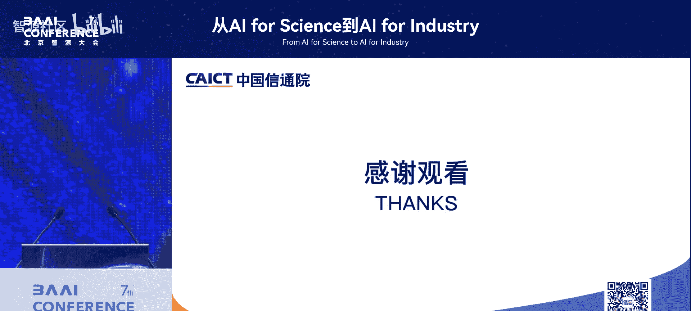

# 2025北京智源大会-从AI for Science到AI for Industry p11 AI for Science到AI for Industry的智能计算发展：栗 蔚 -BV1r7NjzCEGd_p11-

那么下面有请金通苑云大所李威副所长给我们分享。好呃，男秘书长，还有这个冯院长啊，各位我会讲的非常快啊。那么其实呢刚才大家已经分享了很多这个AI science和I industry的这个案例。

那么案例呢，我就不跟大家分享了。那么我主要从智能计算这一块跟大家分享一下，我们觉得智能计算。在这轮的这个s industry的I应用当中它所发挥的一些作用嘛。那么其实整个AI的这个变革呢。

其实不仅仅是算法的一个提升，更多的是我们这个计算范式从CPU像GPU的一个转变，以及我们的整个这个认知的话，是从这个搜索这个呃结果到这个推理的一个找到答案的一个过程。

还有整个一个人机交互的一个这个包括语言的一个不同哈。那么其实我们呢已经来到了这个我们说第三次的这个计算和网络的交融的这样的一个历史时期。之前的话其实大家也经历了。但是可能大家当时的那个这种时代的名词呢。

它不是特别明显。比如说互联网。😊，那么其实就是我们的呃通用计算的计算机之间的这样的一个呃跟网络的互联。那么到现在的话是我们的智能计算的一些呃能力的这样的一个互联。那么它有资源层的互联，网络层的互联。

还有我们现在的智能体之间的啊这样种互联。那么是个全方位的这样的一个互联互通。呃，刚才大家已经举了很多sence的例子啊，但是这个地方的话，大家也都是知道这个这个deepmin的这个靠这个AI。

然后获得了诺贝尔奖。但是呢其实我们很早就研究这个deepmin了。但是我们当时研究它的时候，并不是把它作为一个人工智能的一个平台去研究。我们是从开源的这样的一个角度去研究它的。

因为当时我们把它作为一个生物领域，开源平台去实现这个蛋白质的这个创新的这样一个平台。因为它这个depmand上面其实是一个开放的一个呃协作的这样的一个模式。

所以说我们认为就是开源和这个AI其实它的一个发展也是呃相辅相成的。那么在整个这个sence的发展过程中的话，并不是现在才AI for science哈。其实我们觉得在AI出来的支出。

包括逻辑的这个推理符号推理的时代，其实它就是初衷就是为了去证明数学的一些问题。所以说我们觉得整个这个呃AI的发展其实。对于sense的互相促进是非常重要的。那么这些案例我就不分享了。呃。

在industry这里的话，可能大家分享的并不是特别多，跟大家分享几个数据哈，一个是从这个服务侧，也就是我们的这个供给侧呃，中国的这个AI企业大概是这个4500多家。那么其实这个呃增长还是非常快的哈。

然后那么呃在需求侧的话，其实我们也看到哈，其实在一些这个特别的场景，像智能客服啊，然后这个呃智能推荐啊，然后等等都是产生了非常好的这样的一个呃提升效效率的一个提升。

那么根据我们的这个信通院的对于这个呃AI对于行业的促进的这个IOMM的这样的一个评价模型，就是I的话就intelligence的话，就operation。

也就是说呃我们的intelligence促进operation的这样一个成熟度模型来看的话，从传统行业来看的话，呃，我们的通信行业基本上。😊，是一个引领的一个情况。

因为它不仅实现了自己的一个人工智能转型，还向对外付出。比如呃对外赋能。比如说我们中国移动的9天大模型啊等等。那么在金融行业的话。

像这个工行实现了这个我们的这个呃这个这个呃很大的一个这个这是这种万卡的这样的一个千卡的这样的一个呃集群的一个AI的一个呃大模型，然后还有我们的能源行业啊，还有这个制造业我就不雷述了。

那么一二三产业的这个案例我也不讲了。那么这里的话，其实跟大家分享一个实机的案例，就是我们跟中科院一起做的，大家都知道中科院它有很多的锁，对吧？有化学所有这个这个这个生物所，那么他还有这个重大装置。

像fast，这个大家都知道贵那个贵州那个天眼。那么其实对于他来讲的话，其实以前的时候它都是每个所自己的这个这个超算用的多一点。那么以前的这个数据的话，这个计算，它都是自己所产生了以后再运到那几个。

超算中心去进行超呃去进行计算。但是呢现在的话你包括fast，它的数据是贵州产生的，但它计算有可能去啊在这个呃这个这个呃这个那个江苏。所以说他那么他就需要把这个数据去运过去。

所以说它呃整个这个整个这个呃智能计算的架构的一个转型呢，就是分为三层。第一个的话是在资源层是线下模型，这样一个线象预测的这样的一个过程。再一个是它的系统层的话，其实需要调度它的一个数据的一个呃迁移。

那么其实他现在很多的数据都是说呃在一个地方产生，但是要去另外一个地方去呃进行这个超算也好，智能计算。那么第三个的话就是它的超算和智能计算，还有云计算的一个融合。以前的时候它都是64精度的。

所以它只跑在超算上。但现在的话那么呃由于智能计算的一个呃发展，它又需要把它的任务进行了一个拆分。它任务进行拆分了以后的话，它需要对它的超算呢，它就是一个整体任务拆分了。

好几个任务就比较变成函数型的这样调用。所以它要基于超算去实现这种函数系的这样的一个呃应用的一个范式的一个提升。所以这个刚才我们讲的这个资源层的这种呃这个这个异构的这种芯片，还有这个系统层的调度。

还有服务层的这种任务的这种函数级的这种能力。所以其实是我们现在这个科学计算要实现这种呃利用AI的一个非常重要的一些这种呃架构的一个转变。那么在这里的话，我们可以看到，其实对于计算呃有几个层面嘛。

对于计算架构的话，原来我们的CPU的话，主要就是都是用几指令级去调用它。但是到了GPU时代的话，其实它呃类似于在指令级驱动之上有一层函数。那么这个函数库的话，其实是我们啊去要丰富的。

因为其实我们的科学计算的话，那么其实我们需要的一些这个呃传统的这种科学计算的框架，其实某有现现在很多还是不太适用于跑在这个。😊，GPU上的哈。那么第二个的话就是软件技术。

那么软件技术这里的话主要是说刚才讲的就是不同的这种啊芯片之间的这样的一个统一的函数的这样的一个调度。那么在这里的话，就需要跟我们的云计算结合，产生这种serv类也好，这样的一个云原生的一个调度。

那么从网络上来看的话，就是呃包括从fast到这个呃超算或者计算中心的这样的一个全光网的这样的一个呃高性能传输的网络啊，以及这样的一个流量的一个调度啊等等。那么从这个互联来看的话，刚才讲的，如果调度的话。

就需要我们把这个中科院的不同的这个所的一些计算资源和这个超算资源能够统一的跨域的这样的一个编排调度起来。再一个的话，就从云计算本身来看的话，对于芯片的这个从底层的资源纳管啊，二层的这个调度加速。

三层的这个编排引擎的开发以及四层的应用。那么其实是要有一个整体的一个架构。那么所以说在这里的话。😊，我们觉得还最关键的有个智能体的这个结合。因为其实智能体的话。

它其实实现了我们一个大的任务的一个不同的一个拆分。那么是我们从机模L0像L1和L2场景这个生化的一个非常重要的一个枢纽。所以说在sence这样的，我们认为一个垂直领域的话。

其实我们是需要一个呃几个不同的智能体之间去相互协作的。那么比如说我们的有的智能体是需要调度我们的一些呃这种生物的一些技术，或者呃数据去进行一个训练。

那么有的其实是需要这个呃天文的一些数据去进行一个推理啊等等。所以说在这里的话，虽然MCP实现的是我们的智能体和不同的数据库之间的打通。但是不同的智能体之间的话，虽然现在也有google的A toA。

但是我们认为在sence这个领域的话，我们包括很多的这个垂直领域的这个智能体之间的这样的一个互相的通信的协议，那么还是需要去进一步做这个互联互通的。那么更好的支撑我们。

这个AI for science的这样的一个发展。那么所以说最后的话就是说呃s到这个indu，我们觉得它其实是一个呃嗯这个两就是同步进行的。那么一个是的话就是丰富这个AI的一个应用。

第二个的话就是产业和技术的一些结合。刚才讲的，不管是我们的这个软件的还是这个智能底层技能芯片的ag的等等。第三个的话就是从这个AI呃数呃科学的这个发现到商业的一个价值。

那么第四个的话就是行业的一些数据的一些这种优质资源的一些创建啊等等。嗯，最后呢跟大家分享一下，就我们中国信通院在这块的一些简单工作哈。

一个是我们构建了一个全方位的这个企业的这个这个用AI的这样的一套标准体系。那么不管是s也好啊，这个这个通信还有这个金融啊能源啊制造啊等等。那么从底层的我们这个基础设施到这个数据到模型，然后研发运营。

还有我们的agent还有上层的应用。那么。😊，构建了一套这样的一个啊标准体系，去帮助我们的AI更好的就是落地我们的企业和行业。那么再一个的话就是对于有很多的这个呃呃垂直行业或者是传统行业嘛。

我们也是提供了很多的这个呃咨询啊，包括一些赋能的一些工作。以上的话就是我的一个分享，谢谢大家。

