# 2025北京智源大会-从AI for Science到AI for Industry p12 产、学、研共筑AI开源生态：杨 建 -BV1r7NjzCEGd_p12-

最后呢我们有请浙江大学杨建博士给我们分享AI开源生态。嗯。🎼那个。能听到今天这个是以个人身份来讲，不是以企业身份讲先声明一下啊。就是说呃今天些题目是产生呃AI的这个开源生态。为什么讲这个题目？

实际上和整个的A science到AI for industry呢是非常相关的。但实际上我认为我们那个资源这边呢把这个题目讲小了。我不认为是AF industry过后讲一个概念。

这这个概念是我去年提出来的啊。😊，我我们可以用更大的概念来讲。😊，好，那过去几年最重要的几个 science的发展。我们看这个manman其实是这样的，他做的东西不多。

但是每个东西的deman出品呃出出现一个东西都是精品。就你可以这讲所有 science的只要是了全属精品可以记住这句话。但是这里面其实有一个我觉得它不是特别好的一个东西。

就是阿尔法谱阿法里面文章一直受到质疑，其他的我认为它都是非常好的。特别阿阿这个我接触到阿3开源的呃，第二天我曾经收到过至少上百个这样说要去部署阿这样的一些要求。

所说整个可以看到阿法就是他会做很长时间去深挖一个专题，把一个专题做到极致去然后去引领一个非常小的一个整个的一个sence的一个发展。这是deman的一个啊。😊。

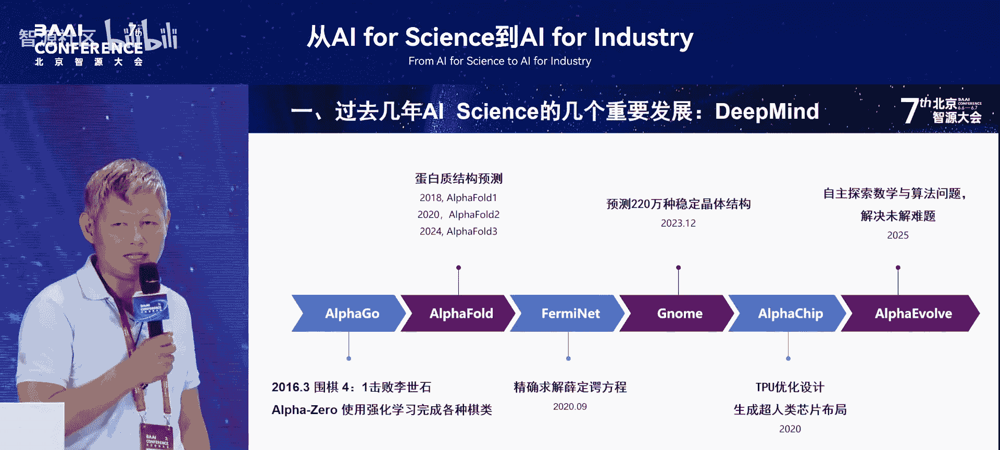

我们再看另一个它大部分开源的呃，中国这边开源的力量呢呃最主要的最初的就是一个在就是M他们用100亿个这个1亿个这个呃水分子的一个模拟，他们最近呢已经扩展到材料力学生物力药物研发。

还有这个能源大概有60多个不同的 science的整个的一个训练的任务和推理的任务。呃，那还有一个就是过去几年中国另一个比较重要的一个发展方向。

就是 science science其实它涵盖的范围也挺广的，就是从呃一些流体工业啊制造材料气象地球科学等等，包括生物实际上他刚才刚才有人讲的就是与数据驱动和基地驱动两种都支持了。

说它更广泛的就是说把传统的这个s和完全结合的，不是一个的一个场景。我快点讲啊，呃那那其实我过去几年呢其实接助了非。😊，非常多的Fs的场景啊，这是我接触的呃一个简单列表。

从基因到分子到呃蛋白质到生物制药等等。那其实呢呃每一个场景它输入是什么，输出是什么等等。其实这个是不够。实际上在一个真正的一个药物研发和基因一块材料里面。

实际上它F science实际上是在中间占据大概10分之1到10分之2的一个地位，其他都是还是传统的计算为主的这是一列举。😊，那机器列举呢，其实还有一些包括医学影像处理啊，包括机器学习啊、材料啊。

化学气象，其实很多都讲，还包括流体地学啊，非常多的一些领域。这是我过去几年接触到的。😊，Yeah。呃，每一个都呃做了一些初步的一些就是实验啊。那实际上我们在看整个这个呃 sense和大模型。

包括AA有什么关系呢？我们看一下一个大的一个发展。我认为说一个特别的发展就是大模型平权是怎么来的。我们看下看美国星机智门。美国星机智门想干什么呢？他想打造一个什么什么东西呢？

他想打造一个说哎我我像人的自动驾驶一样，我未来的整个企业或者科学家甚至说我一个工呃我一工厂的一个流程控制师或者个排产的对吧？或者说我是一个董事长总经理，他都不是人了，他是虚拟人。

他al就说我人就脱手去管一个企业全部全部是有大模型来进行一个控制的一个企业。那目前呢他大概走在第三层和第四层这样一个就是智能体或者创新者这样一个地位。

他每每每个月的这个co大概是说2000美元10就00亿大概有两个任务吧。😊。

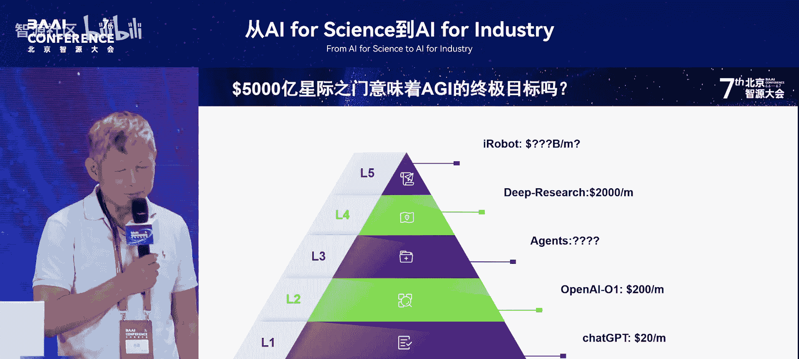

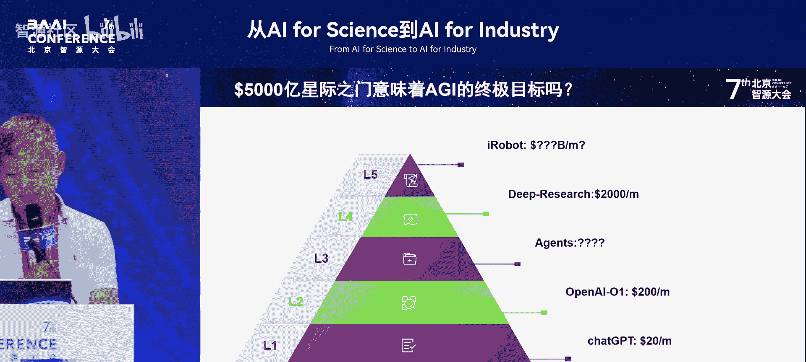

差不多就要花2000美元这样一个东西，这是这是新机制们要做的一件事情。我我认为他一直在往这个方向去努力啊那中国的这个开源的时候的deep出来之后，哎，我我们人用V3没有钱。

但是但是切GP的整个的对标O的话就要20美元，我们用200美元的时候，R one的时候呢，每个月我们也是很多时候我们就是零0元这样子用了，对吧？啊。😊。

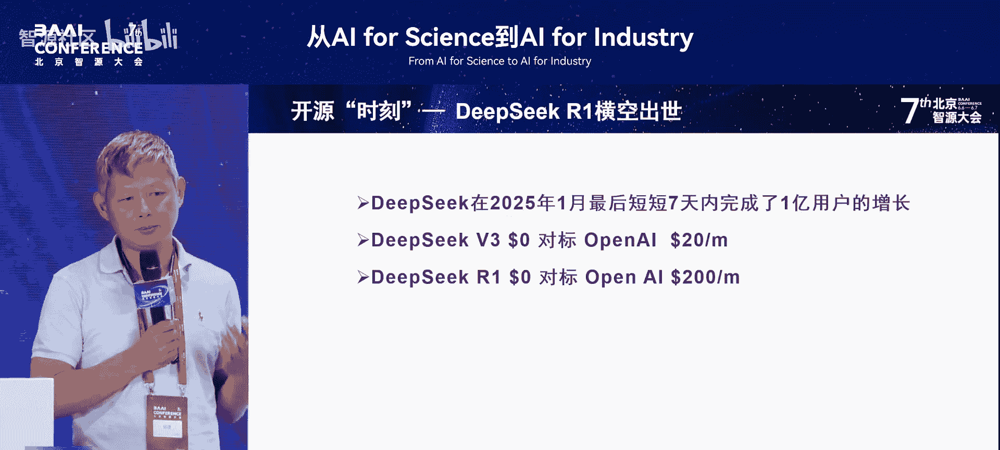

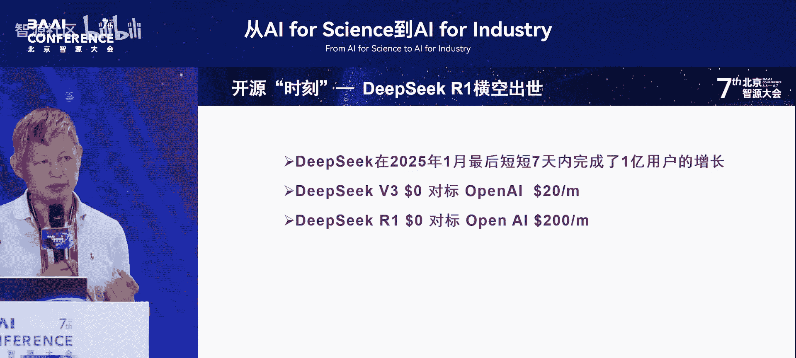

那的下一代就是R one的下一代到底长什么样子？可能是在O4这样一个水平。那下一代它模型会变大嘛？我们也不知道它也可能会变大了4倍，也可能变大10倍。这都是我今天不知道一问题对这是有的话。

但是它整个的在发展是一个开源的一个时代。它开源之后形成了一个大模型的平权，这不是一个这个不是一个核心的西直接跳跳快点就是说我直接跳到我过去几年思考最大的一个问题就是我们看到说为什么在其实在出来之前。

为没有大模型平权实际上呢在大模型落地是非常慢的有了它提供了两个东西，第一个是真的我便宜对吧？第二点提供什么主后续方法。刚才有人讲过了后续方法意味着什么呢？

我可以用后续用非常便宜的成本万分之1成千分成本我这一个特定的小预我可以产生一个博士水平的一个小个模型，这非常关键。😊，那有了这个之后呢，我在推理阶段呢再利用一个叫推理的就是我们后面一个。

在第二个说哎那我有了这个博士水平的模型，我用了足够的一个算力，我就可以在很短的时间去解一个什么问题的一个工程问题一个设计问题。比如CD设计，也可能是一个流程流程的一个设计。比生产流程的一个设计问题。

也可能是我们呃比如说我们整个的这个呃各种各样我最佳的一个这个比如说呃混混凝土搅拌的问题，真的我去过去过那个工地啊，就是那这时候就说哎这些我用了算力，我很快就能让100万个博士同时来解题。

那这时候我就意味着说哎我能够有这这一页是我最核心的一个重点的一个意思来表达。然后再得出我的结论啊，那最后说唉。😊。

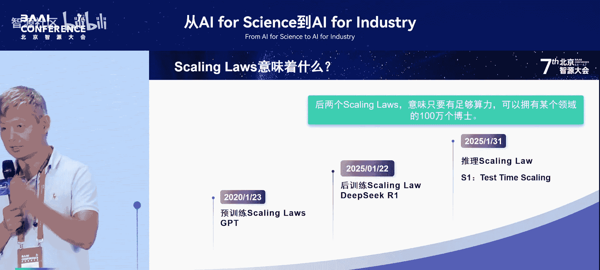

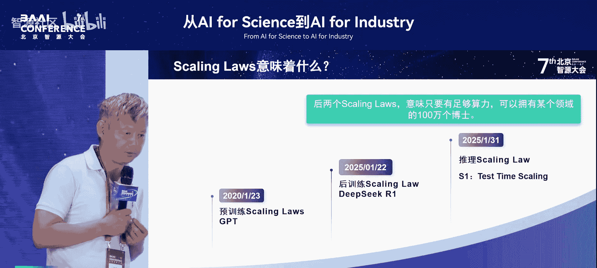

那那我就可以讲很多个领域，比如说我们北大，我们北大有30个专业是非常强的。我北大可以尝生30个自己的专有的模型去解决我的问题。那我有一个公司呢，我可能是做农业的，我可以做一个农很多个农业专业领的模型。

工业也一样，其实你可以从教育到工业到商业，到农业都可以到航天what到信息业都可以做。我大家再讲一个例子，说有了这个之后呢，其际上今天已经带来了时代非常巨大变化的一个时代。我给大家展示一个实力。

这个巨带非常非常大的一个变化。那那在这个时代已经到来的时候，我们我们整个社会缺什么。就是我今天讲的主题，其实讲的是我们整个社会缺什么我们社会缺的是什么东西呢？第一个是优质算力。

第二是海量的开源的应用资源。第三个是大模型开发者。我先讲下为什么我们没有大模型开发者，其实在过去从22年到24年中国的创业公司死掉了多少99%非常重要，为什么死掉了？😊，第一个是因为疫情，我们没钱了。

第二个是因为美国人要求美元全部撤出中国，投资全部撤出中国。所以说我们很多公司没有融资，然后没有钱，没有项目，然后就死掉了。真的有很多公司的人，他就是我们我们知道就说在一个企业，当你死掉之后。

最后还要交这个实交注册资本。😡，干嘛卖房子注交资呗，这些人他受伤了，他就回到大公司去了。所以说这个产业实际上到24年的时候，这个产业是在下滑的。但带来了一个新的活力，我们需要增长。

但老一代的这些创创业的人他死掉之后，他不愿意再去创业之后呢，实际上这些人要新的一代人才能来创业。整个生态才能发展，整个社会才发展。这非常重要一点。所以说我们缺的大模型开发者，我们需要缺多少呢？

我们到我们测算我大概到29年我们需要全国需要1000万人来做大模型开发是这么一个量。😊。

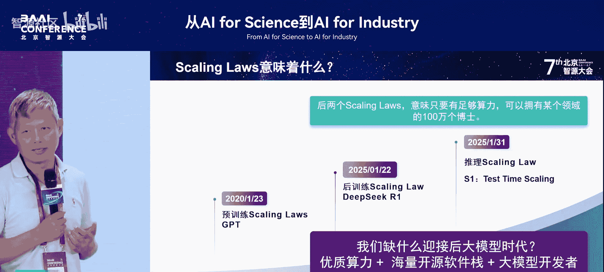

好，那我们我我我为什么讲刚才我们讲那个我们讲F industry这个题目太小了呢？其实我和很多企业聊过这些话题，就是在24年之前，我们都想找一个我企业怎么真正的去落地一个AI实际上找不到，为什么？

因为我们前就做一个问答模型是最多的。24年之前大部分问答模型，你问我答，或者做一个客服，你问我答这样的一个东西，对吧？但是呢譬如说我们在商飞的时候，呃，我在设计里边，其实我我要100个国家能拿到市行证。

这每一个国家市行证是长得不一样的对吧？那你怎么证明说你的这个你的这个所有的材料都和那个国家适行证是要求的各种各样的材料。啊，那这时候我就需要说哎我我如果是人去做的话，一个国家做下来，啊。

平常能够把它做完的人基本上是要求8年左右的一个工作经验才去这个团队去做。但是我怎么能让我新进来的工程师，我新毕业的人能够在完成利用大模型从6个月时间变成8。😊，公司这个水平呢。

其实我们认说FO我我提了一个新的名词叫AF engineering就工程工程就包含了很多，就不只是这个这个F industry了。这是我去年提的一个概念啊，这个是非公开场合题的。今天第一次把它提出来。

那这个里面我为什么为什我我觉得这个工业太小呢？我就让大模型说你有多少个设计的行业，因为我那个呃博士是做那个CAD和CD的，所以对设计比较敏感，那他就我讲这么多不同的一个设计领域。

所以说这设计领域不一定是工业，它都可以完成。为什么呢？其实任何一个设计，我们都可以看成一个自然语言和一个程序语言的一个结合体，对吧？那编程今天已用大模型替代了。

其实CD任何你找任何1个CD所如说你设计一个这个汽车的零件的有机械CD你或者设PCBD或者你设计一个房间的这个装饰的CAD它都是CD对吧？CD实际上这是一个自然语言与一个另一种不同方式的一个表达而已。

这种表达实际上都可以用大模型的。😊，但为什么不热门呢？不热门，是因为程序员的数据太多了，公开数据太多了。这些私有领域，我们找一个设计院，这个设计院有大量大量的领域，比如建筑设计院头有大量领域。

机器设计院大量领域，对吧？那这样就形成一个新的一个领域。所以说我定义了这个AFO呃一应这个标题。😊，好的，那我举一个非常举例子，为什么说这个时代已经到了？这个例子非常典型。

这个例子震撼了我这是一个工程师三个星期的结果，他三线结果值多少钱呢？我们看一下他最高的时候把这个性能提升了6。5倍以上，实际上最高有个30倍的性能提升，就是每一个算子它总共是94个算子。

这94个算子呢如果是用一个在美在中国的话，大概是就是差不多6万人民币或者在美国他差不多要2万美元一个月这样的工程师呢，这些算子要做下来。我刚才测算一下，大概需要400个人月，也就一个月。

如我们折算成100个呃一个人一个人就是所有的工程师做下做完之后能做到400个人月。但400个人做不到这一点，是因为这所有的算子以前都是优化过的，全是被人优化过的，而且世顶级的工程师优化过的。

也就是说那些400个人的顶工师优化完之后再被大模型再去优化。那如果让这些工再让大模型。😊。

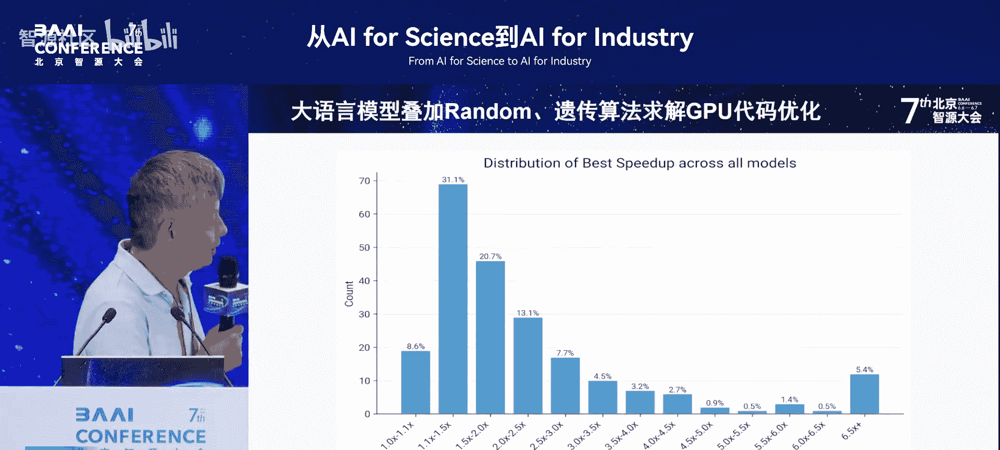

工式优话可能再加10倍的工作量，也就是说要4000个人月，而就是4000万美美元这样的一个成果。但是一个人利用计算机利用了大模型叠加了讲吧？

推理再加一团算法就解这个问题这个际上工程领域有很多问题是确定性的的原理是一模一样的这是你的只是你的领域不一样而已。这是一个所以说这是个非常大的个时变革。在这时讲缺们缺人才我们怎么做呢？

以说我们需要开源我们看过去一年整个开源的的全世界是一个非陡峭的那个左上角地方我右上角后我们再看一下这个过去开源的这个发展。

你看到过去开源非常的密随找了10个这10个里边实际上华人占了一半一样工作量但你看起来整个下来的话就说量是。😊。

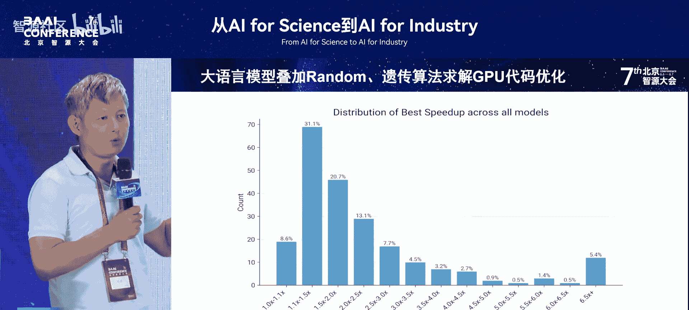

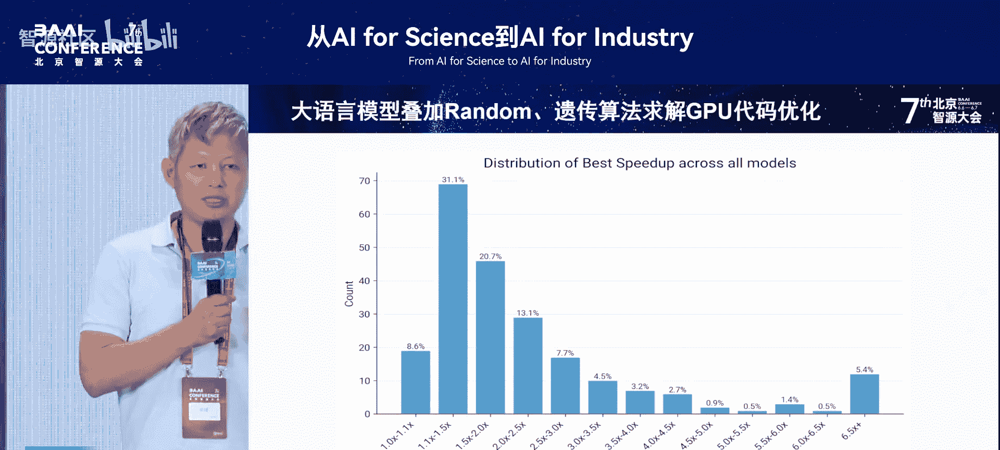

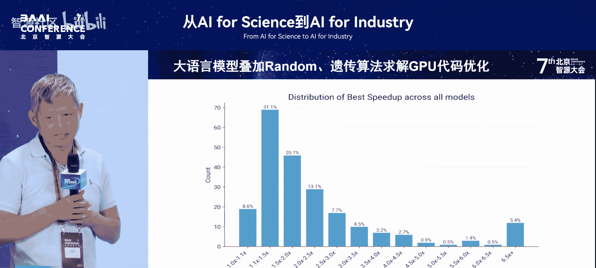

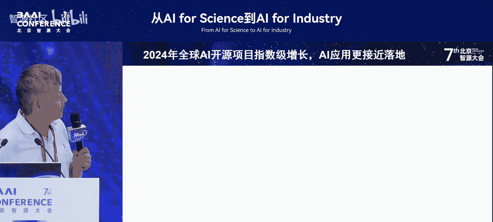

近2万次，那就意味着说实际上在这个团队里面大概会有呃差不多，我们看一下是1200，那将近呃15的话，差不多是呃18000个工程师的一年的工作量在拍到席下啊，这么一个情况。😊，好。

这是一个呃开源一个另一个工作。我我去尝试了一下，就是复现了一下就。那本来op呢是2万美元一个月这个那我用 research这个东西去试了一下我们自己建了一个每次一分钱啊。

每次是一分钱这样的话一次算下来是1就是一块钱算一次啊，那就完全就颠负了我们去用这个这是开源要讲开源的力量啊中国的开源其实我一个新的一个历史我们就不讲了，我们快速跳过去啊。

那其实我们还有其他一些比较好的就是我们呃全世界其实to部署最多的不是那个阿里的啊上海要星城。然后最近开源非常好的一个那个模型加进来那么我们这样的话为了去培养大模型的开源的整个生态去培养整个大模型的人才。

我们认为到29年我们需要在高校里面。😊，100万这样的大模型人才做。所以我们有一个这样一个组织呃，是由这个王慧明院士啊亲自来抓这个整个的事件。上次那个呃。

那个呃梅红呃呃院士呢亲自这个呃成立大会是这个3月12号左右啊，我记得不太太特别清楚啊，他有他有这个学术界的有这个呃企业界的，还有这个互联网等等的，都有啊，还有大模型公司的合在一起，从大模型啊。

到芯片到这个生态，再到所有的应用合在一起去培养整个所有的人才啊，是这么一个体系。啊，那他会有什么呢？还有我们整个国家的这个呃通管的开源协会的这个朱其刚啊等等。那整个下来就是说他需要从什么呢？

第一个从大模型的通识课，我们大学就要上大模型通识课啊，每个学生每个人都要上。然后第二个是大模型的开发课，有一部分上，不是所有都上。那还有一个就是这样的话形人才的培养。第三个呢就是说他还一些论文。

就是他毕业论文也可以以开源的方式，然后去展现。那最后还有一点就是所有的这些东西呢，我们还有比赛的方式。然后再加上最后一个还拉了一些这个投资界的，这里面还有投资界的，比如说黄金金属投资界的。😊。

有投资界业的一些人来投资他们，也许会新新的大明型公司成个一起的产学缘用，合在一起，包括投资一起的一个整体的一个生态啊。好的呃，最后一页就是上面一页的一个具象。那我就不讲了。呃，好的，那最后时间也到了。

嗯，谢谢。😊。