# 2025北京智源大会-多模态模型 p02 主题演讲：国际嘉宾 -BV1zfNxziEfo_p2-

Hello， thank you very much。 So you can start。😊。

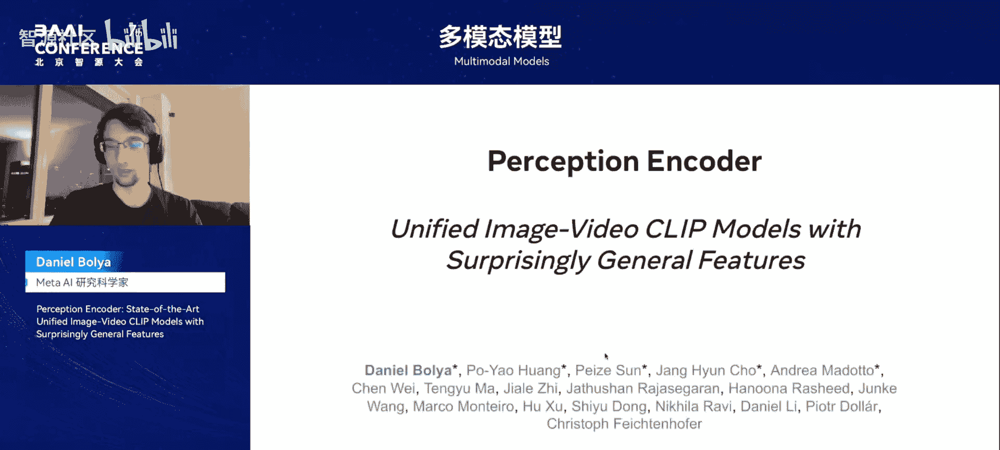

Okay， yep， and as was discussed， I'm Daniel Boyer and I'm going to be discussing today our work on unified image and video clip models with surprisingly general features。

And so this is line of a work that we released just around two months ago。

 and we get some very strong results on a wide and variety of computer vision tests。

 so I'm very excited to share this with you today。

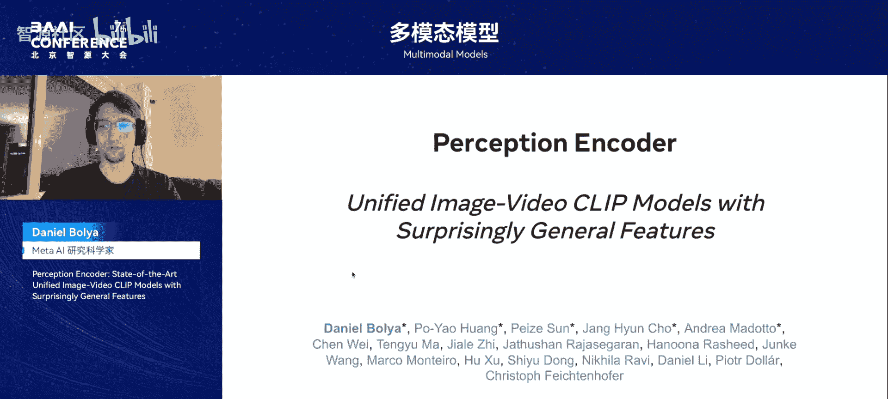

All right， so starting very quickly， let's discuss sort of an outline of what I'm going to be talking about。

And perception encoder is split into three main parts， the first being the core model。

 so this is the base model that we base everything off of。

 that is a unified image and video clip model trained with a large scale contrastive pretraining recipe。

And so here this model， we first pretrained with images and then we extend later to videos to create a unified image of video clip encoder and it's actually state of art on both zero shot image tasks as well as zero shot video tasks for clip models。

 so very strong there。But then we actually look inside of the model and find that intermediate features of the model have very general features useful for several downstream tasks。

Even downstream tasks that clip models are usually not so good at。

And so we use this fact to construct two additional downstream vision encoders。

 the first off being P language where we align P core to a large language model in order to solve multimodal language modeling tasks such as OCR Q&A and captioning。

And additionally， we align the base P core model to dense prediction tasks to solve things like semantic segmentation and tracking with P spatial。

And overall， with this family of three models here， we're able to get a very。

 very strong performance on tons of downstream computer vision tasks。

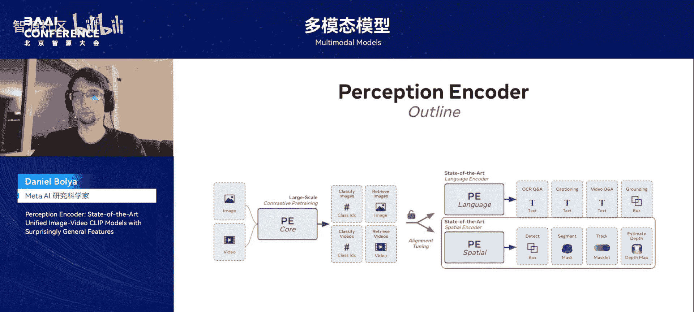

Okay， then let's get started with P core， which is， as I said before。

 our unified I and video clip model。Now， if you know a thing or two about clip is that it's very data hungryung。

 so you need a lot of data to train a clip model， which is fine for images where we have a ton of image paired image and text data available on the internet。

 but it's very difficult for videos because we don't have nearly as much paired video and text data。

So the way we tackle this unified image and video encoder is actually by we first pretrain with images only with a very large scale training recipe。

And then we use that to bootstrap a data engine to construct a video captioner that can generate aligned video captions for video clips。

 and then we use that to find tune in the clip model。

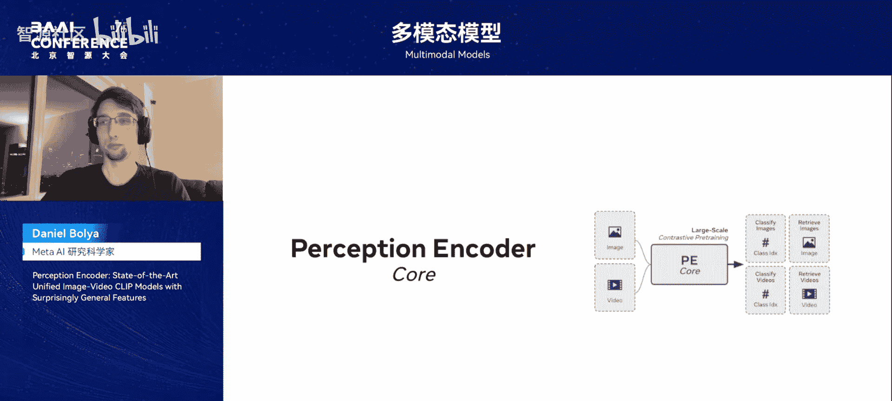

So in more detail， first we have what we call the robust image pretraining step。

 which we try to train as much images as possible and try to extract sort of as much information as robustly as possible from a fixed set of image text data。

So here this is sort of ablation we did in the paper and you can read more details about sort of each line item that we used。

 but for this ablation， the main thing to know is that we started with a baseline VITL open clip model。

 so this is just a very vanilla clip training， nothing changed here。

And then we ab on a fixed set of 2。3 billion images image text data curated with meClip。

 so here we're actually fixing the data and trying to see if we can increase the robustness。

 so here we track in this specific figure we track the imagenet validation performance in the background。

 but also the robustness as sort of an average of a standard imagenet robustness metrics。

And we can see that sort of each of these changes are very small on the surface。

 so things like just increasing the batch size of pretraining or adding rotary position embeddings。

 so these things are actually very small tweaks， but they add up to quite a big improvement in overall image and accuracy。

 zero shot image accuracy， but more importantly， they add up to a very large improvement in robustness on like a bunch of different downstream tasks。

😊，Which is sort of an interesting takeaway because usually you imagine generalizability and robustness being something that you need more data to fix。

 but it turns out when you have this sort of web scale data。

 you actually need to carefully tune your pretraining recipe to learn as much as you can from this data。

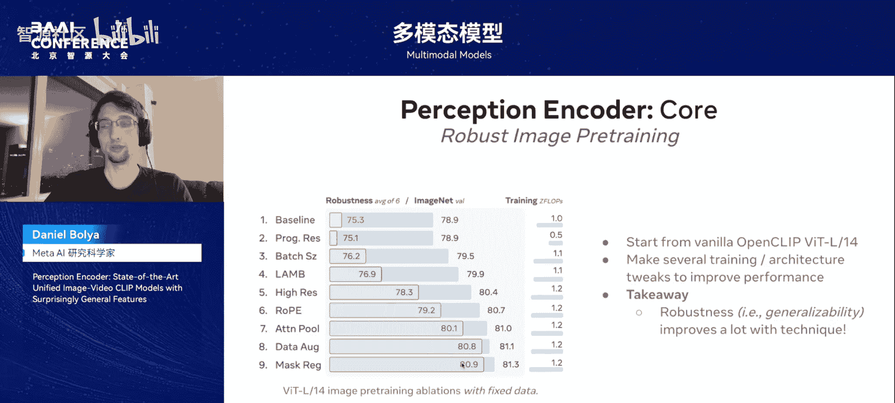

Okay， so now we have this sort of very nice image clip model。

 we then extend the clip model to video by bootstrapping a video data engine as I described before。

 so here we use our image only or early version of our image only P core model to construct a video captioner using a downstreaming LLM。

And then we sort of iterate this with a human in the loop to sort of iteratively improve the video captioning outputs and build it into this sort of very involved data engine that results in very well aligned captions to a given video。

 and we specifically one of the important points is that we specifically engineer this data engine to work well for clip tasks。

 for instance， like the prompt that we give to the LLM is specifically to summarize the caption in as few words as possible。

 for instance， because CP doesn't benefit a lot from long captions。

But you can read more details about the paper and sort of how all these components fit together。

 the main takeaway here is that we end up fine tuning on a small set essentially 20 million videos that we annotate exclusively using this data engine so all of the data for videos we synthetically annotate and we then fine- tuned the original image only model on those videos to create our final unified image in video clipwa。

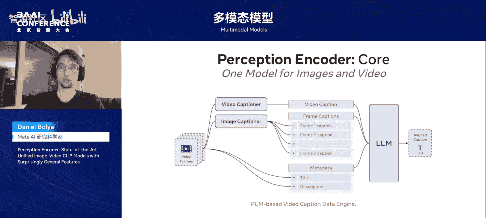

And now let's get into some numbers， so there's a big wall of numbers。

 these are the standard sort of image image level zero shot clip of benchmarks。

 so things like zero shot classification with imageed data sets。

 zero shot fine grain classification and zero shot retrieval and across the board P Cor at all model scales is able to outperform the prior state of art which was released just one month before our work was released Sip2。

And importantly， theres some data sets where we get significant significant gains， for instance。

 like on traditionally harder data sets for clip models like a countryry 211， which is like。

 guess what country you're in of 200 countries given an image。😊。

We get like 14% improvement in zero shop performance over the prior state of art in this task。

 so fairly large gains in a lot of areas。But notably a lot of this performance improvement was due to the video fine tuning。

 so if we compare our image only model to the video fine Tu model。

 we find that actually the video fine tuning helped image performance a lot。

 especially for retrieval。So that really goes to show the benefit of having joint image and video model as well as our video data engine。

All right， then for video results。These are similar video results for zero shot classification and zero shot retrieval。

 and here we compare to Intern videoide two， which was the prior state of art for video clip performance。

And interesting enough， so Intervio2 is a full temporal attention vision encoder。

 so it sees all the frames at once while PE core is actually only frame level。

 so we encode the images separately and then average clip embeddings together at the end and despite that we're able to outperform intern video2 on classification and get quite close in video retrieval。

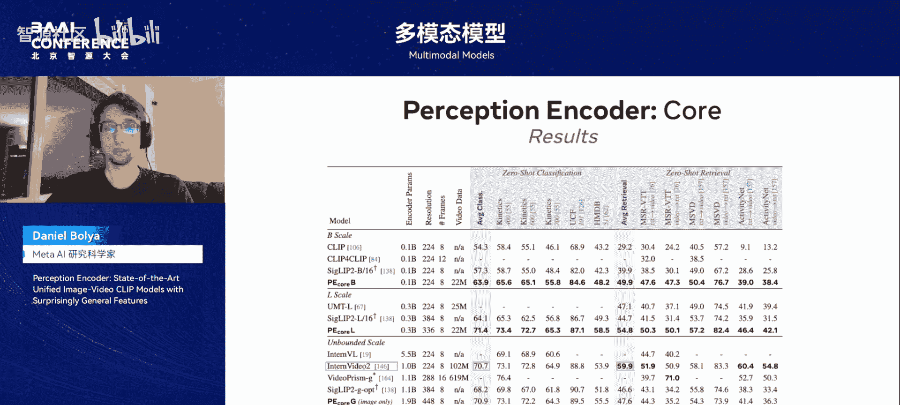

And this is all， of course thanks to our video fine tuning。

 of course otherwise the model doesn't get even close on retrieval。And of course。

 compared to another image only model， which is S2。

 we significantly outperform despite still being a frame based encoder。But okay。

 so we get some great results on image zeroroshot classification and retrieval as well as video zero shot classification。

 but these numbers of course numbers aren't telling the full picture so what does this model feel like to actually use so this is a clip model let's vibe check it。

😊，So how do we actually check the vibes of a clip model， well clip can do retrieval fairly well。

 and in fact， a search engine is basically just retrieval， right？

So we can build a search engine for images using PE core and then see what sort of images we get if we do some text searches。

So the way we do this is we take a database of a couple billion images without any metadata。

 so just images。We passed that through the P Cor image model。

 so the image tower and get back a list of a billion clip embeddings。

And then we do the same with our query into the text tower。

 and then we basically search the big database of images using our clipping bags。

So how does P Corre fare in a situation？Well first， just a simple prompt。

 something very canonical trees with a blue sky， I'm sure the original clip should have also done fairly well on this as well。

 but here are the results that P Corre gives and here I'm showing like the top results or like within the top results and I'll mention that when it comes to it。

Okay， so fairly canonical trees with a blue sky， P coreps is able to very easily retrieve those images from a set of  two billion total images。

Okay how about trees with an orange sky， so some slightly non canonical example。

 and here's what we get for that and it seems that yes pe Cor is able to retrieve trees with orange sky as well。

😊，Okay， but maybe that was a little bit too simple。

 let's maybe change it up a little bit how about the lone tree under a blue sky。

 so we're actually looking for a single tree with blue sky。😊。

And here's what P retrieves， I think this was like the four of like the top six。嗯m。

And here P Corre gets the idea that you want just a singular tree， you don't want several trees。

 and importantly I want to stress in the bottom right corner that tree in the background is like very small and usually clip models can't really identify very small details。

 however P core we noticed does very well at that。

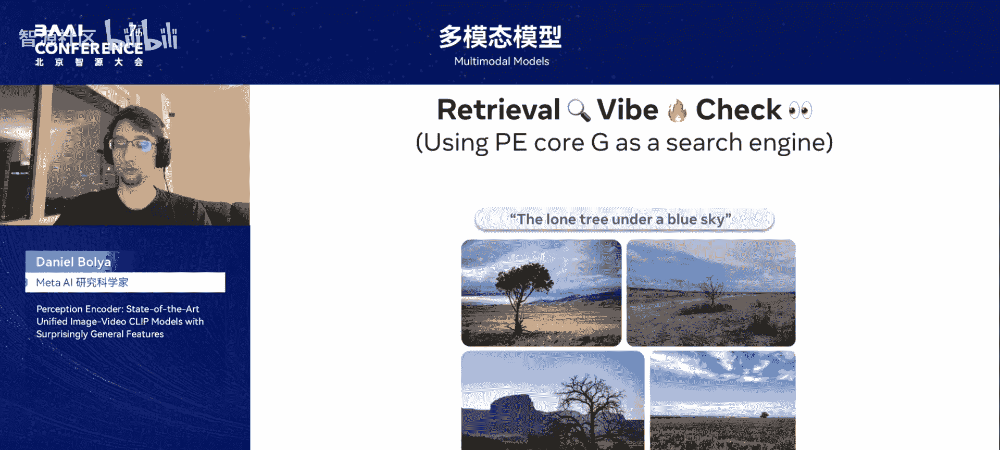

Okay but that is simple for a clip model how about something that clip models are known to struggle with。

 for instance a painting of white trees with red sky in the background so clip models are usually sort of they confuse like the adjectives that you use so like it would switch white and red here and give us images of the reverse so let's see how clip faires orP core fares on this task。

😊。

And here are the three of the top five results， and immediately the first the top result gives us exactly what we want。

 light trees with red background， and of course， it's a painting。

And the next two are sort of more impressionist， but they sort of still give that picture。

 and of course， there's only a limited sample of this type of prompt that exists on the internet。

So altogether pretty good， but those were just landscape paintings。

 how about some queries that we would actually care about for daily use。

 and of course we want to see a happy dog right this is what we want to see in life actually。

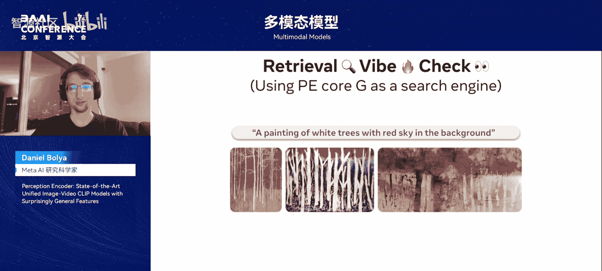

And so P Cor can give us happy dogs， that's an no braininer。

But what about something more subjective like a cool dog？

Let's see what P thinks a cool dog looks like， and these were among the top results。

嗯。I think I agree with the models those are pretty cool dogs。

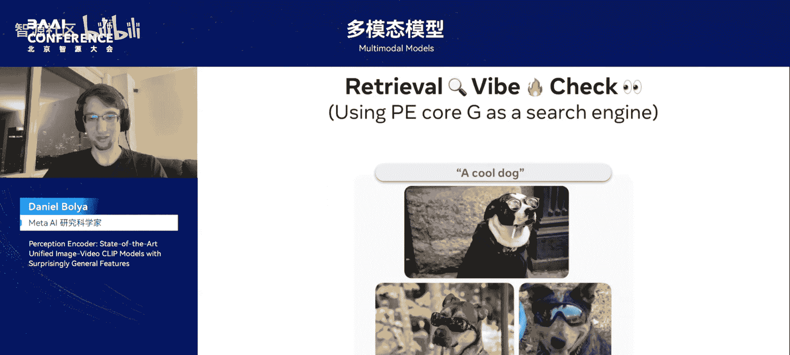

Okay， but how about some little bit of action， how about a dog sniffing the camera。

 so I think what we expect here is like a dog being up close and personal with the camera and giving it a sniff right？

And this is what PE retrieves and turns out there's actually a lot of these types of images on the web。

 so P retrieves quite quite a few of these images。But okay。

Let's switch out over to cats now because dogs are maybe a little bit less fun。

 so here's a cats wearing sareros so these were among the top results and I was able to find more images than Ds in the data set。

😊。

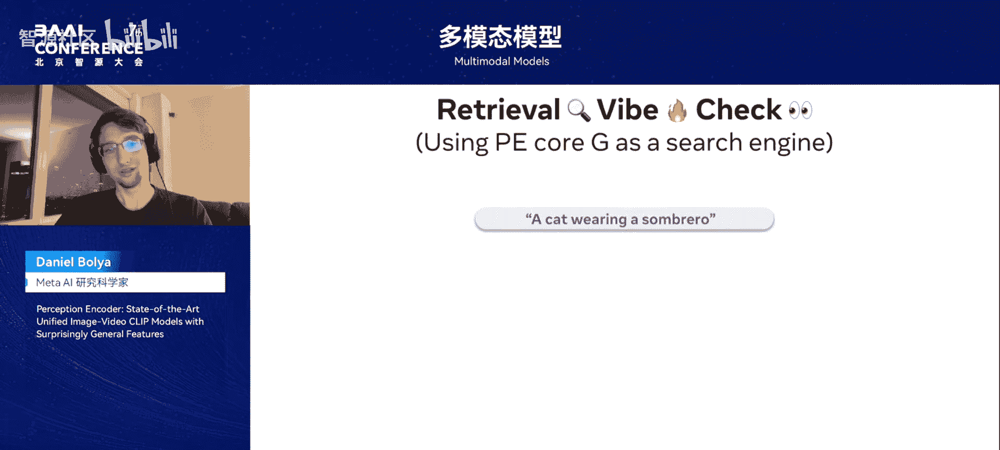

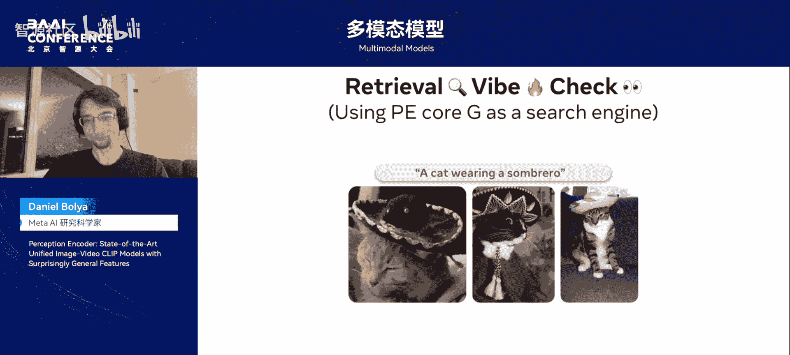

Here's maybe a simpler query but this hints out some ambiguity， so I search a cat standing。

 but when you think of a cat standing you expect maybe it's standing on its hind legs but what pe returned was a cat standing on four legs so the canonical image of a cat standing up so what happens if we actually specify in more detail let's say a cat standing on two legs and turns out that's exactly what we needed it because pe core just retrieves a ton of cat standing on two legs。

Okay， but clip models you expect them to do well on sort of more fine grain tasks。

 so enough of dogs and cats how about an Allen's hummingbird， which is a type of hummingbird。

And of course I can recognize these and I went and checked and this does look to me like Alan Summingbird。

Maybe that's a little bit boring back to cats， about a cat with laser eyes。

And actually there are way more images of this than I expected。

 P core is able to give you cats with laser eyes。So what about a cat giving that look。

 you know that look， the one where it wants food， because this was the query that I gave to clip or not clip but the R P core clip model。

And if you have a cat you might know the look and these are literally the top three results from the retrieval。

 so I think PC Cor understands quite a wide range of topics。

Okay but enough playing around let's do some more advanced query。

 have a Canadian food truck which is a fairly complicated thing。

 it does retrieve a bunch of food trucks， these are five of the top six。

 but how do we know they're Canadian so let's take a closer look and turns out all of these food trucks are Canadian so the top one top left one has an Instagram handle for Toronto the top on the right one is a Putin truck。

The bottom left one has like a Canadian website link I don't know how the model found this but in the bottom middle one。

 it has like an inverse website link with a dot CA at the end and I checked this image is not in the training data so I was very surprised when I saw that it was actually getting these。

But maybe that's not too surprising given that it's like they are on a wide margin for identifying countries。

 so maybe there's some background information that may identify this as Canada。But okay。

 I think that maybe enough of that， I think the vibe check we passed it。

 and of course I gave a little search about CA giving a thumbs up and it was able to find this singular image that we had in our set。

Okay。But that is just clip performance so P core works very well on clip and if you have any use for a clip model please go check it out and use it。

 it works very well， but that's only you know classification and retrieval those are tasks that are useful but not really what we were focusing on with computer vision and multimodel。

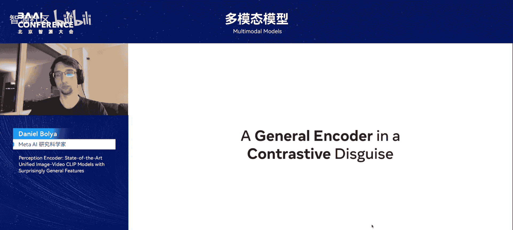

So how does this do on more general tasks here？诶。What I'm showing here is the performance of to three separate models across different layers of the model。

For different tasks for language modeling so here I'm showing AV2 which is a model pretrain with captioning DynoV2 which is a model pretrained with spatially self supervised loss and a PE core was pretrained with global clip loss and so now a PE core is just a clip model right you don't expect it to do very well on like dense tasks and those sorts of things。

So here with language modeling， as you might expect。

 a language model that was pretrained with captioning only with an LLM on top should do very well for language modeling and it does so P Avy2 of what we tested does the best here for like OCR Q andA and。

Viigual Q& A and DnoV2， as you might expect， if you've seen the model before。

 I think it's like the pretty common result is that the OCR performance of DynoV2 is not so good。

 but the grounding performance is very good。 So among these models， even through an LLM。

 the grounding performance is the best。😊，But P corere， on the other hand， does something that you。

 you know， maybe clip models are okay with， but not sort of on this level。

 it actually slightly outperforms AB2 on OCR Q&A and gets very close on the other metrics。

 but at an intermediate layer of the model， so not at the end of the model。

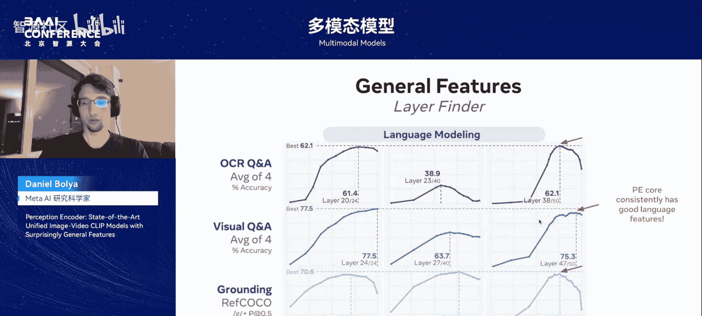

And we repeat this analysis on spatial tasks like detection and ps tracking and find that we have a similar situation now AB2 is not so good。

 DynoB2 is super good， but again， P core is able to do well with intermediate layers on all of these tasks。

So this is surprising because clip models， especially for things like detection and sort of segmentation tasks like tracking。

 aren't usually regarded as sort of the best model to use。

Um but one thing to note is like even though there are intermediate features of the model that work very well on these tasks。

 P core is not outputting them， so the output， the final layer of the model is actually really bad of these tasks。

So okay。You can see we actually analyze this further and see why this happens in the paper。

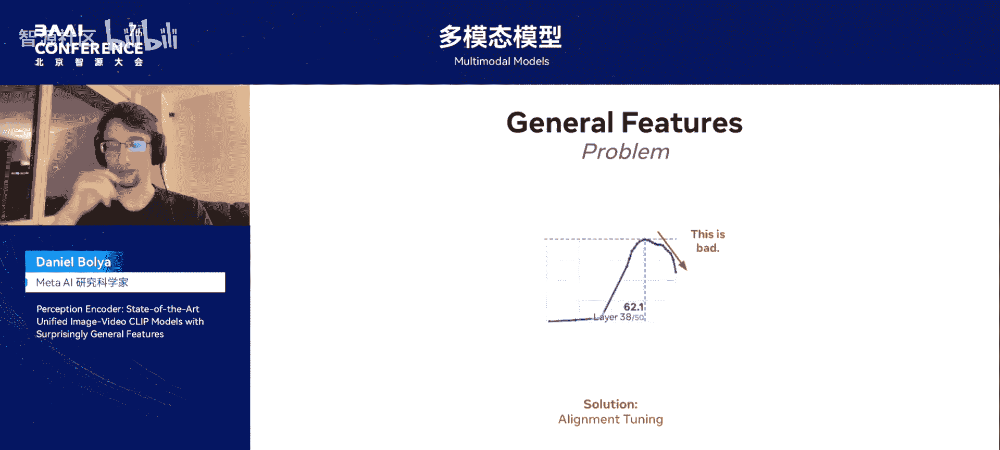

But with the time I have left， let's talk about how we actually address this problem to create two additional vision and colorsors。

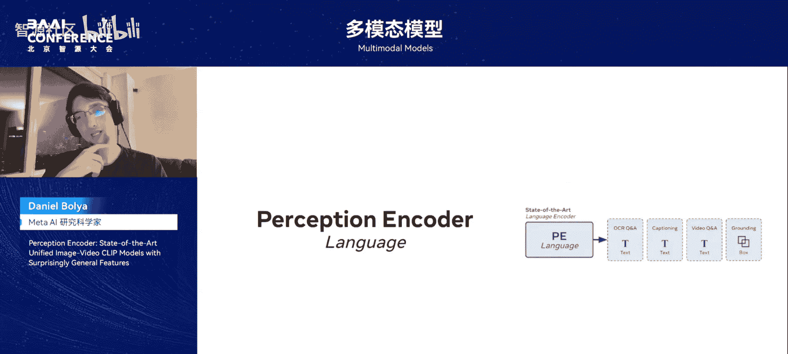

So first up is P language which we align to a language model。

 so basically we see that the P core which is this light line here。

 you know the performance falls off as for a ton of language tasks as the layers progress in the network so what we do is simply fine tune with the language model on top and then here we throw away the language model we just keep the vision encoder and retest that vision encoder on language tasks。

And with a carefully tuned recipe， we're able to get significantly improved performance on all of these language modelding tests with the best layer aligned to the output。

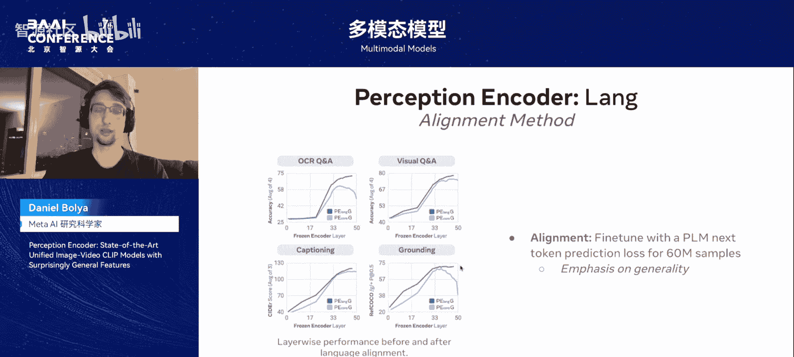

嗯。Some results here another wall of numbers， all you need to know is that among sort of the standard language modeling vision encoders。

 a P language is outperforming all of them and actually we spun this into our own perception language model which is a multimodal large language model that gets state of the art compared to things like  Que to 2。

5 and intern VL3 so very strong results from P link here。嗯。

But then that was sort of simple training with a language large language one on top is a fairly standard thing to do。

 so how do we actually fix this issue for spatial tasks like the detection from before？

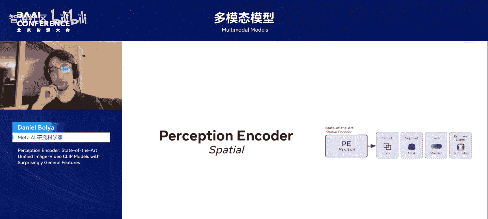

So here we note that there was actually kind of two layers that were really important for spatial tasks and this we tested a bunch more spatial tasks in the paper and this is fairly common currents that there's around layer 40 and layer around 30 do very well for different tasks so things with very shallow decoders like tracking in our case has a very shallow decoder works well at the earlier layers and detection and depth which require maybe more semantics work well at the later layers and we actually analyze why this happens in the paper so go check it out if you're interested but the way we sort of address this with P spatial is we find that the model is really lacking in locality at these later layers。

 so we keep the layer 40 features the same。

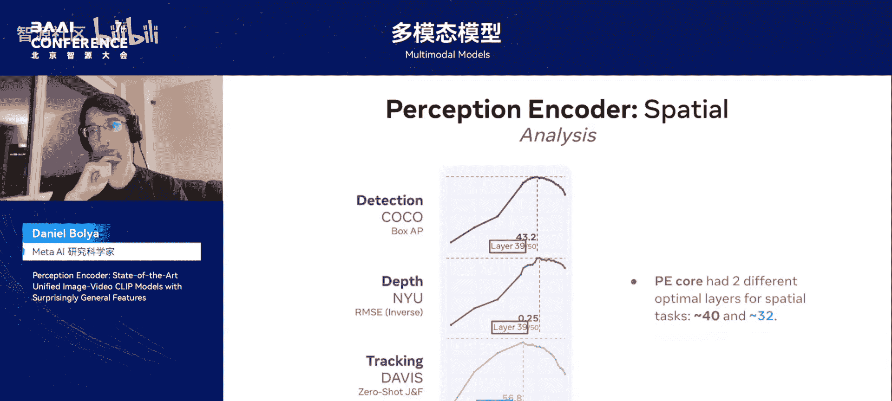

By aligning the output of the model to the intermediate layer 40 features。

 but also we additionally add extra locality by using SA supervision。

 so we actually use something novel that we call SAM mass logics to supervise the alignment which usually SAM is used with this raw features if you're doing something like radio or that kind of distillation。

We actually introduce mask logics， which is just basically you generate a bunch of masks randomly and then you cancatenate the logics together and that gives you very nice features that have a nice locality。

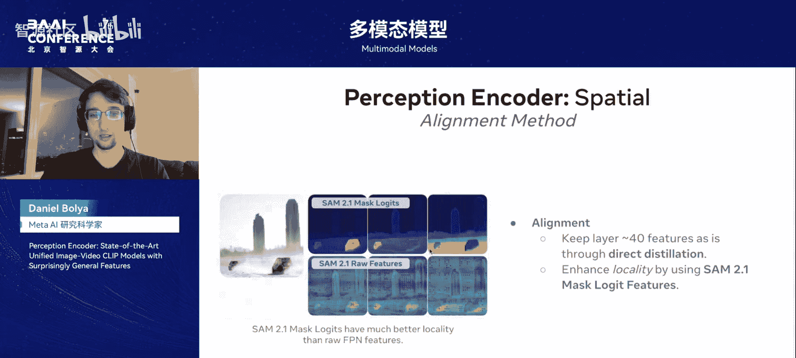

But okay， by trading on both of these alignments at once。

 we're able to lift the light solid line here， which is P core up to the star solid line here。

 which is P spatial for all tasks simultaneously and of note is that the SAM alignment alone。

 which is this like long dashed line actually hurts performance on every task but tracking。

 but if you do this jointly with the P features and the SAM mass logics。

 you actually increase over just P features alone。

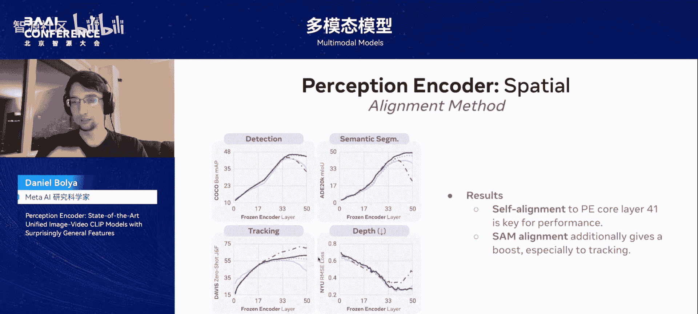

And here are some qualitative like examples of the last layer features。

 and you can see that P core's last layer features are completely destroyed。

 as you might expect from a clip model， so this is like the canonical clip is not good at spatial tasks。

😊，But if you align P core to its own layer 41 features， which is what we did in the previous slide。

 actually a lot of that detailed locality comes back you know it's still not perfect but there's still there's a lot of locality in there If you align to just Sams logics。

 there is only locality， no semantics so you can see that this cat and this cat in the background are not semantically similar according to the logicits。

😊，However， if you do both， you get the nice semantic information as well as the nice locality from the sand logics。

 you get some very nice features。😊，And we also see some part based correspondence if you just look at the objects directly。

 and you can read more about this in the paper and the GiHub release。

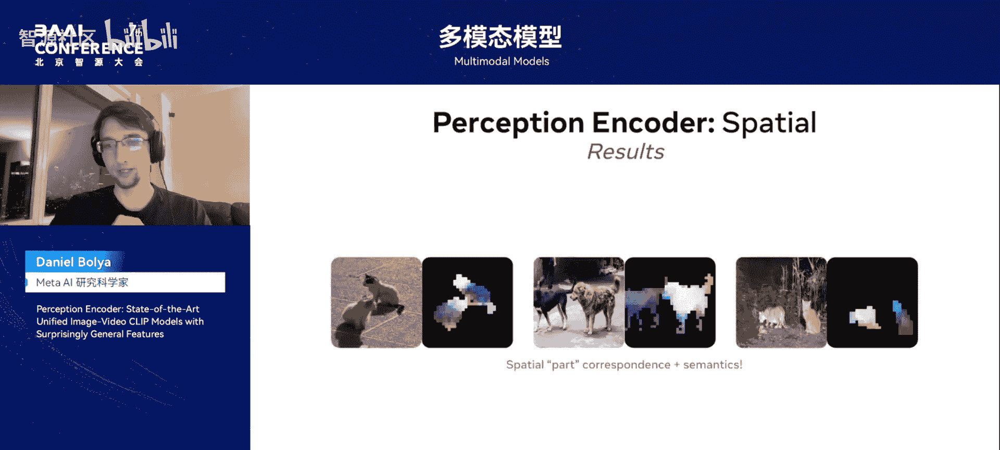

Okay， and so for numbers， of course the performance on are we just get all the bold numbers。

 you know the performance is better than all the previous models specifically you know DnoV2 and Sig 2。

 which were both sort of tuned for spatial tasks DynoV2 more than Sig2。

 and we outperform on tracking segmentation， depth and detection and instant segmentation。Through。

 through massscarian in this case。And we also take that one step further。

And gets saved art by a slim bar on Cocoa here， the Cocoa Let using P spatialial with a simple debtor based decoder。

So okay， that's all I had today， but before I leave you guys， I'm going to give you one more query。

 here's Bcat。

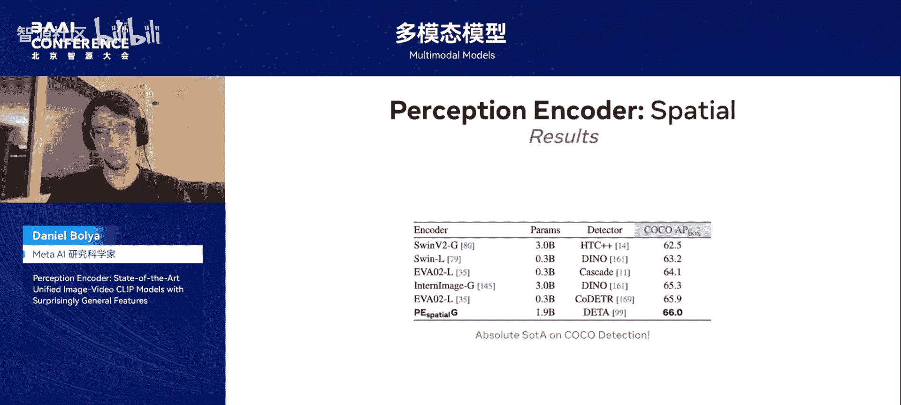

There's way too many， I don't understand why there's so many images of these， but yeah。

Thanks for listening。

