# 2025北京智源大会-多模态模型 p03 腾讯混元多模态生成模型实践：芦清林 -BV1zfNxziEfo_p3-

呃，谢谢王老师介绍，谢谢嗯支援的邀请。然后呃刚刚来了呃来了才半个小时的时间，已经有比较大的收获了。刚才听到daniel说他们的unified clip，然后我第一时间反应下来。

就是想到说哦可以在我们的表情包搜索里边去尝试一下，看看有没有一个更好的变更好的一个效果。对。😊，呃，我叫卢青林，然后我现在在负责毁原多模态的视觉生成模型。

很高兴今天能够跟大家来分享一下我们当前的一个技术的进展。其实从嗯很早以前大概几年前的时候，呃，是生成的这个模型其实已经有一个比较明确的一个非常呃革命性的一个爆发了。然后这是生成式的模型的整体的一个情况。

然后其中有一条主线，其实就是视觉的生成。然后从2021年的时候，那个时候da力出来了第一代的呃图像生成模型，然后再到后面da力 two大力 three，然后包括后面的呃im米gan其实一直也在呃迭代。

然后包括后面的呃国内也有非常非常多的一些。嗯，图像和视频生成的模型出来。然后在腾讯呢，因为流量场景，其实流量产品的这些场景是非常丰富的。包括说我们有呃广告的这样场景，然后还有就是游戏的场景。

然后还有内容，包括腾讯视频嗯乐文集团等等。然后包括还有社交的这一些场景，其实都是嗯非常明确的对视觉生成的应用有强烈的诉求的。所以呢我们也希望说能够建设嗯自己的视觉生成的这个foation model。

然后在我们腾讯的各个业务场景上有一个充分的应用。所以我们呃这是我们自己的一个目标吧。我们希望说能够建设业界一流的一个技术能力，然后覆盖我们自己的这些应用场景。嗯，我我今天后面的嗯这个分享会分成三个部分。

第一部分是生图的模型，然后生视频的模型，然后再是呃图和视频在我们呃公司内的一个应用的情况。

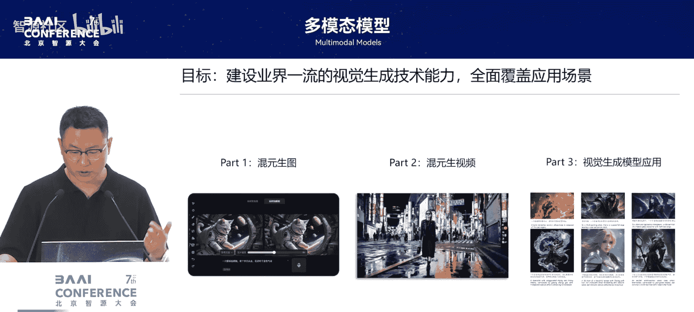

啊，生图的这个模型我们先看一下嗯，现在的效果吧。嗯就从去年5去年24年5月的时候，我们发布了其实混原的第一代图像生成模型。因为那个时候嗯大家主流的还在嗯做unitunit的一个结构上面。

然后我们率先的把嗯基于DIT的一个模型推出来了，然后并且做了一个开源。嗯，但是那个时候因为模型的参数量其实非常小，只有1。5B。然后跟后面推出的10B级别的这种嗯这种图像生成模型。

其实就有一个嗯参数量上的一个差异。然后现在我们也把一方面把参数量提升上来了，然后做到了一个10B级别的一个10亿10亿级别的这么一10B级别的这么一个模型。

然后同时我们在另一方面还希望说能够把这个模型做到足够的快。嗯，那因为它足够的快，那它的应用就会更加的方便。

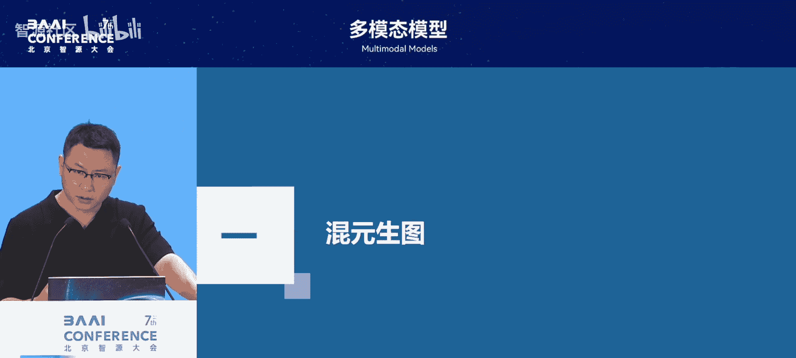

🎼好，我们先看一下这个视频。对，片子比较短，其实能够感受到的就是它其实已经跟之前我们做生图的时候，有一些嗯状态上的不一样了。曾经我们在做呃图像生成的时候，就会去手写一段啊pro，它可能短的可能长的。

然后呢按下一个生成按钮，然后就等待它就会去转，然后生成出几张图片来。那那那个时候的体验就是我可能我也不知道我的pro写对不对？啊，然后我也不知道生成效果好不好，就有一种抽盲和抽卡的一个形式。

然后如果要是我觉得不满意的话呢，我可能就再去来一轮，然后再等个呃几秒钟或者十几秒钟，然后看下一轮的结果。但是呃现在我们会把这个呃生图的模型做到一个嗯几乎是毫秒级别的这么一个一个一个水平。

所以它不仅仅是当我们在写pro的时候，那其实就已经在同时的出不停的出这个图片了。然后我可以看得到说哦当前我这个pro是不是写的足够的准确。如果不准确的话，我可以实时的改，它也会实时的跟着去生成。

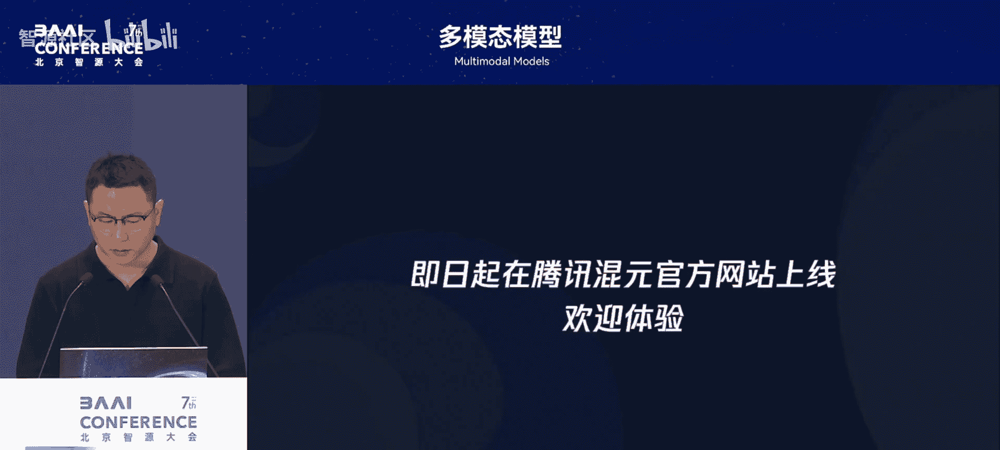

啊，然后除了我们用手写这种pro以外，其实它的速度也已经快到我们可以直接用语音去告诉他。就是我说我要生成一个呃小猫小狗等等。那这样在语音还没有结束的时候，它其实图片就已经可以出来了。

所以它会在整个图像生成的这个交互的形式上面带来一个完全不一样的一个体验。对，那至于怎么做到这样的一个速度比较快的这么一个生图的模型呢？呃。

其实总体的这个pline或者是模型训练链路基本上不会有特别大的一个差别，都是从预训练，然后开始继续训练，然后还有就是监督的微调以及后训练的人类偏号对齐，再用提示词增强。O这其实整个大的其实是不变的。

那实际上里边比较核心的点就在于说我们的速度提升上面用了非常高呃压缩倍率的这么一个图像编解码器，就是里边的BAE然后用了非常高倍数的编解码器以后，还要保证它出图的质量是足够好的。

所以这里边又有了呃一个对抗的蒸馏的一个方案。然后保证它它的推理步数压下来了以后，它还能够表现啊表现的不错。然后同时在质量提升上面，就是包括用呃视觉代言模型去做这个文本的encodeder。

然后还有就是在数据方面也做了非常非常多的工作。然后稍微展开讲一下。一方面是这个嗯超高倍率的图像编解码器。呃，常规的基线的VAE大家把一张图片压缩下来，然后再deder回去的话，通是啊8乘8的一个倍数。

然后我们希望说能够在这个过程中能够把它降到足够足够足够高的倍数。那它的整个的推理速度就能够做到几乎是十这么一个水平。所以我们就尝试16乘16以及32乘32。

然后现在我们呃上线的这一款呃模型它的VAE的倍数是32乘32的，就相当于是说32个像素，32乘32的像素可以直接压到一个token。那这也也就意味着说呃我们的推理速度就包括token量可以减少4倍。

然后ten选计算复杂度可以降降低16倍。然后再叠加蒸馏，我们整体可以把这个推理时候压缩到15倍，原来的一个15倍的一个水平。那压到15倍，其实基本上就是一个量级的提升了。

当然原来是一个2到3秒钟出图的一个状态的话，我们基本上可以做到200到300毫秒，要输输出一张图片。所以所以就能够做到这样的一个呃。不同的，因为时间嗯变短了以后带来的一个不同的体验。

然后在嗯压缩的过程中，我们其实很比较担心的就是一旦把大的这种呃图像patch把它压到非常小的一个图坑里上去的时候，它会不会有极强的这个信息损失。其实我们在这个地方也做了非常多的工作。

可以看到右下角的这个图片，它其实是在一个图片里面非常小的一个细节，这个房子上面，它的那些呃它的那些纹理其实都还是能够清晰的保留的。然后第2块就是效果的提升。嗯，效果的提升。

这边其实数据会有非常非常重的一个作用。然后因为我们嗯作为算法工程人员来说，其实嗯不得不承认的一个点，就是我们对于美感和艺术，其实是有天然的缺失的啊，然后呃像视觉生成，它又是一个技术和艺术的结合。

所以呢在艺术方面的缺失，会造成我们对于嗯出图效果的一个嗯偏偏移。所以在这块我们嗯请专业的美术人员和设计人员来帮我们去定义了一套非常专业的美学的标准，以及帮我们筛选的这他美学的数据。

然后同时还让他们告诉我们，就是一张图片好和不好，美和不美，它是差别到底在哪里啊，然后通过我们有非常专业的这种美学的标准和美学的这种数据了以后，我们就可以去训练出自己的reward model。

然后去强化我们的模型，在美感方面的一个认知。然后嗯通然后通通过除了美学以外，其实我们通过这种强化学习，在人像的质感上，包括OCR就是文字生成和识别的准确率上面。然后还有就是饱和度的优化。

以及各种生成出来的图片的手部机型，腿部畸型上面有非常明显的一些。提升。除了主模型就是 model以外，我们其实也希望说我们的图像生成模型它能够足够的可控。所以呢我们也会去做一些嗯插件。

那就比如说这个是一个非常典型的插件，就是一个一致性的插件，是 character。它就希望说我能够有一张参考的图片，然后能够把这张参考图片放到呃基于这张参考图片去生成不同的场景。

然后比如说把中间这个小女孩，然后生成到呃世界各地的各个地方去，然后基于pro去修改它就好。然后在这里边其实有一个比较大的呃困扰，就是说我到底是要这个主体跟我的参考图足够的像。

还是说她在呃我的pro following上做到足够的墙，这其实是两者是一个balance的一个过程。那所以我们在这里边会用到呃包括文本适配器，将这个主角色去注入，然后包括多多阶段的一个课程学习。

然后选取其中一个非常balance的一个状态，就是你能够看得。到他的呃参生成出来图片跟原来的参考图其实是足够像的。然后同时它还不丢失掉这个bllow呃pro的这个能力。

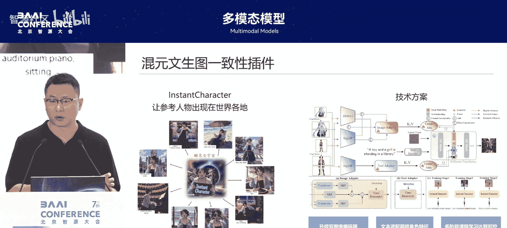

好，除了刚才说的这些插件以外，其实我们在呃图像上面基于之前的那个实质生图的模型。其实我们还做了一系列的工作，就包括说把这个模型做到在人像上面各种各样的风格上面。

然后包括文字渲染上面能够做到一个足够好的表现。然后同时还还把这个模型做出了呃图像编辑的能力。嗯，编辑的能力里边，包括增删改，就是过去的P图，然后一键P图等等这些嗯，都能够在会原的这个图像模型上面完成。

嗯，包括刚才有展示到里边，其实有一个参考图，参考轮廓生图。然后这个地方在美术方面的应用，其实嗯就会非常的顺畅。

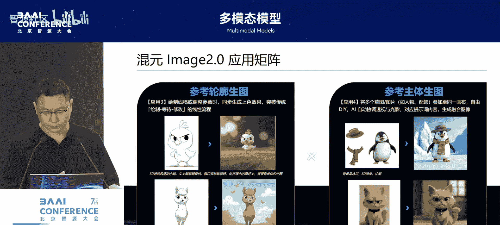

好，这个是图像相关的一些呃工工作。然后看看我们的视频生算模型。啊，我们也先从一个视频开始看吧。

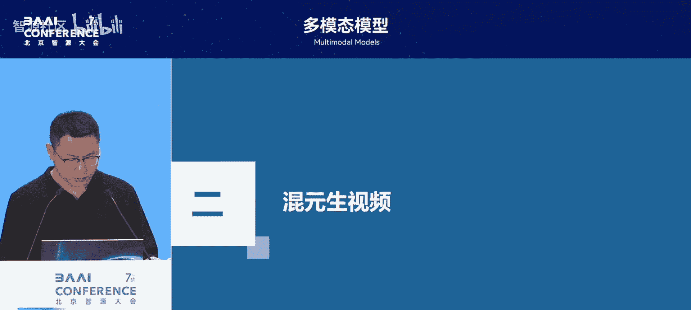

🎼。

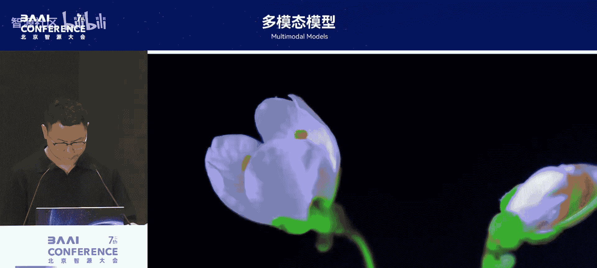

嗯，OK啊，这个模型呢它是我们去年呃12月份的时候发布的。然后嗯在。在12月份的时候，我们是直接把它开源出来了。然后当时也是嗯开源里边最大的一个模型是14B嗯。

然后嗯然后它里边比较比较大的这个升级的点吧。一个就是用VIM去做文本维码器这个这个它的语言的这个following能力就会有一个非常非常显著的提升。相比起以前不管是还是T5等等。

然后包我们做了很强的这个然后嗯在这个上面就可以让这个证间的一致性保持的比较好。那其实在动作非常大的幅度的时候，也能够保持一个比较好的表现。

然后同时还做了一个3D的VE这个嗯3D的VE其实我们的想法就是说能够未来在呃图像和视频用一个模型去生成就好了。因为它的嗯当我们把视频，当我们把这个图像的这个VE变成2D加一加加T的时候。

它其实就已经是个3D的VE。啊，这是一个呃这是前面的这个嗯。😊，就是多模态大言模型作为我们的文本编码器。它有什么好处呢？就是天然它有很强的世界知识啊，然后呃因为它本身就是可以呃在训练的时候。

它就是图文其实是对齐的。所以它的呃语的理解理解能力会比常规的这种包括c或者是其他的这些模型要强的多。然后同时它还有一个更有优势的地方。就是当我们想去让它提取文本特征的时候。

我们会告诉他呃会给他写一个呃就是相当于 instructionstruction呃，我们可以告诉他说你在关注一个pro的时候，你可以关注它里边的呃数量或者是颜色或者是属性。

因为这个就是我们在生成图片或者生成视频的时候最难的地方。那它在呃read这一个tex prompt的时候，就会更加关注这些点，然后提取特征的时候，也会让它能够有更好的一个follow的这个表现。

然后第二个部分呢就是嗯相对来说这块就会常规一些就是DIT的一个双模态的 scaling。就是我们会去看当前的一个计算量，然后当前的数据量，然后我们去定一个嗯这种最合理的这么一个参数量的一个大小啊。

然后再去确定下这一个嗯这一组这个training recipe以后，然后我们再去起一次大实验。这样的话就会有非常呃好的一个保障。

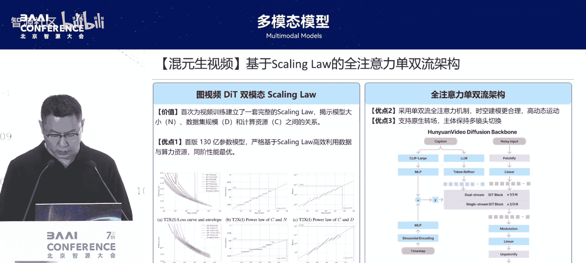

然后这着是我们的3DVAE了，就是3DVAE其实嗯从非常。嗯，非常呃直接的点来说就是呃我其实可以直接就做一个呃2D的BAE或者是whatever。但是33D的BAE它一把就可以把图片和视频都给出了。

所以呢这1个VAE可以共用在呃图像生成和视频的生成里边。所以这是我们一个非常呃觉得他非常嗯比较比较比较不错的一个一个地方。好除了呃 model以外，其实我们呃还在这个上面做了非常多的这种包括驱动类的。

然后还有插件类的，还有一致性类的一些工作。然后这个是去年做的一些表情驱动的工作，然后混员的portit，还有就是姿态的。

就包括像各种各样的呃动作和那个skeleton它的一个motion可以去把它模拟出来。然后在一张新的图片上面呈现出来。然后还有就是嗯阿巴塔阿巴塔其实是嗯在语音驱动里边。

我们希望说它不仅仅是能够把这个语音给follow出来，只是嘴部在那动。然后我们希望它的整个肢体的形象，然后包括它的表情，包括背景的一个状态，都能够有一个比较好的一个表现。都能够更加的自然。好。

然后除了之前的常规的单一的模态，不管是音频还是skeleton还是语音来去做注入的时候，呃，除了这些以外，我们其实还做了一个叫做主体一致性的模型。它其实跟那个图像的主体一致性的模型是比较像。

就是我希望有一个参考的这么一个人物。然后呢我希望用这个参考的人物来去做不同的事情。啊，他其实也是在里面去找一个比较好的平衡，就是我要向这个人，然后同时还要能够。

比较好的following这个pro这个视频可以简单的看一下。其实就可以让左边这个女生，她在包括遛狗啊，包括说是在啊吃东西啊等等，他都能够直接一次的生存出来。然后下面的这个呃男生也是的。

就是可以让这个人去拿着一包薯片啊，做一个介绍，站在游泳池旁边等等。好，然后当时我们就想了，其实呃我既然可以把一个人给注入进去。那么同时可以驱动它的各种各样的动作的话。那势必我们就可以把人物人和物品。

还有文本、语音、动作序列，包括物品的轨迹，全部都作为条件，让模型给它生成出来啊，这也就是一个啊相对来说更大一统的一个方案。那举个例子啊，我们左边的这个图片是这个。这个外国的这个女性，然后呢。

下面呢是我们希望说她能够去介绍我们给她的这个包啊，然后还要有啊一定的这种介绍的一种语言 that you saw some cute pieces that you might want to get for yourself to just revamp your。

对。那么我们看得见就是这个包其实它已经好的拎起来了。然后还当他在拎这个包的时候，其实那个包它也会有晃动，包括它的那个链子其实都是相对来说比较自然的可以呈现出来的。

那么像这样一个人和商品交互的这么一个视频的生成，其实能够在很多很多的场景里面去应用起来。那包括我们过去做不到的嗯，只只能在人下面去做到的一些事情。那其实现在就可以在人和物之间的交互。

上面能够有一个更好的表现了。好的，那刚才就是讲的我们的基础的图像和视频的模型。然后也跟大家分享一下我们现在这些模型在啊腾讯里边的一个应用情况。

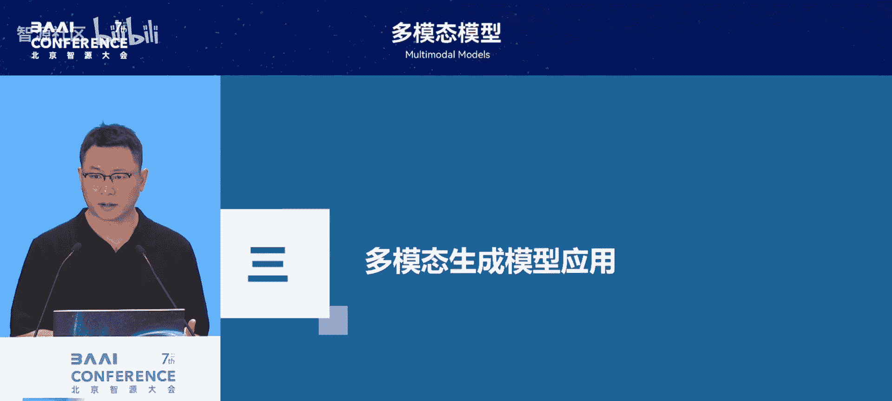

呃，总体其实腾讯的业务板块是非常非常多的，包括呃微信、QQ企业、微信这些传统的社交类的呃这种场景。然后还有就是呃腾讯的游戏、腾讯广告，然后包括呃视频等等。

其实在方方面面其实我们都可以有非常充分的一些应用。我就举几个呃典型的应用场景吧，一个是游戏。嗯，因为整个现在生成式的AI在游戏的概念上面有非常向当强的这么一个应用场景。

就比如说我们生产一个呃游戏的皮肤或者是一款新的角色。那其实整个在里边嗯流程是非常长的，包括创意的设定，2D的这种概念设计3D的模型制作，包括这种特效的制作，然后再到呃再到这个最后的宣发等等。

其实它有一系列的P。那导致我们整个的这个流程非常非常的长。然后在这个里边其实有很多的板块，我们都是可以用AI来去做一个提效的。然后包括这个地方举一个例子，这个地方是一个2D的概念设计。

那当我想去设置一个概念的时候，那我可能就可以先用纹声图。因为它实时的可以把出100个图片啊，然后选择一个呃我觉得更符合我角色设定的这么一个一个一个一个角色。然后呢呃当我觉得如果不太满意的话。

那我可以照着它，然后手绘稿手绘描一个。然后我们再实时的去生成它。然后AI还可以把这个角色做细化。然后同时当我们确定了这一个角色的形象了以后，然后可以把这个角色去变成一个多视图，它1个360度的旋转。

那可以直接生成出来啊，那这样的话就不会像以前一定要把3D建模全部都做完了以后，我才能看得见它的一个三视图的一个情况。所以这块会有一个嗯极大的效率的提升。对，这是举了一个例子啊。

其实我们整个的游戏的场景里边做了非常非常多的功能，可能有几十项的功能。然后我们把它汇集起来，成了一个视频，大家可以。

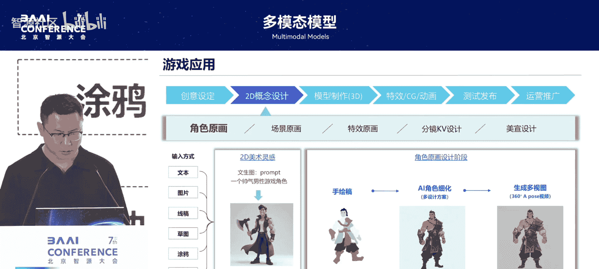

在这个地方看一下。

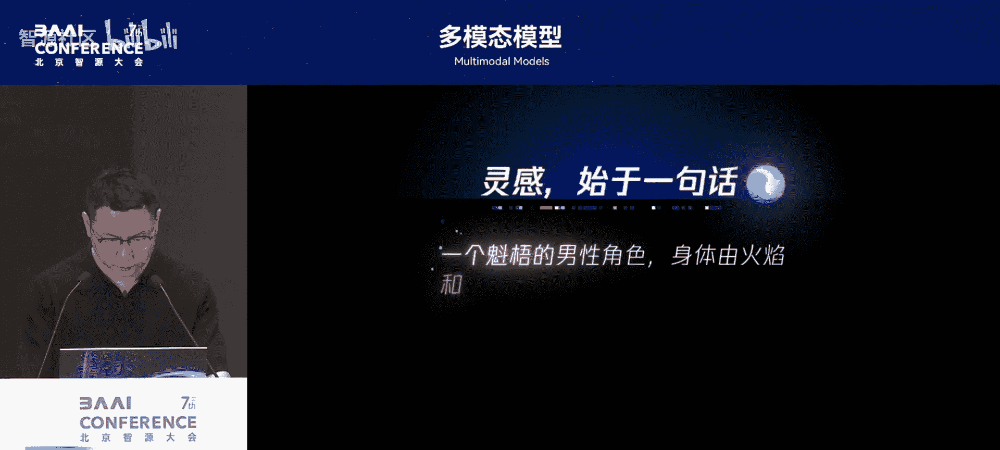

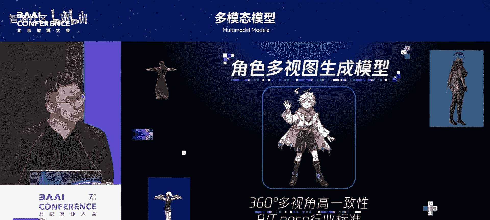

🎼Yes。🎼So。哦，对，我们发布了一个这一个站式的游戏I生产引擎，其实可以给。如果在座有那个游戏从业者可以去尝试一下，其实它可以有很多很多的功能。啊，除了游戏是一个比较大的板块以外。

其实在腾讯呃社交的应用也是非常明确的。然后包括说呃微信QQ企业微信，其实大家对这些方面诉求都非常多。然后里边有一个很典型的一个一个一个一个应用场景啊。

就是呃公众号文章其实是非常内容质量非常高的一个一个一个板块。那嗯但是公众号的文章都非常的相对来说是比较长的。那我阅读一篇文章，通常情况下都可能要10分钟甚至14分钟、15分钟。呃。

我们有没有办法可以更快的把它可视化出来，然后把它变成一个视频呢。其实我们也在做这么一个长文配图，加上图转视频的这么一个能力，然后就希望说我可以一键把我的呃公众号内容导进来，然后呢让它自动的生成一个视频。

然后发布在视频号上面。那这样的话就可以做到一个公众号的内容质量高地到呃流量质量高低的一个连接。其实这个地方是我们觉得非常呃。有意思的一个工作。但但是它这个场景其实不是一个单一的模型是可以做得到的。

它里边需要输入的是一个非常长的一个文本，包括是几千字或者是呃上万字的一个公众号文章。然后呢，我们要做常文理解，然后包括说嗯给他做一个分段，然后哪些段来适适合于配上图片和视频。

然后在每一段里边可能用几百字把它转换成一个pro，然后同时转换成了pro以后，它是一系列的这种呃图片和视频的生成。然后生成完了以后，它其实还要保障说我这一个系列它的它的这个风格是要一致的。

不能说前面是动画风格，后面是写示风格，这样的话就会非常突兀。所以这里边就会有非常非常多一系列的这些工作。对我们来看一个看一个case吧。🎼素杯勾勒出情花，避风弄转胆。🎼平生描绘的牡炭一如你酒妆。

黯然檀香，吐过窗，心事我了然，裙子上走笔只此各一半。🎼釉色渲染是绿途。🎼因为别自藏。🎼对，这就是一个能够一致性保持的这么一个状态。你的每一。啊，然后除了刚才的那个公众号转视频号以外。

其实呃表情包就非常典型了。刚包括刚才del说的呃那个unified的c。然后我第一反应就是啊我在做表情包搜索，可能会是一个非常好的一个场景。啊，因为在腾讯的表情包其实是非常非常多的。

然后我们现在在做了一个就是相对来说比较有意思的一个一个一个事情。就是呃过去的小小黄脸，大家可能用的会比较多，就是那一套呃组合的小黄脸。然后呢，我们希望能够呃UGC可以自己去二创。

然后结合这样的这种谐音梗呃，能够玩出一些非常非常有意思的呃这种表情包的创作来。对，然后这个的现在呃大家对他的喜爱程度其实是非常高的。尤其是年轻的小朋友。

特别喜欢去自己制作一些有谐音梗的这种这种呃表情包出来发送给别人。😊，啊，然后除了这个以外，其实我们还在做一块事情，就是视频号视频的特效。呃，视频特效其实过去在嗯两年前吧。

大家还是主流的是在用干的这种方式。那干的方式，它因为它比较快，但是它模型比较小。那通常情况下就会去做什么脸上的挂件或者是美颜或者是戴帽子等等的。呃，这种是做的比较多的。但是现在新的生成式模型出来了以后。

其实我们能够去做到的事情就会远远比过去要更多了。就包括说嗯这种非常丝滑的这种变装啊，这种是一个很明确的过去其实是比较难做到的一件事情。然后还有就是像呃最右边这个夹娃娃呃。

是我们最近呃跟设计师一起脑爆出来的一个一个一个一个场景，其实很有意思，就是把任何的建筑物或者是人或者是车或者是任何的东西，你都可以用一个夹娃娃机把它夹起来，然后在转的过程中就会把它变成卡通化。

然后把它丢到夹娃娃的那个机器里去，然后让它在里面跳。其实这个特别的讨喜，然后特别的有意。😊，就是生活中的万物，你都可以去这样夹娃娃对。啊，然后除了前面说的游戏和社交以外。

其实我们在广告上面已经有过去呃两三年的一些尝试了。其实嗯它在广告场景里面已经应用的非常非常充分了。啊，包括现在整个腾讯广告里边可能有呃接近一半的这种素材都是由AI生成的。然后包括过去的纹声图。

然后图生图图像编辑等等。然后现在的图生视频，然后还有就是照片数字人啊，还有就是直播的数字人啊，其实也可以实时的去做这种直播的方式。嗯，在广告这个地方它还有一点点不一样。其实可以跟大家分享一下。

就是当我有一张广告素材能够嗯投放出去了以后，他跑量跑的好的时候，那我其实是希望保留他这个跑量的能力的那么在这个时候我再重新去复刻一个类似的这么一个图片，其实成本还是挺高的。

那所以我就希望说我用图生图的方式啊，我可以参考原来这个图片，然后生成一张类似的图片，然后保留它基本上大致的所有的属性。那我再次投放的时候，它大概率还能够跑的嗯有比较好的一个表现。对。

这是非常明确的一个点。然后还有就是这种照片数字人，也是可以给大家播一下。因为要找演员以及嗯再去录一段视频，其实它的成本很高，然后同时还要有一个肖像权。那么现在。🎼A其实可以直接自己要想初中早点睡。

作文京剧尽早背。如果再让我回到小学，什么钢琴、舞蹈、画画，我一个都不学，我就逼着自己把这本作文京剧都吃透。第一，你要知道小学语文再难，也无非就是写作文，每天看15分钟，等上了初中，你就知道会有多轻松。

要想初中早点。OK这case就很典型。其实它是一个跑量非常好的一个一条素材，我们把它生成出来了以后，它呃出去了不管是点击率转化率，各种都呃的表现都极其的好啊。

所以在这个里边它是有呃在广告里面其实有非常好的一个呃应用场景的。变相。然后除了刚才说的那些广告的场景以外，它其实更加的偏呃效果广告。效果广告的意思就是说我以转化率和点击率为目标。

我希望说能够有好的表现的。然后呃还有一类其实叫品牌广告。品牌广告就像过去大家看到的那些大品牌出的那些绑购兰蔻啊，什么可口可乐呀，他们出的那种精美制作的这个广告。它其实不追求的点击率。

它追求的是一个心智啊，心智的一个植入。所以呢我们它的它的整个的呃这个要求会更高一些。所以我们在希望想说啊现在的生成能力，它能不能够足够做到品牌广告的这种呃要求的这种水准啊。

然后由于今年的深度推理出来了以后，其实我们就完全可以在这个地方包括从广告词到设计理念到需求，然后都用大语言模型来去输出。然后同时呢我们告诉他啊，我们需要这是我们的商品，你帮我去呃生成一段这样的一个视频。

🎼好，我们可以看一下现在的效果是什么样，这是完全呃AI生成的美博牙雪山白泥面霜，碎炼雪域疾风白泥，冰川矿脉激活肌肤，焕活肌底能量，凝住动明时光，让岁月在雪境中油战。美博牙雪山白泥面霜。

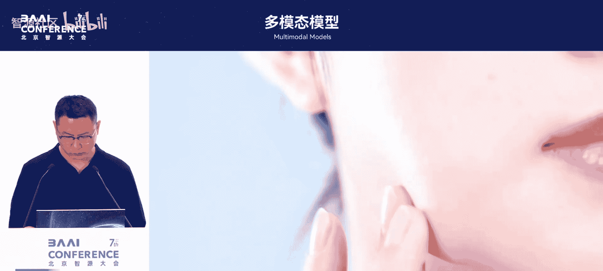

对他其实就已经有品牌广告的那个感觉了。好的呃，时间关系，我今天的分享就到这里啊，谢谢大家。😊。