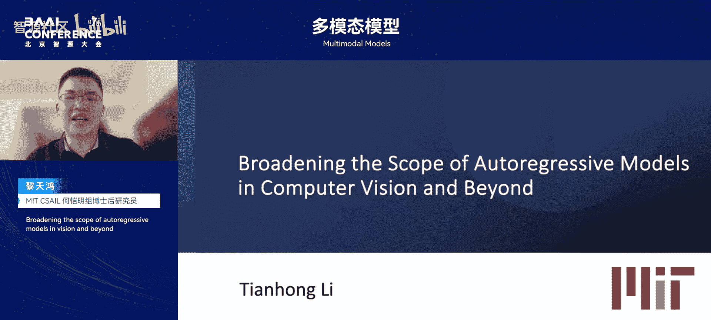
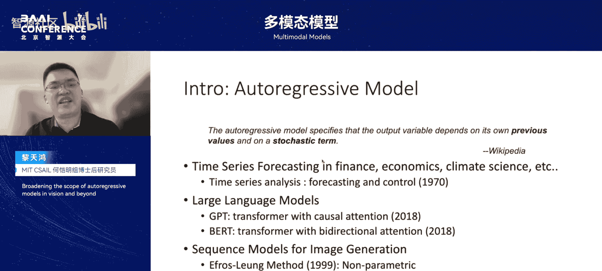
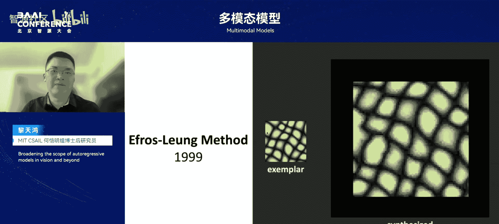
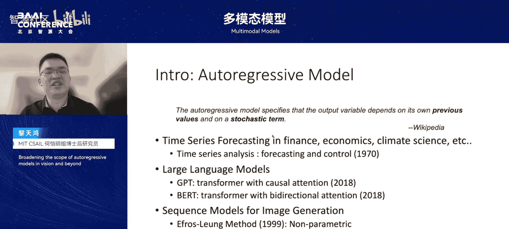
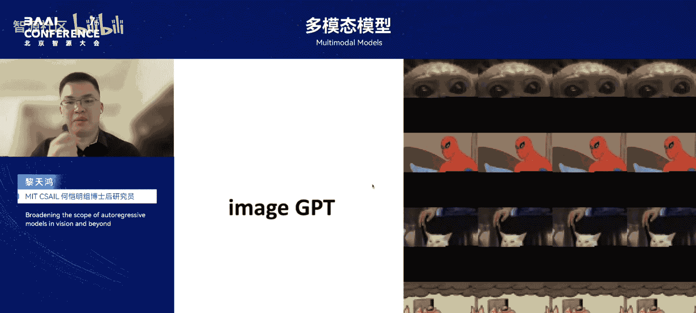
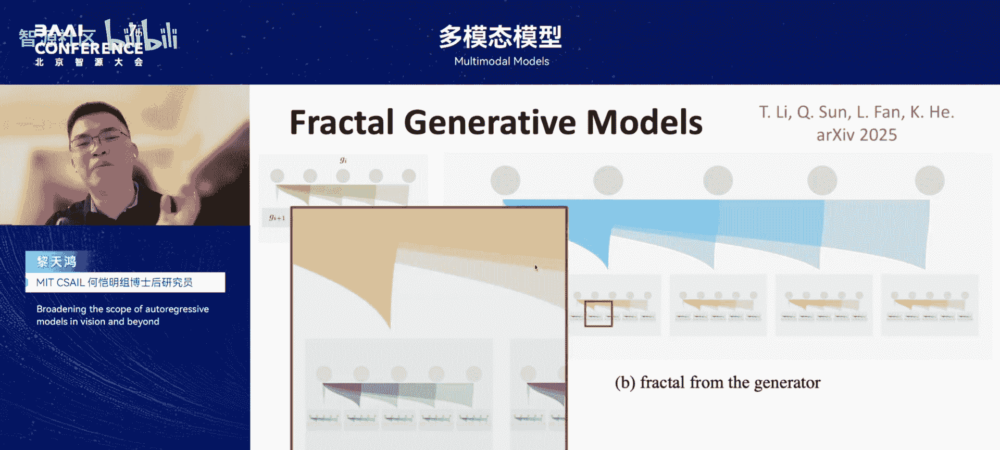
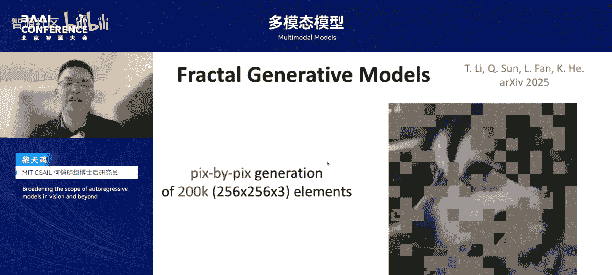
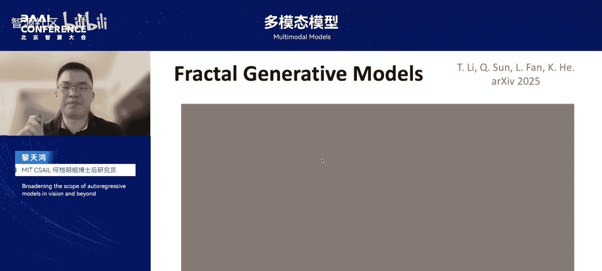
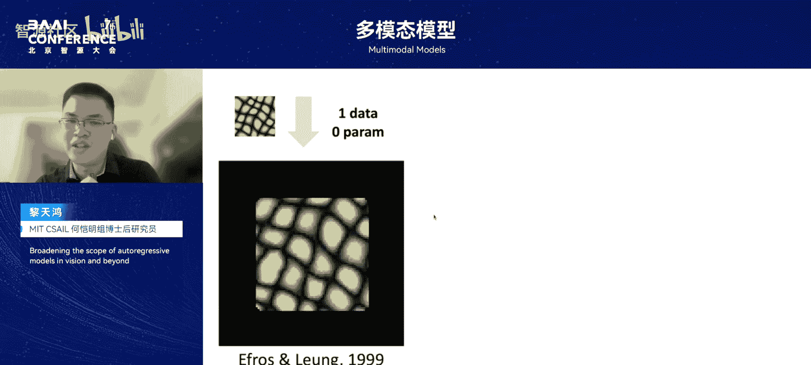
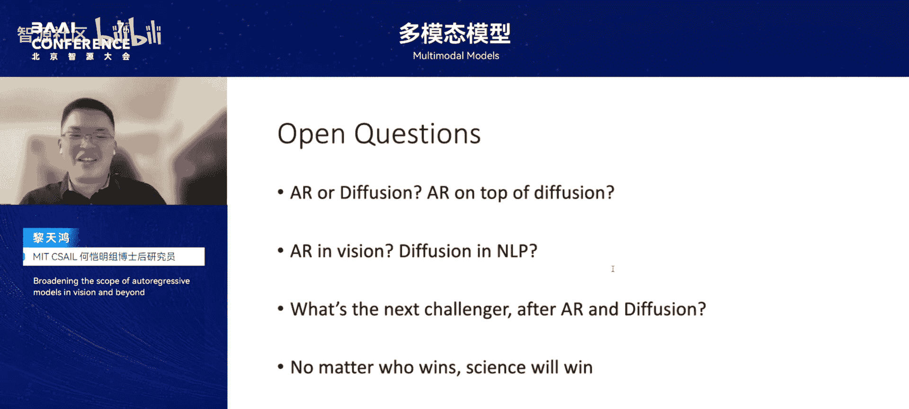

# 2025北京智源大会-多模态模型 p04 Broadening the scope of autoregressive models in vision and beyond：黎天鸿 -BV1zfNxziEfo_p4-

啊，各位老师同学上午好，我是李天虹啊，非常感谢支援大会的邀请给我这个机会啊，可以来大跟大家分享我们的这个最近的工作。那么今天呢我主要分享我们近期的关于自回归生成的一些工作啊。

主要是围绕首先如何拓宽自回归模型在呃视觉中的应用，以及如何解决之前自回归模型在图像数据上的一些我们认为比较本质的问题啊，然后最后呢我会分享一些呃到底为什么我们要做自回归生成的一些思考。

然后今天的这个分享里面的内容呢啊，大部分是和呃许多合作者以及合作完成的，包括永龙、李贺、明阳啊清怡理节和凯明。😊。

好，那这是我今天分享大致的流程啊，在进正式进入主题之前呢，其实我可能会花比较长一点的时间去明确我们首先想要解决一个什么样的问题。你就是说我会花呃大概十0分钟的时间讲一讲我们啊研究的背景啊。

首先我会明确自回归模型的它的一个基本的概念。因为我现在发现很多人可能呃把自回模归模型简单的等同于大圆模型，但其实这个两边的概念还是有很大的不一样的。然后呢，我们简要的介绍自回归模型。

在图像生成中的一个常见的一个做法。当然啊可能从去年到今年这个这些做法会有一些比较大的区别。但是啊我会介绍一下在我们的去年这个工作出来之前啊，大家一些常见的做法，以及现有的这些常见的框架。

尤其是依赖这个我们说ve框tokenization的这个框架的局限和挑战。然后呢呃我会讲一讲我们最近的两个视觉自回归模型方面的工作啊。第一个工作呢我们会介绍一下diiffusion loss啊。

也就是扩散模型，基于扩散模型的一个一个损失函数。那么这一个模块提出呢呃可以让自回归模型生成自回归的图像生成模型不再依赖于相当量化和离散的语翼符，也就是说它可以直接去自回归去建模连续的数据。

那么第二项工作呢，我们将介绍啊分型生成模型。那么分型生成模型呢呃进一步去除了视觉自回归模型啊，对tokenizer，也就是说对把这个图像必须转化成语翼符的这样一个依赖。😊，那么最后呢我会简要的谈一谈啊。

我自自己对自回归生成模型的这样的一些想法。然后为什么我们认为自回归生成啊，不过不管是在视觉上，还是在其他其实所有的数据上面，都是一个我们认为觉得啊非常值得探索的一个课题。OK那我们正式开始。😊，呃。

首先呢我想简要的回顾一下自回归模型这一个通用的概念。那么我从VKPD上面啊扒下来的定义呢是说自回归模型的当前输出依赖于自身过去的取值。并且呢它还受一个随机降啊随机值的影响。

那么它其实就是一个非常简单的定义。它没有说它有啊具体的这个数据需要什么样子的，或者是这个用什么样的模型去建模这样子回归模型。那么在上世纪的时候呢，其实早在1970年啊，就是70年代。

自回归模型就已经早啊被这个广泛的应用在各种各样的领域里面。比如说啊金融啊、经济啊、天气啊，特别是这种啊以时间序列的预测量啊预预测的模型啊比较典型。那么其实我们如果现在回过头来看的话。

当时对自回归模型的狭更狭义的一个理解呢，是说模型的输出必须要表示为若啊过去的若干观测值的一个线性组合啊。因为我们现在知道我们的transformer或者是所有的神级网络是都是非线性的。

但其实那个时候对自回归模型的狭隘理解是它必须要是一个线性组。那模型的学习目标就是从数据中估计出这种线性组合的这个系数。所以我们可以看到，其实在当时对自回归的这样的一种线性拘束。

甚至比我们今天对呃自回归模型的这样一个理解更为狭意。那么当前当然最流行的或者是最最广人人知的一个自汇归模型就是大语言模型。那么在2018年呢。

研究者提先后提出了基于transformer的啊两大字自汇模型代表。第一个是GPT第二个是t。那么我个人理解呢。

两者的核心区别呢啊主要在于这个注意力机制就是啊比如说啊GPT是用的一个英国的注意力机制co attention。那bert呢是用的是双向的注意力机制。那么由于这些注意力机制呢。

可以让他有一些不同的应用场景。哎，其实我个人觉得2022年之前可能bert比GPT还更火一点。但因为他当时是以作为一个language en的形式去存在。但在2022年之后呢，因为差GPT出来。

然后包括大更倾向于去做一些incont learning的东西。所以说现在大家一般提前自汇规模型，都会第一时间想到啊GPT或者说clo attention的这样一个自汇格模型。

然而我们又回到回过来头来看这个图像生成领域。其实。呃，surprisingly也就是大家早就也在使用这个自回归的思想。那事实上呢，时间我们在图像生成里面使用自回归的思想的时间呢比大多数人想象的还要早。

早在1999年啊，刘sha和ts就提出了一种啊非参数的一种纹理合成方法。那么通过在已知纹理样本上啊，估计这个条件的概率分布，逐像素的去自回归的采样下一个像像素。那么这样呢它可以生成新的纹理图像。

那，这是一个这个算法的工作方式的一个演示图。那么他先利用已有的啊左边这个纹理样本估计下一个像素的条件概率分布，再按自回归去的这个顺序逐像素进行采样。那么值得注意的是呢。

这个地方整个过程完全是依赖于统计概率估计和啊随机采样，这里是不包括任何复杂的神经网络，但是依旧它可以生成啊质量非常高的纹理图像。

那么之后呢，随着深度学习时纪的这个呃时代的到来呢，呃视觉任务几乎都已经全全部转向这个神经网络进行实现。那么值得一提的是，在transformer出来之前，2016年就已经有两篇非常重要的工作啊。

PelCNN和 pixelel RNN。那么他们首次提出的用自回归模型或者说自回部的神经网络模型，逐像素的生成啊，这个一个一个图像，那么模型每生成一个像素呢都是以之前已经生成的像素作为条件。

那么依次完成整幅图像的课啊图像的这个生成。啊，之后在2019年，那open AI就推出了这个非常著名的imageGPT或者是IGPT。那么他们将transformer架构引入到了图像建模领域。

进一步呢验证了这个自汇框架在视觉生成中的这样一个能力。那么这里是1个IGPT的事例。

当时在相同的上半幅图像作为条件输入的时候，IGPT使用的是一种从左上到右右下的一种raster order的自回归顺序。你们依次去补全下半幅的内容。那是生成出图图像呢啊既相对来说比较逼真。

又有一定的多样性。但是大家其实很快认识到，就是在像素空间直接建模，对于transform来说，开销过大。比如说我要建模1个256乘256的一个分辨率图像，那我其实是要建模基本上20万个像素点。

因为每个自动点还有RGB3个channel，那我需要建模22呃20万个像素点。去生成一张图像。那么这个东西对于计算量的需求是非常大的。所以所说呢在2011年啊20201年开始呢。

出现了vi干以及后续的一系列musskematemus的一系列的工作。那么这些工作呢受这个语言领域的智慧跟模型的启发。它借鉴了很多啊loge language model的这个设计思路。

那最重要的一步呢，我我个人认为最重要的当时的一步呢就是将连续的图像，原本的这个高分辨率的图像，表示成啊离散的token。也就是说我们说的向量量化啊。

这里是factorctor quantize tokenization。那么下面我们先简要回顾一下这个。就什么ization或者是当前自回归生成图像的一个总体框架。

就所有此类方法就是啊都是basedase on这个这个ve quantization。那么如图所示呢，这个模型首先把用一个CN的把原始的25050的图像映射到一个比较小的la就是潜在的一空间。

那么这个空间，比如说我们说16乘16的一个一个一个向量。那么对空间的每一个像素呢，我们通过一个啊dictionary就是一个一个可你可以认为是 k min的那个dictionary。

然后中间寻找最近的一个啊一个code，用这个code去替换每一个向量。然后呢这样我们就把连续的一个表示或者连续的一个空间表示成一个离散空间的一个一个一个。啊，一个矩阵啊。

但这样的话呢我们就可以因为自回归生成在当时主要是在语言上做，对吧？那相当于是我们把啊图像变成了语言，也就是这个地方我们就把图像变成了这个框 visual tokens。

那之后的自回归生成也就顺成章的可以在这个 token上面进行进行进行回归，而不需要在原始的这个图像上面进行回归。那么需要注意点的是呢，就是这个框 token还需要能够重构原始图像。

因为它如果重构不了的话，那我生成了一堆这个 tokens生成了一堆离散这个图像啊图像符号的话影空间符号的话，我是没办法把它又映射回图像空间的。

所以说我这里需要一个CNder或或者是一个解码器啊这个啊离散的。😊，符号或者离散的视觉符号转换成原始原始的这个。算空间。但是呢其实我们这个是我们我们说从到目前为止。

就是所有人大基本上都是用的这样一套方法做呃视觉上的测绘生成。但其实呢向当量化本身它就带来了两个主要的挑战。首先第一点他非常难训练啊。我相信在座如果尝试过训练V干的同学应该是深有体会。

就是训练困难的根本原因，其实在于这个量化的这个步骤是科导的。它是没办法做这个gradient back pro那这导致编码器接触到的这个梯度呢，就从从呃lo function接触到这个梯度并不准确。

那其实只能通过我们叫做str estimation的方法进行近似。这个str estimation其实听起来就是其实就是把ZQ上面你看右边这个ZQZQ上面啊拿到的 gradient拿到梯度直接拷到左边的Z上面去。

这就是所谓的你就是说它左边的Z上面拿到的，但是因为Z不等于ZQ，就左边的Z上面拿到的这个梯度是跟右边的这个ZQ上面的梯度啊是是是不准的。然后这也会导致什么呢？就是说训练过过程比较不稳定。

以及各个lo之间它有干lo，它有有con这些超也比较难调。😊，当然了，训练难的问题，我们说可以通过更精细的参数调节啊，以及工业化的这样的一个就是训练进行环解。但是其实呢更麻烦。第二个问题。

包括google内部的也会出现的问题是说，即使是一个非常精心训练的啊，它与离连续型的tokenizer也就是刚刚啊老师提到的VAE相比呢。其中重建的质量其实还是非常有限。那么这里有一个简单的例子。

中间的这个蒙娜丽莎呢是我们使用VQ现重建结果。那右边呢其实是啊是用这个一个也是没有使用非什么就是非常好的t去训的一个啊连续的ken的这个结果。那么我们可以明确的看到就是VQ的的这个输出。

或者是重建的这个效果，基法基本上啊基本是无法辨认这个人形的，更谈不上是还原蒙娜丽莎本身的样子。😊，呃，因此呢你想如果我们想看，就是说如果我用这个这样的一个vikenizer来训练我的生成模型。

我想让它生成关于蒙娜丽莎的图。比如说我想生成啊蒙娜丽a in the snow，或者是我要生成啊蒙娜娜丽 is playing soccer，它基本上不可能的。

因为模型本身从来没有见过真正蒙娜丽莎本人长什么样子。那么训练不稳定和重建质量低一下，我们认为是vi token的两个最重要的根本缺陷。那么这一点呢不仅体现在图像领域，在所所有的数据模态里面都是这样。

那么如果我们永远都要依赖vicizer，把原始数据压缩为李赛字符，就意味着我们必须为每一种数据单独训练个token，那么这势必带来巨大的研发和计算的开销。那我们退一步是。呃。

为什么我们一定要做向量量化呢？那我们说白了，其实我们当时最开始做呃VQ的，或者说最做呃vision上面的augress model回归模型的原因是其实就是偷懒。那么因为我们最开始做的时候。

我们想要尽量引沿用这个GPT或者是bt这个套路。我们不想改变语言模型在离3字母上面这个呃损失函数，也是ca三的函数。😊，但是我们如果回到我们刚刚最开始说的自回归模型的这个本质。

我们就会发现veization或者是VQ并不是自回归建模的必须步骤。它从来没有说它必须使啊使用这个连续啊离散数据进行建模。那么因此我们也认为就是说在图像乃至所有的连续数据的自回归生成中关键的步骤。

并不是去打造一个更完美的VQ token或更完美的token。而是尽量的摆脱这个V token进一步或者说首先我们摆脱VQ摆脱向要量化。那么们进一步我们摆脱tokenizer，直接去modode原图。

那么这个问题呢相当于就变成了什么呢？就是首先第一个问题，自回归模型能否直接基于连续型的tokenize来实现，或者说神经网络base的自回归模型能不能直接基于连续型的token来实现。

那么我们啊去年的这篇ma regress model这工作，就是为了解决这个问题。当然在这天工作中间啊，除了这个连续性的问题外，我们也对自回规模型的其他方面，包括生成顺序啊，包括模型架构啊。

bo台式GPT进行了讨论。但是呢我认为在所有的讨论的议题中间啊，自回归生成连续数据是这中间最本质，也最有挑战性的一个问题。那么下面我们将啊说明我们具体是如何去做这个连续数据上的自回归生成的。

那么我们首先回顾传统的离散的自回归的生成方法。当X是离散变量，这是这里X是每个token。那么X是离散变量的时候，也说每个token是离散的时候。

我们通常呢一般是先预测一个logs啊这个logs呢过一个sof，然后拿到每个token的啊就是类别的这个这个概概率概率分布。那么我们这样呢就拿到了一个离散的概率建模。

那么我们如果把这整个模块去呃这个整个小部分去模块化的话，它其实呢就是用来建模一个P啊P of x conditionitional z的一个非常小的一个生成模型。那么我们观察到这种建模方式。

其实它就是有两个充分且必要的特性。那么第一个呢，它是需要一个损失函数。也就说这个损失函数为整个啊自回归的神经网络提供了一个训练信号。这个训练信号可以让它或者是训练和函数，让它能够逼近这个目标目标分布。

那么在离散情况中间呢，这个损失函数基本上使用交叉相啊，这呃ca三触py进行实现。那么第二呢是采样函数，就是这个采样函数呢能够基于预测到的这个log z对每个tokenX进行采样。那么在在离散情况下呢。

这就是一个简单的基于离散概率分布的一个类别采样。那么第一个函数让我们能够训练自回归生成模型。而第二个函数呢让我们能生啊能使用这个训练好的自回归模型生成一个数据。

那么因此我们认为如果我们要把自回归模型扩展到连续空间的话，我们只需要干的事情，就是在连续域中，同时啊也要找到这个同时具备这两项特性的对应的函数就可以了。那么如果我们基于这个方向进行思考，在连续情况下。

我们需要的也不过就是一个模块，它能对连续的条件分布PX of of the进啊进行建模。那么现在几乎所有的主流生成模型都可以做这个事情，对吧？不管是diiffusion model也好。

flow model也好，consist model也好，甚至干我们都可以做这件事情，建模一个PX condition。那么因此呢我们引入一个叫做diiffusion loss这样一个模块。

那么简单的来说，这个diiffusion loss就是用一个非常非常小的条件扩散模型来对每一个连续token的条件分布进行建模。

那么这个diiffusion loss呢就代替了刚刚进行离散建模的这个crosenttropy loss这个模块。那因此呢它也需要具备我们刚刚提到的这个两个函数，一个损失函数，一个采样函数。😊。

那么在d区 loss里面，我们采用的损失函数其实非常简单，就是经典的扩散模型里面的去噪的啊denoL two loss。那么我们在一个小型的MP里面输入这个啊连续的token加噪声。

那么我们输出呢预测噪声，那这个就是非常非常经典的这个diiffusion的做法。那我没有做任何的改变。那么除了损失函数呢还需要一个采样器。

那么这个采样器也是一个非常经典的diiffusion process还是个reion process，我们可以用DDPM我们用DDIM啊，我们也可以用flow model。

甚至我们用one step用con model也可以。😊，但是in general，我们这个想法就在于说我们希望能用一就是已有的这样的一个生成模型去代替之前的所谓的一个离散分布的一个生成器。

用一个小的生成模型，用小的连续啊的生成模型去模拟每一个hoken上面的啊连续的啊分布。O那么下面呢让我们看一组这个实验结果。那么我们发现呢，不管使用哪种自回归架构，只要在连续token上面使用dion。

那我们的效果是始终优于在离散token上面使用。那这一差距的根本原因呢，我认为就正是向量量化就ization这个步带来的这个严重的信息损失。那么这一点呢在我们之前已经详细讨论过。

那么这里呢我们又啊给一个更直观的一个基于连续和离散的token进行纹生图的效果。那么正如我开头展示过的基于izationtoken是没有办法重建这个蒙娜丽莎的真实细节的。

所以说呢那底部我们看到这个离散的tokentoken的模型，即使我的三参数量达到了3。11个B就是30个亿。那我也很难还原蒙娜丽莎原本的这个面特征。

就是不管我怎么样不管我的模型我的生成能力已经被我的离散化的token给住。😊，而我使用连续的token的模型呢，我只需要容量充足。因为我没有这个b，我没有这个这个呃重构这个呃图像的这个能力的棒。

所以说我只要auto regressive model足够大，那我就可以生成细节丰富，而且外观呢也非常逼真的图像。那么与此同时呢，我们也观察到，就说连续token的模型呢，随着参数规模增大。

也呈现出了非常清晰的scaling的趋势。我们可以看到，从0。2个B列，你就是说2亿的模型到30亿的模型，它的生成质量呢是有显著的提升。

OK那刚刚这些结果我们说明重新审视这个自汇文模型在视觉中的基本概念是非常重要的那虽然我们可以从大语言模型借鉴许多技巧，但是许多基于语言特性的模块呢，其实是需要进行重新的设计来适应我们视觉数据的需求。

那么除了离散化的语义服之外，另一个我们认为的关键瓶颈，视觉上面的关键瓶颈就是tokenizer，当然我没有说to好还是不好啊，但是既然大家都做有tokenizer对吧？

那为什么不做没有tokenizer？😊，那原因其实是因为由于像素序列过长，那么我们之前的所有的au工作都必须把用t把图像呢压缩到一个比较小的sequence lens就是啊这个语义的语义符的这样的一个语语段的长度上面去。

那么我在这压缩之后，我再在较短的这个序列上面做自回归的建模。但是其实近几年扩散模型也已经展示出来了，直接建模这个高维的像素数据的这个能力。

那么我们是想问呃自回归生成是否也可以直接完成高维像素数据的建模呢？那么我们之后在分型生成上的工作，说明这个事情也是可行的。那么实事实上这个分行生成器设计啊。

其实很大这个灵感很大程度来自于之前这个MAR的这个或者deef这个项目。那么我们刚刚呢怎么处理连续token，我们其实就是专门引入了一个dion head或者一个genative pad。

用来对每一个token的连续分布进行建模。😊，那么在这个地方呢，这一个diiffusion head本质上就是一个生成模型。那么理论上它具体形式并不受限，它可以是diffusion。

可以是 flow可以唱s可以是VAE啊，我最近还看到一个用engy model做这个这个head的那么这个头只要能提供一个损失函数以及一个采样函数就可以了。

那我们说还有什么是genative model呢啊，mo regress model本身也是gen model。😊，所以我们的思考由此展开。就是说如果这一生成子模块本身。

我们把它也替换成另一个自汇归模型，会发生什么事情呢？那进一步说，如果我们各层一层一层递归，一层一层递规，层层嵌套的去使用自汇规模型去构建整个体系，会带来怎么样的表现，我们能不能去训练？

那么呃基于这样的思考呢，我们提出了这个分型生成模型。那么其核心的理念，其实就是说把自回归模型本身当成一个迭代函数，用递归的方式去逼近这个数据分布。所以左侧呢我们这个这个地方展示了我们的这个整体架构。

我们的基本呢就是一个就是所谓的啊所以就是生成这个分型的基本的规则，是一个自回归生成器。那么我们通过自回归套自回归套自回归靠自回归，这样一个层层递归的方式呢。

这个整个模型就形成了一个自相式次的一个分型结构。我们为什么叫它分型生成？是因为我们每一层都是自回归模型。那么这样可以实现一个从粗到细的一个啊逐级生成。从我们把这个结构放大来看呢。

其实这个我们这里放的这个分型生成呢，一个已经包含了4个分型层。所以说每一个层这里都有一个啊非常高的自强自信。啊，这个地方呢我们通过这里PPT上的这样一个呃就是示意图已经可以生成625个Pixel。😊。

那么接下来呢我们具体说明我们如何在图像上实现这个分成成分型生成模型。那么以这个25063506的分辨率为例，我们构建了4个分型层。第一层呢是一个全头级分型层。

那么我们对整幅图像的16乘16的patch之间啊进行这个建模。那么第二层呢是每一个16乘16的patch内部，我们对每一个4乘4的patch进行建模。那么第三步呢是每一个4乘4的patch内部。

我们把它拆分成1乘1的Pixel，就是16个1乘1的Pixel。😊，那最后一步呢，我们对每个pixel进行RGB3个啊通道的这样的一个au regressive的建模自回归的建模。

那么这样的一种从粗到细，从层递轨的自回归的建模呢，可以把整个呃原本需要transformer需要的就是平方级的呃呃计算成本降到啊就是Nlog根的级别。那么通过这样的一个方法呢。

我们可以逐像素的生成高分辨率的原始图像。那么这个是以前自回归模型，任何的自回归模型都是不能不可能实现的。那么下面这张示例图呢分辨率是256乘256。它一共有啊总计20万个生成单元。

那么我们可以看到模型首先是逐像素的生成细节，然后再把这些像素呢聚合成非常小的子块，然后4乘4的子块，然后再把这些子块呢拼接成1成16的块，啊，最后呢生成成16块啊，拼成整个图像的这个这狗的图像。

那么这里呢我也展示了更多三线生成的结果，以进一步证明了它能够啊逐像素的生成逼真的高分辨率的图像。OK那有趣的情况是其实是这样的，就是说这样的生成过程，其实呃让我想起最初的这个我们说图像生成的尝试。

如果我们回顾1999年af的这个方法，他们用一张视率图零个参数就能逐像素的合成纹理。而25年之后，我们用百万级的像素。当然现在百万级像素，因为这段也是算小数据级啊，用百万级的像素和8亿的参数啊。

也同样能把逐像素的思路扩展到复杂的自然图像。而我们相信呢在自回归在啊生成视觉数据以及其他数据上的潜力，显然还有很长的路骤可以走。😊。

OK那今天的报告介绍了我们最近的两项工作啊，两份工作的目的呢都是为了打破关于自回规模型的固有认知啊，并将其应用范围呢从语言拓管到这个视觉模型，以及更广泛的数据数据模态。不过呢在结束之前。

我还想再分享一个我对非常根一个非常根本问题的一个想法。啊，这个问题其实比啊我们说用不用离散数据，用不用tokenizer，用多啊，用bydirect还是ca这些东西都更本质。😊。

就是我们到底为什么要做视觉上的自汇微生成模型啊，为什么我们不就沿着之前的扩散模型的路子走，对吧？因为我们知道扩散模型的效果，其实在图像上面已经非常非常好。😊，呃，那一个简单答案，其实我也不知道。

就是我只觉得扩散模型需要一个插断者。那自回归模型可以成为扩散模型的一个插断者。我们说只有有有挑战才有进步，对吧？那当然了，在这几年做自回归模型的这个过程中间啊，特别是最近的一年。

大家对这个领域可能越来越关注。呃，我也听到了大家很多人说啊，自回归模型的好处，包括它有做视觉推理的能力，也就resiling的能力啊，有做统一的多模态模型的能力，对吧？你如果做一个diffusion。

你很难做both image andt generation等等。但是我觉得这些呢都没有那么本质。😊，最本质最重要的一个理由是什么呢？就是自回归模型本身和基本上所有的生成模型。

包括扩散模型包括gam或VAE它有一个非常大的一个区别。就是之前的绝大部分生成模型都是在做一件事情，通过训练一个模型生啊这个生成的分布以及生真实数据的分布之间的一个距离。我们说的elb，对吧？

我们需要降低这个elb来或者说el是我们的损失啊，优化函数，我们需要优化这个elb。但是呃自回归模型本质上其实并没有直接去优化这个el，它没有直接优化高维分布之间的距离。

而是将高维的分布分解成了多个简单的低位分布。在对每一个简单的地位分布进行建模。那么这个本质上是跟之前的生成模型是完全不一样。而且这也给我觉得这也给予了这个自回归模型非常大的潜力。

那它有可能学到非常非常复杂的分布。那我们刚刚的报告里面，包括我们这样一个呃这个模块，也说明说自回归模型和之前所有的生成模型并不是冲突的我个人认为呢自回归模型永远应该在其他生成模型的上一级进行建模。

比如说如果其他模型可以很好的，你和一个图像块的分布，那我自回归模型就应该建模图像块之间的联系。如果其他模型可以你和一张图，那自回归模型就应该你和多张图组建的之间联系就是一个小视频。

如果其他模型可以做一个小视频，那自回归模型就应该建模。多个小视频之间的语音联系，是成长视频甚至电影。那么我我认为这个是自慧模鬼模型与其他的生成模型最重要和最准本质的区别啊。

我们也欢迎大家在之后的讨论环节一起交流这个这个想法。我当然这也是我啊出前的观点。那实实上呢整个领域现在还有许多开放性问题啊，扩散模型和自慧格模型谁更优越，也一直没有定论。

那我们这几年做了一些自汇规模型的视觉的工作。那也有很多人做的扩散模型在语言里的工作也有很好的效果。那也很有可能扩散模型和自汇规模型都不是最终的解决方案。但是呢在今天分享的最后。

我想引用啊在有一点CPR上说的话，就是no matter who winsscience will win就不论最终的赢家，最终的多模态大模型啊，到底用的是扩散模型，自回格模型。

别的模型还或者是说根本就不存在多模态的d模型，science will win。😊，那我今天的分享就到这里，谢谢大家。

