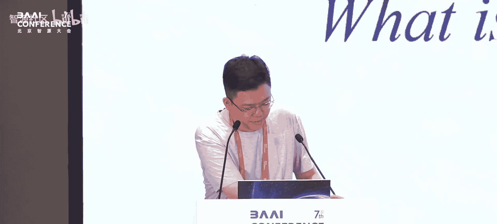
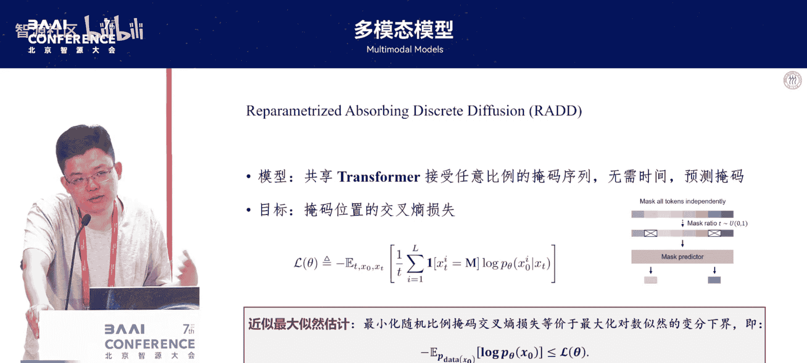
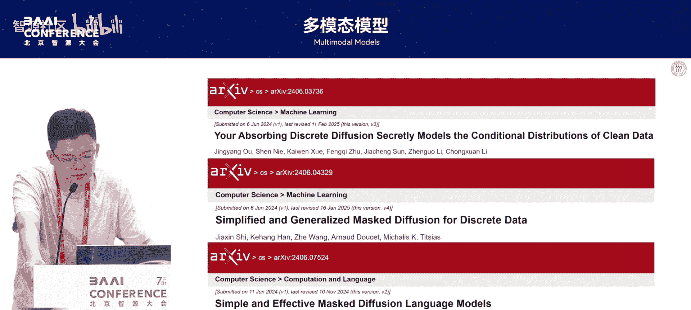
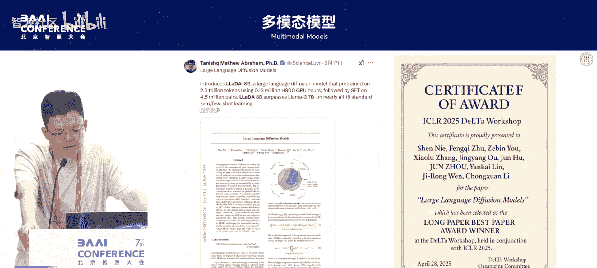
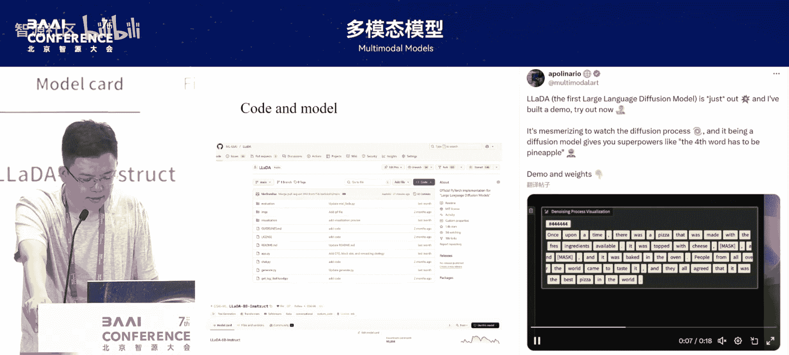
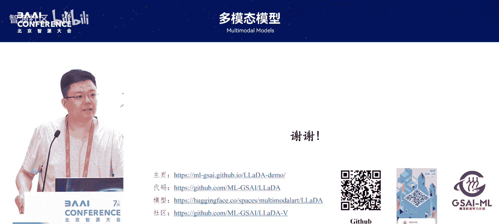

# 2025北京智源大会-多模态模型 p05 大语言模型新范式：李崇轩 -BV1zfNxziEfo_p5-

感谢这个王老师和张老师，然后特别感谢支援大会邀请我来做这个分享。然后我想这个今天这个安排非常非常的用心。然后我刚才英迪博士的报告呃，有很多很多的。😊，这个感触啊我觉得学习了很多。

那么我会讲一个可能稍微互补一点的这个视角啊，就是这个怎么用diiffusion啊去做语言。

ok那么我们可能呃主要就是最近有一个叫lada的模型，2月份啊放出来啊，然后呢大概他能做一件什么事情呢？就是他可以呃接受人的这个输入啊，然后呢用这种由浅及深的顺序，不是从左到右的顺序来去生成语言啊。

然后呢你读读它它还是很连贯的。😊，嗯，然后我们在一些大家比较关心的任务上，像这个数学呀，还有这个代码，这个问答，还有啊一些多语言啊，大概可能20多个任务上跟一个呃因为我们预学练水平还不够高啊。

然后跟那个一个同规模。然后数据量比我们大一些的这个代表性的自规模型那么3做了一个比较详细的对比。大概呢可能呃是整体上是相当的可能还是稍微差一点，但基本上是持平的这么一个状态啊。😊，ok好。

那么可能大概我们呃基于这个结果呢，我们就会去呃背后有四个方面去给大家介绍啊研究的动机技术的路线，还有这个拉拉是怎么来的，以及这个呃我们有一些系列的这种工作啊呃那么首先是研究动机啊。

呃我我个人觉得啊这是我个人的一个观点。因为我做生成模型出身啊，比较偏那个呃基础一边，所以可能会有一些呃跟离博士还不太一样的这种呃观点。

就是说呃我个人觉得它可能有三个要素来去帮助生成模型去表示一个非常非常高维的概率分布，不管是在语言还是视觉上。第一件事情是网络结构啊，那么transformer的结构告诉我们可能在很多很多模态上。

我们都可以去做的很很scalable。那么第二个事情是我们当然要去扩展这个规模啊，扩展规模来去建模这种复杂的分布。那么第三个维度呢，它其实跟前两个维度是正交的啊，就是它是一种概率建模的方法。😊。

那么我们现在面临一个问题，就是呃当然在视觉和语言上它是不一样的，就是有自回规和diffusion的这种啊不一样的概率建模的方法去呃做这种呃不同的尝试。但我想很重要的一个点，就是diiffusion啊。

特别是相较于AR来说，它本身也可以用transer，也可以做的很大。所以它并没有说呃天然的是一个呃怎么说，就是在语言上或在其他的模态上啊，不能够work的这样一个东西啊。

ok那么我们可能会更多的从这个呃概率建模的视角去看待自归模型。那么这里面的定义大概是说呃一个语言模型它能从左到右去做这种nex prediction啊，这个GP的方法。

根本的原因是因为啊就像李博士说的一样，它是一个将联合的概率做这种条件概率的展开啊去决定的。所以它是用这种链式法则，把这个高维的概率转成很多的低维的概率。😊，那么diffusion是一个很不一样的过程。

它也是迭代的啊，它也是迭代的，但它更像是一个草稿反复的去修改的这样一个过程啊，一个粗糙到经济的过程。那么它的概率建模方式呢实际上是一个随机的过程。这个随机过程当中。

很重要的一点是数据分布的维度是不发生变化的啊。然后它是一个没有结构的，比如说高斯到一个有结构的啊，比如说数据分布这样一个去噪或者是结构化或者是复杂化的这样一个转移的过程。

所以本质上它们是非常非常不一样的这个不一样来自于哪呢？来自于我的高维概率怎么样去表示啊，怎么样去表示。😊，O那么我想有一件事情大家都是广为人知的，就是在语言上啊。

大家呃这个自微做了很多的探索也非常非常的领先。那么我们这个报告一个核心的问题，一个出发点就是讨论自是不是语言智能的唯一的路径。啊，那么我想呃如果一定要用两个公式或者是一个背后的原理去总结啊自规模型的话。

我想要是应该是有两个。第一个它是一个生成模型，什么意思呢？它在做最大自然估计啊，也就是说他希望在我见过的文本数据上能够最大化它从某个模型中被产生出来的概率。而这个模型就是我想要的。

那么它确实是在去优化我的数据分布和模型分布之间的KL散度。你可以想象，当这个KL散度足够小，你有很大很大的模型，很多很多的数据，那么这个KL散足够小的时候，我生成的分布啊，就会很像人类说的话。

那么第二个事情呢，就是生成模型本身就是最大自然估计它是一个通用的原则，它可以用到不同的生成的范式上。😊，那么最关键的就是我怎么样去定义这个联合的概率。在自回归里面，我们是用的n或者这种链式法则的展开。

哎，所以我们两个结合了，就有这种大语言模型。那么我们的第一个观察是什么呢？就是大语言模型的很多好的性质，其实来自于公式一，也就是它是一个生成模型，而不来自于它是一个自回归模型，它做了链式法则的展开。

比如可扩展性，我们想可扩展性来自于哪呢？一方面它来自于我的这个transer的结构，对不对？但diiffusion也可以和transformer结合。另外一方面它的损失非常稳定，方便我去做扩展啊。

优化性质很好。那么我的diiffusion啊去造的损失也也很方便啊，也也很容易去优化。那么公式一呢就是它的最大自然估计这一项呢，其实决定了它极限的时候的可扩展性，也就是说你有无穷多的数据。

你的表达能力很强，模型特别大，以至于包含你的真实数据分布，L散度，你的优化特别好散度可以优化到零的时候，你会恢复你的数据分布。😊，这就是我们最终最终想要最最理想的一种扩展性质。

那这个性质呢当然是属于所有的生成模型啊，包括diffusion。所以它不是一个排他的。那么第二种呢是这种指令追随，还有情境学习，还有对话这种能力。哎，你看大原模型很聪明，你跟他说一个什么事情。

他能反应过来，它能够按照你的想法去生成对应的回复，那本质上说明它是一个好的条件概率啊，你只要条件概率建模的好，给了它pro，它能够找到对应的response的分布，它自然就生成你想要的答案。啊。

第三点是关于这个压缩啊，大家都在讲压缩机制呢。那么其实compression本身是一个从信息论里出来的，他诱导出来了像KL散度这种优化的准则。所以本质上你做概率密度的估计做KL散度优化，优化的越好。

你会越接近于你真实的数据分布，你的压缩率也就接近于真正的极限啊，也就是数据的商。所以呢在大言模型之前，其实在呃很多的视觉的任务上比。😊，图像的压缩上，用flow这种方法已经做的很好了。

超过了这种jape的这种压缩率。所以本质上来讲呃，条件的生成和压缩也并不是自回归专有的啊，从这种理论的角度出发呢，也许usion是一个可行的这种道路。那么第二个观察呢就是大原模型的有一些局限啊。

确实是来自于自回归的建模。😊，第一件事情就是我们仔细观察字图V的这种生成的方式，一定程度上，它是要正比于这个输出的长度啊，生成速度要正比输出长度。那么为什么呢？就是因为它用这种呃链式法则的建模。

它要把联合概率拆成一维一维的那它自然要一维一味的生成。当你让GPT生成很长文本的时候，那就要等啊那就要等我们有很多好的这种工程的实现，像KVc像稀疏的tenion。

但本质上它是减少每次迭代它调用的这个时间，而不是减少迭代的次数啊，所以它是一个很本质的一个呃内在的一个概率建模带来的缺陷啊。😊，嗯，那么第二件事情呢是关于它的双向的这个建模或者是呃an推理能力。

那么这里面一个很重要的事情就是当你给定了一个顺序啊，语言里面是从左到右或者视觉里面，你可以有一个其他的顺序，给定了一个顺序之后，自由模型，只去建模单向的这种条件概率。

它没有双向的这个本质上就没有双向的能力。那么在语言上呢，有很多很多的这种。😊，问题，比如说我生成了一个字，它就不能改了。然后我生成后面的东西的时候。

我没有办法再去把这个信息给到前面去让前后一起协同的去生成。那么有很多好的方法，比如像早先的这种ag你会有很多的tlate，但本质上你在说如果我把一个自回归模型的输出。当成另外一个自回模型的输入。

就是ag之间的交互，那么第二个agent或者自回归，他就有机会看到第一个问题的所有的答案啊，比如它生成错的地方，比如他前后的所有的连贯的东西，我去决定我下一次生成。然后最近呢这个进化到一个长思维链。

就是我可以不用两个自回归去交流，我可以一个自回归说哎像这种深度思考的模式。我先有一个特殊的token说你先不要回答你去思考思考比说你一加一等于几他一加一等于3啊，三减一等于一等于2好像不对。

所以我算错了，我再重新算，你可以看到中间这些token的生成在做什么事情，它就是要去尝试回答完这个问。😊，题，然后再反思说之前的答案哪里不对啊，然后我要看到全部的答案，哪里错了，我再改。那你可以想象。

他要生成很多很多的token，才能够去纠正一个答案里面的所有的问题啊，最终呢再给一个正确的答案的输出。所以从这种test time skating的角度来讲啊。

我个人的直觉是觉得这种是不太经济的啊不太经济的。😊，OK好，那么呃问题就来了，似乎会有一些缺陷，我们有更好的方案嘛，也许diffusion啊是一种可行的解。

我们回到刚才diiffusion它是一个粗糙到星系的建模过程，它也迭代，但是呢它的迭代很不一样，是因为它是永远看着当前的所有维度啊，这个草稿去决定所有维度上应该怎么修改。

所以呢它是有双向的这种attention或建模的能力，它同时呢迭代的次数也未见得要依赖于输出的长度啊，我之前做一些连续的diiffusion啊，像DPM这些做加速的，所以它可以做的很快啊，做的很快。

那么这里面有一个非常非常关键的问题，就是我们怎么把连续上那么work的 diiffusion的这种范式迁移到语言上，它们本质上有很多不一样的连续和离散模态的这种区别啊。

那可能需要我们开发一种新的diiffusion的范式。😊，好，那么接下来我就呃快速的我们能够去呃看一下这个技术路线啊技术路线。呃，那么基本上我们是在23年6月份开始做这个呃离散的这种usion。

然后其实这个有很多很多国际的同行在做这件事情，然后大概在24年6月份我们提出了一个叫read的方法啊，这是一个非常非常简单的一个呃离散的这种iffusion的建模方法啊。

然后同期呢有de还有奈尔的一些工作。后6月份做完这个事情之后，我们觉得在算法理论上已经很清楚啊，然后就做了第一个s啊，大概是去年的10月份啊，然后在今年的2月份啊基于这种的结果，非常非常的这种prom。

然后所以做了一个比较大的模型啊，大概是一个巴的这样一个扩散的大语言模型。有了这个东西之后，其实很多像 gogle还有这个奈尔以及他们有一些应用的上线啊，后续可能我们还有一个专门写代码的。😊。

年5月份啊 diffusion出来，其实他们在同期也做了很多理论上的探索啊，但是可能呃这个受限于这个呃他们在公司嘛一些一些一些policy的问题。所以他们没有开源呃很多细节，也没有开源他们的这个代码。

我们在2月份拉达出来之后呢，就开源的代码和模型的参数啊，然后所以呢很多学术界的也开始在呃探索这个diffusion的这条路啊，后面有一些比如像d one这些做啊推理的啊。

然后呃或者是语言的对齐的然后还有一些视觉mada这些做这种啊多么态理解和生成啊，也有一些做纯的多么太理解的啊，我们自己也做了一些系列的工作啊，大概就是这样啊，可能受到一些关注。O好。

那么这种所谓的啊离散的iffusion到底是怎么做的呢？虽然有很多其他的建模方法啊，理论上来讲有你有无穷重的这种离散的diiffusion，但我们特意选了一种啊比较简单。然后当时实验验证比较比较成功。

同时我觉得呢跟现有的一些大语言模型的这个基本的框架，它的这个trans的架构和数据处理比较耦合的这个一个方案，这样的话呢方便我们能够去在不改动其他的比如说数据处理啊，还有trans架构的情况下。

能够先去验证iffusion行不行。后续呢我相信也许会有新的diiffusion啊，能够在这个上面去验证成功。那么这个方法到底怎么做的呢？它其实它也像连续的diiffusion一样，它有两个过程啊。

一个是前项的加造过程。它实际上是一个加掩码的过程。那么在零时刻我有干净的这种文本。在一时刻呢，我有全掩码的文本。那么中间的演化呢就是用不同的这种概率正比时间去给它加掩码。😊，那么自然的我要去反向啊。

我想去学习一个反向的过程，来去呃得到一个从全掩码到无掩码的这样一个呃生成的这样一个范式。那么这个过程当中呢，我需要去建模这个过程的一个转移的函数啊，也就从一个高噪声的时间到一个低噪声时间。

我应该怎么变化，其实就去预测里面的掩码。本质上我们应该去选择一个呃每个时每刻都有一个转移核。但是呢我们希望去减少这个参数量，所以找了一个时间共享的网络。然后把这个时间T作为条件作为输入啊。

这个本质跟呃连续的diion是一样的啊，我有一个共享的网络去建模很多很多类似的这种转移核。😊，呃，那么我们第一个工作呢，其实证明了一个很重要的结论，大概就是说这个关于T的这样的一个时间的函数。

在掩码扩散模型的这种定下，它是能够去重三数化成一个呃就是跟T无关的一个需要建模的函数和个关于T的一个B解啊，也就是什么呢？就意味着我可以在输入中去掉我的时间，然后去建模一个干净数据的条件概率。

然后在推断的时候，或者是其他的时候，可以把时间的B是解啊，T减S除以T这个项乘上去，这样的话呢一方面我可以去简化我的学习目标啊，就像DDPM样。因为相当于关于T这部分的函数形式，我是已知的啊。

另外一方面呢，我们是为了对其自回归模型啊，就是你可以不用DIT啊把这个T的时间的输入啊都去掉。那么直接用原始的去建模就OK了。那么有了这个理论之后呢，我们可以和t建立一个更紧密的联系啊。

可能大家都清楚我我们可以有一个比固定的码比例来。😊，去学习里面的这个被掩码的部分啊，去做一个这种表达的这样的一个表示学习。那么这里面呃他们之间的关系大概是这样，就是首先你要选定特定的加道过程。

得到一个掩码扩散。然后呢，你要去证明它的转移和与时间无关，所以你可以去掉T啊去掉这个DIT用transer，然后呢最关键的一点就是你要从随机的掩码比例变成固定的掩码比例。这样的话你就得到了bot。

但最后一步这个变化呢，其实是非常非常呃不不显然的，是为什么呢？是因为如果你变化了之后，我们不知道怎么从bt里面采用文本。因为你想我从全掩码出发到一个零掩码，理论上我要见过各种各样掩码的比例啊。

所以说我们固定的比例是不行的啊，是不行的。那么或者从更技术一点的角度来讲，berrt它很难去定一个willde一个 distribution啊，就是我没有联合概率的建模，所以它不是一个生成模型。

我们就算bert能够去做sing up，我们也不期待它是对标自回归的，因为自回归。😊，它是一个生成式的统一的文本处理的范式啊，这是这样的一个关系。K那么有了这个基本的结果之后，后面就非常非常的自然。

就是说我可以用一个共享的transformer接受任意比例的掩码序列啊，不需要时间去预测掩码。那么我们的训练损失呢是一个非常自然的就在掩码位置的一个交叉熵。但是你可以证明这个掩码位置的交叉熵损失。

它和正常的diiffusion是一样的。它在优化diiffusion model最大自然的一个变分的下界。同时这个下界是很紧的。那么也就是说它在做一个啊princple的一个gen modeling啊。

😊。

ok然后这里面有一些同期的工作，大概我们是在差不多我们放在archive上之后啊，像嘉欣啊，我的师弟de mind他们就也同天放到一个 archiveive上。然后还有一个康奈尔的工作。

里面有一些不同的细节，他们可能实验做的好一点，我们理论深入一点，但时间关系我就不展开给大家讲。

然后接下来是一个非常自然的想法，就是我们要去把它做大，这样才能真正的去验证这个事情到底是不是O的。我们不能只有概率界盟的方法和网络结构，还需要有sing的这个维度。那么我们就用标准的这种做了一些分析啊。

大概的结论就是他的这个的区线是基本上可比的那基本上可比的。然后我们当时这个资源比较小，就做了一些大概一亿参数的啊，反正就是对标G的一些大小的一些实验。然后我们用了同样的网络架构，同样的训练时间。

同样的数据啊，同样的这个卡，然后得到的这个一些呃比较系统的下游的一些任务上的指标。这下游任务是我们从所有的大家关心的下游任务中选到就是G能得到有意义的结果的不是结果的这样一些指标的集合。

然后我们发现其实大概有4个啊是好的四个是这个不太好的。所以他们是一个可能有一定的互补的能力啊。😊，好，呃那么呃接下来就是我们有了这个之后，后面很很很很很很很很那个去呃得到了蚂蚁的资助。

然后去做了一个比较大的一个呃拉断模型的训练啊，这个训练过程呢其实也是尽量去跟现有的这个语言模型的一些recipe去对齐。啊，我们有无监督的预训练，就是刚才讲到的这种read的方法。

然后呢有一个有监督的微调，有监督微调过程中呢，其实我有程度的数据。但我在pro上就不会去加这个掩码，而是在response里面去加。这样的话就他就建自然的去永远的看到前面啊，就是建模一个条件的概率啊。

然后最后呢训练结束之后，他就有了这种对话的能力。你可以给他一句话，让从全掩码出发去生成它的文本。😊，那么首先呢我们在这种下游任务。

比如像MMMU这些大家比较关心的文本的下游任务上做了一个呃很好的一个呃这个可扩展性的实验的结果，大概是在十的二3次方的fs以下啊，这个拉达啊这个五角星有一个更好的可扩展性。呃，然后当然这个结果也看到了。

我们大概是跟拉么38比是持平的。呃，然后我们简单的去有一些简单的验证啊，就一些呃比如说零样本的这种诗词的呃上去填下去下去填上去这种对比的前向反向的推理任务啊，然后我们跟这个像千问。

还有这个GP4O他们的预训练水平肯定是高很多的啊，有很多的这种大模型和这个数据，所以它的前向过程可以想象，比我们的这个前向的问题表现要好很多。但是呢反向的问题一般都会有很严重的调点啊。

然后但是Diffusion本身它没有这个问题啊，所以在反向上有一点点优势啊。😊，然后呢我们可以去有一些case study，让他去生成对话。

大概就是说呃你让他问这个首这首诗啊the not taken啊，他记得前面几句话，让他做这个中文德文的翻译，他有多语言的能力，然后让他一个复杂的指令，让他去写首诗啊。

关于人生的选择5句话句话以C打头他也能服从那么我想说这这个可能大家已经看惯了，他他不是一个很让人惊讶的结果，但对来讲也许他不是那么显然的啊，同时呢我们的这个预训练可能只有两T的 token啊。

所以他他在这个水平上啊能够有这种对话的能力，还是我觉得是一个pro的结果。然后在训练结束之后呢，我们可以有一个很灵活的不需要任何的微调啊，因为它本质上是一个更一般的损失函数，他见过了所有干净的条件概率。

所以呢他很有有很多不同的采样的方式。比如说他可以去用随机的方式啊，就是我去回答一个数学问题我也可以划分一个block。比如说。😊，呃，这个每8个token为一个block。

然后中间是这个diiffusion啊，外面是ca的啊，就像这个李博士最后讲的那种啊AR在top的这种感觉一样啊，这个呃也可以去生成啊，然后一个极端的情况下，当我的block size取成一的话。

它就像字归一样采样，从左到右。所以呢我去我觉得是一个非常非常呃一般化。然后同时有机会以它为一个框架去融合现有的一些字符归模型的这个一些进展的一一种机会啊。K然后我们这个工作其实也受到了一些关注啊。

然后也有一个Iure的workshop的一个研讨会的一个最佳常文啊呃模型和代码都开源了啊，所以也也也受到一些关注啊，也受到关注。呃，模型可能也累计也有个几十万的下载量。😊。

那么回到我们的这个初心啊，就是说呃我想我们可能也也也没有真的完全回答这个问题，这只是一种可能的路径的去探索啊。然后现在的水平呢实话实说离顶尖的。当然他们可能会比我们好一些。

但是离真正的顶尖的自水平还有差距啊，所以呢我们还要继续去做这件事情。但从拉大他去呃用这种扩散的方式去生成文本之后呢，给我一个非常认知上的一个很大的改变。

或者说在学校里面我们更关心这个背后的一个科学的意义。就是说也许对于机器来讲，我们人的语言其实不是语言，你怎么样去教他人的语言，你只是给他一个最大自然估计的这样的一个框架，让他去学，让他去学。

那么既然是最大自然的话，他他的目标就是一个分布的拟合。那么从拟合的角度来讲，也许他不会像人一样受限于这个信道，说我一定要从左到右去读才能明白，他就是整个句子给他，他能刻画整体的概率能刻画的越准啊就越好。

所以也许不一定。😊，是从左到右才是唯一的这种自然的选择。好，那个呃对时间的关系，我们可能还有一点时间可以给大家介绍这个呃关于lada的这个价值对齐和多态理解的一些系列工作。

第一件事情是呃我们可以看到拉da的第一版啊那个没有做强化学的对齐啊，其实就做了SFT那么一个很自然的想法是它到底能不能和强化学习做融合。啊，那么有很多其他的这个同期的工作啊，像D onedo这些呃。

他们用一些比较先进的像GRPO这些方法啊，用到这个啊语言模型的对齐上。但我们可能呃更关心的是说呃并不是RL方法本身的先进性。

而是说一个diffusion model和自挥mod在RL上最大的区别是什么啊，有没有大家觉得这里面有一些比较本质的困难啊。

我想去先去解决这个啊这个事情那么这里面最重要的一件事情是基本上主流的RL方法它都需要比较两个模型的对数似然啊，什么意思呢？就是说我呃参考模型。😊，可能是SFT之后的这样一个模型和我的一个策略模型。

也就是我要优化的模型。他们对于一个人类偏好的数据，比如叫Y win啊或者是YW这个数据，它的概率不应该一样。因为我希望相较于我的参考模型来说，策略模型会以更高的概率去生成人类偏好的数据。

所以我一定要比较他们之间的这种自然啊，比较这种自然。那比较自然的时候，你要算自然算自然这个事情，在自回归里面是自然的啊，你去一个forward。因为它给定了所有的ground truth。

你可以用这个加和log probability的方式把这个联合概率自然很容易算出来。但在呃这个扩散模型里面没有这么自然，它是一个这种估计啊，我们是一个下界这个下界当然比较紧，我们可以忽略这个偏差。

但最关键的是这个下界是一个期望的形式啊，理论上来讲，你要去啊求和所有的时间或者积分掉所有的时间才能够算出这个下界。但实际中大家如果对ion熟悉的话，我们是做什么随机的采样啊，去采一些时间来去估计它啊。

就像我们做随机梯度下降啊，去估计梯度下降一样。所以它是一个随机的这样一个估计啊，并且呢我们是一个双重的。因为它还有涉及到对这个掩码数据的这种采样。😊。

那么这个估计呢就会对我的这个似然里面引入一个随机性或者叫一个方差。这个方差对于L来讲是应该来说是一个很重要的问题。因为基本上大家应该知道L本身的训练很困难。

很大的原因就是为它的方差做经常要去做方差缩减那么以我们可以证明啊我们一定要去缩减这个概率估计的方差，那么怎么做呢？有很多的方法第一种最简单的想法就是我去加大我的采样个数，加大我的采样个数意味着什么？

就是对于一个偏好数据，你要采样很多的时间和掩码数据才能估计它的似然，那就意味着你的 size和ps等比例的增加。所以这是一个很很坏的事情。但是呢我们有一些其他的方案。首先当我的总体的固定的时候。

我们可以考虑内层和外层它的一个分配问题。我们可以证明最优的这个分配在于采样最多的外层时间，每一个外层时间只对于一个内层的这种偏好数据的采样啊，这就是最好的差最小第二个这个东西是关。😊。

于它是一个自然的比啊，它不是一个自然本身的一个值。所以呢我们可以在估计这两个自然的时候，把其中的随机性给它固定在一起。这样的话他们做差的话，随机性会削减到很多啊。

这是个很典型的叫一个很经典的这个缩减方差的技术。这两种方法呢它都没有偏差啊，也没有任何的计算开销。然后你可以证明它会很好的缩减方差啊，然后他也可以扩展到各种各样的L的方法里面啊。

我们当然简单的用个DPO啊。然后我们做了一些很详的大概就是说你去找最优的allocation去增大你的size去让你的这个队偶的这种去削减方差，对于方差的估计对梯度的估计都有很大的好处啊。

然后同时他对所有的下个任务有一个一致性的提高啊。😊，呃，那么这个可能一个主要的一个message传给大家。除了前面那些技术的部分来说，最重要的事情就是基于这个方差缩减的这种对齐的技术。

lada的数学代码和对齐的性能啊，全方位的有一个提高。并且呢我们这个数据其实本身是为自准备的啊，我们就是拿过来用了一下。那么自符模型同等大小的自符模型在这个数据上的提升基本上和拉da是一样的。

完全一样的。所以呢我们认为拉da的RL对齐是可行的。😊，K然后呢我们也也也去跟一些相关的一些模型啊，还有这个拉了后续的一些专门做数学推理的。虽然我们是通用对齐的数据啊做了一些比较。

发现数学上我们还是更好。有些指令追随的这个case study我就不讲了啊。那么最后呢我们回归我们的初心，其实绕了这么大圈子。我们最开始其实根本不是为了做语言，我们是希望做一个统一的一个概率建模方法。

统一的多模态模型，希望把一个多模态的概率建模，一个生成模型转成一个单模态，因为transer已经统一了已经统一了，只要我有一个统一的 function，一个概率建模的方式，那么所有的事情都是一样的。

但这种情况下，当然有很多其他的探索像四欧啊或一些其他的啊自己最近的一些工作，大家都在聚焦到自回归，为什么我相信很多很多人都想过diffusion也许可行，但是就是绕不过语言。当语言的这个事情解决之后。

我们又回归初心去看，如果用多么态统一的话，是不是扩散它的优势会更大啊，因为它在视觉上其实表现是更好。那么我们一个初步的方案是做了一个很简单的一个多么态理解的任务啊，大概就是说我把那个语言那块拿过来。

然后呢找一些这个呃。😊，能有1000万的这个啊图文的或者图和视频视频和文本的这种呃视觉指令微调的数据啊，做了一个SFT啊，就非常非常简单。其实就是lava的这种感觉啊，了lava的感觉然后做了之后呢。

我们找了一个非常重要的是我们语言上其实整体跟三相比是差的。比如说9个数据里面可能也就有两个是好的个是差的。但是我们会发现在同样的这种多模态的数据做了指令微调之后啊反超啊在可扩展性上有一个更好的结果啊。

然后在整体的这个很多很多标准的这个多模态的任务有非常好的这种结果，甚至跟最顶尖的像千万25啊一些当时最顶尖的一些这个视觉语言模型的结果在很多上面都非常接近基本上不差的。但语言上它其实落后非常非常多。

所以这是一个我觉得很积极的信号，也iffusion的多模态潜力还没有被充分的挖掘出来然后呢。😊，我们也去对标了一些啊，比如说一些混合的方法啊，也许他们在视觉上用了diiffusion啊。

但是受限于语言的这种自回归，他他最后得到一个混合方法，里面有一些比较有名的，我们都拿过来。然后在他们所有评测过的这种呃多模态的任务上，我们都做了一个评测。

发现哪怕我们的diiffusion的langu model比他们的自回归的那个模块要差很多。但是一致性的这种通用的训练，已经在所有的这种语言呃这个多模态理解任务上得到了更好的结果。😊。

ok然后这里面也有一些case study，当然他现在聊天的时候可以给他涂了啊，然后呢，他让他数着里面有多少只鸟，然后你可以看到他用扩散的方式去去生成。然后最后呢给了一个呃最后的这个答案啊。

输出的这种答案。😊，OK好呃时间可能差不多。然后我们总结一下，大概就是说呃我们其实也也是这个尝试了一种新的这种路线来去用啊diffusion去做语言。然后呢我们做了一些工作。

像基本的这种概率建模的方法理论啊框架扩展定律，还有一些预训练指定微调的这个做法啊，然后呢还有一些开源的知识工作啊，都已经完成了。像RL还有多么态输入或者多模态生成这些其实非常初步。

我相信有很多很多好的方法，可以在结合diffusion本身的特点啊去develop新的这种啊呃这个方案，然后有新的这种呃结果去产生。啊，然后还有很多很多其他的这个问题。

比如像一些呃架构的设计和K最近这个呃拉大的加速有很多做啊，可能我知道也有3篇他们号称可能平均上可能有8倍左右的这种加速啊，然后大概极端的情况下，可能有27倍的这种加速。所以从这个角度来讲。😊。

嗯做一些的这种优化的潜力还是非常非常大。那么我也相信这个 diffusion，它本身的这个加速的这个效果可能很快学术界啊也能去赶上。因为diffusion还是一个非常非常新的这样一个领域啊。

然后有很多很多可以完成的工作。好，我的这个呃报告基本上主要内容就结束了。然后感谢我的这个研究团队里面的所有的老师和同学们啊非常不容易去做这样的一个呃比较风险比较高的这个方向。

然后也很荣幸得到了很多的这个呃研究机构高校还有企业的合作方的帮助啊，然后我们这个呃有一些这个链接，包括拉大本身的一些demon，还有他的代码模型，然后他学生也搞了一个社区啊。

然后还有一些我们组所有的ub code，以及我们经常在知乎上有发也不是经常了有时间的时候发一些对生成模型理解的文章啊，大概就这样，感谢大家好，谢谢。😊。

