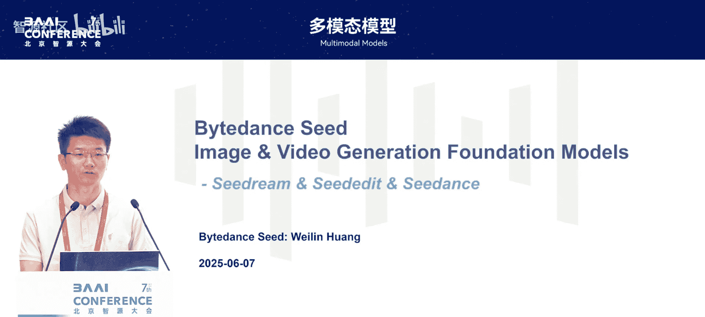
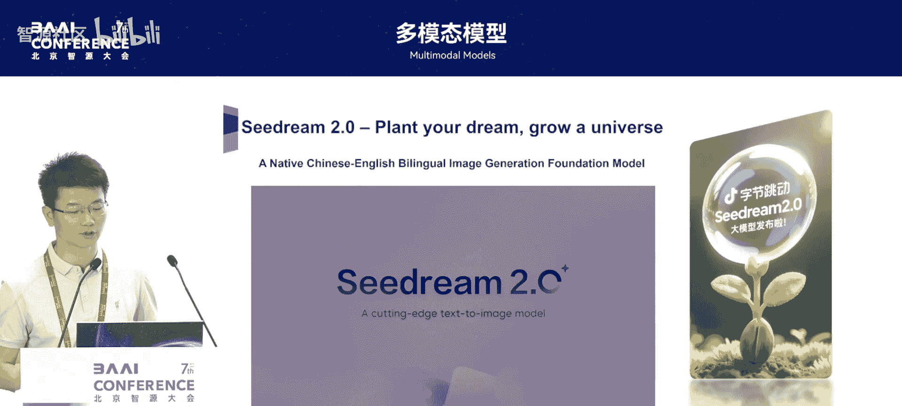
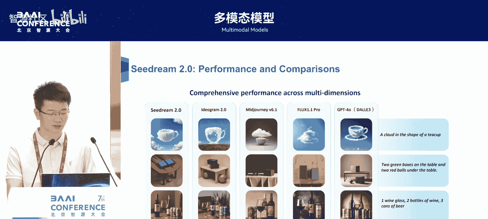
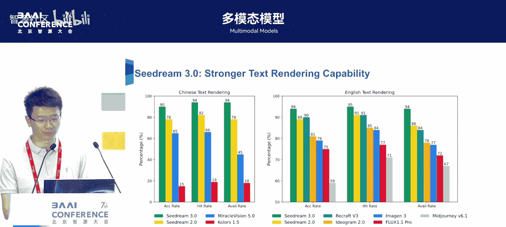
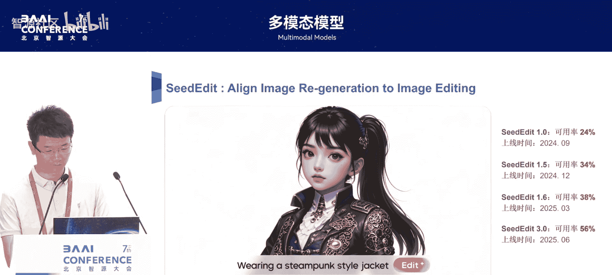
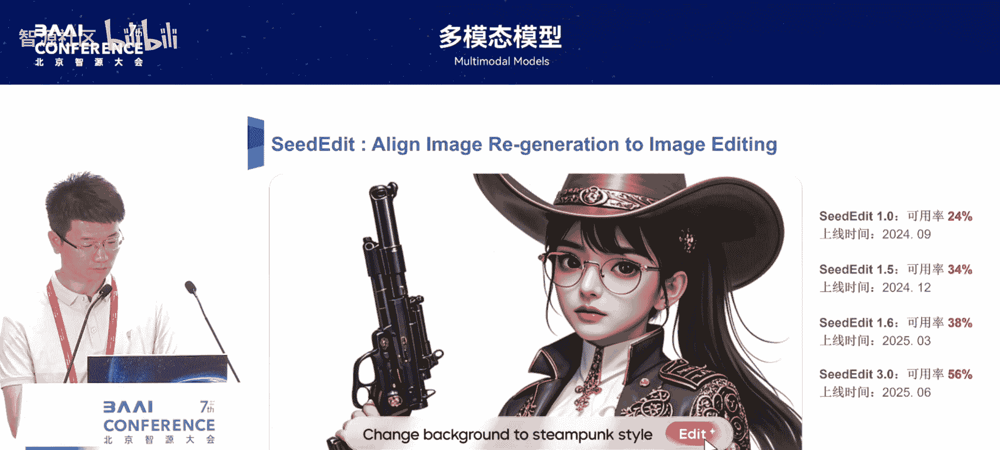
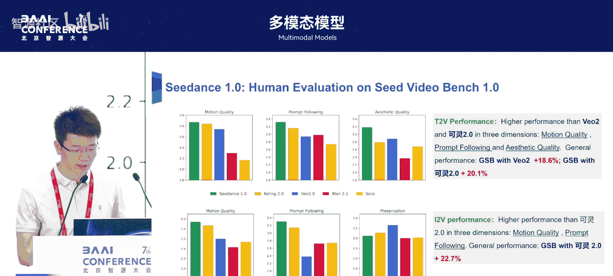
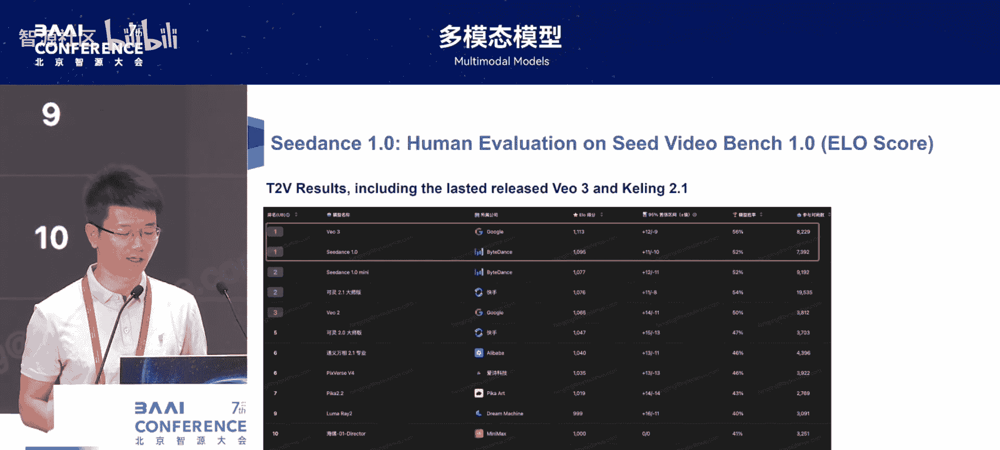
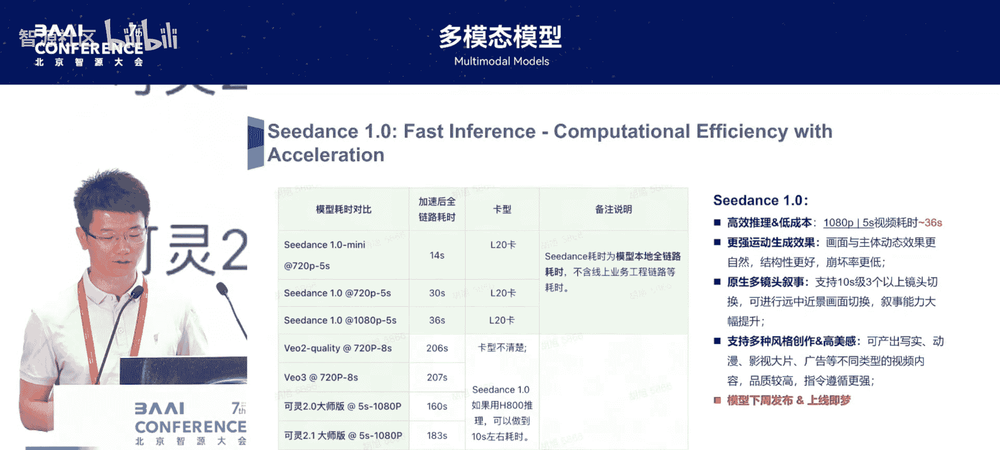
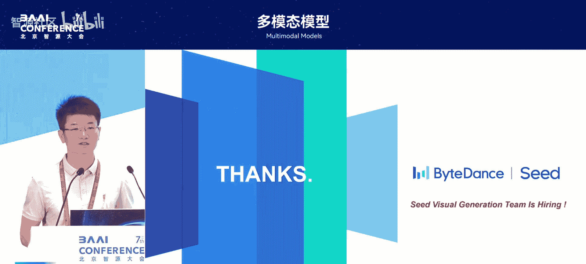

# 2025北京智源大会-多模态模型 p06 Bytedance Seed-Image & Video Generation Foundation Models：黄伟林 -BV1zfNxziEfo_p6-

大家早上好，我是来自志杰的黄伟林。呃，非常感谢志源那个今天的邀请啊，有机会也是第一次跟大家分享我们在Cd里面的一些图像，还有视频模型的一些进展。然后这个也是基本我们呃商业模型啊，基本上支持了整个字节。

包括多包了、dement了，还有抖音上所有的生成图像生成，是视频生成的一些那个技术模型。

对。第一个就是呃今天讲的大概内容就我们讲的主要有呃三个模型啊，有前面两个都是图像模型，一个图像的呃那个生成模型，还有编辑模型。对，然后最后一个是会介绍一下我们这个视频模型。这个模型可能是下周会发布啊。

然后后面也我们也列了一个几个模型，呃，大概的时间，就大家可以看到，就是说我们呃图像模型叫s dream2。0。呃，最早上线，呃，应该是24年8月份啊，然后12月又更新了一版。对，然后3。

0是今年那个呃4月份刚上线的。然后后面是两个嗯编辑模型，编辑模型也是从9月份到今年6月份呃，也是昨天刚发布了，然后大家可以可以试一下。然后这两个模型基本上是把图像能力。

就是说关键的能力做单点的都做到比较我们觉得觉得应该是做到了呃商业可以落地的程度。然后然后再往后就是莫高这个模型就应该应该是呃是我们一个统一模型。所以我们后面会把所有的图像的动模态能力整合到一个模型。

然后可能在下半年也会推出一些商业的版本。对。🎼对，这个是我们去年最早那个8月份发布了一个那个CGM2。0，就当时就是做的主要一个目标是说哎当时怎样做一个中文的，就中文能力比较强的双语言。

我们英文能力也很强，就双语比较强的一个双语言呃双语模型就就把中文这些元素，中国的元素能够做的很很极致。对，这个当时在业界其实还是说比较难。因为很多语言模型都依赖于T5的这个这个呃语言模型。

英文的一些构架。对。

所以我们当时做这个设计这个模型的时候，主要考虑到唉当时嗯应该研发的时候，应该是在224年上半年。对，所以当时主要是模型有业界的几个模型。我们看了有有一些比较大的短板。

但是我们觉得这个在商业落地的过程中非常重要。所以我们当时去去去去思考了一些问题嘛，就是说很多模型像对吧，大概大部分是在美感上做的比较好。但是它的基础能力像pro flow能力是比较一般的对。

然后还有一些比较重要的feature，就是像文字的生成呃渲染，这个是呃当时业界都做的不太好的对，还有就刚才提到的对中国中国元素的生成。

这个因为我我一直觉得是对对对这个生成或者对这个创作是非常重要的一个特点。所以我们主要是想对吧这几个点做的加更加呃极致一点。对，所以所以下面就简单介绍一下这个大概的一些那个嗯我们的设计吧。

但是也可能是比较比较比较出力度的啊。就是首先是我们呃觉得过去一年一两年的我们做了一个比较好的一个数据的系统。有这个系统其实还是非常重要的，支持了我们后面所有的模型迭代的效率跟质量。对。

所以这里面我们其实是把数据从多个维度做了一个呃呃这个不同层次的就是呃筛选和优化，对，第一层是我们从数据的质量上面，对吧？我们会选出一些高质量的一些呃美感比较好的一些数据，对吧？第一层是质量。对。

然后第二层是说哎我除了质量以外，我们对这个数据的分布跟多样性也做了比较多的呃，呃就是说过滤吧。对，因为你你的很多数据是重合的，重复重复的。然后有的有的数据是没有覆盖到了一些分布。对。

所以这里面我们做了很多。大量的一些工作，好了，依赖于一些呃超大规模的一些剧烈的方法来做的对，然后第三个就是说对一些嗯知识性的东西。对就我们有建了一些那个知识数，就是呃叫tex的一个知识的，包括各种词表。

然后会根据这个词表去扩展我们那个所有的数据结构。对，然后最后一个就是说我们也会根据一些嗯比较缺的。但是呃模型比较弱的这些模块去做一些专门的数据的检索跟优化。对，所以通过这几个层。

我们基本上把整个数据系统做的呃比较扎实。然后在这个基础上，我们呃去不断的去sing数据过去呃过去一年应该呃我们sing的数据应该是在呃5到10倍左右。对，这样的一个这样的一个节奏。对。

然后第二个就是说模型构架的设计啊，就是说构架设计呃主要有几个点，可能主要也是跟针对刚才上面提到的。就我我们呃过去一年我是觉得做的比较好的。就是我们应该是在23年底就把这个语言模型。

 decod only的构架，用到做t en code。一个因为那个时候去年还呃23年的时候，大部分的还在用P5或者用一个clip的t encode说呃才能实现这个中文的能力。对。

所以说这里面对中国原呃中国中国元素这些原生的呃学习跟翻译，就实都会带来很大的gap。所以我们。所以我们当时是想做一个怎样如何把这些语言模型，对吧？然后另外一个就是说你你如果能把语言模型用进来之后。

然后它语言模型的迭代是很快的那不像那种T5那种呃encoder deco构架，其实已经不再迭代了。所以我们每一个版本语言模型texender这块升级都是随着语言模型的进展不断的在升级了。

所以这个给我们后面带来一个比较大的一个比个收益。对，然后。就然后这也导致我们后面在不光是中文啊呃原生这些元素，然后包括图文匹配这块，其实也是有持续的呃持续的那个呃呃升级。对，所以说到第一版过去之后。

基本上在图文匹配这个力基本上上了的那一水平。对第二个就是说我们在一个应该是功能性的对吧？就把中文我们当时看了一个中文文字的生成都比较差。但是呢文字这个又特别重要的一个feture。

就说你能够能够把文字生成的出来，生成的准并且改准了，这个对商业场景的应用就非常重要的。所以我们当时就想怎样把文字生成的更好。所以当时也是做了这么一个工作。啊第三个就是说我们呃2。0的2。

我们应该是从去年上半年呃3月份左右开始应该也是那个收纳出来之后然后我们就把个I这个构架应该我们是觉得做的比比较抵制比较高效，所以这个后面给。我后面带来了一些呃。

也是说在scaing数据加构架上面就比较稳定的呃提升。对。主要是这个三三个点的那个升级。对，然后第二个是说我们在2。0之后，其实在这块也做了很多工作，就投入也比较大。对，然后就通过呃re model。

就是我们呃设计了很多个呃re model，然后针对这个模型的关键能力。比如说像图文匹配，还有美美美感然后还有这个文字渲染，这里面都做了一一都有相关的一个rere模型来持续的提升这这三个维度的效果。对。

然后第二个就是说我们在呃除了这些re模型。然后这re模型你怎样怎样去针对这几个关键的飞机去标数据，这里面也做了很多的一些工作。

不断的呃通过呃包括我们自己还有设计师这种迭代迭代的方式来不断提升这个re模型的效果。对，然后再往后就说我们也用了一个一些多轮的。我们是用re一些直接re的方法。

然后这个方法其实也是对生成我们现在摸了很多啊，觉得这这个是比较比较高效的一个方法比DPOPO这些。会更高效一点。但当但是他后面的一些scaning能力什么，我们呃可能也也还有空间在探索。对。啊。

这个当时是2。0的一些嗯，这个是8月份，24年8月份的时候的呃效果，主要是比了呃megram就flex，然后GB4欧GB4O当时应该是大3啊，就还不是现在的石欧。

就效果基本上是呃各方面各个维度还是比较比较接近索塔的，或者基本上至少都在第一梯队。然后这个是看有有些case可以展示一下，就是说还是我们当时对比的idegram，还有呃mi6。0。对。

主要是说在图文匹配在返现时这块就是是比较好的。然后最下面一个case可以看到，就是说在那个像呃。多主体多物体是吧，这其实一直生存的不太好。对，然后这个现在现在也还没有说完全都解决的非常好。

但但家比之前可能会好很多了。

啊，第二这个呃这下面也单独对这个中国中国元素，我们也做了对比，就对中国美感，中文的美感，还有中国元素的响应。对，也做了对比。基本上这块还是做的呃比较比较我觉得业界做的比较好的。对，然后从嗯从今年开始。

应该是。去年底今年啊我们开始就搞到就搞到这个3。0，对3。0就是主主要一个核心点，就是我们是在2。0的基础上做了一些比较有效的s。整个算利呃去年的话比2。0应该的6倍。

所以这6倍是吧带来的收益是非常非常明显的我们2。0到3。0，我们如果从可用率上看应该是一个字的跳跃。应该是从我们内部评测应该是从40%几到了65%左右。对，所以将近20分左右。所以应该是比较明显的。

所这里面主要是第一个是我们是呃对数据做了一些对数据的质量会更高，然后规模也更大，规模2。0的时候应该增长3倍左右。对，所以说呃还有对然后还有对文字生成这块的一些OCR的数据也做了一些更精细的那个优化。

对然后第二个就是模型构架，我们也做了一些对我们是在MDI的构架基上做了一些。那个第一个是说呃参数上也是是变大了。第二个就是说我们在整个模型的paline上面其实也做了很多的呃做了一个比较大的改进。

我们原来是基于两阶段的，是一个base model加一个refin model去做超光。然后到了30连接，我们基本上是做到这一个支出，指出可以只做到2K4K也可以对。

然后最后一个改进就是我们在port这块，其实也有持续的改进。然后在SFT这块一个比较重要的点就是说我们原来SFT数据是做了一个同样的美感。但是我们在呃。在3。0之后，我们转到了做一个艺术美感。

就是类似这样的一个美感。然后在这个维度上，我们做对数据做了很多呃高质量的一些数据做了很大的一些优化跟处理。这里呃让我们的美感有大幅的提升。对第二个就是说 model上面，我们做了一些 model的一些。

我们用LM模型来做这个模型的re model这里面的收益也是非常明显的对，然后最后一个就是说我们做加速做了很极致。我们3。

0基本上呃基本上大的模型可以做到3秒对3秒3秒的话其实对对比对比那个是有六七十秒其实还是非常大的一个一个优势啊。对，所以说这些收益给我们后面都来整个就是说基础能力的提升是比较明显的。

然后还有一个很重要的就是文字对对写文字这块是提升很明显的。对，这个是当时的对比，也是最近的啊，这这个这个基本上是比较近的。就右边是我们内部评测级的一个对比。

就基本上所有的维度都是都是呃接近呃都是第一梯队至少。然后第二个是说在外部的阿里飞。啊阿里飞这个一楼一楼板上，就是我们也做了一个呃去打分。对，基本上跟4欧是呃非常接近的。对，这个是一个综合的档。

然后是外对。所以这个呃后面也是现在目前当前我们在多包即mail上面的一个一个主要的模型。对，这里后面有些case啊，可以简单看一下，比如说第一个呃。中间那个对呃是我们那个3。0，还有对比2。0。

就是在呃propower for能力，对吧？就是响应能力，这些都都其实会会会强很多。还有这些比较难的一些case，一个是生成一些四呃四个图，对吧？然后每个图里面它有不同的表情，和有文字，呃。

基本上都还是响应的不错。然后还有这个是呃模型变大了，所以它整地的肢体的结构也会更好。对，所以以前会出现。比如说在运动运动的情况或多人的情况，它肢体都会有一些会出现一些瑕疵或者问题。对。

然后这个问题基本上我们在3。0基本上都基本上都解决了，很很很少看到了。对，还有这个是呃美感上也会更好一点。对，然后这个是专门对呃文字生成能力做了一些就做了一个做了一个那个呃评测。就基本上在准确率。

还有召回率上面都都还是做的比较好。

然后这也是一个文字生成的一个case，一个比较难的case，就是呃有有7个杯子，然后每个杯子上面写着不同的字，还有颜色。对，基本上都还是做的比较对。然后这个是文字上面。

在中文英文上面呃生成的效果也还是比较可用率还比较高的。啊，这个是跟呃4OGB4O做了一个对比啊，因为我们这个基本上跟4O是差不多同一时间。对，然后发现就4O其实在呃英文生成呢确实是非常稳定，非常准的啊。

这个肯定要比我们要好一些。然后第二个，但是我们在中文生成上面，我们的字符的生成，还有对小文字，还有排版的生成，都都都会比4会更更更好一点。对，然后。刚才这个是那个图像生成的两个模型。都总结一下。

就是说我们从2。0到3。0，基本上是用一年的时间。然后呃2。0基本上解决了这个图像生成这个领域，一些基础的问题。它不再出现图文不匹配，不再出现那个呃结构不稳定的这个问题，基本上都解了。然后3。

0基本上是实现了整个生图领域。一个我是觉得一个比较重要的一个是说它作为一个生产力的工具，就是说可以解决很多商业性的问题。我是觉得这个应该是下半年整个在生图方面，就是说去年下半年到今年上半年整个生图的话。

在商业化落地里面一个非常重要的一个呃解决了很多一些关键的场景的问题，解触了很多一些关键场景，对吧？像海报设计配图，对吧？那这些其实都是生产力，还有那个广告广告的设计，都需要一些文字。

还有更稳定的一些结构。对。然后下面就简单过一下，我们在编辑，就是前面只是申图一个单点，后面是做一个编辑的一些工具，就呃编辑就是说改图就P就一键P图这样这样的一个能力。对吧？

我们从去年9月份上线的第一个版本C2。11。0。对到现在呃到后面那个到呃昨天昨天昨天我们上线了3。0啊。就整个的可用率，我可以看到就从可以从24到56。所以这这这这这对这个这个技术呃的落地，还有商业化。

应该也是一条过了一条非常重要的一个线。我是觉得这版之后基本上它是可以在改图，还有申图就广告这里面做了一个比较比较大的一个应用。对。demo简单看一下啊，时间不一定够。

🎼也基本上可以实现就是说呃任何一句话改图。🎼这个是我们底版的一个demo。

嗯对。Okay。对，我们简单过一下这个我们技术的一些方案。对，然后这个我们第一版出来，其实主要是通过是在我们那个T toI模型的基础上，然后做了一些改进，做了一个反turn，对吧？

我们从一个预训练好的T2I模型跟一个预训预训练好的这个呃多理解模型来来来来来来反正上一个一个编辑模型。对，然后这里面最主要的一个思考，就是一些考虑，就是要要平衡它的重建能力，就是说保持能力。

就是你你你是输入一张图，然后加一句话来改来改这张图，对吧？所以说你原图的哪些地方不要改，要保持的很好。第二个就是说哪些要改的地方要改的准，所以主要是平衡这两个能力。所以最主要的是要构建构建这个呃两张图。

一张是改之前一张一张是改之后的图，然后加加一个改改的指令。对这样的一个数据的一个构建，对，所以说呃主要是这样的一个就是就方法上其实还是构建的还是比较简单的。对，就刚才说的，左边就是我们的大大概构架。

就我们会有一张图，对吧？然后过一个呃理解模型，就VR模型。然后我们会把这个图加这个呃改的指令，对吧？一起一起那个通过通过语言模型VR模型会出来改之前指令跟改之后的指令caption。对。

然后会输入de model，然后把它排在一起，然后过一个通过一个cos attention。他说填写来实现它的那个最后的一个生成。所以这个框架是非常简单。

但是最主要的是说这个数据的构建要做的足够足够高质量，足够好。所以它反正出来的一个是说你对真实场景的拟合要更好一点，对吧？然后对于第二个是改的精细程度也跟着相相关的。对，然后。

上面是大概是这个整个大大体的构架。然后后面是我们最近的3。0做了一些改进。就是说这个因为它是通过反 turn的两个模型，所以它的效果跟T模型的效效果是强依赖的。所以我们这版3。时候是把20升级到。

作为一个基础模型。然后第二个就是说R模型理解模型也做了一升级，升级到我们面的一个比较强的个模型，所以整体效果是带来比较大的提升。然后后面两个改进就是说我们在在数据数据收集上其实做了一些更精细的一些设计。

对然后通过一个 information这里面把它强加入强注录到模型里面，让它对这个任务的理解会更深一点加加就是说有有有有方向一点。对所以就会就更好一点。

第最后一个就是们因为编辑里面很重要一个是说你一到另一张对吧？这个能不能变你人人物一变其实就没有什么价值了。所以说我们针对这里面其实做了一个呃这里面就是说。ID保持上面就有一个acface loss。

所以说整体效果还是提升的比较大。对，所以着随着这些收益给我们后面带来，比如说我们整体的可用率啊，可用率，我们从38到到现在这个版本到56，所以一个是一个比较大的一个一个一个提升。对。

然后这个是一些更细节的一些呃构架。就是说呃我们前面是有呃做 model的时从图图像是要经过一个VIE对吧？做一个encoder，然后在过理解模型是经过要要过1个VIP然后会把呃修改的指令也输入给模型。

然后一起过到VR模型VR模会把这些呃指令，还有比图像的信息，通过一个的形式输出去。呃，然后最后给他模型来做来做最最后的这个这个生成。对然后这版我们也做了一些反正加速的优化。

还做的比较比较比较比较呃这块投入还比较大。就说加速也做的比较不错。对，所以呢这个是整体的效果，这个是我们那个自动评测。我们从呃一点。1。0到3。0对，中边还有一个小两个小版本，1。5到1。6。对。

然后左边那个图是呃横坐标都是那个呃指令响应响应能力。然后纵坐标都是那个图像的一次性保持，所以从两个维度上右上角的肯定是非常好。越往右上角就越好。对，所以说我们可以看出来。

就整个我们综合能力还是说是比较好的。然后在像GPT它它它它就它的能力就比较偏差啊，它的一次性保持就没有那么好。但是它的指令响应是非常好GPT4。对你看它是在右右右下角这个位置。对。

然后右边的那个图是横坐标也是指令响应，但纵坐纵坐标主要还是做了一个IID人脸一致性的保持。对就整体说还是比较那个那这个是呃数值的指标也可以看出来啊，就是说在编辑可用率上其实整体还是说比4欧跟密4密2。

0这些还是好的比较多了。最主要是说我们在两个。做的比较均衡嘛。对，然后整个整个模型是在呃昨天啊，昨天应该是在豆包已经全亮了。然后吉梦在灰度，所以大家可以可以可以去体验。对这个是编辑编辑这块的。

然后有些case啊，我这就不展示了。就是主要是实现了就是说嗯对比的这这几个呃这几个主要的主要的商业模型。对。然后再往后就我们现在就现在就是说呃再往多模态方向做。

就这个这个我们也是那个放在阿开的一篇文章也构架，主要是一个构架。我们是把想把边辑能力，对吧？就刚才说的就一张图加一句话边辑能力。然后还有一个那个这个响应的就是融到一个模型。

然后另外一个我们要实现这个任意模太进，任意模太粗这么一个构架。就是说就是说你你你你你问你一句，就西红柿炒鸡量怎么做，对吧？他会跟你说第一步说什么，第二步说什么，第三步做什么，啊每一步都有相应的图。

然后在前后的图需要一致的内容也需要一致的这样一个多模态，就是说现在业界也比较那个在比较火的。但是这块就是说呃我们主要是做了一个构架来验证。然后这块我是觉得我们最重要的是说。构架业绩可能大大差不差。

但是最主要是数据的构建会差很多。就是说数据的能力是会决定这个模型的那个效果。对，然后整体构架就是说我们也是用了一个AR加的方案，就是说R过图，面是后R是的整个构架其实说我们做了一些精的计。

但是呃让这个在交织能力会更强一点。但是这里面其实还是依赖于数据。对所以说构架我就不过了。然后几个技术点就是我们通过这个呃呃交织的这个解决了这个交织生成一个更更更高效的一个问题。

然后在训练里面呃还有这这个这个这个我们做了一个这练样样式这个效果可能更稳定一主要这些改。后我们有一些技术报告大家可以去看后整个效果其实基本上。也是对比一些理解跟生成，基本上都是呃比较比较说套的对。

然后目前就是说这个方案就是我们基本上验证的这个构架应该没有太大问题，不管是AI还是dion，就是就是都没啥问题。但我们现在是在通过数据来把这些东西变成一个商业化的一个模型跟产品。对。

最后我们就呃简单过一下这个视频视频生成。我们应该是第一次呃，这这我们新的模型叫C dance1。0，然后。对，这个呃我们会下周下周会发布。然后现在井梦上应该开始做灰度了。

然后整体的效果应该还是说业界应该是呃至少在第一梯队啊，也比较比较说他的对，有些case我们生成的效果可以看一下。就整体是在比如说我们在prommo flow能力会更好。然后在运动的稳定性。

还有呃这个风格的响应上呃都会更好，也可以生成一些影视级别这些美感的这个图片呃视频啊。对，然后这个构架我发呃几分钟简简单过过一下。对，就是。

我们呃第一个是说呃视频里面是也是有一个t这块基本上我们是演之前呃图像那边的一些收益。对，基本上是用了一个呃语言模型呃反听过的语言模型。所以这这个加上我们非常精细的一caption对？

这我们至少我们在我们自己评估的维度上面我们视频的就pro响应能力应该是非常非常不错的。也基本上是业绩呃比较好的。然第二个是说视频里面一个3D的E。然后我们这里面做了一个也是比较常规的设计吧。

一个16倍16倍加4倍一个呃三个维度的下采样48全。对，然后第三个是在MMDI这块，我们做了一些设计，然后这里面的设计主要理念是说我们是一个比较高效的设计。

是同样模型size我们其实算法的效率会更高一些。然后对所以说我们相当于一个是说ial跟是交叉的然后第二个是我们设计了一个wind attention对，然后在window attention。

其实呃让我们的算力这个会省很多。对，第三个就是说我们是采用一个极点的构架。我们先是一个先出到480，然后再再再通过超分上去的。对，然后这里就是数据的收集。

对数据的收集就是说第一个是说我们考虑数据源的一个多样性的问题。第二个就是说我们通过也是一个嗯多多阶段的啊，也是多阶段的一个数据的过滤line对。

然后第三个就是说我们希望基本上都是把数据前期的前期的呃做offline的一个。然后再去训练就保证在训练效率会更M会打的更高一点。对。

第三个就是说我们是一个dance caption是有一个静态的动态的caption一个的方案。对让caption会更准一点。对，这个是我们那个训练跟推理的peline，这个反正也比较常规啊，我就不说了。

就是主要还是说我们前面是有推理的，推理，我简单介绍一下，我们是有个user，然后是一个有1个PEPE之后，然后过一个t，然后b模型，然后再分模型。对，然后有一个超分的过程。对。

然后呃在rebo我们主要还是采用了一个直接re的方式，或者呃有直接的类似一个imre。所以这个效果我们试了啊是要比DBOPPO还有JIPO这些是要好了。在这个任务上面对，所会更稳定一点。

然后第二个就是说我们re model有3个，一个是基础的re model。然后另外一个是一个motion的就运动了，因为对视频来说运动实在太重要了。对，然后另外一个就是美感。就这三个这三个re模型。

然后。最后那个呃效果我们这个是我们内部的评测级，我们就是这个是前前段时间比了那个那个vi3跟可林2。2。1还没出来。对，基本上我们整体的效果跟内部打分的，跟vi two上面应该是B要高8%，然后比2。

0可零的话会高20%。然后这个任务上呃，我们就vi two two当时其实不算太好啊后跟可林2。0比的是大概有20%左右的呃呃收益。对，这个是内部评测级。然后我们也根据内部评测级做了一个呃做了一个打分。

这个也是内部评测级。然后我们就给给公司内部做了一个这个双盘的一个打分打个一漏的分数啊，在整个上面，我们还是说比现在的就就前两周出的vi3可能还要会稍微好一点。对，但但应该是在一个一个梯队。

然后在 two上面就整体来说会跟差不多了会比们略好一点。对然后这。

至少呃都是在一一个梯队啊。对对，然后后面再往后我们可能也会去跟去去外部的一些编mark再再再打个分。然后下周最主要的是说哎我们下周下周可能就发布了，然后大家也可以去去去去去体验嘛。

对，那后最后一个就是那个整体的我们刚才一直强调的说呃我们这个1。0C当时1。0主要还是说是比较偏高效的一个设计。所以说我们在全链路的模型的耗时上，也跟现在业界的比较顶尖的模型做了个对比。

就整体结论就是我们基本上是在呃3636秒会出5秒的1080P的一个图。然后这个是纯模型时间，即使我们部署上线加上一些工程时间，可能也能做到呃一分钟以内或者40秒左右，这么一个全链路的时间。

然后对比行业里面最最高性能的几个模型。就我们之前打分都是跟这几个最高性能的模型去做对比，基本上是可以做到呃之二三十的耗时。对，然后所以说整体说是整个是推理更高效，然后耗时更低一点。

啊后第二个是运动生产呃效果也会呃更好一点。然后我第二个是我们可以原生支持这个多镜头切放，在10秒里面可以做一个多镜头的切放。对，然后第最后一个就是我们可以支持这个风格创作和美感。对，好吧，对。

主要是这些性能的一些总结。然后整个模型就呃可能下周下周上线，好吧。

好呃，我的分享就到这啊，谢谢大家。😊。

