# 2025北京智源大会-多模态模型 p07 从推理优先的角度启发新的预训练范式：宋佳铭 -BV1zfNxziEfo_p7-

呃，这个呃首先我是呃龙马的呃首席科学家呃，然后我今天来介绍一下，呃，就是跟更偏算法的一些内容吧。因为前面几个toplk可能呃呃有很多是跟模型具体啊呃内容相关的。呃。

首先一个事情是对于呃原生的多模态生成的这个问题。其实大家已经呃就非常感兴趣了。啊，那么就是在呃去年的情况下，大家很多人会做呃vis language model这里面的这个输入很多是呃文字跟图片输入。

然后文字输出呃，或者说说是像呃diffffus model，也就是说这个扩散模型呃，文字跟输呃图片输入，然后图片的输出。啊然后现在呢就是大家可能更关心的呃一套模型，其实是说那种呃混合模态，或者说是呃。

😊。

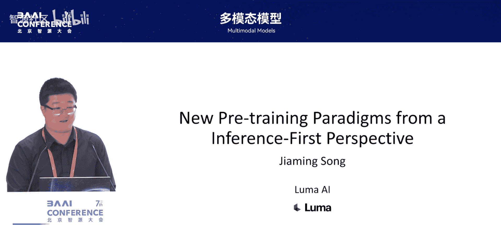

混合模还的模型，这里面是呃文字跟图片输入，然后文字跟图片输出的这样一个呃模型，它会更像呃更像一个就是纯语言模型的一种一种情况。

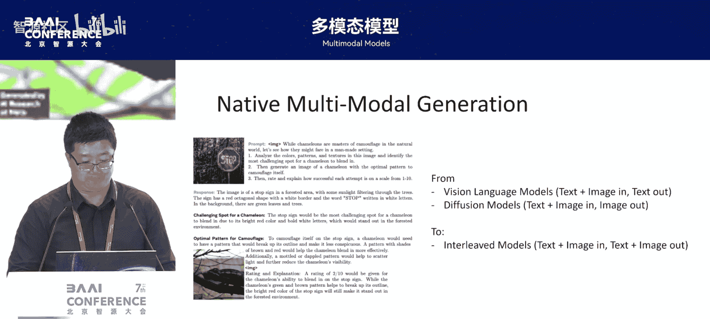

呃，在过去的一年里，其实就是很多呃文章就是已经注意到了这样这这样一个问题。所以说呃可能从最早的呃就commeon就是meha的这个paper开始啊，这里面他们会对文字跟图片有一些不同的建模方案。啊。

比方说对于文字来说是用呃direet就是就是离散的这个自回微。然后图片是离散的自回归。然后受欧的话可能用一些不同的这个方法。

然后transfuion的话是用呃离散的呃文字自回微和图片的这个呃就是扩散模型来做。然后最后有一些最近的一些方案是用这个离散的扩散模型去做。啊，但基本上这些方案的呃实现方法都接近于。😊，嗯。

一些就是已有算法的排列组合。这里面一般都是说哪些算法是比较呃在呃实际场合中验证的比较多，那么就会呃把它做一些排列组合。然后这个里面其实有就是很多的这个文章的爆发。

但基本上可能离不开这三种算法比较成功的算法，一个是呃离散的自回归模型。然后呃离散的扩散模型，以及呃连续的这扩散模型。😊。

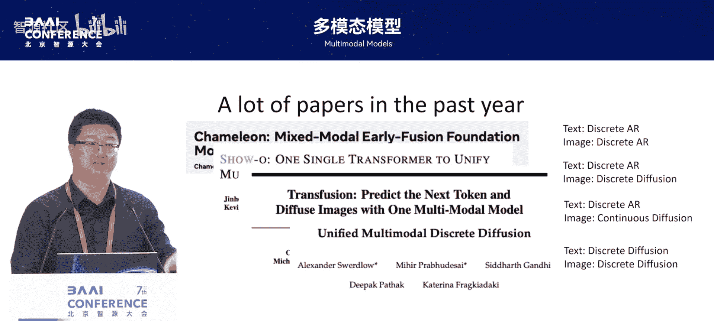

呃，然后其实可能呃自慧功模性的扩散模型在5年前呃，大概可能是正好是现在5年之前呃，已经就是在业界就被提出来，并且呃得到了很多的呃这个使用。GPT3的文章其实是在2020年5月份也就是这5年之前。

然后并且第一PM这个把iffusion这个领域带火的第一篇文章，也是就是2020年6月份，这也是5年之前。那么就是过了5年，其实可能大家意识到的一个问题是这些呃最优的算法。

其实可能还就是在这个两个5年之前的算法，这个这这里面做。然后其他的可能新的一些呃就算是最新的一些多态的方案，也都是在这些已有的方案上做一些排列组合呃所以说这里面的一个问题在于就是有没有什么方法。

我们可以去把这两个这个算法的这个就是上线去打破。呃然后我觉得其实可以分享一些我们最近呃的一些就是算法上。😊，探索，但是我认为这个呃可能性还是比较乐观。呃，所以我今天讲的这个方案可能是有这么几个方向吧。

一个是说呃我们会同就是总结一下现有的一些成熟的方案。在两个不同维度的呃就是推理维度的扩展。一个是序列层面的扩展。然后一个是不在序列层面在就是rement或者说是将这个token变得更优的一个扩展。

然后另外一个接下来我们会讲一下，就是在呃推理优先的一个一个一个范式。然后第三个点是讲我自己当年做的这个DDM然后或者说从某种程度上diffusion在呃一定程度上其实是次优的。

然后可能从第四个呃最后我会讲一些一些新的算法，呃它呃或者新的一些呃同时对于离散和呃连续呃 domainoma就是有一些用处的这个方案。😊，嗯，首先一个问题，这个就非常简单，就是呃我们在呃。😊。

我们在推理时间中该如何去扩展这个算法，这里面其实可以分成两种非常简单的这个呃这个方案，一种是增加token的数量，另外一种是不增加token的数量，这个就呃非常的非常的简单，它是或者不是啊。

当然对于增加token的数量，其实就是很常见的呃对于呃语言模型来说，就是可能像sha thought或者说是一些这个呃推理的能力。然后我增加了这个呃用增加就是token数量的这个方式去增加这个呃。😊。

推理的这个程程程度。啊，这里面可能训练的算法可能有多种啊，比方说从刚开始SFT到最终发展的最新的这个RL的些算法，然后可以用来提升呃这个推理的一些性能。😊。

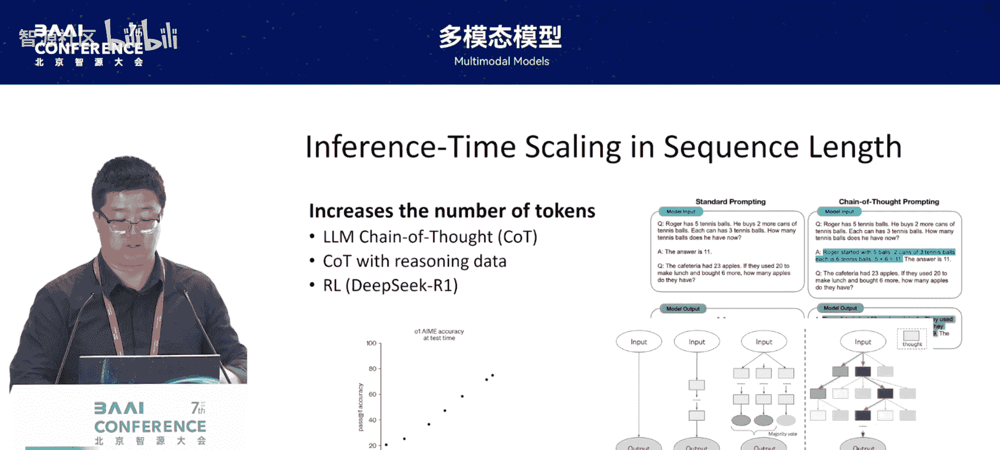

然后对于不增加token的这个呃方案的话，这个方案更多的其实是像接近于扩散模型的一种情况。就是说假如说在扩散模型或者说是呃流匹配模型，其实也是扩散模型的一种。啊，那么它会并不增加扩散呃。

并不增加token数量，而是对已有的这个token做一些优化和呃做一些呃改进。然后这里面你可以看到就是说同样的token在呃数量，对于呃我的这个步数的增加可以增加它的这个效果。😊。

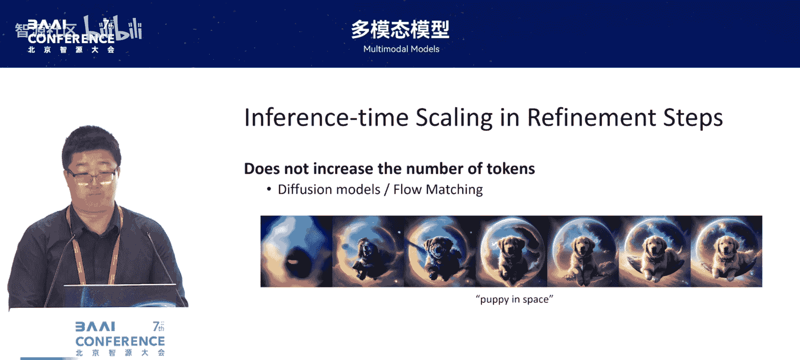

然后这里面也有一些呃针对这个维度的这个就是扩展的一些一些效果。

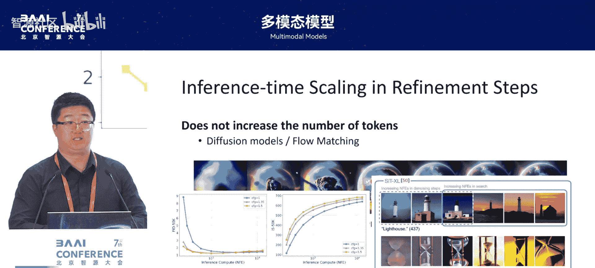

呃，我们可以通过这几个方案去总结一下已有的一些这个算法，他们在这两个维度上的扩展。呃，当然有比较传统的模型在两个方面都不会扩展。那么就像VE啊干或者说是呃就是malizing样的一些模型。

然后还有一些模型可能是说更传统的这个AR的模型，它会在序列上扩展。但是它并不会在就是优化这个 token本身的这个维度做扩展。这里面包括像GPT或者等等等等这个方案。然后也有一些是并不扩展序列长度。

但是优化这个已有的token。那么这个是us model，然后还有一些就是 model等等一些方案。然后接下来下一页我会讲一些可能更多在这两个维度上都做一些扩展的方案。比方说一个比较简单的这个情况。

就是说我有我是两个循环。然后我在外面的这个循环会有这个扩展就序列长度。然后在里面的这个这个这个循环里面去扩展。😊。

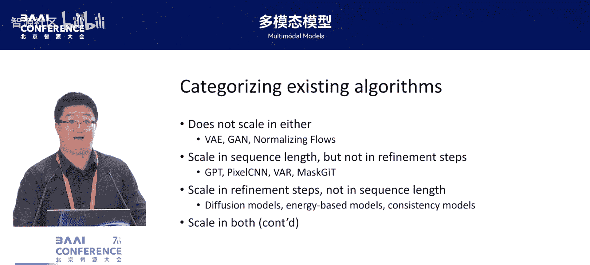

这个就是迭代和优化的这个部数。啊，这个里面基本上就是大部分把这呃就是扩散自慧规模型和扩散模型放在一起的这个这个方式，基本上呃这个是基本上的做法啊。

这里面也包括了一些像这个MAR啊diffioncing啊，或者说是一定程度上的这个离散的LM的这些一些做法。😊。

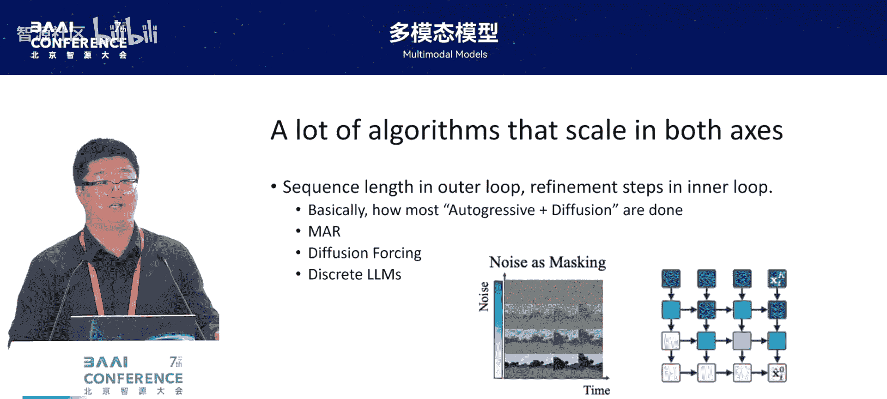

呃，当然其实也可以就反过来做，就是说我其实呃就这个就是像呃呃自回归的这个这个模型在里面的for loop，然后在这个呃就是就是refinment或者说是优化这个token的这个部分。

在一个在一个aler loop呃，这个其实当然是比较奇怪的。但是我自在大概5年之前在跟DDM同期的这个工作，其实做了一个大概的这样一个事情。但是这个个很显然应该不太成容易成为一个主流的方法。😊。

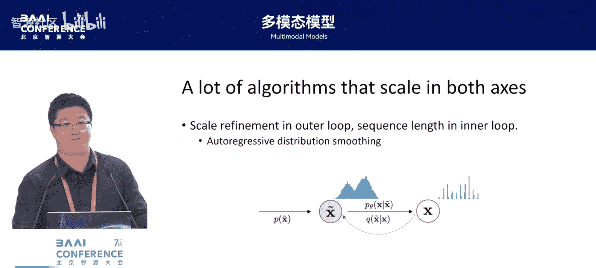

呃，当然我们刚才说到的是说这个所有的算法，我们都希望它有一些就是在推理时间的这个扩展能力。但是紧仅能够推呃这个算法如果他只能够在推理期扩展，它其实是不够的。因为呃我们还是需要去考虑这个扩展的效率。

因为如果说我的扩展的这个效率不够的话，那呃有我可以用一个就是很简单的一个方案，就是这个里面其就是infinite monkeypro。就是说我用无数个猴子打无数的这个时间。

总有一天可能去呃把这个莎士比亚的一些文学打出来。呃，但是这个是当然是一种很简单的一种这个扩展的这个方式，但是它扩展的这个效率实在太低了，导致并没有人会真的想去用这样的方法。呃。

其实甚至在最近的一些呃就是就是推呃呃。😊，场景，比方说像re learning或者这样的一些这个强化学习的情况，其实呃很多的这个例子也是由于就是能够更优秀更高效的去做扩展。然后它获得一些呃成功。

比方说在阿go它开发的过程中，其实有一个很重要的这个点，并不是呃用并不只只是用这个扩散呃用强化学习去学这个东西，而更多是说它可以用一些呃深度学经网络去更好的去呃计算这个value function。

或者说计算一些一些一些pan。那这样的话就是说用即使用同样的这个强化学习算法，那么有更好的能够呃扩展的这个推理的这个能力，也是呃能够就是对这个能够从这个产生一些质变的一些方案。😊。

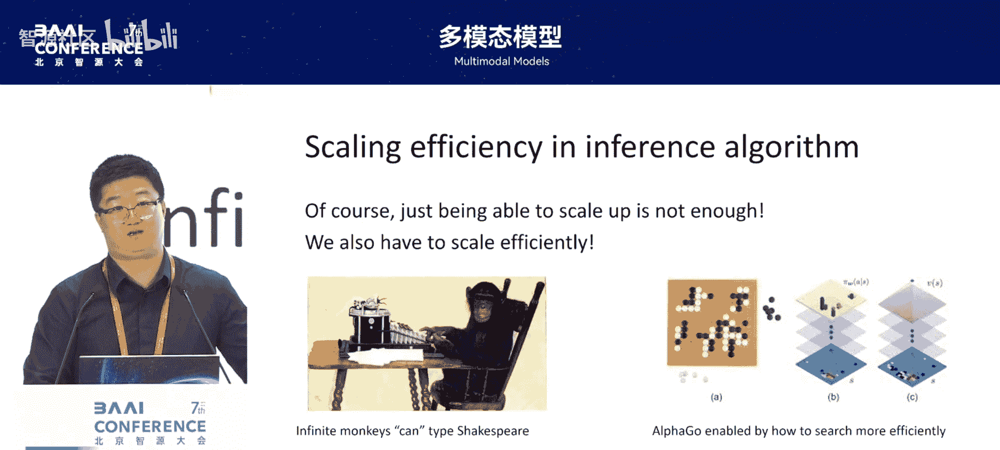

呃呃，那么鉴于这几个观测，我自己的这个几个观点如下。呃，首先就是呃当然这个是我个人的观点啊。呃，首先是正确的就是我们未来的这个合适的这个算法。不管是呃就可能是预训练啊，或者是一些就是算法。

这些算法在推理时机的时候，都应该去在这两个维度上去做可扩展的一些一些一些能力。😊，然后第二个点在于就是假设我们的模型的就是capacity，也就是说它的这个能力是足够的。呃。

假也就是说基本上假设说我的这个模型是可以拟合任何函数在呃univeveral approximation theorem的这个假设下可以拟合任何函数。那么我们是希望它的效率是越高越好。😊。

然后第三点是呃第三点可能是这个大家并不是呃最最能够了解，或者说这是相对比较就不太一样的这个观点是说呃在我们看很多就是就很多在文章里面，大家会写各种各样的训练方法。

但是我个人的观点是说我们在看训练方法之前，应该去分析这个算法到底是怎么去做推理。后就是如果说可以通过这样的一个角度去可能看到现在的算法的一些缺陷，以及我们怎么去优化它。

然后我们可以基于这几个想法去呃就是考虑一些就是在呃离散啊，或者说是连续ion做一个例子来去讨论这个问题。呃，当然呃这这个想法也包含了一些可能对于其他的模型的一些看法。

比方说像对于传统的E或者干或者就是izing型。他们最近其实在过去几个月也有一些文章试图就把他们复活。但是我个人的观点是他们其实可能没有必要去复活。

因为他们并不能满足第一条就他并没有这在就是 time能够去。😊。

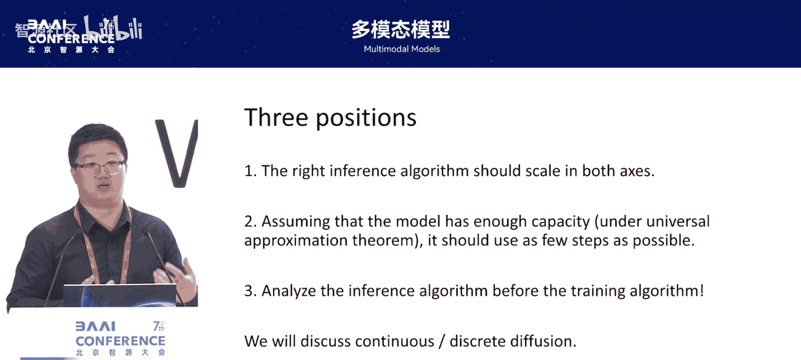

的努力。对，呃，当然我们可以先看一下这个就是连续空间上的这个扩散模型的这个这个情况。呃，首先我们要看就是第一个第一点和第二点是不是是不是符合。那第一点当然是符合的。就是说假如说我这个一个扩散模型。

它是可以通过增加的这个步数来获得更更好的这个效果。这个是呃一个就是扩散模型的一个非常基本的一个一个一个能力。然后当然大家也会就是希望这个扩散模型的步数越少越好。但是呃现在的情况是说。

如果说我增加步数还是可以增加它的能力。😊，第二个条件它可能就并不一定是对的。就是呃假如说我的这个模型本身它的这个表达能力是无限的。那么它应该是需要用就是尽量少的步数就就好。

但是实际上我们在做就是扩散模型的时候，因为这个扩散模型的训练方式是做一个或者说是一个降噪器的一个情况。那么再加了过多闹噪声情况下，它其实是学在最大噪声情况下，它其实学的是一个数据的平均分布。

那么这个里面其实这种方式呃，使得你的模型不论有多大，那么它的这个生成的这个步数都不能在一步之内去收敛。当然也有人可能必须问就是说好，那既然这个扩散模型，这个训练方式不行。那么我能不能换一个训练方式。

但是呢我的推理方式还是用一样的这个推理方式，对吧？假如说我现在这个之前是说我用就是连我用方式去训练这个模型，但是我推理是用DDM这个是不行的。但是呢我推理时假用。😊。

但是我训练的时候用一个可能更强的一个训练方法，用一些呃就diilllation啊，或者说用一些cons model接近的方法，呃，这行不行？呃，可能答案是非常就是呃也不行。所以说这里面就是。😊。

做在DDM的情况来说，其实它就其实并不是个最优最优解。😊。

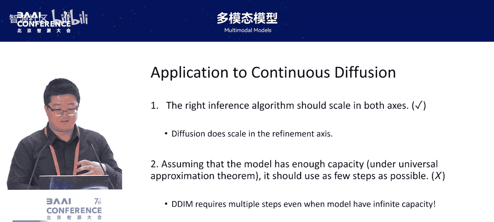

呃，首先我们可能需要看一下这个情况，就是呃就是我们想想想要的是什么样一个情况。呃，它需要满足两个情况。一个是说它能够呃在就任意的N部都有我们需要存在一个解这个这个模型。

它能够在N部生成正确的这个这个分布，并且呢它也可以在一步生成这个正确的分布。那就是这这两点就是说首先它能够scale correctly，就是正确的s up。

然另外一个是说efficly就是说假如我的模型的这个呃表征能力无限。那么我应该都能做一步生成。呃，但是呃我们在接下来的两页可以证明一下，就是就是DDM其实它无论你的模型的这个能力有多就是呃大小有多大。

它都不能够满足这样一个条件。也就是说呃其实在这个情况上，DDM其实可以被判死刑。😊。

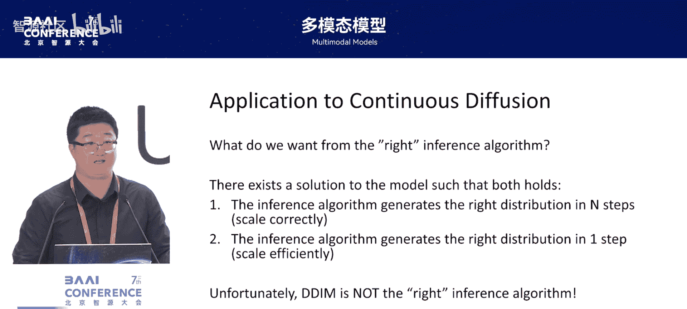

呃，我们可以就是这个我我希望可以少讲一些数学的内容，但是这个可能就是可能必须要接触一下。呃，就是呃在DDM的情况下，这个采样器是怎么怎么做的啊，这里面其实情况是比较简单的。

就是说我呃看右边的这个图呃左面是呃可能加噪声加的比较多的一个情况。呃，然后右边呢是可能我的这个数据分布，就是加噪声交的比较小的情况。然后我呃做扩散模型基本上是需要找到一个从呃左边的这个就是先验。

然后不断的去做迭代到呃右边这个数据的这样一个情况。那么对于每一个步迭代来说，我会在一个起始点呃去呃最模型做一个呃evalu，就是我的模型会呃。😊，拿到这个我现在点X。

就是我现在的这个这个这个这个本身的输入，以及它的这个时间就是time，就是T的这个输入。这个这个这个时间的输入，这个是扩散模型的基本的两个输入。然后呢。

我的这个扩散模型可以可以被理解成为我会训练我会预测一下一个就是降噪后的这个这个结果呃，的的一个一个一个一个结果，或者说是velocity，就不管怎么样。但是我的这个扩散模型做完预测之后。

是要沿着一个直线去去做一个呃interprelation或者说去去连接呃，在DDM的时候，当时我们的这个解法是更多的说我去有一个XT是加噪成的这个内容，有一个是X0，就是它降噪的内容。

然后我在任何一步需要去做呃就是连接的时候，我都需要去做一个。😊，呃，就线性的这个这个组合。然后那这样的话就产生这样一个问题。就是不管说我的这个模型，它的这个能力有多强。

但是我的这个这一步DDM的这个呃采样的这个这个这个方法，其实针对S，也就是说针对我下一步的这个结果，其实是一个线性的一个函数。那么这样的话，其实就会呃限制了这个它的这个表达能力。

就假如说我有一个我有任何一个模型，它能够在一步表达这个正确的结果。那么可能他我把这个同样的算法用在N部上，可能它就是会出错。这个是因为它呃对于S，也就是说对于下一步的这个呃灵活度其实是不够的。😊，呃。

这里面其实有一个非常简单的这个这个解决方案，就是说我们知道我们的这个对于S的这个灵活度不够。那么我们就直接把就是下一步就是S这个这个time step直接放到这个模型里面。

就是说我我现在呃扩散模型并不是指啊吸收一个就是就是噪声的这个level，对吧？我可以吸收两个level，一个是我的开始的level，一个是我的这个结束的level。

那么这个其实就已经可以去呃就是涵盖了很多这种就是更复杂的这个结果。啊，这样的话就会解决刚才我们说到这个这个就是表征能力的问题。啊，这个其实是一个就是无论我最后怎么训练都可以去呃做的一个一个改正。😊。

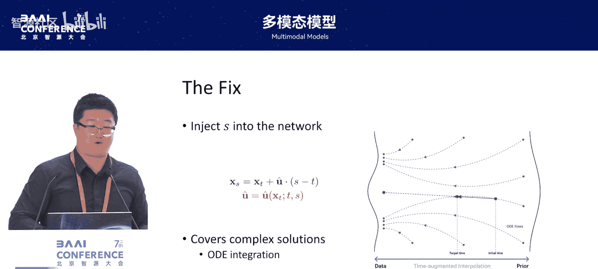

呃，当然这里面也是说的，刚才跟刚才那个这个想法一样的。我们其实理想中的一个现实的状态，其实是希望通过增加更多的这个呃就是推理的步数，使得它的效果更好。但是呃我们在推理步数比较少的时候。

还是希望它的这个模型效果是是是比较不错的。然后这里面其实我们呃看到的一个呃 curve就是说这个是在在扩散模型里面，它的这个效果其实比较差的。它的很少的部数推理效果比较差。

然后但我们可能最近的一个呃工作，使得它的这个呃情况都会比呃扩散模型要更好。😊。

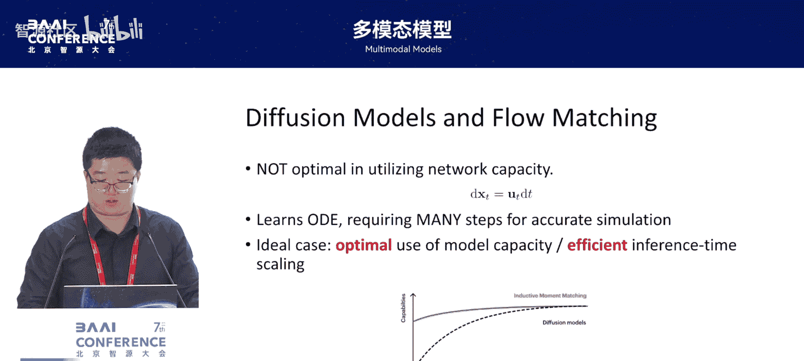

呃，所以说我们可能刚才看到的一个例子，就是说对于呃。😊，从刚才的这个推理这个算法的这个分析来讲，呃，来说，DDM可能并不是一个最优的一个算法。

因为它的这个呃模型只能够吸收一个呃采这个采样的这个这个time step。但是呢其实我们是可以把这个它的采样的这个步数变成就变成两个。

就是说我的这个模型可以吸收两个不同的这个时间的这个time step。然后呃这个东西其实已经在这个就是呃一些一些文章中已经出现了。然后这个这个这个概念其实被叫做form。

然后我当然也有一些文章可能会之前会说我们其实一个这个time step都不需要，它也都能学。但其实我我个人认为这个可能这个模型需要吸收两个time step的情况可能是更好的。😊。

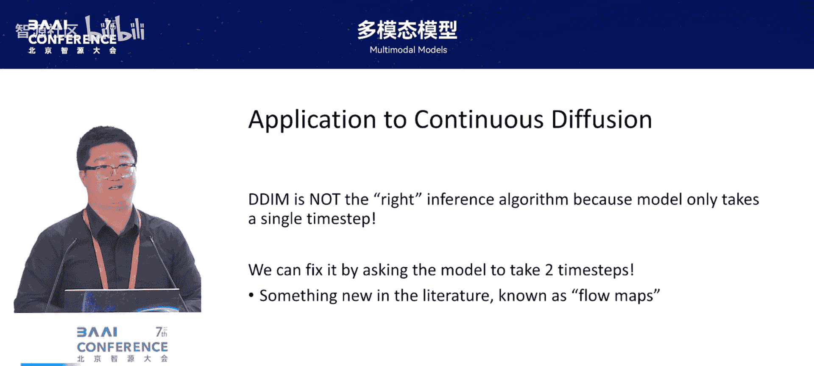

然后呃当然就是在确定了这个推理的算法之后，其实可能你就可以用各种各样的方式去训练。呃，这里面可能有就是比方说有几种不同的这个文章，这个是 clear的一个文章叫con model。

然后这里面这另外一个文章叫 model。然后还有去年的一个文章叫flow matching。然后最近这个呃就是从这个何海明组里面出来这个meflow其实都是符合这个方案的一个一个一个方方法。

然后当然今天我们可能会讲的是一个我们自己在呃就是ICML这种一个工作叫呃ductive matching呃。

这个其实是呃就是符合了我们其实对于理想的这个训练算法的一个就连续空间中训练算法的一个一个一个想法。呃，它既能够一步就是在一个呃单独的这个。😊。

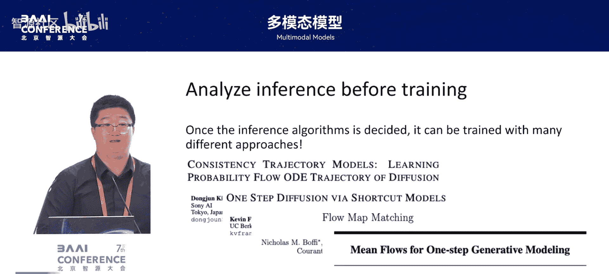

单独这个阶段去做训练啊，并且呢它的这个生成效果还是比较好的。并且呢它的这个生成效率还是比较快的。呃，之前呢所有的算法其实可能都不太满足这个条件。比方说像呃就是呃扩散模型的话。

它可能多步呃单步呃呃单步生成效果比较差。然后呢，如果说对于像这个做dilation的这个方法，它可能训练起来相对来没有那么稳定。😊。

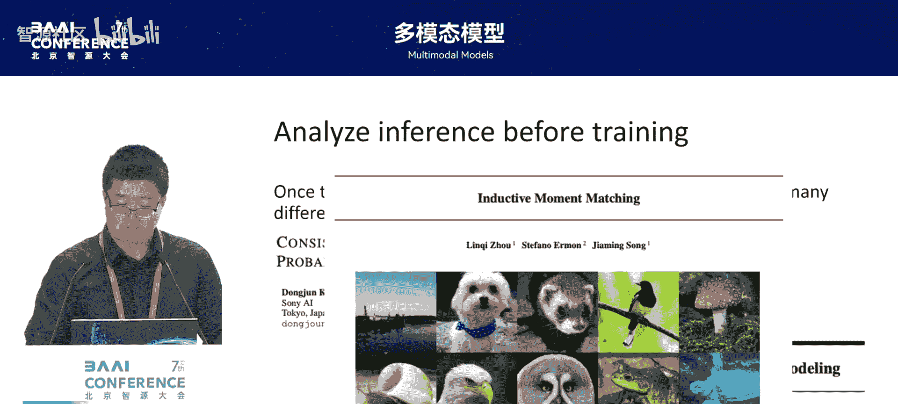

嗯。就是其实我并不会想讲太多关于这个呃这个这个算法本身的这个这个内容。因为就是这个我觉得细节很多，我并不想就是就是在现在这个时间让大家就是过多的看这个细节。但是我觉得可能这个里面思想是比较重要的。呃。

就这个思想其实是这样就是和我们其实主要就是他的关键其实主要是么去做推理这个训练其实不是那么的重要。因为就是我们这个训练其实和就是扩散模型的整个框架其实没有什么关系的啊。

他又不依赖于这个这个这个框架也不这些框架，他也和这个就是之前的那个scobD框架其实都没有什么关系。然后他自己的解甚至都不需要去跟这些东西有关系。就是我当然我们可能在文章上没有写。

但是其实是可以证明这一点这一点。😊。

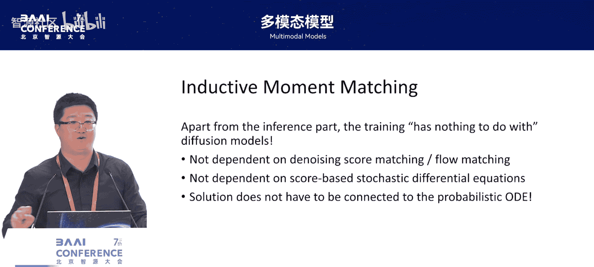

呃，这里面其实我们的这个大概的一个就是直观直觉，其实是想要去在呃不同的分布上去做这个con model，或者说去做一个呃就是一致性模型的这个点。就是假如说我现在有三个就是time。那么S小于R小于T。

那么我们希望的是从这个模型可以从XT到XS就是这个这一步的这个预测和从XR到SS这一步的预测，他们这两个不同的这个呃就是路径得到的这个模型的呃分布其实是比较接近的。然后这里面其实如何表示这个模型接近。

其实可以用一个呃比较稳定的训练方法，比方说呃这个方法我们用的方法叫mum定 discrepancy。这个其实是呃一个就是有点接近于干的方式。

这里面其实可能跟干的方式比较类似的是说它里面有一个dirimin就是一个一个呃就是判别式的一个一个一个一个模型，但是和干不太一样的是它其实并不需要去优化这。😊，呃呃判别模型。

它它的这个训练其实是比较稳定。

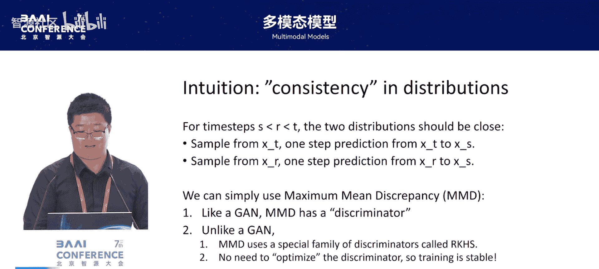

呃，所以说IM其实有这样几个呃优势。那么就是首先它是一一步训练，只有一个这个这个图就是呃目标函数。然后呢，它并且它可以就是它其实是一个呃con model的一个一个扩展。啊。

然后并且呢它这个在一步就是一个一个tage是可以用这个比较稳定的去训练。然后并且呢它可以就是在呃用就是很很少部数的生成去达到1个C there。😊。

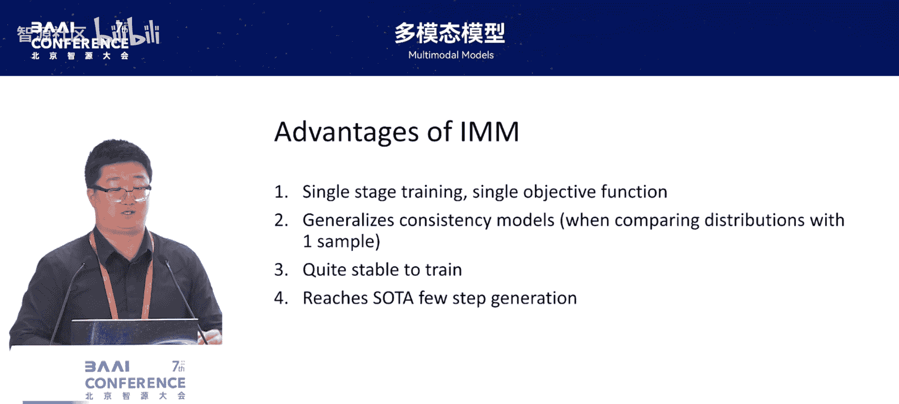

呃，然后跟cons model这个情况其实相比来说就不太一样。就是cons model在很多情况下其实会训练，直接训练会崩掉。但我们这个情况下，其实可能你训练的久一点，其实也不会有事。😊。

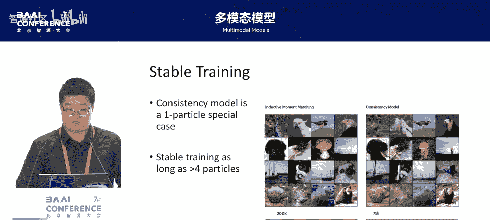

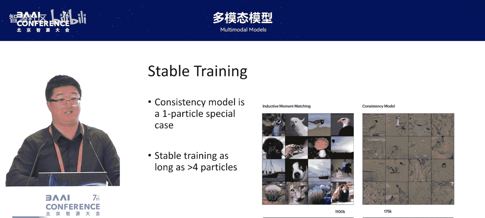

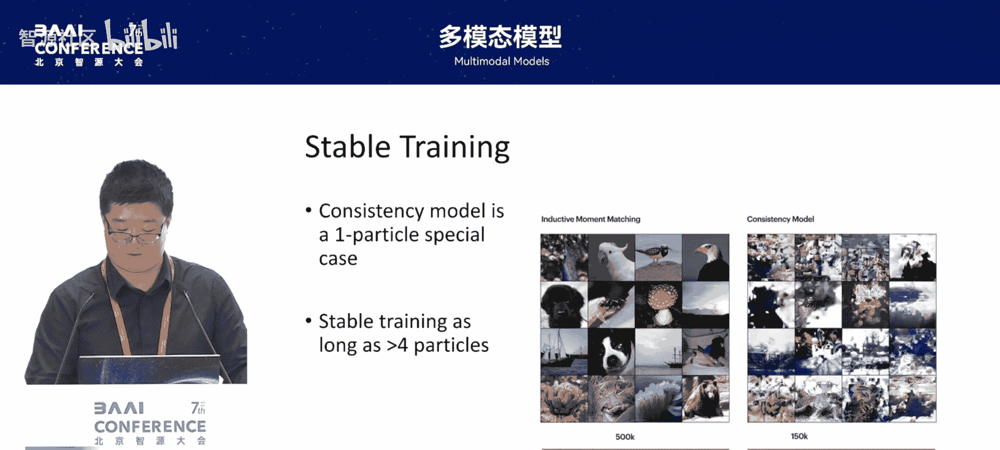

然后呃在当时的一个情况下，他会呃达到对于这个采样的这个compue以及这个FID或者说这个模型效果的这个这个相对比较优的一个情况。啊，我们希望这个采样的这个量是比较少。

并且我的这个呃FID也就是说我的这个这个生成的这个生成采生成的这个结果和呃我的这个实际的这个分布是是比较接近。然后我们刚才讲到了。

就是说从这个呃这个这个思路是如何可以能够让我们想到有一些新的这个算法的一些就是方案。但是刚才那个情况更局限于呃连续的这个空间。然后呢，我们可以也去分析一下这个li散的空间。

也就是说像这个discriptffion这样一个情况啊，我们可以呃就是从这个像呃这个李春元老师讲的这个情况，就是说它是个mask defffion这个这个这个条件开始啊。

我们去就是在不断的去迭代这个部数的情况下呃，通过呃不断迭代步数来这个使得之前的mask不断的被呃就是被被降噪，然后就会呃预测一些不同的这个结果。😊。

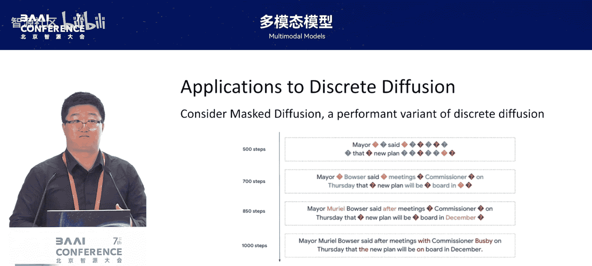

然后呃这里面一个比较重要的点是在于，假如说我已经预测到了一个对应的这个这个token，就是假如说这个token没有mask。那么接下来就是就所有的这个预测都会假设这个token的这个这个情况是不会变的。

也就是说我只会修改mask token一次，后面呢我就不变。😊，然后呃那么那么这里面其实会有一这样一个问题，就是说假如说我的序列长度是N，然后呢，我又想在推理的时候能够做一些加速。

就是那我一定是希望我的这个推理迭代步数L是远小于N的这个步数。那么呃根据这个呃各伦原理，其实至少有一个步数，我需要需要同时去预测两个token的这个这个结果。

就是我需要呃有点类似于motoken prediction，我需要在一个步数来来预测两次两个token。😊。

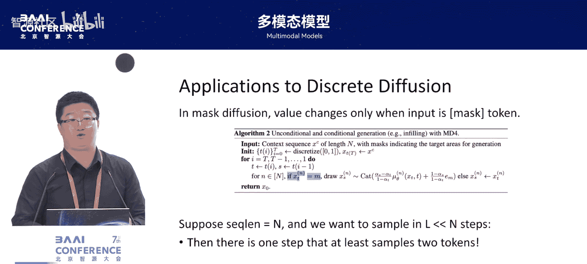

呃，这里面其实可能比较有意思的点是很多人他们会分析的是呃这个算法，就是说我这个训练算法以及我的这个呃就是扩散模型本身这个这个训练算法，这个算法本身倒是没有什么问题。

但是我们可能需要想的是说我们现在这种像是t这种风格的模型它其实是不是很适合做这样的task。其实我们可以用这样一个例子来看，这个可能是一个比较简单的一个例子。就是说假如说我现在要同时去预测两个单词。

然后这个两个单词呢是在这个里面的这个比说有一些呃两呃有一些这个这个可能的这个这个情况。然后其实我可以去回复我应该可以回复一些不同的这个情况。比方说hcard或者说to pair这样一些其他情况。

但是呢t这样的model它其实会先去预测所有的这个然后呢再去做这个做就是做采样。然后并且呢它会同时对两个这个m token都去做采样。然后这的话也就是说。😊。

如果说我能够生成像highcar或者to pair的这样的一些呃就是结合体。那么我其实理论上也可能会生成highpe或者to car这种有错误的这个结合体。

这个其实也是一个呃在就是birt里面的一个呃其实拿ive base或者说是呃条件独立的一个假设。然后这个对于传统的那种一个一个token做预测的next token prediction的那种这个自回功模型。

其实并不是这个问题。因为呃其实它的这个单词其实是一个会一个一个去预测。😊。

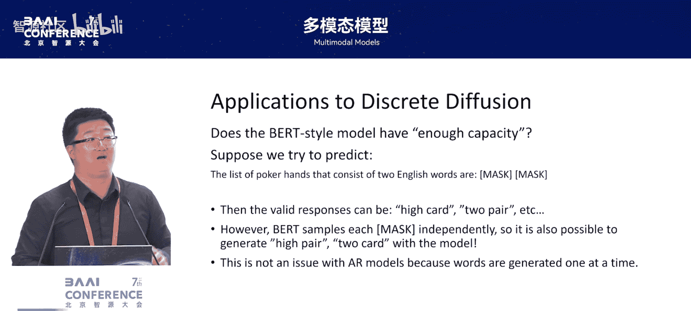

呃，所以某种情况下呃看的话，我们如果从这个角度去看这个问题。如果说我关心的这个任务只是说做像呃单纯的生成一个呃一个序列。那么假如说我是希望我的这个生成的速度。

或者说生成的部数要远小于这个这个整个的这个token的数量。那么我是有可能会遇到这个由于呃Brt这个模型导致出来的一些呃就是模型的这个这个capacity或者说模型的这个这模型的这个问题。😊，呃。

所以呃总呃总总结来讲的话，我希望让大家就是能能够就是呃感受到其实是这样一个问题。就是说就是呃有很多很多的这个训练的方案。但是其实可能大家应该去更多的去思考一下，就是推理的方案应该是怎么做。

这个其实如果在做这个预训练算法的情况下，我们应该去先去考虑如何去做推理，然后再去看如何去做训练啊，因为推理的这个方案其实可能没有很多。但是训练的方案其实会有就是就是非常多种啊。

然后我个人认为就是说首先要选择一个合适的推理方案，然后怎么去做训练其实可能相对是更次要的一个一个问题啊，这里面其实这种想法其实已经在刚才我的这个呃就是讲的这个情况下，有一些就是实际的应用。

比方说在连续的这个情况下，其实可能可以给呃就是现在的扩散模型带来一些新的不同的这个思路，然后在一些这个离散的情况下，可以帮助我们去分析对像这个就是或者说这个ma transform这样的一些模型。

它的这个一些限制。😊，以及可能呃对于这种这个这个方案的这个实际的可能更有更有效果的一些改进。啊，对我希望讲的就是这么多，好，谢谢。😊。

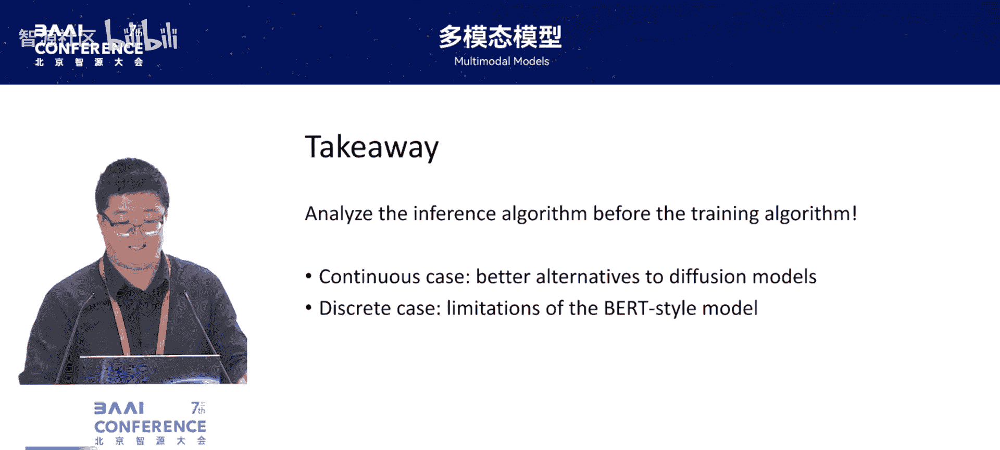