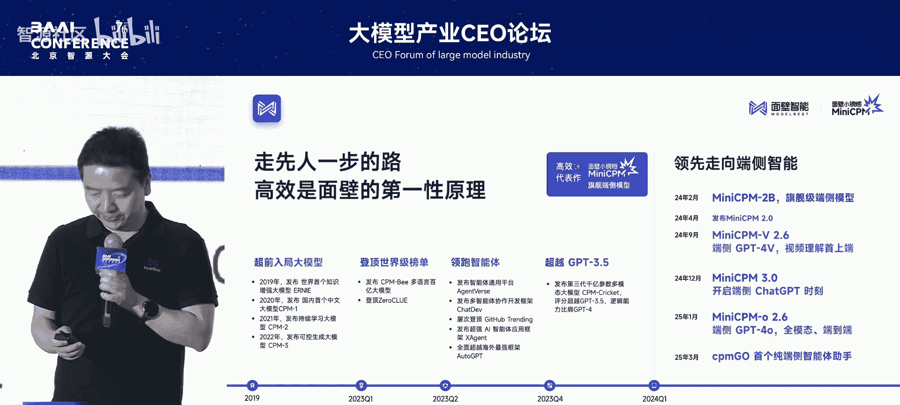
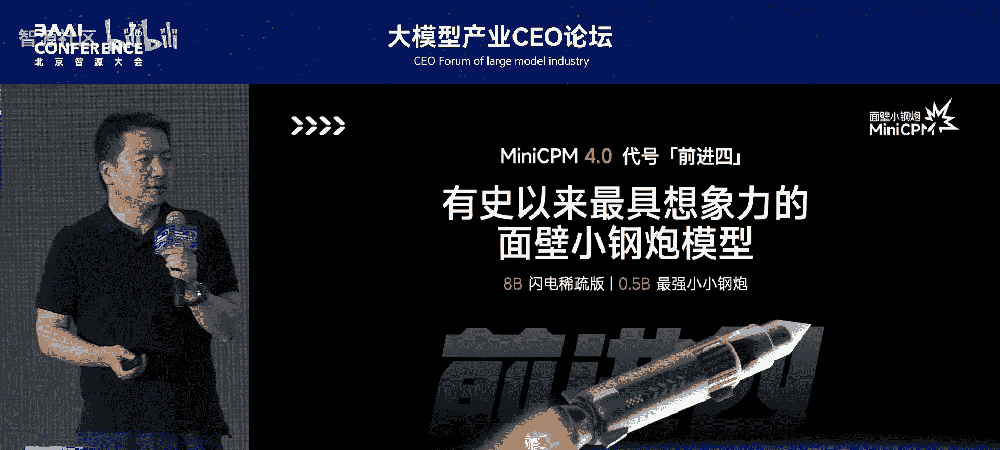
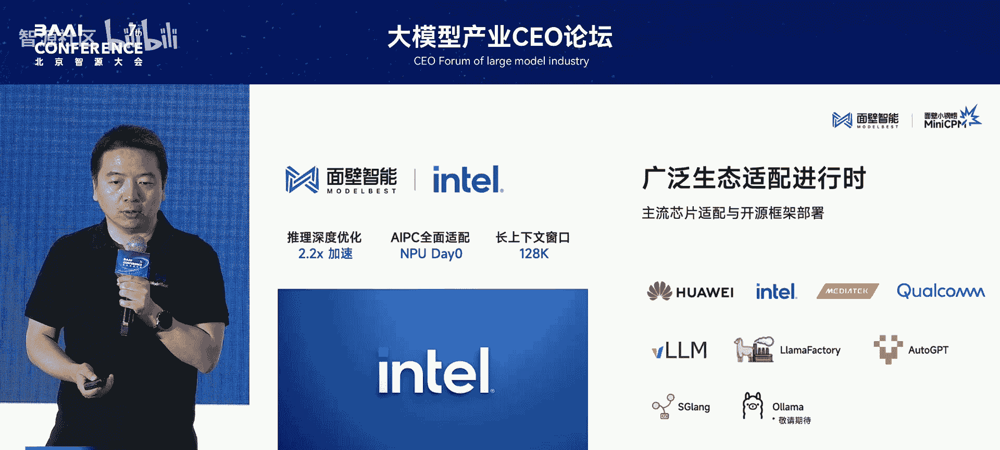
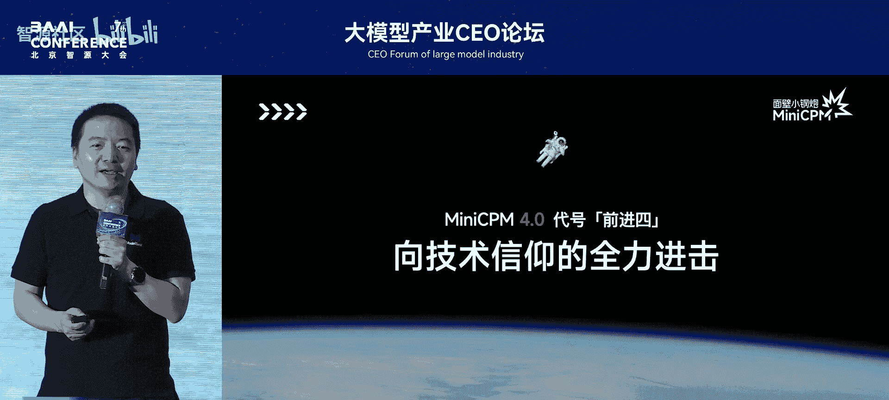
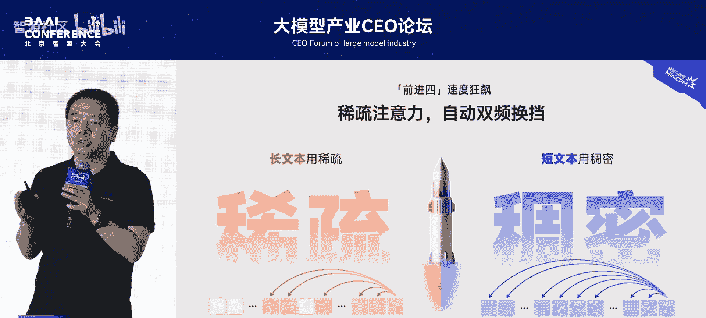
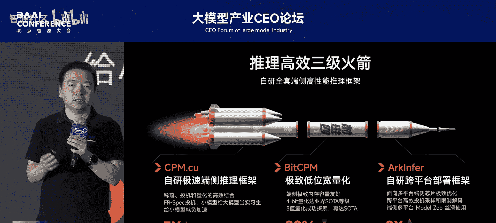
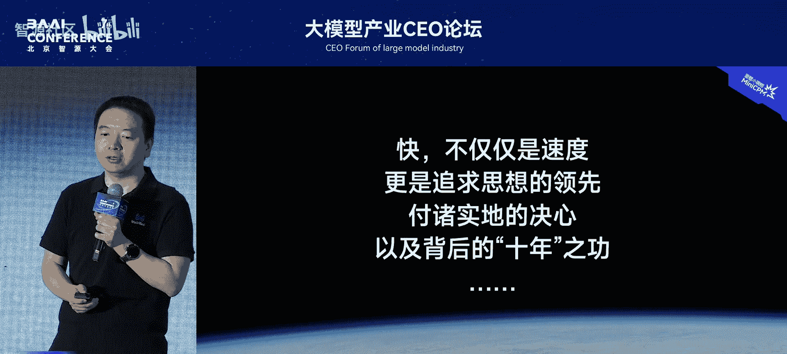
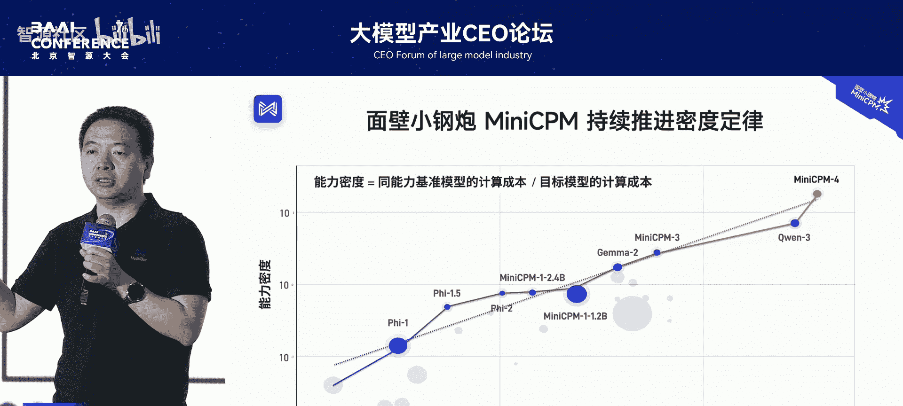

# 2025北京智源大会-大模型产业CEO论坛 p01 高效大模型路径探索：李大海 -BV1NmN5zLEU5_p1-

志愿的朋友们，大家下午好。😊，每年都很期待到我们智源研究院的AI春晚啊，今天呢呃特别高兴能够借我们这个呃春晚的舞台来去呃以模型绘友啊。我们今天正好借这个宝地发布我们的全新的面壁小钢炮4。0的模型啊。

同时呢我们把它取名叫。😊，前进四啊。然后嗯。发模型只是呃我们的一个呃动作。但是今天主要想跟大家交流的是基于我们这个模型背后我们所做的工作啊，我们做的创新的一些思路和方向啊。

通过这个来以模绘友啊去跟大家加深交流。那在这里呢，请允许我先首先介绍一下面壁智能啊，我们是一家呃技术全站的大模型公司啊，从架构到数据到模型的预训练，对其强化学习，再到智能体啊，我们都有对应的技术的积累。

但是我们把所有的这些技术呢聚焦到了端侧啊，为什么要聚焦到端侧呢？是因为我们看到了大模型发展的趋势，知识密度越来越高。这样的一个趋势在端上大有可为啊。

所以我们从24年的2月份开始，就持续不断的在行业里面发布我们的端测大模型啊，一共是三个类型，一个是语言基座大模型，一个是多模胎马大模型，还有全模态大模型。我们的三只脚啊，这三类的大模型呢。

在过去呃接近10个版本里面，一共全年已经在全球超过了1000万的下载量啊，这一点是呃我们也非常自豪的事情。那在1000万的下载量背后呢，其实也是千千万万的开发者啊，对我们的认可。

我们最近有朋友啊代代替我们他们去深圳去找很多这个智能硬件的呃创业者去交流。我们发现很多创业者其实都在用我们面壁小钢炮的端测模型去做智能硬件的创业啊，我们也希望我们持续能发出啊更好更快的小钢炮啊。

赋能我们所。有的智能硬件的创业者们。那么。呃，这里面呃就是简单讲讲我们的模型的区别啊，这个原计作模型，当然就是我们的这个纯语言的版本。那多模态呢是主要聚焦在图像视频和和声音的理解上全模态模型呢。

它是一个更接近人的大脑的模型。这个模型有点像呃去年GPT4O发布的那个产品的形态，能够同时去做看听说。那面壁智能呢是全球第一个啊全模态模型，做到端侧的公司啊。

我们做的我们发布的在今年1月份发布的这样一个模型呃，一共是一个8B大小的模型啊，然后能够做到5分钟上下文的呃每每秒钟一个采样的这样的理解能力啊。那今天我们非常高兴的去发布我们的4。0版本。

我们给他取了一个有趣的名字叫前进四。😊，前进四是什么意思？前进四其实搞。搞航天的呃朋友可能知道在在那个呃刘慈欣先生的三体里面，其实有这么一个情节，就是我们的宇宙飞船在星际航行的时候。

它会四段加速前进一前进二前进三前进四。当他达到前进四的时候，就是他最快的巡航速度啊，我们的4。0模型呢，在这一次最大的特点它就是快。所以我们呃用前进四这个代号来去代表我们的这次小钢炮的一个发展的情况。

那我们这我们今天呢其实呃一共有呃向大家发布了开源了两个版本，一个是8B的稀数版本，另外一个是0。5B的呃超级硬核的小小钢破版本啊。

这里先给大家展示一个视频啊。🎼需要说明的是，我们这个视频是在呃140K长度的上下文下去做的比较。因为在端侧140K的上下文，它需要的内存已经很大了，属于一个比较极端的一个场景。

那在这个极端场景里面呢啊像千问山这样的呃没有做过上下文稀数化的模型。它的内存消耗过大，已经显存已经不够用了，所以需要用到CPU里的内存的时候，它的offloading导致了速度极致的急速的下降。

所以我们但是因为我们做了快速的这个稀数化的这样的工作。所以我们没有这个问题。所以我们在这种极限的场景底下，可以取得非常非常大的一个速度的领先优势。🎼那常规的场景里面。

我们至少是有个3到5倍的这样一个速度的优势。🎼，嗯。在快的背后，我们并没有牺牲质量啊，我们要的是又快又好，这才是小钢炮。所以呢我们在呃我们的模型的表现的综合评分上，可以看到我们的0。5B的模型。

它不是一个稀数化版本。但是它在呃整个一B左右的这个模型里面呃得分是非常非常炸裂的啊，整个综合得分平均分52。99分，是远超同类的所有的模型啊，同时呢我们在这里还发布了0。5B的一个三值量化版本。

所谓三值量化版本，就是我们的参数，最后只有-10和正1啊，所以这个量化的比特数是小于2的啊，这样一个量化版本呢，我们发出来以后，大家可以看到我们的一个一臂的这样的版本啊，它的平均的得分是56分啊。

在三值底下做到56分，这是一个非常非常好的一个成绩。我们也非常的兴奋。我们也希望我们的这样一个非常先锋实验性的啊模型，能够为我们的端侧芯片的伙伴们啊，提供一个引领的方向。

大家一起去在端侧去做到更高效的一个软硬一体的这样的设计。那对于8B的，我们的8B的模型呢，就是一个刚才大家看到的，我们加了长上下文的稀数化的版本。在这个版本里面。

我们的呃在各个现在行业里的呃一个权威指标级这的平均分下面我们的这个平均得分是呃能够去对标千3啊，平均分比他略高一些啊，我们对自己要求比较高。我们认为这是对标。

但同时呢我们也呃显著的超越了解码的这个三代的12B的模型，就是比它12B模型的效果还要好明显的好不少。那有了这样一个好的基础的端测模型，它可以做什么事情呢？啊可以做我们就自己我们抛砖引玉。

做了两个还不错的应用。在这里作为demo一步的一并的在我们的开源模型里面向大家进行了开源。第一个呢是我们的MCP的模型啊，就是我们在端上利用MCP的这样的协议去对15个应用主流应用进行了这个支持啊。

可以看到我们的呃一个行业里面的比较重要的一些评测，基于这个MCP的评测。我们在这样一个呃工作里面，我们的得分是非常高的啊。另外一个呢是我们的呃我们叫miniCPM4的serv版本。

这就是一个deep deepep research的一个版本。我们把deep research的能力，通过我们的面壁小康报4。0构建在了端上。也就是说大家可以利用我们的这个第二个版本。

直接在AIPC上去构建一个deep research的服务。在AIPC上去构建这样服务有什么用呢？太有用了。因为大家不太肯定不不愿意把自己的 AIPC自己的个人电脑上的所有的私有的文档都传到云端。

只有一个端侧的一个服务。它能够非常开放的去引用，去探索你的本地文件才能够针对你的本地文件，结合云端的互联网上的所有的文件去做一个全面的一个dep research。

这样dper research才是更加deeper的一个research啊。所以有了这样的功能，它才是一个更加专属于你的一个我们所谓的随身端测小内阁啊。所以可以看到呢。

我们呃有了这样的非常炸裂的端测模型以后，其实大家可以做的事情就更多了。那同时呢在我们发布出来的这个呃第一时刻，其实我们就已经跟很多的我们的生态合作伙伴进行了深度的合作。

那这里呢特别要明确英特尔英特尔在过去一段时间紧密的跟我们合作，已经现在已经在他们的平台上能够把我们的这个稀疏加速的这个工作完全落地啊，到目前已经有了呃两倍以上的一个加速的效果。后续还在持续的优化中。

那与此同时呢，我们在像呃华为的升腾，还有高通呃联发科等等这样的芯片上，其实已经呃我们的呃小钢炮4。0前进四的模型都已经可以直接流畅的去运行。同时我们也支持了像V啊GPT啊SGL等等这样的一些。呃。

推理的框架啊，然后欧拉玛呢我们在这个积极的适配中。

下面这一趴呢就是我们的技术的一个分享啊，大家又快。

怎么做到的啊，又快又好，是怎么做到的？这里呢我们呃寄出了我们一贯的这样的思路，就是一一个关键词高校啊高校从哪里去看呢？我们主要是架构推理、学习和数据啊，这几个方面我们都往高校这个方向去做极致的优化。

首先我们实现了行业里面第一个全开源的系统级的上下文稀疏的高效创新。这是什么意思呢？我们知道。当上下文非常长的时候，我们在我们这样的一个transformer的架构底下。

其实越到后面它的每一次的这个推理preview的时候，它都需要跟前面所有的这个啊transformer的这个呃attention去做计算啊。那我们用了这样一个稀数化的一个架构。我们用类似于检索的思路。

就是每一个我去找他前面所有可能的啊稀数化的模块去做这个直接只对这些模块做引用技术计算。通过这种方式呢，我们可以把这个稀数度降到5%。这样的话，他的几个计算量就有一个极致的下降。

而同时呢我们还创新性的用了一个呃我们叫这个双档自动换挡的一个技术，就是在长上下，我们就切换成一个稀疏化的这样方案。在短的上下文底下，我们就重新沿用稠密的方案。通过这种方式呢，我们也能够避免呃稀疏化方案。

在我们的短上下文下产生效果急剧下降的问题。

呃，除了我们说的这个长上下文这一点之外，我们在呃推理上也有了一个我们的三级火箭的这样一个推理框架。除了我们我们自研了我们的呃端侧的一个呃极速的一个推理框架。这个框架里面实现了稀疏。

还有呃投机和量化的这个高速的高效的结合，这样一个框架呢，随着我们的呃今天的模型一并进行了开源。同时呃如果刚才所介绍，我们也把极致的量化这个工作啊呃这个发向了推向了行业里面。

同时我们还在自研我们自己的啊跨平台的库署部署框架啊，我们知道在终端上跟云测生态非常不一样啊，云测其实只有像英维达生腾等等啊一些这个呃这个推理的生态。但是在端侧推理生态其实非常非常的多样性。

那要在端上去把这些多样的呃推理生态都能做好兼容，其实是一个成本非常高的事情。那我们面壁在这方面呢，我们就在做这样一个统一的一个自研框架呃，部署平台的框架，希望能够啊。

部署模型适配芯片这样一个M乘N的问题，尽可能的复杂度简化降下去啊。除了我们说的这个在呃我们的架构高校等等这些方面的工作之外，其实数据啊还有大模型的训练的实验，也都是非常非常重要的啊。

其实刚才我们的那个模型的效果。还有一个非常重要的优势，没有给大家啊仔细的展开讲，我这里在可以，我在这里给大家做一个强调，就是我们。

又快又好，做出这么好的模型，里面还有一个特别重要的一个优势是我们只用了非常少的高质量训练语料啊，相对于呃我们从千问的呃这个te report里面看到了啊呃千问用了36T的高质量数据。

但我们只用了8T的高质量数据，迅速我们的8B的模型，就能够在刚才大家看到的各种指标里面给出一个非常非常好的表现。这背后代表的是我们只需要更少的训练啊，更少的算力，就能够做到一个非常不错的一个技术模型啊。

这背后也是成本极大的下降啊，成本极大的下降，有利于我们去更好的去做更多场景的落地。当然这里面还有很多呃我们非常创新的，我们在呃各个方向做的很多的探索。比如说我们习贯在用FB8这样的高效的训练啊。

我们这次也去在行业里面去落地了FMMTP的这样的一个推理的呃监督这样一个这个推理的一个模式啊等等等等啊，这些工作呢在这里就不一一展开。因为每一个点可能深度展开，可能都是一篇论文。呃。

用前进式这样一个呃代号呢，其实也呃一贯的还是代表了我们面壁自己的一个精神内核。我们我们公司的名字其实就来源于三体里面的面壁者计划这样一个呃一个文化符号啊。

所以我们呃还是在这里呃再次的致敬刘刘慈新先生的三体啊，我们也希望呃大模型这样一个。是技术驱动的这样一个行业，我们能够有更多的人文关怀，能够有更多的想象力啊，最后为我们呃人类的幸福。

人类所有的人的这个幸福生活能够去呃做一份贡献。那我们呢也在去年我印象很深刻啊，我们在去年的智援大会上首次向行业面提出了大模型的支识密度定律。那在过去一年呢啊我们也在重复一下。

我们当时嗯提出支持密度定律的时候，我们当时的表述还是说大模型每8个月支识密度会提升一倍。但是我们当时发现我们的统计的周期是从20年开始的。当我们把这个周期从22年开始算的时候。

这个时间马上就从8个月下降到了3。3个月啊，是一个非常非常快的一个速度。那到今天呢，我们还是以它为第一性的原理，我们不断的去践行大模型的知识密度。我们今天推出来的啊，我们的面壁小康报4。0。

在知识密度上还在持续的以这样一个速度在往前推进啊。

最后呢啊20分钟的时间非常短啊，我也很难非常详细的给大家讲清楚我们背后的让我们很兴奋的这些技术上的改进啊。最后在这里我再简单的总结一下，我们所做出来的工作。

我们能够呃通过这样一个前进式这样的一个啊端测模型去在常温本这样一个非常重要的呃应用场景里面，相对于当前行业里面最优秀的模型取得百倍速度的加速，极端情况下，百倍速度的加速。

这背后其实是我们的非常非常多的工作，整体系统化的组合在一起的结果。那它是既有我们的速度上的一个狂飙啊，同时呢也有我们的这个系数化的这个呃带来的效能上的一个改进啊。😊。

🎼最后给大家做一个呃再把我们在呃我们的汽车场景落地基于面壁小康报落地的一些畅想，在这里分享给大家。有了好的这样的端测模型，我们相信呃在2025年以及未来的更多年里面。

会涌现出越来越多的越来越聪明的智能硬件和终端这些终端搭在像面壁小康报这样的模型，具备更好的端侧大脑啊，更好的为人们服务。好的，我的分享就到这里，谢谢大家。正为成正为。🎼因为您上好儿童锁。

