# 2025北京智源大会-大模型产业CEO论坛 p02 PixVerse(拍我AI)：如何打造6000万用户喜欢的AI视频产品？：王长虎 -BV1NmN5zLEU5_p2-

，大家好，我是爱诗科技的王长虎。嗯，很荣幸啊次被邀请来到志源大会啊，这个大模型产业论坛上面做分享。一年前我主要是聊技术，那过了一年时间了啊，总点有总得有点进化吧，是吧？所以今天只要跟诸位聊一聊产品。

今天的的主题是picrs啊，如何打造啊这样一个很多人喜欢的产品。😊，嗯，pic这个词很绕口，非常绕口啊，因为它是一个海外的产品。所以啊我们今天特意给大家起了一个中文名字叫做power我 AI。😊，嗯。

事事实上这个其实不是一个成功的一个之后的一个分享。因为依然在创业啊，大家都知道创业就是在刀尖上行走。所以介绍这次呃在产品发展的历程的同时，其实也是一个创业新人，在这两年创业过程中的一个新路历程。

其实就是给大家讲个故事啊，中间会有3点想重点介绍一下，就是影响ba发展三个重要决策。刚看到大海兄啊，他的呃发布啊，PPT非常棒啊，我这个就没那么高高大上了，每个字都是我自己写的。😊。

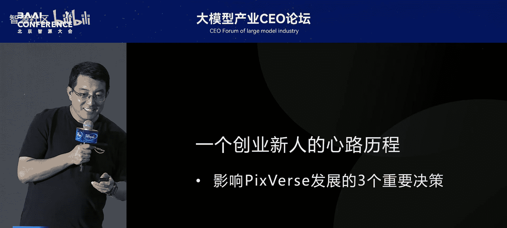

对。有多少人知道picixel这个产品啊？啊，我想哎我非常开心，还有一些人知道。😊，因为他在国内啊声名不写，因为它是一个海外的产品。嗯，所以先用这一页PPT来简单介绍一下这个产品当前的现状。

那首先在过去这一年时间，我们的模型啊爱仕科技的这个模型在全球范围内是持续领先的。这只是呃这个这个这个呃评测是在一个特殊的时间点，就是24年的12月份sra。😊，在发布之后。

10个月之后啊姗姗来时正式可测的时候啊啊，第三方做了一个评测啊，跟大家的认知是一致的。就是当他真正出来的时候，就已经不是在第一梯队了。大家发现第一梯队的前三个其实是可林啊海螺啊，还有我们pix。

这个相对靠谱的一点是啊直到现在，全球用户量最多的最大的上个视品生产产品也就是这三家。同时我们的产品发展很快，我们的移动端是在24年的12月份正式上线。😊，不到一个季度时间在25年的2月份啊。

全球知名的投资机构S6Z发布了一个全球100大啊人工智能应用排排行榜在移动在app端的排行榜上面我们排到了第52位，没有把我们没有把我们的网页端进行排名。如果排的话，能在前20名。对。

那从去年10月份之后，我们的呃用户量增长非常快的啊，到至今为止，我们的月活超过了1600万。当你当然了，带来的就是营收的快速增长。这就有些数据也引去了哈。

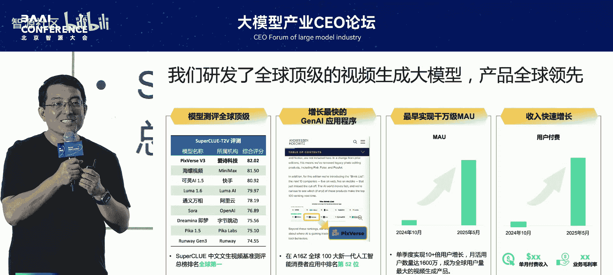

那回到两年前，像我这样一个在人工智能领域，已经已经闯荡了20多年的老兵来说，很多人都跟我说，你为什么那么想不开出来创业。😡，啊，特别是在23年那个整个的融资环境非常非常差的时候啊。

最重要一个激励我纵身一跃。就是因为我们看到和很多同行一样，看到了一个新时代的到来。😊，因此啊20年4月的时候啊，我们走上了创业的不归路，这个是我们公司成立的时间。事实上，在chaGP刚刚上线之后啊。

222年年底就开始筹备啊这个创业之路了。所以涉及到我们这个要做第一个重要的决策。你出来创业干啥？这个不是一个容易回答的问题啊，特别是两年前。我看到今天这个论坛其实一半以上都是做视频的，对不对？

但是两年前是这个样子嘛？大家想一想，大家回我回到两年前，那个时候视频生成冷的不得了啊啊，我们可以对比一下，是当时在大言模型啊，这些公司融资的金额啊，数百亿数十亿数亿美元，而且视频生成这个赛道就这么散啊。

😊，软位已经那个公司已经成立了56年了，那个时候啊融资已很多，海外还有个皮卡，然后我们融资数百万美元。😊，啊，是就是蚂蚁跟大象的关系。大家能感觉到有多冷了吧。对，那时候做什么也不是显而见的。为什么呢？

聊过好多人啊，很多的99%的投资人跟我说，和包括业界专家跟我说，为啥干视频生成呀，5年之内他没法落地，因为你看右上角那个当时的水平，当时最好的那个模型的最好的那个examp就是那个样子啊，而图像生成。

你跑出来了，年轻时候1亿美金，对吧？有开源模型了，你可以方便套盒做应用，对不对？那是就做大模型啊做应用大模型很烧钱是吧？有很多跟我说，你就别做大模型了，对吧？看不看好大模型。😊，行业的人不会投我们。

为什么？因为他们觉得这大模型没前途啊。😡，那看好大模型赛道人也不会投我们，为什么？哎前面有大语言模型，那个更ex。😡，所以当然应用册也有很多机会，我们可以做游戏，做广告，直可以直接变现是吧？

所以但是我们的认知是什么？😊，哎，视频呀，我们有你只要你有纹声图，有纹声图，哎，有大语言吗？行，为什么不做视频呢？因为过去我在字节跳动。只陪伴抖音tt成长了好多年啊。

我们的认知就是视频是最贴近用户的内容形态。那个时候不做视频就没有道理呀，对吧？😡，对，所以我们选择了一个非共识的事，当时是非共识的事。但我们认为内心认为是正确的事，all in视频生成。

因为我们认为啊是民生同这件事情一旦能够落地，它的产品化商业化的机会可能比大原模型不差啊啊，另外一方面。因为我我和我团队当年支撑了抖音tktop这些国民级啊产品背后的视频AI能力的发展啊，我们有信心。哎。

别人不认为也能做出来，我们是有信心能做出来的。二者合起来，我们没有理由不做这件事情。对，一旦做了这个决策。哎，发现哎很多很多发展就就就比较顺利了啊，这有这是一个时间线，我们在4月份成立公司。

真正7月份开始all in训练视频生大模型，3个月时间，10月份就已经在全球第一梯队了啊，我们在24年1月份正式在海外上线store网页端。😊。

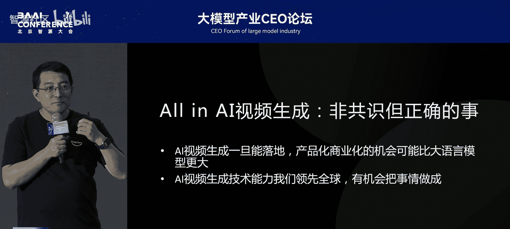

一个月之内，在2月份的时候，我们在各种排行榜上面已经冲到前面了。

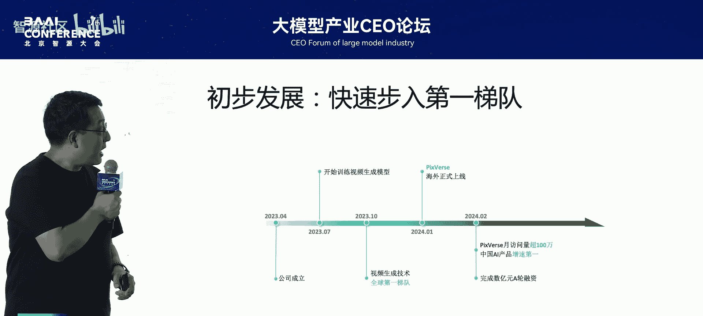

啊，这是去年智源研究院嗯和中传媒大学做了一个非常专业的评测。那个时候也是我们第一代模型。sorra，大家都知道，所以那个时候的sorer是个假的东西，所以带个星号。

所以当时评测啊我们是在全球范围内是前二名，国内是第一名。😊，那是大家知道我们这种模型打榜，我们不能只看这个，我们还要看产品。对我们在1月份上线上线一个月的时间，刚刚上线一个月的时间。我们在各种榜单上面。

增速网上面都是稳居第一名。😊，本局第一名增速，但是新新的产品增速快，当然这个大家也不会特别呃在意哈。但是你看它的访问量绝对值。当时刚上线第一个月就已经跟当时最著名的。😊，大圆瓶产品，包括豆包。

包括吉米啊，这同一个量级了，这是我们非常exciting的事情。😊，哎，很顺利是吧？好像一切都挺美好。但是大家记得哎突然发生了什么事情吗？😊，我们是20年1月份正式上线的啊，在海外取得非常好的口碑。

大量的用户在使用。突然2月份啊那个sara哄空出世，对不对啊？所以那个春节期间啊，早上起起来的时候，我的微信叮叮叮叮叮叮，好多人关心我们的人给我发发信是吧？就很担心啊。

说哎GPT出来的时候领先了这么多sara出来之后，你们是不是公司就会完蛋了，他会不是领先很多。当然我们现在看那个时候是个假的东西，对吧？但是忽悠了很多人啊，对，所以很多都是这样的关心的信息。

包括我们的投资人啊很焦虑啊，我们的很多的同行，啊，我们的很多朋友很焦虑，但是也有好的事情，就是因为因为s扰出现让这个。😊。

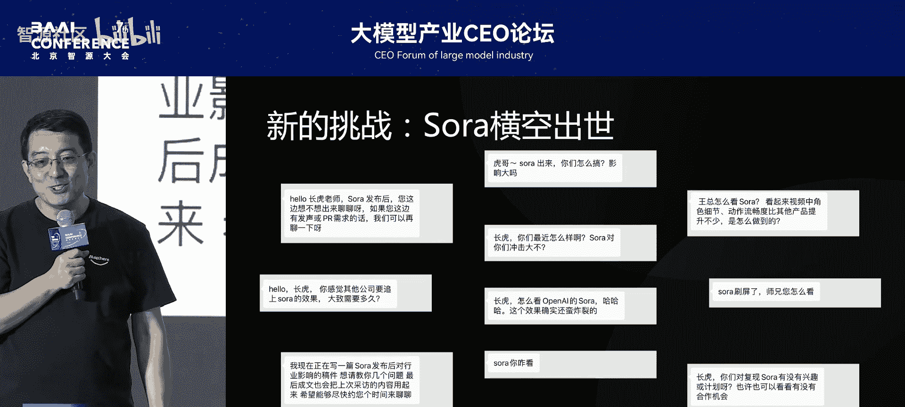

方向形成了一定的共识。哎，我们呢非常想要招过来候选人，突然给我发了信说哎呀，要加入，决定加入我们了。😊，哎，这个人后期在我们公司发展过程中起到了非常重要的作用。所以哎引入引出第二个决策，重要决策。

sara出来了，你跟还是不跟啊，这是一个很重要的事儿，为什么呢啊？😡，首先这个方向啊从一个非共识的呃那个状态变成一个非常热门的方向啊，留给这个小公司为琐发育的时间结束了啊，很多大公司大厂对吧？

google啊、这些快手啊，还有大模型公司啊，那个融资金额是我们几十倍的大模型公司纷纷加入竞争行列了，竞争更激烈啊？哎，这个形成共识之后，融资是不是更好融资了，融资环境24年比23年更差。😊，哎。

你有很人担心，你是不是比sorer已经落很久了，你还有机会吗？你没你钱你跟那家怎么比啊，对吧？你资金那个实力没那么雄厚，对不对？😡，啊，很好，因为我们过去那一年发展实际上是是发展的还是不错的。

所以我们拿到第二轮的融资。但是呢宣传这个大模型，现在大模型需要过去10倍的资源，你要不要搞？哎，你只有一你的现金流只能支撑你一次机会，训练不成功，我就完蛋了啊，没有第二次机会，你搞不搞？😊。

对吧是继续训练大模型呢，还是放弃转身做应用啊。如何杀出重伟？我们遇到这么大的挑战，在这么多问题的情况下，我们要做个决定要不要跟啊，但是你要知道创业就是纵身一跃，对不对？😡，这一跳我都跳了，第二跳还怕啥？

😡，所以我们决定是奥意，但是也是有逻辑的啊。首先我们是有前瞻性的。很多跟我们聊的那个投资人在23年的时候啊，sra还没出来的时候，我们跟他们规划技术路线的时候，就有DIT这个架构。

而且当时exactly就是计划的在第二年的春节前后，我们拿到第二笔的融资之后，能够支撑我们训练更大模型的时候，我们训练这个架构。所以如果不是sra先发布的，有可能是我们先做出来。所以这个路线啊，我们是。

😊，认同了并且believed。第二个是哎我们觉得我们能力好啊，对吧？因为你看下GP出来之后，大家的认知是大语言模型。其实中国是落后美国很多的啊。但是因为他太火了。

导致很多人把这个认知变成了AI中国落后美国很多。但是实实际上过去这几年我们做的抖音啊，to talk呀。我和我团队在做的事情是领先全球的。视频AI能力是领先全球，这是我们的认知。

所以我们觉得哎我们有能力做好，并且可以10倍效率的做好。😊，啊，10倍低成本的做好啊。所以那个时候很多。媒体同媒媒体朋友啊还想问，哎，你得说个数字吧，对不对？那个你们什么时候能赶超sorra。

我我很谨慎的跟我们的呃技术同学哎。😊，仔细的去去盘了盘，我们当时得我3到6个月。嗯，还可以啊，不要被打脸啊，当时非常谨慎，就3到6个月。

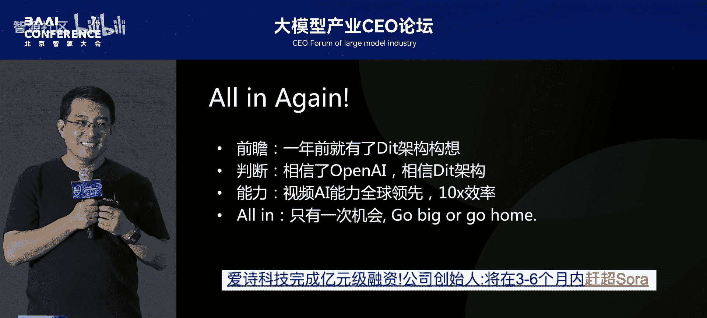

实际上啊发展过来之后，你会发现哎吹过牛，哎，基本还实现了。所以你看我们从那个呃1月份譬如说正上线啊，2月份呃又活已经超百万。对，然后我们在34月份开始筹备，做大模型啊啊又囤了很多机器。

然后做DIT架构3个月时间，我们的7月份就是正式上线了啊。😊，be是别说维 two的这个产品。啊，在我在在爱思科技，在py source没有发布这个概念我们历史上没有发布，我们直接上线啊。😊。

所以我们是。可能克林在我们前面上线这个产品，我们创业公司里面大概是最早的一个。然后又过了3个月啊。10月份我们正式上线了V3。如果大家有印象的话，我们第一页PPT的时候，你发现哎为啥我们的用户量。

我们的营收都是从10月份开始涨起来的哎，这是一个重要的mstone。😊。

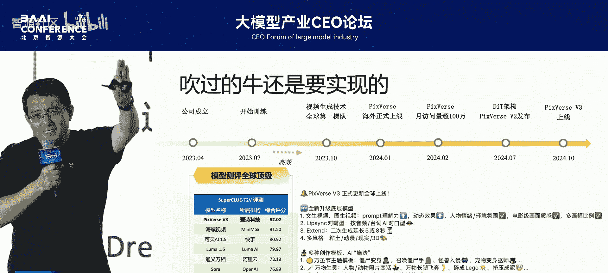

对，这是我们V3啊这个模型。24年10月份正式上线的时候呃，那个视频大家可以。去看一下。🎼，🎼，🎼。🎼。🎼。

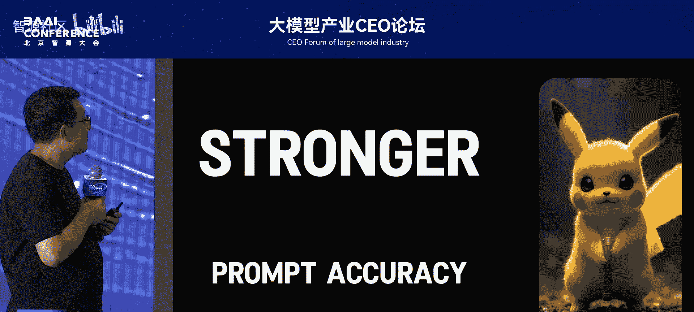

🎼，🎼，🎼Hey， take it easy。🎼。🎼Yeah。🎼看一看有没有熟悉的内容，我就不仔细介绍了的一。🎼意图无胜千言嘛，对吧？Okay。如国。🎼Make you character speak。

 Make your character speak。这是我们的那个产品的页面。哎，我们有一个选项，这个产品页面里有叫叫做eect特效，里面有好多种特效模板。有没有大家熟悉的，是不是第一个很熟悉呀？😊。

毒液啊。毒液。火了火爆了。🎼。🎼や。🎼Yeah在。🎼Yeah。对。我们是一个海外的产品，对不对啊？其实国内还是没法用的啊，但是它在抖音居然火起来了。就是如果你仔细看的话。

它几乎每个视频上面都有个logope啊带来了病毒式的传播。😊，🎼当然我们有一些一些因为流量太大了，有一些。😊，🎼对一些明星你才自发的模仿。对。然后火到什么程度？闲鱼啊，到悬疑上。

你不是搜索pesource啊，你搜索AI，直接搜索AI，你发现推荐的都是pers毒液生成，最贵的18块钱一个而是。😡，对，因为我们是个毕竟是一个海外的产品，所以中国火了，海外更火。对。

我们在各种社交媒体上爆火。然后当然也不止毒液火了，很多东西都火了。全球持续发酵。嗯，所以这有一些些数据了啊，这是那个。AI这个中国的产品的出海曾树宝。对我们排在了第二名啊，当月这11月份。

返量直接接近有80%的那个提高啊，在各种中国AI产品里面排行第二啊，你看看这单摊的返量已经远超于第一名了。

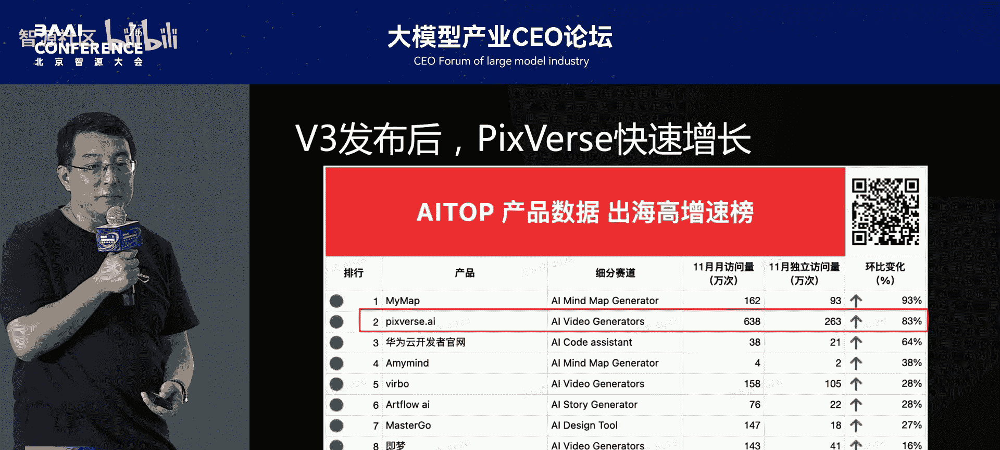

对。我特别特别喜欢那个那个张一鸣啊，钱老板啊，他的一句话就是务实浪漫。其实大家很奇怪，务实跟浪漫这怎么能放在一起呢？对我们认为我们第二个决策all in视品生成啊，这件事儿就是一个。😊。

务实很浪漫的事儿啊，确实是背水一战，大家想象不到啊，那个时候那个钱就够你够你训练一次，犯一大错误就没机会了。但是真的是背水一在。嗯所以我一些在想跟大家也分享一下啊，移民的一些观点，做容易的事不是务实。

短期投机不是务实，做正确的事才是务实。那我们认为我们做的是正确的事啊，认识事界多样性是务实多样性嘛，都很多人做大原模型，我们就要做视频。😊，独立思考啊，穿越喧嚣是浪漫，有生命力是浪漫，面向未来是浪漫。

拥抱不确定性是浪漫。哎，就是我们在做的事情。我其我们其实V3成功背后有很多力量，包括我们过去哎 are in视频的各种思考啊，包括我们背水战啊，包括我们把这件事情做成了，就行政预言。

还有大家看到漏了什么。哎，这些是不是都都是关于技术的呀，对不对啊，产品呢，所以涉及到我们做第三个战略决策，做什么样的产品？V3的成功是技术和产品的成功。做什么样的产品呢？

to B还to C早很早时候不不知道，但是。😡，当我们all in之后，我们就很清晰了啊。服过哪些用户如果设计。😡，我们。在all in视民生城那一刻啊我们的愿景就是想帮助每一个人成为生活的导演。

那是to B啊 to C嗯，我们要先做t C再做to B，对不对？哎，我们认为我们这个团队是一个全球化团队。我们伴随个抖音和tiktok的发展，我们是个全球化的团队。所以我们有限资源情况下。

我们先做海外再做国内。每个人成为生活的导演，每个能玩抖音to talk的人成为生活的导演。啊，所以我们希望能够几十亿的普通人能够用起来。有了这个目标，后面就很清晰了。我们要做好两件事情，一件事情。

如何降低普通人创作门槛，对吧？另外一个是如何提升普通人的创作体验啊。😊，我们再来回头再看一看那个爆点那个毒液变身为什么能成？用户只需要上传一张照片，然后选择一个模板，比如说接入模板。

🎼哇不需要输入prom就能生成这样一个视频。哎，他也可以选择上传照片之后，可以选择毒液变身。但很熟悉了是吧？🎼也可以一起摇摆。😊，是不是很好用啊？所以为什么V三成功啊？首先我们做到了降低穿的门槛。

不需要再收pro了，仔细上传一张照片就OK了。每个人都可以做。第二，提升创作体验。你要知道在这之前，所有的产品都在服务于那些创作者，创作者有创作目标的，他可以容忍你的。不好的地方啊，生成10个视频。

超有一个可用，它出卡概率是10分之1，对不对？啊，是否生成5个视频才有一个可用，是触版概率20%。😊，普通人谁会去用啊？第一个生成第一个视频不满意，他就不会生成第二次了。所以成功之处在于我们。

把超法概率直接拉到接近百分之百。任何一个普通用户没有经验的用户，这从第一个视频就成功，他就会传播啊。所以这是去年20年1020年10月份，我们V3和产品上线。

是第一次真正让普通用用户普通消费者用AI能力创造出过去无法创造出来的视频。是么异议？在我心中，这个时刻才是视频生成的GPT时刻。

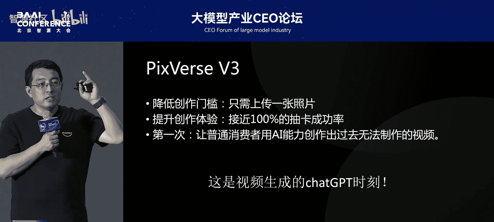

属一好的模型带来了好产品的。但是当然了，这个啊这个火啊谁都能看到我同行都看到了，所以他们快速上线那个同样的毒液变身的这样的能力啊，对呀？但是好的模型带来好的。为什么前面说哎V3那模型。

我们全全球最能打的模型啊，对吧？我们不是只看那个打那个那个榜单的数据啊，能打在哪，我做个对比啊，左边这个是一个同行毒业变身是一个非常。😊，重要非常强的同行啊，他当时也是上线了这个变身能力嗯。

上传这样一道照片，你看他怎么变身的。😊，哎，这个准场，对不对？这独西是跟跟这个人你为他不太有关啊，我不知道大家会去传播这样的给自己的朋友圈传播这样的视频吗？右边是我们的。😊。

所以本质上这个这个用户喜欢是因模型好。嗯，所以那个时候模型确实是巨能打。哎，有了这个认知之后怎么办呀？我们要做的更好，我们就要做更好的模型。😊，啊。当时毒液变身火，不知道大家对毒液有印象更深刻。

还是对pic印象更深刻。很多人易说哎，这个东西很多家都有这个毒液变身能力，对不对？都有模法能力。那是毒液变身火了，还是你pic火了啊，这是一个佐证，这是google trend上面的搜索指数啊。

我们是10月初啊，开始。你看我们的直合指数蓝色直线上升中间两条这个是列的全球最好的视频模型产品啊，sara。😊，他在喊上面runway啊，是因为他英语里边是有一个它是一个单词。

所以这个这个这个曲线它是虚高的啊，让我们已经远超过他们了啊。所以那个时候呃视频生成的GPS时刻啊，他不是毒液变身火了，这是picixsource火了。😊。

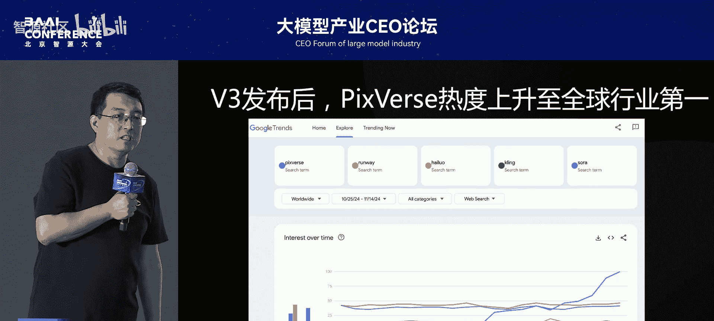

啊，所以我们要去做更好的模型。最后速度很快。我们在10月份上线的V3啊，112月份上线的V3。5。因为我们觉得普通用户不会有耐心去等待你去生成。过去全是分钟级别的生成生成视频，1分钟几分钟十几分钟。

我们直接把它拉到了1010秒钟之内啊，这是V3。5。😊，哎，这样的话我就可以支撑我们的产移动端啊，app上面上线这个这个这个这个产品了，普通用户就可以去使用了，对不对？

要不然普通人不会花那么多时间去等待你的生成。😊，2月份我们上线了V4更快了，而且支持这种实时生成的效果。啊，5月份上线的V4。5，每一代都有巨大的进化。

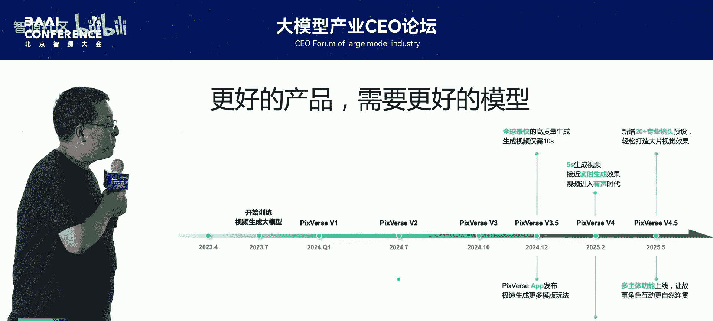

我不会详细介绍了啊，我只是说一些视频，比如说V3。3。5，它是一个最快全球最快的视频生成模型。当然也有其他的一些一些能力。包括哎我们那个提供了一个首尾帧的这样的生成。这个全球也火爆了一圈。对。

上传左边一张图片啊，是视频的首帧生传尾帧帧图片，就上传这两张图片，希望生成一个视频，从第一帧过渡到最后一帧。你看生成视频是什么样子的。😊，开打开门，镜头钻进去，看到一个新世界。

这个视频里面的所有镜头都是用这个能力生成的，这样给大家提供更多的啊玩法。哎，这个模型好，不能自吹自擂，对不对？产品好，不能自吹自擂。所以这个是当这个是那个1月份的时候啊，那个中国产哎。

这个应该不是中国产品，这是全球的AI产品增速榜。😊，1月份出现了一个历史性的事件是吧？大家都知道dig sick横空出世，对吧？所以你看。😊，那个时候1月份全球的AI产品里面。

在访问量和增速上面同时超过我们的只有dept。好，25年2月份，V4上线了，它不仅更快了，几乎5秒钟就能生成5秒钟的视频了，几乎都要实时了。同时。😊，他让视频生成进入到了有声的时代。

大家知道哎最近的那个vi V three啊那个上线了一个这种带声音的生成，让我们在2月份就已经上线了。大家可以看一下这个这个过去的视频，在媒次要媒体这样传播的时候的声音啊都是后配的，都是创始后配的。

我们是给同时的是生成。😊，这是同时生成出来的。all three major indexs当然了可以去指定这张图里面的人说哪些话，口形影对上很多其他能力我就就不具体介绍了。也发对象。😊，哎。

这2月份上线，你看我们上4月份的时候，这是中国产品出海总榜啊，这是移动端。刚才是访友这是移动端。你发现很巧啊，所有中国AI产品里面啊出海的产品里面在MAU和增长上面超过们只有yt所以也很惊讶，很惊讶啊。

😊，好，我们25年5月份那个上个月啊刚发生的我们的V4。5正式上线。啊，他也带来了非常多的功能。那一些进阶的消费者也能够生产这个创作电影级的内容啊，包括多角色联动的一些能力啊，能可以看一下。😊。

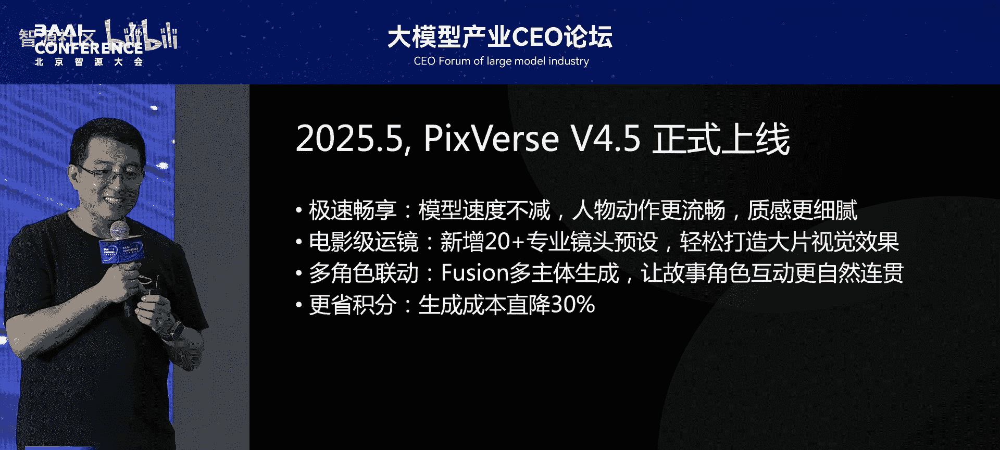

这是几一个视频啊体现这个各种专业引进。😊，🎼啊，你的小猫B弟跟我眼接。😊，🎼可以看到各种各种专业的眼镜了没有？Yeah。🎼快速推电。好，多主体什么叫多主体？就是上传来两张照片啊，生成一个视频啊。

是这个主体在这个背景里边畅游啊，干成生成什么？😊，这是上层的内容。嗯。5月份其实发生了一件事情，我们非常开心啊。哎突然一早一大早起来，我们的那个同事和朋友给我发信说，哎在美国的总榜上面，IOS总榜上面。

你们跑的很前面了啊，这是两个榜，都是美国的总榜啊，第一个是所有的这总榜啊，所有的的，我们排不到第四名。😊，啊，可以看到哦排子前面的排在后面的，包括google map呀、剪映呀，whatsapp呀。

当然还有一些背影墙的一tlk。那在photo和video这个榜上面，然后我们排到了第一名啊，你看我们后面那些剪映ingram YouTubetubes等等然我们非常开心。但是不可能一直大霸榜啊。

可能是昙话一现，我们非常开心。😊。

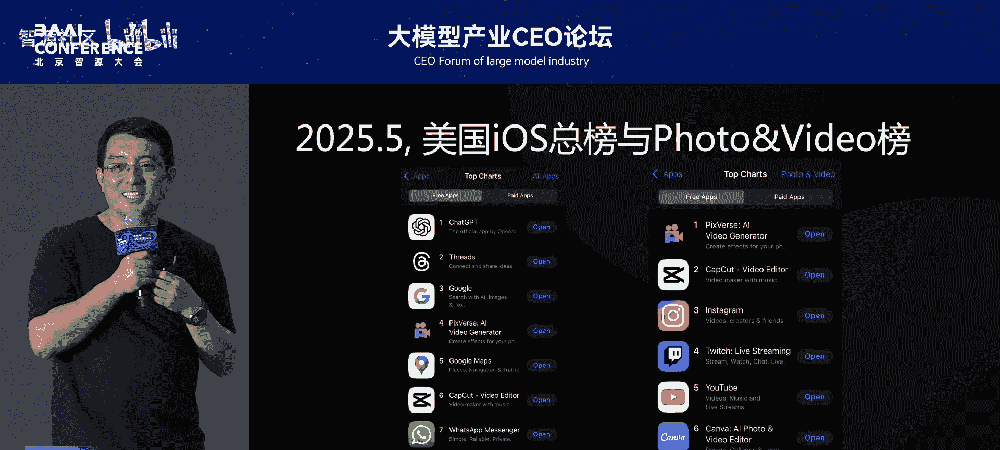

对，所以当前我们已经超过6000万用户在使用picix。大家大家很好奇，这帮人哎还用你用它干啥？😡，啊，我们可以看一下，我们是在在tktk里面搜索picix source。

你可以看到很多用picix source生成的视频。然他们用户是怎么用的？🎼哦，那这歌可没放出来，那因为时间也也没什么时间了，我就跳过去了。大家可以自己去去看一下。😊，🎼我们在1月份的时。啊。

我们在1月份的时候啊，就是因为我们产品在国外已经火火的不得了。然后就很多的那个B端的客户，企业用户找我们说，哎，能不能让我们能用你们的API呀，对吧？有很多能力我们是差能用上。

我说哎我们已经有至于超过6000万用户的最佳实践了。我们知道他们喜欢什么，对吧？我们知道他们爱用什么。我们知道他们怎么用，那这些能力真的是可以赋能我们全球的这种B端客户啊，对吧？

所以我们可以在1月份的时候开始逐渐开展这种这种B端业务啊，支持了各行业的API和定制化的市品生成，能覆盖了呃非常多的场景。互联网营销电商等等等等。😊，啊，这里就不多介绍了。但是依然是一家海外的产品。

对吧？那个大家去国内的那个app store上面啊，各种app store上面去搜，你发现全是李鬼，全是盗版。因为对我觉得也也对有很多广友说，哎，你们产品这么烂呀，对吧？我说我们没上线呢。

所以应用户的要求啊，我们筹备了几个月时间。今天啊今天正是啊在国内全面上线公测，我们的名字叫拍我AI啊。😊，首先它很全啊，在国内各商商店上面都可以去下载啊，包括网页端。

同时它最新的它对齐了那个picixrs最新的机模和所有的功能。同时它是一个中国的模型，中国风啊，中国味啊，模板和内容。同时我们有一个新的域名picixrs太绕口了。对中国来说t又好了。

我们给它起名字叫拍我啊，所以域名是拍I派点video很好记。同时我们B端用户，B端那个服务也全面升级啊。😊，power我AI啊，首先power我和pic对于我这种英语不好的人来说，确实有点很像，对不对？

但是他有自己独特的命名的啊原因，我们可以看一下。😊，这个镜头这个视频啊，镜头都是由派维I生成的。🎼嗨是人类最简单的创作行为。🎼开是人类最原始的赞赏品。🎼当技术拥抱艺术。🎼开始激起每个人的创作本头。

🎼我是主角。🎼我也是导演。🎼红中。🎼吃。特别幸运啊，创业两年。依然留在了牌桌上。

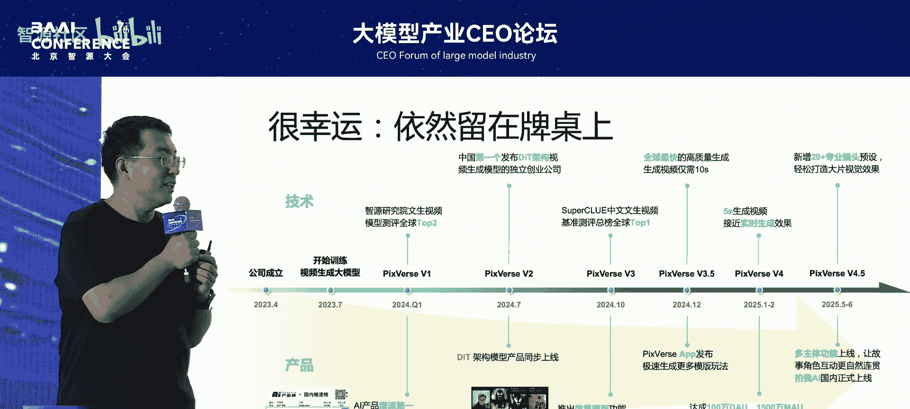

好像一切又挺美好，对不对？诶，这里为什么又有个又似曾相识啊，跟去年年初很像啊。😡。

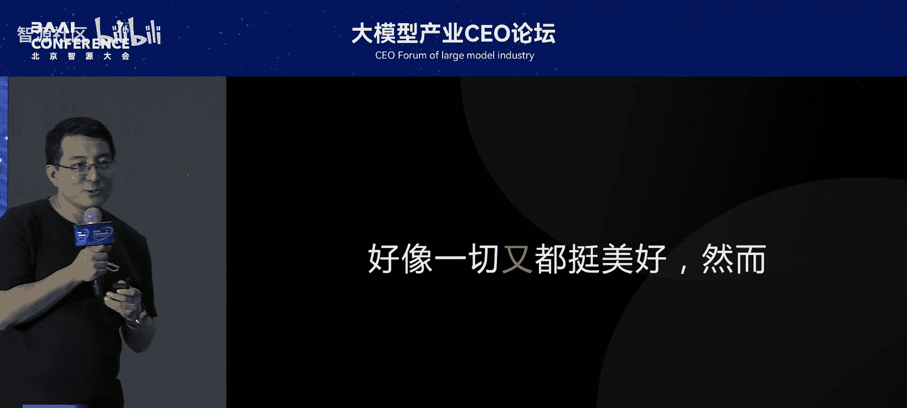

任重道远，需要刀尖上求生存。

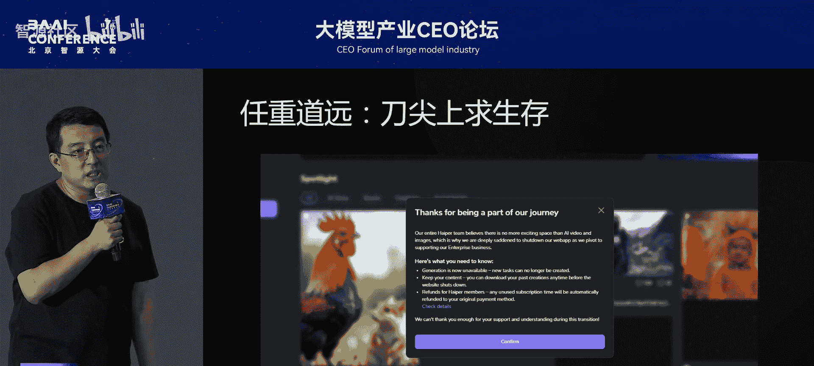

我们有很多竞争内手，过去这两年其实有好多的同行，其实。都被落下了啊，但是没有都没有触动我。对，真正触动我今年上半年的突然发现一个我们一直在关注的这样一个产品。😡，Hper。突然。暂停服务了触动很大。

因为一直在我们的竞品名单上。对，所以创业很不易的对。😊，未来非有非常多的挑战，一个是技术迭代快啊，对如何持续保第一梯队了。过去两年你成功了，不代不代表未来两年你能成功。大模型很烧钱，我们没那么大对吧？

我不像大圆模型那么烧钱，我们可以很高效的烧钱，但是依然要烧钱，如何持续的融资啊，如何确保现金流的健康，如何加速商业化？😊，呃，不止于工具，我们如何做好产品差异化啊，如何建好如何建好竞争壁垒。

如何应对大厂的竞争？如何应对开源生态？这也是未来爱仕科技。pi派维I要进一步思考的对，所以过去总结这过去这两年，其实我是不会创业的，都是一猛子扎下去了，然后在想思考干啥，对吧？

所以过去两年这三个重要决策啊，我们做了影响了产品的发展啊，其实都是在边做边学啊。😊，那一个学到的一个很重要的一个一一点就是这个这个企业呀，它是有生命的。他就像一个小孩一样啊，你的孩子啊。

实实上他是其实他你创始人的经历呀、认知啊、经验啊，影响着每一个决策。你的孩子嘛总是像你的对吧？但是小孩的成长过程中如何去教会他？😊，能够有面对困难，勇往直前的勇气，如何教会他更坚韧一点。

在各种极限压力情况下，让他更好的。具备更好的性格，更好的发展。小孩小孩子哪哪能不犯错呀，会犯错，对吧？但是你不能犯大错，像我们一犯一个大错误，工司又黄了，吧，现在又断了。对，但是要有快速纠错的能力。

对吧？还是说市上印。😊，边做边学，持续成长啊，因为时间原因啊，我有很多其他的一些一些一些认知啊，这里就没法介绍了啊。对。其实创业这过程中，这两年其是蛮孤独的。特别是当你聊了99个投资人。

聊100个投资人，99个都不看好你的方向。的时候就很孤独。嗯，创业是一段孤独的旅程啊，就像在。😊，这个戈壁上啊独行一样，同时他又是一场非常幸福的修行，遇到非常多的懂你的人，和你一起战斗的人。

你可以看着你的孩子啊逐渐的有性格变得越来越强壮啊，非常的开心啊，最后啊致敬这个时代，自有梦想的这些人，谢谢大家。😊。

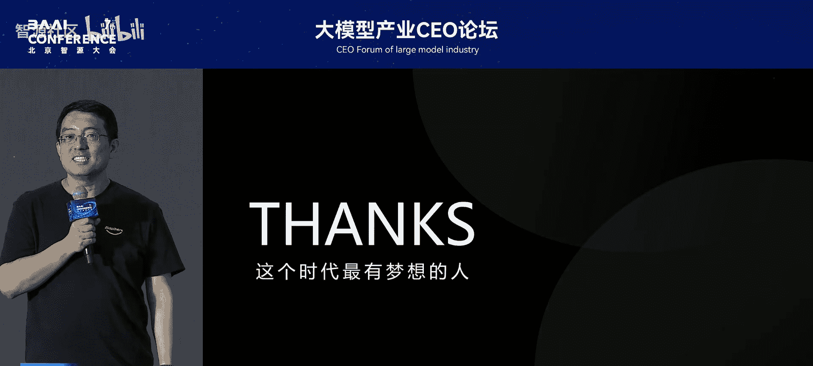