# 2025北京智源大会-大模型产业CEO论坛 p03 多模态生成从模型走向生产：骆怡航 -BV1NmN5zLEU5_p3-

啊，现场和线上的朋友们，大家好，我是申树科技的洛一航。嗯，今天这个论坛是产业论坛，我其实想更多的从未来的方向跟大家分享啊，多么太深层啊，怎么走，从模型怎么走向生产，千行百业。

以及走的过程中会遇到什么问题，以及如何啊走的更好。那其实我们啊看到了语言模型哈，其实从去年我觉得有一个大的飞跃式的爆发啊，多么肽呢在我看来可能晚了半拍或者一拍。但是尤其是今年哈我们看到飞速发展。😊。

那我认为今年啊可能多模态生成正处于规模化生产落地的拐点啊，几个方面。第一呢我们看到了技术迭代非常迅速啊，新音视频的生成模型，无论在效果速度成本上都会快速提升。那其次呢我们看到行业需求特别旺。

为什么就是传统的我们去做内容生产啊，痛点非常多啊，周期长，成本高，人员非常专啊，专业的软件以及创意非常难等等。那这些痛点呢，其实是亟待解决的那第三呢我们也看到了说很多行业视频内容相关的各种产业啊。

落地节奏加快啊，这里边。去年一年，包括今年上半年，尤其是看到各种行业都在啊积极的探索，而且有些已经完全生产落地了。所以在这样的场景下，我们做了一些行业侧的总结哈，包括了八大行业，还有啊三十大场景。

其实可以看到这些行业都是视频为主的内容产业啊，其中所有的行业基本上都是以视频内容啊为主去流转的这里面包括了内容的生产内容的消费等等环节。所以我们看到传统的生产方式在对这些场景的内容进行生产的时候啊。

是亟待去解决一些痛点和需求的。所以我们可以看到生产价值是非常巨大的。而且。亟待挖掘。那视频生成如果要规模化落地啊，对于申诉科技来讲，我们如何去推进呢？我认为今年包括再往后的几年，要同时具备四个条件啊。

第一是内容的创意啊，内容质量生成的效率和生产的成本。那创意部分在我相信啊，主要还是人的部分啊，人的想象力，人的创意如何去发挥？那其次呢就是内容质量、生产效率、生产成本。

那这三个维度主要还是大模型的模型和产品啊，要去。推动的那如果具备了内容的质量好于传统方式，同时呢生产效率和生产成本在我看来，效率必须比传统的方式要至少百倍的提升。比如说以前我们做一个视频，可能1万块钱。

但是如果他只是降低10分之11000块钱，但是如果效果不好，我相信可能大家也不会采用哈。但如果降低100倍，同时具备一样的效果。我相信这样的推动力是极其大的。那同时生产成本，还有传统方式至少要降低。

1%啊，生产效率要提升百倍。

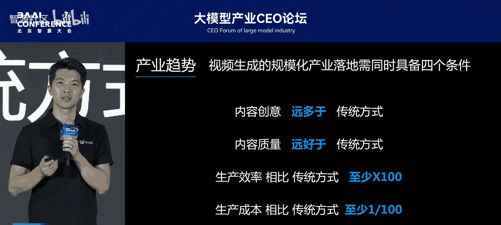

那对于深诉科技来讲，我们是聚焦在多模态生层啊，现在哈是主要以视频生成为主，包括音视频的部分。然后未来我们在延展啊3D虚事空间等等。那目前呢我们是聚焦在专业的用户和企业用户里边，也是致力于刚才提到的。

我们去把模型推动到八大行业三大场景里边。那这些内容为什么是生产场景哈？因为在我看来，那内容除了我们所有的人我们可以去互动。但是如果内容要去产生商业价值和消费价值的话。

它可能会发布在自媒体、广告、电商、动漫文旅啊，教育培训、短剧、影视制作等等方面。我认为这些内容的价值，它是商业价值啊的发生。那申树科技的产品呢，我们叫微度哈，去年的4月份，其实是啊24年的2月。

sra出来之后啊，申树的微度是第一个跟进了国产的啊视频大模型啊，叫微度。那同年的7月呢，我们发布了微度的啊AI内容生产平台。

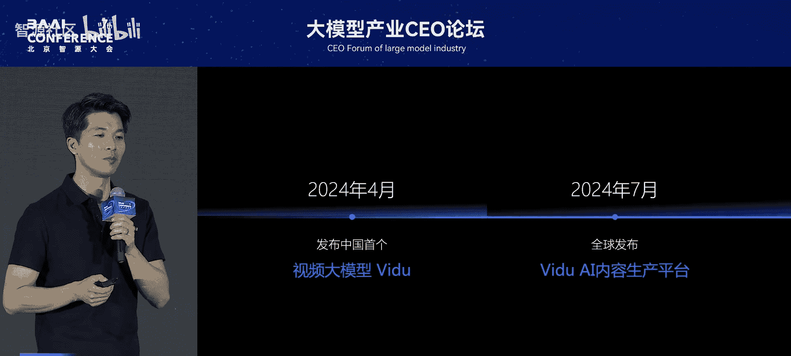

在随后的啊半年多时间里边，包括今年的上半年，我们陆陆续续从模型测产品测，还有用户测啊，已经提提升了很大的进展。那模型测呢包括了微度的1。5的版本，微度2。0，包括微度Q one的版本。

那这里边其实回到刚才我们说的效果效率和成本。那微度1。5呢，其实是我们去提升效果的一个版本啊，通过参考声视频，我们去保持多主体的一致性，使得在刚才提到的所有的商业场景里边能更好的去落地，保持效果。

那第二呢，微度2。0我们是把速度极大做了提升。我们可以达到5秒技术生成。那同时微度Q one呢，我们去进一步提升，包括高清的版本啊，还有首尾增，还有动漫啊等等方向。同时呢对于音效，还有音频。

我们做了生层。那从产品方面，我们目前已经把创作者啊个人还有个人啊创作的团队，我们去提供ss平台啊，企业服务，我们提供mas平台，包括移动端呢，我们去具备了API的APP的这种方式。那中国站和海外站呢。

我们啊从去年开始，我们就分开，而且去专项去服务每个区域和每个啊国家的客户。那从用户覆盖里边啊，截止目前我们啊在200多个国家和地区超过3000万的用户了。企业客户呢啊包括了刚才提到的八大行业里边啊。

2000多家的客户在使用啊申诉科技的维度的产品。那同时呢有30多家的生态合作伙伴也跟我们在合作。那其实可以看到用户他要使用产品，我觉得交流是非常重要啊，因为就像我们在抖音上大家可以去看大家拍的视频。

我们再去啊二创再去啊分享延展。那同样的对于AI创作来。

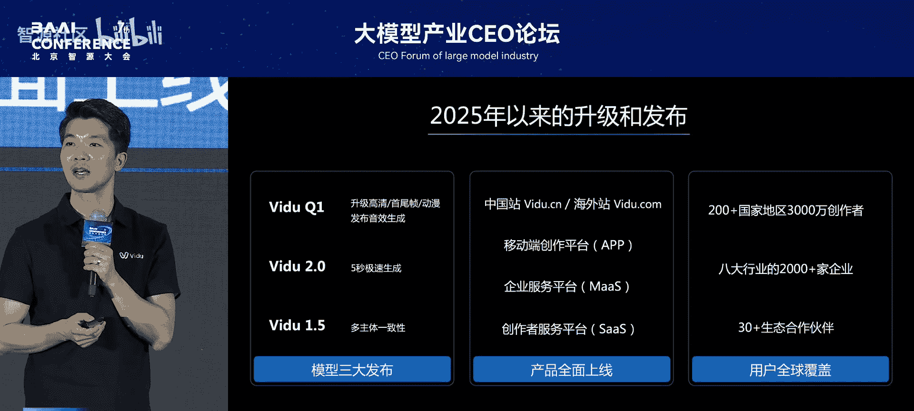

讲啊，我们也可以以这样的方式。那每天啊3000多万用户在微度的社区里边去寻找灵感。那这些灵感里边大家可以看到，包括人物画面、动效、剧情、调度、创意、短片教程等等啊，大家都可以从社区里边去学习。

那另外呢每天有数百万次的想象和创意表达，在微度啊累计超过两亿次。大家可以看到视频啊，其实是有有很多视频是实拍不了的，或者说很有想象力的视频是可以通过微度，通过AI的方式去生成的。

那同样呢有了短片或者素材之后啊，每天全球数千个完整的作品啊，在微度上面投稿分享出来啊，供大家学习和交流。那其实在这样的视频和作品的背后呢，其实是微度一直追求的理念。

我们就是要把创意效率、效果和成本啊兼巨。所以我们其实是致力于从用户侧，还有企业侧，我们提供最落地的模型和产品。那最新的我们的微度Q one版本呢啊，4月22号今天发布之后呢，也是登定了榜单。

但是我们先啊看一下视频啊，其中提供的一些啊能力。🎼，🎼，嗯。微度Q1的版本在啊纹身和图生国内的啊国际的两大榜单里边啊，然后领先于啊国内外的一些模型和产品。那最后边我想跟大家分享很多微度背后的用户的故事。

那其实用户为什么要选择微度呢？我相信他们一方面是自己的创意，如何去表达。如何通过模型和产品能够让他们的想象和创意去描绘出来。那同时呢他们更追求在效果、效率和成本上的艰巨。那我们来分别看一下。

首先啊柔术特效，他其实是一个一个一个创作者哈，他艺人他自非常喜欢动漫作品。他3月份发布的动漫作品一系列的连载，至今呢已经在啊分发平台上有300万人次的一个观看了。同时呢相比他传统的制作方式。

相比业界的传统方式，其实提升了10倍以上。

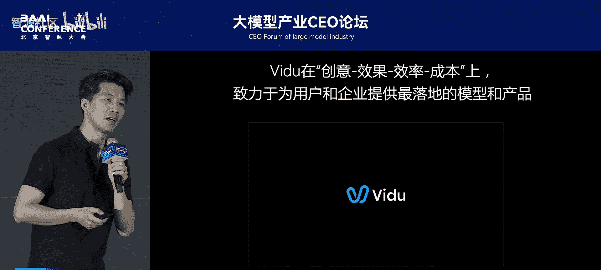

🎼あこは？🎼て行 未来ゆ は 近づ くの。🎼其看不是你。🎼あした。🎼这界の君。それは？🎼The。🎼不知一把那。🎼も誰れ？🎼加油。对，如果大家喜欢动漫的话，可以在B站上哈搜啊柔术特效或者这部作品的名称啊。

观察的悖论啊可以去看。那另外呢其实想讲一个海外用户的故事啊，他是美国的啊作家kimberfish。他是1个60岁的啊奶奶啊，他其实有一个视频梦，因为他以前的作品呢全是啊文字作品，文字著作。

然后他的作品有一个特点，就是啊非常温暖啊，都是以comfort啊去命名。那其实有了AI之后，大家现在都看短视频啊，看短剧啊长视频等等。那如何更好的去分享他的著作呢。

其实他一个人啊用微度去创作他的啊文字著作的视频的介绍啊，那他只需要拍上他作品里边的一些插图插页啊，就可以去通过徒生视频的方式，把他的配套的视频可以生产出来。🎼那其实有了文本啊，有了文字著作。

再配上这样的视频的话，其实非常受到他的读者啊，尤其是儿童读者的喜欢啊。他现在每天可以通过微度的啊平台去生产啊大量的他的著作的一些配套视频，包括以以前他创作的以及啊未来他新写的一些著作。好。

然后另外对于企业客户来讲，有很多我们在啊包括市场人员、营销人员，我们在工作环境里边如何去更高效生产了。那我们日从可日常可能用的更多是一些啊协同工具啊，这里边啊有大家的一个团队如何去协同。

如何更批量的去生产了。那我们的微度的API被飞书集成到啊办公平台里边。那这样的话，视频生成的人，你就可以开箱即用了，而且可以批量的去生存。🎼The。🎼。

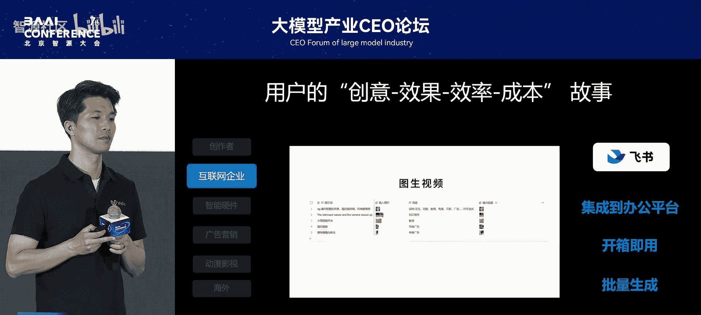

好，智能手机啊智能手机里面其实有我们每个人的啊相册啊，还有旅行的一些照片。那其实可以通过图身视频的等等能力，我们可以让一键啊把照片复活起来，或者说我们一些老照片怎么去动起来。

以及呢我们的有些照片可以一键去生成vlog。那这样的方式其实可以极大的去啊丰富我们啊旅行或者记录的一些体验。

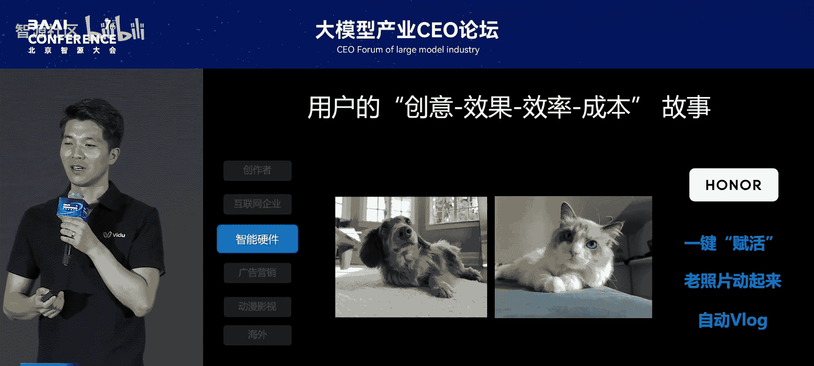

🎼那同时广告领域我们可以看到传统的广告制作方式啊，本身比如说实拍它的整个周期特别长，包括成本特别高。那我们和飞鹤我们一起完成了一部品牌广告。那这部广广告呢其实是播放在电视的广告里边。

他对质量和啊清晰度要求非常高。

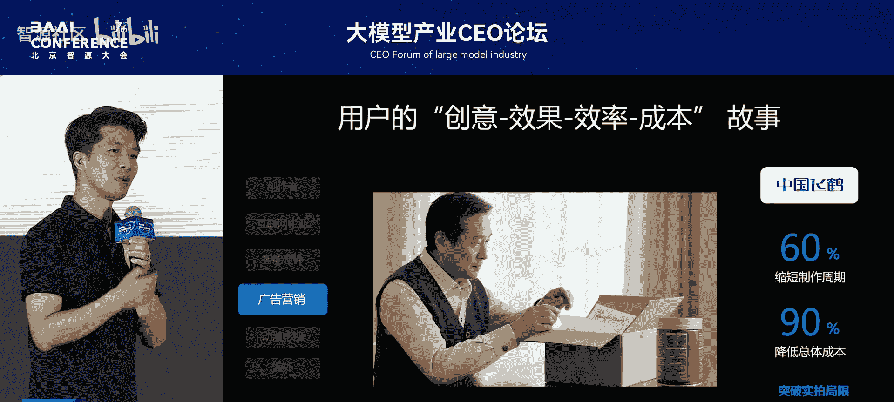

🎼今天收到了女儿的礼物。🎼老爷。🎼妈妈说这个。🎼一定要每天喝两次20个哦，下次我们再一起爬山，身上可好看了。😊，🎼果然是贴心的小棉袄呀。🎼哎国这大孙子。🎼给我这老头子满满的爱。🎼喝。好。

那相比传统的呃品牌广告制作，其实可以让我们的创意人员哈专注于创意本身，其实突破这种实拍的一些局限哈，它可以在创作周期上，包括总体成本上得到了极大的提升。那另外呢我们也看到有些个人的创作者。

他也可以在现在，比如说一个人我们可以去接一些啊商业广告了，也可以制作出一些高品质的商业广告。例如这样的一个案例哈，是一个广告写实的场景。他对于微度的全功能做了一个极限的制作。

利用非常短的时间去做出了这样的一个广告的测试视频。😊，🎼Hang down your head， Rosemaryrie， hangang down your head and sigh。

🎼Hang down your head， rose Marie or girl you're in such a flight。 A de board from down the lane。

 He made my heart a taate of light， but his love was just a passing game。😊，Aone at night， hang down。

あello。🎼Sorry， we are waiting for the queen number one。That's right， I am queen number one。好，呃，毒液啊。

刚才常虎也提到了啊，我们跟毒液呢啊没有去做这种互动。但是呢我们是啊跟索尼电影，还有伯乐互动。我们去做了毒液的电影的啊中国的宣传片啊，是以中国水墨画的风格，我们做了这样的一个创意啊。

全全程我们使用首尾珍的能力去实现这样的一个宣传片。那力网影视行业，尤其是好莱坞的一些啊公司，它其实对于一些作品的质量要求可能更高啊。啊，传统的一些预告片的方式基本上要从策划到最后落地。

可能至少需要一个月的时间。那当前这部片子我们是啊跟合作伙伴，我们用了10天的时间。那在成本投入上呢，基本上省了啊90%。那同时呢因为视频生成的快速性啊，我们在半天的时间里边啊生成了上千支的素材。

共索尼电影那边去挑选。那最后可以看到这样的一个作品，在整个中国影视行业里边啊。

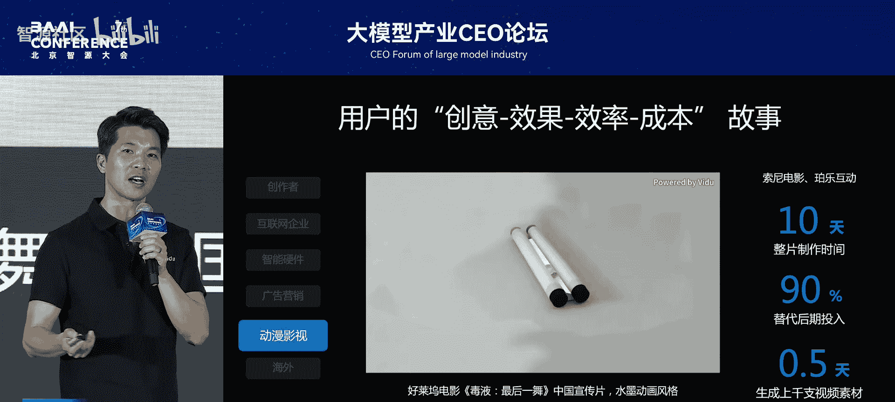

去呈现。好，嗯海外呢海外其实我们也呃接触很多哈，包括刚才提到的啊创作者啊，还有一些企业的伙伴。那包括好爱莱坞的一些动画工作室，也通过微度去制作啊动漫。那这样一个ar的动作工工作室。

它是基于微度打造了1个AI的动漫工作流啊，它是批量的去进行创意生成，把它的时间花在整个创意的部分，啊生产的周期去用AI的方式来完成。那那目前他是跟我们一起发布了啊预告片，那在随后的两个月的时间里面。

他将会把50级的整个AI动漫会做出来。🎼，Okay。对，这部动漫的风格就呃非常像啊好莱坞漫威的风格哈，也结合了亚洲动漫的一些风格啊，有一些特色。那另外呢啊除了动漫之外，其实GUV度还可以做很多啊偏写实。

包括科幻的一些作品。像这样的一个创作者，他是打造的一个科幻剧哈，场景里边非常宏大啊，而且叙事部分非常精美。There are three questions。

The first almost accurately predict human behavior。🎼It sounds fittings。But in fact。It。🎼Secondly。

They already have a line， yet they deliberately fail to pass the superturing test。🎼If we pass the。

🎼That humans need to prove that they。🎼楽し？🎼军。🎼A dream about。🎼I don't know。Maybe。The world。

Without human being。

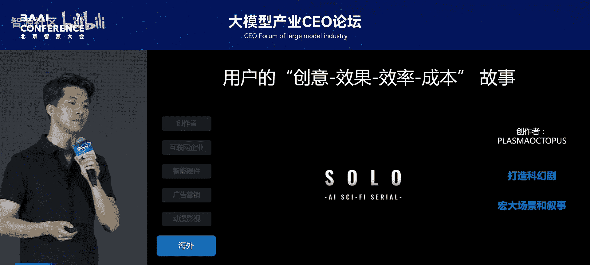

好。那上述的一些啊素材哈，大家都可以包括短片，大家可以通过微度的官网啊可以去访问啊，从公司成立至今哈，然后短短的啊两年时间，然后我们商业化啊，大概一年的时间。其实我们已经服务了啊如上的啊企业客户。

还有创作者。那我们的目标呢，其实最终最后的终点啊，我们希望是改变千行百业里边的内容啊，制作流程，包括内容的生产效率。那我们希望嗯是以用户的认可啊，我们为动力，同时呢驱动产业变革为目标。

那其实还有很多的创作者啊做出了很好的作品。那这里我们做了一个合集哈，让大家来看一下不同的创作者，他对不同风格的一些啊掌控以及不同的创意和想象力如何发生的。

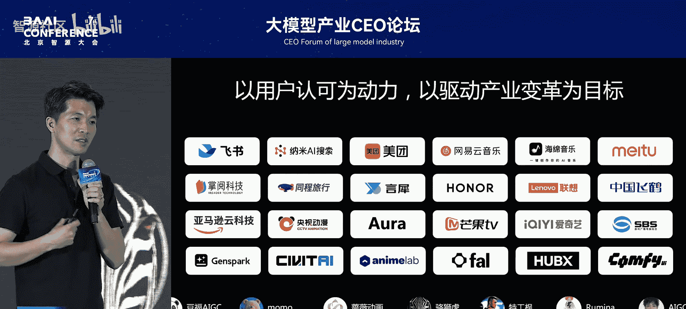

Yeah。🎼，Okay。オデオジン。う。🎼ニ？没有。🎼你。

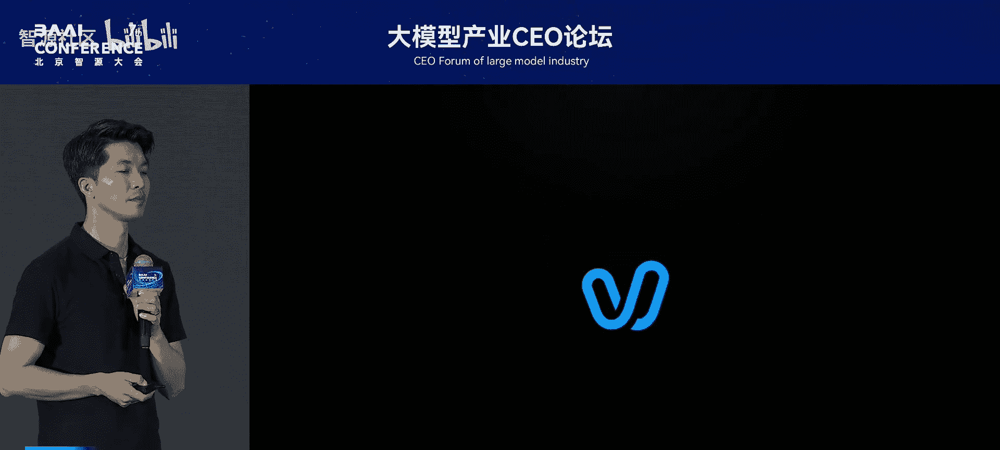

好，嗯，就为什么可以获得啊用户的认可呢？我们也非常啊倾听用户的一些反馈，也在持续迭代。所以到现在为止，我们认为啊为什么能符务好这些客户，同时呢还有很大的距离，我们还要去提升哈。

是因为我们从模型产品用户啊，逐渐形成了一个飞轮。在这样的飞轮下，我们的团队啊，我们希望去做到快速响应啊，所有的用户的需求和反馈。那同时呢因为机模能力的啊通用性和广泛性，我们可以在刚才提到的八大行业里边。

我们可以去广泛满足。同时呢除了去满足技术需求，其实很重要的一个事情。刚才我提到的啊生产效率要提升百倍，生产成本要降低100倍。那其实必须得深度适配。所以我们通过机模的能力，还有场景的啊微调的能力。

包括产品的能力，我们去满足各个行业非常复杂啊，非常专业的需求。那。从微度上线资金呢，我们专业创作的占比啊增长了300%。同时里边的生成量、付费量，还有使用时长都大幅提升了。

那对于开发者、企业客户啊也提升了150%。那在这些开发者里边，其实对一些相对专业的和要求严格的场景。互联网广告、动漫、电商等等，它的应用的占比占到了80%。

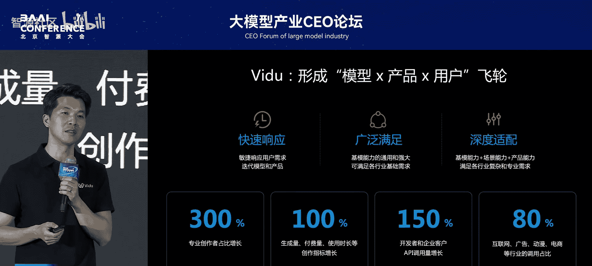

好，那呃也打一个广告哈，就是在下周啊微度将会再次迎来重大的升级啊，敬请大家关注。那最后呢提一下我们的愿景和使命哈。嗯我相信AI啊对于我们在座的所有的人，包括我们的工作来说啊，我认为不是一个替代啊。

它其实是我们的一个啊伙伴。那人呢我们是有创意和想象力了。那这一部分需要我们足尽情去释放。那工具呢微度来说，我们希望是啊除了给大家带来一些互动和娱乐，我们更希望是说去赋能生产力。

同时呢让人的想象力和创造力得以释放。谢谢大家。😊。