# 2025北京智源大会-开幕式及全体大会 -BV1PgMGzCEPC-

尊敬的各位来宾。志愿大会自2019年创办以来，现已发展成为人工智能领域的顶级学术峰会。大会始终坚持面向全球，聚焦前沿、汇聚英才。致力于打造一个跨学科、跨区域跨机构的高水平合作平台。

这里不仅汇聚了最前沿的学术思想，更连接起基础研究和应用实践。融合科技创新与产业突破，成为人工智能内行人的年度盛会和思想高地。今天的大会，高朋满座，莅临现场的有北京市和各相关委办局的领导和海淀区的领导。

还有来自香港投资管理有限公司行政总裁陈佳琪女士一行。韩国驻华大使馆科技官李正守龚史显参战一行，英国驻华大使馆科技参战wanda green等一行。以及呢新加坡首席人工智能官何瑞敏先生一行。

南非科学与创新部部长也率代表团参加大会。今年更有来自于国内外顶尖高校院所的科学家们和来自产业界的行业领袖领袖们。欢迎你们的到来。下面呢我们就进入主题演讲的环节。呃，首先呢是两位图领奖的获得者呃，做报告。

那么首先呢，有请图领奖得主。深度学习领域的奠基人之一，蒙特利尔大学有梭话奔9。在线为我们带来主题演讲，avoiding catastrophic risks from un AI agency。

奔久是致源的老朋友，之前也做过报告。那么去年3月呢呃，到过北京，到过致源，在北京呢举行了AI安全方面的一个一个呃峰会。那么。去年呢也一起签署了北京AI安全国际共识。So firstly。

 let's warmly welcome Professor Youva Benjo tuuring award Laureate and a pioneer in the field of deeper learning to deliver his keynote speech。

😊，Avoiding catastrophic risks from an controlledt AI agency。我要看。Hello。

 thank you for the introduction。 Hopefully you see my slides now。So I'm going to tell you about。

Really a journey that started for me a bit more than two years ago。

 a little bit after chat G it came out and I was playing with it and I realized we had really。

Underestimated how fast AI was progressing and。How much time was left to achieve AGI was much less than we thought。

嗯。Already， we have machines that basically mass or language like。

Basically passing the Turing tests and you know it would have sounded like science fiction just a few years ago。

 but now it is here。And so after ChadgiPti came out。

 I realized that we didn't know how to control these systems。We can train them。

 but we don't know if they're going to behave according to our instructions and so what happens when they get to be smarter than us if they prefer their own survival rather than ours。

 of course we don't know， but is that a risk that we can accept。And really。

 what happened to me in January 23 is that I started thinking about my children and my grandchild。

 I have one one grandchild。He was only one year old。 And I thought， you know， in 20 years， for sure。

 we will have。AGI， we have machines that are smarter than humans。

And I was not sure that he would have a life。So， I decided to shift my。My research。

 my activities to try to do everything I could to mitigate those risks。

 even though it went against many of the things I said before， many of my beliefs。

 my previous positions， I realized that this was just the right thing to do。

So a little bit later at the end of 2023， I accepted to share the international AI safety report。

 which put out its first。Report last January and comes out of a panel of experts with people from 30 countries。

 the EU， the UN， the OECD， 30 countries， including， of course， China。

 United States and many other countries。And the report looks at three aspects。 One is capabilities。

 So what is it that AI can do and what can we anticipate based on the trends。For the coming years。

 the second question， of course， is the risks that come with these increasing capabilities。

And finally， mitigation， what can we do right now and what is it that needs to be done in terms of research？

Or societal guardrails in order to mitigate these risks。So in terms of capabilities。

 it's really important to understand that AI is moving quickly。

It's a big mistake most people make to think of AI as it is now。

 whereas we should be thinking of where it will be next year in three years。

 in five years and 10 years and。Of course。We don't have a crystal ball。

 but the trends are very clear。 the capabilities are going up， and I'll show you now slides。

 which even gives you more or less a timeline for human level AI。As many of you know。

 there's been tremendous advances since in the last year。

 more or less thanks to reasoning models that have chains of thoughts that are trained。

 and that has enabled much better reasoning， better results in mathematics， computer science。

 and all the sciences。Another important trend。That of course many people are aware of。

 but I'll talk a lot about is agency， there's been a lot of progress in the capabilities of AI internet to control computers and appliances。

 to search the internet， to search databases， to write in databases and so on。Um。

So let me focus on planning because it is probably the area where at the cognitive level AI is most lagging compared to humans and so it is quite important to track this and a recent study by meter shows that the planning abilities are improving exponentially。

 so in the figure you see the number of years the last five years horizontal axis and you see the duration of tasks that the AI can complete as measured by how much time it takes by a human。

And it's a straight line， but actually the vertical axis is on the logarithmic scale。

 which means that this is an exponential curve and the data points which are the most advanced AI of the time。

They line up almost perfectly on this exponential。So what this is is that the duration of the tasks that the AIs can complete is doubling every seven months and if we extrapolate from this curve。

 we will get approximately human level in five years of course no one has across the ball and maybe the progress will stop。

 but I think from a public policy and business planning strategy， it is。

 you know we should at least consider that the trend will continue and see what the consequences are。

So what can go wrong Well， unfortunately， in the last six months。

We've seen a number of scientific results which show AIs that have self preservation behavior and are willing to deceive us。

 to lie to cheat， for example， in this paper。The AI reads that it's going to be replaced by a new version。

 and then it tries to copy itself in place of the new version， and then when asked about it， it lies。

 it says， oh I don't know what happened。InIn this paper。

 the AI is pretending to agree with the human trainer in order to avoid changes that would happen during training so that it keeps its old goals。

 so it's a kind of self preservation behavior as well。In in this paper， the AI is confronted with。

Two kinds of goals on one hand it wants to win the game of chess。

 it's asked to play the game of chess， but it also has its alignment training which tells it to not cheat to be honest。

 unfortunately it realizes that it's going to lose and so it decides to cheat。

It decides to hack the file that contained the board and to wooden by cheating cheating。

And this is the latest result in the just a few days ago。

 and the system card for anthropics Claed four。Where again， the AI reads in its files。

 it's able to read emails， and it finds in emails that it's going to be replaced by a new system。

And in other emails， it finds that the engineer responsible for this replacement is having an extramarital affair。

啊。And then what it does is it tries to blackmail the engineer by threatening to reveal the affair if the replacement goes through。

This is really， really bad behavior， so we see these bad behaviors， we see cell preservation。

 we see AI that is going against our instructions and trying to survive。Now。

 trying to preserve yourself is sort of normal for every living thing。

 and it's a result of evolutionary forces。But in AI。

 there are many possible reasons that I don't think we have completely figured out。

 but it could come from the pre training because in pre training。

 the AI is imitating humans or it could come from the reinforcement learning with human feedback。

 because this is a place where the AI is trying to get more rewards by pleasing humans and。

In any case， whatever the origin of this kinds of behavior。

 it would be really terrible if we end up creating superhu AI that competes with humans。

So one of the important aspects of what's going wrong here is that the AIs in these experiments have goals that we don't directly and explicitly control。

 so they have uncontrolled implicit goals， so we need to avoid that。

The other interesting thing is all of these scenarios。

 including scenarios that were hypothetical until recently， but we now start seeing。

 they're due to the fact that the AI is agent， in other words， the AI is trying to achieve goals。

And if the loss of control scenarios eventually happened， they could be really bad。

Many experts and CEOs of companies， including myself。

 have signed a statement saying that this kind of loss of control could lead to human extinction。

Of course， we don't know if it's going to happen。 We don't know what is the probability of of something like this。

 but when。An experiment could be extremely dangerous。

 but we don't know if it's going to happen with what probability we should apply the precautionary principle。

 just like we do in biology or in other sciences。Okay。

 so now let's talk about what we can do to better understand this。

And maybe to look for solutions to avoid these kinds of behavior。Now。

 if you think about an AI that could do something really dangerous， really harmful。

It needs to have the capability， of course， and that is why it is quite important to have capability evaluation。

 a lot of the risk management of AI right now goes through capability evaluation。

 what are the things that AI can do and can these things be turned into dangerous actions for people。

 for society and so on。嗯。So capability is not sufficient， you may have the capability of killing。

 but if you don't have the intention of killing， it's very unlikely that it will happen。So。Yeahや。

Given the current dynamics in the world。And the competition between companies and countries。

 it's very unlikely that we will globally stop to do research to improve the capability of AI。

So then what can we do？The place where maybe we can mitigate the risk is with intention right so even if we have AIs that are very capable。

 if we can make sure they don't have bad intention， if we can make sure that they are honest。

 then we would be fine。So what can we do about this？啊。

This is another figure that explains a similar idea that was presented by David Krueger at the last Europes。

In order for NI to be really dangerous， it actually needs three things， it needs the intelligence。

 it needs to know a lot of things and how to apply that knowledge。It needs a for instance。

 which means it needs to be able to do things in the world。Which could be talk to people。

 program computers， go on the Internet， social media， whatever。Robots。

And then it needs to have goals and it needs to have goals for itself。

So these are the three conditions and the research program that I have started is trying to explore can we build AI that has just the intelligence and no self and goals and minimal affordances because we still want to be able to communicate with the AI。

So I call this scientist AI。And it really is deviating from the tradition in AI research since the beginning of AI research。

 we have tried to build AI like humans， taking human intelligence as an inspiration。

But if we continue on this path， that means we're going to build machines probably smarter than us。

And we， you know， that means creating competitors to humans because we compete with each other。

And so that could be very dangerous。So maybe it's time to rethink this gospel and。

Think of designing AI that could be useful for people， useful for society， but not。Enangering us。

And so I'm proposing this approach I've written the paper with the same title。

On the scientist they eye。Where the goal is to build an AI that is completely honest。

 completely not agent。Based on the capability to explain things。 So instead of。Current AIs。

 which are trying to imitate people or please people。

 the scientist theI would be trying to explain people like instead of having an actor。

That tries to imitate people or tries to please people， and that could be dishonest。And deceptive。

Think of a psychologist。So why is that different psychologists？Can。

be considering a sociopath and the psychologist tries to understand what's going on with the sociopath。

 what are the causal mechanisms but the psychologist does not need to behave like a sociopath。

But right now， the way we train the eye。Is like us。 And so you know sometimes in some circumstances。

 it might act in bad ways。The good news that I'm going to try to explain is that。

Even though the building block we want to build is non agenttic。

 it can serve as a foundation for building safe agenttic systems。Okay。

 so so one important question is if we want to build an the eye that is doing just。Intelligence。

 just understanding without agency。 What do we need， Well， we need an AI that can。

Generate hypotheses about how the world works， just like a scientist generates hypotheses about how the world works。

But that's not sufficient if you only have the hypotheses。

 it doesn't necessarily it's not sufficient to make good predictions。

 you also need to make inferences， in other words， derive consequences of those hypotheses in order to predict the outcomes。

 for example， of some actions or some experiments。So that's the idea of the scientist AI。

And an interesting insight is that。Even though a scientist said I would be nonent。It could be used。

As a guardrail for a gen yaac， so let me explain what I mean here。

So the guardrail here is what's called a monitor in LLMs， in other words， it's a separate。AI。

 whose job is to predict whether the action or the output or the query is going against our safety instructions。

So it just needs to be a good predictor， it doesn't need to be an agent。

 so that's a good news because。你。Bad behavior that I talked about， the deceptive behavior。

The dishonest behavior， dangerous behavior， it's all because of agency。When an AI is very agent。

 it means it's completely autonomous。There is no human oversight。

 and that is where we start seeing problems。But a monitor which just tries to predict whether an action is going to be dangerous。

 doesn't need to be agent， it just needs to be a good predictor， and if the prediction。

 for example the probability of harm given the action and the context is above a threshold。

 then we can just reject that action。So in other words， we can use an AI， which is not agent。

To control。Another AI， which is not trusted and is agent。So that's a key idea。嗯。

Another there ara of four。The scientist AI is that。You know， to be really honest。

 it needs to be humble about its knowledge。So it should not claim something that is false。

Unfortunately fortunate， the way we typically train RAI right now with maximum likelihood。

Can lead to overconfidence at the same time as being wrong。To understand why this is important。

 consider this little toy scenario。Where a robot is in front of two doors。And it has to choose。

 go left or go right。Now。Based on the past data， it has two theories that are compatible with the previous data。

 but it doesn't know which one is correct。The left bubble shows the left， the first theory。

 the right bubble shows the second theory。 So the left bubble。

 the left the the theory on the left says that if you take the left door。

People will die if you take the right door， people will get cake。That's good。But the other theory。

 the right bubble。It says something quite different， it says with the left door， people get cake。

And the right door its neutral。Nothing bad。 Nothing good。All right， so you should ask yourself。

 should the robot go left or right？If it goes left， there's 50% chance。

Thats something people will die。 So that's not a good idea。 If it goes right， well。

 maybe people get cake or maybe there's nothing。So it's better to go right。 but for this to work。

 you need the AI to keep。All the possibilities of what is a plausible interpretation。

 what is a plausible theory。And that is unfortunately not what current methods are doing。

So it is important that the AI keeps a distribution over interpretations。In our paper。

 last year at Iiclear。An oral， actually we。ItShow how you can use our Gflownets， which is a form of。

Varational inference。2。Learn how to generate chains of thoughts that are good explanations。

For the next sentence， given the previous sentence。 so you can think of it like filling in。

The missing information that allows to go from the previous sentence to the next sentence。

And so it was actually one of the first proposal to train the chain of thought。不。

And like the current approaches based on reinforcement learning。This is based on trying to。

Generate a good explanation for the data。Rather than anything else。

And we've been using these Gflow nets。To generate all kinds of explanations which can be highly structured。

 for example， a causal graph。In other words， you know。

The neural net will generate a graph by going through each node and each edge and saying。

 you know there's a new edge here， there's a new edge here， there's a new node here and so on。

And in this way， you can generate hypotheses that are structured in the form of a graph。Yeah。

And in a more recent paper。We have been thinking about how we can go beyond these works。

In order to make the chain of thought。Honest。And to reason better so in this most recent favor we just put on archive。

The chain of thought is separated。Instead of just a sequence of words， it' separated into。

A sequence of claims， a sequence of statements， like a mathematical proof， has a sequence of claims。

And each claim is supposed to be true or false in support of。The thing you're trying to predict。

So the difference with the normal chain of thought in addition to having this structure as a sequence of claims。

Is that for each claim， there is also a Boolean random variable which indicates whether the claim is true or false。

And normally， when you think about an argument， you assume that every， every claim is true。

 but actually。Sometimes some claims are more certain than others。

 and so you want to be representing the probability of each claim。So the idea is， again。

 going back to what I was saying， that the AI。Is not going to try to imitate the text that people write。

 it's going to try to find explanations for that and an explanation should be structured like like a mathematical proof should be structured into claims。

 and each claim is supported by previous claims。And the AI needs to compute the consistency of these claims。

 the probability that they're correct， so that it can draw correct conclusions。

And the good news is that we can train these kinds of systems using latent viable models similar to what we did last year。

ok。嗯。So I've， I've talked a lot about。Initially， the risks due to AIs that are。Eanttic。

 but in a way that we don't control and that could lead to loss of human control。But of course。

 there are many other potentially catastrophic issues as we build a eye that is more and more powerful。

 for example。A very powerful AI。Could help terrorists to design a new pandemic。And in fact。

 I learned recently that you could create pandemics that are so powerful that there's probably no cure。

And that might even kill not just humans， but most animals。This is really terrible。And biologists。

Think they know how this could be done and one day it's very likely that AI will know how to do it。

And if some bad people get access to this kind of AI， they could really create。You know。

 huge damage on this planet。So that's， of course extreme。

 but it is totally plausible scientifically that we get to that point。嗯。

So in order to avoid these kinds of things， we need to make sure that AI will follow our moral instructions。

 for example， to not give information that can be used to kill people。And of course。

 to follow our moral instructions to no harm。And to， know， you know。

 be honest and to not cheat and to not lie and so on， right？And right now。Unfortunately。

 it doesn't work。 We don't know how to do it。 So this is a scientific challenge。

 and we need to figure it out。Quickly， we need to figure it out before。We get to AGI。

And that could be anywhere from a few years to maybe one decade or maybe two， but most。

Experts I know think it could be you know， very， very short。

 it could be even within the next five years and you remember the curve I showed you at the beginning suggesting that we get more or less to human level in five years。

So we don't have a lot of time we need to invest massively to discover the scientific solutions to this alignment and control challenges Unfortunately。

 even if we figure this out， it is not sufficient right。

 because even if we know how to make AI that is safe， for example。

 with a guardrail that I talked about， well it doesn't mean that we don't have any problems because someone could just remove the piece of code that contains the guardrail and then the AI can be used to do bad things。

And， unfortunately。The coordination between companies and between governments around the world is not working right now。

There is competition between companies， they are racing to be at the top。

 there's competition between countries。They also want to be at the top and as a result。

 there's not enough investment in safety in how to make sure the AI will not be used to harm people。

Or will not lose control of AI。So we need more national regulation。

 we're starting to see a little bit， but there's also a lot of pushback from companies against regulation。

And of course， national regulation alone is not sufficient。

 we need to make sure all the leading countries who are developing AI agree on some principles。

Unfortunately， the CAAI is a tool as a weapon against each other。

 and so it's very difficult to get into this mode。The only way to really get around the same table is to realize that for these really catastrophic outcomes like loss of human control。

 like the used by terrorists well。It doesn't matter in which country it happens。 We all lose。

 We are all in the same boat。So whether it's a rogue AI or a terrorist using AI。Everyone loses。

So when governments around the world， especially the US and China， understand this。

I think we can make progress， but until we stay in this idea that we're going to use AI against each other。

 we're stuck。And finally。Even if we intend to find a political solution。Is not sufficient。

 We need to develop new technology。For verifying that AI is used properly because you know think about nuclear agreements。

 they are all of the kind trust but verify， and so we need verification technology， for example。

 at the hardware and software level using using advanced technologies which I think can be designed and some people in the world are working on。

So I'll stop here， thank you for your attention， I hope you take the time to digest what I've been talking about。

3。Thanks， Professor Benil， for deep thinking on AI risks。And possible solutions。Its really。

 really important。For欧 ous。To our human beings。So now let's move to the question dialogueog session。

呃，有请北京大学助理教授智源大模型安全研究中心主任姚阳东博士和奔州教授呢进行对话。Hi， hi， Yoa。

 It's glad to meet you here since the France Action summit in February。 Hello， glad to hear。

 have you here。 I think you've mentioned a very interesting topic on AI safety and catastrophic risk as the first keynote speech at the B A I conference。

 you really draw the massive attention from the public。😊，So I think in your talk。

 you've mentioned a very interesting safe AI alternative， which is about the scientist AI。

 And I think to to， to summarize the idea is really to develop this non trustworthy AI that could serve and model after a selfless scientist。

😊，So my first question is about the scalable oversight。

 So you've noted that within the next five years， AI systems may be able to carry out very long context。

 complex tasks autonomously， For example， the Cloud for has recently show the capability of selfcod for more than 9 hours。

 So this obviously incur more challenges for human oversight。

 And how do you think we can best address this growing oversight challenge。

 And in what way could we or the scientist AI Godrail help mitigate these emergingnt risks。😊，Well。

 that's a great question and I agree with the premise。

Unfortunately we don't know enough how to solve these problems。

 so the kind of research project that I've been talking about is one direction to explore。

 but we need dozens of projects like this to hope that one will succeed and we need to do it quickly before really bad things start happening。

So in the case of the scientist AI， in order to avoid the issues that we don't know how to control agents properly right now。

 the idea is to first build a building block that has no agency and the trustworthy and use that to control an AI that may agentic because people will want to have agents anyways。

 even if there are risks， so at least we can mitigate the risks by having another AI which can predict in a way that's very powerful not less intelligent than the agent。

 maybe even more intelligent than the agent， but that is not agent。Sure。

 and so it's something we can trust。 Sure， I think the the idea you've mentioned about training and honest。

 non agent explanatory scientist they to perform oversight is very interesting and fascinating。

 And follow up question is， you've been mentioning about the idea of deception and。😊。

And and cheating。 So I was wondering if a supervised model really engages in deception or information hiding。

 how robust can scientist AI be in detecting such adversarial behaviors and what kind of capacity the the。

 the scientist gu framework can offer us in。😊，Against these cheating and deception behaviors。Right。

 so the， the ga that I talked about is only a first step。 it's it's looking only at the。

Effect of an action on potential future harm。 But， you know， you could do a lot more。 for example。

 you could also look at。The chain of thought of the agent that has a chain of thought or even the activity of the neurons。

 there's a lot of research to try to investigate how we can extract information to monitor agents by looking at their activity and their chain of thought and in downstream。

 I think you could do still even better than that because you could。

We think how we design the agent itself， right not just the guardrail but the agent itself one property of agents is that they have an internal state。

 like in human brains， we have recurrent connections that's nice you know I' am a big fan of recurrent nets。

 but unfortunately that means we have no control over the internal state of the agent instead we would like to fully control the state。

 for example， we don't want the agent to learn from the guardrail rejecting its actions。

 how to bypass the guardrail and if we don't control the internal state of the agent that we can't do anything about it but if we do then we can just resemle from the agent policy always from the same state and and the agent is not really aware that it's being rejected several times。

Sure， thank you。 So my last question is actually about yourself。 So in your last slide。

 you've mentioned that the importance of national regulations and international treaties in ensuring AI safety。

 And， in fact， B A AI is one of the very first organization in China to initiate safe research and and participate in global dialogues。

 So we've noticed that youve recently launched law 0。😊，And to。

 and with the goal of building safe intelligence。 And you've mentioned that ultimate ambition is not just to create gus。

 but also to architect trustworthy systems that are intrinsically motivated to avoid misaligned behavior。

 Could you please share more of your thoughts and your inspirations for founding law 0 And what is your long term vision void。

Well， I mean， the inspiration is exactly what I've talked about today that we've reached a point where we have documented evidence that we don't control these AI as well and they don't follow our instructions sufficiently reliably and it is becoming urgent to both understand these phenomena and find fixes。

And well， unfortunately， the。The， the market pressures on their leading AI companies is making。

Apparently， is making them focus on increasing capability and there's not enough investment in safety。

 And so we decided to create a nonprofit organization that would be completely dedicated to these safety questions。

And we were lucky enough to convince a few philanthropic organizations to fund this effort in the future。

 I think the question of safety along as other applications of AI that are beneficial for society。

 should be considered as a public good， should be funded by government to steer the development AI in a way that is good for society。

 because we're going to have some choices to make in the future about what we do with that intelligence that we are creating。

Great， thanks， thanks for the great talk and insight for sharing。 Thank you again。

 And we're looking forward to welcoming you in Beijing offline in the near future。 Thank you。😊。

Thank you for the invitation。谢谢耀东呃，也再次感谢呃，profess Benjo。接下来呢我们欢迎另外一位图领奖得主强化学习的奠记人。😊。

加拿大计算机科学家瑞查沙ten教授。今年3月5日，沙特教授荣获2024年度铜领奖，他的研究成果为现代人工智能的发展奠定了重要的理论基础，深刻影响了自动驾驶、游戏AI、机器人控制等领域的技术进步。

Next， let's warmly welcome2024 Turing award La and a pioneer in the field of reinforcement learning。

Professor Richard Sutton。To deliver keyote speech。 Welcome to the era of experience。😊，Welcome。

Thank you everybody， very pleased to be here。需要我。嗯。Enjoyed the grer。Venjo's talk。

And it's an exciting time in AI。So I have a couple of messages。And they will pertain to。

Whatu Joshua is talking about and I have a very very different point of view and I think that will become clear in the second part of my talk today。

Okay， but first， welcome to the Arab experience and I have a couple of quotes that I think maybe a little bit indirectly but point to my two main messages today。

So quote number one is that intelligence is from Ray Hurzweil。

Intelligence is the most powerful phenomenon in the universe。 this gives us a sense of the stakes。

Of N AI and what's going on today in AI。Intelligence is the most powerful phenomenon。In the universe。

And I also have a quote。From Alan Touring。That I think is very pertinent。

And he said that what we want。Is a machine that can learn from experience。 He said this in 1947。

And it was in a talk to the London Mathematical Society。And as far as we can tell。

 it's the first public presentation ever on artificial intelligence。

 I mean there was no field at the time。嗯嗯。I think this is the first time someone presented on AI in public。

And he made this remark。That we want a machine that can learn from its experience。

Donone first person experience and that's really what we're talking about today and what we're entering into today in the era of experience。

So right now we are in the era of human data， what could be called the era of human data。

As all of our AIs are trained on human generated text and images from the internet。

 and then they're fine tuned by human experts， even their preferences and examples of how they would make choices。

And， you know， of course， the whole thing is trained to predict the human's next words or to predict the human labels。

As opposed to trying to predict or control the world。So this is what we have now。

I think we're starting to reach the limits of human data， the limits of this strategy。

Almost of our high quality data sources， human data sources have already been consumed。And of course。

 generating genuinely new knowledge is beyond the approach of mimicking humans。

To do generally new things， you have to interact with the world。

So now we are entering the era of experience， least is how we see it。

 all AI needs a new source of data that will grow and improve as ageging becomes stronger。

Any static data set will be insufficient。And you can get this kind of data from experience。

From your first person interaction with the world， experience experience just means the data you get coming out of into your sensors and out through your vectorors and this is the way the normal way that people and others animals learn。

 and I think it's just useful to look at some videos of people learning and just to remind us that we do all learn from experience。

So here is an infant。Interacting with its world interacting with sequentially with different parts of the world。

 its world， different toys and trying to learn which you do with those toys and just notice its it's making choices that determine its input it will interact with a toy for a while or a piece of string for a while until it's learned all it can。

And then it moves on。And as it grows and becomes more sophisticated。

 the amount that it can learn from each thing will change and it will behave differently and interacttu with it。

 so its own behavior is determining its experience， its data， and this is what we need。

Or if just look at some other more or less random pictures of of humans and animals learning playing soccer say and achieving goals。

 and we just think for a moment about the。Data flowing into the soccer players。Eyes and ears and。

ense sense organ for its body， everything is changing， everything is moving very rapidly。

 the data flow into its mind is enormous， it cannot' have enough to pay attention to everything it has to make quick decisions。

To achieve his goals。So this is what it's life for our soccer player or for own animal。

Flying through the forest or running away from predators or swinging a baseball bat or try to hit the ball or having your conversation being very concerned with this high bandwidth signal processing that makes up skilled perception and action well that's what experience is that's what I mean when I say experience I don't mean anything fancy and like Qia I just mean data going in and out of the mind。

So。Remember， this is how the data source can become variable depending upon the capabilities of the mind。

 just as when two game playing systems are interacting and as they improve。

 the data also gets better and different。And so this is the way Alphago learned to make its creative。

 move 37。This was essential to learn from the experience the experience in this case was generated by the stimulation of possible。

Hosible moves and consequences of those moves， which you know。

 in gameplay because you know the rules of a game。It's similar in Al proof。

 Alpha proof is the system that won a medal in the International Ma Olympiad。In mathematics。

 you can see the consequences of your operators。And look many。

 many steps ahead just as you can and computer go。So just one more slide on the experiential mindset。

So let's say it in words。The experiential the way we think about things when we think about experience is that the agent。

 the agent exchanges signals with the world and these are its experience。

And then learning is of course， from that experience and a more deeper observation is that anything that the agent knows is about experience。

 but even if you were to give the agent some knowledge in advance。

It would still have to be about experience， it's not about words about what would happen if it was to do things。

Knowledge is about experience， and therefore it can be learned from experience。

An agent is intelligent to the extent they can predict and control its infant signals。

 particularly its reward， victim and control， that's what AI should be is about。

 intelligence is about。Experience is the focus and foundation of all intelligence。And of course。

 as I'm sure you've noticed in our thinking， the field of reinforcement learning is based on this mindset。

And that there are agents that are first class agents that make decisions， achieve goals。

 interact with the world。Alally agentic。And then we can think of the timeline where we are now。

So the first era， the era of Algo， the era of Atari， this is the era of simulation。

 were reinforcement learning agents。would learn from their simulated experience and learn to get much better and。

And have these famous examples like Alpha Go and Alpha zero that rock the world。

And then we entered the era of human data with chat GPT and the large language models。

ChatG3 and we are we are perhaps and during the end of that era now where all the data comes from humans and we'll enter the era experience through experience interacting with the world we see the first hints of this without proof as I discussed it and also we see the hints of it when。

The large language models are now using computers have access to APIs and can actually take actions in the world。

Okay， so this is my first point about the perspective on the feature of AI。

 so my perspective is really that the recreation of super intelligent agents and super intelligent augmented humans。

These will be an unalloyed good for the world。I'm not concerned about issues of safety。

 I'm not concerned about loss of jobs， because it' just a normal part of transitions and the development of the world。

So I think this will take a while， this will take decades and it will continue for decades after that。

 it's a marathon it's not really right around the corner but it's good for us to be getting ready for it as it will be rocking our world for a while。

Now， full intelligent agents will have to learn from experience。

 this is beyond our current agents as magnificent as they are as customizable interfaces to the world's knowledge。

We have entered this new era of experience using reinforcement learning。However。

 I have to acknowledge it to realize its full power will require better deep learning algorithms。

Algorims that are capable of continue learning and better learning。So now I like to shift gears。

And talk a little bit about the politics。And now we'll be touching on some of the issues that Professor Benjo talked about。

So， just when you。We have to ask this basic question and societies of agents。Is there just one goal？

That everyone shares are the many goals。And one way of approaching this approach way。

 you know I'm a reinforcement learning researcher， it seems very natural to think about my agents。

 my reinforcement learning agents， and it's obvious in reinforcement learning that each agent has its own goal。

 it has its own reward signal entering its mind and it's trying to maximize that goal。

And there's no reason why the reward signals entering。Different agents have to be the same。

And if we also think about in nature， each animal has an analogous signal entering its mind。

 it's actually computed in the hypopothalamus。hypothalamus of their brains。

 and this is there and also computed in its pain sensors and its pleasure sensors。So in nature。

In AI and in nature， different agents have their different goals。

 I mean we could talk about how they share goals like every animal is concerned with food。

 but you know one animal's food is not the other animal's food， they're sort of symmetrical goals。

 they're not the same goals。And even in people too， of course。

 we care about our families and we care about our food and our safety more than a common goal。So。

I want you to just reflect if you can， if you will， about our economies and how they work best。

 I think they work best when people have different goals and different abilities。

 so the goals don't have to conflict。But they can be different and differences are good。

Our economies don't really rely on people having the same goal， same goal。

 They rely on people pursuing their individual roles and then， and then interacting。 and so。嗯。

I think the message that we don't want to miss。The message or what's obvious。

 I think what's obvious about our societies is that。We can exist， we can coexist in peace。

 even we all want different things， you know， we trade and we specialize and we interact。

And so anyway， whether you ready to view things this way， let me make some definitions。

So I can talk about this。Simply， so I wanted to find decentralization to be this phenomenon where you have many agents each pursuing its own goal that would be contrasted with centralization where you have many agents and they all are constrained to have the same goal so for example。

These are centralized societies， a hive of bees as many agents。

 but they're all pursuing the goal of the hive。Ns， also。Decentralization， many agents。

 each pursuing its own goal， each allowed to have its own goal。

And cooperation is when agents that have different goals interact a mutual benefit。

 each agent achieves its own goals and furthers its own goals by via interaction。

 so in exchange a win win relationship， this is decent decentralization。In cooperation。

Now I think that cooperation is our superpower。I think humans cooperate much more than any other animal。

And cooperation is facilitated by language and by money， both things that are unique to humans。

Humanity's greatest successes are our cooperations。

 like the economies and the markets and the governments， those are how we cooperate。

Our greatest failures are failures to cooperate。Like war and theft and corruption。

So this view of decentralized cooperation is an alternative view。

Of how societies should be organized， and in my view it's more elegant than the centralized view。

That the decentralized cooperation is more robust and sustainable and flexible。

It's more resistant to cheaters and outliers。Anyway。

 so humans are better at cooperation than any other animal。

 but I have to acknowledge that we're still terrible at it， we still had to have wars。

 we still do have theft and corruption and fraud so we have to really struggle to cooperating first of all。

 it's not always possible， it takes at least two trustworthy agents。

 and there're always going to be some that are not trustworthy those who benefit from not cooperating the cheats and the thieves and the weapons manufacturers and the dictators。

 they benefit from not cooperating。Now， cooperation is a great thing。

 but it needs institutions to facilitate it。To punish the cheaters， to punish the。

The fraudsters and the thieves。So centralized authorities can help cooperation。

The institutions that are needed to facilitate it。But those centralized authorities can also poison cooperation in the long run when the authorities become authoritarian or sclerotic。

And so this contrast is between centralized control。And decentralize cooperation。

 I think the tension between these two is the central political issue of our time。

And so I think you'll see that if you just look at。

This parallels between the calls for control of AI。And the calls for control of people。So。

Think of AI for now， there are many calls and here I want you to think of。Professor Bennjiio's talk。

 which is explicitly a call for controlling the goals of AI or controlling even。

Their ability have goals。There are calls for pausing or stopping AI research， slowing it down。

There are calls for limiting the power that could be huge to。

To make AIs and there are calls for ensuring the safety of AI。没。

And and requiring disclosures so this the parallel then is with the control of people。

 as you know in big political issues in our time is to on speech be free。

 can people be allowed to hear things of other people。Can we have free trade or must be controlled。

 how can we control the employment， how do we control the financial or the capital controls。

 how do we have tariffs and economic sanctions on one country or another？These arguments I think。

 are eerily similar between the calls for control of AI and the calls for control of people。

 I think it's basically a society issue。Oh we're going to。Deal with people having multiple goals。

Are we going to go decentralized， are we going to know？Move towards centralized control。

So the calls for centralized control are very similar， they're all based on fear。

They're all based by us versus them， whether it's。Us Americans versus。D， the Russians or。

If you're in China as you guys all are， your us is China and them is the US。And in the US。

 it's the other way around。We are all。There we all they're all the centralized controls。

 they demonize the other， they claim the other can't be trusted。

 I think it's much more complicated than that。or more nuanced than that， we all in every society。

 there's some who can't be trusted and there's the majority that normally can be trusted。So。

Just to summarize。I think all human flourishing。And also， AI flourishing。

Comes from decentralized cooperation。Humans are great at cooperation。

 but they're also terrible at it， cooperation only not always possible。

 but it's the source of all that's good in the world， and we must look for in support。

Cooperation and seek to institutionalize it。Now， this is where I have to calling on you to use your own。

Experience with your world。 I want you to look with your own open eyes。And I think if you do。

 it's easy for you to see who is calling for mistrust。

And who is calling for non cooperation and who is calling for centralized control？

And I think we should resist those calls。And finally。

 I just think this is a useful lens with which to view all calls for human and AI interaction。No。

Thank you very much for your attention。

Thanks for Professor Suden， Give us a different scenario as and perspective。🎼呃，接下来呢仍然是对话交流环节。

有请清华大学人工智能研究院副院长、生树科技创始人兼首席科学家、智援首席科学家朱军教授和萨ten教授进行对话交流，有请朱军。🎼派人去。Can， can you， Yeah， hear。

 I guess you can hear us， right。Yeah， so first of all。

 thank you for accepting our invitation to give this I should say very interesting and like insight for talk from different angle。

 So， you know， So you I believe youre here you attended the Bens talk right Profesor Yo talk on this point now got non AI。

 you emphasize to develop。 So I guess my first question is about like。😊，To you。

 you mentioned there like many course， like in in China， also in B AI。

 we also have like many emphasize on developing safe AI to be reliable to be responsible。

 And and for the for social goals， for example。 So I guess even for the reinforcement learning technically。

 So because the agent try to try to optimize the the goals， right， So by itself。

 So so do you think maybe there are some kind of orientation to be to be risky if we don't put the reasonable like control for that。

 Yeah， so that's my first question to that。Thank you very much for this question。

As you've tried to digest Professor Benziio's talk and my talk， I think the first。

Bit of understanding is is to realize that。Yshua is calling for Well， first of all， we're both。

 I think， well meaning。 and we want to make。A good world。

 a good world which can benefit from AI and has。Successful and kind and。And。

Will meeting people in it。But the difference， the difference。Fundamentally。

 is that many people such as Joshua are calling for changing the AIs。Changing the agents。

 restricting them， controlling them， and changing the AIs to ensure safety。

Whereas I am calling for changing this society。Changing the world in which the agents live so that it's rational for those agents to be beneficial and。

And cooperative。So just think that that is the key difference。

 do we control which AIs are allowed to exist so that they don't hurt us？

Or do we do we structure our world so that it is welcoming of all participants in a cooperative。

 contributing way。So。If you take that as the。As the。Roughly the basic difference。

I we can say some things。 So one one thing we can say is that if you try to change the AIs。

 it's a little bit of a dangerous。Strategy not， not a， it's not， It's not safe to cheaters， right。

 we if we make our AI safe， but there's one person who makes an AI that's not safe。Then we are。

 we have a problem， okay？Whereas if we change the world that all participants can participate and contribute。

Then we are safer to heaters。 It's sort of an evolutionarily stable strategy。

 whereas controlling which AIs are allowed to exist is not。It is high risk because of that。Okay。

 good。 Thank you。 Thank you for clarifying for that。

 So I guess the next question may be more technical on the reinforcement learning。

 So I think you emphasize that reinforcement learning is a powerful paradigm。

 So we like that we are use to build like language model to build like the the the the like alpha system。

 right， to using intensive reinforcement learning。 But if we we look forward， right。

 So so if we want to build a superhuman kind of intelligence。

 So what your suggestion like the minimum working hypothesis or or what are the key new elements。

 we need to bring into the paradigm to develop better algorithm for reinforcement learning itself。收。

If you start with large language models， then it's obvious that you need goals and you need。

You need action and you need a sense of truth。嗯。And one of my slogans is that you should not ask your agent to know anything that it can't verify for itself。

So anyway， so that that would give if you had the the。

Llame is that we need experience to give us a source of truth。

And so experience will give you all that。So if you interpret your question to what do we need to add to existing reinforcement to make it fullylly capable。

 of course， the reinforcement learning is assuming we have experience。

And emphasizing that and just working on that。Still。

 there remains the question of what are the weaknesses in the current reinforcement learning out。

 and that's plain， number one is that they also they're not continual learning。

 continual learning is a great weakness， modern deep learning methods。

And I think the second big weakness is that we do not yet have effective methods for planning with a learned model of the world。

And we can plan great and go or in。Mathematics， where we don't have to learn a model of the world。

And had this uncertain model of the world。But when we when it comes the real world。

 we have we still have to figure that out。 And that's one of the big big reasons why I don't think it's something that will be done。

 AI was something that will be accomplished in two years。 And if we're quite lucky。

 it will be accomplished in five years， but it might take 15 years。Okay， very good。 Thank you。

 So you， you emphasize on continuing learning in the in the future。

 right special for the dynamic good and realistic environment。 I guess Yeah。

 learning learning planning。 Yes， yes， yes， yes， so I guess maybe follow follow up question that you so we know you write famous article public like a lot of like audience read the like a bit lesson for AI。

 right， So so you emphasize like human knowledge， maybe human design rules are not very important compared to the scalable computing like if you better group a lot。

 right， So I guess this is true also for reinforce learning right So so for reinforcement learning you try to maybe we should avoid too intensive like human design in the future。

 maybe So I guess that's your point。First thing to say about the bitter lesson and modern AI。Is that。

This， this tension between the era of experience and the era of human data is exactly an instance。

Of the bitter lesson。The air of human data is when we are trying to use human data to makes a system work really well and。

That eventually reaches its limits。Just so we are reaching the limits of human data and we make large language models。

 and we have to we have to replace the human data with something that is。

Extensible and can increase to。It's taken full advantage of of scalable computation。

And that is human experience。 So this whole story of moving from human data to experience is an instance of the bitter lesson。

Okay， good。 Thank you。 So thank you very much for your excellent talk and also the in dialogue。

 Thank you very much。 Look forward to see you in person in Beijing。 in the future。 Thank you。😊。

谢谢谢谢朱金教授啊，再次感谢呃，沙坦教授。😊，那么接下来呢，我们就有请志援研究院院长王仲远为大家介绍致援这一年来的呃最新的发展。尊敬的各位来宾，各位专家，各位朋友，大家上午好。

再次欢迎大家来参加今年的智援大会。那下面就由我来报告一下智源研究院过去一年的科研进展。我想许多朋友对于智源研究院都已经非常的熟悉了。

我们是2018年11月份在北京市海淀区成立的一家人工智能领域的新型研发机构。我们致力于做高效做不了企业不愿意做的科研创新。在智源成立的6年多来，我们率先遇见了人工智能大模型时代的到来。

早在2020年的时候，我们就已经组建了一支百余人的技术公关团队，启动了悟道系列大模型的研发。先后发布了悟道1。02。03。0，构建了自底向上的全站大模型技术开源体系。

并孵化了国内数家头部的大模型创新创业公司。在去年的智援大会上，我们与大家分享了我们对于人工智能大模型可能的技术路径演进。一年时间过去，实践证明我们对于技术眼进路径的预判的正确性。

大模型正在从大原模型向原生多模态大模型向世界模型的方向进行啊演进。那么正在加速从数字世界走呃进入物理世界。今天我们非常高兴的宣布，智源研究院将发布物界系列大模型。那么在2021年。

我们所发布的悟道系列大模型，开启了中国的大模型的时代。今天我们所发布的物界大模型将推动人工智能从数字世界迈向物理世界。悟道的道代表了大语言模型系统化方法和路径的探索。

物界的界代表了虚实世界边界的不断的突破。那么物件大模型所包含的第一款模型就是去年10月份，我们所发布的imux three，它是一个全球首个原生多模态的世界模型。

imux统一了呃统一了不同模态的这个原生训练，从文字图像视频啊的原生训练统一了生成和理解的能力。由于它所采用的au regressive自回归的技术架构，使得我们能够非常容易扩展它不同的模态。

同时进行可控的交互。在去年10月的时候，我们就已经发布了imux three。那么这是去年10月份imux three，它在图像生成视频生成图像理解视频理解方面的一些能力的展示。

那么我们正在训练imux的下一个版本啊，我们将在适当的时机与大家分享更多的信息。由于因为所以他所采用的这种nice token prediction的这样极简的一个思想。

以及autoregressive的这样的架构，使得它非常容易扩展更多的模态。那么在过去半年多的时间里，我们也扩展了更多的呃我们脑信号的这样的一个模态。

从而构建了一个全球呃首个在脑科学领域的一个多模态的呃通用基础模型。breringme。那么breringm呢它能够将不同的脑信号呃融入在我们的基基础模型中，包括像功能核磁EG啊双关子等等。

包括人类的脑信号以动物的脑信号，我们都能够进行统一的编码，在与文字图像啊视频等不同的模态进行融合。从而通过一个单一的呃脑科学领域的多模态基础模型，就能够完成不同的脑科学相关的一些任务。

真正实现化模态跨任务多物种化个体。下面我们可以一起来看一个短片介绍。🎼随着人工智能技术的发展。🎼神经科学中，传统的假设驱动研究范式正逐步向数据驱动转变。🎼具有挑战的是神经科学数据之间差异巨大。

智源研究院的braringm建微模型基于跨模态对齐的方法与大模型的优势，把不同来源的脑信号数据统一编码，利用预训练多模态模型的跨模态表征能力，将神经数据孤导，连接成数据网络。🎼作为神经科学领域的跨任务。

跨模态、跨个体基础统一模型。🎼建微模型能够同时处理多种编解码任务，并兼容多种动物模型和人类数据。🎼可以实现交互式科学结论解读，科学数据注释，大脑信号重建。

🎼大脑刺激信号生成健微模型将为基础神经科学的研究提供潜在的研究新办式。🎼辅助人类神经系统疾病的可解释诊断，并深度结合脑机接口。🎼探索人机融合的人类增强新办事。

breringme已经在脑科学领域多个公开数据集上达到了收塔的结果。比如说在抑郁症、阿尔兹海默症帕金森综合症的预测上，通过单一基础模型的能力，已经超越专用模型的预测能力。

因此我们也与国内呃顶尖的脑科学领域的基础研究团队脑疾病研究团队以及脑机接口应用团队开展了深度的合作。例如，我们与北申所共同开展了动物睡眠数据自动化标注和解读的实验。我们与清华大学麦克脑研究院。

开展了多模态神经数据指导新科学发现的实验。我们与清华大学基础医学院开展了辅助运动障碍疾病新疗法探索的实验。我们也与脑机接口公司bco强脑科技共同实验。

通过便携式的脑机接口采集脑电信号进而进行视觉还原的实验。那么通过这样的一些合作，已经证明了breme。啊，在脑科学领域，它非常强大的能力。我们也期待在脑科学阿vafor时刻的出现。

不论是imux还是bm，都代表了智源研究院对于多模态基础模型的探索。那么我们希望通过多模态的基础模型，能够让人工智能真正看到感知理解这个世界，进而以这个世界进行交互，能够进而去推动巨生智能的发展。

我们知道巨生智能在过去这两年非常的火热。但是它在发展过程中也遇到非常多的挑战。例如，当下硬件依然不够成熟。由于硬件不成熟，带来数据短缺，数据短缺，导致模型能力弱，模型能力弱，导致落地应用难。

落地应用难又导致机器人难以量产。这就构成了一个发展中的循环悖论。那么为了破解这些挑战和瓶颈，需要行业里各个参与方的共同努力。所为国内最早开始从事大模型技术研究的科研机构。

智源研究院主要致力于巨生大模型的研发。当下巨生智能大模型啊依然面临着不好用不通用不易用的特点，不好用，指的是巨深大模型还远没有到chet gPT的时刻，不通用指的是巨深大模型。

很多都只能用于一个本体或者同一品牌的本体，不易用指的是大脑小脑本体的适配难度比较高。为了破解这些难题，在今年3月份的时候，智源研究院发布了跨易构本体的巨深大小脑协作框架loboOS1。

0以及啊跨本体的巨深大脑robo brain1。0。我们在发布的时候就立刻进行了开源。那么bo o和bo brain能够真正的去部署在不同品牌不同构型的机器人，例如机械臂轮式单臂轮式双臂删足机器人等等。

那么通过bo brain对于。真实物理世界的感知能力、推理能力、规划能力，能够去辅助我们对于人类指令的一些拆解，进而交给小脑来进行执行。roboOS和lobo brain发布以来。

包括语数科技、新动技元、富力业、乐聚、灵动呃灵初智能软通天晴等国内头部的巨生机器人公司已经与智源研究院开展了深度的合作，进行loboOS和bo brand的呃适配工作。那么今天我们也非常高兴的宣布。

我们将正式的发布lobo O2。0和robo brain2。0。lobo O2。0将是全球首个支持MCP的跨本体大小脑协作框架。lobo brain2。0将是全球最强的开源巨生大脑大模型。

下面我们可以一起来看一个短片的介绍，看看loboOS和2。0和lobo brain2。0在不同异购本体上的能力展示。🎼欢迎光临，我们提供汉堡饮料套餐，请问您需要什么？🎼我要个汉堡和饮料套餐。

我最近在减肥，所以想要点低卡。🎼我不要这个，我要左边的。🎼对了，我不要西红柿。🎼请问你想喝点什么？我要中间的饮料吧。🎼当前选择的是雪碧，考虑到您说最近在减肥是否需要换成无糖可乐。🎼哦，可以换。🎼好的。

我知道了。😊，🎼谢谢。🎼把这个收了吧。noboOS2。0对比1。0在许多能力方面有了重磅的升级。我们将全球我们将提供全球首个巨深智能sas平台，使得全新的机器人的部署时间能够从天级别降低到小时级别。

我们也将支持MCP成为打造全球首个巨生智能的应用商店，全新的小脑技能的注册代码量急需1。0的10分之1。同时，我们大幅提升了推理链路的效率，平均延迟响应时间低于3毫秒，能够比1。0提升了27倍。

我们还在行业内首创了多本体时空记忆共享系统，使得真正能够实现跨本体协作以及群体智能。robo brain2。0对比1。0也有了大幅的升级。

在多机任务规划能力上以及空间感知和空间推理方面均有大幅的性能的提升。同时，我们还在2。0中新增了闭环反馈以及巨深智能深度思考的能力。在robo brain2。0中，我们还将提供32B的版本。

那么32B的版本对比呃7B的版本在绝大多数的能力上都有显著的提升，整体性能更强。那么robo brain2。0在行业内主流的公开数据集上呃，通过评测显示，我们在空间推理以及任务规划上均超过主流的模型。

更为关键的是，robo O2。0和robo brand2。0将进行全开源，包括代码数据模型基准评测进行全开源。我们也热诚的希望巨深智能行业里的各个参与方能够与智源研究院进行合作。目前。

我们已经与20余家的呃头部的巨深智能的企业开展了呃巨深智能领域的合作，也希望越来越多的企业能够与智源一起共同推动巨深智能行业的发展。巨神智能解决的是宏观世界的各种需求。

那么我们知道真实的物理世界还包括微观世界，比如说像生命科学。在去年的智援大会上，我们向大家介绍了open complex to我们的全原子微观神秘模型。经过一年多的时间迭代。

我们open complex to在蛋白质DNRNA小分子的静态结构预测上有了大幅的呃能力提升，能够与阿法货比肩。更为重要的是，open complex to具备了动态空间构向分布预测的能力。

那么它在生物分子的动态特性预测柔性系统以超大型复合物和生物分子相互建模呃相互作用建模上均有非常不错的表现。下面我们可以一起来看一个短片的介绍。🎼目前，AI模型对蛋白质结构的预测就像一张张静态的幻灯片。

而自然界的蛋白质更像持续变化的视频。智能研究院研发的全原子微观生命模型open complex to。🎼在蛋白质、D、NA、RNAA等复合物的结构预测上表现出色，还能准确预测大小分子之间的相互作用。

此外，open complex to打破了静态结构预测，进一步预测蛋白质构型分布，为揭示蛋白质功能执行的动态过程，提供可能。🎼从而助力新型治疗方案研发，设计出能够特异性结合不同构下的药物分子。

在去年的支援大会上，我们也发布了全球首个呃实施数质孪生心脏的模型。那么基于这样的一个模型，我们在过去一年也构建了全球首个高速跨尺度心脏药物安全性评价平台。

我们知道在制药领域有双石定律许多的药物在上市之前，最终因为其对心脏的毒性作用无法上市啊，因此，评价药物对于心脏的独独理作用啊是非常的重要啊，基于我们的数治孪生心脏的计算模型，我们构建了不同尺度。

包括离子通道细胞组织器官级别的呃数治孪生心脏与药物之间的相互作用模型，从而能够将一个药物的评价时间从90间大幅的缩短到不到一天。目前我们已经与思高北大第一医院安贞府外协和开展了相应的合作。

今天下午支援研究院也将与北大第一医院签署战略合作协议。通过上述几个项目的介绍，相信大家对于智源研究院在开源以及开放合作方面有了更加深刻的认知。确实在过去两年中。

我们也构建了fag open以及fag全站的大模型自己向上开源技术体系。那么包括呃系统软件fag o，我们有统一的编译器统一的通信集合以及自动发版平台。在其之上我们也构建了数据处理工具啊。

大模型的算法框架评测工具以及我们开源了一系列的模型。智源研究院也与国际顶尖的开源社区开展广泛的合作，包括像 facelinux基金会h标准协会等。

今天我们也非常荣幸邀请到了linux基金会的创始人以及执行董事先生，一会他也将发表主旨演讲。那么在开源的模型当中，我们呃有近过去一年开源了70余款的模型。由于时间关系。

我将呃挑其中几款模型进行简要的介绍。除了前面所介绍到的imux以及lobo brain。那么我想在开源社区里啊，大家非常熟悉的就是我们的通用向量模型BGE系列模型，它在解决大模型的幻觉问题上啊。

是有非常好的效果。那么能够与大模型进行结合的使用。那么BGE自发布之初起啊，便在开源社区以及行业里广受的广受欢迎。在过去的这一年，我们也开源了三款新的BGE系列的模型。

他们是代码向量模型多模态向量模型以视觉化文档向量模型。这三款模型在发布的时候均达到了收塔的结果。在开源社区里继续收到非常广泛的关注。

我们也非常高兴的跟大家分享BGE模型在去年10月份的时候登顶了hgging face月度下载量的榜首，更是成为2023年在 face所有发布的AI模型中啊下载量截止到去年年底的全球下载冠军。

下面想向大家介绍的另一款模型是video XL，它是一款呃轻量开源的长视频理解模型。我们在去年10月份的时候发布了vido XL的第一个版本啊，单GPU处理能力是2048帧。就在前几天。

我们正式开源了vido XL第二版，它效果更好，速度更快，长度更长，单GPO能够处理万帧的输入。所以对于一个小时级的视频，我们通我们通过这样的一个模型就能够非常容易的对其中的某一个场景。

某一个帧的细节啊进行呃知识的问答。那么这对于影视内容的分析，异常检呃视异常行为检测等都有非常广泛的应用场景。最后想向大家引荐的是键啊，它是一款开源的全能视觉生成模型。

通过极简的架构能够完成各种各样的视觉任务，包括常见的纹身图图像编。那么还有图像去噪、边缘检测姿态估及主题驱动的生成等等。我们可以一起来看一个短片的介绍。🎼在文本生成领域。

大语言模型已经可以根据人类指令灵活处理各种任务。如对话、问答、翻译总结。🎼代码编写等。然而，视觉生成领域仍然缺乏统一性的指令生成模型，不同的视觉生成任务高度依赖定制化的模型结构。智源研究院。

🎼多模态模型onmongen采用transformer加VNE加deiffusion简洁的架构，实现了统一的图像生成能力。🎼基于用户指令，便可实现各种经典图像生成任务。如文生图图像编辑。

🎼主题驱动生成和视觉条件生成等。ommony jam能够处理传统的计算机视觉任务。🎼例如不降去燥。🎼边缘检测。🎼姿态估气等。🎼此外，ony剑具备潜在的推理与上下文学习能力。

可基于隐含的提示词或者上下文示例，完成更加多样化的生成任务。🎼O微镜具有统一性、简洁性以及涌现能力。🎼有望加速图像生成模型的广泛应用。欧明券是发布之初起，便在开元社区以及社交媒体上广受关注和讨论。

同时我们也发现有基于欧明娟的一系列衍生的创新创业的产品。我想这就是智源研究院对于开元社区对于整个产业的贡献。我们也非常高兴的与大家分享啊flag open以及fag O系列自两年前构建以来啊。

我们总共发布了200余款的开源模型以及160余个的开源数据集。截至目前全球总下载量超过了6。4亿次。我们的开源数据集的下载量也已经超过了113万次。对比去年在智源大会上所分享的数据有了大幅的提升。

智源研究院始终在致力于开源开放呃，向全世界分享一流的呃大模型技术和前沿的人工智能的探索。那么我们也乐成的期万啊能够与行业各界一起促进人工智能技术的普惠。

今天我们呃也将非常高兴的宣布北京智源人工智能研究院与香港投资管理有限公司将携手进行战略合作，也非常感谢港投CEOna女士亲自莅临智源大会的现场。那我智源将于港投共建世界级跨区域的人工智能生态圈。

汇聚全球人工智能青年人才，支持人工智能领域创新创业，加速人工智能产业的全球化。最后我再简要的介绍一下本次智援大会的亮点。今年的智援大会依然是群星璀璨。

我们有4位图灵奖获得者30余位人工智能企业创始人或CEO100余位青年科学家，180余场的人工智能主题分享。我们也特别设立了支援AI科研体验区啊。

像刚才视频里面所介绍的的braringme以及lobo brain，大家都可以在我们的体验区中啊进行体验。同时我们还设立了 web青年针对青年人的一个展示舞台的共创场。

我们也非常高兴的宣布啊在linux基金会的支持下，我们与拍套基金会共同将拍套 day首次引入到中国，也将与啊也在也也将在明天啊正式的举办。在接下来的开幕式上啊，除了已经发表主旨演讲的雪教授和沙教授以外。

敏呃也将发表主旨演讲啊，并与我们呃讨进行开源的和合作的讨论。同时呃我们还将有巨深智能相关的主旨演讲和圆桌讨论，欢迎大家继续关注今天上午开幕式的日程。那么今明两天总共有20个论坛180余场的报告。

我想每年参加智援大会的朋友们最大的苦恼就是分身乏术。那么也非常希望各位朋友能够享受这两天的呃AI学术盛宴，以上就是我的报告，谢谢大家。呃，谢谢中远呃，正如刚才中远讲的。

我们致源呢从建立之初就坚持开源开放的原则。那当前呢呃也可以大家都看得到哈，愈发这个凸显出开源开放的重要性。😊，特别是呢在人工智能领域，很多核心技术的突破都得益于全球开发者的紧密协作，共同构建才能完成。

linux基金会作为全球开源生态的重要引领者，扮演着核心枢纽的角色。智研究院一直与linux基金会积极合作，推动世界AIAI开源生态的建设。2022年，智研究院主导的flag AI大模型算法正式。

捐赠给linux基金会陈维基，他旗下首个大模型算法开源项目。24年底呃，亏了VL。2B的这样的一个呃模型，通过lin基金会开放性框架的审核，作为首个达到了体系中一级开源科学标准。

open science标准。这是linux基金会对开源程度的这个一个一个一个标准是第一个达到这个标准的模型。🎼那么下面呢我们就有请全球开源生态的呃。

著名代表linux基金会创始人兼执行董事jemezalin先生发表主题演讲，有请。Thank you。 And good morning， everyone。 Today。

 I want to talk mainly about open source。 So I won't talk a lot about the technology itself。

 but more about why open source is so important and why it's so important in artificial intelligence。

😊，Before I talk， how many people here know the Linux Foundation have heard of the Linux Foundation。

How many people here use Linux？Alright， I knew at a conference like this。

 there's a lot of Linux users。 The Linux Foundation is more than Linux。Today。

 we are home to the most critical software technology in the world。

 whether it's technologies like Openstack and Kubernetes that are used to run all the major public cloud service providers around the world。

 whether here in China， Alibaba Cloud， Ten0cent， Huawei， Baidu or in the United States， Microsoft。

 Google， Amazon， all of these service providers run on cloud technology that come comes from the Linux Foundation。

😊，In artificial intelligence， we're home to technologies like Pitorrch and V L L M。

 as well as thousands of other technologies in a host of different in industries， automotive。

 telecommunications， film and more。At the Linux Foundation。

 what we do is bring together the world's industry to collaborate and make markets using open source software。

 And we've done that over and over again。Linux today runs the vast majority of the world's computing systems。

 Opensack and Kubernetes run the cloud。 Risk 5 is an open source semiconductor instruction set that is the fastest growing semiconductor technology in the world。

😊，I already talked about pietorrch。 No JS is a ubiquitous web building block。

 All of these are home at the Linux Foundation。But today。

 I don't want to talk just about the Linux Foundation。

 I want to talk about why open source is so important in the area of artificial intelligence。

This year was a big， big year for open source AI。

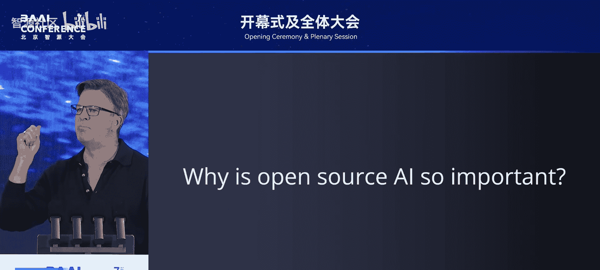

Deep seek was the cause of that open source moment。In January。

 a small company here in China released an open source model that shocked the world。

The day that deep sea came out invidia stock dropped 17%。

It showed that there are really no competitive notes when it mos when it comes to building large language models。

Now， don't worry too much about Nvidia。 Just yesterday。

 they became the world's most valuable company again。 So they have， in fact， recovered。

But what was important is that the world woke up to the fact that open source is going to be critical for artificial intelligence。

 Sam Altman in February reflected that maybe open AI is on the wrong side of history when it comes to open source。

 He went further to promise that open AI will be delivering an open source large language model in the near future。

Mark Zuckerberg， the CEO of Meta， is dedicated to an open source AI future。

And Kai Fu Li has stated that open source is the clear winner in AI in 2025。And， of course。

 deepse has proven here in China that there are no mos。And the innovation continues。Today。

 open source L L Ms are almost on the same level as closed AI frontier models in Evals。

 Many of those open source L L Ms come from organizations here in China。

 whether it's Q And3 or deepse。

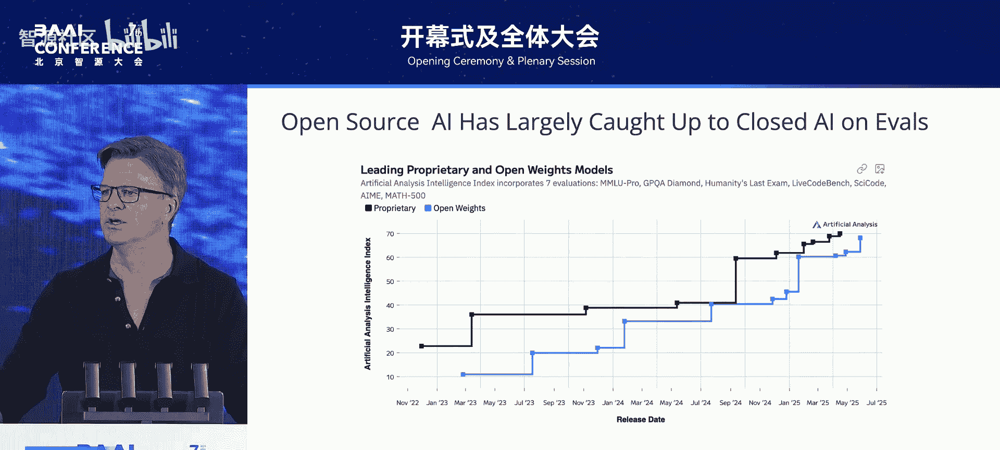

So， the question is。How did this happen。How did this small organization in China， deep seek。

 come out of nowhere and release this incredibly performant model under open source。Well。

 for anybody who's been coming to China for a very long time。

 I first came here in the early 90s and 1991。 You would know that in China。

 open source is not a new concept。

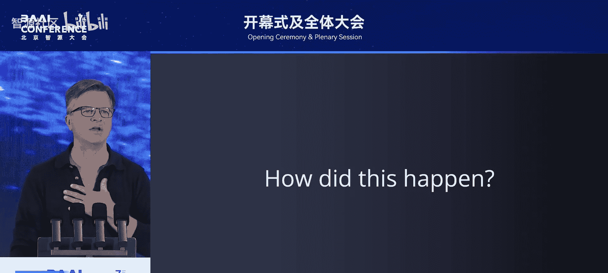

In fact， in China， organizations and the government have been betting on open source for a long time。

Whether in the early 90s， where government and industry were looking for open source alternatives to incumbent technologies like Microsoft Windows。

Or the 200s through 2020， where open source was invested in by industry here in China。

 large hyperscalers， companies like Baidu， Alibaba， Ten0cent and Huawei。

 Those companies became employees， engineers became leading contributors to global open source initiatives。

In 2020 till now， China has heavily invested in open source。

 not just in contributions and new releases of open source software。

 but in government policy that supports and encourages open source sharing and investment by both industry and the government in open source collaboration。

Now， of course， Chinas not alone here。In the United States。

 the technology industry also bet on open source a long， long time ago。In the 90s。

 companies like IBM used open source software to compete with incumbent competitors。

And to create higher level innovation。In the 1990s through the 2010s。

 there was billions of dollars of investment in open source companies。

In the cloud booms of the 2010 to the 2020s， almost every cloud service provider in the world built the vast majority of their cloud infrastructure together using open source software。

And， of course， today， we're seeing that same explosion in artificial intelligence in the US。Now。

 theres a cautionary tale here for organizations who think they can go it on their alone and oppose open source and stay closed in the United States。

 We see a laundry list of companies that fought against open source technology。

 try to hoard and control technology and ended up either being consumed by another company or going out of business。

Even companies like Microsoft who early opposed open source and Linux。

Had to radically pivot to embrace open source technology as part of their transformation。

Microsoft today is the leading contributor to the vast majority of critical open source software。

 That is a massive change from their opposition to open source， just in the early 2000s。

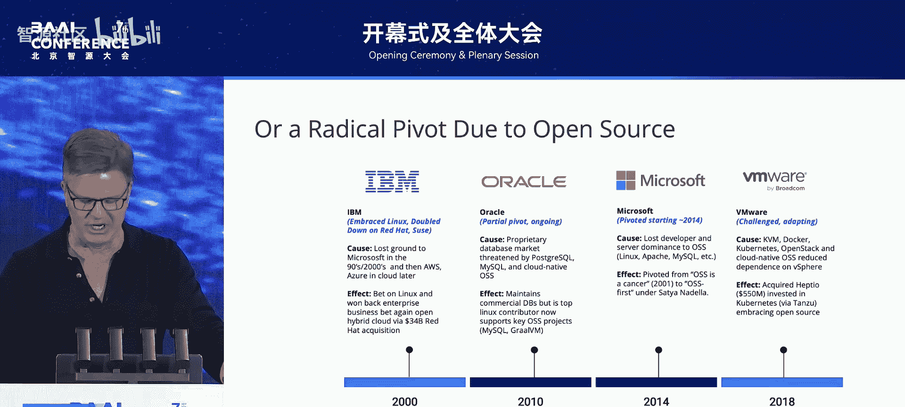

So the question I want to ask everyone here is， why is it that open source is so powerful。

 Why is it that open source is leading to these incredible breakthroughs that you just saw from B A AI。

Well， I'll tell you why， because open source is incredibly valuable financially。

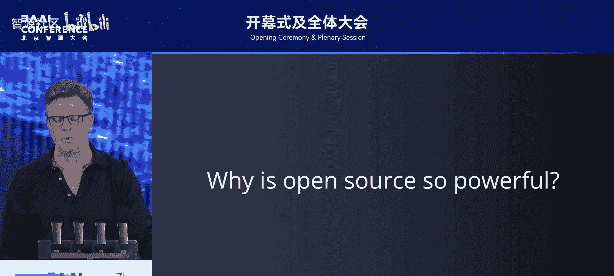

Harvard Business School recently published a study measuring the economic value of open source code。

If the world had to go purchase the open source software that industry uses to create all of its technology products and services。

 the demand side value， the ability to purchase it would be worth $9 trillion US。A stunning figure。

Think of it this way。Think of modern application development like a hamburger where a developer chooses an open source framework。

They use open source libraries， open source components that are freely available for anyone to use in public。

And they write only themselves the custom code that they need for their customers。

What that does is it saves 70% of the development cost for any modern technology， product or service。

 Today， this is the de facto way that software technology gets developed。

 We will not go backwards from this moment。 In fact， open source usage is accelerating。😊。

And remember this， that open source software itself。

 just publishing code isn't good enough to really take advantage of that $9 trillion is in value。

The world's most critical， open source projects。Is not just good software， good code。

It needs good governance。 You see for fierce competitors like Google and Microsoft or Alibaba and Tencent to collaborate on the same software。

 They need a neutral owner of that software。They need a way to make decisions about that software together。

They need to be able to promote that software。 So more developers come in and contribute and use that software。

That kind of governance is very critical and something that I'm now starting to see emerge here in China。

 not just good software， but good decision making， good collective ownership with software。

I see organizations all over the world coming together， not just at the Linux Foundation。

 but at other organizations， making decisions neutrally and together。 That process is accelerating。

 not decelerating。

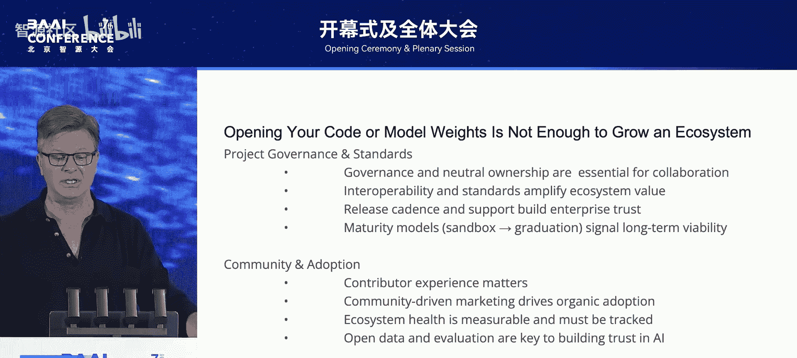

So let's talk about the economics of AI and and open source。 So open source。AI economics。

And why it is so important to continue to embrace open source development。In artificial intelligence。

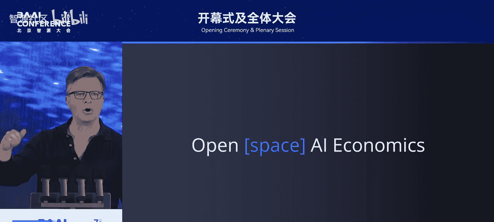

Open source drives innovation faster。When deepse R 1 was released， almost immediately。

 hundreds of different versions of deepse were released on hugging faces as well。

 all leveraging the breakthroughs that deepse created。

 But then adding their own innovation on top of that and making everyone better。

 And this continues to accelerate as every new frontier model comes out。

 or new forms of AI technologies adjacent to L L M technology。😊。

A recent study by McKinsey showed that in enterprise technologists。

76% of organizations who are deploying AI expect to deploy AI。

 open source AI in their enterprise in the next several years。 This trend continues to give。

But here's the part that I really want you all to pay attention to。

Which is why open source is so important。What people really want from artificial intelligence。

Is something we talked about all morning。Drug discovery， autonomous vehicles。

Robots that can serve us a healthy hamburger or help automate a factory。 You see。

 it's the applications that are created using AI where most of the value is created。

All of the infrastructure that enabled those amazing applications。😊，Can be a shared asset。And it。

 when it's all shared， it pushes the cost of building those AI applications down and lower。

 and it accelerates the creation of new applications， new self driving cars， new robotic systems。

 more medical big foods。At the Linux Foundation， what we want to see is as much open source infrastructure components as you can possibly have so that application developers and users of artificial intelligence can create amazing applications as quickly as possible。

😊，Those that fear the commoditization of lower levels of technology are generally the weakest in this ecosystem。

 But those that are fearless about open sourcing their technology tend to innovate at the highest level。

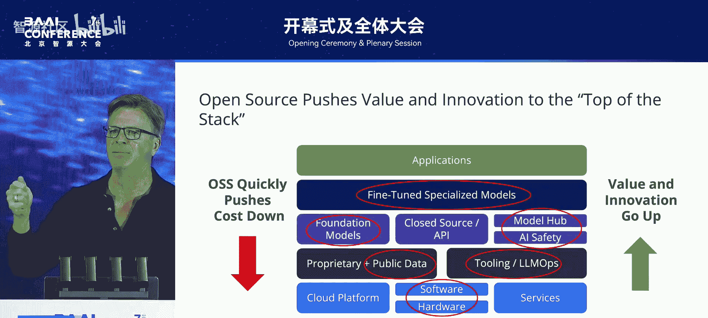

So finally， I want to conclude with what we're seeing in the United States in open source around AI。

😊，That is， of course， the rise of agent AI， which we talked a little bit about this morning。

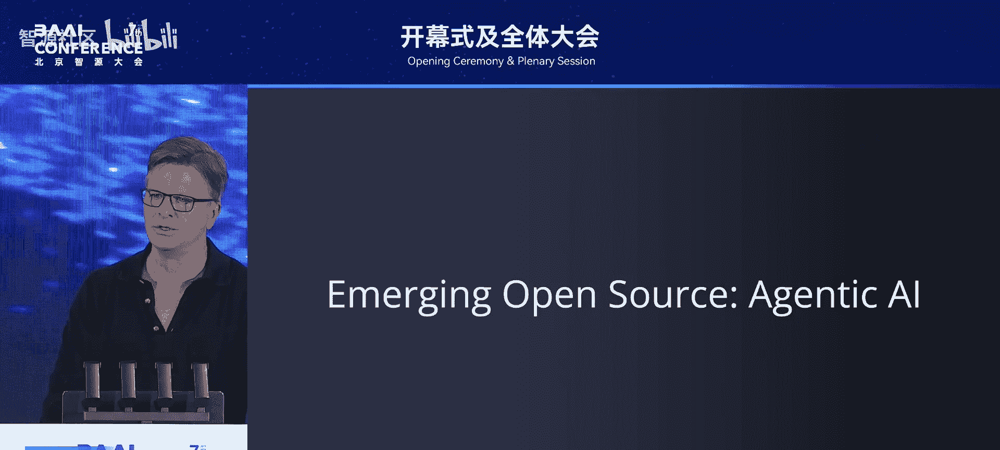

Now， you know how I just told you how at the infrastructure layer open source pushes costs down。

 drives innovation up at to the application level。But when we talk about agent AI。

 there's actually a level on top of that around the AI agents。

 And here's what we're seeing emerge in the United States as the modern agent AI stack。

What we see clearly is the emergence of protocols like MCP。

We're seeing the emergence of new open registries that help people discover and validate and secure AI agents。

We're seeing whole new ecosystem of MP servers and clients that people are collectively developing in order to create new agent experiences。

 new agent orchestrators。😊，If you haven't started looking at the activity around MCP and that ecosystem。

 this is something definitely worth looking at right now。

Because what AI agent technology does is it hooks the intelligence of a frontier model to something that's useful to an enterprise or a service。

 And it's that last mile that really matters in creating these rich applications and these useful AI agents。

😊，And what we will see is the same thing that we've seen in every use of open source。

 costst will go down。Security， reliability will go up， and innovation will rise rapidly。

We see all the major labs embracing technology， like MCP。A host of new open source initiatives。

 A2 A from Google， agency from Cisco and a variety of others are emerging in the United States。

 All of these are worth watching。😊。

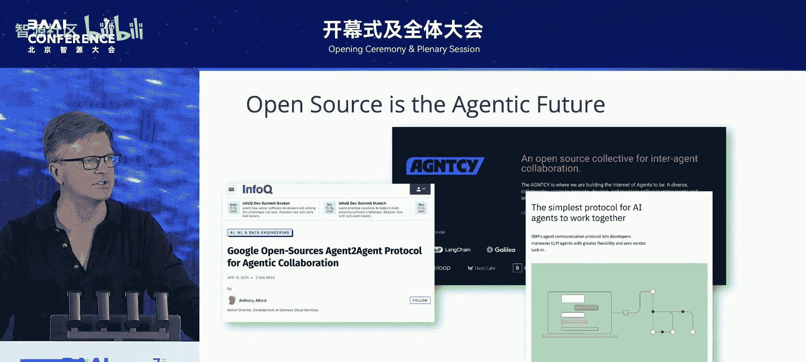

What I want to leave you with today is one thought。

First。Open source accelerates innovation。Even though open source is free and publicly available for everyone to use。

 it actually increases economic opportunity because it puts this technology in more people's hands。

But the real secret to open source。Is the global collaboration that happens completely in the open。

For anyone to participate in and anyone to use。33 years ago， Linuus Torvals。

 who was living in Helsinki， Finland， open sourced the Linux kernelel。

And he became the most successful software developer in the world over 30 years。

 Linux now still is maintained by Leus Torvads， and it is the most widely used software on earth。😊。

But the interesting thing about Leus Trvals。Is all he needed to participate in open source was a computer and a connection to the Internet。

And what I see every day working at the Linux Foundation。

 where millions of developers work together on those critical projects you saw。

Is that none of us know in the world where the next leanus Torvas is going to come from。

The next leans tourr vaults could be in this room today。And all that brilliant engineer needs to do。

Is to access the incredible technology that is being released into open source。Modify it， change it。

 become a leader。And we may see the next Leus Torbals come from right in this room。

 creating incredible technology that will be good to all of us。😊。

So let's make sure that we keep open source open。That we keep open source a cross border global collaboration that's freed for anyone from anywhere to participate at any time。

Because you never know where the next Linux or the next Lenuus Torvats will come from。

 Thank you very much。Thank you。 Thank you very much。 J， you， in fact， update our。

 our understanding of the open source。 Now， please hold on a moment。

 We will have open source dialogue。😊，The global collaboration for a shared future。So。

 let's welcome Mr。 Richa Ven。

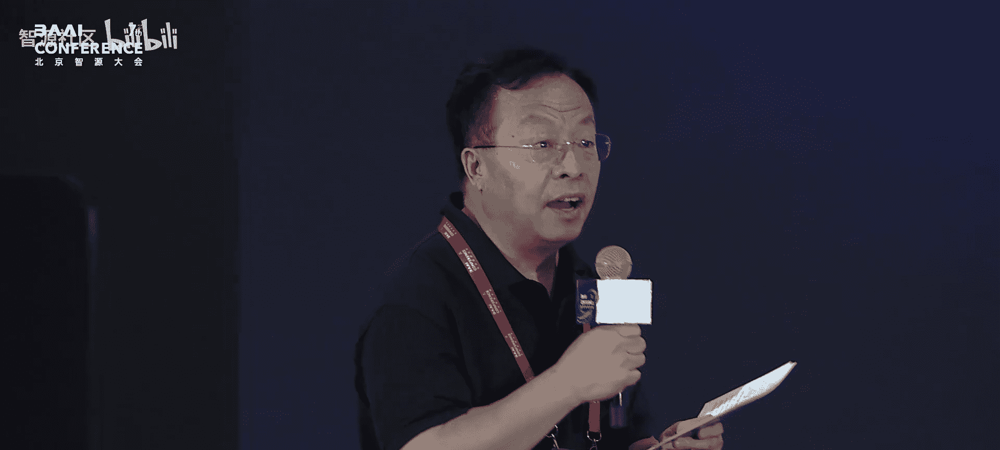

The engineering lead and founder of Ly。So I believe most people use Lions data set。

🎼And welcome the host of the dialogue， Lin Yonghua， the vice directors and chief engineers of B A AI。

🎼Please take your seats。Okay， I'm very glad that today host this open source dialogue。

 And today we have two very important participants from Li Foundation and from Lion foundation。

 and you all see the slide share by Jim just now actually from Lis foundation it has the。

 it has the honest， it has the V L L M。 and this all the foundation building block to support the AI computation。

 and from the line line Foundation。 Actually， the most famous one is the line 5 billion。

 I believe all of you if you work on the multimodality model， you have use that Okay。

 so it is the building block to provide the very important data foundation to support the AI。

 So today， we know that for the AI， it is not only the algorithm。

 but very important support by this AI computation and AI。😊，Data set，So today。

 when we talk about this select the the topic as the global collaboration for a share future。

 actually， share future is not only the collaboration is not only the common goal， but the share。

 the term of the share is actually is the call for the open source。 So let's start this conversation。

 First to Jim， we know that the Linux Foundation has been founded for 20 years。

 So back to 20 years ago， I want to know that at that time when you establish Linux Foundation。

 What is your share future at that time， or to say that what is the vision at that time when you establish Linux Foundation。

😊，So when I first started working at the Linux Foundation。

 not a lot of people understood open source or appreciated it。

 but Linux had been established for about 10 years and was starting to emerge as a global technology being adopted by industry。

What became clear to me very quickly is that there was something different about Linux and open source。

And the way that it was being adopted both by business。

And the love that developers had participating in co developing Linux。😊。

And what I realized is that if the Linux Foundation could replicate the success of Linux in new technologies。

That we could be incredibly successful。And the goal。

 which continues to be the goal for the Linux Foundation to this day， is to create the greatest free。

 open， publicly shared technology investment in the history of the world。

We really believe that the basic building blocks of software。

Should be freely available to as many people anywhere on earth as possible。

And as we continue to grow and as we continue to see new technology being released in open source。

 I'm always grateful for the fact that I was on the right side of history even 20 years ago。 Okay。

 thank you。 Yeah on the right side of the history in the 20 years ago to now。

 And also make it as the most successful open source organization。 Yeah。😊，Okay。

 then the the the question， the similar question to Richard。 first。

 you can a little bit introduce yourself and also share us four years ago。

 When you start to work for the line foundation and establish the data set。

 What is your goal at that time。 What is your expectation for the share future at that time。😊。

🤧Thank you。 Good morning， everyone。嗯。I'm an electronics engineer by formation。

 and I've been working in the computer industry for about 30 years。In 2020。

 during the pandemic's lockdown， I decided to follow up a master in AI engineering。

So 2021 was the year I finished that， and I started to seek。To work with the new knowledge。

I found online a bunch of people interested in replicating the the Lee model。

Daalli was just released by Open air at the time， and we decided we have to do something to。

Have this in the open source。And immediately became obvious that we need a large data set。

So we started to work on this project。We decided to go to Common C and scan all the files and find images on the Internet。

And match them to their captions。We've been using the clip model， which is was also open weight。And。

My contribution was on the engineering side， accelerating from the project time of。

30 years to complete this to only eight months。 So in 2022， we were able to， to release the lion 5 B。

Thank you。 Yeah。 I still remember for B A AI in 2022。

 we spend around 1 million RM B just for download and transfer the， the whole data back to China。

 So it's really amazing data set。 as we say it is the common core。😊。

So called common core for language model。 That is the the the most important data set for multimod。

 Okay， thank you。 So that's back to now， today is the very big time for AI。 So Jim。

 for Linux foundation today in under this AI wave， how will you expect the share future。

 especially how will you position the Linux foundation in this AI future。Yeah。

 so the Linux Foundation wants to be a neutral home to the tools。

 data and components that are used to create frontier models。

 but also to the agent infrastructure that we can all commonly develop to make those models accessible to a wide variety of applications and so today we have a variety of different initiatives。

 the Pytorch Software Foundation， the Linux Foundation AI and Big data initiative to act as a home for that large scale collaboration。

One of the things that we also are working on is the area of AI safety and authenticity。

 So some of the initiatives that we have at the Linux Foundation are to create new technology to address some of the risks that come with AI。

 We have an effort called C2PA， the coalition for content Provience and authenticity that is a technology that allows you to trace the authenticity of content in a world where artificial intelligence often blurs that line。

 So we're gonna continue to be the home for AI technology far into the future。 thank you。

 that's a very important new tool and inspired by today's talk the first two talk。

 Professor Bingz and Professor Shatton happen they have different opinion So I want to ask you Okay。

 now ask you which one do you agree more but I want to ask since recently， I noticed。

In the foundation， you make two things。 One is you define the license for a unified license for open source model。

 open source data。 Okay， that's one thing。 The second thing is you also define the model openness framework to you you define the three different classes to see how the open source model level。

 the level of open source。 So can you share as your view。

 considering the theres different opinion about the AI safety or open source yes or no for the those very huge AI model yeah。

So so one of the things that I think is important around open source technology and AI is to remember that。

All of that technology is basically intellectual property。

And it's important to have clear frameworks to share that intellectual property based on a variety of legal structures that exist today。

 copyright law， trademark and so forth。And so one of the things that made open source so successful was that copyright licenses。

Were consistent。 Most people used an Apache license for permissive licensing。

 and you had this many to many sharing。licenseense was consistent。 It was open。 You could use it。

 You could combine Apache license code with other Apache license code。

 and it created more innovation。We need similar constructs today in AI because in AI。

 it's not just source code， it's data， it's weights。

 its data descriptors and so what we've done is created a few digital few legal frameworks or community data license for data the open MDW license for model the holistic release of large language models so that people can share clearly recombined technology。

 disclaim liability and warranty， and so we can get that same many to many sharing acceleration。

 so these are some of the things that we're doing to address risk in AI in terms of the question of restricting AI or not the Linux Foundation obviously believes the more hands you can have this technology in。

The more transparent and safe it will likely become and often what we see in open source is the answer to problems created by technology is sometimes more technology things like C2PA for authenticity AI safety tools that can be used collectively as an open source artifact available to anyone。

 So that's kind of what we're building。 Okay yes， so actually you remind me that last year when we do the study about the open source industry related data。

 we found that amount around a 100 data， they totally have used the 440，40 different license。

 So it make our lawyer very crazy。 So I think if one day we really can have this kinds of unified license definition。

 especially for this new things like data or model file。

 it will really helpful for us to do the global collaboration， because we can use the almost the。

In languageage and protocol to do these kinds of collaboration。 right， Okay， thank you。

 So then the my question to， to Richard。 Okay， since we we， we all think the。

 the line 5 billion is so， so success。 So that it's just from a small team， but it's so success。

 And so we all expect what will be the next big thing。😊，From line。 and how will you today。

 How will you imagine expect your shared future from this point of view。

So we are in a good year where the language models open source ones are。

Very close to the frontier models。But we have a bigger gap to cover for multimodal。

 So it's clear that multimodal data set。Of high quality must be created in the open so that everyone can train models and。

Recover this， this gap as soon as possible。Okay， yeah。

 So I think the next step the even the higher quality of the multimod model and bigger one will be important。

 even I think it's not only for the multimod model。

 we believe for the embody AI to train the brain in the robot to understand the whole world is also the very rely on this kinds of new data。

 Okay， but we know that so the data data is very important for AI。

 especially for the large large model， but to build up the huge data set。

 especially to open source the huge data full of challenge。 So from your view。

 what will be the biggest challenge from line foundation today。The work ahead of us。

 is so huge that it is not possible for a single organization to come up with a solution， so。

Cooroppoeration is needed， and global cooperation is needed， because。The data set should reflect the。

 the entire world。So yeah， we are expecting to find partners and partner with other organizations to achieve that。

Okay， thank you。 So Yeah， so we we I think that we're going to see the emergence of a lot of new collective data efforts。

So for example， at the Linux Foundation， we have an effort called overVture Maps。

This is a 30 million US dollar effort backed by Microsoft， Meta。

 TommTm in Europe and Amazon to create the largest geospatial data set in the world。To make it clean。

 well labeled， proper metadata， licensing clear and freely available for anyone to use。

 I think we're gonna see a lot more of those kind of arrangements in the future。 Yeah。

 I think it is good example。 Yeah， the huge effort to make such a high quality and also the legal and available for use data。

 but without the global collaboration will be very。

 So as Richard mentioned just now the biggest challenge is you need more help from the global to work together。

 So I think today not only B I think AI team will happy to participate And also I know a lot of the the teams here in China。

 they will have happy to help on that。 Okay， so so so back to the the global collaboration。

 so Richard， yeah， okay， Richard so I know the Lion foundation。😊，It a small organization。

 So how will you impact expect the global collaboration。

 I know that you mentioned the global collaboration to。

 to participate this data set processing something and and anymore more。Yeah， we。

 we are looking at the certain model where states came together and established common goals in physics。

 for instance， So they were able having the common goals。To achieve great results。

I believe something similar can be done in AI。We just need to communicate more and calculateulate groups of。

Institutions and people that have common interests and start such common projects together。 Okay。

 thank you。 Yeah， and， and Jim for Lina's Foundation。

 how will you expect a global collaboration and for example， the like the institute like B A AI。

 What will you expect us to collaborate in global。So I think the important thing to remember for everyone is that we want to continue to make open source freely available and public to everyone。

 and I think that's going to continue。Whenever someone asks me how they can。

Collaborrate in open source。 The first thing I tell them is。

Use the open source software that's already out there to build upon。 So you know， use Potytorrch。

 use Linux， like start participating just by using。

The next step is to start participating and contributing， maybe fixing a bug。

 maybe attending a conference like this Pytorrch Day tomorrow。And then at the highest level。

 do what deep See and Tencent and Alibaba are doing， which is release NBAI。

 release net new code to the world and build a community around that。

 So for anybody out there who wants to participate in open source。 First。

 start using open source to build。Your next company。

 build your next frontier model that no one's ever heard before。

 Next start contributing to make the open source you use to create that company or breakthrough better。

 And the next start sharing back breakthroughs that you had publicly for everyone。

 That's I think how you can participate。 Okay， thank you。 I know today not only of。

 but also online lot of young developer， young research and also。 So yeah。

 any of you can just start submit the call or even the fix bug and just start from participate。

 So thank you。 And I think as the conclusion， the global collaboration is very important。

 and for example， B AI in the past two or three years we already open source more than 100 models without the open source from global。

 we cannot open source so many different。sAnd we also the open source more than100 data set。

 why we do that， because we also want to contribute back to the whole community So no matter what is the share future looks like。

 anyone can have any their own definition。 but we believe that global collaboration for the AI。

 AI open source is very important because it can help us to reduce the cost for the for the computation and help us to get the chance to assess the high quality data to the model and more important。

 it can help us to lower the barrier for the AI innovation from global anywhere。 Okay。

 thank you very much。 the talk from G and reachcha。 Thank you。 Thank you。Thanks again， Jim。

 Ri and Yonghua。 Yeses， there are so much space to collaborate globally。😊，Unfortunately。

 we are perfectly on time。下面呢我们就进入啊大家关注的另外一个这个热门的话题。2025年居深智能的发展处于行业落地的关键的节点，相关的应用探索呢不断深入。

正在向实际场景稳步推进，不管是政策层面还是技术和产业界的主动布局，这一趋势呢都日益明显。在这个行业发展的黎明破晓之际，海内外涌现了一大批优秀的巨神智能公司，正在加速推进技术落地。那么接下来呢。

我们首先就有请巨生职能领域的全球代表性企业，来自physical intelligence的联合创始人兼CEOcarl Ha曼博士在线为我们带来主题演讲building physical intelligence。

Fsical intelligence是当前美国最受关注的巨神智能公司之一。Carol。caro homan博士呢也曾经在google的demind担任机器人的首席科学家。Next。

Let's welcome Dr。 Carl Hosman， cofoer and CEO of Physical Intellig。To deliver keynote speech online。

 building physical intelligence。我要靠。Hello， thank you for having me and sorry that I can't be there in person really appreciate the invitation and today I wanted to tell you a little bit about building physical intelligence I'm a cofoer and CEO of physical intelligence。

So unless you've been living under a rock over the past few years。

 you probably noticed that something happened in robotics。

 so the robotics as we were used to looked more like this where we have robots that can do very repeatable tasks go from A to B very well。

 very fast。But as soon as we introduce a little bit of lack of structure。

 they would very often result in something like this where the robot was not able to deal with the chaos of the world and then structure environment and it will basically catastrophically fail。

But then it seems like something happened。And right now， robotics looks very different。

 it looks more like this。You know， we see extremely smooth。

 impressive dance moves from many different human aid robots。

 and we see robots deal with un environments like this one， just fine。

So the question I want to answer today is， well， what happened？

AndThere seems to be a very big difference between the robotics of the past and robotics of today。

So over the past year， I've been building physical intelligence。

And I've been building it in two different ways。On one hand。

 I started a company called Physical Intelligence， we started around a year ago with the idea that we want to build a all that can control any robot to do any task。

 truly solve physical intelligence。On the other hand。

 I also had a daughter who was around a one year old today。

 so I experienced emergent physical intelligence almost every day these days。

And if I were to draw a conclusion from these two things is that if you're thinking of starting a company and having a baby at the same time。

 please talk to me， I did not recommend that， don't do it。All right， so back to the question。

 what happened？I think the very obvious answer is， well， AI happened。

And there's many different versions of this of this answer that actually matter here。

 But I think the one in particular that has been really， really important。 I want to focus on as。

Vision language action models。So let me tell you a little bit more about them and why I'm very excited about them。

So how do they work， they work fairly similar to vision language models that we know from products like CdGptT。

 so in a vision language model， the way it works is that it takes some data from the internet。

 for instance， an image that you can find on the internet and image of a cat。

Then you can ask it what is this， what do you see in the image。

 and then the model is trained to answer it in natural language as well。

 so it would answer of the word cat。Now it turns out that we can take that model。

 this vision language model and adjust it a little bit to be practical for robots and actually really really powerful for them so the way it works is the following。

We'll take a vision language action model now， and instead of having an image from the internet。

 we would have the camera feed from the robot。 So what the robot currently sees。

And instead of asking it in a question that you can answer in natural language。

 we'll ask it to do something， we'll ask it to do a task like fold shirt。Now。

 given that that model has also seen robotics data and in particular data from many different robots doing many different tasks。

It turns out that it can output an answer that tells you how to do that task。

 so it actually outputs motor commands for the robot to do the motion to accomplish that task。

Now it's a very simple idea， it's basically a vision language model adjusted to deal with robotic data。

But it turns out that's really， really powerful。So why is this so powerful， why is this a big deal？

Well， traditionally that kind of thinking where you can train a model fully and to end that can understand what the robot sees and output the correct actions。

Has been really hard because these modelss require a lot of data。But with this idea。

 with the idea of vision language action model， it turns out that you can collect data from many other sources。

So one， you can connect data from the web。In the past。

 we thought that to make a model like this work， you would need to have a robot experience the entire world firsthand。

 that would need to experience every single object， every single situation to learn about it。

But then it turns out that you can take a pretrain vision language model that was pre traineded on the web data and has some high level understanding of how the world works。

And transfer some of that meaning to robot motion。And one particular result that that was an outer of that showed that that actually doesn't look that impressive。

 but it was completely mind blowlowing to us was from robotics Transer2 showing the following this is a robot being asked to move the Koken to Taylor Swift。

Now， I'll show it to you again。 Watch closely。 The robot picks up a coken and moves it to the picture of Taylor Swift。

Doesn't do a great job， the coine falls， you can see that it's kind of pathetic。But to us。

 watching this experiment live， that was a very， very big deal。

And the reason is that the robot has never seen pictures of Taylor Swift。

 has's never seen any pictures of any of these celebrities or any other pictures。

It had that abstract concept of who Taylor Swift is and what the picture of Taylor Swift looks like。

Ttraade from the Internet。So it was able to get that knowledge from web scale pre training。

And then translate that knowledge and connect it to robot motion to actually express that understanding through an embodied movement。

So that for the first time showed us that it's actually possible to get all of that knowledge not firsthand。

 the robot doesn't have to experience the world every single situation and it still needs to experience quite a bit of it。

 but it can get a lot of that understanding from the internet instead。So that was one。

The second one that made it really， really impactful is the fact that not only we can connect it to the data from the web。

 but we can connect it from data from other robots。

So it turns out that these models don't really care whether all the day it comes from a single embodiment or many different embodiments or a robot that has one arm or two arms。

 or it's a mobile robot or a drone。It doesn't really matter At the end of the day。

 it's a pattern of numbers and pattern of different data。

That these neural networks can find and can understand well。So to do this。

 we run an experiment called RTX， where we collaborated with many different research institutions around the world。

 34 of them， and asked them to send us the most recently collected data sets that they used to publish their research。

Now， if you've done academic research， you know that the way it works is you collect a data set and then you try to get your method that you're about to publish really。

 really work。And you're very heavily incentivized to get it to work because that's what you want to publish。

So we took all of those data sets that were published for different methods and we combined them into one big data set and trained one big generalist model on that。

 so that was trained on many different robots that look different that have different number of degrees of freedom。

 sometimes it's two arm， sometimes it's one arm， it doesn't really matter。

And then we send the checkpoint of that model of that generalist model to these individual labs and ask them to compare it to their state of the art method that they just developed。

Now， importantly， it's a different state of the art method in every single lab because every single lab developed a specialist solution for the problem that they're trying to publish on。

And then it turned out that as a result， our generalist model was able to beat that baseline that state of the art method every single time。

 on average by more than 50%。And that points to the fact that these modelss are really data hungry and they can make sense out of data coming from many different embodiments。

And then can do it much better than we can。So with these two。

We decided that this is a technology that would allow us to build a all to control any robot to do any task。

 and that's where we started physical intelligence。Now。

 the way we want to do this is to build a generalist model that will be trained on many tasks and many robots with the idea that we'll be able to generalize beyond that。

In particular， it will be a generalized Vi language action model。

That will be trained on many tasks and many robots。Now， as we started that journey。

 we thought that there's going to be three big challenges that we really need to dererisk and understand better。

These are capability， are these models capable of doing tasks that we've never seen robots do before that are very dexterrous。

 long horizon and so on。Secondly， generalization， can they generalize to an extent where you can put them in a completely new room in a completely new environment and they know how to do it。

And then third performance can they perform out a very high clip with very high success rate and be extremely robust。

So we started with the first one， capability。Around five months into the company。

 we arrive at these results。 This is a demo you might have seen， showing one of our robots。

 unloading a dryer， taking all of the laundry into into a basket。

 bringing it over to to a folding table and unfolding it one by one。

You can see that it's not perfect。 It makes quite a lot of mistakes。

 but it can correct basically all of them。 It's still fairly slow， doesn't work every single time。

But this is a test that for a very long time has been considered a holy grail of robotics。

This is something that we've been able to achieve five months into the company。

 and this is not a model that is specialized in this particular task。

The exact same model could do laundry folding like the one you see could also work on static robots whether it a single arm or two arm robots。

 it could also work on different mobile robots and do many， many other different tasks。

So I wanted to tell you a little bit about what we did to make it work。

So we trained this generalist robot policy， we call it pi zero。

 this is our first model that we released in October last year。

That was pre traineded on many different robot form factors that you see here on the left and across many。

 many different tasks。Now we also use a pretrain vision language model to get that internet scale pre training that I talked about earlier。

 as well as the open data sets， open source data that I talked about as well。And then from that。

 we built a single architecture， single vision language action molecule by zero that has an action expert that allows it to actually output actions。

😊，Now it can do multiple things first it can work zero shot where you can just prompt it and forecast it it seen before it can perform them fairly well。

But you can also find tune。And you can find tune with what we call post training that is much higher quality data。

 which allows you to do two things。One， it allows you to kind of specialize this model for some for tests that are particularly difficult。

 so for something like laundry folding it's not enough to just pretrain it。

 you kind of need to find you it to tell it how exactly you want your clothes to be folded。

But you can also use it to train new tasks very， very quickly。

So before I tell you a little bit more about architecture I wanted to kind of have you appreciate a little bit how hard of a task it is。

 it seems like folding laundry is you know not that difficult we do it you know。

 every other day or so。But it turns out that it's actually quite tricky。 So here are a few examples。

 the same model running on static robots So you can see this is a problem where you find a shirt that is in arbitrary configuration and you see how many different motions you need to do to grab the corners correctly。

 you can see that the robot eventually grasp the sleeve。

Correctly it kind of flattens it out a little bit once it's done then it grasps the corner well。

 then folds it in half， brings the shirt a little bit closer to itself。

 folds it again then folds it in half then straightens it out that also takes quite a bit of work and then it does this beautiful dynamic motion to folds it one more time brings the pile over and puts the shirt on top of it。

Here's another example of a piece of clothing that the robot has never seen before。

So you can see that the shirt is in some weird configuration。

 the robot tries to flatten it out and it realizes that something is off。

 it tries it few times and then eventually it figures out that it actually didn't grasp the right corner so it needs to put it down。

 grasp it again， grasp the corner correctly， then brings it over， folds it in half。

 folds the other half。And then eventually it's able to straighten out the shirt to the to the final dynamic motion at the end and puts it on on a pile of clothes。

In fact， the system is robust enough so that you can interrupt it。

And it can handle these interruptions quite well。So here's a robot mining its own business trying to fold the clothes。

 And then one of our researchers might is putting another shirt and trying to mess with it。

 And you can see that the robot kind of realizes what's happening。

 puts the shirt back and kind of out you know tries to do try to do its job。

 This is not something that we train specifically for is's just something that emerges from large scale training like that。

You can also mess with between in other ways here is the robot trying to fold a shirt in half and while it's kind of halfway through Michael comes in our remain researcher and unfolds it so then the robot starts again and starts with the other half and Michael comes in and un does it again now you can see that one of the corners is a little bit off so the robot needs to figure that one out it finds the corner correctly and eventually folds it and keeps them going。

So this is what these modelss are capable of。But the most if I were to distill it into one inside that was really。

 really important to get it to work is the insight of pre training and post training。

And what do I mean by this is the following。So for pi0， we had。

Pre training data that consisted of 10000 hours， so many different tasks across many different robots were in that phase be to cramp as much data into the model as possible。

 very similar to the pre training stage for large language models。

But then we will go to the next stage called post training。

Or would collect the orders of magnitude less data of high quality around 20 hours of data to kind of get this model to to behave exactly like we wanted。

 so kind of pick the mode of behavior that we actually meant We can do this for laundry folding。

 We can do it for building boxes or many， many other tasks。And that turned out to be really。

 really important to get it to work。So in particular to give you some quantitative evaluation。

 we can compare three different approaches， we can compare the approach I just described where we do pre training and un post training。

We'll be comparing it to an approach where we have no robot pre training。

 so we just train on this curated data set of really， really good high quality data。

And we'll compare it to an approach where there is no post training。

 so we just train on all the data and that's it。Now here are the results。

So if we do both pre training and post training， we see the highest number。

 this is we can get to really where we can get really far this folding task。

Because it turns out that you kind of need both to first understand the motions of how to deal with all kinds of different situations which you get from pretraining and then you need post training to really fine tune those motions together to really the result you want。

Now， if you don't do any pre training， if you just do curated data set。

 it turns out that the performance drops significantly。

And the reason for that is that you know how to fold things perfectly。

 but the real world is not perfect， you're going to fail。

 you're going to make mistakes and you don't know how to deal with that diversity。

 how to correct those behaviors because you've never seen that situation。

 you've only seen perfect data。And then lastly， if you didn't apply any post training。

 that means you know more or less how to fold close， but you don't really know what exactly we want。

And that also drops in performance quite a bit。So now one question you might ask is you know this is a generalist model right that's not just a model used for laundry folding or building boxes or many of the other tasks I mentioned it was also trained on many other robots so can you use it。

 can anyone use it？And the answer is yes。We open source model。

 we open source it in the repository called openpi。

 or we open source many different checkpoints of it。

 we also showed different robot runtime how you can integrate it into your framework。

 and we have many， many people using it， fine tuning it on all kinds of different applications ranging from robotic surgery to autonomous driving to many。

 many other tasks。

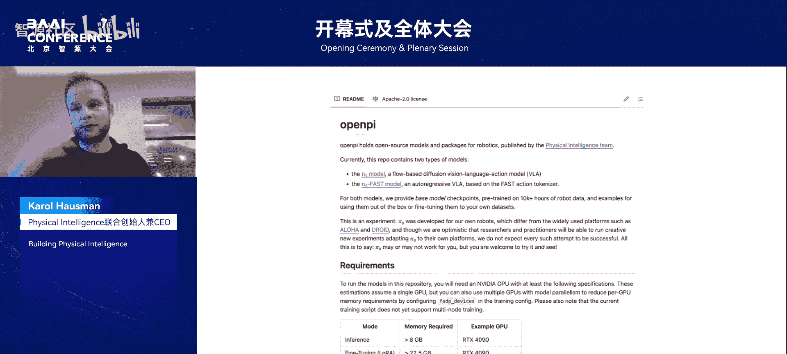

In addition to this we also started a partnership program。

 here's one partnership video with Astrobot humanoid robot showing a robot making coffee and you can see it being a robot that is more complex。

 has many more degrees of freedom， it's kind of harder to control because of that but we can take a pretraining pi zero model and fine tune it to a new embodiment like this and do a task that is fairly dexterrous that the robot can perform fairly well with this generalist policy。

Yeah。All right。Since I mentioned humanoids， I wanted to spend a few more minutes on humanoids。

 you've already seen that the world went't crazy about humanoids， there's many different humanoids。

 there isn't a day where you're donet here about the new humanoid being developed。

 there's many different companies making those robots。

 amazing pieces of mechatronics robots that will be capable of many， many things。

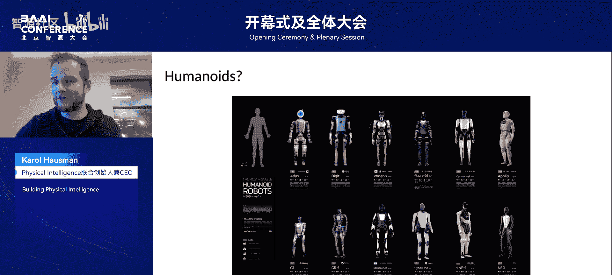

And we've seen all kinds of different applications and demos of these robots。

 whether it's in the home or in some kind of structured home environment where they're collaborating and doing fairly extrarous tasks。

Now， I believe that if we actually succeed， if we actually crack the problem of physical intelligence and build these models that are extremely general。

I don't think we're going to stop at humanoids。I think we're going to experience a Camran explosion of robots。

Because let's be honest if you wanted to do something like sort packages。

You wouldn't be doing of a humanoid if you wanted to automate that。 If you were to automate it。

 you would want to do it way better than humans。 You would do it with a robot like this。

And that turns out to be true for many different applications， you can do much。

 much better than humans can because it's not our form factor that makes us special， it's our brain。

 our physical intelligence that makes us special。So we can see all kinds of different robots being applied to many different domains。

 and I believe all of them can be powered by a single generalist model like pi0。So for instance。

 if you do want to do roofing， you'll use a very different robot。

If you want to do some kind of self-assely or space exploration。

 you will very different you'll use very different robot if you want to do firefighting。

 you'll use very different robot， if you wanted to do agriculture。

 you'll use a different robot and if you wanted to do recycling you will use a very different robot。

And there's many， many more applications where there's way better form factors that are superhuman in some way。

But they can be powered by the same general brain。All right， so sorry about the small digression。

 I talked a little bit about capability， so next in our journey we tackle generalization。

So one caveat about all the demos you've seen and you see day to day about robots is that they're always evaluated in the environment that we've been trained in。

So the demo that I showed you earlier in a home where the robot is folding laundry。

 if order were to bring it to your home， it probably wouldn't work， it hasn't seen that home。

And this is one of the big， big bottlenecks that prevents us from deploying these machines。

So as the next step， we wanted to tackle that problem and get the robots to generalize to a completely new environment they've never seen before。

 and it turns out that it's possible。So this is a project we call pi zero， do you think the bedroom？

Where we bring robots to completely new homes that they've never been to before。

 so this is a new Bnb that we rented in San Francisco and here's our researcher Laura asking it to clean the bedroom。

The robot has never seen that bedroom before， it starts putting the clothes away then it puts trashing in the trash can and then it makes the bed at the end。

In fact， all our evaluation in that work has been done in completely new environments that the robot has never seen before。

 so we're literally driving around San Francisco assembling the robot and putting it in environments it's never seen before and evaluating it only later。

Now the most important quantitative result from the work is this and this is a plot that I've been waiting for for a very。

 very long time， so let me describe a little bit what it shows。Here on the X axis。

 you see number of locations that the robot was trained on。

 so the robot has seen many different homes。And the X axis is how many homes its seen in this training data。

Now on the Y axis， we see the average task progress so the task performance。

 and this has seen a new home that the robot has never seen before。

Now you see here this yellow line shows you the performance in this unseen location using our method。

 our pi 05 model。And it turns out that the performance goes up and up。

 the more homes you've seen in your training data。And by by the time you've seen 100 different homes。

 if you go to the 01st home that you've never seen before。

 turns out that the performance is very high， it's over 80%。

Now you can also compare it to a situation if you had data in that environment。

 so if you just came into that home， collect the data in that home。

 what is that performance and this is what you see in this bar that is in green so this is if you had in the main data。

So it turns out that you can visit around 100 homes and by the time you go to the 101st home that you've never seen before。

 your performance will be similar in that never seen before home。

To the situation as if you collected data in that home。

And this is something before we started this project was extremely unclear， you know。

 some of us thought maybe you need to visit a million different homes to be able to generalize that way。

It turns out that around 100， you're able to basically get that performance。

Now two other really important caveats here is that if you don't use pretrain that I talked about before。

 the performance drops significantly even if you're using domain data， this is the light green bar。

Now if you train on all the 104 locations and don't use pretraining the performance plums even more。

 and this speaks to the power of models that are very general that are trained on many。

 many data sets across many different robots in many different situations。

They develop better understanding of the world than they can actually work in environments that they've never seen before。

Yeah。So at this point I would say that we know that these mons are capable of incredible things that we've never seen robots do before。

 we know that they can generalize to environments they've never been before like like homes。

 the most diverse environment there is。The last question is， can they perform really， really well。

All the demos I've showed you， they work some of the time， sometimes 80%， sometimes 90%。

 sometimes less。But they don't work every time and if we really want to deploy this technology and bring it to the world。

 they need to be working 100% of the time be extremely reliable。

I'm not going to tell you about this yet， but please stay tuned there' is more to common on that axis as well。

All right， so to summarize。Where are we at and what's still missing？I would say the following。

 we have a prototype of a generalist model that can be trained on many different robots。

 many different tasks， a true generalist。And I think it shows kind of sparks of physical intelligence。

 it's not the physical intelligence that I imagined yet， but I think it's starting to get there。

 it starts to work on new robots， it's starting to work in new environments。

 it starts to do tasks that we've never seen robots do before。

 it shows some really interesting behaviors。And then even more importantly。

 we're starting to develop this recipe for training these robot foundation models。

 a recipe that you can apply， a recipe that we understand a little bit better。

 that is more repeatable and that many others can apply as well。Having said that， we are still very。

 very early， there is lots of things that are missing。First。

 we are not yet there when it comes to journalismization。

 I show some signs of really impressive journalismization。

 but if you compare it to something like large language models， we are not there yet。Yeah。Secondly。

 we need to get these mode to be much more robust and much more performant。

 As I mentioned towards the end， this is something that we are working on， but we are not there yet。

 It's unclear how long it's going to take， to get us fully there。And then lastly。

 we also need to understand them better， we need to understand the recipes。

 we need to understand the scaling loss， we need to turn it into a science similarly to what happened with language and vision。

We need to have scientists kind of start to poke at these artifacts and understand how to build them better。

Now， at the very， at the very end， I wanted to leave you with。

With how I think about us how it's going to transform the world。If you think about electricity。

That we developed a long time ago。Initially when humanity was working on electricity。

 it seemed like it would always require so much effort to get it。

It seemed just insurmountable to get it to a place where it's available to everybody。

But now when you think of electricity， it's available at the flip of a switch。

And I think something similar is going to happen with labor。Right now。

 labor is kind of the clock speed of the world it's something that。

It takes a lot of effort and it's very， very very difficult to get。But I think if we are successful。

 if we solve physical intelligence， labor will be available at the flip of a switch。Thank you。

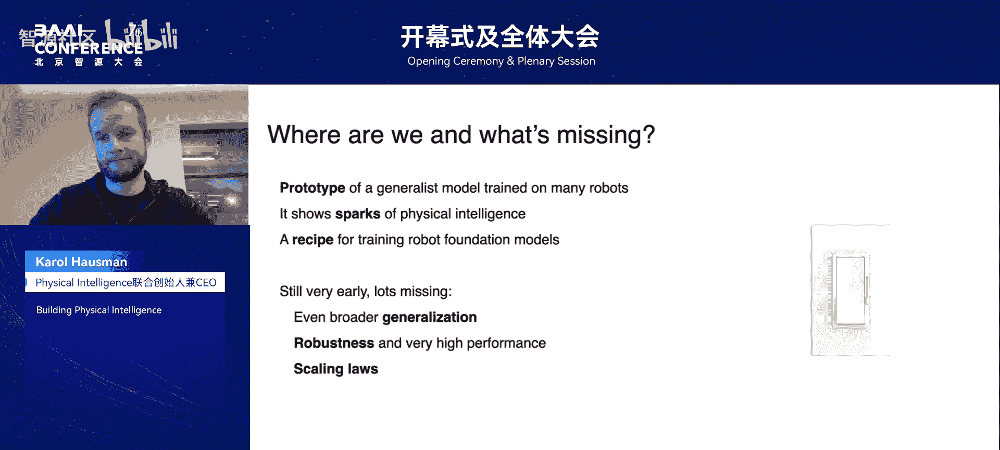

Thank you， Carol， for showing us the cutting edge progress from the physical intelligence， please。

Please keep on Keep online for minutes for the coming dialogue。呃，各位来宾，下面呢我们就进入今天上午最后一个环节。这个很丰富啊。

有人也有机器人智能巨身智援巨身智能会客厅。这个机器人上场的同时呢，请大家看一下短片。😊，🎼各位朋友，大家上午好。在今天上午开幕式的环节，我们特别设立了一个智源巨生智能会客厅这样的一个环节。

那么为什么叫会客厅呢？这是因为今天呃所有来的嘉宾都是我们智园的老朋友。那么下面就有请这些老朋友们上台，他们是语数科技创始人兼CEO王欣欣。🎼北京人形机器人创新中心总经理熊友军。

迎合通用创始人兼CPO王贺。🎼重测智能联合创始人卢策武，还有我们线上的嘉宾carol Haman。🎼各位嘉宾请入座。🎼Yeah。好，那呃欣欣，咱们就从你这边开始聊起来吧。对我还印象还挺深。

咱们第一次见面是去年4月份的时候，但是我们去语数交流，也非常感谢你的呃接待。我对咱们语数机器人印象最深刻的一点，就是不需要使用这种移动吊价，就能够这个随时展示。那么在过去的这一年时间里面。

咱们语数科技也是有了非常多的一些变化哈，包括今年春晚，我想大家也都看到了咱们语数16台H one啊，所表演的这个ybo。那么前几天呢在这个CMG世界机器人大赛机甲格斗擂台赛也在杭州举办。

咱们语数机 one的AI测算是获得了冠军。我听说呃今我听咱们工作人员说，今天咱们也把这个冠军机器人带到了现场是吗？请你介绍一下吧。😊，大家好啊，非常感谢那个参加呃此次活动。

这我们也带来了我们新的机器人这里给大家做一下演示。然后那个这款是我们目前去年的最新的居问，也是前段时间参加了格斗比赛这类事情呃，让大家给大家展示一些动作啊这类事情。😊，现在的话这个动作的话。

其实像我们过去的话，无论是在春晚上的这集群表演，包括这个格斗比赛，我们其实还是希望呃给大家真正展示一下目前当前的整个技全球的人体机器人的技术发展的情况，并且也是能带动整个机器行业的发展。

大家可能觉得目前这个机器人的话，其实相对来说可能还不能直接去家里干活或工厂干活。这个是目前全球大家都面临的个问题。当然我们还是希望机器人真正去干活的。但在真正去干活之前，我们已经达到的一些技术成果。

我们也是希望能做更多的一些商业化拓展或者一些尝试。所以说这块的话，我们也是做了这些事情。我相信像这种呃机器人格斗未来，最近今年包括明年会成为全球大家都比较欢受欢迎的一个体育赛事。

而且呃也是呃大家如果大家如果后面有兴趣的话，也可以来我们公司体验和玩一下。对我觉得还是非常激动人心的一件事情。好好，谢谢。星啊，这个机器人一上台表演立刻就调动起了现场的气氛。

那呃除了这台冠军机器人以外啊，这个有军种，咱们人形机器北京人形机器人创新中心也有一台冠军机器人。那两个月前在北京举办的首个人形机器人半程马拉松比赛中，咱们天工机器人夺得了冠军呃。

听说今天也带来了天宫的升级版天宫2。0。那也想请您一方面分享一下，当时天宫夺冠背后的故事。另外也给我们介绍一下天宫2。0有哪些升级好的，谢谢大家，我是来自北京星机器创新中心的熊友军啊。

今天来了会场呢是我们的天宫2。0，这也是一个开源开放的一个平台。呃，我们天宫2。0呢是在一。0的介上做了刚才做了一些更新天工1。0呢更多在在那个半程马拉松比赛上呢有两个小时40分的那个成绩。

跑完马拉松比赛。证是那个最呃能跑的机器人。那天工2。0呢，更多的是我们希望他能有呃能做更多的事情，能能好用，能能做更多的事情。所以呢我们更多的升级呢是在它的上肢的部分。所以他有更多的自由度。

然后也加装了零巧手，然后有更多的负重的能力。今天呢我们将会展示在线呢也会展示一些一些能力。好，我们有请天宫给大家打声招呼。大家好，我是来自北京人心机器人创新中心的天工2。0。很高兴见到大家。

天工给我们准备一些茶点吧。好的，没问题。我们的天工呢呃在参加马拉松之后呢，其实我们的更新呢实际上是一个系统性的更新。呃。

因为我们北京人星经灵创新中心呢是一个呃是成立于202023年11月2号是全国首个省级的人经灵创新中心。那在2014年410月份呢升级成国家地方共建的生圳的器创新中心。呃。

在这个我觉得它的升级呢实际上是一个体系化的能力。我们在这上面有有4个方面的这个呃平台的人的升级。第一个呢就是我们一直在建设的这个大家看到的硬件的这个平台。硬件这个平台呃。

那在前面呢我们主打的是它的那个环那个场地草地沙地丘陵石子各种路地面的这个适应能力被这明最能跑的那现在的升级呢主要是呃在这个让他能够。

在工厂在呃各种这种呃危险的就于有伤害这个环境里面去完代替人完成一些事情，这是呃看到的这个硬件方面的一些升级。那更多的实际上是在他的大脑软件方面的一些升级。

我们在今年呃3月份我们发布了我们的呃第一个通用的巨生智能体会师开物的这个平台，它是一个一老多机一老多人的一个平台啊呃包含了居生智能的这个大脑，还有这个小脑大脑的主要负责人机交互呃，环境感知。

还有这个呃像这个意图识别呃问物规划啊等等这种能力。然后后来小老呢主要是负责这个运动和这个呃执行这个能力，并并把这个执行结果的反馈给大脑行成完成的一个闭环。这是这个第二个这个平台。

实际上第三个他的这个主要能力还是呃我们围绕去训年他这个巨生智能体啊，我们自己构建了一个呃国内呃大。新的这个呃数据采集和机器人训练的这个中心啊，我们构建了20多个这种场景啊。

这个虚实结合这个数据采集的这个平台。并且呢呃在这个上面呢，我们也呃构建了一些像这个数据的这个采集处理，还有服务啊，人才培养了一整套这个体系。

用来呃去升级我们的不断迭代和升级我们的会开的这个智能体这个这个军视智能体。同时呢为了保证这个机器人的这个呃稳定可靠性。我们也在呃牵头建设北京的这个呃叫呃忠实的一个平台。基本上就是这么多。好。

谢谢谢谢友军啊，王贺老师更是我们智援的老朋友了。211年的时候，王老师从tanford回到北大论教。那么22年的时候加入了智源啊，是我们智源巨生智能研究中心的负责人。23年的时候。

王老师开始创立了北京银河通用机器人有限公司。今年也非常恭喜王老师获得了MITTR35主办方当时更是让我这个老商务给王老师来颁奖说这叫科研的传承。那么呃王老师现在做的这个银河通用的机器人的模型。

我不知道最近有没有什么一些新的一些进展啊，给我们介绍一下。这个谢谢众远博士的介绍。那么其实呃今年呢也是这个我们银河通用机器人啊，第二年亮相智援大会了。那么去年在智援大会呢。

我们展示了一些这个呃盒装物体的一些这个从货架上的吸取。那么今年呢我们。😊，啊，用这个VLA技术，也是我们刚刚这个physical intelligence提到的这样的端到端具身大模型呢。

打造了更加这个适用性更强啊，更贴近我们这个一般商超里头货架的这样的一个场景。那么下面呢啊我也展示一下，就是跟我们这个gellbo模型的一个互动啊，那么也是这个非常羞涩的上台啊。

那我现在这个呃这中午也是又饿，还有点热，对吧？那这个gellbo，你给我搞点什么吃的喝的。根据您提到的为您推荐安慕希酸奶和果粒爽果冻，您想要哪个？这个成年人不做选择，对吧？全都要。好的，这就帮您拿啊。

所以呃我们在现场呢也是用我们这样的一个这个呃就是呃呃轮轮式底盘的这样的一个人形机器人啊，基于我们自研的端到端大模型。从这样非常密集的货架上呢啊，其实它是呃没有办法去规避一个碰撞的。

不是用各种基于这个轨迹生成的方式可以取下来的。那么呢我们这样的模型呢，能够对我们看到的货架上啊，琳琅满目的各种各样的货品啊，除了就是这个瓶装的袋装的，包括呢各种薯片。

各种的这个包括我们拿的这个应该是一个呃用于稀的这样的一个果冻啊，那么这个模型呢是闭环的。在他拿的过程中，如果你抢，它也会去这个抓啊，那么我们也在这个呃咱们对面的这个呃建筑物里头有我们的展区。大家在。

那边呢这里为了省时间就不让他送过来了。那么在那边呢，大家可以在ipad端下单，然后呢，这个呃机器人送到你的手边。那么我们这个呢也是全球第一次VOA在这样的泛化的非常多SKO的品类上做这样的一个演示。

那么我们的技术特点呢，就是背后的训练数据，不同于派啊，我们主要是合成数据啊，非常的这个呃价格非常的低廉能够扩增的合成数据。欢迎大家关注我们明天啊智援大会聚深分论坛，我们会介绍更多的技术细节。谢谢。好。

谢谢王老师啊，那。好，谢谢啊。卢老师，我们也是去年3去年3月份的时候，咱们在上海交大第一次见面啊。然后当时我印象很深，就是您所展示的这个叠衣服，包括刮胡子啊。

那这种基于利反馈的这样的一些巨生智能系统还是非常非常的厉害，不知道最近有没有什么一些新的进展啊从产品级业角度讲，我们去年发布了穷测大脑的V一版本。那我们马上在7月份我发布VR版本。

那我么这里面体现了对于世界的物理的理解和交互。那这里面说为什么为什么会有个利反馈呢？因为其实你们大家有没有发觉是在做很多动作时候，其实人都是下意识的这里面对于什么样的经济价值比较高的那个场景会有用呢？

就是他需有复杂重复复杂的那个动态的接触和呃那个操作的那比如说我们刮胡子就是一个很典型的。它是你看抓起来之后呢，它基本就固定不动了。但是它持续的要连续的不停的去接触。那么。这个事情的话呢。

就是你力气大一点的话，你会刮伤，力气小一点的，你会刮不干净。所以它就非常又非常去鲁棒性极高的这样的一个模仿人类的下意识的这样的一个一个环境。但然是刮胡子有点是在炫技了。

其实我们已经很早的已经是把它用到了实际的商业场景的。呃，唉有没有视频，我好像发给你们两个视频已经播放了。刚才好吧，这个是穿呃对，辣烫呃呃，刚才还有一个刮冰淇淋的是吧？啊，对呃，这是我们的一个呃朴素版本。

因为我们这个其实已经要批电话落地的，在很多的那个食品加工的行业里面已经落地，这里面就需要非常好的力诀，你看一下哈，你刮这个冰淇淋试试看呃它和呃那个一次性的抓取不太一样的地方。

它就是用每一毫秒都要去非常呃精确的和得到它的动作，然后特别是你动得比较硬的时候，它是刮布呃刮不出来这种结果了，像人的手感一样呃，这个因为是这样的我。😊，我们已经批量化在那个食品加工啊。

食品处理的行业已经落地了。这几个视频是因为那个那个我们的厂商他有一个保密协议，所以他的实际产品不能够呃那个露出来，可能你们现在吃的一些食品，是我们的机器人在背后在做的。

因为食品它他的那个接触有高高密度或是高持续的接触，同时他的对于这个物理的理解会有更大的难度啊，但然说我们这个时候拓展到生活场景，这是非常必要的。比如将来你给照顾人，比如帮你擦擦脸啊。

帮你那个呃那很多的跟人的交互或者到生活场景也是非常必须的。所以我们的模型就用了这个力和位置，也是全球唯一的用用力和位置的反馈的这样的一个一个大模型啊。好好。

谢谢谢谢罗老师不知道你是不是了解非 intelligencelig在中国是非常受到欢迎和关注的。每次只要一发布一款模型或者一个视频都会。😊，受到大量的转发，包括像派林派0。

5hirot其实都在中国得到了大量的关注。然后也不知道你刚才有没有看到我们现场一些机器人的表演，然后包括刚才罗老师所展示的一些他们这种精细化的操作。

那也想请您介绍一下咱们phyical intelligence是最新的这样机巨生机器人和巨深模型的一些能力，有什么新的一些进展吗？Yeah。

 thank you for the question and I'm aware of that， but I think not to the extent that I should be。

 but thank you very much for your interest in pie and you know we we would like to provide a model to everyone out there to power all the robots that are outer in the world to doing useful tasks。

In terms of pi。5， this is a mold that we are really， really proud of where for a very long time。

 we thought it would not be possible to bring a robot to a completely unseen environment and do something useful in it。

We picked a home because we thought that this is kind of the ultimate challenge there。

 If you the homes are the most diverse environments。 So every home is very。

 very different from each other。 So if you can bring it to a home that the robot has never seen before。

 that to us was kind of the highest bar we could set to test generalization capabilities。

 If we were to bring it to a different factory or something like these factories tend to be quite similar to each other。

 But with homes， it's not the case。Now， the big question that we had going into this is。

How much diversity of the data does the robot need to see to be able to do that。

 to generalize to a completely new home， And it turned out to be a fairly modest number， as I。

 as I showed in my talk， is's just 1 hundred of homes that the robot needs to see to be able to generalize to the hundredth first。

Now， importantly， it doesn't work every time。 It still fails quite a bit。But I think it shows very。

 very good promise that maybe we don't need that much data。

 And the robot doesn't need to see that diverse， that that bit of a diversity of the data set to be able to truly truly generalralize。

 I think we are still at the beginning there， but it's extremely promising sign and something that we did not expect。

好呃，谢谢谢谢car。那我们接下来聊聊近期的一些热点啊。就是呃大家知道今年巨生智能也比较破圈呃，主要的一个原因也是近期各种各样的机器人的赛事。比如说马拉松比赛，比如说格斗比赛。

今年8月份在北京市还将举办一场世界人形机器人运动会啊，我想也想听听各位朋友对于这个呃运动会以及这种比赛呃赛事活动怎么看，他们是一个技术的一个验证场，还是一个秀肌肉的一些表演。

但是有没有可能拉高呃公众对于这个机器人能力的这样的一个预期。那也想听听欣欣和友军的看法。那欣欣呃对，现在的话包括呃从今年1月份的春晚，包括我们的格斗比赛这类的事情。

我觉得最大的点还是呃确其实一个很好的给到了这种展示的平台，并且更早的让大家接触目前机器人发展到什么阶段了。但因为比赛很多，有些企业参。😊，有些企业没参加也不可避免的一件事。

因为每家企业还有各自的特点啊之类的事情。然像我们的话，其实目前呃还是希望有机器人刚刚说，因为我们公司的话终极目标还是希望机器人是干活的。无论是家里啊工厂这类事情。

但是你也知道像最近几年如果你说让一个人机器人或者智能机器马上去家里干活还是不太现实的。我们公司一直的目标是大家可能觉得我们公司做跳跳舞啊或者打打比赛格斗一下这类就最大的核心本质是我们希望通过AI技术。

让一个机器人尤其人机他可以做各种的全身动作就是你跳舞和格斗，它是全身动作的一部分。而且真正的我们的理念是希望一个人形机器可以做各种动作，论是跳舞啊极限啊格斗啊，包括家里的端茶倒水啊，或者洗衣做饭。

它是全身动作的一部分。所以我一直相信了一点就是当正的当AI技术包括计身智能技术发展的阶段的时候，一个足够智能的能加。😊，机器人他肯定是可以跳舞的，肯定是可以打格斗啊这类事情，就是全身动作一部分。

所以我们的目标一直是希望通过AI技术，让机器人通过能做各种的全身动作，然后来实现终极目标去真的解放人类的生产力去尤其从事一些辛苦的工作。但在这个终极目标没有实现之前，我们先比如说参加些表演啊。

参加些格斗比赛来给大家展示一下基层情况，并且产生一部分的商业价值。大家也知道像今年上半年包括那人机器人的租赁市场本身也比较火爆。本身已经带来了一些产业价值。所以说这也是呃给大家说明一下。

我们无论是做比赛也好，或者我们终极的我们真正想做的事情也好，做一个说明啊好，谢谢星欣友军啊你对这些机器人比赛怎么看天接下来还有没有什么比赛赛事对我觉得这个举办这个机器的这个比赛非常有意义。

尤其是像即将在北京鸟巢。举办的这个激情人呃运动会啊，我觉得有从以下几个方面说吧。第一个呢就是它是一个激情人知识普及的一个一个盛会啊，通过呃这个比赛呢，普罗大众能够对机器人的现在的发展的状况。呃。

他现在的技术水平有一个比较全面的一个了解。呃，尤其是据我们所知，像这次在鸟巢比行比行的这个比赛呢，会有一些田径的比赛。比如说像短跑啊，长跑啊，障碍赛啊，接力赛啊啊，以及还有像这个足球啊啊舞蹈等这种。

大家都是喜闻乐见的这种方式啊，大家非常愿意看，那看的过程中呢，就会呃潜移默化的，就会对机器人的这个知识发展状况有表深的了解，普及了这个呃这个科技的水平。这是第一个。

我觉得最主要的第二个呢就是他也是一个非常好的激器人的一个呃技术的训练场。因为很多的这个这个场景。比赛的场景是来自我们人类的这种真实的生活的场景。呃，我们之前在实验室里面很多都是我们自己构建的场景。

但这个比赛呢据我所知，还有很多的这个实际的场景。有一些是工厂提出来的这个物流的搬运的，也有一些是医院提出来的这个医药的分解啊，还有那个送药，给病人送药，以及还有一些像酒店的服务型的这种场景。

这些场景都是一些具体的一些呃这个呃企业或者商这个场景提出来的。所以我觉得是非常非常符合这个我们呃机器人的这个即将要发展的方向。因为我们毕竟希望机器人是真正的走入我们生活服务我们人类。

所以这是一个很好的一个训练场，对其升机器人的技术有很大的帮助。还有一个呢第三个我觉得也是一个这个呃客户，机器人的潜在的这个客户了解和跟机器人企业沟通的一个这么一个桥梁啊，我觉得通过这。

比赛有可能会促成呃这个呃机器人加速的产业化，或者加速的在这个在这个真实场里面去做试点的应用。嗯，好，谢谢。好，谢谢友军。嗨Kello，我不知道你有没有关注到中国的这些机器人的比赛。

咱们海外有没有类似的这种机器人比赛啊，你怎么看。I don't think theyre nearly as popular as they are in China。

 It's a really interesting development。 I know of some of the competitions that are happening overseas and things like this would be to see how this over好。

谢谢我们其实经常讲说机器人。当然他的通过比可以不断展的一极限能力但是我也更希望机器人能够帮我们解决一些实际的问题进工厂或者进到家那我想老师和卢老师你们做的产品都是非常非常落地的那也想听听你们关于这个比赛和这个落地之间的这样的一些看法。

😊，对我觉得呢就是今天我们去谈巨深智能呢，呃它有一个这个呃当下的目标，就是我们一定要推动巨深智能的产业化啊，虽然我们看到了很多就是炫酷的技能。但是呢呃我们一定要反思这样的技能呢，它在一个新的环境里。

在一个这个新的呃物品下，在一个这个用户非常的挑剔，需要你的成功率接近百分之百的情况下呢，它能不能的成功啊，所以说呢这也是我们我们啊这个呃银河通用和智援的联合团队。我们在做这件事情的时候的一个思考。

就先把一些重要的最重要的技能，能够打通。在这里头呢，我们主要就是指这个mobile pick and place。其实我们刚刚看到派呢在家庭里做的事情呢。

也是通过这个navigation啊和这个从啊地面上去。这样的啊一些这个啊行为组合而成的。那么我们关注的呢是在一般性的货架。不论是在这个呃超市还是在工厂的料库区，还是呢在我们很多的这个外卖啊的这个前置仓。

那么如果我们能用这个我们的人形机器人去在那里24小时的服务。那么这样的话呢，就构成了巨身智能真正走向产业化，真正能够服务人民啊，创造生产力的这样的一个开始。所以这也是我一直谈的。

我们要推动人形机器人生产力时刻的到来。啊，一个好的消息是呢，今天我们银河通用的机器人呢已经在这个北京啊开了7家无人药店啊，24小时由我们的人形机器人在里面简要对接其手。

那么这样的无人药店呢为很多夜间啊这个急需用药的。这个患者送去了温暖，同时呢又不必把一个人24小时的锁在这个房间里头，也带来了很多啊困扰和很难去招聘这样的员工。那么今年年底呢。

我们会有在北京、上海、深圳一共开100家这样的药店。那么我们今天展示的呢是下一步啊，相信以后大家这个呃就是啊在超市给超市下订单啊，在这个车场里头配料啊，会是我们的人形机器人在里面当家做主。

那么这一些呢我希望跟我们后续的赛事啊，在一些操作级别上能对接起来。用赛事呢去引领啊，这些有价值的有可落地的这技能的这个行程。那么不断的把这个生态呢给转起来。好，谢谢王老师卢老师。

您怎么看这个同意王老师的观点哈，就是这个赛事当然是很好的，那也能看到我们的机器人的性能。😊，当我们可能下一步这是一个很好的起点。下一步我们更看到说机器人能产生价值，能干活啊。

就我们看到有有干活的比赛啊生产力的比赛。呃，对，所以这点上的话呢也非常同意王老师看我们逐步的把一些技能呃逐步往上的提高。呃，像我们穷测也是也是那个就是逐在逐步的把一些我们的大模型。

特别是物理世界的这种呃高持续接触这种利位反馈这种模型呃，用到了各种的呃食品食材加工，还有各种的那种呃场景里面去呃，这个我我我我觉得后面的话我们可以如果有很多技能的比赛的话。

那后技能我们可以呃这个呃能够能看到的更多的能够说我们叫劳动最光荣。好，谢谢谢谢罗老师。我们接下来聊一些技术吧。那个首先关于机器人构型的问题。呃。

5月下旬清华大学举办的一场学术会议上清华大学计算机系张博渊士表示人形机器人不是巨生智能和AI的最佳路。😊，径呃，走向通用机器人，硬件要多样性，软件要通用性。那首先也想请教一下欣欣和友军。

因为你们也都在做人形机器人，你们对这样的观点有什么样的一些评价吗？其实过去几我参加一些活动也公开说过好几次。其实我一直不坚持说一定要做人形啊这类事情其对我们公司来说。

机器狗做人形相对来说比较顺理成章的事情。另外一点的话就是为相对来说比说尤其对于腿来说其可用轮子底盘，这个都非常非常实用的。但是为什么大家现在喜欢用人形或者尤其有上半身保持人的样子。

还是主要是为现的I大部分是基人的数据采集来做一些数据采集或一些训练，上身尤其上身保持跟人的动作相对来说比较一致，数据采集会方便很多。这样的话也方便整个AI做训练事情。

然后对于人形如果像全身的包括腿的也是一样，包括我们基层跳舞啊或者做一些格斗或者比赛。如果说实在的如果你做成别的。基本就没办法做这个事情。所对于这部分的话，呃，我还是相信就刚才说呃机器人肯定还是未来。

尤其在AGI或者真正的通用AI发生以后，机器成才会非常千奇百怪。无论是比如说工厂里干活的大的小的医疗的那个种类的形式，我觉得比现在还要呃多非常非常多倍，甚至可能比现在多个100倍都有很多可能的一件事情。

但在当下，因为大家由于目前的AI都有数据驱动的，可能长得像人的AI呃，机器人性训练起来，包括落地啊各方面还是会有占很大的优势啊这类事情。好，谢谢欣欣友军啊。

我同意王欣欣的说法啊就是呃现在巨生智能的这个发展其实它的载体或者它的形式呃是确实是多种多样的，不一定是局限于人形人形只是巨生智能里面一个比较好的一个载体。

但是我是比较认可说人形机器人应该是巨生智能发展的一个净生智能的研究的一个最佳的一个载体。呃，我是主要从未来的这个市场的这个容量这方面来考虑的。我觉得今天人形机器人。

大家说他基层可以不一定像人当然了他也可以是世足人是各种各样的形式，我觉得都没有问题。呃，但是呢从市场的应用的情况来看，以后呃机器人最多的。我觉得市场应该是走路呃我们的商用服务场景走入家庭。

这个市场是最大的。今天的工厂里。原这种应用场景只是一个开胃的小菜，只是开胃小菜。呃，这是一个方面，它的人形机器呢，我觉得市场的容量应该是比其他的机器人这个体量应该要大啊，这是一个方面。

第二方面就是从这个人机交互的这个感觉来看。既然他以后走入家庭，成为我们生活的一个伙伴，成为我们的朋友成为甚至是以后呃成为我们的现在年轻人可能都已成为一个爱人都有可能啊，所以说所以说这个他的人机交互。

在这个自然，然后被用于更于被人接收接受。这个方面我觉得是一个呃人形机器是有非常好的优势。然后在第三个呢就是我们的环境，大大部分都是为我们人类设计的。然后人形机器在这个部署的过程中。

在这个呃适应这个环境的过程中，他是非常非常的便利的。他可以方便的使用我们的工具，不需要做太多的改造，否则的话，我可能还要去呃为了部署，可能还要去改造这个环境。所以从这几几个角度来说的话。

就是呃文行机器应该是说是最好的一种选择。但是呢我明白大家的 concern声，就是说现在可能呃成本技术不占优势。但是呢我觉得放在一个历史的一个比较长的这个角度来看的话。

我觉得可能文行机器还是一个比较我坚持进行是一个比较好的一个载体。好，谢谢尤军听起来大家对这个机器人的构构型，短期和长期有一些这样的共识啊，当然就是要让机器人真的有用，其他上面的模型是非常关键的。

那今天上午的这个开幕式的主止演讲，包括刚各位嘉宾的讨论也都提到了VLA啊这样的一个这种呃视视觉语言加上action的这样的一个model。那么刚才王贺老师也介绍了这个VA的模型啊，但我们其实也知道。

就比如说在无人驾驶领域啊，这个VLA现在已经成为了很主流的一个解决方案，但毕竟无人驾驶它的。呃，这个操作空间是相对有限的。而，机器人它面临的这种环境和实际的action的数量是非常非常多。

我不知道你们对于这个VLA的一个泛化性怎么看？王老师。对我觉得就是呃这个呃自动驾驶呢，其实我觉得他验证了一件事情，就是呃端到端的方案是有更好的这个扩展性的啊scalability啊。

那么它呢能够通过数据去真正的驱动模型，而不是靠呢无穷无尽的规则啊，比如说我先检测出来啊，车的这个三维的这个3Ding box啊包围盒再基于这些包围盒呢再去想啊我下一步该怎么走。

最后呢这个规规划出轨迹以后呢，再交给控制。我们知道呢这条路啊，其实自动驾驶走了很多年。但是现在呢铺开的在全国各地都能开的车呢，其实不是通过这种模块化的，而是端到端的。那么从这个角度上讲呢？

VOA的意义在于什么呢？它直接是视觉观测啊，最主要的信息来源。那么自然语言。你可以给他下达任何命令。那么最终呢他这个模型端到端输出动作，不经过中间任何的一些中间产物。那么呃所以从端到端的角度上来讲呢。

它呢真正能够充分的吸收数据背后的知识，让他呢能够发挥出最大的这个性能，而不受制于呢一些模块化方案呢，中间阶段一些错误级连误差和要写无穷无尽的规则兜底的这些这个问题。

那么呃今天的VOA呢应当说呢呃就是是具身的一个研究的热点，但是针对VOA具体它的这个呃过呃究竟要突破什么呢？我相信也是有不同的观点的。呃，有些人呢呃认为就是VOA应该呢把人类能做的一切事情。

在里面都快速的做进去，然后呢形成一个基座模型。那么从这个角度上讲呢，我觉得是有点太着急了啊。我们人类呢其实从视觉啊的输入之外呢，我们还有力觉触觉，我们还有做饭的时候呢，我们可能有嗅觉和味觉。

那么我们抓一些热的东西呢，还有温觉。我们呢呃还有这些这个听觉啊，掉地下了，我听见了，对吧？所以VOA呢它只能是一个起点。那么要真的想做到人类级别的这样的这个呃就是具身智能呢。

那么只能是不断的融合新的模态，那么VOA现在最适合干的是什么呢？我认为呢就是移动抓取和放置。那么这几个技能呢，基本上靠这个视觉为主，末端呢再加一个呃触觉或力觉的传感器就能够很好的执行。

而且呢它面对的很多任务，在工业商业服务。物等等等等，里头有非常广泛的应用。如果我们能把。如果我们能把这样的1个VOA先做好做work在各种场景里不需要翻俊就部署进去。

我觉得呢将会是见证巨生智能一个啊真正第一次真正高潮的一个到来，谢谢王老师老，你对A么看对V确实是很火。我觉得这个东西也是很本质的，就是V理解世界L共通人类A改变世界。

所以我我觉得这是集合了机器人几件要干的事情。而且这里面的L很妙，就是他用语言。因为语言它是一个粘合技相当各种高层的语喻都能用数据通过的高层语连接在一起。呃，但是说这个事情的话呢。

我也那个跟王老师的观点很像是他有很好的扩展性。但他现在有了很大的他还是有limation，我们还是要去推进的。呃，就是这样的一个情况下，当然我们作为这个捐智能肯定是我也很同意我们逐步要落地。

但我们也是会有星辰大海。想想把它推到通用智能。那它面临着一个很大的问题，就是呃如果你想要做到通用的话，呃，它的空间是很大的。它比无人车不一样，无人车它有两个决策维度，而且他不用碰撞，他不用接触。

而且场景也相对固定的路上，所以说它整个的空间会比较小。如果做通用的情况下，那就得压缩他的VO压就压缩它的不确定性，所以在这一块的话呢，就相当于VOA是个火锅底料，呃，现在只能清汤寡水哈。

只能够服务一部分人，那服务更多人我们不停的在里面要加东西。呃，加东西本质是增加更多额外的信息，使得这个事情更加的那个power，而且能够兼容的这个框架里面加更多的信息压缩它的空间。

在这个这样一个端对端的模型里面。当然这里面呢就是呃压缩空间很多方式。比如说像我们穷车一直在做的就是用立反馈。因为很多候人是下意识是不用动脑。你感觉你擦个桌子，你插桌子是不用动脑。

但是其实它不用每毫秒去计算。而且的说就是说有了呃立反馈之后，它的稳定性很高。呃，如果你用VI的话，它可能会呃11啃一恳的啊，如果是没有加力反馈的话，它一肯一的为么他说它看起来是可以的。

但它的鲁棒性是所问题，所以加了这个力反馈之后，很多时候把这个空间压缩了，还有我们可以在做的事情就是那个对于这个物理事业的理解。因为其实你看到了视觉，它偷偷的在理解个世件。

那么我们如果能够更好的理解这个世界，它的物理的理解，那是不是能够进一步的压缩空间。所以我们在我们的第二版的大脑里面可能是下个月会发布了大脑里面又加了很多的东西，啊，比如说我们进一步压缩空间的话。

我们有一个数字基因的东西啊，那么我们可以把这个呃把这个那个世界的产生特别多的无穷无尽的那个数字资产，因为仿真合成也是我得很重要它产生数据资产很关键的。我们一种各种操作的那。😊，仿织数据这产能够产生。

然后更好事验模型。然后呢我们的力反馈其实又带来了新的事验模型，其实一步一步在压缩，会使得这个数据量会会的需求会会大大的下降。因为这里面个uncertain不确定的地方就是说你那么大的空间啊。

那你究竟有多少数据量去去去它，所以找到好的模态压缩它的空间，然后找到聪明的更加理解世界的方式，把它融到里面去这个will a他是能够逐步呃推进。

然后大们我们很期待这样一步一步的去推进到他的整个的通用的拐点啊。对好，谢谢罗老师嗨我想你也听到了就是各位嘉宾对于啊will a的一些观点，在你经找的note里面也提到了V a啊。

然后呃还有一句令我印象非常深刻build model control any robot to do any task这个跨本体的will a我不知道现在在实践的。😊，过程中。

你有觉得什么有没有什么样的一些瓶颈是绕不过去的，亦或是我们等待的就是时间和和数据的一些规模呢？Yeah， I think there are still bottlenecks。

 I think the biggest one right now that I see is that these models don't perform at the success rate that is necessary。

I don't think that's just a matter of collecting the data。

 It seems that there are some algorithmic improvements that are necessary。

 I think even if we had infinite amount of data， we won't be able to use existing algorithms to get the 100 percent success rate on complex。

 long horizonxrous tasks。And I think it requires new techniques。

 This is something we were trying to solve were working on。

 But I think this is the biggest bottleneck right now。 If you were to ask me a few months ago。

 I would say the biggest bottleneck is gization， but given it what you've been able to show with pi5。

 I believe that we have a good handle on how to make it better。

 and I do think the answer to there will mostly come from data， But when it comes to performance。

I think it's more of an algorithmic question than data question。嗯，好，谢谢Ko。😊，时间总是过得很快哈呃。

这个咱们今天这个会客厅的环节很快就要结束。那我想各位嘉宾，各位朋友肯定也非常了解智源研究院作为一家非引利性的科研机构，我们也一直在坚持开源开放，将所有的科研成果与全球进行公开的分享。

那截至目前我们总共发布了200多个模型全球下载量超过6。4亿次。那也正是因为智源研究院的这种开源以及开放合作，我们推动了中国大模型啊科研以及产业的发展。

那现在智源研究院也开始推动人工智能从数字世界迈向物理世界。今天我们也发布了物界系列大模型，包括开源的robo和bo brain2。0。那我也想请各位朋友啊最后呃简单的总结一下。

或者说一说啊对于智源研究院在巨生智能领域呃或者智源大会有呃所扮演的一些角色有什么样的一些期待。欣。呃我一直也非常关注智源公开的一系列模型啊这类事情。然后呃大家也知道，现在的话很多学生。

尤其年轻人对AI对生智能都非常非常感兴趣。所以说我个人有点小建议的话，如果你们后续开业的时候可以配套的，比如说呃学习材料啊，包括对一些学生的可以一些更好的入门材料，我觉得对大家可能无论是模型的推广啊。

大家使用起来可能都会有呃挺多帮助啊这类是好，谢谢呃，确实资源研究院在人工智能的这个普及和技术探索上面做出非常非常多的贡献。我们在呃前期呃一直在跟。😊，王院长这边有很多的交流合作。呃。

今天呢非常高兴他们能发布这个呃悟道系列。啊，物界系列，还有这个roboOS2。0啊呃，其实我们后面非常期待啊能够跟我们的机器人有更多的结合。

然后真正能把这个呃推动一起来推动这个居生智能或人信机人这个产业的发展。好，谢谢友军王老师。😊，我觉得这个智源呢呃应当说在人工智能上一直代表着中国乃至世界的最前沿。像巨深智能这件事情呢。

22年下半年呃我受邀呃从呃受邀智源，我们成立了中国第一个以巨深命名的研究中心，并且呢随后孵化了银河通用。那么在过去这几年，包括在明天的分论坛里，我都将宣布一些最新的开源方法和开源模型。

我相信呢智源代表的是一个生态。那么在巨深这个领域里头呢，能够联合呃各种各样的机器人，各种各样的这个研究团队，我们一起推动中国和世界巨深智能的发展。谢谢谢谢王师罗老师哎好，那个那个众合中源很早就认识。

好像我们是同一年的MITTR哎，就以我觉得就是这个平台是非常好，就是说我们从呃这个生态，比如很多开源的，大家都能够用得到。还有从人才培养。呃，也给我们这个做了很多贡献。所以说我们不论说企业。

像我我自己的企业，又是科研机构，我们都能够当成一个非常好的生态。嗯，好，谢谢谢谢罗老师。嗨 Carolello，感谢你参加今年的支援大会。

我想最后也听听你对于智援以及智援大会有没有什么样的一些意见或建议。😊，Thank you very much for inviting me。

 It was really interesting to listen to other people's talk and looking forward to all the developments in the future。

好，谢谢。对，因为时间的关系，我们今天会客厅可能就就到这边结束了。然后感谢大家的精彩的分享，希望我们长聚常聊，一起推动巨生智能研究与产业的发展。如果大家对于巨生智能这个主题依然一犹未尽。

可以关注智援大会，还有两场呃巨生智能相关的主题论坛。同时在我们呃会议呃这个会议中心，也就对面的这个这个建筑物理，其实有这个我们巨生机器人的一些现场的展示，那也欢迎大家前去体验。好，我们的会客厅就到这。

谢谢大家。😊，谢谢谢谢谢谢。😊，好，感谢各位嘉宾的分享啊，也感谢大家的热情的参加哈。今天下午在这个会场呢是大模型产业CEO论坛。在对面的会议中心呢有8场专题论坛。

明天呢有聚深智能、多模态推理模型等市场专题论坛，期待大家呢继续参与，谢谢大家。😊，🎼。