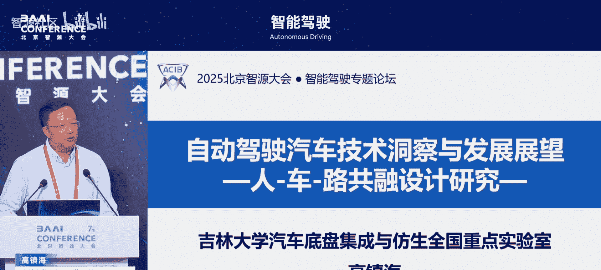
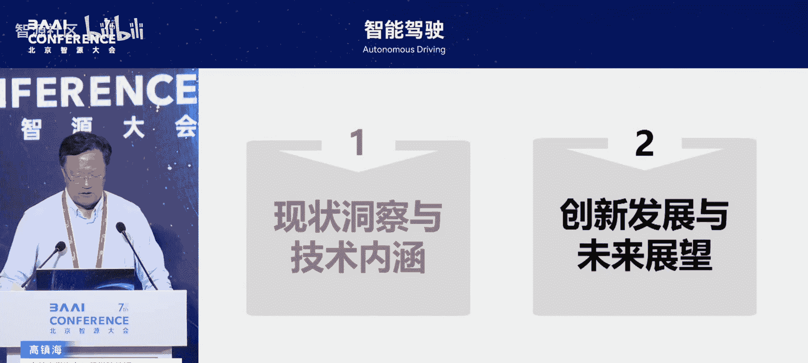
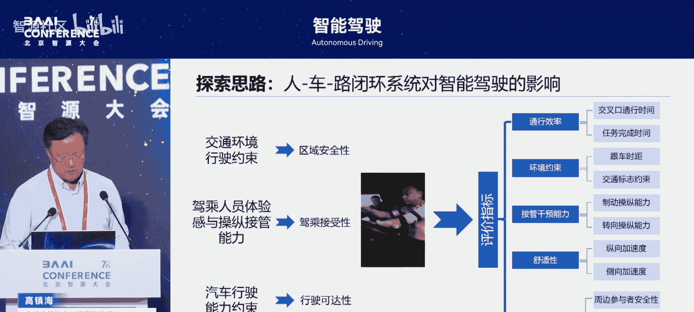

# 2025北京智源大会-智能驾驶 p02 自动驾驶汽车技术洞察与发展展望：高镇海 -BV1JWNtzuE57_p2-

谢谢法主任的邀请啊。今天那个难得有机会。我正如刚才那个黄老师说，我是来自于纯粹的车辆工程专业。我是我从入学开始，0从90年入学的时候，就在吉林工业大学的汽车辆工程。但是我们确实在思考AI来的时候。

数字智能来的时候，汽车未来要怎么去发展。所以可能我今天讲的还是站到车的角度讲，我们去做。所以我写的题目是自动驾驶汽车的技术洞察，我站在车辆工程，我就说站车上，我们就怎么去理解自动驾驶。

然后也结合我们团队在数字智能技术上一些研究的进展，给大家做一些分享和展望。我下面写一个副标题。因为所有的汽车到最后，无论是所有的机机械吧，运载机械到最后都是人车路的一个共融设计与控制。

所以我们团队在我从990年读本科开始，94年读研究生开始，我们一直在做人车路闭环系统的设计。所以我们从共融事业角度讲我这做。首首先因为。

现在我是0我从08年来学院工做相近24年在学院做副院长院长做了16年。但是我们在我们国种实验室，我做了已经啊接近25年了。在我们的实验室。我所以说现在我想介绍一下我们实验室。

我们实验室是我们最早是1955年，我们组建了长城汽车拖拉机学院，也是中国第一所围绕这个车辆行走机械做的专业的高校。然后1986年呢，我们组建了中国第一所汽车学院，当时叫吉林工业大学汽车工程学院。

然后我们在1988年也组建了中国首批的汽车领域的全国重点实验室。那时候叫我们最开始的名字叫动态模拟，就是汽车动态模拟，国家重点实验室。但是2022年迎接整个科技部科科技体系的改革。

我们重组为全国重点实验室。我们重组的时候，当时就想我们希望我们聚焦到什么地方去。我们把我们所有的点聚叫它汽车底盘上。我们有中国第一个。汽车工程铝的院士，也是我的老师顾委会院士。

同时我们一直在想百年的汽车师。刚才黄老师讲，百年的汽车师，几乎所有的汽车原创性的设计理论，实际上都是源自于海外。所以我们希望把仿生的概念引入到车企的设计概念来来重构底盘性的原创性的综合引领性的设计方法。

所以我们去跟仿生领域去做公关汽车的底盘集成开发跟仿生开发。我们瞄准了船油车、商务车特种车三类车这么去做。我们现在也在研究上天入地下海的车怎么去做，不是光路面上公路上这样的车。然后我们去研究从汽车的设计。

到汽车的运动控制，到汽车测试评测试评价，整个全生命周期的在做研究。这是我们实验室一个简况吧，然后想跟各位同事们分分享的是今天我的两个自己的观点。第一个是线控的洞察，跟它的技术的内涵是什么。刚才几位老师。

两位老师也都说百年的汽车师，实际上从1886年开始诞任第一台汽车的时候，所有车车辆工程专员的人都在研究驱动制动转向悬架轮。轮胎座舱整个结构的探索，就是近百年大家都是探索汽车机械的结构怎么去做。

包括从告别的马车蒸蒸汽走到了内线机加机械这样时代。然后呢，实际上从上世纪二战前，现在一战的时候，大家就在这讨论电子化怎么逐渐加到车上去，产生了机械流水线的制造，开始了机电业，实际上百年汽车史就是机电业。

只是进入本世纪以来，开始进入新型能源时代，进入了智能网联的时代。我们可以去看，从机械汽车产业的重大变革角度讲，从机械到电子到电动加智能，我个人觉得未来这20年30年应该形成AI汽车的概念了。

但这个AI不是指的是智能驾驶，不是智能驾驶本身汽车实际上就是一个巨型智能体了，就是人形机器人一个泛行的一个轮式的带有型运载功能的这样一个机械了。我们正在去想驱动制动我们。

现在自己的团队在研究每个驱动单元，制动单元实际上就是一个小的智能体。区域制转钱核桃系就是一个大的智能体，怎么去做这样子。然后呢，我觉得现在看智能电动来了之后，代着汽车最大的改变是三个改变。

第一个是从结构上原来的结构是从于内烟机的底盘开始，我们去研究动力传动、发动机变速器，然后从然后离合器传动器，然后行驶的时我们研究转向盘啊，这些发动机什么这样子。我们走到纯电动汽车的时代。

是研究三电系统、电池电机电控。然后我们的整个动力传动是原来从用发动机变动器走到了用电池电电池、电机甚至112档这样减速机构来去做这样传动。现在看呢，大家都在研究滑板底盘。所谓的花面团。

我们给它定义就是分分布式电驱动的底盘。所有的整个动力传动系统都极控在轮端了。在轮端轮毂里面集成电机，然后把整个电池放到车架下车架下了。所以说未来的可控的自由度呢，我们可以去想。

每一个轮子就原来轮子只是一个转动，现在这轮子从一个简单的结构体走到一个功能体了。轮胎本身轮毂电机一个轮端单元本身就具备了转向制动驱动悬架的所有的功能，然后实现四个轮或6轮八轮之间协同的工作。

所以我觉得现在是引发了全新的设计理念的转变。这样。从智能化的角度讲呢，更是使得整个汽车产品的设计产生颠覆性的变革了。原来我们想象不到怎么能做AI式生层式的设计。现在汽车的造型已经开始做生层式设计。

我们应在也在探索汽车结构设计的生能化怎么去做。原来我们是靠近30多年，我们都走的计算机的CAE仿真3D就是3C的这样设计，从实施仿真到实时的迭代验证，我们现在开始研究全数字化的汽车是个什么样子。

甚至原来的汽车出厂之出厂之后，在设计阶段就决定汽车性能了。现在汽车能不能在整个服役过程中，整个汽车性能处于全生命周期的自我进化的管理，怎么去做。所以我觉得汽车就是一个持续进化的一个智能体这样子。

同时从控制角度讲呢。原来几乎所有的底盘电控是基于规则的，我们事先预设好基于典型的工放场景，预设好它的处理机制。我们来做。现在开始我们都在探索有知识加数据驱动。但是这里面一定要避免一些AI的幻觉。

胡说八道也是我们就要去做在机理的约束条件下，我们做数据驱动式的。我们来做规则的生成式的设设计。同时第三改变，我觉得从整个控制角度讲，在前5年所有的行业的各个媒体都在说软件定义汽车。

我觉得确实对软件确实使得汽车控制功能产生革命的改变。但是我觉得汽车的硬件结构决定软件功能的上限，就是汽车的结构，汽车的轮胎率就决定了汽车的稳定性和精止的区域了。软件只是使得我尽可能逼近这个区域。

尽可能达到精准的直线，其实呢就可能执行到这个区域罢了。但是我觉得在这个未来几年呢所有的控制，不能是单独做控制了，一定要走到机电液磁热升控，甚至跟材料的一体化设计，不能单独做控制来讲控制本身上的事了。

所以我觉得这个数字智能上带来，只有产生数字化的智能化的设计方法才能产生这样从变革上从思路上从模式上从难度上的改变，才能具备这样可行性了。第3个呢。我们今天是讲一个那个整个的这个智能驾驶，因为。

座舱我们团队也在做，但我今天不讲一个也跟黄老师，不讲一个座舱上的事，整个的智能驾驶。我觉得从底盘控制，从车从车辆角角度讲是什么概念呢？原来在做控制的时候，我们只能控制轮胎与地面接触那块力。

通过那块力的调整。因为空气洞力穴我们无法主动的调节，我们只能控制轮胎力，就是轮胎的这个六分力，6三项的三项的力跟，三项的那个力据。我们的所有的控制实际上是基于人眼的视野所能看到的。

但是现在智能驾驶来了之后呢，我们可以更大时空尺度。我们可以基于我们所有的车载的传感器，使得进一步从车辆从单纯的人员感知的视野范围，走到了单车感知。

甚至是维图莱的车电网感知的更广域的道路转况下我实现运动控制。同时呢所有的智能电动电底盘的智能电动化，使得我可以进一步的感知增强。我可以进一步产生更多丰富形态的运动控制的方法。

我可以精准的单独控制每个轮甚至控制每个车的区势转权的所有的结构。例度看我们现在很多车体汽车像跳舞一个样子。因为每个轮可以单独控了。每个轮曲势转权都可以单独控，它才可以产生这样跳舞。

甚至是可能先到泥地里面，它可以跳出来，蹦蹦跳跳的出来，产生脱困这样的行为。同时我们可以实现多车了。现然大家一直在说车路云，可以实现多车的协同控制，怎么去做，甚至我们在云端。

可以实现主动干预和远程的监控了。因此我觉得从技术内涵的角度讲，我们从车辆角度讲，我始能认为所有自动驾驶其实的技术内涵就是人车路闭环系统下的一个智能协同的控制体，怎么去做相当于把人的人类驾驶员。

我觉得现在的自动驾驶仅仅是一个自动驾驶的一个控制器，还真正没实现类脑智能和类人智能下的控制，怎么去做。相当于人的手眼角脑，它这个协同操控的一个功能，实现去人化的智能驾驶怎么去做来模拟人的眼睛和体感。

模拟人的心理脑的大脑的心理决策，模拟人的小脑对底盘的运动控制来去做这样的事。从人的角度讲，我觉得所有的自动驾驶，所有的那个智能驾驶实际上是操控的去人化。就是我们原来人坐在车上，主任务是开车。

现在主任务是坐车了，我要去享受这个车上带给我的这个乐趣，但是不是驾值的乐乐趣了。所以说但是要这样一来呢，我的系统要求我必须尽可能的实现或弥补或拓宽人的感知的范围。

同时也进一步能修正原来人开车时候一些能力的不足，它的行为的一些决决策的缺陷，最以后是辅助来的替代人去实现安全的操控。这个从人的角度讲，我觉得所以说现在说自动驾驶车对底盘的控制。

底盘的运动变得更加的苛刻了。因为人不开车的时候，他坐的车场感受就更直接了。这个车的行驶，必须我觉得很舒服。各种声音传的要很那个劲，我很觉得很浓郁，体验感特别好，所以对车的设计要求更加的苛刻了。我觉得。

从车的角度讲，我觉得所有汽车的控制，无论是自动驾车底盘电控都是感知决策控制的一体化的实现。设计的时候传感器、直行器控制器一定会站在一体化角度讲去做这样一个事。

我觉得所有东西实现了基于汽车的测纵锤的三项动力学和运动学，加上整个底盘上行驶跟整车行驶中带来的机械、电子液的控制，磁的控制、热的控制声的控制，它的一体化的设计。同时，这控制可以进一步的精细化的。

可以精可以精细到。十几毫秒内，我怎么去调控一个车的一个运动，怎么去做精准的去调控。同时我们还在很长一段阶段，还得利用人类驾驶员的特色，就是人车共驾的特色来实现人车人类驾驶员智能驾驶员优势的一个互补。

来确保行驶性能的一个最优化。当然从路的角度讲呢，我觉得原来我们在做设计车的时候很少考虑路。就是我们去研究车，只是的典型工况，只研究复杂的路况，包括摩擦系数这样子。现在我觉得确实从。

原来的对轮胎力的66项力的控制，走到了单车控制到智慧路的结合。我们原来只我我们在做汽车设计的时候，原来只研究地面力学。我们地面力学是研究轮胎与地面接触的微观的道路交通。

就可能就是一张B5指这么大的一个环境下，这个轮胎历史的汽车怎么走。但是现在呢我们可以从车与车之间通讯，车与路之间的通信，甚至云端之间通信，我们知道更广域的道路交通环境，我们来实施这种车路的协同控制。

今天大家都在讲车路云，我觉得车路云是单车智能与智慧云的协协同。我们原来可以提供更加丰富的交通出行信息，来，进一步拓展了单车智能的感知和它所有的控制的边界来做这样的一个事。当然了。

我回去实际上我在我们学校上课的时候，我也经常跟我同学说，所有搞汽车工程师到最后安全、节能、环保舒适是永恒的主题。我们实上到最后，但是现在我觉得还加一个高效通行，因为现在车变得越来越堵。

但是在人工智能的驱动下，怎么实现这种零的伤网，零的拥堵，零的排放，我们可以讲汽车能不能是一个净化器。变汽车变得就像一个大健康的一个载体似的，变得更加舒适，更加的健康是怎么去做？

这是我们搞汽车工程师的设计的目标。在这个目标下呢简单做一个小结。我觉得前面这个我觉得整个自动驾驶车。如果说我对它的技术洞察角度讲，我觉得是从单车智能走到车与X，就是人车陆营往整个信息的共享。

与智协同的智能出行上，它确实改改变了，或者是颠覆性的变革了。原来以人为中心去去控制车设计这个车。当然，原来我们最开始车的事业理念是车能只要能够走，是以车为中心。现在确实开始以人为本来设计这个车怎么去做。

整个交通关系全改变了。因此我觉得现在这阶段实际上是从就是刚才法官主任也说，现在是辅助驾驶，因为所有车现在应该都是辅助驾驶。但现在确实我们从学生研究角度讲。

是从现在辅助驾驶正一步步向真正实现去人操控的无人驾驶汽车进行发展。我觉得这是我们现在我至少我自己看来，对整个自动驾驶汽车的一个理解。在这个理解上呢。

实际上我想用后后面的10分钟给各位同事们分享想创我们在做一些研究上，AI赋能上我们做了一些什么事儿。

我觉得我们团队实际上从最开始做吉林工大的地面地面系统力取的时候，角度，我们就一直在探索。我们希望开展真正的智能汽设的设计理论方法的原始性、创新性的探索。我们希望开展人车路的共融设计与控制。同时。

我们现在确实在探索仿生开发的设计理念。我们实际上从传承我们最早的吉林工业大学的地面系统力学。我开始做硕士的时候，我的老师就李永洲人车路的闭环仿真。我们一直想探索智能技车的人车路闭环设计。

我们基于这个理论呢，我们开展分布式电驱动的整个的设计开发与测试评价。然后在这5年，我们重点工作就是人车路的供程设计与智能仿生。在这个大的体系上呢。

我们基本上探索思路是我们真正去细分一下的这个人车路的系统在原来汽车设计走到智能驾驶汽车设计时候带来什么改变了？交通环境给了我们带来的实际上是区域的行驶的安安全性。

人的监管能力和控制能力代表我的驾撑的接受性。汽车本身的能力，区域势转权的所有加速能力、减速能力制动能力转向能力，带来我的行驶的可达性。在这上面呢，实际上对整个智能驾驶从它的行驶安全到舒适。

到人的接管干预到环境的约束到通行的效率，来提出这些宏观性的指标。在这个指标上呢，我一个给各位同学分享，我们确实是现在从车辆功能角度讲。

这个车是否运动形态能够更加丰富。我们在研究分布式电驱动的这种底盘的设计理论到底是什么呢去做。我们希望瞄准这龙。我们说我们在做工程仿生的设计。转向系统，我们希望。四个轮之间怎么能独立转向。

就是全轮都独立转向之后，它运动血态完全是丰丰富了。一个轮能不能横着走，然后呢悬架设计能不能模拟马马腿的。减震的功能四个轮之间相当于形成一个互联，形成一个是纯电的互联还是电异互联来做这种动态烧扭和减震。

就是叫人坐的更加舒服。同时呢我们更加围绕汽车的因感感知我觉得我们没有做。但是从运动控制，我们一直想提决策与控制的一体化怎么去做。我们建立自己的运动控制服务的算法。来。

同时我们相对于开发形成我们自己的控制软件之后呢，我们在这两年重点的探索全国产新全国产芯片的预控制器的开发，怎么去做。包括跟东风长安跟仪汽，我们都在做这些研究。

同时我们原来汽车的所有控制实际上是基于模型的。包括前面我们很长一段时间，我们学生都在研究MPC也好，基于一个model的控制。原来汽车的所有控制基于车辆动力学模型，但是车辆动力学模型实际上在很多工况下。

精度很难达到实时控制或精准控制的需求。我们确实现在在探索在原来的知识和机理驱动下，用数据来建立。我们希望探索在未来5年能不能实现这种无模型的。控制怎么去做真正在数据驱动下的汽车的动力。我们去想人开车。

人的头脑中是能形成对这个车的运动控制的完全的理解。然后他去开这个车。但是现在智能驾驶，人不碰这车了，原来70%左右的建模精度加人的20%就能摆车开的很非常好，现在人不碰了。

原来的动能性模型还是70%的精度，你怎么可能去控制好这车呢？所以说在复杂工况下，我们希望进天这种数据的模型，我们去做这样的事了。同时我们确实在研究全新的底盘平台。我们可以看我们现在开发的平台。

从轮腿足铝提全地性的运动平台，轮胎的运动形态变得更加丰富，就是四个轮可以随便去转怎么去做。我可以想象中汽车想怎么走就怎么走。因为原来的机器人是可以想怎么走就走。但是车受它机械结构的约束。

它不可能随便的转，随随一个边的横着走，竖着走。但是现在我可以产生各种丰富形态的这种运动形态去做。同时呢我觉得车在开发过程中需要全新的设计方法。因此，我们确实猜从在研究多域耦合的仿真真析的设计方法。

研究原来的汽车所有的测试装备都是面向机械系统进行的测试装备开发。我们在研究整个三项的KCA实验台的全面升级版，是个什么样子。因此，我们在做从制动啊转向自己的仿真软件。

然后到自动轮到整个滑板底盘的测试实验平台。我们希望给所有的车体在面向自动驾驶运动控制的时候，我们提供全套的这样的设计的软件和硬件的工具链来干这个事。探索完车之后，我们一样去探索这个人。

我们现在确实在研究这个人的模型怎么去建。刚才两位主两位领导也都在说，我们也在探索在AI的驱动下，人的多模态的数数据，就是人的数的生理学带来的所有的状态信息的感知。

基于这种模型下去研究人的认知状态的交互与认证技。我们一再研究情感计算。人的需求的分析是个什么样子。基于人的需求分析，去看个性化场景下，从行驶到乘坐到信息的提供这个多维的驾驶行驶功能下。

怎么实现人机功能的主动调节，这是我们在主攻的事。然后呢，我们也在我们的驾驶模拟器上，我们实验室最开始我们郭老师管老师在做的时候，我们就围绕我们自己的驾驶模拟器。

我们做中国路况讲中国驾驶员的行为特性的分析。我们做的若干种自己设计的一些各一些各种典向工况和一些con case的一些长远向的工况，我们去做这样的分析，包括那个右侧这个图是我们突发一台车。好吧。

人在要碰撞的时候是怎么要去做，怎么去做B状行为这样是。然后我们去研究，实际上在前十年，我们一直在研究单车智能，我们把自己的辅助驾驶系统要做的更加好。在这个5年，我们在研究社会群体了。

我们因为现在的整个自动驾驶已经走已经走到从实验场已经走到示范，走到路上来了。这个路上来了之后，传统的方法，单从单车安全的角度讲是OK的。但是走到社会形象怎么去走。我们在研究这种。

高安全、高人员的接受性和高通行效率的群体智能协同交互决策怎么去做？我们去研究这种人的阻抗的模型，去研究车与车之间多车之间它的价值冲突，怎么去缓解这样冲突，怎么去做。然后呢，我们在5年前。

呃这个博士去年去那个那个比亚迪了，我们在研究。单车车来了之后，如果遇到这种两难工况，就像这种电车难题了，你必须要撞一个事儿的时候，你怎么去撞？你肯定在社会上你必须要产生一些这种两难的情况下，我们从。

底盘本身控制走到社会伦理学的安全角度讲，我们去研究两难情况下人的本能性的反应规律。就像这种电池难题是，你要装一个人还装5个人，你怎么去选择？我去研究人的本能性的选择下，怎么去做。

就是怎么避利驱害的原则是个样啥。然后我们同时在研究人的单体的时候，我觉得车给人带来的不仅仅是行驶的快乐，还子带来舒适健康。运动症是所有现在电电车发射线的一个非常大的一器，就是电车在加速时太快。

就实电电机的起步比这发动机的起步要快得多。所以说这种运动症的行为，我们去研究人的感知人体的感官充足的理论，去研究运动症的检测，要把运动症的程度叠加到我们的运动控制上往上去，使得我们的运动控制。

实际上能够避免或者减减缓人的运动症的发生的程度。同时呢我们在研究整个的行驶带来的人的隐性损伤。我们开车还行，所有的职业司机，出租车司机长途物流司机实际上都有腰间盘的。哎，这个里面啊OK嗯。

这个你看其实还有一分钟，你你提示我还有5分钟是吧？我去你是。反正时间长了，我还着急了。我们在研究这个人坐在座舱内怎么能实现这种大健康的这种概念去能不能缓解人的腰间盘的隐性损伤。就说现在大家坐这椅子。

实际上这个椅子我觉得特别不符合人人体工学。包括高铁上的按掌坐的椅子也是不符合人体工学，几乎对你的腰椎没有支撑力。这样的。所以说我们在研究怎么能够去缓解人的腰椎的隐性损伤。长途物流司机肯定有腰间盘突出。

这样好说，你怎么叫它缓缓解适当的缓解这样的事。我们在研究这种病变的机理，然后通过对坐姿椅子人际交互的调节，甚至运动控制的调节来改进这个事儿。但呢我们要干的事的时候，我们一直说我们研发我们自己的工具链。

我们形成自己的所有的数字学测评的工具。就是现在我们在我的实验室，我可以测试人坐在车上所有的数字数字的生理学的表达。从它的眼动的信号，骨骼、肌肉、脑见、心电、皮电甚他兴奋程度，我都会去测试这。

相当于我们在我们现在建立一个人机工血的实验室来做这事，包括它的热的舒适性，还有我们建立自己的人机交互的动态模拟器来进行这样的测试。最后实际上我们现在也在跟中汽中心中汽中心啊几个单位我们去研究路。

我们希望把交通环境进行场景化，希望把整个的中整个中国从高原啊，什么那个赤道第那个地带各个地方。我们建立这种无限场景的虚拟实验场。我们去构去构建所有的复杂工况极限临时工矿下的这种全地形的道路结构。

怎么去做。同时我们在开发自己的仿真软件。我们在开发软件的时候，人的模型我们建建完了，车的模型我们去建完了。

我们也在建立复杂的道路环境模型跟基于复杂的的环境模型下这种视觉传感器雷达传感器VV twoS传递在云端传递一些衰减。所有这些传感器的建模，我们也在做。基于这样建模呢，实际上后面我简单有三4个页的展望吧。

我我刚才一开始跟大家分享的说，我是来自传统车辆工程专业。但是现在确实确实汽车我觉得是一个伟大的一个高新技术的一个载体。所有从机械到机电业到信息物理融合系统，一个多学合交叉创新的一个最佳的技术载体。

也是所有的新材料、新器件、人工智能大数据。我这是所有的新概念在这里面都有一个应用的一个点。但是所有汽车是以还是为较安全节能环保舒适这个点，我们的团队或者说我们希望我们在车辆工程角度讲。

我们是以汽车加AI为核心。当然我们我们做车的人啊，我去瞄准了底盘的真正的生能式的AI的设计，跟趋势转权结构的一体化的控制，怎么去做。我们去研究制架的感知我们在做感知决策控制时候。

我们把它分为感知认知决策运控和线控5个环。解我们希望做觉感觉控的一体化设计，同时做人车陆云的协同智能的控制怎么去做？同时我们要去研究架乘体验感的数的生理学的表达语言的行为图谱的AI式的大模型怎么去做。

在这个基础上呢，实际上我们现在重点在做了如下的三个事。一个是我们是基于底盘的数字孪生。我们希望我们的底盘设设计，不仅仅在设计设计端来决定性能，希望走到全生命周期下，面向从设计到整个服役过程中。

全生命周期，因为底盘性能是在衰减的，轮胎是在磨损橡胶衬套也在磨损变得越来越硬，可能底盘也出现一些故障点。但是人判断故障上，人可能直观判断出来。因为职业司机坐在车上，一听呢一响，觉得拿车可能就有问题了。

那我们看智能驾驶怎么去做。所以我们觉得要接着出来底盘动态性能的演变和品质的退化机制，而建立底盘的智能运行安全的数字孪升的全息品牌，就是我们现在在主攻的这个点。

我们主攻的第二点呢也希望从单车只能走到车陆云上去，我们也希望跟我们的同学们一起来共建真正的基于人车陆云的智能驾驶的并行安全的。监控我们希望基于这种对法规的理解，对合情合规更加合合理这个基本原则呢。

建立智能驾驶的安全实施监控及云端的主动干预系统。就是如果好比像某个车企品牌的车，到最后要求人接管人又没接管，他要没有去进行主动干预的情况下，好吧，那你在云端能不能有个最后对汽车安全的一个保障机制。

相当于城市大脑来保障这个车有个最后的一个屏障，怎么去做，想要进行主动安全这样子。第三个呢，我们一样在线。研究人，我们研究人的大模型。

我们希望通过人的模型来进一步的实现整个的人车交互的设计与控制的自我进化。怎么去做？因为所有其实我说是以人为本的。我们要研究人车路的交互的意图，通过交互的意图的预测呢，我们现在也在研究基于这种。

基于这种视觉、语言和动作的大部分形况下，对人的数据驱动、场景生成、AI的认知，主动进化和学习进化到底怎么去做？最后一个，我们现在在建立自己的大的实验平台。我们现在通过学校。

我们希望把车、交通和城市合到一起，做成这种多域复杂的环境模拟。然后陆海空天多域的交通参与物的模拟。同时我们希望我们未来的模型，人的模型。

车的车的模型路的模型是真正AA驱动下的自生成和生成式的建房不是人手工再去建了，这是我们现在在做的事。最后我作为一个小解吧，我觉得从我还是想说从车的角度讲。

以智能电动为主要特征的新能源汽车开发面临着什么呢？简单化讲，汽车的电动化引起了整个动底的融合，引起了整个汽势转型功能的预控化设计和控制的完全的预控化，从智能化的角度讲呢，实现感知角色控制的一体化。

我觉得未来要去做。同时我更加想提，因为这样大家都做智能网联新能源汽车。我觉得未来十年的20年，汽车一定是个绿色可持续发展的车。比如汽车具备以人为本的功能，具备全新的运动形态，具备数字孪成的全全生命周期。

具备它的巨身智能体的改变，拒说车路云能的改变。同时。未来的十大里面，汽车一定会成为一个自学习和自进化的可持续发展的一个运动载体。这是我对汽车未来的一些理解吧。以上是我一些理解也希望大家能够在一起。

我们希望我们的目标，就是希望创建新一代的智能电脑底盘的设计理论与方法。我们提供核心总成控制软件和工击链。以上是我分享的内容，谢谢各位敬请批评指。

