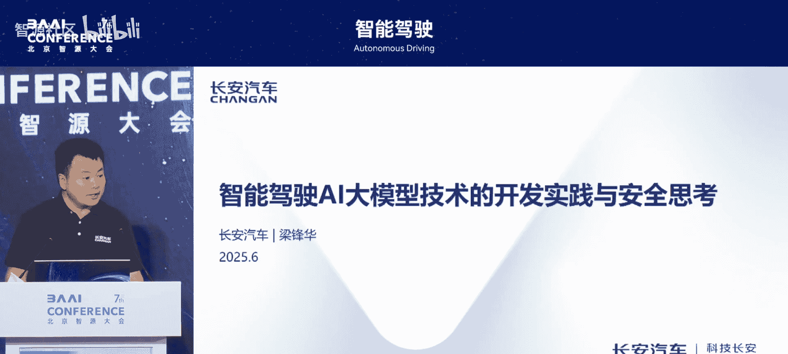
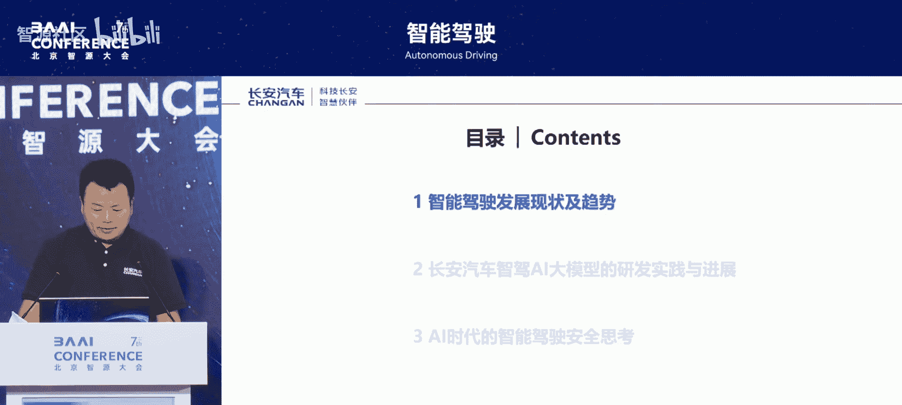
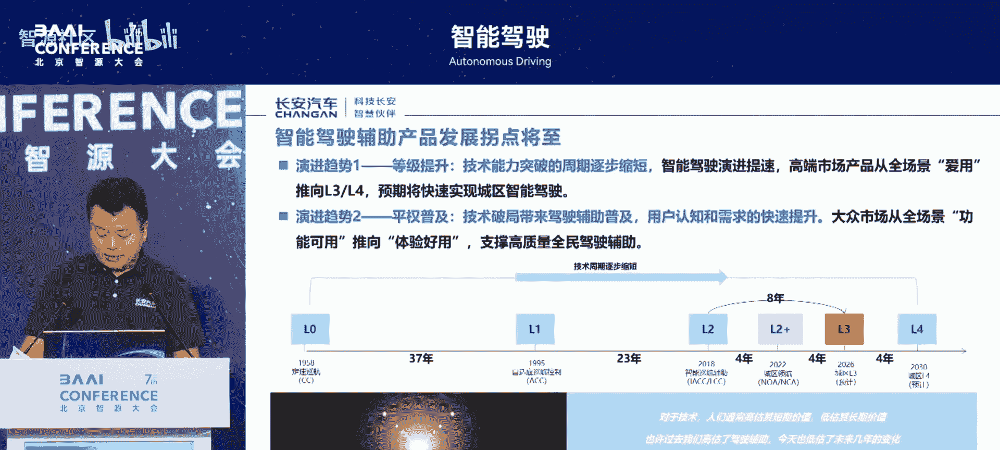
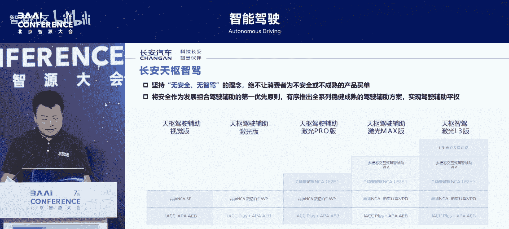
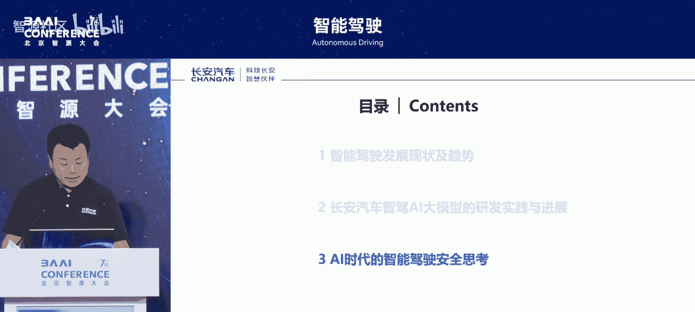

# 2025北京智源大会-智能驾驶 p03 自动驾驶AI大模型技术的产品应用与安全思考：梁锋华 -BV1JWNtzuE57_p3-

尊敬的呃黄老师呃，法问主任呃，各位专家，大大家下午好。呃，非常高兴有机会在这里。那么对呃长安汽车，那么在智能驾驶这个方面这个最新的这个工作和思考来跟大家来做一个报告。

啊，首先对于这个关于这个趋势啊这个方面的这个理解啊。那么第一个呢就是那么现在这个这个趋势应该还是非常的清晰啊，那么这个整个这个第一就是我们的这个支架的这个搭载率啊飞速的提升。

那么目前最新已经到超过了60%。那么同时呢用户对支架的这个呃认知度需求度啊，包括购买的意愿，那么也在呃也在持续的提升啊，而且这个从我们实际的呃实际的监测情况来看。

那么就使用户对这个支架的这个它尤其是使用支架之后，那么它的依赖度，那么是非常高的。就是说呃应该说呃。

真正使用支架之后的这个用户几乎没有没有回头的。包括一旦使用支架之后，那么他的用他基基本上会作为他购车的一个呃这个一个必要的这个决策选项啊，那么同时在这个对于支驾的这个安全这个方面。

其实现在呃也在逐步的达成一致啊，那么就是支驾将来这个它的安全对用户的这个安全保障能力到底要做到一个什么样的一个程度啊，现在逐步的应该在达成一致。因为现在来看呃至少肯定是在数量级之上。

因为仅仅是仅仅就是这个呃驾驶辅助啊，就是这个L2的驾驶辅助如果做的比较好的情况下，那么它已经是可以做到比一个普通的驾驶员，那么它的安全安全等级。呃。

整个这个安全保障能力要高一个数量高一个数量级的这个这个这个状态。那么预计接下来的这个自动驾驶可能会要到也许也许会到这个两个数量级。这样的一个这样的一个程度啊。啊，同时这个这个支架的这个发展的这个拐点。

那么这个也应该说以肉眼可见的速度在在接近。哎，那么现在这个迪呢就是呃这个我们从从过往的这个历史上来看啊，这个从L0开始最早L0开始，那么到L1到L2到可能这这个过程中。

大家也有很多L2的一些呃这个在场景覆盖上面有比较突破性的一些新的状态。再到L3呃L4等等。那么我们可看可以看到这个中间的这个间隔。啊，那么它是在呃持续的这个缩短。啊，那么这个那么依依据这个趋势。

那么走下去，我们我们认为可能呃呃2030年应该是这个L4大规模这个这个呃推广的一个非常非常重要的一个时间。哎，那么同时这个在这个支架的这个呃平权普及这个方面，那么现在也呃这个也是在快速的提升从。

前可能只有只是作为一个可能高端豪华的这样的一个配置。那么到现在这个几几乎到了一个全民的这个驾驶辅助普及的这样的一个状态嗯。

同时在这个技术演进这个方面，那么呃智能驾驶的这个技术。那么也从这个呃呃之前的这个规则模块化。那么像端到端的这个数据驱动来持续的这个演进。那么在之前时间呃这个很长时间呃，包括包括在当前。

那么它其实也是一个这个呃众多的这种不管是感知归控。那么呃小的这个呃相当然相这个是相对于这个大模型而言，它是小的这个呃深度学习的模块呃，再加上小的一些规则的模块。

那么这个组合成的这样的一个呃大的这样的一个支架的这个系统。那么现在正在快速的向这个端到端的这个数据驱动来进行这个来进行转变啊，但是呢整个这个技术的发展。呃，这个我们的理解啊。

它仍然是一个总体仍然是一个呃叠加式的发展啊，并不是呃简单的并不是这个这个颠覆式的这个发展。呃，包括比如说虽然说这个呃这个端到端，那么会成。为主流。但是以往的这个模块式的啊。

包括规则式的这样的一个呃技术的沉淀。它仍然是这个端到端发展的一个非常呃重要的基础。同时这个呃其实我们可以也看看呃可以看到行业实际上在支架这个方面呃，也是一个我这前总结下来。

实际上是冰火两重天的这个这个这个状态。一方面我们看到那么支架对用户的这个行车安全也起到了呃也在起到非常大的这个提升的这个作用。哎，这个比左边这个图，那么也是呃我们监测到的一些这个数据哎来看。

那么实际上当前的这个呃这个这个比较好的呃驾驶辅助系统。那么其实对用户的这个安全保障已经达到一个比用户自身的这个驾驶要高一个数量级的这样的一个状态。啊。

当然同时我们也可以也可以看到行业里面现在这个在支架这个方面也出现了非常多的这个这个问题。哎，当然我们追究原因的话。

就是我们觉得还是呃一方面就是这个在整个这个系统的设计这个方面还有非常多的这个呃完善的这个空间啊，包括这个安全和。用户体验方面的如何做好更好的这个呃兼顾啊，包括这个呃呃人机共架这个方面。

那么如何做好人机呃非更更加可信和可靠的这个人机共架。比如说这个在一些危急的这个情况下，你那么你的你的系统哎不能说哎只是把这个简单的把这个系统的控制权就交给用户。但实际上很多时候可能用户这个时候。

他根本来不及反应。哎，等等这样的一些问题都是需要同时还有更关键的一点，就是呃毕竟是加持辅助。但是呢就是说在呃我们的市场上我们可可以看到一些这个呃过度的宣传。

那么导致这个用户对这个系统它的认知呃产生了非常大的偏差。哎，那么这个从而进一步的导致了这个系统的呃这个很多的这个安全风险的发生啊。啊，当同时这个这个在呃法问主任的主导下。

那么最近最近几年我们也可以看可以看到这个呃这个围绕着智能网联汽车这方面的呃这个政策。那么在不断政策标准，在快速的呃这个完善啊，不管是L2的这个准入L3的准入啊。

包括最近的这个呃智能网联智能网联汽车组合价值辅助的这个呃安全要求啊，这个呃这个将来是准备呃作为强标，我们也可以看到这个安全要求呢，应该说呃在对我们整个行业我相信都会产生呃非常巨大的这个促进啊。

这个最近我们也在呃非常内部也在非常激烈的在呃讨论啊。啊，那么在这个我们在这个支架呃，整个支架这块呃长汽车在支架这个方面的这个发展情况。那么第一个呢就是呃那么从2017年。

那么长汽车开启了第三次的这个呃创业啊，我们叫创新创业的这个计划。那么同时在2018年也发布了这个北斗天书的这个智能化的这这个战略。那么呃总体上，我们在不断的加速向智能低碳出新科技公司来进行转型。

那么在北斗天书1。0的这个阶段呢，那么我们应该说取得了17个的这个里程碑式的这个节点啊，包括我们这个呃这个呃牵头制定这个呃汽车驾驶自动化分级的这个国家标准啊。

包括这个我们之前在不管是在技术呃智能驾驶的这个技术的这个储备，还是在这个量产啊这个方面都取得了呃一系列的这个呃突破啊，那么所谓的突破，实际上很多的时候，是以首发的呃这个方式来呈现啊。那么同时这个在2。

0呃，这个我们在今年也发布了北斗天书2。0的计划。那么这个2。0那么我们是计划在未来累计要投入2500亿元来构建以天书大模型为核心的这个巨神智能的架构，从而实现呃智呃这个智慧大脑的不断的这个计化。

那么我们在内部有一个呃这个呃有一有一句这个slogan。那么就是无创无AI不创新，无AI不不长安。那么整个北斗天书这个2。0的这个计划。

那么它的整个核心还是打造一个真正能够不呃给用户带来呃这个更好的呃不无论是安全体验等等。这个更加智慧的一个一个呃这个类人的大脑。那么整个这个呃发展的路径，我们是呃全站自研和开放呃合作。那么两条腿走路。

那么既苦练内功呃，构建全站自主可控的这个研发系统。那么同时也也也和这个华为等等SATTST企业在内的这个支架合伙人那么深度的来进行合作。

那么也也在不断的把这个包括呃这个乾坤智能红木系统等这个这些这一系列这个比较好的这个技术，在我们的这个阿维塔深蓝等等产品上来进行这个应用。那么同时。我们也呃这个打造了智能汽车的超级数字化的这个平台。

我们叫天书架构SDA。那么实际上这个对对这个这个整个这个架构应该说对我们的整车的这个架构进行了重新的这个定义。呃，那么可能从之前那么整车的这个架构，可能大家呃理解的话。

可更更多的就包括就是呃大家想到的是包括呃底盘呃动力呃，包括车身啊等等内外饰等等啊，这样的一些架构的划分。那么新的架构我们把它分成分成6层。那么这个六层的话就是包括这个机械层能源层，包括这个意义架构层。

包括这个操作系统呃，包括应用以及这个云南大数据等6层呃这样的一个方式。那么同时我们呃这个也打造了这个这个面向巨深智能的原生的端到端的这个架构。那么这个面向未来巨深智能的这种内人架构。哎。

那么同时这个这个整个这个整个这个架构应该说我们是具有除了特斯拉呃以外的这个唯一的中央环网的这个架构，应该说是目前呃最先进的这个智能网联汽车的这个架构之一。哎，那么它总体的特点就是反应更反应速度更快。

安全容易更多。呃，同时集成度那么也更高。哎，包括这个环网架构里面就是这个我们这个呃出现了这个比如说哎即使是骨干网，那么出现了这个连接中断的这个情况。那么我们也是可以保证那么整车能够进行这个稳定的运行哎。

那么同时在天数大模型这个方面，那么我们引入具备世界呃知识的这个多模态的大语言模型。那么实现拟人的交互智能和进化智能。那么它可以像一位呃可交互可执行、可进化的数字司机，那么这个能够看得懂路听得懂话。

能够理解和思考，并且能够持续的进化。那么真正意义上实现呃执行的合一。那么它的终极状态是AI座舱和AI这个呃支架，那么融合的一体化的这个大模型。那么同时在硬件层面上。

那么最终我们也会走向这个参加一体的这个融合。那么同时也会将各类服务哎，包括这个司机管家等等来融为一体。啊，这个实际上最终是一个超级的agent。那么在这个支架这个方面。

那么我们坚持呃无安全呃无呃无安全无支架的这个理念。那么我们绝不能让这个消费者为不安全或者不成熟的产品来进行买单。那么我们也将安全作为这个发展这个支架，包括组合驾驶辅助的第一优先原则。

那么也在有序的呃推呃推出一系列的这个呃稳健成熟的这个支架的这个方案。那么最终是呃实现这个支架的这个评选。这里面当前我们把支架分成5个阶梯啊，包括这个呃这个天梭支架的辅助视觉版。

天梭支架的这个这个辅助激光板，还有天梭的这个驾驶辅助的这个激光pro版，还有max版以及激光的这个23版。呃，5个台阶，那后续整个这个呃这个整个这个支架的这个产品形态也会持续的这个迭代啊。

同时在这个端到端这个大模型这个方面，那么我们认为呃未来支架的未来一定是交互式的这个支架。那么呃因为这个支呃这个呃将来的这个呃支架呢，它不仅仅是安全的这个需要。

那么它也是这个用户反馈的这个反馈和交互的非常重要的这个通道啊，那么我们的端到端的系统和交互模型，我们会在信息更新上也会有这个快快慢之分，那么充分的发挥这个快慢系统，那么它各自的这个优势。

那么这里面比较快快系统，那么更多的来解决实性实时性的问题。那么这个慢系统。那么就是更多的来解决呃包括这个复杂复杂场景的这个判断啊，包括这个呃这个呃实现更好的这个驾驶员和这个和系统。

那么车辆和环境之间的这个这个充分的这个交互啊。同时这个呃在这个具体的技术方这个方案这个方面呢，那么总体上我们把端端端的系统会分为云端和车端呃，两个大部分，两个大的部分。那么这个云端的这个系统。

那么主要包括呃这个基于大模型的这个数据的生产，大模型的这个包括大模型本身的生产系统啊，包括训练部署评测等等，以及这个云端的智能体的这个系统，还有大模型的这种仿真的引擎等等。那么车端的这个端端端系统。

那么会包括呃那么车载的这个支架的模型，啊，那么也包括对应的一些一列的部署啊，包括这个感知归控一体化的大模型多模态的交互大模型等等，还有大模型安全的这个对齐的引擎啊。

以及对应的这个支架的软件的工程包等等嗯。那么总体上应该说是我们可以把它总结为叫呃云脑大脑小脑三脑的整体的这个蓝联动。啊，那么同时在数据侧呃，我们目前是已经建成了全链路的这个数据闭环的这个系统。

那么它会它包括数据的采集标注训练呃，包括这个呃仿真呃测试等等。目前的话每每天的这个生产的样本。呃，生产的训练样本是可以达到1000万帧。

那么到预计到今年底是可以我们是可以拥有一帧级别的这个关键的场景的数据积累。同时这个大模型的这个我们认为大模型的这个安全基础。呃，同时会依赖于高质量和多样化的这个数据的支撑。

那么是需要解决真实数据的不足和场景覆盖不不全的这个这个这个瓶颈。那么同时这个呃从这个我们实践的情况来看，其实这个这这里面比如说这个高质量的这个数据支撑。实际上高质量数据的这个背后。

其实首先是呃这个尤其是针对端到端大模型来讲，那么是高质量的驾驶行为，实际上这个实际上这个控制好驾驶行为，其实背后应该说其实是有非常多的呃恐活脏活和类活啊，包括我们的甚至包括为了获得高质量的数据。

那么从这个驾驶员的这个管理，应该说很多时候是非常严苛的这个管理选择管理，包括这个呃获得数据之后，那么呃我们也会有对应的一系列的这个不断但是现在也是在不断的迭代提升的这个呃这个引擎。

那么对这个驾驶行为的这个片呃它的片段。那么来进行这个呃来进行筛选啊，把好的选出来，把这个差的，要及时的把它剔除出去，这里面这里面工作具体的工作实际上是非常非常庞杂哎。同时在部署侧呢。

那么这个我们认为大呃端到端大模型还是需要与传统的这个规则系统来进行互补。那么从而形成AI的泛化能力加这个规则的确定性。那么双轨的这个安全的机制。

那么因为这个这个AI本身AI大模型本身它本身具有黑箱的属性。那么这个规则系统，那么它也是这个端到端技术真正实现落地的这个必必备的环节啊，因为这个是端到端是呃是可以把这个上线做的很好啊。

但是这个下线仍然是需要我们的这个规则，那么做好这个做好兜底。那么在这个应用侧，那么这个我们也呃建立了多支柱的这个协同的测试策略。那么和这个系统的性能安全的这个模型。

那么也充分运用这个包括重庆的这个8地的这个复杂的这个道路的场景啊，和包括交交通环境的这个场景。那么来持续的对系统来进行考验。哎，那么从而达成达到这个这个功能和性能测试内容的这个呃百分百分之百的这个覆盖。

但然整个这个这个覆盖，它那也是也是一个持续的这个挖掘风险场景，那么持续的来进行测试覆盖的这个这个这个过程哎。同时那么我们现在也。呃，构建了这个我们在这个AI大模型这个方面的这个呃内部的这个管理机制。

那么我们依据呃包括这个网络安全法，包括数据安全法呃等等一系列的法律啊，包括国家的关于大模型这方面的这个管理的规规定。同时也结合我们的这个实际的这个工程实践。

那么我们也制定了呃长汽车的这个AI大模型的这个安全管理办法。那么从管理层面来全面的呃落实这个AI大模型的这个安全主体的这个责任。那么整个这个整个这个管理办法。

那么是我们是构建这个网络与数据安全一体化的防护的制度和体系。这里面也包括这个数据安全呃，模型算法的安全服务和应用的安全，包括对应的安全评估安全的应急的响应安全的审计，包括安全的考核等等。多个方面呃。

当然整个这个办法，那么也是呃一方面它是保障这个AI大模型安全可控和业务创新，能够持续呃可持续的这个推进。那么同时。呃这个整个这个安全管理办法，那么也是一个持续的这个呃提升和迭代的迭代的这个过程啊。同时。

我们关于这个AI时代的呃这个。这个关于这个AI时代智能驾驶安全方面的一个思考，尤其是大模型安全的这个思考。因为这个呃这个新的这个大模型的技术。

那么给这个智能网联汽车也在不断的带来这个新的这个呃在带来这个用户体验持续提升的同时，那么也在带来这个新的这个挑战。呃。

这个其实这个呃这个过程呢呃应该说呃一方面就是实际上我们应该说也是有历史的这个经验可借鉴啊，就像当初最早这个深度学习刚出来的时候，那么大家其实也也有这样的一些呃担心。那么现在来看。

那么经过这这么多年的这个一个技术的持续迭代啊。那么另外一个呢就是对应的这个呃我们的一些呃管理体系啊，包括呃这个开发测试验证等等这个体系的不断的这个完善。

我们现在现在来看到就是像之前那么基于深度学习的这个像感知啊等等。那么们在我们的汽车上，那么已经已经得到了呃比较好的安全的可靠的这个落地。那么接下来。

那么AI大模型我相信也会呃经历，当然呃经历一个呃类似的这个过程。但是当然这个历史的发展，它也是螺旋式的提升啊。那么AI大模型，那么它也会有它也有AI大模型，那么更多的这个问题也需要持续的来解来解决嗯。

那么这个这个里面有几个方面啊，第一个方面就是关于模型的这个呃可解释性和问题的可追溯性。那么我们认为这个将来还是要建建立全始全生命周期的这个数据的这个监控。那么从这个运行，从整个这个运行数据的呃这个运行。

那么到整个这个呃呃事前事中事后，包括运营各个环节。那么都要对数据来进行全生命周期的这个监控啊，包括上传上传云端的这个数据的实时的这个呃呃监测和评估。啊。

那么从而呃力求这个实现全这个对整个这个模型的全生命周期的这个问题的可解释问题的以及问题的可追溯。第二呢就是关于这个这个呃测评的这个数据和场景的这个困境的问题。

那么我们认为呃这个一方面就是作为作为我们的这个我们作为开发主体，那么同是肯定是要为这个开发的这个结果来来进行负责。那么我们从我们自身来讲，那么是本身是需要来建立持续的建立和完善。

那么我们的场景库和数据库，同时我们也是非常期望。那么呃行业能够共建这个场景库。那么场景库和数据库，尤其是针对这个呃场尾场景的这个这方面的这个场景库和数据库啊。

那么能够建立常态化的采集和持续的呃场景重建啊，同时让整个这个行业的这个场景库和数据库。那么它的整个这个呃规模不断的提升。那么能够呃持续的覆盖。那么整个行业，那么所遇到的包括这样的一些尤其是长尾场景啊。

这个是我相信这个是对整个行业的这个快速的。发展，那么它是一个非常非常关键的这个助推。同时呃这个也是需要构建全面的车用AI的这个风险的管控管控机制。因为这个本身整整车企业它是面临着这个包括系统安全啊。

数据合规，包括呃伦理责任等多重的这个挑战。那么这个为了保障技术的落地。那么是需要从这个组织架构，那么包括技术的研发数据的治理。呃，合规的协同等等这个方面来建立这个呃不断的不断完善的这个这个管理机制。

包括我们刚才所讲的这个这方面我们的这个AI的这个这个管理办法啊，那么这个实际上它是一个它也是一个起步。那么后续那么也是在各个方面也是会不断的这个细化深入。那么让整个这个整个这个管理。

那么得到让整个这个AI的这个大模型呃真正得到比较呃可靠和安全的这个落地。当这里面也有很多建议啊，包括这个构建国家级的这个呃智能驾驶的这个数据的中枢平台啊，包括这个呃场景呃重构呃这个。

事故责任的这个框架啊，包括国家级的开放的这个测试场景库等等，包括对应的这个全生命周期的穿透式的监控等等。哎，那么最终我们还是希望能够和全行业一起。那那么能够呃持续的加速。

那么我们这个呃呃不管是支驾的这个AI大模型，还是我们整车的这个AAI大模型。那么能够成为我们这个汽车不断的转型升级，高质量发展的一个非常呃非常关键的这个助推。好，我的分享就这些。好，谢谢。

