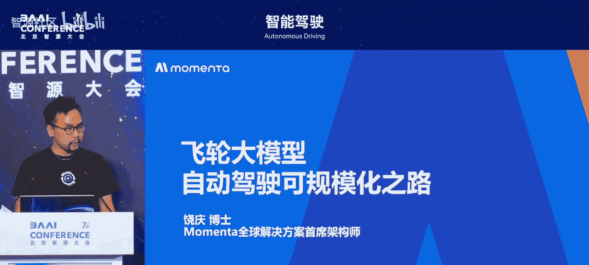
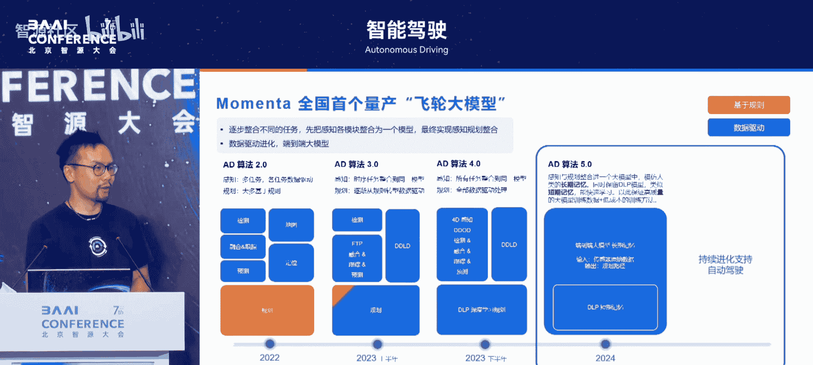
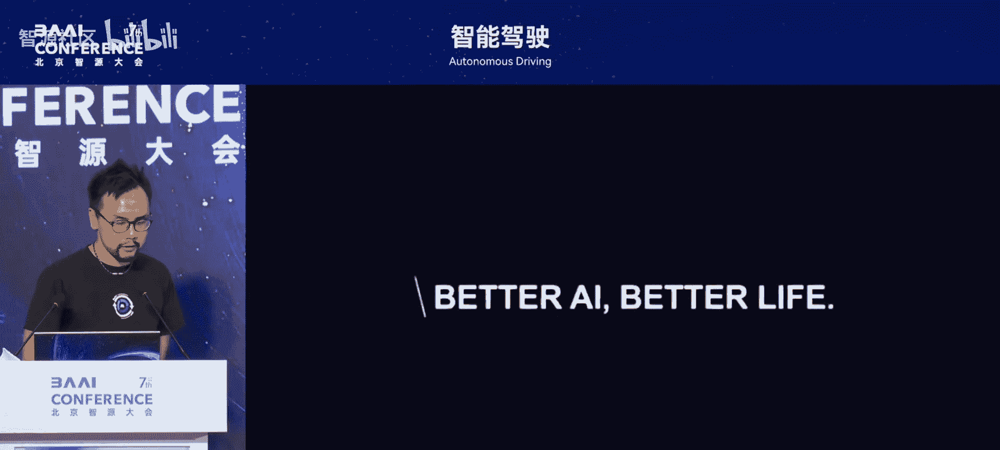
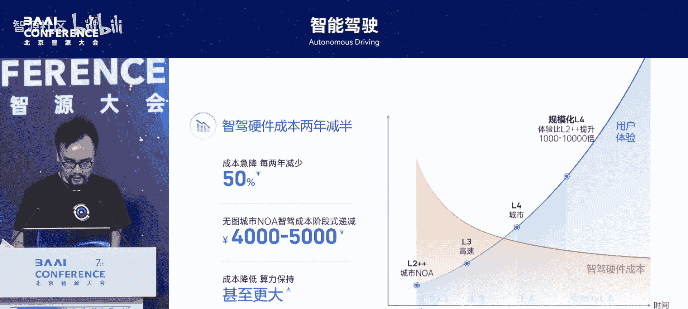

# 2025北京智源大会-智能驾驶 p04 自动驾驶的可规模化之路：饶庆 -BV1JWNtzuE57_p4-

嗯，大家好，感谢法问主任，感谢黄院们，感谢朱办方的邀请。😊，今天和大家分享的话题呢是自动驾驶的可规模化之路。呃，那么在我开始之前呢，呃首先和呃大家介绍一下我们公司的最近发展情况啊。

我们ta成立于2016年。呃，我们在2022年呃首个交付了呃基于呃我们飞轮大模型的呃第一款车啊，从2022年开始呢到2025年，我们陆续交付了30多款车。然后目前在我们的拍里一共有130多款啊。

呃正在交付中。嗯么呃从2023年开始呢，我们的车型也在国际上啊，在global有交付啊，在欧洲，然后今年的包括澳洲新西兰呃，以及呃全球的其他区域，都有交付的计划。嗯，那我们的战略合作伙伴呢主要是欧EM。

包括上汽通用奔驰丰田以及比亚迪。

呃，我们的文化是under promise over deliver啊，就是在和主机场合作的过程中，在做项目的过程中呢，主机场是看到了我们的交付能力啊，然后慢慢的变成了我们的投资人以及战略合作伙伴。好。

以上是简单的呃，公司介绍。那接下来进入我们今天的正题。呃，我们的目标是实现可规模化的L4啊，可规模化的L4是什么意思呢？它不是一个区域内的呃几十或者是几百台的robo taxi呃。

而是全区域都可以开的这个可规模化的L4。那么实现可规模化L4的一个具体的目标啊，这里有一个数据表就美国呃国家交通管理局的这样一个数据啊。呃，人类司机每100万公里会发生一次交通事故。

然后每1亿公里呢会发生一次致命的交通事故。那么实现可规模化的L4呢，我们需要比人类司机更安全的。自动驾驶系统啊呃那目标就是至少10倍于人类安全啊，这是一个呃必要条件，这是一个必要条件。

怎么样去实现这个十倍于人类的安全性呢？我们也简单做了一个测算。呃，就刚才说到的每1亿公里发生一次致命的交通事故，然后10倍于人类安全性。那我们需要看到10亿公里的数据。

但是呢呃我们每开100公里才能看到一次这种比较罕见的case。所以1亿乘以10再乘以100啊。那我们简单测算一下，就是需要1000亿公里的驾驶里程，才能解决这个真实世界里面的各种常尾问题的识别。

什么叫长尾问题呢？其实可以举个例子啊，我们去年呃刚开始做这个一段式端到端大模型的呃研发的时候呢，在清明节的时候也在路上去跑去试车。那么清明节咱们国家路边烧纸前啊，上面有火堆。那么看到了这个火堆的场景。

平时看不到的，这就属于一个常尾场景，当时测试的时候还比较紧张。因为我们可能训练数据里面都没有这个火堆的场景。但是车还是绕过去了啊，所以说明这个人工智能，或者说等一下介绍到的一段式端到端大模型呢。

它的泛化能力是非常强的啊。那么像火堆呀，然后像真实世界里面，还有那种卡车拖着树啊，然后或者旁边车道的车突然失控，caing到我们自车车道。像这种场景呢，我们都需要去识别出来，并且做这个安全的处理啊。

这样的话才能实现呃真正意义上的L4级别的自动驾驶。啊，那我们去解决这样一个常位问题呢呃有两个洞察啊。首先第一个洞察是必须是数据驱动。因为基于传统意义上的规则驱动呢，没有办法去解决所有的问题。嗯。

我们来一个case就定义一个规则去解决。那真实世界里面有成千上万数亿个这个case啊，不可能来一个case就重新定一套规则去解决，必须是需要数据驱动的。那么我们为此呢去打造了这个数据驱动的飞轮啊。

这里面包括三个因子，一个是数据驱动的算法，就是我们等下要介绍到的端到端的大模型啊，另外一个是海量数据，就是从真实世界里面量产车回流的海量数据啊，能够让我们看到各种各样的控case。

然后第三个就是闭环自动化的工具链啊，这个梁总刚才也介绍到了，我们在云端的工具链呢是需要自动化的去处理这么多的数据以及自动化的生成训练数据。然后去训练模型去不断的迭代模型，让模型的性能达到更高啊。

这是我们第一个洞察啊，需要数据驱动解决成远问题。然后第二个洞察呢也是刚才提到的啊，需要使用量产车辆去来解决。因为仅仅用L4的robo taxixi车队啊。

我们目前可能呃几十辆几百辆车队呢是没有办法去满足这个1000公里的驾驶里程的。呃只能通过量产。车辆的数据回流来去解决这个L4的超位问题。目前来说呃，我们在市面上已经超过30万的量产车辆啊。

我们假设每一辆车呢每年回流的数据有呃1万公里的话，那么现在呃估算下来，30万辆车乘以1万公里就是31公里的呃数据。然后我们预计在2028年的时候。

我们的装载这个moment解决方案的量产车呢会达到1000万辆啊。那这个时候呢能帮我们去实现这样1个1000亿公里的驾驶里程，实现可规模化的L。好，基于之前两个洞察呢。

我们公司是打造了一个飞轮两条腿的独特产品战略啊，一个飞轮刚才介绍到了，就是中间的数据驱动飞轮。两条腿呢，左边这一条腿是mas production啊，量产的辅助驾驶。呃。

这里面既包含了目前在市面上已经量产的L2级别的辅助驾驶。呃，后续呢也会提升到L3有条件自动驾驶以及L4呃高度的自动驾驶啊，这是我们的量产车上搭载的呃系统。

那么通过量产车的数据回流反馈给右边这条腿sable robot啊呃当然这里其实之前写的是sable robot taxi啊。然后我们现在呃把robo taxi换成了robo。

因为robo里面也包含了robo taxi robotbo truck和robo delivery啊，呃也是对应着我们公司的呃十年物流效率翻倍的这样一个愿景嗯。从量产辅助驾驶的数据回流到呃云端，然后呢。

我们去不断的迭代scalable robotL4级别的算法。然后呢，通过L4级别的算法更新，再部署到L2级别的量产车辅助驾驶车上，然后不断的形成这样一个闭环啊，不断的去提升咱们模型的呃效率以及性能。

能够实现可规模化的L4啊，这是我们的一个独特的战略。那么刚才也提到过啊，我们智能辅助驾驶的车型搭载量呢和交付量是一个飞跃式的增长啊。从2022年开始，我们交付第一款车型呃，经过了两年的时间。

我们搭载特辅助驾驶的车型嗯，是实现了10万辆的这样一个车型量。呃，第二个阶段呢，从10万辆到20万辆呢，只经过6个月的时间。然后第三个10万辆，从20万辆到30万辆呢，只经过3个月的时间啊呃。

这个车型搭载量呢是飞跃式增长。然后另外一边是我们成功交付的数量。呃，2022年第一款车啊成功交付到了2024年底，我们成功交付了26款车型。到了2025年4月份呢呃累计的定点数超过了130个车型。呃。

这样一个趋势呢，我们判断下来，也就是说我刚才所说的，到2028年嗯，大载模们它的辅助驾驶的车辆会超过1000万辆啊，这样能帮助我们去实现11100亿公里的这样一个里程。好。

那接下来是今天的重点啊呃介绍一下我们我们他的算法呃，眼睛的ro map。呃，那么算法呢这一张图其实里面有两个趋势。第一个趋势呢是基于规则的算法，慢慢被基于数据驱动的算法去替代啊。

基于规则的算法是橙色的部分。我们2022年交付的第一款车型里面还是我们的算法2。0。在2。0的时候呢，呃我们用了不同的小模型去实现不同的任务。像检测，我们用一个模型去做这个物体检测。然后之后呢。

用另外一个模型去做融合和跟踪。呃，预测又是另外一个小模型啊等等。不同的小模型。然后第二个趋势，刚才所说的是小模型逐渐融合成一个大模型。这里面有一个好处啊。

就是一个是说我们的算法的工程的复杂度其实是降低了。因为不同的模型呢，我们有不同的团队在维护。然后在维护的过程中呢，对模型的训练啊，对数据集的呃这样一个管理呢都是一个比较复杂的工程化的问题。

那么小模型逐渐融合成一个大模型之后呢，其实那我们只需要一个团队去管理一个模型啊，这是降低了这个算法的工程复杂度以及代码的行数，其实也是降低了啊，这是从工程的角度来去看这个趋势。

啊后另外一个呢是从算法本身的角度啊，那我们在3。0的阶段是第一个用深度学习的做的预测啊，这个3。0的时候是FTPfusion tracking prediction啊。

我们把融合跟踪和预测呢是做了一个融合，去做深度学习的pre。然后在AD算法4。0，就是在2023年下半年的时候呢，我们进一步把这呃规划基于规划的呃planning啊，基于规则的planning呃。

替换成了基于深度学习的planning deep learningning planningDLP啊，这个我们也是呃全球第一啊，当时特斯拉是FSD的V11在2023年下半年。那据我们了解到。

特斯拉的V11呢，还是使用的基于规则的啊这样一个规划算法。所以在算法4。0的阶段啊，我们是使用了三个呃比较大的模型啊。

一个是叫DDODda drivenri objectject and obstacle detection啊，这个是主要负责的呃动态物体以及这个通用障碍物的检测呃。

然后另外一个右边这一块呢叫DDLD drivenmark detectionDDLD呢是呃对静态的呃地标进行的一个感知啊，静态地标里面既包括车道线车道中心线道路边缘呃，当然也包括广义上的道路边缘。

比如说在这个施工场景里面啊，摆了一排连连排追同以及连排水马，这一块呢都是通过DDLD这样一个静态的模型来去检出啊呃值得一提的是DDLD呢，我们也是通过这个去替换这个高清地图的方案。

因为呃DDLD可以实时的在车端去生成高清地图里面，我们所需的呃。有元素啊，所以其实我们现在的方案呢都是轻地图以及无图的方案去做呃LR级别的辅助驾驶。就是算法4。0，我们用了三个比较大的模型。

其实用今天的话来说呢，就是这个时候已经是两段式的端到端了啊，呃，当然当时没有这个说法啊，所以202023年下半年，我们是这个两段式的端端端。到了2024年啊。

我们进一步的把这个两段式的端到端模型呢融合成了一个呃大模型。那么就是我们的AD算法5。0。呃，这里面呢其实我们做的工作是把BEV啊就是在DDOD和DDLD里面的BEV future generation融合到一起啊。

用共享1个BE back然后呢在BEV back上面去接不同的头部啊，不同的heads啊我们在BEV上面呢有DD有DL有这个通用障碍物的然后呢直接把基于深度学习的规划L的这个接到了BEV back上面那实现了这个感知和规划的一段是端啊那结合起来有什么好处呢？

那第一就是为什么大家现在都说一段是端端好因为其实它是把这个人为定义的感知和规划之间的接口给它去掉了，什么叫人为定义感感知和规划之间的接口呢？就跟我刚才举的这个火堆的例子啊。呃。

我们其实是没有明确定义火堆作为一个物体的。嗯，在4。0阶段呢，如果没有定义这个火堆的物体，那么感知就不会有火堆这个物体的输出啊，所以规划呢它不会接到这个火堆的物体。

那规划也不会去呃规划这条路径给它绕过去嗯，所以4。0阶段呢，我们对这些没有明确定义的物体啊，包括火堆啊，包括这个呃水坑，包括路上游洞，或者说突然山上掉下来一块石头啊。

然后现在其实跟L2的组合驾驶这个墙标比较有密切相关的。像路上的那种50乘50乘50的盒子啊，这个呢如果在4。0阶段，两段时段段的时候呢。

是没有办法去操作的那我们需要对这些小物体呢都要去明确定义它的物体类型啊。融合成一段式端到端之后，我们其实不需不需要去定义这个物体的类型。因为我们训练的方式是通过呃我们采集老司机的数据。

我们有这个有经验的人类司机，然后呢在真实世界路况里面去开，然后我们把他的轨迹去录下来。录下来之后呢呃作为监督学习的这样一个ground truth啊，作为监督学习的数据，呃，让模型去模仿人类司机的行为。

啊，这个时候呢我们在训练数据里面可能没有直接的火堆数据，但是呢有类似的啊，比如说它也有绕障碍绕通用障碍物，或者说呃路边有一些这个呃挡道自自车的这种小障碍物，那么可以让模型去学习这些人类司机的轨迹。

进而呢去让模型成呃形成了一个泛号的能力啊，那么这个上面呢，我们就是在5。0阶段形成的这样一个能力。一段是断到端可以去应对呃通用障碍物的这个这些危小物体。然后第二个呢是在复杂的路况下面。

在复杂的场景下面呢，我们对其他的交通交通参与者的交互。啊，是有一个明显的提升。呃，什么叫其他交通参与者交互呢，比如说在这个大路口。大路口中间，我们其实是没有明确的车道线的啊，然后比如说我要左转。

然后突然呢侧向又来了好多车。这个时候呢我们在感知和规划融合成一个大模型之后呢，我们可以去通过对向车流啊，通过其他的车流来判断哪些是可以行驶的区域，哪些是不可以行驶的，哪些是应该行驶的啊。

就是即使在没有明确车道线的情况下，我们也可以规划出一条路径来，然后甚至在这种比较复杂的博弈场景下呢，我们也可以去慢慢的巩过去啊，这个后面有视频可以给大家分享一下。嗯，那么这个是AD算法5。0AD算法5。

0呃，去年2024年呢，我们是9月份啊，后面陆续OTA给终端用户推送了AD算法5。0这样一个一段式的断端模型。然后接下来呢其实今年上海车展啊，咱们驱动也和大家分享啊啊，接下来我们是要加入强化学习啊。

飞轮大模型进化到。R6啊这个R6里面的R呢就是强化学习的reinforment learning。呃，我们在其他的领域，尤其是在自然语言处理领域啊，这个deep seek也受到一些启发。

就deep seek加入了强化学习之后呢，我们是能看到它对这个推理啊，对这个reasoning的能力是有一个明显的提升的。呃，我们在把强化学习应用到智能辅助驾驶这个领域的，它能带来的明显提升。

是让模型学习到思考的过程，而不是直接学习到一个结果。那么这个呢对一些呃比较难以解释的。因为大家说5。0的时候端了端了都变成一个黑盒啊，那可能有一些场景出来之后呢，我们没办法呃理解没办法解释。

那对于这些场景呢，我们是可以用强化学习的训练方式去给它抑制掉的啊，就比如说我们可以在真实世界里面去收集人类司机不好的行为啊，就像那种右转的时候压实线，或者说这个有时候呃呃它不好的行为呢。

我们可以触发把这些数据记录下来。然后呢把这个不好的行为。也未给强化学学习里面的这样一个呃word model啊，在这个里面呢，对它进行负反馈。那么这样呢，我们既有正反馈的数据，也有负反馈的数据。呃。

不好的行为呢就给他这个惩罚啊，好的行为就给他奖励。嗯，这样在云端不断的对这个模型做提升。我们认为呢他可能是能够达到人类司机的水平，甚至超越人类司机的水平啊呃，举个例子就跟。阿尔法故阿尔法过一样啊。

当时阿尔法够呢他是学习人类的棋谱啊，然后战胜了这个呃应该是人类最好的旗手啊，在跟李世石嗯。那个旗下完之后呢，呃阿尔法购跟阿尔法够啊之之间，我们让他自己去下啊，然后他自己跟自己下下完了之后呢。

他已经是超越了人类最好的骑手啊，我们是类类比于这个阿尔法够。

好，那接下来呃给大家看一下我们算法5。0在真实世界里面呃实现的一些效果啊。呃，我就由于时间关系，我就简单放几个视频。那么这个是对追筒啊，以及这个对象来车，还有呃道路本身的车道线是没办法看清的。

它是一个比较泥泞的泥泞的道路。呃，他也没有车到线，然后道路边缘呢也不太清晰。那么这个路边还有一条小洞啊，小可能是小猫还是小狗。然后路上也有这个水坑的这个反光。所以在这种复杂的小路呢，我们的5。

0啊端到端的一段时端端端的大模型呢是可以很呃很好的去应对，很丝滑的去应对嗯。嗯，尤其是在城市呃，这种小路上面呃，旁边有车挡路啊，然后我们也可以去借到对向车道。嗯。

在判断对向车道是绝对安全的情况下呢呃去实现这样一个四滑的通行。

这是一个复杂的避让啊。然后另外一个呢嗯ETCETC是现在嗯可能行业里面比较热的一个点啊，然ETC呢是非常复杂的一个工程问题。嗯，它包括在进ETC之前，我们要去识别这个哪一条车道是ETC车道啊。

然后进ETC之前呢，其实这个大广场上面呃，也是没有车道线的啊，然后也有很多很复杂的这个车辆交互。那么我们通过ETC呢，也是呃纯视觉的这样一个方案啊。

可以通过一段式的端端端大模型呢去检测到ETC的它的呃车道线呃，ETC的车道啊，然后去进入这个相应的ETC车道嗯。然后第二个是出收费站之后啊，出收费站之后呢。

我们也需要很快速的去判断这个呃哪一条车道是我们想想想进入的车道啊，可能他有时候马上就要呃选择一个高速。如果走错了的话，那又造成这个走错路，也有走很多弯路，而且出的出ETC的时候呢。

也有很多这个博弈的过程。因为它是多重多条道变成很单条道。那这个需要我们进行一个迅速的判断。嗯。然后当然第三个呢就是ETC抬杆那个本身啊，它的杆的形状是呃千差万别，它有这个单杆，有双杆，有时候也没有杆啊。

这个我们都是通过端到端大模型的能力去应对的。🎼好，那由于时间关系，我就可能再放一个视频吧啊，这个是车位正大广场嗯，车位到车位只能自主驾驶开始。🎼不。🎼第一个。

🎼车位到车位呢是应该是今年在市场上也比较火的一个呃这个新的feature新的产品。🎼呃，我们实现的方式呢是E问P就是在城市范围内的这个L2级别的辅助驾驶和LPNP啊。

在停车场内的记E泊车领航辅助给它做了一个结合啊，那么这样呢其实用户啊首先是他能够学习的范围是更大的啊，就比如说自自车的停车场呢，他可以自己先学一遍，然后把停车场里面的建图建起来。

然后跟这个呃L2的领航辅助驾驶进行一个结合啊，好，那后面我就嗯快速跳过了啊。诶。嗯。呃，这一页讲的是我们对中国市场发展趋势的一个判断啊呃智能驾驶辅助呢。

其实我们2023年就认为它是智能辅助驾驶的一个拐点啊，2024年变成一个引爆点。其实这个我们当时的观察啊，现在验证下来是正确的。呃，因为今年年初啊可能有比亚迪啊。

他也说这个全民智能辅助驾驶的这样一个呃口号，然后带起了这个智能辅助驾驶的节奏呃，甚至标配这个UP啊城市领航辅助的车型呢呃从20万的车型下探到了15万的车型，甚至呢后面会这个下探更多啊。

那么我们认为呃在后面啊就跟智能手机一样，它从2009年到2019年它的这个覆盖率是增长了5倍啊，然后电动汽车呢从2020年到2023年，它的覆盖率也是接近了5倍啊，那我们认为智能辅助驾驶的这个引爆点。

从20。3年开始嗯，到2030年也是会有5倍的增长啊，到到20230年年底呢会达到80%左右的这个市占率。然后它背后的逻辑是什么呢？这个是我们对市场的一个观察啊，就是智能辅助驾驶的摩尔定律。

然后摩尔定律呢分为两个，一个是软件啊，软件体验呢，我们认为两年是会提升10倍的。它这个背后就是一段式的端到端大模型啊，作为技术支撑，然后后面加入了呃强化学习之后呢，我们的体验是可以10倍10倍的提升的。

呃，10倍体验提升是一个什么概念呢？呃，可以举个例子啊，在两年前我们有客户来试乘这个呃来苏州去试乘车。当然呃我们的车也试乘，然后有商轮车也试乘啊，然后试乘完了之后呢，我们问客户的反馈。

他们觉得是焊流浃背啊，焊流浃倍开了自驾之后，可能觉得不太安全啊，呃比较比较恐慌。然后现在啊我们的客户再来试乘我们现在5。0的端当端大模型之后，就呃觉得是像滴滴专车司机一样啊。

滴滴专车司机一样非常的安全安心。那么再往后呃，我们认为这个是可以达到国宾级的司机的啊这个水平。国宾级司机呃，现状L2的这个城市认为到了2026年，我们是认为高速啊，L3的高速，以及呃到2027年以后呢。

实现这个L4的城市，它的体验是呃比现在的L2级别的辅助驾驶呢有10倍到1000倍的提升。然后到了2030年可规模化的L4比L2的提升是要1000到1万倍的提升的啊。然后另外一个呢是硬件成本每两年减半。

这个也是驱动全民智能辅助驾驶的一个前提啊，硬件成本的减半呢，其实也可以举个例子，在两年或者3年前啊，大家实现城市辅助驾驶的方案可能用两个欧 X啊，然后用好多个激光雷达用是一个相机啊。

这样硬件成本呢大概在15000到2万左右啊，这样一个硬件成本。这个时候当时还是比较豪华的车才能去装配这样一个呃城市辅助驾驶的系统。那么到了现在到了现在呢可能用一个orin X或者更价格更低的一些芯片啊。

像高通的8650啊等等。啊，就可以去实现L2级别的城市辅助驾驶。现在的成本呢可能做到8000到1万左右。然后到未来我们认为到2026年啊，这个成本会进一步降低到4000到5000。那么这样。嗯嗯。

就能够驱动呃标配城市辅助驾驶的车型的价格进一步下探啊，从15万可能到12万甚至更低啊嗯，我但是在硬件成本减少的情况下，它的算力是不会减少的啊，在同等算力的基础上呢，我们用更。嗯。

低廉的成本去实现更好的性能。这样能够驱动整一个呃整个行业的发展，以及整个用户体验的提升啊，让呃智能辅助驾驶呢变成一个全民化，呃，带给终端用户更好的体验。

然后最后做一个总结啊，我们认为能够实现这家摩尔定律，并超越这家摩尔定律的公司呢，能够成为卓越的公司。所以我们也希望和呃行业一起啊，包括当然今天呃和工信部的各位领导啊。

在遵守这个L2级别以及L3的法规的基础上啊，我们一起去推动智能辅助驾驶这个行业的进步，嗯，给用户带来卓越的产品以及卓越的体验。好，谢谢大家。

