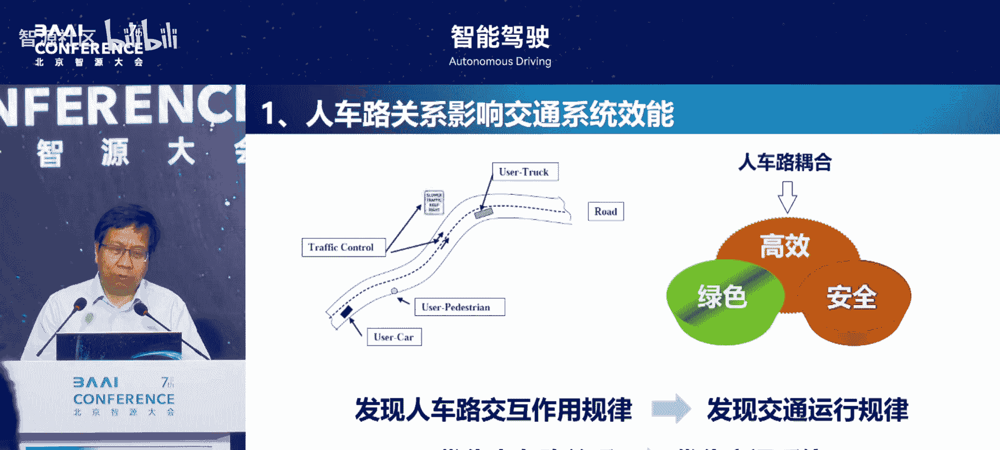
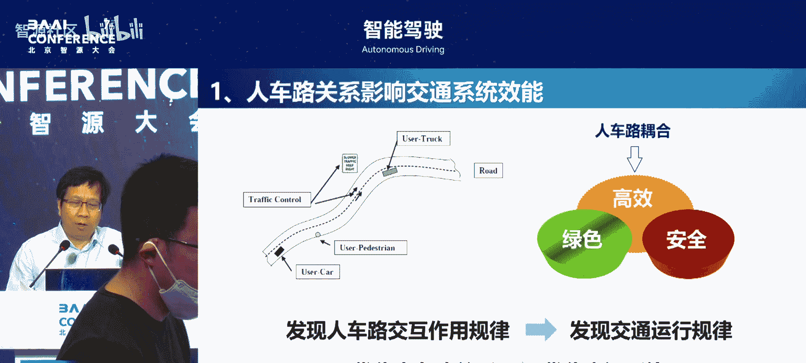
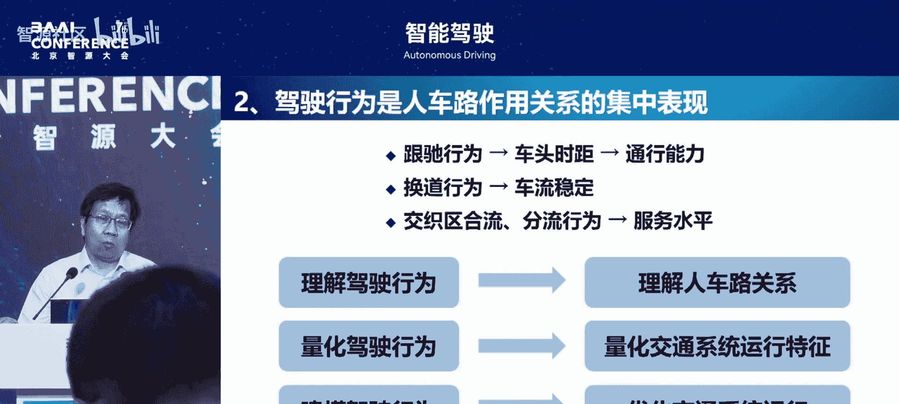
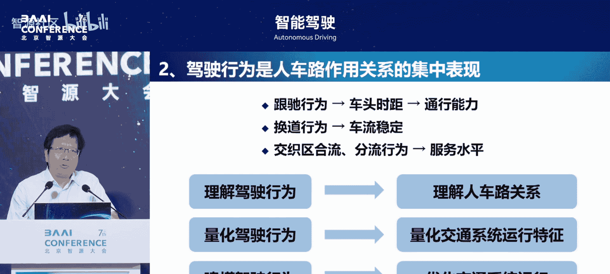
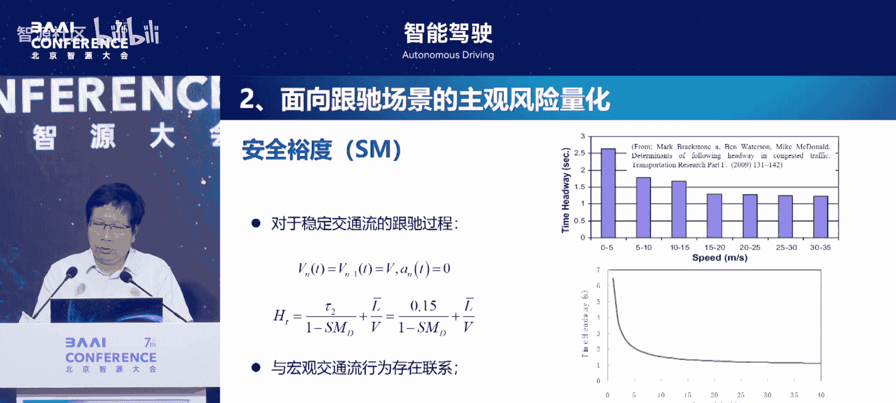
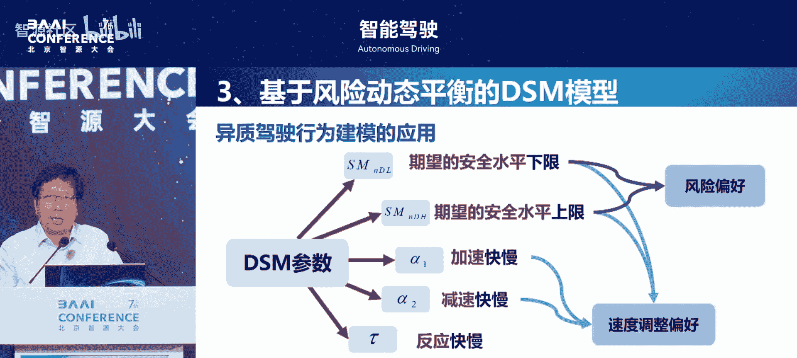
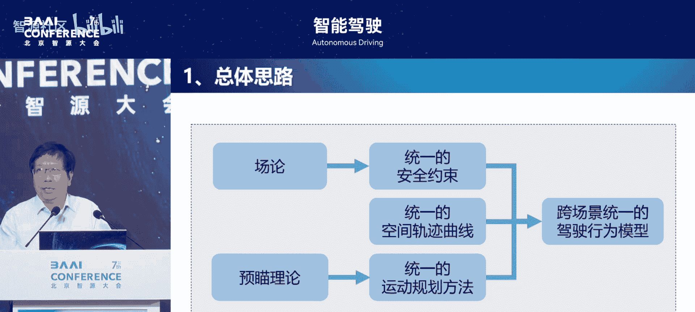
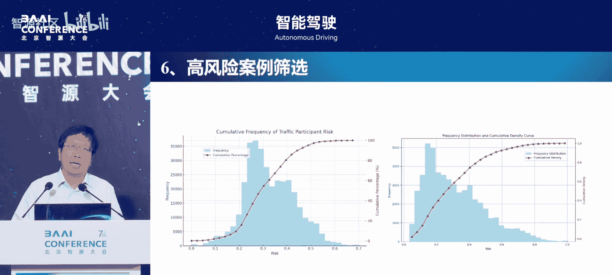
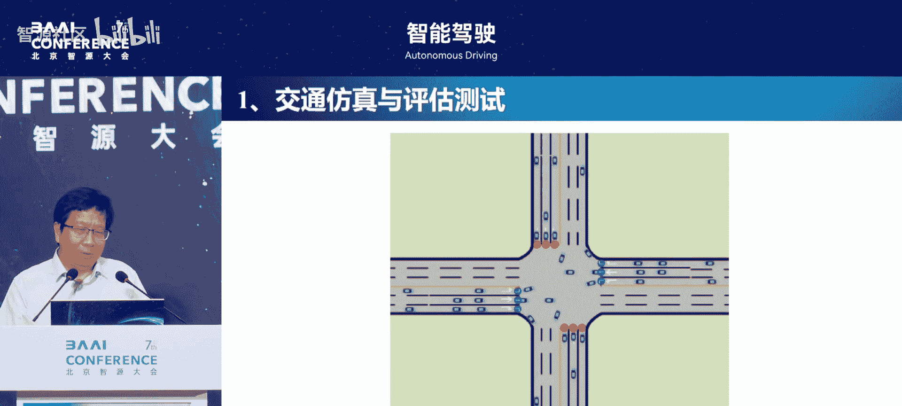

# 2025北京智源大会-智能驾驶 p05 基于风险动态平衡的驾驶行为统一建模：鲁光泉 -BV1JWNtzuE57_p5-

嗯，非常感谢给我们这个机会来这里跟大家分享一下我们这几年的一些呃在驾驶行为方面的研究成果。应该说驾驶行为呢其实是一个比较底层的驾驶行为禁模是一个比比较底层的工作。

那么也是跨越交通和汽车两个行业的一个底层工作。我从这么几个方面来给大家做汇报。首先呢我们说一下，其实我们整个交通系统，我是我本身是呃学之前学汽车，后来又学交通。所以的话在这两个行业里面都有影响。

所以我从交通的角度来引入汽车的一些问题。呃，我们可以知道我们其实整个交通系统在运行过程当中，始终呃要关注的一个就是人车路之间的关系，这包括我那么这核心的问题呢，就是汽车的在路上的运行。

我们所有的交通研究，实际上呃都去做一个事情，就是发现人车路之间的。

交互作用规律，发现交通的，从而发现交通的运行规律。第二个呢是优化人车路之间的关系，来优化交通系统。那么在这里面呢，驾驶行为是人车路作。

关系的这种作用关系的一个集中体现。我们所有的应该说在交通里面的宏围观现象。

翻到底层去都是驾驶行为。的一个集中体现。比如说我们的跟驰行为，实际上是跟我们车头实际的选择等等的。都有关系。那么这个就会导致我们整个交通系统的通行能力的问题，换道行为带来的交通车流稳定性的问题。

所以我们可以这么说，从交通的角度出发，理解驾驶行为是理解人车路关系的基础。量化驾驶行为呢又是量化交通系统运行特征的基础。静摩驾驶行为呢是优化交通系统的基础。

那么其实驾驶行为的研究可能在一定程度上出了交通系统在做这个方面的事情。最近随着这个智能驾驶的越来越发展的话，包括刚才高院长也在介绍，其实驾驶行为也是我们智能驾驶里面一个比较一项比较重要的工作。呃。

当然了，现在随着这种就是说呃以数据驱动呃，这个人工智能为基础的一些呃控制算法的发展，可能在弱化的驾驶行为。但是我们如果这真正能够把驾驶行为作为一个很好的禁模。

实际上我觉得我们可以在一定程度上呃解决人工智能里面一些不可解释性。问题就类似于我们现在说我们把天体，我们把太阳、月亮、地球这些运行轨迹都给AI，它是可以完全预测你将这个将来是怎么走的。

但是如果我们知道了它的万有引力的这些作用规律，那我更可以更方便的更简捷的。去计算或者是说推引他的将来的引发过程。我觉得驾驶行为也是这样的。

那么目前驾驶行为的禁模呢，我们认为存在几个问题，一个是模型的适用性问题。现在驾驶行为很多驾驶行为禁模实际上是不同的行为建立不同的模型，这就带来了我们不同的场景，带来了这种场景不断增加。

模型也需要不断增加。那我们有没有可能说用一个通用的模型去描述不同的场景。这是我们需要说希望去呃达到我们的一些目标。第二个是模型的可解释性？呃，驾驶行为禁模呢从几个角度出发。

以前呢有的用这种数据领合的方式。那么这种回归出来的模型呢，里面的各个模型参数与行为特征之间缺乏对应关系，这样就带来了我们的模式可解释性问题。最近呢随着AA的发展呢，很多人用人工智能的方法。

神经网络的方法来做驾驶行为禁模。那么这个呢跟你整个的行为参数和这个我们的模型参数之间的对应关系，更是缺乏这样呢也带来了我们的模型可解释性问题。第三个方面呢。

我们的一些行为特征和我们在在做决策判断的过程当中，包括我们的风险啊决策啊呃这个轨迹啊，是不是可以解偶。如果解偶开去的话，那么我们可做的事情呢，可能会做一些分布的计算。然后整个计算的压力会降低一些。

那么我们来给大家分享一下，或者汇报一下我们这几年在驾驶行为禁模方面的一些想法、思考和一些成果。我们主要是基于风险动态平衡这个理论来做驾驶行为建模的。那么首先这我说一个呃介绍一下风险动态平衡理论。

其实驾驶员在做他的操作决策的时候，它不是一个很客观的风险水平，它是一个主观的风险水平来做决策。那么在我们的风险理论里面有一个叫风险动态平衡理论。还有另外一个理论叫呃风险补偿理论。风险动态平衡理论。

其实是认为人在做决策的时候，他是通过长期的经营积累，在心里面有一个可接受的固定的风险水平。这个风险水平相对是固定的。而我们通过我们的行为调整，使得我们感觉到的风险。在我在我接受的这个水平上，动态的调整。

所以叫风险动态的平衡。

这个理论呢实际上在一些宏观事实，宏观现象里面呢得到了一些证实。比如说呃北欧有一些国家把这个。就是从左型换到了右型之后，他突然发现他整个的这种呃。就是事故水平降低了。

从而他实际上就是相当于人感觉到的风险水平增加了之后。那么通过他的行为调整，他的行为更保守了，导致了事故水平的降低。但是一年半半年一年之后，他的事故水平又恢复到了原来的水平。大家已经习惯了这个呃场景之后。

他实际上他的可接受风险水平是固定的。但是他感觉到的风险水平已经恢复到了原来的水平。所以这个理论能不能用在我们驾驶行为禁模里面，我们一直在思考这个问题。但是要用在我们这个驾驶行为禁模里面呢。

最核心的一个问题，就是说人是通过主观感觉到的风险水平做决策的。那我们人主观感觉到的风险水平。是怎么怎么去量化？我们得用一些可观测的数据去量化。所以我们在这方面做了一些呃尝试。

我们自己经历了一个量用可测的。风可测的参数来量化驾驶人主观感觉到的风险水平的一个指标叫安全意度。这里面呢我们最开始的时候是在最简单的根驰场景里面做了这个事情。

那么我们在做完这个呢发掘这个指标跟现有的一些安全评价指标相比呢，不同的人在同样的交通环境下根驰的过程当中，它能保持一个基本的不变的量。

实际上我们这里面核心我们就是能够想去找一个驾驶人在做操作决策过程当中的一个不变量。如果我们能把这个不变量找出来，我们觉得我们整个的行为建模会简单很多。所以我们构建的这个模型，我们做了呃大量的一些。测试。

比如说我们用不同的驾驶员来看，大家可以看下面这个图，这是。就是下面这个图啊，我们把9个驾驶员在不同的不同驾驶驾驶环境下开，那么他整个的安全一度水平是保持基本不变的。这样的话在这基础上呢。

我们我们再看一下下面这个表，你看在不同的车道上，不同的同不同的人在开，他在跟车的过程当中，他的整个安全水平基本是保持不变的，就是不同的人。呃，在相同的环境下，这是这是中间车道和边上的车道。

不同的车道基本上是保持一定的水平。那么有了这个水平之后呢，我们再看一下，如果我们把这个呃安全裕度，我们把它换算到跟驰过程当中的车头实际，那么和车头实际的分布也有很好的吻合。

所以在这个基础上的话，我们实际上相当于我们能够找到一个在跟车过程当中一个人们衡量风险水平的一个不变量。如果有这个不变量了之后呢，我们可以根据这个行为补偿理论来做一个简单的跟驰模型。什么叫什么行为补偿呢？

就是我的安全我感觉到的风险水平，如果高于我接受的风险水平，那么我的行为就要趋于谨慎，趋于谨慎干什么事呢？谨速，如果我感觉到的风险水平低于我接受的风险水平，那么我认为这个风险水平过低了，我要加速。

那么基于这样的话，我们用一个简单的刺激反应模型，用5个参数来描述了我们整个跟驰过程的一个行为。那么这个五个参数呢？分别是。风行水平的下限风行水平的上限，就你可接受的期望的风行水平的上下限和上限。

另外的话，加速的快慢。我们把它叫加速敏感系数，减速的快慢，减速敏感系数，还有人的反应时间。所以整个模型的话，从风险偏号和速度调整偏好两个角度，然后每个参数呢对应着我们整个跟车过程当中人的一些行为特征。

这样的话整个的可解释性比较好。同时的话这几个参数，我们其实在可以用人开车过程当中的一些实时数据很快的把它警测出来。所以我们就能够说根据人的开车的数据来标定出我们的这个跟车跟驰的这个啊参数。这样的话。

如果我们做一个唉全呃一个ICC用这个模型的话，那我可以说唉你原来是一个比较风风险偏号型的人呢，那么你整个的这个车用你的参数来做控制。那这个车开出。出来的水平和你的。和你的期望是一致的。

这样的话会给大家带来一些很好的体验。

这我们之前做过一些测试，这是大概十多年前了，我们就做过一些测试。后来呢也被一些人用在了做这种呃自动驾驶的车辆循环公况测试啊，做背景交通流啊等等。我们不展开了。

那么刚才这个呢实际上只是在一个最简单的一维的根驰条件下做，我们实际上实际上很想把它扩展到二维的环境下。但是二维的环境下是啊，其实跟一维的环境下有很多很多很多的这个呃差异。

这是我们哎这篇文章其实已经录用了。在我们可以看出我们做了一个参数参数和刚才一维情况下是一样的。然后我们可以看出，我们的这个风行水这个二维的安全易度，在整个驾驶员在制动过程的。

它的这个制动加减速操作和我们的。这个风神水平的量化具有极高的相似度，极高的相似度。当然它会有一个这个反应时间的之后，这是我们在做了这个。但是呢它整个的我们感觉它的普实性还不是那么强。

所以后来我们在想我们能不能找一种更普实的把驾驶行为，在不同场景下的驾驶行为，能够用一个模型来描述清楚。所以我们做了一个基于产论这方面的描述。那么这里面呢我们考虑几个，就是我们在开车的时候。

一般是有一个安全约束，还有一个就是轨迹规划。那么两个方面，我们能不能用统一的模型去描述。所以我们从这里面呢做了几个，一个呢是我们用产论的方法来描述统做整个行车过程当中的统一的安全约束描述。第二个呢。

我们做了大量的调研。我们企图用一个统一的空间轨迹曲线去描述人们开车在。

不同的环境下，包括左转，包括右转，能不能有一个统一的模型去描述这种呃空间的轨迹关系。第三个呢，我们用育苗理论来统一了我们整个的运运动规划过程。从而我们建立起一套就是说跨场景的统一的一个驾驶行为模型。

这是我们来说的，那么我们首先我们定义了一个。

对安全对运动约束的安全约束的模型，我们把它叫做我们风险场。当然从产论的这个角度啊，之前就有好多人做过很多研究来做我们的。但是呢我们发掘很多研究呢。

它不太适适用于就是不符合我们之前讲的那个风险动态平衡理论。那么如果按照我们的风险动态平衡理论，就是说我们每一时刻感知到的风险要和我的期望风险做个比较。如果这个风险高了。

那我就是要把我的行为趋于保守或者制动啊或者找一个更更风险更低的点去行驶。如果风险低了呢，那么我要趋于我的行为要去于我的这种更冒险。但是所以的话我们自己进了一个呃新的风险的量化方法。

那么风险的这个量化方法呢，我们基于这几点考虑。一个如果一个时空里面被。任何一个物体占用。那么这个空间对于其他来说，对这对于其他来说，在进进入这个空间的话，对别人来说就是风险就是一了。

相当于我们把风险源和受风险影响的对象给它分离开来。那么风险源占有的空间，别的风别的物体是不能再去占有的。如果他要再去的话，那么对别的物体来说，它的风险就是一了。然后的话我们以这个。风险源为中心。

把这个蔓延开去。所以的话在这里面呢风险产中风险最大值是一。那么对对它风险源对周围物体的或者是周围运动的影响约束呢，它是随着它离这个风险源的距离呃降低的。这就是我们之前呃我经常给大家讲的。

就是说我们在我们在开篝火晚会的时候，大家抬着火把去跑。它不会跑到火堆里面去。但是呢他也不会留离火堆特别远，它有一个适当的距离，而这个适当的距离，就是他心里面的那个风险水平。

然后呢他也不会和抬着火把的人转上，他会预苗它的所每个时刻占有的位置。然后的话离着一定相对的距离。那么这个距离的远近，也就是他可接受的，他期望接受的风险水平。这样的话我们来做一些。

把风险云和风险的作用对象给分开。同时的话，每个风险云它产生的风险，对作用对象产生的风险。每个作用对象可能有不同的风险人对他产生风险。那么这些风险人呢有一个叠加方式，有一个叠加关系。那么叠加的影响。

这种叠加的影响呢，我们用做了大量的研究，认为采用最大值取最大值的方法做叠加影响是比较合适的。这样的话，我们这个统一的安全风险约束呢，我们从运动物体开始。那么运动物体的对周围作为一个风险源。

对周围物体的影响呢，它主要是两个方面，一个是对周围空间产生的这个风险呢，一个是这个空间点离我这个物体的距离，另外一个呢是我这个物体运动的运动的速度。因为每一个物体运动速度越大的话，它不稳定性就越高。

那么它对周围的影响就会产生越大。这样我们尽立起一个运动物体的风险场函数。同时呢这个风险场函数呢需要考虑物体的形状。那么物体的形状在我们在交通里面呢，重点考虑了它的这种叫就是车辆的形状。

就是按按这个矩型去考虑。然后的话矩型区去考虑。当然你也可我们也可以把它呃换算成一些一个点，一个点一个点的叠加。所以的话实际。那任何一个形状都可以在我们这里面得到了一个很好的体体验。这是一个。第二个呢。

我从两个方向上做变化。然后的话做叠加。但是我们在叠加的时候，刚才为什么说我们不同的风险源对同一个物体，同一个空间位置产生的风险。它的叠加取最大值呢。那么我们最做一个最简单的做了一个最简单的这个思维实验。

就是我们有一条护栏是一个固定风险物。比如说这个护栏是10米，那么它对周围产生的周围空间产每一个点产生的风险，应该等于把它截成5米的两个护栏产生的风险。那么通过这种实实验的话，能发觉。

那么你取最大值的方式是比较好的。那么如果有有了这种动态风险的话，那么动态风险把它速度取为零的话，就实际上就静态物体的风险。所以我们在这里面呢，实际上我们在开车的时候。

有的时很多时候实际上是不需要知道我周围的这个物体到底是什么的。我只知道知道它是一个障碍物就行。另外一方面呢，我们用同样的思路来构建这个信号灯对人的运动约束也是一个风险。

那么就是相当于信号灯在停车线那产生一个虚拟的物体，这个虚拟的物体呢会随着信号灯的变化而变化。那么这里面变化比较比较难的呢是黄灯期间，因为红灯期间它风险为一，这个大家可以认可的。绿灯期间风险为零。

但是黄灯期间我们都知道黄灯期间车是可以走的，黄灯期间车是可以走的。但是黄灯结束的时候和黄灯开始的时候，车越过停越过停车线的这个概率是不一样的。那么我们在大量的数据的基础上呢。

解决这个黄灯期间这个风险的问题，它是一个竞变的。那么它同时呢要和绿灯期间和红灯期间的这个点要有连续性。这样，那么具体的公式和具体的思路，我们就直接就因为时间关系我不展开。这样的话。

我们把运动物体固定物体信号，甚至说我们将来的这个标志标性，我们可以做统一的就是用一套完一套完全一样的量化模型来做我们的这个来做，就形成了我们每一个物体在运动过程当中，受到周围物。体影响的一个风险约素。

这就是我们所做的。那么在这里面呢，有几个参数我们需要标定，就是我们做的这个模型，因为是描述人的嘛，所以我们需要标定说这个模型的一些参数怎么标定？我们用了两个比较特殊的。东西去标定它。第一个呢就是。

停车时候，比如说跟着车前面的车停了，我后面的车也跟着停。那我为什么停在那个位置？我为什么停在那个位置？因为那个位置恰好是我心里面期望的这个风险位置不高不低。这样的话我们就用这个停车的时候。

平均的车距来标定了这个风险场离我这个风险源距离的影响的这个参数。第二个是速度的影响。速度的影响呢，我们用稳定奔驰的这个参数来标。那么我们可以看一下，这个是大量的这个稳定奔驰的数据。

从不同的车不同的速度下，它有不同的车头实际。那么我们根据我们之前的我们风行产量化方法，我们也能够得到一个车头实际和速度的关系。那我们根据这两个之间的关系呢，我们能够标定出我期万的风险是多少。

人开车的时候，一般期万的风险是多少，以及对应的这个风险产这个量化模型里面的参数，这个是一个很巧妙的方法。这是我们一个博士生做了一个很巧妙的方法。这样的话，如果按照这个模型的话，大概我们说量化出来。

我们用这个计算的话，我们大大多数人开车的时候，期万的风险水平大概是0。345。当然我们也可以把这个期万的风险水平自己定义一个期万的风险水平来调整别的参数。这是我们说的呃。

我们整个开车过程当中的一个风险约束。第二个呢，我们就是空间轨迹优化。空间轨迹规划。我们知道我们左转的时候，右转的时候，直行甚至有些错位的时候，换道的时候都有不同的曲线形式。

但这个曲线形式能不能用一个统一的模型去描述这块，我们做了一些探索。那么我们用一个三阶的贝赛尔曲线来描述了左转右转换道，甚至各种曲线形式。而且这个曲线形式的曲线参数呢，只跟它的取直点关系的相对关系有关。

换句话说，跟我这个车辆本身没有关系。所以这样的话，我不需要说不同的宽度的路口，不同的曲线去做新的标定。这我们做了一些工作。大家可以看一下，这是我们左转右转和这个实测的一些数据用同样一个标模型做出来。

的那么我们为什么用三阶贝塞尔曲线呢？就是三阶贝塞尔曲线，应该说是一个接速最低的，可以达到我们这种描述人的空间运动曲线关系的一个公式。那么我们在描，比如说这里面描述这个左两个车这个车的左转。

那我要服从一个呢，从左转过程当中，它进入进口道，它的速度方向是沿着进口道方向的。到呃呃出口道方向的进出口道方向的。开始的时候，它是沿着出口道方向的。到了进口道呢，它是沿着进口道方向的。

那么要保证这两个方向的话，至少需要4个点。就是进口道方向一个两个点，出口道方向两个点。而四个点恰恰是贝赛尔曲线，三阶所需三阶贝赛尔曲线所需要的4个点。

所以的话我们说能够是说最多最小的这种用过用一个最简单的模型应该是这样的。同时我们也在换道过程当中做了一个呃三阶贝赛尔曲线同样用三阶贝赛尔曲线，我们根据速度可以直接算出我们需要的换道这个曲线。这是。

我们说的我们有了空间的轨迹，统一的模型，有了这个安全的约束，统一的模型。即在这两个模型的约束下呢，我们就做了统一的运动规划模型。实际上这个统一的运动规划模型，我讲起来可能就很简单。

还是根据之前的风险动态平衡，我风险动态平衡的基本理论是什么呢？我需要我需要这个。我整个的运动决策使得我一直处于什么样的？处于我的期望的那个风险水平上。所以的话我在做决策的时候，我就按照疫苗。

在按照一定的时间预苗我的运动到的位置，以及该位置上，我预苗那个时间点大的。对，那个风险水平。如果这个风时候风险水平。低了，那么我可以加速到达那个点。如果风险水平高了，那我就要减速。

使得我到达那个被期望的那个位置的时候，恰好是我的这个风险水平，是我那个我自己面心里面接受的那个理想水平，这就是我们的运动规划的一个统一模型。那么在这个用这个统一模型呢，我们就描述了这么根驰过程。那。

其实跟现在的IDM啊等等这些根驰模型，它的精度基本是一致的。没有。这个精度是。第二个呢，我们用同样的一套这这套模型，我们描述了它的换道过程。这个整个过程。

它的采取的这个7万的风险水平和我们的这些整个的模型参数都是一致的。然后呢交叉口黄灯期间的通车辆的同行过程，我们可以看到有的车是闯黄灯了呢，这个是符合我们的标准。那么我们在无信号交叉做了一个做了一些测试。

比如说这个这里面呢红色的是用模型做出来，蓝色的呢是这个实际跑出来的车，车的速度曲线，就按照这个模型跑的。这里面这个这边这个实测的场景，中间这个呢是实测场景的其中白色的这个车的运动。

就是按照刚才的这个模型跑出来的结果。但后面这个呢是我们用说如果我7万的风险提高了之后，我会对交叉口的整个交通行为会产生什么样的影响。我们可以看到不同的风险水平下，就同样的三个。

其中一个是停着的作为干扰车，这两个车采用不同的风险水平，它跑出来的结果是完全不一样的。所以如果等将来自动驾驶发展到一定程度，如果大家也能够接受更高的运行风险水平的话。

其实交叉口的这个通行型通行能力是还可以提高一点的，还可以提高一点的。但是前提是你这个风在这种风险下，你要能保证安全。那么我们用这个模型呢，我们可以对不同场景下的安全水平做一个量化。

甚至这个量化呢能够量化到具体的车的某个位置。那么之前大家做安全量化的话，有好多什么TTC啊、车头时距啊，各种指标。但是这些指标呢往往都是在一些特殊的场景下。比如说TTC车头时际车头实际往往是跟驰谁啊。

TTC呢它需要有一个交叉的，有碰撞可能。但是所有这些指标都解决不了一个问题呢，就是两个车并行。然后但是呢它的距离又极近，这种时候实际上是风险挺高的。

但是所有的这些指标其实都解决都量化不了这个这个如果用传统的这些指标量化的话，量化出来它都是安全的。因为它的TTC也很高。然后它的这个包括PET也很高。然后车头实际呢你也没法量化。所以的话用这个模型呢。

可以不同场景都用都进行一个统一的量化，而且它的值是统一的。这样当然了，各个车的风险水平量化了之后，我们就可以做交叉口的统一的这种啊风险水平的量化。同时大家现在在做这个说一直在说这个产尾场景。

产尾场景的话，它一定是一个呃就是说概率发生比较小的场景。那你这个怎么去把这个产尾场景抓出来。那么用这个风险，我们其实做了几个这些现在的一些就是这种场景库，我们把场景库里面的所有的所有的跑。一变之后。

那么所有的量化之后，那我们可以有个统计分析，看它的风险水平是一个在一个小概率情况下，那么它的风险水平应该是去读大值。

然后我们做了一些反真，我们看一下这个反真挺有意思的。就是嗯我们这个用这个模型反真出来，我们传统的不是直行车和左转车冲突的时候。我们有的时候按照规则，我们应该是让直行车的。

但我们很多时候我们其实是左转车先跑过去了的那我们这里面实际上也能够反真出来不同的情况下，哎，它有的时候左转车走，有的时候直行车走，就这最整个的是完全的一个应该说一个规则的水平。

然后如果无信号我们把信号都去掉。如果流量比较大的话，它可能会锁死。但是如果但是实际上我们有的车在这种锁死的情况下，有的车自己会提高一点风险水成长水平，然后慢慢的就把这个锁死就解开了，就是后后面这个。

然后的话我们也可以模拟绕行障碍物。就是假如我们假如我们在交叉口有一个车坏了，别的车其实是还是要过去的。怎么绕行过去，这是唉这是这这是我们在做一个环岛的一个反真，就是用这个模型，完全用这个模型。

别不用也不是这个走环岛的一个反真，也有绕行的一部分。大家可以看一下。这个车切进去的时候，它会通过一些它的风险判断会让行，后面它能够切进去。这样这样的话我们就能就希望更精确的去描述驾驶人的一些行为。

这是我们近几年做的一些呃做的一些研究的一些文章。如果大家有兴趣可以去看具体的看一下。啊，感谢大家去听，谢谢。

