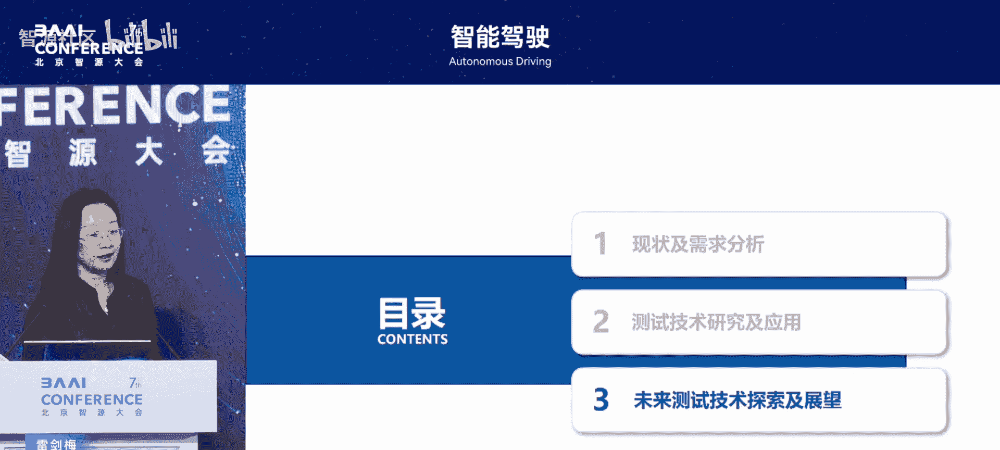

# 2025北京智源大会-智能驾驶 p07 融合感知信息的(预期)功能安全测试技术研究及应用：雷剑梅 -BV1JWNtzuE57_p7-

啊，今天法务总说是学计算机的哈啊，高老师是车辆工程的，我是学雷达的，呃，学雷达和无线通信的。就是现在汽车这个行业真的是包罗万象，学什么的都有。呃，这是个好事情。因为汽车这个产业链本身很长。

我先说几句闲话啊，产业链本身很长，就是各个专业方向都在向这个方向汇聚，就说明前面是我记不得是高老师还是黄老师呃说了一句话，说汽车是一个很宝贵的，可以将很多先进的技术及大成的这么一个产品。

所以才会有这么多不同专业的人往这个地方汇聚。呃，那我今天讲的这个主题呢呃我前面听了很多东西，特别是卢老师那包，我觉得听了很有感受。这个可能您的那个风险理论在我们后线后续测试评价定指标的时候是很有价值的。

后面我们下来好好商量一下。呃，但是呢前面听了很多朱玉在前的报告。呃，前面的报告的专家们都有一个很宝贵的资源。你们都有数据。😊，长安有长安的数据，长城有长城的数据momentta可能有更多的数据。

你有很多正常的数据。那我们是一家做测试评价的一个技术服务的机构。我们现在面临了一个很尴尬的境地，就是因为我们没有产品，所以我们没有数据。但是在没有数据的情况下。

我还得想办法怎么样去对这种人工智能上车之后的安全性的要做测试，这其实是一个很难的事情。那今天我就来探讨一下，我们在这个很难的境地下，我们做了哪些努力？呃，我今天重点讨论的是一气功能安全的这个测试技术。

😊。

嗯，那首先说说为什么要把这个作为一个主题来讲呃，人工智能现在上车之后，我们就看这个梁总牵头做的汽车自动驾驶自动化分级的这个标准，从L3或者L3加开始，呃。

车辆的这个自动驾驶系统已经开始在运动控制这个呃目标事件的呃探测响应以及动态驾驶的这个任务接管方面发挥越来越重的作用。也就是说他发挥作用已经远远超过了驾驶员。

那么在人工智能在AI技术赋能下我的自动驾驶系统已经开始代替人的眼睛去做感知和认知，开始代替人的大脑去做角色规划，开始代替人的四肢去做这个控制执行。现在这典型的两个技术路线嘛，有规则驱动的，有端到端的。

现在大家都说在规则驱动的这项端到端的转移。但我唯一听到梁总说的，可能很长一段时间内，规则驱动还是兜底的，还是很重要的。那么预期功的安全的这个这个技术其实呃很早就出来了。但是在2022年。

我21448这个标准发布的时候呢，我们才认为预期工共安全这个技术它的基本的理论体系是成型了。呃，在2024年，清华大学也在一篇这个综述性的这个文章里面明确提出了。

因为人工智能算法在自动驾驶汽车的这个呃应用中越来越广泛。所以说呢预期功的安全也开始成为我们自动驾驶或者是说智能驾驶的这个产业要实现大规模落地的必须解决的一个很重要的挑战和问题。

那么运识工安全它它的核心目标是什么呢？我们从这个场景四象线的这个最最常规的最容易理解的这个角度来讲，其实就是把我的未知不安全的这个区间把它尽可能的压缩。而让我的已知安全的期间尽可能的扩大。

这样就像法王所说的，我们关心的是安全的这个底线。我们把底线兜住。那么怎么实现这一点呢，其实就是我们要去做这个要去设计我的测试场景。然后在这个场景的分析和测试的过程中去发现那些未知的不安全的场景。

并且你发现了之后，它就变成了已知不安全的场景。然后再由你的安全机制设计，去把它设计安全机制之后呢，我这个车辆的不论是模型还是这个自动驾驶系统，它面对这个场景，它就可以做到安全的应对。

那就变成一个已知的安全的场景。后面那部分的安全机制设计呢是我们蒙mentta、长城呃，长安这些企业重点关注的事情。那我们其实关注的就是前面怎么去做场景的分析和测试，这也是我们这个报告里面的主要内容。

那么疫区功能安全的这个测试，它其实主要的一种技术手段就是基于场景的测试。呃，我们按照呃法官总也写了论文的三支助法哈，这个仿真测试封闭场地测试开发道路测试。这里头可能仿真测试，它需要仿真的场景。

封闭场地和开放道路，它需要一些场景的描述和场景的搭建。那么场景怎么来呢？我有通过应用场景做任务分类去寻找或者说判断你的感知的局限，你的决策和控制中可能出现问题的一些因素。

那么或者对原始的交通场景通过数据处理统计分析提取出它的一些这个参数空间。那么利用这个参数空间的定义，那和前面说的感知局限决策控制的这些问题共同输入到我们一个系统里面去形成我的功能场景库。

然后用功能场景库导致逻辑场景库，再通过一些如果说是仿真的话，我通过一些软件工具去实现具体场景的这个完成。但是并不是所有的场景都是我非常关注的。我们在做一区功能安全的时候，关注的其实就是两类关键场景。

一个是。典型复杂场景，一个是边缘危险场景。那么呃前面说了我们三种测试方法，仿真场地、道路。那么我们在典型复杂场景和极限危险场景这两类我们预期工安全所关注的关键场景里面，我们比较了一下这三种方法。

它的各自优缺点。呃，对仿真测试来讲，你基本上可以实现所有场景的全覆盖。因为你仿真可以自自己定义的去生成任何的场景，而且效率很高，速度很快。

但是它最大的一个问题是它没有办法把传感器的这个呃物理特性和车辆的响应，真实响应，引入你的这个测试系统。所以说你的呃传感器的物理特性和车辆真实响应是在你的仿真系统里面是没有的。这个前面高老师也说过。

我们很难把车辆的动力学的这个模型建的非常准确，所以这误差一般还是比较大的。所以这个仿真测试呃，它要做整车级的这种呃验证，其实它还是有一定问题的。那么场地测试呢呃我的车辆和我的传感器它都是在环的。嗯。

但是因为场地它空间有限，而且你所有的场景里的真实性搭建，所以它的效率很低。你很难实现非常复杂的这个场景的测试。呃，而且呢危险的场景你也不能在场地里去测啊，所以这是场地测试的一些问题。

那道路测试它就可以是非常丰富的。你在道路你可以在任何的这个交通道路上去去做测试。但是呃当然一个危险场景还是不能测的。第二个呢嗯你的场景其实是不太可控的啊，你在实际的道路上去做，总有一些你不知道的。

不知道从哪来的，不受你控制的一些交通参与者，他可能会走入你的这个测试场景。那么所以说这三种测试方法呢，它都还是有一些他各自的问题，这就启发我们去考虑。有没有一种新的测试方法。

我可以呃在一个可控的环境里面能够高效的去实现预期功能安全的各种场景的测试。那我们呃就在探索的去去做这种基于场景注入的预期功障安全测试。😊，接下来就介绍一下我们在基于场景注入的这种。

我们叫融合场景的整车级预期公共安全测试里面，我们做了哪些事。因为这里我们重点关注的是整车级。因为在这个控制器级不论是heel这个m它其实都已经有比较丰富的方法了。比较困难的是在怎么去解决整车级的问题。

我们设计这种方法呢其实就是场景用虚拟的方式去注入。那么车辆用真实的呃动力学的这个车辆的实际响应去反馈，这叫虚警实车的一个呃融合场景的整车级测试方法。那么这个测试方法里面呢。

我们场场景呃就像我们做这个实际的仿真测试一样，场景是用仿真的方式去产生的。那么这个仿真的场景通过车载的公共机和我的场景注入设备，它注入我的真实车辆的这个备测车辆的原来传感器输入的那些通道。

我们把原来传感器输入的通道把它解掉。然后车辆上要配配备我的整车的这个位置和姿态，包括动力学响应的一些传感器这些。数据要能够及时的反馈给我的这个场景仿真的仿真仿真的这个场景仿真的系统。

那么由此形成一个可以闭环的呃高效的这么一个。我们可以叫它仿真测试，也可以叫它这个虚拟呃也可以叫它这个呃虚景实车的结合的这种测试。那么要完成这个呃这种测试，那需要突破三个技术，一个就是我们的场景构建技术。

一个是场景泛化技术，还有一个是场景的注入技术。那我们实际做这个场景构建的时候呢，我需要呃根据产品的这个定义和呃人工智能技术它的一些特点去呃分析呃引发安全问题的一些关键要素。

并且呃把这些关键关键要素挖掘出来之后，形成我的这个触发事件。那么在以合理的这种方式对不同的触发事件进行融合，来构造一些复杂的呃多触发事件的这种呃复杂场景。啊。

那么其实最后呢就是我们通过基础场景叠加我的有点到面的各种触发条件去形成我预期功能安全的测试的这种复杂场景。啊，这是我们场景这个构建的这个思路。那么呃场景泛化呢。

我们单一场景或者说单一一组参数的场景是很难实现你的这个测试的全覆盖的。所以说也需要泛化技术。但这个这个泛化技术有很多种方式啊，呃，我们也可以我们我们用了一种方式就用正交事件。法的方式。

我把车辆这个呃安全问题引发的这些要素，我们把它往下分解，分解到每个要素之间能够是相互正交的。我们再用正交场景正交试验法的这种设计的方式去设计我的这个泛化的算法，由此就可可以得到一组比较完整的。

能够覆盖我所有这个要素特性的。但是它的这个呃用力的数量又不是那种无限庞大的这么一个泛化过后的场景集。呃，那个另外一个呢比较关键的技术就是场景注入技术。呃，我们这个场景注入技术的主要思路就叫叫劫持与替换。

那劫持就是把我车上所有的原来的这个跟自动驾驶相关的这个传感器把它断开。呃，转而用我的注入的我场景注入的这些数据给它输入。那么摄像头呢，我就呃用比如说典型的用GMSL的这个通路去注入点云呢。

我可以用这个以太网呃，就取决于你原车它是用的什么方式呃，去传递你的传感器数据。那长声波现在可能用的比较多的是看看FD那么用这种方式呢，其实呃它里面有个比较呃比较重要的需要解决的问题。

就是首先你的你的注入的数据的这个呃速度或者是数据的这个通道的宽度得符合你原来想注的这些数据的要求。另外一个你要让这个车它看到它从不同的传感器看到这个世界得是同步的。

否则就像人的这个手也如果不协调也会出问题。所以说我。需要嗯实现场景自动注入，同时要保证各个数据链路要达到毫秒级的这个同步精度。那么做这个事儿呢，中国企自己开发了一套我们自己的这个呃数场景数据注入的系统。

是可以达到毫秒级同步精度的。那么有了这三种这个基本的这个呃技术之后，我就可以去嗯去构造我的这种虚景实车的这种测试的环路或者测试系统。那么我构造这个虚景实车的测试系统，它有两种实现方式。

第一种实现方式是面向整车及复杂场景。去做一期步安全测试的这个呃这种方法。这个这个方法里面呢，我的车辆。呃，面向的复杂的非危险场景。我所以车辆可以在实验场里头去跑，让实车运行在封闭测试场里面。

但是这个车上的所有车辆传感器看到的所有的这个呃场景的信号呢是由注入的方式。我车载的一个公共区和这个场景注入系统给它注入。那么车辆的实际的动力学响应，就是真实的响应。呃。

再加上我的车辆的这个实车的位置位知数据，这也是真实的位置和姿态数据呃，一种实时的方式反馈给我的这个仿真场景产产生的场景生成的系统，这样构成我们一个呃真实的闭环啊，这是第一种方式呃。

实现目的是实现复杂典型场景的测试。这个因为这种方式我就在一个道路上去跑一个场地上去跑。我的场景可以是非常丰富的。你想测什么就测什么。但车其实看到的东西和它实际在跑的那个场景是完全不一样的。

这是第一种实现方式。第二种实现方式呢呃我们叫面向整。设计极限场景的这个测试方法。那么这种测试方法呢呃为什么要去实现极限场景？因为在场地测试和道路测试我都做不了，所以我得设计一种方法去做。

那设计什么方法去做呢？我们是设计的是一种让车辆呃被一个这个。真实的呃像目路面一样这个模拟驾驶的路面模拟系统把它承载着。那么通过在有限的真实测试空间中实现这个通过这个路面模拟系统。

在有限的真实空间中实现横向和纵向，这只是实现了两个方向啊。如果你这个路面模拟系统你可以做6自由度的那你就可以实现更多方向的就是无限拓展的虚拟测试空间。通过这种方式解决极限场景危险场景。

在场地和道路上不可测的啊这个问题。那么这个这种实现方案里面其实比较关键的一个设备呢，就是我们的这个无限曲率的道路模拟系统。我们这套系统是中国气源的这个凯瑞装备公司开发的这个目前是国内唯一的一套呃。

有点像那个风动系统里面那个MPS那套系统，它可以实现正负40度的转向，可以实现80度每秒的高速转向。呃，速度车速可以达到160公里每小时，其实满足一般的这个测试其实是足够了的。那么用这种方式呢。

呃我的仿真我的。场景仍然是用仿真的方式去注入的，用劫持加这个注入的方式给了车辆。那么车辆的动力学响应仍然是真实的那只是我的位置和姿态信息要通过模型来计算。因为我没有在场面上去跑。

所以这种方式下我们就可以实现一些危险场景的测试。那么利用这两种方式呢，我们就可以把典型的这个复杂场景和极限的危险场景，这两种预期功安全测试中最关注的关键场景全覆盖。那么有了这种方式之后。

在我实施开发的过程中，这个系统其实不只用于测试也可以用于开发。我在实施开发的过程中，我可以把你的这个整个系统开发完了之后，我放到这个呃我的虚虚景实施的系统上去做测试预功安全测试。测试完了之后。

我发现问题之后，我可以针对这些问题去做我的这个安全增强，或者说针对我的预功能安全去做我的安全机制的修正。那么做安全机制修正之后，我在左边再在这个里面该做的做完了，我又可以上市。直射上去做快速的验证。

那验证完了之后，如果还有问题，你可以继续修正。我们可以这样实现一个循环迭代的安全机制的增强和迭代升级的这么一种机制。由此构造一个高效并且闭环的预期功的安全的这个开发设计体系啊。

这就是呃我们设计的呃我们目前在做的面向预期功的安全。我们觉得可可能啊可能可以我们已经解决了一部分。但是他现在不敢能说能解决全部解决一部分这个预期功的安全的这个复杂复杂典型场景和极限危险场景。

关键场景覆盖的这种预期功的安全的测试体系。呃，接下来呢呃简单介绍一下，我们可我们觉得可能这个行业里面未来可能还会有的一些一些新的技术。

那么首先呃这个人工智能包括深度学习技术在车上自动驾驶系统上应用之后呢，呃带来了一些什么挑战呢？首先它显著提升了我们自动驾驶系统的这个感知和决策能力，但是我们在训练的时候。

我的车上的模型训练的时候都是用的实际场景训练的。比如说长城或者长安的车，它训练模型它肯定是用的这个量产车输出之后，卖出去之后，回来的数据去训练。那么这个模型其实对数据是有很强的依赖性的。

那所以说我要去做测试，我刚说我们现在面临的困境是我们没有数据啊，我做测试，我不能像长城一样，就拿你的这个实际的数据来选来做测试，对吧？所以我得自己去构造这种仿真测试的场景。那如果我这个场景不够真实。

因为模型对你的这个场景数据的真实度依赖性已经非常高了。那如果我构造的这个场景不够真实。那这个测试结果就是不可信的。所以在这个过程中，我们测试机构面临的问题。

就是要很大的挑战需要构进一个高质量并且可控的测试场景数据。😊，这个高质量和可控，它不只是说我的这个呃我测试场景的保证度要很高，呃，也需要我的这个测试场景库，它是一个高效的。

也就是说它是一个有价值的场景库。那么呃要解决刚刚说那个问题哈，一个是高保真，我要解决高保真的问题。现在行业用的比较多的。前面很多老师已经讲过了，3D高斯重建，加上优一渲染啊，来提升我们场景的这个真实感。

解决传统场景不真实的问题啊，这都这也不是我们的技术，觉得行业都有的技术啊，这也不多说。呃，但是要前面是解决高保真的问题。那么下面解决场景的高价值问题。怎么做的呢？

一般是我们对对场景这个基本的场景先去做泛化。泛化之后呃，利用我们的这个知识建模和突步构建，呃，定义一些这个规则约束来剔除我们泛化过后的场景里面那些可能不符合逻辑的或者不合理的一些场景。

那得到了我一个基本合理的这个场景库。在这个场景库里面呢，我们有两种方式去选择选择我呃需要的高价值的场景。一种方式呢，我把我的这个场景里面的关键参数。

因为预期功能安全主要是去考察你的这个呃预计功能不足或者人为物用。那一般情况我关注的是你在这个呃关键参数的这个边缘区间，你大于小于或者等于边界的这个条件的时候。

那所以说我可以把场景的关键参数去做定义去定义我的边缘场景，然后去做变行仿真。在这里面去找我通过性很差的那些场景。那就是我的关键场景。另外一种。啊，除了这个边缘场景之外，我在我常规的场景里面。

我也要把它拿出来做剧类分析。剧类分析之后呃，在里面找出多个类型的场景。那么在这个多个类型的场景里面，我可能挑一些典型的场景去做呃变行仿真，仿真出来也有通不过的那通不过的或者通过率很低的那些场景。

就是我的这个未知危害的场景。那么由此就得到我的大规模的高价值的这个测试场景库。呃，前面这个前面的技术都是比较常规的技术呢，到到了端到端上车之后，这其实也是老老生常谈的。端到端技术面临的一些这个新的问题。

一个是系统的可解释性下降。呃，其实系统的可解释性下降。大家都在说，其实对研发啊，对整个场来说，它带来的问题就是什么？我的模型设计好了，跑好了，就遇到该有的场景，它的响应不满足我要求。

不是我的目标响应的时候，我不知道是啥问题造成的，我也不知道咋去咋去改他。我除了继续训练它这个模型没有其他的解决办法，这是第一个第二个面向法务的关心的这个监管的问题，真出了问题，没法界定责任是谁的。

我也不知道是什么原因导致的这个问题。那么第二个问题呢，就是呃我们传统的测试方法，我们传统做场景的时候，都是基于我的这个呃功能去定义我的场景，功能规范去定义我的这个场景。

那么传统这种场景定义的方法其实已经完全不能满足端到端的这种。因为他的这个。功能边界已经大大的远远的大于我们传统的这种这种场这种模型了。所以说我们现在还需要扩大我的这个测试的这个场品的覆盖度。

也不能依依托原原来的传统的这个场景的设计方法来做了。那么呃前面说的对于这个端到端模型的可解释性下降，我们现在有很多都引用了这个视觉语言大模型来做。那么我们也在尝试着探索的。因为我们做测试的。

我们在尝试着探索的这个当端到端和V2A结合之后，我们测试机构有什么办法去验证你这些模型的一些特点呢？那我们也在考虑啊用啊，这个是视觉语言大模型，现在有哪些车场用了。那我们也尝试着用触发条件与视觉问答。

就是触发条件加VQA的方式来考察我VRAA模型的一些基本的性能。呃，我举个例子啊，我VRAA和这个端端模型融合之后，那么我因为VRAA它本身有一个可问答性。所以我可以去问他。

比如说前方的这个这个车辆看到前面有行人有红绿灯，我可以问他前方的行人在干什么。再问他我现在应该采取什么驾驶策略。那么根据第一个问题，我可以去判断你这个VRAA模型，它其实它的这个它的感知系统。

它感知的是不是正确的。那么再根据第二个问题的响应，我去判断你的场景的理解和输出决策的这个一致性是不是正确的。那么这当然不能解决这个这个端到端模型或者VRAA他测试的所有的问题。

但是我可以在一定程度上去了解你这个模型的这个性能水平啊，这是我们在呃人工智能这个或者是大模型技术上车过后，我们做的一些。探索呃，确实这个检测机构啊，第三方机构现在困于受困于我们的数据量太少。

我们也呼吁着这个整车厂加大和检的机构的合作。我们上次房总在讨论那个仿真那个标准的时候，也在说这个仿真的标准如果没有模型，没有数据，我怎么去做，也是个很困难的事情。

那如果说今后我们这个行业真的有一种联动的机制，也可以让这种第三方机构可以更深入的介入我们产品的研发和验证的过程，提高我们的这个整个行业的水平哈。呃，就最后做一个简单的总结。嗯，现在产品的这个发展趋势。

首先AI技术高速发展模型迭代系统智能。呃，关键是开发周期越来越短了。所以说我们其实我们的测试方法，站在我们这种第三方服务机构的角度来讲，我的方法要革新，我还要突破这个没有数据的这个困难和这个难点。

而且我还要实现场景的高覆盖高真实度。而且我还提升这个我的测试效率，这就逼着我们要去在这个。😊，我们前面讲的哈需势融合的这个测试技术，高价值场景的挖掘技术和高成真实场景的生存技术方面，要去做更多的探索。

最后来保证我们车辆的安全。其实第三方机构最后是法望走，希望我们能够帮助。这个房他们来做安全的兜底。那其实我们现在确实面临很多困难，后面慢慢的在跟行业的专家们探讨解决的方案。那以上就是我今天的报告好。

请大家批评指正。😊。