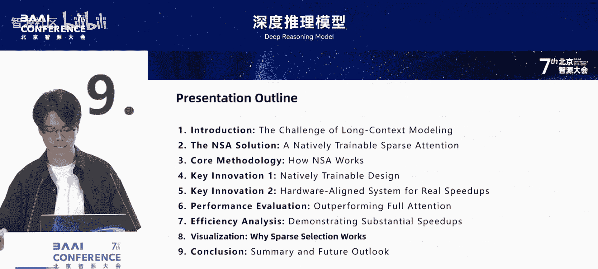
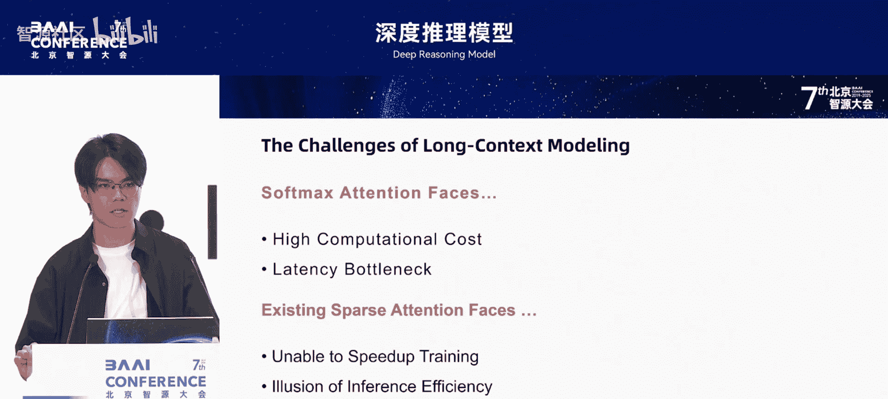
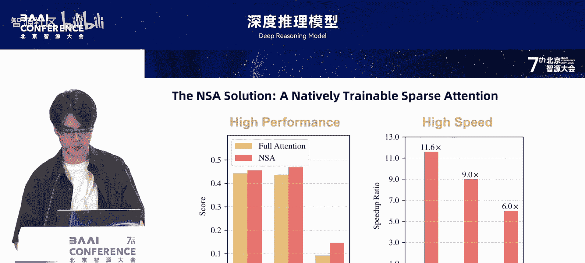
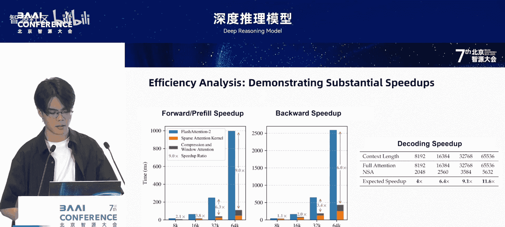
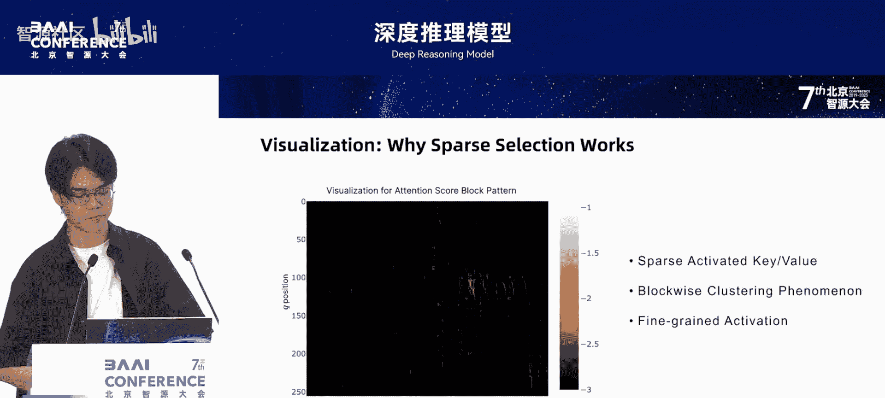
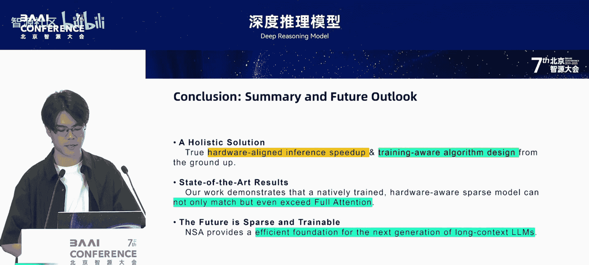

# 2025北京智源大会-深度推理模型 p02 原生稀疏注意力机制：关注硬件的原生可训练稀疏注意力大模型：袁境阳 -BV15UNszsE8T_p2-

呃，今天我要为大家介绍的是我在dep six实习期间合作的一项高效attion的工作，native spark attention原声吸收注意力。呃，那么今天会从这些方面去和大家做一个分享。

嗯，首先呢我们来关心一下现在大模型的一个核心挑挑战成本处理。那么无论是需要进行长当的逻辑推理，还是分析整个代码库，甚至是实现复杂的智能体系统。模型处理更长的上下文的信息的能力都变得至关重要。然而呢。

传统的注意力机制，也就是我们熟知的soft max attention，其计算成本会随着序列长度的增加而急剧上升，成为了性能的主要瓶颈。那么对于主流模型做理论理论估算之后，我们可以轻易发现。

在处理64K上下文的这个文本时，注意计算占到解码总时延的70%到80%以上。对于更长的上下文注意力计算的占占比会更加的高，使得常文本应用又贵又慢。那么为了解决这一问题。

学术界近年提出了许多吸收注意力的概念。那么这个想法是很好的。但是呢。它有一系列的问题。嗯，虽然说吸疏注意力可以帮助我们只去计算在注意力过程中最重要的那一部分。但是呢现在学术界的这个问题主要有两个方面。

第一个就是现在的方法主要是用在这个推理阶段的，很少有方法把它用到训练阶段而来。那么为什么把这个吸疏用在训练中这么重要呢？这个问题可以从两方面的角度来去看。

第一就是随着open IO系列模型和DcRE这种呃推理模型的提出和发展，我们会发现越来越有必要去研究这种更长文本的一个训练机制。

因为我们会发现就是呃包括Ds R一也会提出呃在我们的这个强化学习训练过程中，模型的这个输出长度会越来越长。而随着这个输出长度越来越长，这种强化学习也需要这种更长的训练。

那么这种post training的这个训练模式，会在这个模型的训练中占比越来越高。另外一方面，现有的很多新书模型，它的这个方法是指在推理阶段中使用的，它依赖于在。呃。

for attention模型上进行一系列的减脂，这种方式是会带来一些out of distribution的特性的。也就是使得我们的稀疏模型会天然的偏移在训练时的一些特性。

也就是我们更长所了解到的训推不一致。这种特性会导致以以这种吸疏方法来去进行的研究，它的最终效果会有一个上限，那就是不可能超过for attention的一个性能。而原生去训练的这个稀疏模型。

它由于自然可以去学习这种吸数特征。所以天然没有这种限制。不过，想让以往工作的叙数模型从头开始训练是比较困难的一件事。先前的一些叙数方法有一些引入了像ki min聚类这样的操作。这些操作是离散的。

无法求导的，阻断了反向传播的路径。有些方法虽然理论上可训练，但他没有考虑反向传播的硬线适配，无法利用像flash attention这样的高效算子，导致训练慢的不切不切实际。

那么这些是呃之前提的呃刚才提到的以往的新收模型所具有的第一个问题。那么第二个问题是这类技数模型存在推理阶段的效率幻觉。很多方法虽然它宣称大幅减少了传统attention的计算。

但是实际应用中做呃则不能完全发挥出理论优势。这是因为他们有一些只在单一阶段加速。比如说只在deding的时候加速，但是preview的时候就不不进行加速，导致整体的效率不高。另外一方面。

有一些呃稀疏框架的设计，它没有去考虑和MQAGQA这种先进ten用架构去融合，导致只能是去使用MHA这种在decodeding阶段的这个呃内存不友好的一些策略进行推理。这就导致这些方法的泛用性不强。

那么这两个问题正是我们NSA需要解决的。第一就是我们要让这个理论的稀疏性真正体现到呃这个模型在训练和推理中的性能上去。第二个就是我们需要去做一个原生的训练来去解决强化学习以及成本训练时的。

这样一些问题。那么这张图非常直观的体现了NSA的核心贡献，在大幅提升效率的同时，保持甚至超越了原有的模型性能。大家请看左边这张图表，它比较了NSA和forten在通用常文本和推理三大类基准上的表现。

可以看到红色的NSA柱子在所有类别中都比黄色的forten要高。这证明了我们的吸疏方法，不仅没有牺牲性能，反倒获得了性能的提升。再看右边的图表，这里展示了在64K序列长度下。

NSA相比于全注意力的加速比。无论是抵ding潜向传播还是反向传播阶段，NSA都取得了巨大的速度优势，分别达到了11。6倍、9倍以及6倍的提升。这两张图结合起来就回答了那个关键的问题。

我们能否在不牺牲性能的前提之下，实现了数量级的效率提升。NSA的答案是肯定的。下面我将为大家详细展示我们是如何通过原生可训练和硬件对齐来实现这一点的。

正如这张图所示，NSA的核心设计理念由这两点组成。第一就是可训练的呃吸疏架构，那吸输模型可以进行端到端的稳定训练。第二，我们真正实现了与硬件对齐的系统设计。保证理论上的计算减少，能实打实的提升为速度。

NSA的核心思想是从根本上重新设计，吸收注意力，但它不仅算法上高效，更能与现代硬件协同工作，并且能够从头到尾进行原生训练。现在我们来探讨第一个核心原生可训练的设计。那么NSA的架构设计是什么样呢？

其实它的核心是一个包含三个并行分支的注意力框架。对于任何一个query，它会同时从三个不同的维度去审视历史信息。那么第一个分支是压缩注意力。

它的作用是将长序列中的token按序列顺序区分为若干长度的相同的组。然后通过可学习的压缩器，将每个组压缩成单个token。那么这样做的好处是模型能以很低的计算成本，快速扫描整个上下文来去抓住全局主旨。

第二个分支是选择注意力。光有拳局主旨还不够，更多的细节也是重要的。这个分支的作用就是保留这些关键的细节。它会根据第一个分支算出的注意力得分来去挑选那些最相关的组。

并且用每个组的原始token进行更精细的attention计算，做好了好钢用在刀刃上。那么第三个分支是滑动窗口注意力。我们发现在训练这这样的一个呃多分支的模型的时候，模型很容易过度关注这个最新的信息。

为了让压缩和选择分支能够更好的去学习远距离的依赖，而不是一直在关注近处的信息。我们专门设立的这个滑动窗口分支来去处理局部上下文。这样子不同的分支就可以各司其职，学习不同范围的特征。最终通过一个门控机制。

我们可以将三个分支的attention score来去做一个加和，得到最终的output。那么我们可以看到在这个图中，最左边这一路就是我们的压缩注意力，它会将整个呃sequence去进行一个压缩。

比如说在文中我们主要的实验都是在一个32呃合一的压缩比上去做压缩的。然后通过1个16窗口的，这样子的话，整体的压缩率是16合一。也就是比如说对于一个16K的上下文。

我们可以把它压到1个1K的长度来去做一个tention。然后拿到这个tention score之后，我们会直接去利用它的这个重要性的分数来去对第二个分支做一个selection。

我们看以到在第二个图中会有这个top的一个s环节。这也就是说我们会对比如说这1K个block进行一个选择。如果我们去选择前512个重要的呃会有前64个重要的block的话。

那么一共会有64乘上这个32这么多的token进入到第二个环节。那么在第二个环节，我们会进行一个稀疏，但是token力度唯一的一个正常的attention。

这是我们NSA的一个呃核心的这个attention位置。它会进行一个呃就是我们自己实现的高效 kernel进行的吸疏attention。还有一个分支就是刚才提到的ssteaddy window。

那么这个分支是为了防止这个呃模型去在select attentiontention这个分支上去学全部学到进术的信息而设立的。我们可以看到右边这张图描述的是三种不同的分支，它所关注到的这个呃KV的结构。

那么每一行就代表每一个Q再去呃关注KV时选中的块。呃，对于comppression attention来说，它是全部都看到的。然后为了避免一些呃就是泄露的原因。所以说一些进出的block。

我们是没有去看的。后呃第二个第二行就是我们的吸疏模块，它会根据第一个模块的这个呃最重要的这个block来去选择按块来去连续的一个吸疏attention。

那么第三个就是最常见的standny window attention mask。那么为什么说NSA的设计是原生可训练的稀疏呢？我们可以看到在NSA3个分支的设计框架之下，吸疏索引信息。

也就是压缩attention，它的梯度，然后吸疏信息的梯度，局部信息的梯度都可以进行自动的一个反向传播。这里的关键在于，虽然说压缩attention在提供吸疏索引时是不可导的。

但是通过它独立的贡献一个attention分支。我们间接实现了吸疏索引的可学习，能够进行端到端的稳定训练。那么以往的吸疏方法大多是推理专用的，很难用于训练。

难点在于他们要么包含刚才提到的像key means剧类这种无法求导的操作，要么在反向传播时效率低，导致训练过程可能非常缓慢，甚至无法进行。而AA在设计上是完全可训练的。这一点就主要是在于。

虽然说我们可以看到，在这个从第一个模块到第二个模块的top selection这个分支，它是呃这个过程它是不可导的。但是通过独立的提供一个output，然后再加到这个最终output之中。

我们可以为它直接去提供一个梯度。而这个梯度它的信息在呃直觉上也是比较符合逻辑的。因为呃它的意思是告诉模型，我在模糊的地方看到一个需要被注意到的block的时候，我就应该把它打开，看的更细一点。

那么这也是NSA的设计的一个呃直觉的一个逻辑。那么接下来我们来介绍呃第二个呃核心贡献与硬件对齐的系统设计。那么为什么这一点比较重要呢？这就是因为之前提到的很多悉数算法，在论文看起来很美。

但实际部署是没有达到预期性能的原因，就是他们的内存访问模式是随机离散的，就在GPU上效率极低。我们在NSA设计之初就考虑到了硬件的特性。我们采用了blockwise处理的方式。

这样无论是内存的读取还是计算，都会以连续的数据块作为单位。这种方式能够最高效的利用现代GPU的张量核心，最大化的最大化了硬件的吞吐量。为了将这一思想发挥到极致。

我们也专门为ASA设计了一个 kernelnel。这个 kernelel有一个与众不同的设计，它以GQA的组为单位来加载数据，一次性获取共享的KV缓存块。

如果大家去对比flash attention的设计，就会发现这张图，也就是forward的这个过程，会和呃我们的NSA的过程有一处不一样。

flash attention的q block的形状是sequence lens乘以的。也就是说它的切块是在sequence上进行，然后在head上是进行一个blockwise的并行的。

但是我们的切分方式是把这个呃每一个group去接到一块。也就是右边这张最左边Q的每一个我们会发现它在sence上力度是一那么这一点也是系数模型去设计是无法避免的。

因为假如说我们也依然去仿照flash attention的结构去设计的话，我们在每次load这个q block的时候，我们会去load整个连续的sequence q。然后再根据这个Q去load的时候。

也就是在内循环中，我们每次需要去这整个所需要关注的所有那么我们知道因为每个每个Q它是去单独去query k和 v的。如果我们去把这个整个lock都去的话。

那么有大量的是用不到其他所需要关注的这些和 value的这会导致大量的存。对。所以我们重新设计了flash attention的 forward架构和back架构，来使得它可以和NSA来完美契合。

我们现在把Q的力度改成一之后，那么我们只需要去要求每个Q group它所需要关注的K和V相同即可。那么这在GQA中是可以去做这样的保证的。

这样我们就成功的去把这个原先需要浪费的这个缓存变得不用去这么浪费。减少了这个冗余的数据搬运，并且确保了GPU上各个单元的工作负载是均衡的，从而实现了真正的加速。呃，那么还有一点比较值得一提。

就是我们在论文中是使用的是tton的 kernel。但是后来我们发现t的算子实现会更快一点。因为在反向传播中，我们需要对k和re进行一个atomic的合并。那么tton这边的效率会比t浪更低一点。

另外的话在呃MLA的推理模式中，我们知道我们会把这个呃KV blockV block的这个weight去融合到Q上面去，这会导致Q head从128变成一个非常大的576。

那么这个对GPU的 memory的要求也是比较高的。而t是可以去进行一个比较良好的shad memory和计存器的管理的。所以在某一些情况下，就是我们会发现t的这个使用的效率更强。

那么在深入的看各项下游下游任务的指标之前，我们先来看一下最能反映模型学习本质的指标。我们的los curve这张图展示了我们NSA模型和for天审基械模型在270亿参数模型上预训练过程的损失变化。

那么首先我们的训练过程可以看到是非常稳定的，没有出现任何的崩溃或不收敛的问题。那么更关键的是大家可以看到，代表我们NSA模型的成色曲线。

在整个训练过程中几乎一直都低于蓝色的for attention曲线。这意味着尽管NSA是一个稀疏模型，它在这个呃相同step的情况下使用的算力是比for更低一点，但是它却能更好的你和训练数据。

达到了更低的los。这个有力的证明了我们原生可训练设计的有效性。它表明，如果让模型从一开始就在稀疏的环境中去学习，不仅不会牺牲性能，反而可能因为它学会了更好的过滤无关信息，从而实现了更优的收敛效果。

那我们也接下来看一下在各项评测中的详细表现。首先在通用能力评测上，我们用涵盖了知识推理代码等9个主流基准评测集，对比了我们的NSA模型和使用for attention的基械模型。那么结果是。

尽管NSA是一个系数模型，计算量更小，但是和loose curve的表现一样，它在7个任务上都超越了for attention模型。这说明我们的吸疏结构有利有利于过滤模型噪音，专注于更重要的信息。其次。

在我们更加关注的长文本能力评测上，呃，我们可以在大海捞针的测试中，在64K的超长文本中实现百分之百的精准信息检索。在更全面的long评测集上，NS的平均分也高于for attention。

然后for attention也明显高于其他的所有的系数模型。这个就是呃刚才提到的，因为所有的系数，就其他的这个系数模型是在呃推理阶段去做的，它天然的会比for attention更差一些。

我们也在其中展示了exact top k的一些表现。我们可以看到exact top k这个表现是跟f attention非常接近的。这个其实也是我们呃所有se model的一个呃基础。

就是我们的attention模块，其实只需要去atend的很少的top k就可以拿到一个不错的分数。但是我们的NSA可以比 full attentiontion，也包括ex top k做的更好。

那么最后呢我们还测试了NSA在复杂推理任务上的潜力。我们将模型在数学推理数据上进行一些微调。这里我们用的是一些呃RTRFT方法，也就是另外一个推理模型去产生的呃就是一些数据来进行微调。

我们也是与复天生模型去做了一些对比，然后在极具挑战性的AIME术学竞赛题上去进行测试。结果显示，我们的NSA杠R模型得分显著高于全注意力版本。这证明了我们的架构能够有效支持深度和长链条的逻辑推理。

那么性能强大的同时，NIA在效率上的同体的提升也是革命性的。我们在A100GPU的服务器上进行了严格的速度测试。在训练和preview阶段，也就是计算密集的任务中。

我们将我们专门优化的tratter内核与业界顶尖的flash attention2进行了直接对比，结果显示，在处理64K长度的序列时，NIA的前向传播速度是flash attention two的9倍。

反向传播是它的6倍。这个加速比非常可观。在decodeding阶段，也就是一次只生成一个词场景中，速度的瓶颈主要是在呃显存中读取庞大的KV缓存。那么我们可以去直接估计出ASNSA的一个加速比。嗯。

通过其稀疏设计，NSA可以极大的减少需要load的数据量。在64K的序列长度上，我们理论上可以达到11。6倍的解码速度提升。在相同的一个s选之下，我们的渐进速度提升比最终可以达到16倍左右。在自慧买呃。

就是呃我们的这样一个设计，最重要的一点是呃会随着序列的程呃就是序列程度的增加，越发也就是越发体现出更强的这个呃性能收益。也就是说我们如果未来需要处理100万甚至更长的上下文的时候。

NSA这种系数的架构可能是不可或缺的。

呃，那么在这一页中，我想通过一张图来直观的解释为什么我们要选择块析出这样一个策略。那么这张图就是我们的一个for attention模型进行可视化分析中得到的注意力热图，其中颜色越浅。

代表这个attention score的值越高。我们可以从图中清晰的看到，图中这些颜色更亮的，代表更高注意力得分的区域，它并不是随机离散分布的，而是会呈现出一些明显的块聚集的一些特征。

也就是说重要的信息往往会呈现成片出现的这样一个特征。也就是这样一个关注给了我们启发。他验证了比较小的块为单位进行的吸数处理，是一条更符合注意力内在规律的道路。另外一方面。

块的力度从图中看到应该尽可能的小来提升有效token的命中率，避免一个块中只有几个别的token是有效token。那么这样一张图也是我们NSA设计的灵感来源。我们应该是呃就是我们在吸疏方法设计的时候。

应该尽可能去关注天然存在的原生的这种信息模式。

那么总结一下，我们提出的NSA通过将算法创新和硬件感知设计深度融合，成功的解决了现有吸疏注意力方法面临的两大核心难题。它既能在实际部署中带来显著的硬件加速，又支持稳定高效的原生训练。

带来稳定高效的原生训练加速。以及性能提升。那么我们的实验结果也有力证明了一个精心设计的从头开始训练的稀数模型，其能力完全可以媲美甚至超越传统的全珠力模型，并且速度要快得多。

无论是在通用能力、长文本理解还是复杂推理上，NSA都展现了卓越的性能。我们相信NSA为下一代长文本模型的发展提供了一个坚实而高效的基础。将稀疏性作为模型的核心特征，并贯穿其从训练到推理的整个训训练周期。

是我们高效拓展模型能力的关键之一。嗯，我的介绍就到这里，谢谢大家。下面是问难环节，应该。

我们有1到2个问题时间，请大家把问题尽量精简清楚一些啊。嗯，袁博士您好，我是来自武汉大学的一名硕士生。然后呃我之前也有关注过您的这篇文章。然后也同样呢我也关注过deep的一些其他的成果。呃。

我想我正好注意到就是deepR一的一个非常重要的贡献呢，是提出了那个叫呃多头的潜在注意力模型，就MLA那么我想知道就是我想请问一下，就是这个NSA架构和MLA它是一个冲突的。

还是他说两者是可以进行结合的呢？呃，两者是可以进行结合的。呃，这个是一个非常好的问题。就是呃对attention的结构需要呃一些比较精细的设计。那么呃我们知道就是刚才提出NSA的这个方法的时候。

包括我们在论文中去做实验的时候，是使用了GA的这样一个模式。呃，这个是主要原因是刚才提到的在呃就是我们刚才就如果大家能回忆到的话，就是有一张算法设计这张图。

我们呃是一定要在把Q group去进行一个合并。来去落到内存里的。那么这个模式它和MHA是天然互斥的。因为如果需要把呃就是MH去这样做的话，我们会只会得到一个ctor成mtrix的一个设计。

然后这个东西是用不了sor cord的。呃，因此如果我们想把NSA去和MLA去直接的进行融合的话，需要在呃训练过程中把MLA去改成一个呃ding模式。

也就是把ML去改成这个跟推理一样的这个呃就是多个Qhead去关注一个keyhead模式。这样子NSA就可以直接在MLA上面用了。好，最后一个简短的问题吧。呃，袁老师您好，感谢您的分享。呃。

能不能向您请教一下，您觉得deep sick和open AI在未来大概多久之后，就可以就是呃一次性的输出文本，可以输出几十万字的这种文本。嗯，您觉得大概过多久可以有这种情况啊。

或者说在呃半天一天之内输出几十万字的文本，大概过多久之后啊，谢谢谢谢。呃，谢谢。呃，这个问题我觉得挺有意思的，就是呃就我我们会经常现在希望自己可以去预测未来，尤其是预测到未来模型能够发展到什么地步。

对这边我不能去就是为我的回答做任何保证。因为它取决于就是各个领域的一些发展，包括长文本的数据，然后包强化学习。就就包等等下会有各位老师去介绍的各种方法的一些改进。

那么我自己的一个体验是现在模型进步的还是非常快的。呃，我觉得可能如果是几十万字的这个输出这样一个量级的话，很有可能我们今年或者明年就能看到open去包括然后包括google来去提出这样的非常强的模型。

对然后我相信国内的这个各类模型各个模型厂商不只也会去跟进这样子的长文本的模型。因为我也相信就文本是一个非常重要的一个场景。它在无论是代码也好，还是对话也好还也好，各个场景中也都非常关。😊。

现的大家应该都会去在这个方面去投入非常多的精力。