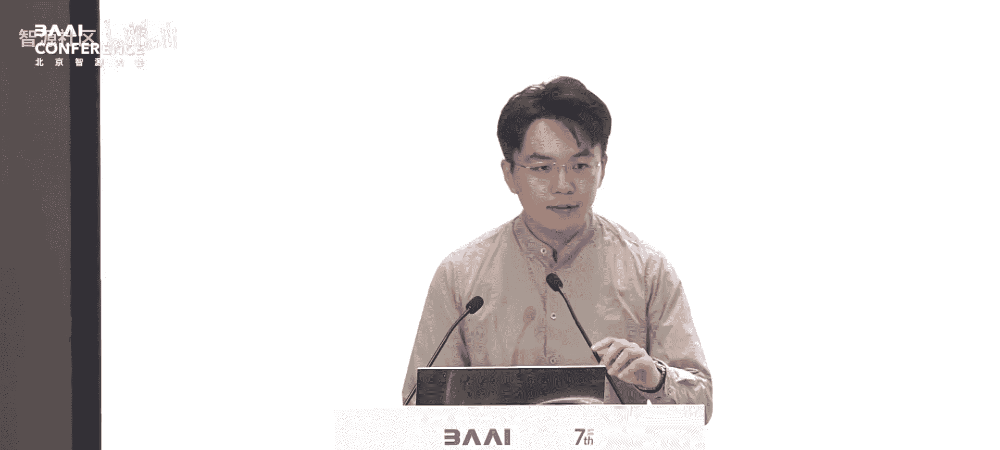
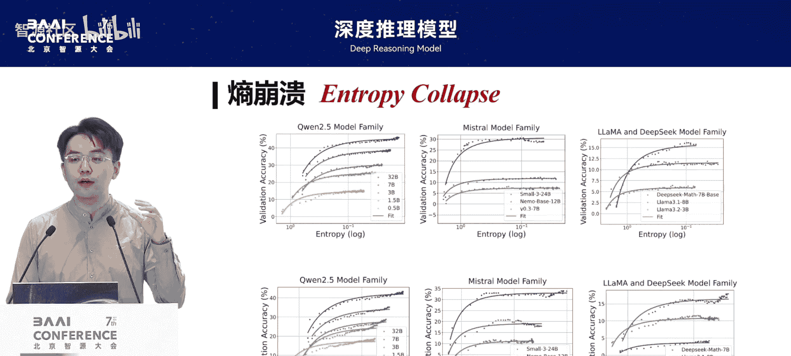
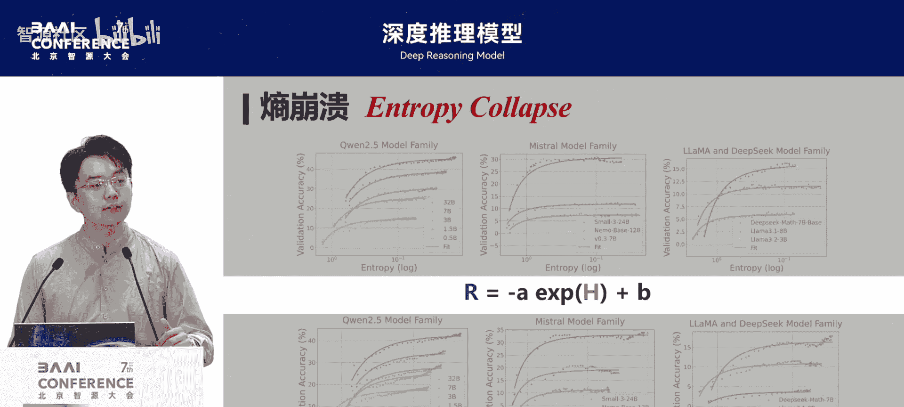
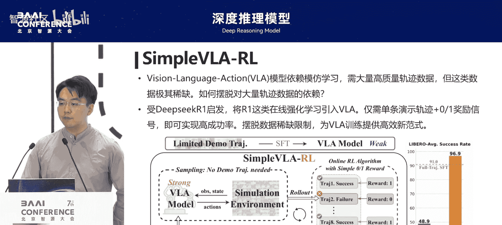
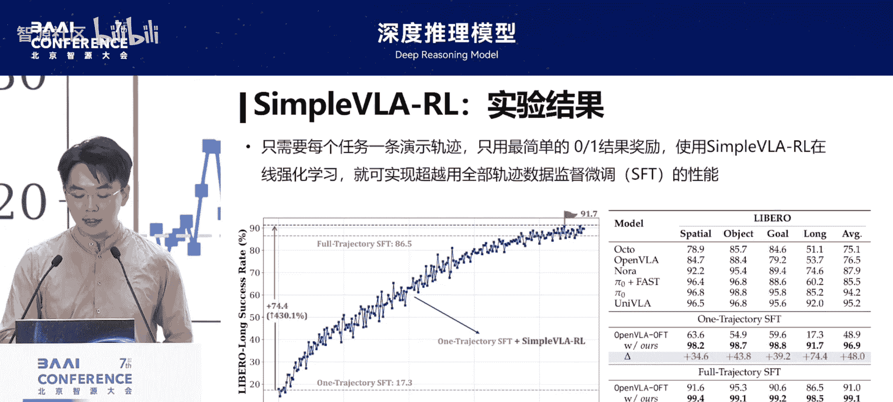

# 2025北京智源大会-深度推理模型 p03 强化学习驱动的推理模型：密集奖励、策略熵和自演化：丁宁 -BV15UNszsE8T_p3-

呃，谢谢赵老师的介绍，然后谢谢智援大会的邀请。呃，我叫丁宁，我来自清华电子工程系。今天我会给大家带来一系列我们最近呃针对这个深度推理模型的一些强化学习的方方法，其实他们并不是一个完全的体系，呃。

但是他们都互相之间有联系。呃，首先就是呃这个图可能大家看过很多遍了，就是模仿和学习的scaling。呃，可以说已经结束了。呃，但是呢激励和探索的篇章才刚刚开始。

然后今年的图灵奖也很是呃适合适宜的颁给了这个我们强化学习的鼻祖。然后richar。然后实际上他呃仍然代表着这个计算量能换过来智能，只是这个计算量不仅仅包括了这个学习的计算量，还包括了搜索的计算量。😊。

呃，为什么强化学习是最重要的？这个我认为强化学习就是现在最重要的技术。没有之一。然后这里呢我给出一个数据角度的观点。呃，比如说我们拿右边右上角这个图为例，呃，我们告诉模型，这是一首诗，杜甫写的升登高。

呃，他会模仿他，然后学习它。但是如果我们告诉模型，这首诗它的奖励是100分，就是它有一个奖励，它值多少钱，那么这对于模型来说又是一个智能之呃就是增量的信息。所以我们会从一种提示工程到奖励工程。

而数据是可以用完的。但是数据的奖励是永远都用不完的，它甚至在它甚至还有有很大的主观色彩。比如说这个我打分这个这个诗是100分，但是可能杜甫他本人来打分，他可能就觉得这只有60分。呃。

然后呢强化学习是典型的训推一体的架构，他既包括训练又包括推理和探索，理论基础是十分坚固的。虽然我们现在都说我们在研究强化学习，但是他其中的理论和算法，其实在很多年前就已经快被研究完了。我们。😊，就呃。

比如说我们用一个贝尔曼方程，呃，强化学习的目标就是要去学习一个最优的策略。这个策略呢是能够最大化我获得的所有奖励之和。就跟我学写诗，我要每首诗都写出这个水平。呃，通过一个贝尔曼方程。

我们就可以去呃知道这样的最优奖励，最优策略是一定存在的。那么为什么强化学习加大模型是最重要的呢。实际上很简单，大模型的推理，添加了泛化这一维度。就是他不仅仅是在学数学或者说学代码。

它可能对于我们所谓的写诗写写文本都会有帮助，这是他为什么重要。😊，呃，强化学习其实就是在做这件事，它最大化智能体获得的奖励总和。然后监督学习是呃鼓励模仿的，强化学习就是鼓励探索。呃。

今天呢我主要给大家带来三个工作的介绍，呃，稍微有点长，我待会可能翻快一点。然后这个第一个第一个呢是说怎么样？我们只从结果奖励去获得免费去获得和利用免费的密集奖励。第二个是呢我们怎么去模糊的估计奖励。

然后让模型自金自行化。第三个呢是强化学习到底在干什么？它的底层的原理到底是什么。😊，首先给一些基本的定义，呃，强化学习必须得用数学去学，呃，但是想可以用哲学去想，所以它非常好玩。呃。

但是我们学的时候千万不能给他呃就是特别特特特别形象话，必须得用数学去学，反而这样会更加清晰和简单。呃简单来说，我们要呃我们对于每个动作我们都有一个reward简单来说就是假设小明现在在做鸡蛋蛋炒饭吧。

他刚炒完了番茄，然后不鸡蛋炒西红柿吧，他刚炒完西红柿，然后炒鸡蛋，这个动作他获得的夸奖，就是当前的奖励，然后呢return就是整个我们优化的所有的奖励。比如说这个他做完这个鸡蛋炒西红柿呢。

他获得的所有奖励之和valueue呢就是说我现在炒完西红柿了，呃，在这个状态下，我获得的期望的未来的期望的奖励之和Q value呢就是说在当前状态下，我采取这个动作所获得的期望的奖励之和。

比如说我炒完西红柿了，我接下来要炒鸡蛋了，他这个这个动作我会期望获得的所有的奖励之和。😊，呃，然后呢所以说一切都是关于奖励。呃，而我们像R一大家都知道了，就是包括可能现在很多的大模型。

大家用的其实都是结果奖励呃，而没有用过程奖励。呃，然后很多人就说过程奖励模型是不是不能用了，或者说是不是不太好其实不是过程奖励永远是有用的。因为密，因为它很密集。

而且就是我们人其实也是我们我我们也想在过程中获得很多的这个监督。那么他为什么不好用呢？是因为它是unsable的，它不可扩展。

传统的openI提出的那种方式就是由人来标注人来标注标注一个绝对对一个步骤绝对对或者一个步骤绝对错，这是这肯定是不可扩展的。因为我多一条数据，我就要让一个人来标注这么多步骤。呃。

还有一种方法呢是用蒙特卡罗计算，那他在计算上也是不可扩展的。因为我要搜索很多空间。然后呢再回来这个呃比如说我一个呃810个步骤的一个一个一个数学解题步骤，然后我采样8条轨迹，那么我就需要搜索80次。

这显然也是不可扩展的。😊，我们就提出了implicitPRM1个免费的密集奖励方法，它相比于MCTS应该会提升38倍的效率，呃，而且效果也会提升。呃，他具体怎么做呢？其实他的方法很简单。

当我们就我们的这个奖励是一个数，我们可以用任何方式来表来表示它。当我们使用这样一个方式就是。😊，哎，这个笔不能用是吧？当我们当我们使用这个方式来表示奖励的时候。

简单来说就是我当前的模型的策略的输出概率和我reference model的输出概率的log log likelihood呃之比表示奖励的时候，我们就能得到一个特别好的性质。

我们就能证明理论上模型是在学习一个Q函数呃，Q函数，刚才大家还记得吗？是我现在炒完鸡蛋了，我们马上就要炒西红柿了。然后呢，当他在学习一个Q函数的时候，我们把两个时刻的Q函数相减。

我们就能得到任意密力力度的免费的过程奖励。😊，呃，这个图可能更直观一点。简单来说，训练的时候，我们只用结果奖励来训练，我永远还是只有一个结果奖励。然后呃好或不好对或不对。但是推理的时候呢。

我们可以用过程奖励来推理，我们就可以得到中间每一个step甚至每一个token它的过程奖励，这就是implicM的核心思想，然后它的效果呢肯定就很好，至今我觉得应该也是直接获得密集奖励最高效的模型。呃。

呃，然后我们就想到底怎么样能用它，我们现在能免费得到密集奖励了。呃，对，这这里有一个稍微有一点哲学的考虑是impliciveM它代表的这个密集奖励，它代表的不是绝对的对与错。

而是我这个动作相比别的动作是不是离目标稍微近了一点点。我只要相对好就行了。我不要求我绝对好，因为绝对的好是难以定义的。所以说它就效果上和效率上都很高。然后接下来我们考虑的就是如何去应用这个密集奖励。

我们就提出了prime它就是使用impliciveM然后呢我我觉得应该是业内第一个在。😊，呃，就是使用纯使用强化学习，在大规模的做出downtri的推理提升的工作。呃，其实比R一还早了20天。但是对。

但是影响力肯定那个那那种。😊，对，那pri到底是怎么做的呢？实际上当时的模型还没有现在这么强，我们确实是需要一个动态的密集奖励，让模型完成呃有意义的更新。

刚开始的时候我们就是一个呃普通的SF model当然也是可以是个 model它会分化成向左边分化成我们要训练的poli model向右边分化成一个我们要我我我们要时刻给予监督的implicM就是刚才免费过程奖励的这个模型。

然后呢我们就通过一个呃方法来完成训练。简单来说，有个pro呃进左边的这个policy model之后，然后我就会得到一个response。这个respon呢我就会得到一个奖励。这个奖励是结果奖励。

就在右上角，然后这个结果奖励可以用于更新这个PM然后这个更新完的PM之后呢，我又可以免费获得一些过程奖励。然后我用结果奖励和过程奖励一块去更新我的poli model就是pri所做的东西。😊，呃。

它的效率和效果当然也是非常高的，就是相比于当时的传统的R的方方法应该是高效了很多。呃，然后呢，它其实呃我们发现了一个最重要的点，就是我们需要在线更新奖励模型简单来说就奖励它不能被。

就是不能让模型超超近道，所以奖励模型一定得和这个基础的模型一块来更新。呃，同时呢prim也是一个通用的算法，它可以在已有的算法上加东西。比如说呃的GRPO就是左下角的这个虚线。

这个粉红色的虚线是GRPO，然后再往上加的话，它也就是也会来提升效率。😊，呃，相比传统的方式呢，它就提升的效率很高，然后效果也是比较好。对，然后prime其实我们在今年的1月2号就发布了。然后之后呢。

我们在deepmind在呃苹果公司，然后以及国内的一些呃机构我们都做了报告，然后也获得了呃国一些一些关注。对。刚才我们说到我们给定一个结果的奖励，怎么样获得免费的过程奖励。而现在我们要说我们就没有奖励。

没有结果奖励。呃，我们怎么样让模型自己探索或者进化。呃，这个是我们最近研究的一个比较有意思的工作。我们把它叫TTRL呃，实际上t time这这个词，大家应该听过很多遍，就是我在推理的时候。

我我我可以采样很多条，然后选个最好的，其实就这么简单，但是他们基本都是t time inference就是模型它不会变化，我们希望模型是能够估算出一个模糊的奖励，而这个奖励是有意义的。

从而让模型完完成用RO完成更新，用什么RO都行用priPPO都行。然后这实际上招示的一种自进化的一个趋势。比如说我们的计算资源不仅仅是要做t time inference。

我们计算资源可以直接让模型在t time时候完成进化。😊，呃，这就是TTRL它的方法非常的简单。呃，它采用这个modjoity voting就是投票。简单来说就是投票。呃，我一个模型给一个输入。

我假如我采样10条输出，那么我这个10个10个10个人就投票哪个是对的。然后投票完了之后，我们就假装这个答案是对的。然后和10个真实的答案分别作为比较。然后比较之后就算如果一样的话，它就是一不一样。

就是零，就这么简单的一个方法。我们发现它却这个非常出奇的有效呃，这个方法其实代码非常简单，可能呃去掉注释和空行不到十0行。😊，不管是还是这个open其实各种方法都能使用。对。

然后它效果我们发却发现出切的好。它在这个呃AIME就是它没有接触到任何的所谓的就是没有接触到任何的标准档案，他就能完成了一种自化在MMC50这些大家所有人都在刷的数据上就获得了很好的提升。

然同时呢最最关键的是它具有泛化性。就是它并不是说在这个在这个数据上完了，它别的模型就不行了。实际上比如说我们在ME上完了之后，他在MC和5都能获得提升。当然他可能是一个就是还是说一个 domain里边。

而不是一个跨 domain的，它的效果甚至和在真实标签上的效果接近。那么为什么这种方法能work呢？实际上我们后来就给出了一个自己的解释。😊，呃，当然他也对所有的方法方法都适用。

比如说GRPO我们刚才提到的prime和PPO他们都适用。而且右上角的这个呢是我们给出的，就是它实际上甚至能产产出一些so塔的结果。就是他在这个千魂38B上呃已经很高的点上，它可能还能再提。呃。

所以说呢就是而且他能够轻松的跑赢，就初始的模型的投票结果。就是我这个模型初始投票假设就是它的上限了。然后我的这个呃TTR的方法就能够去增增增大它的上限。😊，那么为什么它有用呢？这个问题其实也困扰着我们。

呃，后来我们发现它的方法就是它的原理其实挺简单的。假假设我们以左边这个例子呃为例，它现在采采用了8条轨迹，然后它有个8个预测1122456。然后正确答案是3，就证明这个模型没有一次预测对了。

所以它的正确的label不是正确的reward应该是8个0。然后呢，如果我们采用TTR的方法先投票，然后再让它在那样对比reward会会发现它的这个呃reward是00111000。

也就是说还是有5个蒙对了，这是一种幸运的副奖励，就就是这个模型的label很有可能是错的。但是它reward是对的。因为它怎么着都错。所以说我们再看右边这个图。

中间的这个就是说模型刚开始它的这个呃就是预测标签的奖励会非常低，但是它的reward奖励就是奖励的准确率会非常高，就是右上角的这个所以说而且它会一直非常高，一直会超过70%以上。也就是说当模型。😊。

一个模型我可以菜，但是他菜的足够分散。然后菜的就是这个这个它不是一根筋，死脑筋，就是呃只在只在一个胡同左到弯，它能各种不断的尝试，那它也能work。😊，呃，所以说呢就是比如说最近UW这个工作。

他说呃这个一三大会应该也都转疯了，就是我用这个错误的奖励是不是也能把它让它work。实际上我们呃给他的解释就是这也是一种幸运的负奖励。比如说我们输出是12345，正确答案是6，那么奖励就是5个0。

那么就算我们把其中一个我们把五当做正确的答案，那他的奖励是00001也有80%的正确率。所以说呢就是这种幸运的负奖励，呃，其实挺有哲学性的。你自细想这是挺有意思的。D可能就给了一个这个呃这个答案。

他就是说你错的，如果千差万别，那么反而我们就知道对的路在哪里。就是你这个黑夜，你知道这个呃背景是黑的，那我们就反而知道这个星星有多在哪，这个还是从哲学奖还挺有意思的。然后呢我们在呃继续研究之后。

我们就去研究模型探索和学习到底在做一个什么事情，就是我们发我们知道模型，他一直在。😊，强化学习中又探索又学习。那么它本质上到底在做什么呢？呃，这是我们我要介绍的第三个工作，就是商的商机制。

首先我们先说一个模型的现象，它模型都有商崩溃的现象，就是你用任何的强化学习来训呃，当你是在前提是你不给他加更多的干涉，会发现一个非常正常的现象吧，就是商会急剧下降。然后奖励会上升，然后饱和。

所以这个其实就挺有意思的，就是说商代表的就是一种不确定性，奖励代表一种一种确定性，好像这个模型时刻都在拿商来换换奖励，我时刻就是呃在做在做某种交易，我用我这个商呃往下往下走。然后呢。

我的这个奖励就会呃就会往上升。呃，所以说呢这里呢我们就做了很多实验，然后来搞一个三点图，然后去判断呃，这个就是他们到底之间是不是有什么规律，然后发现了一个很有意思的现象，就是好像不管用什么样的模型。

什么样的数据以及什么样。😊，它总能拟合出来一个曲线，这个曲线好像背后有某种数学规律。后来我们发现了它非常的简单呃，就是这就这样一个公式。二就是reward奖励。H就是商，就是不确定性。

就是不确定性跟确定性之间有一个定量的关系，我们可以去预测它。我们只要刚开始拟合几步，我们就知道我们就可以3岁看老了，就知道这个模型在一万步之后，它在这个数据分布上，大概它能能够达到什么样的效果了。😊。

也就是说，当不当不去这个当不去干涉它的时候，模型一定会面临熵崩溃。就是在早期的训练中，我们就能去根据商来预测表现。而且我们知道它上限是多少，上限就是H等于零的时候，R等于负A加B。

这就是模这就是这个模型能达到的最高的上限了。😊，对，然后什么因素会影响这种呃关系呢？然后这就是这个公式，我们发现算法不会影响。

不管是PPOGRPOprime而路reinfor reinforceinfor下家。呃，我们知道的都不会影响。大模型的大小会影响。简单来说，不同的模型它的天赋不一样。就是我们就知道这个呃他他天赋。

他学不同不同的这个数据，它的难度不一样。然后不同的数据也会有影响。就简单来说，这个数据对模型简单，这个数据对模型难，然后我们就能够去预测这样的关系。😊，A和B在这个公式中有明确的物理含义。

A就代表着商转化奖励的效率。B就代表着模型的上限。我们能很我们甚至可以去从小的模型去预测大的模型。比如说这个A呃就是就是左下角左下角我们在预测A，然后它最最低的点是小模型，然后模型逐渐增大。

它就是一条直线。就是说我们能够在这个程度上完成一种sing了。😊，那么我们现在理解了商，它还在完成一种定量控制。现在我们要控制熵控制商我们要干什么呢？我们要去分析熵的变化。

就是说呃我商从这一步到前面一步，我大它到底在怎么变呢？我们从理论可以推导出来对于这种m策略的就是大模型吧连续两步之间的商变化正比于它的对数动作概率和logit变化的斜方差这一话我念都有点绕。

实际上就是对数动作的概率就是左边成色的这个这个这个项就是说呃我这个概动作产生概率有多小多大还是小，简单来说就是我模型对这个动作的这个自信的程度，右边的这个是两个对应logit之间的变化。

就是我这一步的logit减上一步的logit这好像感觉有点有点模糊。那别急，我们还可以继续推两个对这个这个我没放上来。不好意思呃，就是两个模型就是可以看第一个公式最最右边就是两个步骤之间。😊。

他的log之间的变化，实际上正比于它的动作的adage advantageage就代表实际上我这个动作好不好？然后呢，这个派零这个派零就代表我这个动作觉得这个模型觉得这个动作好不好。

所以说呢这就有一个非常也是挺哲学的东西，大家可以想一下，如果说我这个模型觉得这个动作好，而他实际上确实好，那么他的伤就会崩溃就会急速下降。因为跟我预测的一样，这个没有啥区别，所以它的伤就会急剧的下降。

如果这个动作不被看好。就比如说这个模型认为它的概率其实不好，但是它的优势很高，它实际上非常好，那么它的概率那么他的商就会增大。所以说就是高概率且高优势的动作会显著降低伤。

然后低概率且高优势的动作会显著的抬高伤，这是我们的我们的对它的解释，那么我们现在已经可以很好的去理解商，我们现在知道的商跟奖励的定量关系。然后我们知道我们要控制上。呃。

然后我们现在就理解了这个商到底在代表什么。😊，就代表这种covariance，那我们就可以去简单的去控制它。简单来说，我们就是把高协方差就是那种呃高概率且高回报的。就是我又自信。

他又确实好的那种能显著降低商的动作，给他抹抹去，或者说就是让他呃就是不要让他掺掺和太多。那么我们只用那种。😊，简单的就是只用那种能够影响策略的商的那些概率呃来来来做更新。然后我们就可以去很好的控制商。

我们这里只需要去这个呃我我我们这里只需要去就是解决0。02%的头02%的token就可以很好的控控制商。然后我们提出来两个很简单的技术，一个是clip掉，把这些token给c掉。

另一个是用一个KL散度去约束它。😊，呃，这个代码实现也非常简单，和刚才的TTRO一样，比刚TTRO多了几行吧，就是也可以简单的实现。我们用这样一个方法就可以显著的去控制商。呃。

所以所以这个工作大家可以看一下，就是我们先知道如果不干涉商，那么商跟奖励就是定量的转化关系。那么我们就要理解怎么干涉它，理解怎么干涉它，我们有一种方法是是。

就是我们去试各种各样的这个 empiricalirical的方式。另一种方法，我们就是从理论上推，这里我们选择第二种，然后呢，我们第三种就推出了理论上控制商的方法。😊。

然后效果呢其实呃基本所有的工作都会来一个这这这这一页，就效果肯定是也很好的。我们相比于一个我们的 baseline是 hire，就是它是一个非常出色的工作，是那个呃字节调动跟清华联合提出的ou。

然后呢不过呢它是属于的方法。他说呃我要把这个c的这个值搞成把这个呃就搞成1。28，1。2搞成1。28，没有人知道1。28为什么好，他们就是试出来了。现在我们解释出来了，我们不需要去给一个具体的数字。

我们就把clip掉那些covariance大于零的token就它就能work，而且效果会更好。😊，OK呃，今天今天我就讲完了，最后讲一个小彩蛋。因为我们现在做RO做的很多。

然后呢我们就这个呃我们就就是也不务正业了一下，我们就做了一些别的领域。然后发现在BIV上，我们也能把RO很快速的给做work。呃，比如说这个只用一条轨迹，就是机器人领域。但其实我不是干这个的呃。

只需一条轨迹加01的奖励信号就可以实现很高的成功率。这某种程度上可以让我们摆脱BLA现在最重要的一个数据吸收的限制。然后呢，这个效果呢其实是挺惊人的。但是我们还没有写论文，我们还在不断的去验证它。

以及在真实的场景验证。然后呃你看右下角的这个9是9。1，应该是在这个数据上的就是字面意义上的搜它。😊。

好，这就是我的报告，谢谢大家。😊，大家可以提问，我们有两个问题的机会。尽量简简洁去提问啊。那请于老师先提个。啊，谢谢丁老师的报告。问一个简单的问题啊，你把那个高的c掉以后，最后会不会引入bios。呃。

或者是说你这个商是不是直接可以约束它，不要太小就可以了。哦，你你我第一个问题是你把它那个好的动作给c掉以后，这是不是会引入bios在里面嗯，然后有没有其他这个约束它的上的方法嗯，啊对。

是我们除了这个cl掉它，我们也可以用散度去约束它，别就是让它的更新限制它的更新幅度，就让它别离就别更新的太猛，来主导模模型的更新。这是相比于c的更好的方式。但其实我们发现并没有很好的。

并没有很影响这个os。因为我们某种程度我们不太在探索的过程中，我们不太需要那种我觉得它好，它有实际好的动作。我们反而为了让模型探索的更多，需要它这个好像本来大家都不看好它，但它实际上优势很大的动作。

所以说这个我们目前发现其实其实在效果上影响并不大，反而是能让我们的re一直长。😊，下一个问题。好呃非常感谢您的这个精彩讲述。我想提两个问题，也是我最近做的过程中遇到的。

就是首先您提到了TTRL它就避免了这个reward hacking。我里面可能有这样一句话，就我想问一下这个比如说他避免掉这个re hack的可解释性是什么？

因为我觉得re hacking包括还有mod在我就最近做的概里面是一个挺顽固的问题。那么很多时候容易出现这样的情况。然后呢以及就是在自然语言理解任务中，有的时候他可能不像推理任务这样像数学一样可计算。

然后就一步一步的可以扩展。那么很多时候自然理解任务里面，比方说也有些特征，有些特征可以当做奖励。在这种情况下，如果能找到就是说跟任务比较相关的特征这种奖励值是不是奖励相对而越越密集越好。

然我想提问您的这两个问题。好的，谢谢第一个这这个这几个问题非常好。然后第一个问题是说TTR能不能避。😊，实际上我弄我我PPT应该没有这句话，实际上应该是prime它会避免re hiking。

不过我刚才想了一下TTRL也可以就是我们要一个RL的方法work它必要条件就是避免re，我们有很多种方法，一个是让奖励本身来自于一个呃一个一个一个验证器。这个验证器本身就是告诉你对或错，它没有什么规律。

它就是绝对意义上的对或错，这样就能这样就能避免。还有一种呢是让奖励模型在线更新，就简励模型不更新，它一般都会re hiking让它也在线更新，这样也是能避免。然后呢TTRL为什么能避免呢？

实际上就是因为呃怎么说呢？就是它这个reward。😊，会随着模型本身的变而变，某种程度上，这种所谓的隐视的reward，就是他投票投出来的那个reward也会在再线更新。所以我认为它会避免呃。

这是第一个问题。第二个问题是说呃你说对于稍微开放一点的任务，怎么样获得奖励，对吧？这个实际上我建议可能目前我我所了解的做这个2O的人都没有太观测这个指标，就是奖励准确性，就大家都在观注label准确性。

就是我这个就是觉得意义上对货不对。但是我但是我想呃我们去可以观察一个指标是这个奖励本身是不是对的，就假设这奖励是错奖励说是零，那么这个零本身是不是对的，如果观察这个我认为是奖励准确性足够高的时候。

就证明你这个reward是有用的。然后具体怎么做这个奖励工程，这个其实就是各花入各眼了，就是这个不同的场景都有不同的方法，比如说写诗我可以拿什么七律瓶子，就这些这些来做奖励。

然后不同的数学我就看对货错就行了。如何。😊，因为时间的关系，我们要严格控制下时间。因为你后面可以再合好的好的，丁师连线交流。谢谢好，让我们再次感谢丁丁老师。😊。

