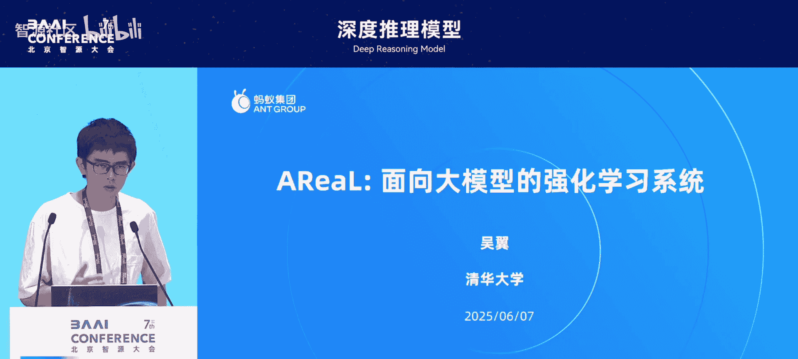
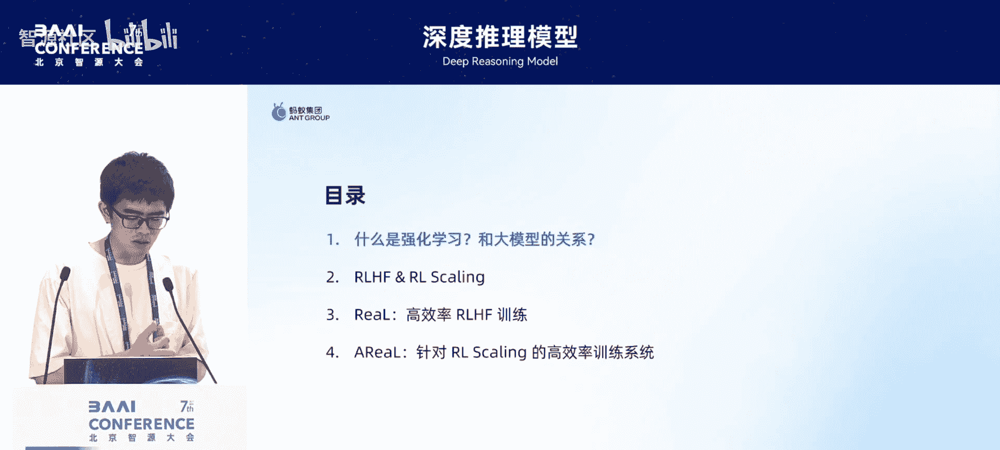
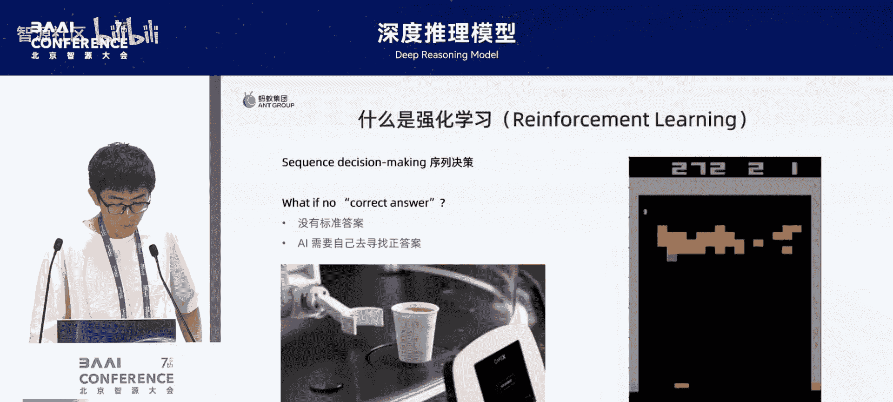
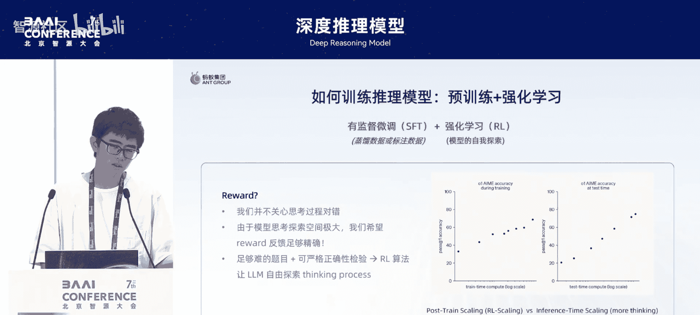
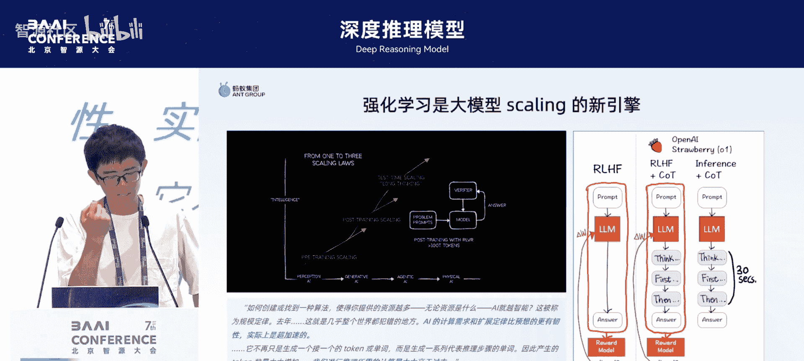
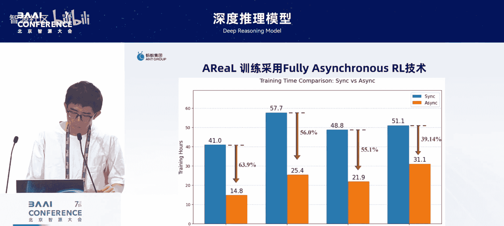
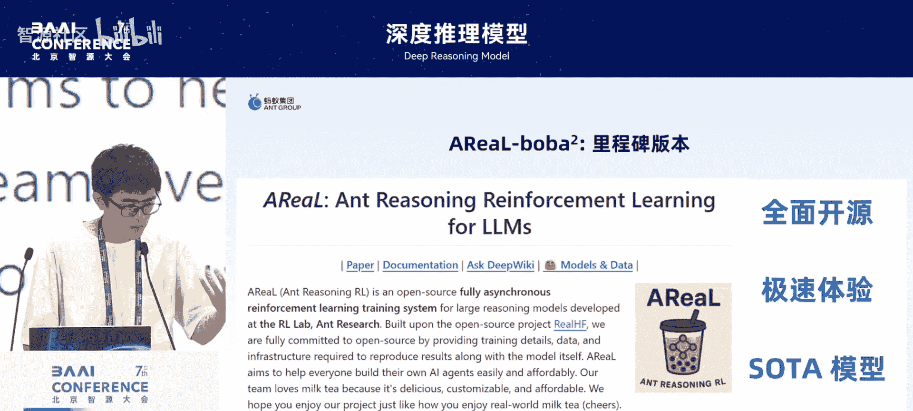
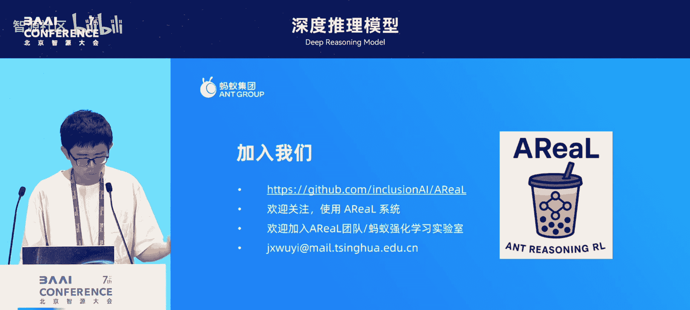

# 2025北京智源大会-深度推理模型 p04 面向大模型的大规模强化学习系统：吴翼 -BV15UNszsE8T_p4-

好，非常非常感谢。然后。😊，呃，能听到吧。好，非常感谢有机会跟大家来分享一下我们现在一些工作。啊，今天讲一下我们最近一直在做做了很长时间的一个系统叫ar realo。啊。

然后因为今天我也感觉到好像大家的这个背景都比较比较分散一些。所以我也想借这个机会跟大家也科普一下强化学习，科普一下大模型和强化学习的关系。所以我们今天这个报告可能先从什么是强化学习。

跟大模型有什么关系开始。😊。

那什么是强化学习？对吧？首先强化学习呃，从数学上讲，或者从定义上讲，它叫一个解决一个序列决策问题。那你希望学习一个模型在一个复杂的问题里，比如说打游戏，比如说端一杯咖啡这样的任务里边去找到一个好的策略。

那它有个特点是其实没有没有一个绝对意义上正确的策略或者绝对意义上错的策略。比如说呃我拿咖啡，我是拿左手拿还是右手拿，其实没有关系的，反正喝到就可以。我打砖块往左边打还是往右边打，其实也没有关系。

因为我只要拿到分数高就可以了。所以强化学习解决的这些问题，往往是这种没有标准答案的问题。他需要AI自己去探索，然，找到一个比较好的策略。

那所以强化学习有些重要的组成部分。比如说它有个东西叫智能体，这个智能体跟环境进行一些交互，它有动作，从环境中间观察观察到了一些呃观测，然后呢不断的通过自我进化、自我迭代和探索来最大化它的奖励。

最后得到一个比较好的策略。比如说一个玩智豆人，玩的很好的一个智能体，这是强化学习的这个重要的组组成部分。那所以强化学习的算法的核心。

其实所有强化学习算法的核心都是探索和这个这个或我也不知道中文怎么说比较合适啊，就通explorationexportation的 trade off。比如说有你在美团上点外卖。

那么到底是你应该去看吃一家新的外卖餐厅，它到底菜好不好，还是说我就在过去里面，我就印象里最好的这个餐馆一直吃这个叫exportation。我发现一家新的餐馆叫exploration。

所以所有的算法基本上都在做这么一件事情是让模型去探索，然后去不断的选择他探索出来最好的那个策略。呃，那强化学习其实有很多出圈的时刻了，我们都知道强化学习是因为10年前的阿go啊。

就是当时在围棋项目上击败了李世实。然后后来openAI啊，我当时在I工作的时候，19年的时候，当时是在dota项目上击败了这个最好的人类呃，团队，当时是OG。所以其实他出圈是在打游戏上出圈的对吧？

大家知道强化学习是因为发现打游戏上他特别厉害。啊，那有人就说了，那么跟大模型有什么关系，对吧？我们很经常会说大模型made强化学习great again呃，10年前一个出圈的东西，然后最近又火了。

他到底有什么关系呢？所以我们来先看看大模型是个什么东西，对强化学习大模型的结合点有两个点，一个叫IHF一个叫I scaling。所以我们来看看这两个东西到底跟大模型有什么关系。先看大模型是什么？

大模型大家的训练的方式叫next token prediction，用人话讲叫熟读唐诗三0百首不会做诗也会赢啊，我怎么训练一个模型说人话或者写诗呢？我给他看好多好多这样的诗歌，他看多了，每次记多了。

有一天他发现哎他也可以写诗了，它叫next token prediction多看多记多写哎就学会了。呃，所以你会发现这两件事情其实不太一样，对吧？强化学习我是有一个智能体，有一个游戏环境。

然后让AI不断的里面尝试，他自我尝试，有好的东西，有坏的东西，然后有反馈进化的。语言模型呢熟度唐诗三0百首不太一样，对吧？我是把所有的好的东西都喂给你，然后你看的越多，你记下来就可以。

所以强化学习是有一个try and error的过程的。而语言模型不是语言模型把所有的答案都告诉了，你记下来，所以他们之间有什么关系，为什么这两个东西最后合并起来了，对吧？

就是在这两年 magicalagly合并起来。其实这个事呢是这个出现的这个结合的点叫instruction following啊，这也是cheGPT火，是因为这件事情火的。

因为在cheGT2022年年末啊火爆全球之前，其实大家没有人觉得这两件事情有什么关系，但有一天他们解决了这个问题，然后要强化学习。这个进入大家的视野，有是什么问题呢？叫呃叫in following。

叫听从人类指令。比如说早期的GBT3，你给他一个指令说explain moon landing six year old in a few sentences这句话其实人类是有目的的对？

我希望你帮我解释一个具体的具体的故事。但是你看如果GPT3早年的AP它会不断的重复这件事情。因为他在做exken prediction他在预测下个词是什么，但他并没有真的去理解人类的指令。

所以这个问题叫instruction following人给了一句话其实是指令他希望让AI能遵从这个指令，然后让这个GT变得有用，很多时候大家都觉得这大模型没有用，是因为指令遵循做的不好，那怎么办呢？

所以当时openI说我们可以用强化学习来解这个问题怎么解我们用强化学习，我们用个奖励的方式来解那么奖励需要强化学习用来解这个问题他需要一些模块对吧？他需要有智能体。那智能体这很简单，就是个大模型。

大模型的说话，那没有任务有没有。环境有这个指令本身是一个任务，是一个环境啊，动作是什么？动作就是输出的所有的文字。那么奖励是什么？奖励比较麻烦一点，对吧？奖励那呃人类的指令人类的奖励到底是什么呢？

那就是只能让人类来标。所以当时被出圈的这个工作叫instructGPT当时提出的方法呢叫RLH基于人类反馈的强化学习。其实本质上就是在这个强化学习的范式里面把奖励这件事情补足了啊。

就是他让很多人来标大模型说的对还是不对，反正是instruction following人类指令人类指令遵从，所以让人类来判断的到底对不对。所以他学习了一个模型来来来表达这个人类的反馈的奖励。

然后来解决了这件解决了指令遵从这个问题。同时一瞬间让大模型出圈变成GPT了。所以这是第一个IH就是让强化学习和大模型结合在一起，叫指令遵从。

所以我们知道那个时候的范式是我们通过预训练得到了一个很好的预训练语言模型，然后通过强化学习HF来做后训练post training。然后呢得到了一个好的有用的模型或者叫tra类模型叫GPT。

那其实呢在这个是强化学习很早的一个范式，但这个范式其实并没有改变强化学习的scaling law。一般来说，这个IHF的迭代次数是很少的，它并不会提升模型的能力。

所以有一个问题就是说那么强化学习能不能提高AGI的智能。除了让它变得更听话之外，能不能提高智能。那这里就是在去年这个O one系列r旺系列模型推出来了一个新的事情叫reaing。

他让大模型像人一样思考说的什么事呢？是说所有之前大模型的话都是给一个指令，大模型立刻把答案给你，但是人其实会想一会，所以呢说怎么办呢？他说那这样这样的话怎么让模型想一会呢？那不如让模型图一点字啊。

涂点thinking你先写段草稿，写完了之后再告诉我，然后呢这样的话就发现大模型可以输出的更准确，智能水平更高。所以举个例子啊，比如说让这个算24点，他会先想好一会想好以后就会告诉你一个答案是正确答案。

啊，所以呢这里就会几个部分有一个提示词，有思考的文字，然后思考完了之后再输出答案啊，那当然这个。呃，这就是推理模型推理模型就这么来的。然后有推理模型之后，大家发现呢？呃，因为呃怎么定义奖励呢，对不对？

然后其实大家会发现你思考的过程是什么样。其实我们并不关心了。因为你希望只要答案对就可以了。所以这里面其实是用强化学习，让大模型去探索怎么思考这个过程。对思考的过程是没有关系的，自己探索就可以了。

最后只要答案对就可以。所以这是一个强化学习非常标准的训练范式，让大模型探索，最后我给你一个奖励，奖励是一个比较标准的标准答案是否对错的一个过程。那通过这样去强化学习去训练推理模型之后。

我们会发现唉训练的时间越久，在测试的时候思考的时间越久，它的正确率会越高，这就带来一个新的这也是老黄在这个GTC大会上的一个一个新的这个PPT叫。

那之前我们预训练有了所大家会发现好像强化学习变成了一个大模型新的引擎，就是通过大模型自我探索思考来提升模型的。

Yeah。好，所以说了这么多啊，我们讲了强化学习和大模型。那为什么我们需要一个系统呢？啊系统也很简单，我给大家看一看，看一看，就是看一下这个里面到底难在哪里啊。比如说我我写了一个算法。

叫PPOPPO是最常见的一个强化学习算法。强化学习算法呢，它就会有个表达式对吧？一般做算法的同学都会说哎，我把表达式写完了算法结束了。但如果我们仔细来看这个算法，里面有一些模块。

有actctor一个大模型reference算概率的，有reward算奖励函数的呃，有ctic。每一个都是一个大模型。虽然这个公式非常简单，但是每一个都是需要好多好多卡，好多好多计算资源。

好多好多加速方式去做的这么一个大模型，有四个大模型都需要并性化的计算，需要好多卡。啊，然后呢我们把它就如果真的把它写成一个这样的一个流程图来看的话，PPO的运算不光有4种不同的大模型。

它同时还有不同的计算任务，有生成任务，有算概率的这种in任务，也有training的任务。不同的任务，其实它的计算模式也不一样。但还有还有依赖性。所以仔细来看，你想把一个强化学习的算法执行好。

挺麻烦的有大有不同的大模型，不同的计算任务，还有dependency。有人说特吴老师，其实我这个写一个我也会写，对吧？特简单，你不同的任务就调不同的包，我有我有比如说我有4张卡，我有生成任务的时候。

我就调生成的包，然后有推理任务时候，推理的包训练的时候用训练的包，我就这么写，啊，可不可以这么写，可以这么写比较简单，因为我顺序执行所有的任务它好处是有的。比如说它很容易实现。

比如说因为你每次任务就做一个事嘛，你用了所有的资源去做所有的事。所以其实GPU的等待时间是很少的。这么做是O的。但是它有问题，就是因为你用很多的卡去做同样的事情，其实中间有很多的调度成本。

有很多的 overhead，其实它会很慢，它会很慢。而且因为不同的大模型计算模式不一样，它所需要的并行策略和优化模式也不一样，它就会非常非常慢，那应该怎么做呢？所以。😊，我们希望对于不同的大模型。

不同的计算任务能够有不同的并行策略，能够多做一个比较高效率的调度。所以我们就有一个呃，比如说这里不同的任务其实是可以并行进行的对吧？它不需要用同样的卡做同样的事情。

不同的计算任务有不同的计算的任务的这种最好的模式。所以呢这是我们今年的一个一个paper吧，就是我们写了一套系统叫real，就是我们去年写了一套系统叫叫叫叫这个名字还可以吧，叫real。对呃。

他有个策略就是他有个这个核心思想是说我对不同的任务。比如说蓝色的这个线叫act a有生成任务，有训练任务。在生成任务阶段，他用所有的卡用不同的并行策略。在训练的时候用两用一半的卡，用不同的并行策略。

我可以在不同的任务阶段时间去动态的调整不同的卡不同的计算这个大模型到底用多少卡，用什么样的计算策略，同时能够能够该并行的时候并行概序列执行的候序列执行。

这样的话就会有一个好的效果是达到了很低的通信同时有比较呃低的GPU等待的时间，最后就会有很高的训练吞吐。这个呢其实是我们发表在今年MC2025的一个一个一个pa。

就说当然我这里比了很多这个论文在H的这个任务上比了很多系统。当然我们不是说所有系统不好，就是我们在那个发paper的时间点。因为所有的系统迭代都快嘛。在那个时间点我们做跟一些同样的系统去做比较。

你会发现做一个比较精细化的这种。进行策略的评估会达到最好的效果。其实会有一个啊1。4到3倍多的一个speed达会很快。当然对于算法的同学来说，系统跑得快，你就可以做更多的实验，对吧？就会有更好的算法。

所以这是我们re的系统，就是做IHF训练的那当然最近别人就说了，那是吴老师我们最近这个推理模型这么火，我们不要做IH我们做推理模型，所以我们也在去年之后把这个系统稍微更新了一下，它叫aral啊。

就是也是跟蚂蚁研究院一起合作的，做的这么系统叫那么是针对强化学习推理模型做的新的一套的这样的训练系统，我们希望它依然个很高效，可以比较灵活，可以支持索塔模型的训练。那有就说的难点在哪，对吧？难点在哪？

我们画了一个这个比较的图啊，右边是这个任务的区别，上面这个任务是对话任务IHF的任务主要是对话。然后呢，现在对于推理模型来说，那么是coing任务或者数学题，反正是很难的这种需要逻辑思考的这样的题目。

呃，左边是它的算法流啊，就是你左边是RUH上面是RUHF的算法点特别多，对吧？然后下面是reasoningRL推理RL的这个算法图。你会发现其实简化了不少。所以人就说吴老师这个不用那么麻烦了。

原来这个点这么多，现在下面只有4个点了，好简单啊，是不是那你这个系统是不是直接拿过来用就可以了。那其实也不是这样啊，有了推理模型之后，其实有它一些自己独特的比较恶心的地方。

什么地方恶心呢它最大的恶心的地方就是在于推理模型的输出长度真的很长真的很长。那比如说在HF的时候呢，一般来说大模型输出2K到4K token就可以了，比较短，而且比较工整比较工整。

但是对于reasoning来说，32K起跳32K或者16K到32K起跳，这是10倍的长度增加。长度增加带来什么问题啊，当然除了长度增加，它不光它不是固定的增加，随着训练的增加长度会变化。

尤其是特别容易发现的是随着训练的增加长度在不停的变大好，输出模型的长度在不断的变。但你的卡数是固定的所以会导致他所需要的显存的。😊，这个占用也越来越大。所以大家特别容易发现的问题就是在推理RL过程中间。

你特别容易OOM跑着跑着崩了，对吧？你实验跑到一半崩了啊，这怎么办？就得重来就很痛苦。啊，而且更糟糕的事情不光是呃随着训练平均长度的变长，每一道不同的题目输出长度也变化特别大。简单题，输出长度很短。

难的题出长度超长，变化特别特别大，可能从几百到几十K。这是所以呢怎么说呢？呃这个事儿就是这么一件事情，叫不同的输出长度真的变化好大，而且特别长。你就需要对于这个事情做非常非常认真的优化和处理。

不然就容易出事情。啊，所以我们来看一下吧，那我们需要做什么，对吧？首先。我们要说的是这个生成在整个R推理训练中间，这个inference的任务其实占的比例非常非常少。

主要的所有 overhead都在生成和训练上占用了把超过95%的GPU我们分别来看一看呢对于这个超长的序列我做哪些工作。比我实做了一个小的技术呢叫是啥呢？

因为一个 batch里面的这个输出长度特别大有的特别短特别长那你怎么把它丢到训练器里面去训练呢？有人就说吴老师可以dding补零呗你可以补零就是把红色的部分都补零那补零呢就会导致你浪费了好多好多PU的计算啊。

就效率很低，有人说要不打打包对吧？打包变化长度特别大，你不能随便打，以呢你需要怎么打包呢？你需要贪心的打包短的和长的放在一起尽量的把它打在比较少的包里。那么这样来说一利用PU的计算。

其实你减少了 batch的数量就会速度比快。所以呢我们这也做了个比较。如用。基本上可以提升一个20%的20%的时间还是挺多的，挺挺多的一个训练上的提升。啊，除了训练，还有生成。生成一样的问题，对吧？

有好多好多的prom有好多好多的输出输出变化的长度差特别特别大。那有人就说我们还是一个简单的实现的方法，我说吴老师，我能不能这么写，我就生成。然后呢，对于所有的prom的输出一个输出。

然后呢输出完了之后拿着它过来训练。然后呢，我再输出再训练。这是一个非常经典的也是非常常用的常见的一个强化学习系统的实现方式，我就是用所有的卡去做生成，生成完了之后，我去做训练，一步一步一步这个依次进行。

😊，这有什么问题呢？还是这样，就是所有输出的长度变化太大了。如果每个批次的需要的数量，这个数据的数量，一个bach是固定的，所以会带来什么样的问题呢？是如果你仔细看这里有好多白色的地方。

第二个bach有很多白色的地方，第三个bach也有很多白色的地方。所以如果你用批次的概念来处理生成的话，那么因为一个批次里面有超长的那一个你必须要等你需要等那个最长的序列输出完了之后，这个批次才能结束。

所以就一定会有很多的GPU浪费。这导致你为什么慢？当然还有一个，比如说切换的成本，比如说你从生成切换到训练，这个本身工程上是有切换成本的。所以我们做了12呢，我们A要用了一个异步训练的方式。

完全异步的训练的方式。什么叫异步训练？就是说我生成的模型从来不停，它不等任何人就不停的生成，不停的生成。那在另外一些机器上呢，有些训练的节点，训练节点一旦他们有足够的数据就进行训练。

训练完了之后跟生成节点去同步模型的位置。这样的话，因为生成没有任何的气泡，他用上了所有的GPU的资源，所以它会很快。那当然有人就说了，其实你这个系统设计很好，有没有一些新的问题呢？

因为异步的训练其实也带来了一些新的问题。比如说之前我们会发现有一些特别长的输出的话，它会横跨特别多版本，对吧？原来是以同样的模型生成了一个输出，然后拿来训练模型。现在是有个输出。

可能横跨了好多次模型的更新。它横跨了好多的版本，它是有不同的版本的模型生成的。😊，它会带来一些什么问题呢？它会带来一些训练效果上的问题。这里有个很重要的概念，叫stillness成就度。一个序一个序列。

如果它横跨了多次模型更新，那么第一次生成它的模型和当前模型的这个输出的呃这个版本差叫stillnesstness是一个非常重要的异步RL里面的概念。

你会发现在异步RL中tillness越大效果越次效果越次。所以这是一个很糟糕的事情，就是你会发现你虽然系统的设计并带来了很快的加速，但是模型效果不能保证这个系统也是白费了。

所以你会发现在传统的异步像这个按摇训练中，你stillness越大，效果越差。那怎么办呢？所以做了一个系统和算法的codes的工作。系统层面呢，我们希望用一些系统的机制来控制生成的吞吐。

能够稍微该等的时候等一等，不要出现特别糟糕的这个ness的问题，可以用一个参数来控制你允许的ness这个这个程度。第二呢我们改进了一下P的算法让P算法更能容忍这种比较旧的数据。两边加起来。

你会发现对于这个右边的这个系统的asynchronize训练，对于很大的ness可以到8甚至16，其实它也不会带来最终效果上比较大的改变。O所以呃总体上加起来，你会发现在模型效果不变的时候。

我们会达到一个2。77倍的加速很大的一个加速。就原来只能跑一个实验，现在可以跑3个。

嗯，当然就最后我们就打下我们的广告了，这是我们这个一个是一个我们的开源项目叫我们这个最新的里程碑版本叫，因为呃我们都很喜欢喝奶茶啊，然后我们也希望这个这个项目是跟奶茶一样又比较便宜。

但又很喜欢又比较个性化。这也是一个完全开源的项目们开源了所有的代码开源了所有的数据开源的所有的模型，也希望所有人都可以去复现。然后也可以去复现ta的模型，同时也可以让大家训练的速度很快。

然后我们基本上每一两个月都会有一次大的版本更新。这是我们最新的次版本。那么这个版本里面ta的模型呢是我们在上用千问34后在上做到了6。1这应该是开源模型最好的一个14B模型的一个效果。

基本上跟千问235的果差不多。然后我们也公开了所有这样的数据，然后也是完全可复现，我们也欢迎所有的同学去关注我们这个项目也去复现这个最好。😊。

它的co定模型。啊，那最后就打个广告了，然后就是我们A real项目，然后欢迎大家关注，然后一键三连。呃，然后也欢迎大家这个加入A real团队，然后也欢迎大家加入蚂蚁强化学习实验室。

然后大家如果任何的问题，然后对ar real有问题，或者想读博士或者怎么着，都可以给我发邮件，我的邮件写在这里。然后大家也应该可以找到我的联系方式。好，谢谢大家。😊。

因为因为时间关系啊，我们提。我们提那个一个问题吧啊，好吧。嗯。有没有同？那没有，就请于老师来提。😊，感谢王老师的报告啊呃，关于这个成就度，那既然他已经有这么成旧的数据。

是不是可以考虑用 policy的方法呢？对，就是其实算法改了，就是把那个这个呃important sampling的那个trus region要改一改。

因为传统PPO的那个reference policy是很老的那个版本。它的 behavior policy。因为你的ynchronize的时候，它那个be policy可能跟你版本差了很多。

如果你直接这么改的话，就会你的poli就会被最老的那个版本拖着走。所以呢你就需要做一些这样的修改，模型能的更所以就是那些传统啊其实就把当年那些of policyynchronize的算法拿过来。

然后找到了一个计算量在大模型时代还比较可控的方式就会有用。对对对，但是系统上也要做好多操作啊对。😊。