# 2025北京智源大会-深度推理模型 p05 世界模型与决策推理：俞扬 -BV15UNszsE8T_p5-

好，非常感谢主办方的邀请啊，非常感谢啊我们赵老师的邀请，以及啊我们前面丁老师和吴老师已经把强化学习和大语言模型已经讲清楚了啊，这为我的报道省了非常多的时间啊。

所以我们知道这个chGP出来了以后呢啊如同刚才吴老师讲到的啊这里面用到了强化学习所以这个对于我们强化学习的研究者来说是一个很振奋的消息啊，这个。

所谓的make are you great again。呃，前面其实这个吴老师已经讲清楚了，在强在语言模型里面呢，那么前两步我们做监督学习或者是微调的时候呢，都是在预测下一个token啊。

那么用在强化学习上面的时候，这个时候稍微麻烦一点，强化学习的这几个基本的元素啊，就是关于我怎么做观测啊观测呢就是我们这句话的前面的部分。然后呢强化学习还有我的行动。

那么行动在这里呢直接对应到我的token上面去啊，那么我们的环境是什么呢？那就是我生成的下一个token会贴在我的这个状态上面。所以这个转移非常的简单啊，所以最后还有一个因素，只要这个因素补全了。

那么它就可以完全套用强化学习的框架。这个因素就是奖励啊，其实前面啊这个丁老师也专门讲了这个很多关于奖励的事情。那么这里呢其实我特别想强调的一点，就是当强化学习的框架，这几个要素已经完全具备了以后。

我我们训练强化学习啊，用强化学在训练这个语言模型是不需要数据的。

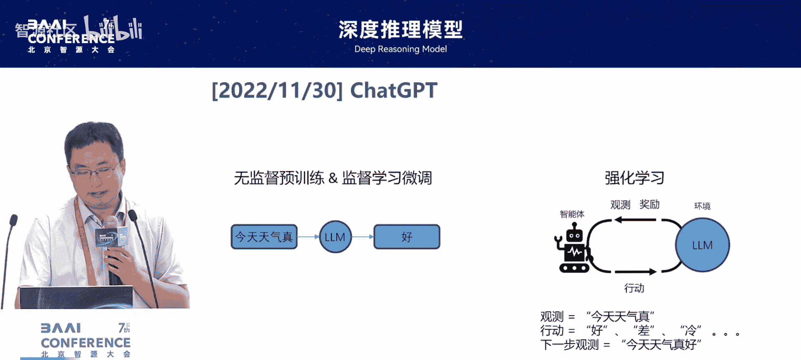

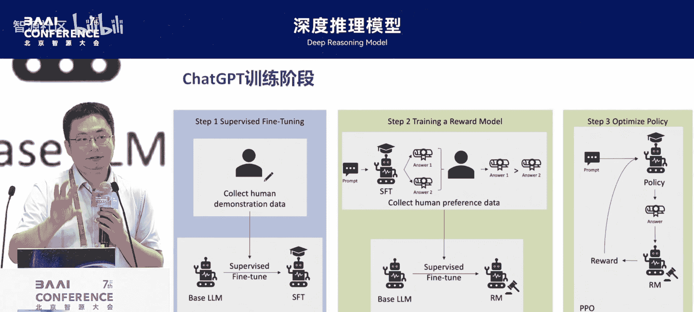

啊，因为他又完全靠奖励自己去找啊，所以这一点呢是对于我们提升啊语言模型的泛化能力是非常关键的一点啊。那么在签了GPT出来了以后呢啊特别是啊由于这个呃PPO是这个open eye自己发明的为数不多的算法啊。

所以在在这个呃在openi讲像GPT的时候呢，特别把PPO这个算法给提了出来啊。其实呢这个呃很多的强化学习方法呢，在很多问题上其实表现的差不多啊，没有那么大的差别啊，PPO里面并没有什么神话。

但是呢我们看到的是啊当openi啊，在22年啊11月30号把这个op把这个这个GPT开放出来了以后呢，大概在8年的时间里面没有人能很好的复现这件事情啊，其中一个主要的问题呢。

就是啊做强化学习非常的麻烦啊，其实刚才这个吴老师已经讲的很清楚了。

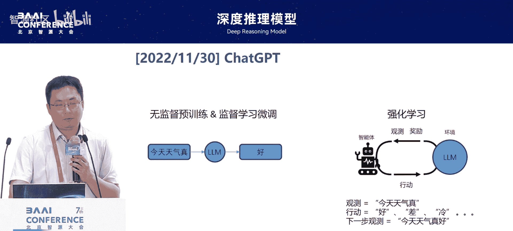

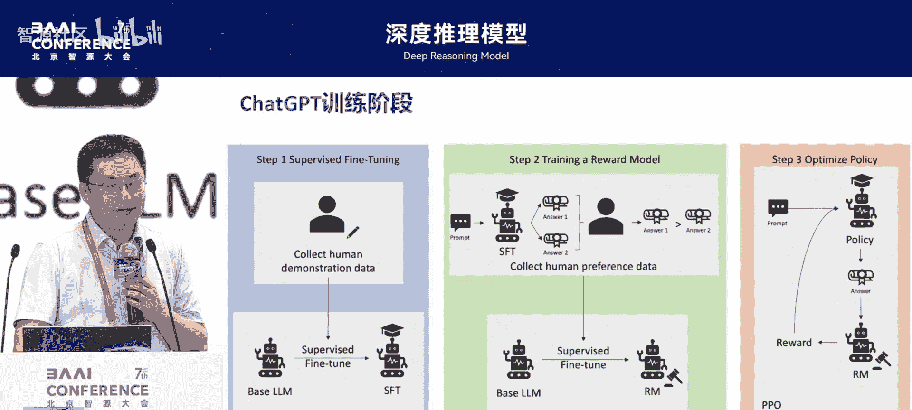

啊，强化学习里面呢要涉及到除了我的语言模型以外呢，还会涉及到别的东西。比如说它里面的cit或者叫做valueue模型。这个模型呢和大模型一样大啊，所以它整个要跑强化学习的话。

比跑监督学习要占用的内存量要大的多啊，所以这个是我们看到右边呢是这个啊deep seek在复线的这个过程中报告的这个时间，而且它时间特别长啊。

所以我老师专门做了这个啊能够跑让它跑的更快的啊这么这么一个框架。

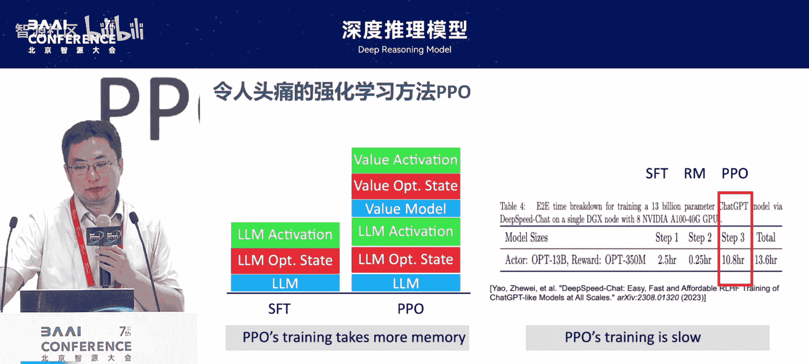

啊，所以呃这个在。呃，2023年的年终5月份的时候呢呃当时这个包括有斯坦福的这个团队呢呃做了另外一个算法。这个算法呢叫做direct preference是一个我们认为是个监督学习的算法啊。

他认为他和RLHF里面呢是有完全等价的目标啊，所以他可以用来代替强化学习的方法啊，这个对于一方面呢对于我们做强化学习的人来说好像是一个噩耗啊，这个本来还有一个环节用强化学习的好像也可以不用了啊。

另外一方面呢这个工作的影响力非常强。我这个呢已经是比较老了，他现在已经差不多接近4000了啊，是一个非常有影响力的工作啊，而且呢还获得了这个new3的standingroup的奖啊，所以这个工作。啊。

为什么他可觉得这个啊可以用监督学习代替强化学习呢？因为通常强化学习。我们假设它的reward model是一个黑盒，我们不知道它的里面的奖励模型是什么样子的。

但是呢在RLHF里面这个re model是我们自己设定好一个目标从数据里面学出来的啊，所以把这个目标和强化学习目标合在一起以后，它其实可以变成一个目标但是呢啊这个如果说它和强化学习一样的话啊。

那么我们觉得从直觉上来说就觉得有问题啊，所以我们后面在做了一些分析啊，那么是不是这个DPO这个算法确实是可以替代强化学习呢，后来我们发现至少有两个地方是不一样的啊，虽然它从数学目标上的等价的。

但是它实际的实现的时候呢，第一奖励的表征函数是不一样的啊，前面的这个DPO呢里面呢，它是隐视的表示了这个奖励模型那么在强化学习里面我们是需要显示的把这个强化这个奖励模型表达出来那么这一点的差别呢。

可能会带来3分之1的误差。那么更重要的是，我们前面讲的强化学习的这个框架里面啊，一旦所有的因素具备了以后，我们是不需要有训练算数据的。我不需要知道每一个问题的正确答案是什么啊。

我直接用这个re model我就可以去让这个语言模型得到提高。但是作为一个监督学习的方法的话，我是只能在我给的有答案的数据上来训练啊。

所以这两者呢它的差别可以使它的误差能够在我们设定的一个简单的环境下面呢可以达到一半以上啊，所以我们在23年年底把这个东西啊，把这个结果做出来以后呢啊就来讲说这个两个是不一样的啊。

其实呢当时它的影响力已经达到几乎所有开源的模型全部用的是DPO来做最后一步对齐但是呢我们就啊呼吁的是说这两个其实不一样的啊，其实今天我们倒过来看，除了性能上不一样以外，那么更多的使用强化学习会。带来啊。

其实刚才已经讲到了它的推理模型的进步。啊，如果我们就落在DPO上面，那实际上是不会用的，不会产生推理模型。啊，因为你就放弃了强化学习这个啊技术路线的啊，反而是像openI啊。

像这个专书曼专门提到这个工作啊，就是其实oppenI里面没有啊这个很重度的去使用DPO这样的算法，还是在用强化学习啊，所以后面导致了我们推理模型的产生。啊，所以这个是啊一开始我们在23年开始来呼吁。

后面呢看到了也有更多的工作才发现啊，其实DPO会导致我们的泛化性不是很好，性能上面的各种缺陷啊，所以今天呢我们看到了更多的是把强化学习啊再用上去啊，所以强化学习，可以啊进一步的归 again啊。

但是呢这个很难训练的这个问题呢，在当时还没有得到很好的解决啊，可能当时如果有吴老师的这个框架的话，已经可以啊非常快的训练起来啊，但是呢我们看到啊要把openI的这个PPO算法要跑起来的话。

实际上是需要非常多的算力啊，因为光是这个显存的占用量就会打啊就会打很多。

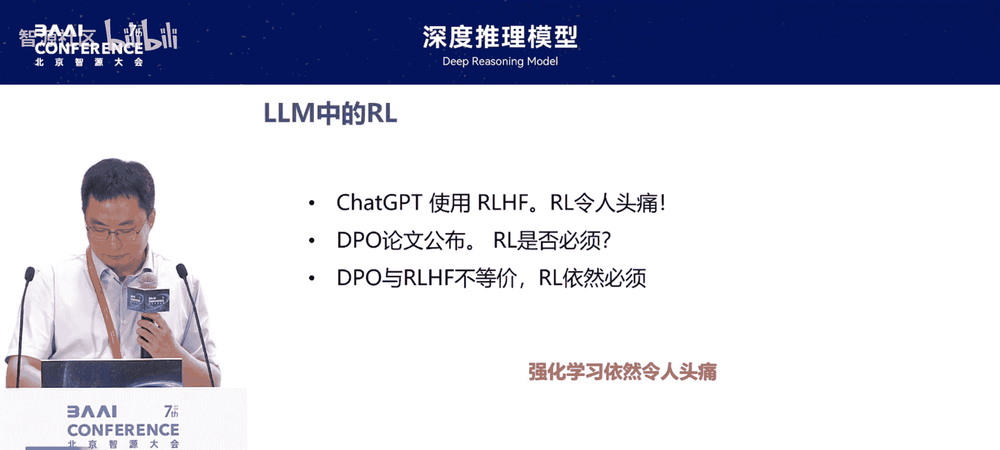

所以在23年的年终的时候，我们也来想啊啊，特别是对于我们高校的团队啊，基本上是没有办法去复现这么大的这个计算资源啊，所以我们想的是啊能不能简单一点啊，不要做这么复杂。其实能不能简单呢，其实是可以的。

因为我们发现的是在语言模型里面呢，没有像通用的强化学习那么复杂，特别是关于语言模型的转移。我们所谓的转移，就是把我啊预测的下一个动作拼到我的状态上面去，就变成下一个状态啊。

并不会产生有其他的一些啊像我们在通用强化学习上面面对的不完全观测呀，不啊这个随机的一些因素啊，在里面。所以当它的设定其实是更简单的情况下面呢，我们可以啊取消一些复杂的制度在里面啊。

比如说我们不要这个valueue model的。啊，但是不要用valueue model行不行呢？啊，其实valueue model在强化学习里面呢啊。这个过去花了啊十几年的时间才发展起来。

实际上是使得啊这一类叫做基于啊策略梯度的方法能够变得稳定的一个很关键的一个因素。以取消了以后那么我们的算法还稳不稳定啊，所以这个又需要找一个啊baseline来让它变得更稳定啊。

那么我们实际上发现呢对于语言模型，这种简单的来说呢啊是可以把它取消掉了。我们这里呢是找了一个啊一个启发式的一个baseline啊。

就是让大模型自己输出一个啊这个生成的一个句子来作为baseline就可以。那么我们显示出它可以减少一半的内存的开销以及啊这个实际上训练时间也能够缩短了一半啊。

那么这个工作呢其实基于我们一直想证明这个减少这个ve model是可行的。以我们在24年的年初的时候呢啊基于当时比较好的这个模型呢来训练的一个在。

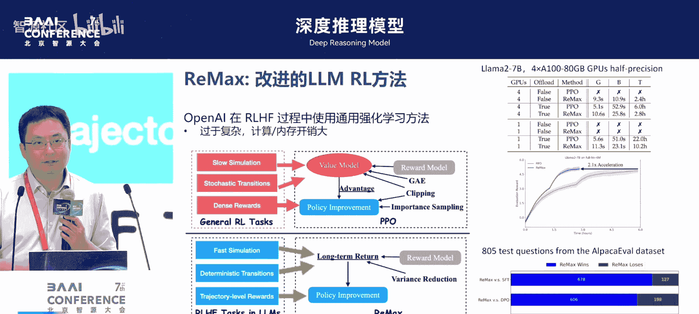

榜上看到确实能得到得到比较好的效果。而且呢这条路线呢我们看到在24年年终的时候啊，google的开源的模型，这个gema呢里面也使用到了相似的。

它成为这个reinfor大写的reinfor这个算法的一个变种。大写的这个reinfor就是2000年啊已经20多年前呢，25年前啊发表的一个非常简单的强化学序算法。

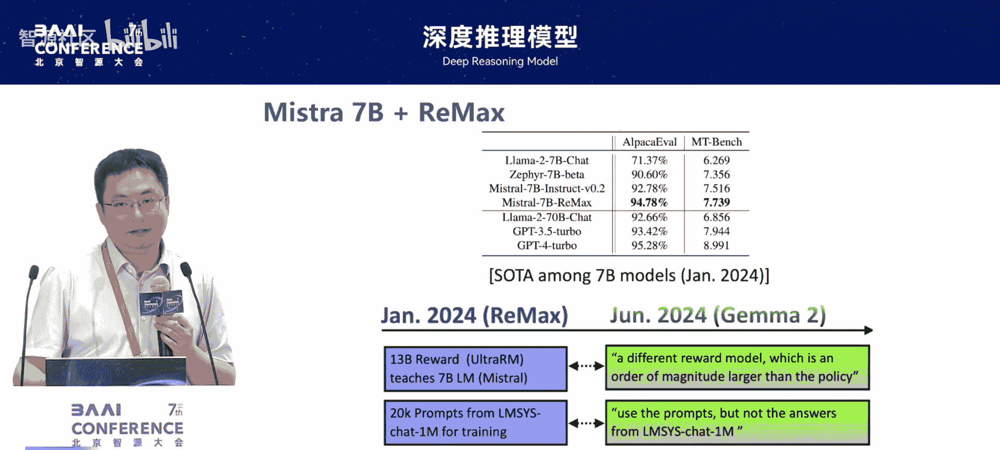

啊，那么之后呢我们看到有更多的这种去掉了啊它的valueue model，让它变得更简单啊，但不同的方法呢其实是在寻找有不同的baseline啊，只要我们的base night能够选的比较好的话啊。

那么对于这个语言模型来说呢，其实我们都可以让它比较稳定啊，所以这个也包括了这个啊后面包括de的这个加RPO啊，这个是24年啊，然后我们看到这一条线上面呢，已经开始逐渐产生啊不同的算法。

那么这些算法的出现呢，我们觉得啊对于今天的啊更多的开源的语言模型里面，能够用到强化学习去把它训练出来啊，有很积极的贡献。啊，那么这些强化学习。啊，可以跑起来了以后呢。

其实我们里面啊发现了还有一个很大的问题。啊，最终呢我们就发现啊这个整个过程我们现在可以跑了。从啊我们看到che了GPT看这个公布出来的时候呢，我们自己还复现不了，到现在可以复现的。

但是更重要的问题呢是这个其实前面丁老师也讲到了这个reward的问题。啊，那么在RLHF里面呢，是通过收集了人的数据啊，然后从这个数据里面来导出我们的奖励的模型的。

这就意味着其实这个奖励的模型还是需要我们人的数据来给出标记，给出preference啊，然后才能够把这个奖励模型设计好。呃，其实呢在比较早的时候呢呃22年年底的时候。

antropic已经给出一个他自己的设想，就是能不能从啊语言模型自己给出自己的一个啊反馈。那么这样的一个方向呢叫做RLAIF。也是说我们从啊语言模型本身的反馈来作为一个奖励信号。

然后就可以用强方学习把它训练起来。其实这个方面呢。啊，我们的工作呢其实这个也不是第一个了，我们工作应该是第二个啊，但是至少在google之前啊在啊我们的工作里面呢阐明了一件事情。

就是为什么我们可以用AI模型自己的反馈来提升自己啊，这个听起来好像是一个左脚踩右脚可以无限提升的一个想法。实际上呢是因为它的评价能力啊，还是比它的生成能力要来的更简单一点啊，来的更好一点。

所以我们可以用它的评价的能力来改进它的生成能力。同时呢也讲清楚了一件事情，就是这件事情是没有办法持续改进的。因为它的评价能力不能改进评价能力，自己啊，只能改进它的生成能力啊。

所以我们可以用语言模型来作为自己的这个评价。啊，那么这个方向呢，如果啊这个继续往下发展的话，那么其实更多的是。啊，我们考虑如何去啊把我们的这个语言模型里面要用到的这个啊奖励函数呢把它做的更好。

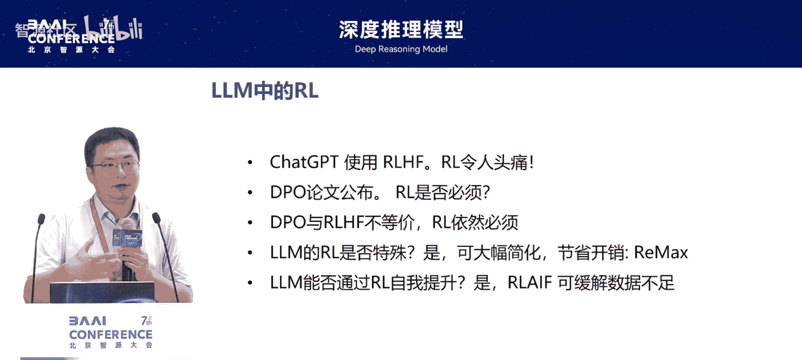

啊，今天呢我们看到啊这个如同前面吴老师讲的啊，现在呢这个推理模型啊用强化学习来增加我们语言模型的推理能力已经变成一个啊能够增加语言模型能力的一个主要的途径了。

那么在去年的open eye的 openen day的前两天啊，其实都在讲这件事情啊，那么O一呢是他公布的第一个啊基于强化学习的推理模型啊，我记还我还记得这个在应该是在24年的时候啊。

这个open eye为了O一的发布呢做了很多很神秘的推广啊，一会儿又是Q星一会又是草莓啊，其实我们现在知道就是用了强化学习啊。

更多的用了强化学习去增加它的推理能力啊那么第二天呢他公布的也是这个reinment的啊，那么呃这个depR一呢也是用了强化学习来使得它的推理够。增强。所以今天我们到这个时间点上。

我们再来回顾呢就会发现啊如果啊在23啊在23年的时候，那么跟着DPU的这个脚步啊往前走的话，那么就到不了啊今天这个做rening model的这个程度了啊。

所以我们觉得啊很多时候呢可能也不是啊这个热点就一定是往好了带，也有可能是往坑里面带。那么未来的发展呢啊除了让我们的系统变得更快，在工程上做的更好啊。

我们这边呢在高校里面啊没有那么多资源去啊把这个大模型给训练出来。所以我们更多的探索的是一些啊能不能做啊未来的一些变化。比如说我们看到今天的语言模型啊要用强化学习的话呢，其实面对了很大的问题。

就是让探索能力，其实是啊不充分的。

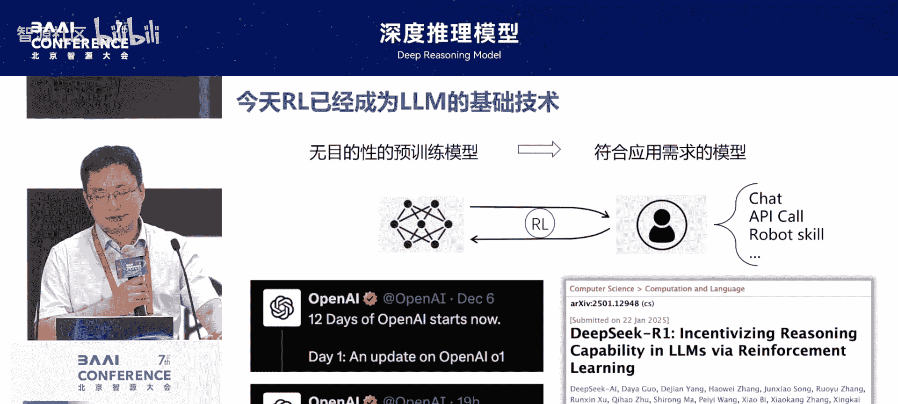

啊，最近呢我们看到有一些啊讨论的论文啊，比如说认为这个强化学习有没有改进它的基模型的这个能力呢？啊，其实呢这里面背后的问题就是强化学习有没有能够做到充分的探索。啊么对于一个标准的R1SF这种框架来说啊。

我们的每一个动作是什么呢？是我的10万token啊，可能15万token这这种规模，这样的规模要做探索的话是非常困难的。也就是说我要探索，我相当于把所有可能的啊token全部枚举一遍。啊。

所以怎么样能够改进这样的结构啊，让这个我们的语言模型可能现在是本身不适合于用强化学习来训练的啊，那么啊我们也有一个工作，让他能够这个啊变得更适合于用强化学习，把它的action space能够减下去。

那么它的探索效率呢就能够得到提高啊，这个是一个方面，那么我们后面觉得更重要的啊，当然可能这个更重要呢也啊在短时间里面可能也不能很好的解决的，就是这个更好的奖励模型。

实际上呢如果我们有了一个完美的奖励模型，那么就等同于我们有了一个完美的语言模型。因为我的语言模型的每一步都可以用这个奖励模型来找出它的最好的生成。啊，所以这个做奖励模型这件事情呢就一定不会简单啊。

但是呢我们觉得这个方向是一个下面可能会非常值得探索的一个方向啊，怎么能够在开放环境里面啊，除了我们的这个数学证明和代码啊，因为这两个呢叫做人造问题，人造问题上面我们可以有人造的verify啊。

去啊判断我们生成的东西对不对啊，在更广泛的这个这个应用场景上面，我们怎么能够有一个更通用的啊奖励模型。这个是一个啊我觉得更关键的一个因素啊，那么今天呢我们看到这个一方面是强化学习。

让大模型变得更好另外一方面呢，这个我今天没有介绍，就大模型也使得传统啊强化学习。那么传统强化学习呢，比如说我啊能在星际上能在这个dota上打的比较好。那么它只能在这个上面做的比较好的。

这个是一个专用模型啊么今天大模型呢也能够让这样的专用模。行变得更通用一些。啊，那么这种啊框架呢啊相互促进的框架啊能不能走向AGI呢？这个啊不知道啊也有可能不行啊。

但是我们认为强化学习这样的从反馈中来不断的提升我们系统性能的这样的技术。那么未来一定是我们智能系统里面的一个核心啊元素。那么啊这个前面也提到啊，像这个今年图灵奖呢就颁发给了啊这个强化学习的两位啊先驱。

那么我们也认为这样的一个方向。啊，未来一定会啊带来一个新的啊希望能够接近于我们想追求的这样的人工智能系统。啊，谢谢。

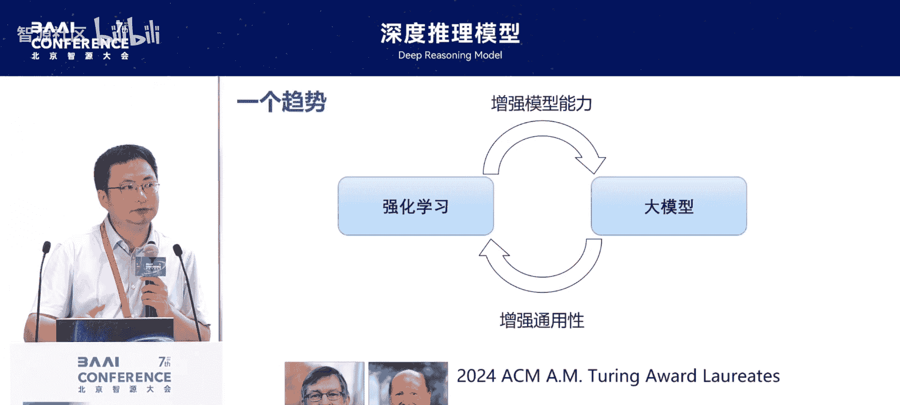

好，请大家提问。呃，于教授您好，我是来自360的呃也AI产品。刚才您讲到一个就是关于强化学习里面有很引其重要的是一个奖励。但是如果随着呃模型不断的发展。

他其实到时候可能已经超出我们人类可以给他提供反馈的奖励的这种时候，那模型该怎么去给他去进化的这种呃 word定了。就比如说像那个您刚才分享的一个就是呃围棋里面那个他有一个神来自比。

但如果他的模型本来是很长，或者是最终的那个规则，不像围棋一样，他有一个确定性的，我们能够定义的这个规则，那后续他该怎么去去进化，我们人可能就没办法给他做这种正确的反馈了。😊，嗯，好，谢谢你的提问啊。啊。

这是首先呢我觉得为人服务的系统。那么人是啊这个系这样的系统，不管它能力有多强啊，一定不会超出人的提供的这个反馈的这个范围的。呃，其次呢我们所说的这个奖励不是意味着我们告诉这个模型正确的答案是什么。

比如说像下围棋啊，那么其实最好最优的围棋该怎么走，人也没有答案。但是人知道他我想要什么，我想要的是下赢所有的对手。我只要有一个明确的目标。那么这个目标就可以引导强化学习去啊解决问题。

那么这个是我们认为强化学习能成为人的智力帮手的一个很重要的一个一个一个原因啊，就是因为我只要设定的目标，他就往那个目标去。啊，那当然了，至于怎么样能够设定一个呃比较很通用的啊。

在各种场景上面都能够表现的啊符合人类需求的这个目标。这当然也是一个非常复杂的问题，我们也暂时没有答案啊，谢谢。好，还有。还有同学想提问吗？老师好，就是我是北国的一个博士生。我作为一个平时的开发者呢。

就是我平时也用大模型嘛。但是目前我发现大模型它是属于它是通用型嘛，但他很难做到各个任务都说某个模型，它各个任务都第一名。这是目前模型很难做到的。可能说我平时写文章的时候。

我会用openI和jimy写代码，会用cloud。😊，然后呢，目前的话我们现在也就是很多研究也也在逐渐说嘛，我们现在开始更加关注评估嘛，以前的模型可能是高分低能，有可能是这种，但现在更关注高分高能。

但是呢任务很多，但是我们很难说说具体每个任务都做具体的微调和强化学习，就是我在强化学习，我就是我比较困惑，就是如何通过强化学习，让模型成为各个领域的第一名。😊，因为越家很残酷吧。

我换1个URL换换换个key，我就可以把你模型给换掉了。对于我们用户来说，就是如果通过强化学习，使得我们的模型成为各个科目的第一名。嗯，好的，谢谢。这个能不能用强化学习呃。

首先我们假设抛开大模型这个事情的话，那么能不能用强化学习成为各个领域的第一名。其实过去强化学习干的就是这样的事啊，比如说打游戏打的比人好，下棋下的比人好。那么解决各种具体的问题的时候。

都能做的比我们可能已知的其他的方法都要好。😊，那么说明这个其实强化学习，我们就是希望他干这样的事的啊。那么在大语言模型上面呢呃它的好处啊其实是呃通用性比较好啊，知识很多，学了很多数据进去啊。

但是呢我们从数学上面可以证明的一件事情啊，就是如果我们在强化学习的这个框架下面来看待大语言模型的话，它其实做的叫做模仿啊，从数学上面呢是有这么一个结论的。我如果A模仿B，那么A的性能一定比B差。啊。

所以。当我们的所有的数据知识都是人告诉语言模型的啊，包括专业的领域的知这个知识都是我们告诉语言模型的。那么语言模型在这个点上面是不可能超过人的啊，如果他只用模仿的方法的话啊，所以强化学习是一个途径啊。

但是今天的强化学习怎么能变得在通用的任务上面，就在专用任务上面，我觉得这个已经是没有问题的啊，在今天我们强化学习在专用问题上面已经开始啊有越来越多的应用的。

就是因为它的每一个具体的问题上面都能够做的比较好。但是怎么样能够让它在各种各样的问题上面和语言模型两者的长处结合起来啊，一个就是专用能做的很好。一个是他又有很多通用的知识啊。

那么啊怎么使得他们两个变成通用上面都做的很好。那我觉得这个还没有一个至少今天把强化学习用上去，我觉得已经是一个很大的进步。但是啊离这个目标还有点距离啊。好，因为时间关系啊。

然后让我们呃可能我们今天提问就到这里结束了。然后呃再次感谢于洋老师。