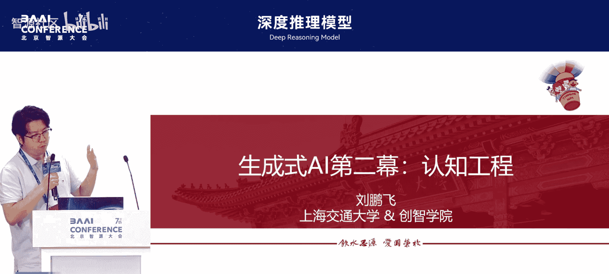
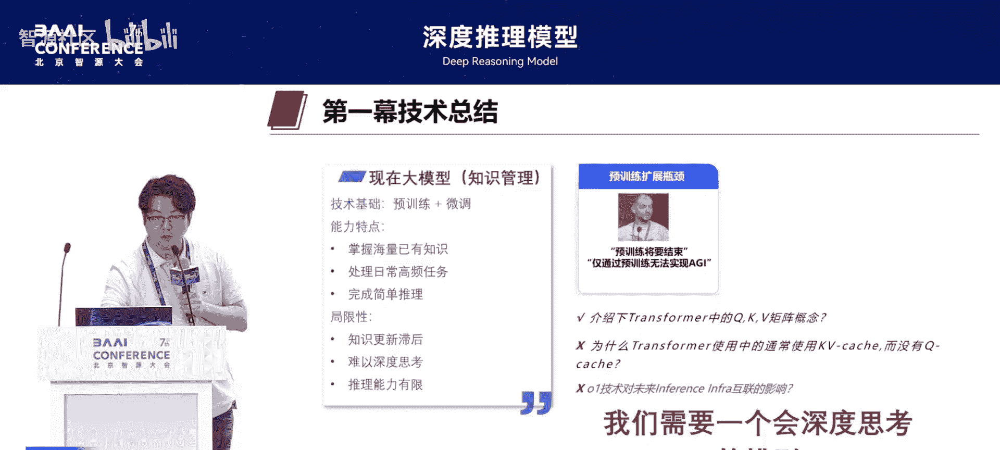
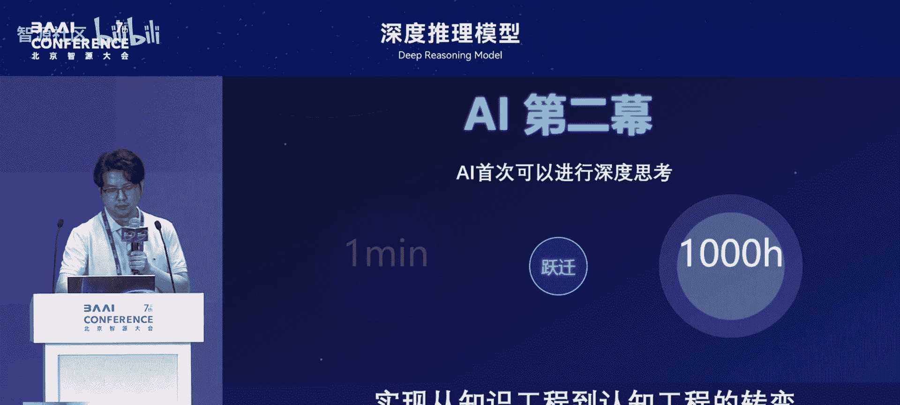
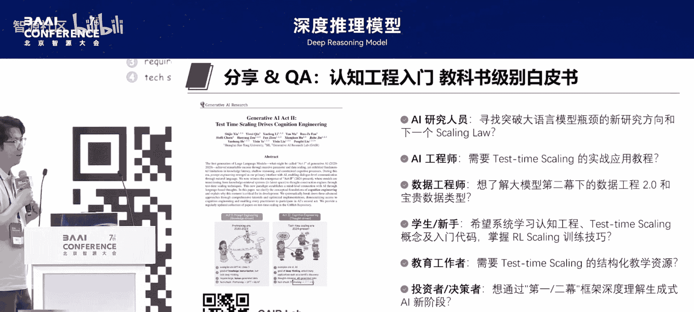

# 2025北京智源大会-深度推理模型 p06 生成式AI第二幕：认知工程：刘鹏飞 -BV15UNszsE8T_p6-

谢谢赵老师。好，今天呃非常荣幸在这个非常好的环境里面，然后分享这个关于这个大模型深度推理。就现在非常好的一个top。然后大家知道其实在没有就推推理这个事情就相当于给大模型带来了更多的可能性。

在没有推理之前，我自己都不相信大模型可以搞到A加这个水平。但有了之后我自己都觉得都在怀疑人类的intens这个事情，现在看起来也不是最un的部分了。

然后今天给大家分享的就是呃就是从那个去年9月份啊op放那个 one之后，其实可能可能我们团队确实是有可能世界上最早去放出去一个 one复现的一个的东西。

然后不管最终我们这从9月份到现在一直在expl这条路啊。然后不管中间有很多试错，也有很多个呃就是poitive的一些reward。

那今天其实是其实总结了我们从过去9月份到24年9月份到现在一直以来整个呃探索过程中，然后我们总结了一个。😊。

这样的一个叙事的一个story line，这样一个叙事结构叫生成式AR的第二幕认知工程。因为这因为这个大模型会思考实在是太重要了。

以至于我觉得是需要给他有一个这个chter或者是actctor不同目的划分，才足以引起大家的一个重视。

然后生圳式人工智能这个大家的概念大家都很知道，这个主要是我这个大都知道的概念，但是我需要这个contest来铺垫一下，就是啊整体AR是很重要的。它正在E这个word。

这这是从各个的这样一个大厂的这个大卡都会的反馈来都可以印证啊。那我们说。我们说大语言模型驱动的生成式人工智能本质上就是一种特定类型的AR它有直接的应用，可以生成不同的模态，甚成各种各样的模态。

它有间接的应用。间接的应用可能更加powerful。因为本质上我们借用的是这种ative power相当于有一个共性的智能的输出，它可以赋能很多事情用大语言模型甚至可以去解学解化学题这种相关的类型。

那生成式人工智能最核心的技术有很多这里面总结两个，我觉得比较关键的一个就是生成式运训，他教我们怎么把这个宇宙中所有数据以向量的形式给存起来，还一个就是提示工程，它告诉我们数据不止可以存存进去。

作为人你肯定要读取嘛为我们所用。那读的方法就是第一次我们可以以人类熟悉的自然语言human language去把无穷无尽的数据给读出来，这是所以才有了一个叫pro一个巨大的工程嘛，它带来的东西非常厉害。

相当于人类第一次有了一次机会和AR有个。😊，这个interface我们之间可以啊去询问各种各样的知识层面的信息。所以我们说大语言模型本质上是人类延伸的一个大脑。

如果说像这个大语言模型lu model本身是一个人类延伸的大脑。如果说传统的AR是降劳，就是取消重复的体力劳动。那现在生成是AI它本质上就是一个增质，增加你的你的你的intelligence。

它取消的是重复的这样一个脑力劳动。😊，然后到目前为止，其实到去年24年9月份之后的，就是深成是AI的第一幕嘛，第一幕其实已经取得了非常大的成功啊。不管是在我们的理解。

然后我们看各种各样的知识啊层面的bannch mark都被刷到非常高的一个结果。包括到多模态能力也是一个非常大的一个一个一个提升。😊，然后但是也我们也会看到一些不足，比如在千万2。

5去发布他们的AIMEmark的时候，他们发布千万2。5这个模型是我们从他report可以看出，其实在一些比较那个时候比较复杂的推理任务上，它性能其实是没有那么好的30道题。

可能也就是几个题的这一个一个结果。然后在一些比较long present task，就长城去planning这种任务的时候，像让大模型去使用电脑，对吧？

这种像比较经典的OS word就bech mark也没有做的很好。深圳是AI的第一幕其实并没有在这些resoning或者是啊长链条任务上做出很好的结果。但是我们有知道这种复杂推理。

复杂planning的任务对我们来说又非常的重要啊。不管是我们做数学推理，我们做工具调用，我们做智能体。

我们还有更复杂的做做深度科学搜索科学研究re或者做computer use或者我们去做啊整个re level的一个一个debug就各种各样的任务。其实我们的本质上底层能力都是需要这种复杂推理的能力。

这个是opI的一个科学家说，就是任何要完成的任务工作都会遇到障碍，而让你绕过这些障碍，就是你的推理能力。所以reasoning的能力可想而知有多么的重要。以至于opR在整个通上AI5级划分的时候。

其实resoning也是排在第二位。😊，所以第一幕技术的总结就是这样，就是以预训练微调为基础，它能力特点就打模型已经掌握了海量的知识，可以处理一些高频的任务。这些场景任务未必有高价值。

但是是我们日常中比较高频的任务，能完成一些简单的推理。但知识更新比较之后，难以深度思考，难以持续深度思考，能以难以深度思考，然后推理能力是非常有限的。😊，所以我们这个时候就急需一个啊会深度思考的模型。

所以我们认为就是AR进入了第二步，就是AR首次可以进行深度思考。就是以前面几位老师都说了这样一个不管是inence time scanning还是test time scaling以RL scanning为驱动的这样一个技术出来之后。

大模型可以进行深度思考，而且可以思考的很深。从一分钟到1000个小时，他们思考不同的时长能解决的单个问题的市场价值也会越大。

然后我们这里边有个例子，就是就是对于同一个问题啊，这个问题叫苹果为什么会落下。第一幕的模型和第二步会思考的模型。他们的回答的方式上有什么不一样。第一幕的模型，如果对于这个问题，苹果为什么会落下。

它直接就照本轩科直接把教科书上那些知识告诉你，可能因为有啊重力的作用，有万用力引力定律。那第二步的模型它就会深度思考一下，它会启发他他会觉得苹果为什么会落下和月球为什么会围绕地球转是不是一个道理。

然后进行一些相关联的一些分析，总之，他可以在知识层面挖掘的更深。😊，这个图大家很熟悉，我先把这个图给放出来，就是大们都知道那个包括那个黄教主也给了3条scal law，曲线。

pretraining到post training到我们说大模型让大模型会思考的这种inence time或者t time。那这里际上给出一些个非正式的，但是又比较有inciight的一些分析。

就pre本质上再做一件什么事情。就是我们可以从一个大模型在学习的时候，他们从啊knowledge层面存储的层面记忆的层面上去啊思考这个事情，建立一个思考的一个思维模型pre阶段要做的事情。

就是他可以把预学练中通过n prediction，把大量的知识点概念给啊记住以及一些简单的概念之间的关联给他记住。😊，然后我们 post圈本上想做的事情可能有一些个关系，一个有些概念之间的关系。

大模型在pre中没有学的很好。我们通过一些个 s样本或者它给大概不太能这个事情。大量的可能可以让我们在学好的这个 conceptcept里面加一些个。

但这个时候其实会注意到有些距离很远的边跟点的边是没有被建立起来的。可是他们之间应该有有些边有些关系。这个时候就是需要我们有t time需要概念距离非常远之间点之间你要想建立关系的话。

你就要给他足够多的时间思考才行，给他更多的token给大家更多的推一体的往前走才行。就像我们如果你想解决一个非非常远之间概念的推理的话，你肯定要推来推去你更多的草稿纸才行。

这个是一个比比较喜欢的一个思维。😊，那可以帮家分析很多事情。在这样一个思维模型建模下，其实你会发现infence time scanning还真的可以帮我们去解决啊create一个就建立一个新的一个 scientific discovery。

可以发现一个新的呃科学发现，本质上就啊找了一个新的点，然后建立了一个关系。😊，所以生成R第R的核心就是通过延长推理时间和学习人类的认知使大模型从一个知识管理工具。我如果只有大模型的话。

大模型本质上是一个就就manage这个这整个一个knowledge，通过预训练和后训练。但是通过in scanning和认知学习的话，我们就可以把真正的深层次的认知，它啊思考了更深可以持续思考。

变成了一个这个具备深度思考的一个认知管理工具。就是从啊数据信息到知识，一直到wisdom到这个cogniition level。所以如果给一个认知工程一个定义的话。

就是他通过这样一个test time scaling的范式，就是系统性的可以主动这这个构建性的去发展ARAR的思维的能力。它比传统的方法来看，它是像通过抽取挖掘人类的认知。

或者是AR自己去发现认知使得模型可以深度的去思考。呃，所以我们对对比一下就相当于第一幕就是knowledge driven的一个pro engineering。

第二就是思维去驱动的这个ogni engineering。他们有不同的代表的一些个系统原型，就GPT4可能是这一幕的RY是这一幕的他们擅长的东西也不一样。

这个是擅长知识管理那个擅长啊 deepthink然后他们能解锁的不同的场景任务也不一样。所以为什么大家现在这么期待着可以研究一个高价值场景的agent就是他可以做科学发现的一个agent那本质上就是具备的这样一个认知思考的能力啊。

当然它的技术上也不一样。传统的我们走的是pretraining sFT到HF现在可能是pretraining，有可能直接跳过SF到RO这里和是不太一样的。然后R其实更强调的是不断的去迭代F在过去的作用。

其实更强的是对其人类的一些价值观，这也是第二幕和第一幕的差异。有了这样一个差异，其实我们在这个。😊，下去思考所有的问题可能都会不一样。

它是一个巨大的context就就R进入现在进入第二幕是一个巨大的认知的context。未来思考所有的问题可能要在这个t去思考，可能会有些新的发现。那为什么现这所谓的这一个认知工程或者是模型会思考呢？

主要是这里个因第一个支柱就是那个知识基础的质变。实就 model里面的soning data越来越多了。举个子像可能它关于code或者于个。

这是为什么大家觉得如果你想你的模型能力越来越强就要加更加更flow这个时后你就会享受到这个时你加数据的带来一些妙的一些结果就是是一个知识的基础。第二个就是你像大模型思考会深度推理。😊。

只有啊reasoning个这个fo的一些基础是还是不够的。就相当于一个一个一个小一个小孩，他的解数学题的能力很强。但是你在他做的时候，一张草稿纸都不给他的话，他也解不出来。

或者你给他你让他必须这个看到题目之后的3分钟给你解到很难题，他也做不出来。所以就是那人都做不出来，其实我们也没有必要去为难AR这里所强调了就是我们对于更难的题目，不管是人还是AR或者是任何的智能题。

你都要给他足够的尊重，给他足够多的时间，让他去思考这个事情，这个时候才能啊让他有机会去解决好这个事情，越难的题目需要思考的时间就越多，难道极致可能就是统一物理学定律，如果解决癌症。

这个时间可能要放到一年或几年的尺度上去做这个事情。😊，然后最后要要分享就是就是大模型第个是生成式AI或者大模型进入第二幕了，但又又如何呢？它有什么新的特性呢？

那这里我就是分享分享一些最近一直在探索的一些前沿的认知。第一个就是第二门的第一个新特性就是极致极致的数据高效性，有极致的数据高效性。啊，就可能强调三遍极致的数据高效性。就这个大概就是说就是举个例子。

这一系列工作时我们最近做的。其实在22年我们就做了一篇关于在非reaing这个场景下数据高效性的验证。

然后当时会发现这个这最左边这个工作000个样本呢其实在比较高参数的一个模型上去微调的时候就可以做到非常好的效果。

但当时的那个啊场景是非推理不是reaing是一个非常简单的structfoow指令遵循这个能力是可以做到的那篇文章其实我们做最后的场景尝试做数学做ing做做做那个发现100个样本根本解决不了。

所以我们觉得啊reaing这么难，应该不可能用1000个样本可以解决吧。直到我们到2025年可能就两三年之后的这个今天就发现好像非常复杂的奥赛题也可以用非常少量的样本可以做到。

当时就用了81个样本就可以把一个那个AME这种高中这种数学竞赛的题目刷的非常非常。😊，好而在此之前，可能要别人要用到大概几万或者是10万级别的呃数据量才能做好。也就说这是一个比较重要的moment。

就是个moment。就是说啊你任务不管有多难，你也可以用极致少量样本把它效果很好，就相当于每一条的样本的价值都可以得到体现数据有具有极致的高效性，而你很好理解。

因为你的基础知识已经包含足够多的reaing data。然后你你后面无非做的就是思维的一个整合，一个一个一个这个策略上的一个一个combination一个一个训练，就O了。所以在有这些之后。

你再去看最近所有的工作也不会觉得7奇。啊，因为因为它的底层逻辑就极致的数据高效性在底就是这些东西已经建过了，已经建了很多很多不是一模一样的。但是knowledge foundation已经建立了。

所以我们这个mo是对于SFT然后reasoning data可以啊少到800多个就可以做的很好。那我们我们看一下R是不是这样的？那R也是。😊，如果SF了R就没有道理。

不是因为它本质上它的底层逻辑都是数据的高效性nledge本的ready。所以我们做一个会发现原来用000多个样本能实现的结果。

现在压到8倍100个可以的很好甚至甚至效果可更好一点不spri如你用一个样也可以把做的很好不做以做到效果，甚至你这一个样本的标签是错误的，也可以的很好。

这在过去都是可能两年前三年前大家去做那 learning都是都是玩过的一些然后包括那这只是reasoning而已。我们能不能放到更长距离上的一些个任务呢，我们要做智能体。

我们这里会尝试下在大模型去操控电脑这样事情computer use这样一个场景里面也可以做极致的e所以这个事情就给了一些非共识的一个信息未来你要rea你也不用怕。

它好像也没有那么需要da它非只要你主动把它构建成一个 efficient的一个术略。😊，好了，你可以构建大量大量的一个 data认知数据，把它往往前置。最后你在post时候压力就会很小。

所以其实本质上来说，R one或 one是通过数学这个场景帮我们探索出出了一条可把一个复很很好的一个技术。后面多其他场景复杂或决策的任务我们都要模仿这个技术看看思考它是怎么构造的构造CBT的构造构造。

然后整体a就没有想象这么难。这第一点第二点就是第二步的新特性就是认知。我们之所以说认知工程，就是想强调认知数据的挖掘是非常非常的关键。这个现在我觉得可能还不是很多人的共识。

但大家做做到时候就会发现挖掘认知是件很重要的事情认知那那要挖掘认知就要思考认知存在哪很多时候我们会有一些。😊，历史遗失的一些认知，比如古代学者的一些思维，这都没有存进来嘛，还有科学发现完整的推理过程。

牛顿这些科学发现完整的推理过程其实没有的。包括很多哲学思辨的认知轨迹，大部分专家问题的解决思路，不是一篇论文。

而是你去发这篇论文的整个过程这三个月你是怎么做这篇论文的所有轨迹是一个比较好的认知data啊论文本已经是一个shot是一个像一个快照一样的东西是一个tcut这个东西直接学价值没有那么大啊。

当然我们我们索性在这个过去几千年咱们都是在做一场认知的接力赛索性现在还有一些现有的这些认知资源。我们可以尝试目前先去系统进去收集的这些认知藏在哪里那藏在专家的大脑里。

所以我们要和做我们要和科学家合作这些认知还存在教学录像的思考过程中存在学术论文的这样一个片段中，虽然它只是一个快照，但是我们可以尝试去把它recover出来，不管是通过。😊。

还是通过各种各样的code的一些。当然还有还有很多其他的事情，包括咱们去做学术，整个你你去录制的这些讨论会议过程记录。

这些到到最后都是都是在拼看的这面的数据认知数据的rastructure构建的更好更快。当然还有一些新兴的来源。AR自主AR自己就可以搜嘛。

你有一个环境智能体自己就可以搜一些ject这就是一条比较好的纯AR的一个纯AR的一个认知数据。可有人把它叫做exper但还有一点是国去很没有聊的就是未来在做AR的时候。

很多时候我们需要人机协作一起去完成件事情。那这个时候你用质上你和R一起在完成一件事情。那这个时候这认知数据其实是人机共创一起的。而且越去攻坚最难的问题的时候，越去攻坚更加长城推理任务的时候。

AR一起协作过程这个认知就会就会越越需要。所以最后就说认知数据就成为这个。😊，AR时代最稀缺的一个战略资源。因为过去我们没有意识到要收集它啊，现在还不算晚，因为你也只能从现在开始收集，过去能恢复就恢复。

它可以为下一代AR突破或人类这个认知或知识传承建立基础。这是第二个第三个新特性就是我们肯定是从proble solving这个问题走向真实世界，全面走向真实世界。

我觉得未来可能agent未来1到3年都会沿着这条线去走。从左下到右上去走这个线整体有三个维度，其实可以画一个三位坐标的。然后啊横坐标表示的是这个任务这个场景可以被验证的一个复杂度，就可以被验证的复杂度。

它决定设计的一个难度。纵坐标表示的是这个任务本身推理链的长度，有些这个任务就很难就需要推很多。比如你要写篇论文就要推很久啊，那个表示的是环境的复杂度，相当于是你你在做这件事情时候。

你本身环境有多少个工具，有多少种不同的交互环境本身也会有一个。😊，啊，复杂度解数题本身就是一个最纯粹的环境。然后你后面可以慢慢的你用你用你用你用工具的话，可以你做做这comp use这都是不同的环境。

所以本质上我们在做的就是你可以看到现在已右的ch mark都是在往这里去去找点。然后啊现在趋势就从左从左从最左下到右上。我们可以看看啊下下一站，就大感性的点在哪，你要构建一个新的ch mark。

你想你想你想把它position到什么样的位置，你啊现在模型能力在哪？像OPR现在一直在往前走，可能是pa bench或者是 deep research可能是它有它自己的一个生态位。

但后面你也可以觉得往往上面再走一下，做一个更复杂的。😊，呃，这是是强调了未来agent就在第二幕下agent可能会发生的事情。然后我自己有个非共识，就我可能会觉得环境比reward更重要。

因为你后面你要真的去去做一些个智能体，你要去做train的时候，其实大概率最先不是用R第一步你要做的就构建一个环境。而构建环境本的工程量是非常巨大的。你要把环境给scale，可能后面很多事情就解决了。

环境可以起来，就意味着你可以去和大量的 synthetic认知，有了这些数据你就可以做大量的post training或者是CBT这个时候模型技术能力被抬起来之后。

你再去做R再去考虑reward可能效率会更高。😊，最后一个我们的认知就是我们觉得我们马上提出我们提出概念，就是交互及智能。就是简单来说，我们我们认为未来我们去解决一个复杂任务啊，需要很长时间思考。

你要去写篇论文做一个科学发现，可能需要1到3个月以上的这样一个时间。而在这样一个时间上，你不可能让AR就一路走到底的，一路走到底，就是这个时候人机的交互是必须的，还不只是AR和AR交互。

人机的交互是必须的当一个问题的解决需要思考啊，几天或者一个月以上的时候，人类人人人类和R交互是必须的啊，因为你那个时候你会看到他明明犯错了，你难道不想去给他指一下吗？

就是就是像人人我们老师在学生也是这样的，你明明知道他这里需要可以知道关键策略性指导一下，他就可以纠正很多。那为什么不指导一下？尤其在一起解决一些非复杂的这样一个任务的时候。

就是人类可以非提供我们大家叫观念。😊，节点上给一些认知上的一个指导信号就够了，也不需要每步都知道。而这个特性之所以可以成为现在能做的事情。

就是因为大模型处于第二幕人类和AR有了一次可以思维层面进行沟通的一个机会。他能听懂你在说什么了，你给他一个监督信号，你相当于有一个认知的杠杆，可以让他听懂更多做事件更多。

然后对这个就相当于每个时代都有每一个时代那个技术边界下需要的人机共创的一个interface。而我们认为我们现在正处于第三个时代，就最早就是搜索引擎嘛。2。

0时代就是就是就拆了GPT我们和他一起通过对话去完成一个任务。那对话还是要还是还还需要同步的去对话，一起可能50%50%的去做事情。但现在不需要了，现在需要的就像sor一样，你看着他完成很多事情。

在关键的事情上给他一些指导，他就可以把它做的很好。所有的都要被这个人机交互给重启。😊，我们我们最后一点会发布一个叫deogni的这样一个呃人机共创人和AR非常深度可以完成操作合作的一个事情。

就我们认为在解决非常复杂任务的过程中，人类一定要在关键节点上给出一些决策啊一起去。而且这个时候其实模型及产品使用及标注。人机和人和AI一起去共创的时候，最后你收集的在对认知数据。

就是一个非常好的可以做能启动啊A景去训练的一条数据。这个也也显示当你可以把人类这个事情在关键的监督去应用起来的时候啊，你的性能就会非常好。大家用DP测就会发现op搜每次一次要4到5分钟才给你一个结果。

你你中间也不能随时打断它。你明明知道这可能有问题。但是你要你打断不了它，而且也不能不透明不交互。这在未来可能就是是一个非常不合理的一个人机交互方式。😊，好，最后就是呃前面说了很多。

我们最后把这些认知都总理成了一个叫做认知工程的这样一个大模型第二部认知工程的一个。我们自己觉得非常非常非常系统化的一个大概写了六七个月的一个啊白皮书，有中文版，还有英文版，能解决的问题，在右边也有。

可能他试读的对象有AR研究员，有工程师有数计师，包括我自己在交大ACM班上大模型课的时候，就用了这样一个教材，大概上了三节课。因为我知道知道知道非常非常重要。这要感兴趣也可以去啊去关注一下去阅读一下啊。

中英文版都有啊，而且我们组关于这个呃第二部的工作还有很多，大家感兴趣可以关注我们的主页啊，以及陆续可以发布一些工作。好，谢谢。😊。

あし。好，大家可以提问，然后可以请请那个刘老师往中间移动一下，因为他们要更新一下这个系统。好，谢谢好。看大家有没有问题。哎，好。材有だ。哎，鹏飞你可以往中间看一下往中间老师好，我有个问题啊。

就是我用AI的时候会发现一个问题，就是假设我设计两个问题。第一个问题是一加一等于几。第二个问题是请求下面一道极其复杂的微积分。然后第三个问题，然后第三个是请告诉我第一道题的答案。然目前推理模型的话。

根据我使用经验，他会想很久很久，甚至会想那个微积分然后最后告诉我一加一等于2，但是实际上我们人是我做一个做题加对吧？我们高考时间很紧张，可能前十道题，我没时间了，我最后道题选择题做题我不做了。

但我我保证我前几道题我都做出来。我们人有做题培训，我们会合理的安排有限资源的时间获得最高的分数。但是AI好像目前暂时据我观察好像不具备在有限的资源里面合理的安排时间这个能力。

因为他实第二道题完完全可以不用做。因为我只要第一道题的答案，但是目前好像他会花很多时间去想第二道题导致时间的浪费。请问您是怎么看待这个问题的我觉得很好的问题。

就是其实在在未来很多时候当你这个问题被提出来时，这个问题可能。😊，被解决掉了。老实说这个问题可能标几条样本或者加一些个场景的数据就可以被解决掉了。

但是它美中不足的就是他有可能解决这个事情未必能泛化的非常多。所以最后很需要一个东西，就是你要你要能自动化的sable的方法去找一些个不足的地方和场景。

所以更scalable的去构建nch mark就会成为第二目非常重要的一个事情。今天也没有说，但这个是这样的，就是所以这个东西有可能也需要人机一来，或者是你把这个需求放出user以及给fe back。

但这个事情我理解不会特别难，它可以成为scal过程中就能解决一个非常小的一个问题。可能对。😊，好，第二个问题，哎，请第一排的吧，我看你一开始都在举手。哎，送个麦嗯。那个我有两个问题啊。

第一个问题就是那个各个国家都在打造自己的主权AI，那个安德森就是想象的共同体嘛，你怎么样看这个这个主权AI对这个想象的共同体这种这种这种认知的影响。

这是第一个问题什AI国家的主权AI每个国家都在打造己就对认知的影响，对国民的 nation的这种认知的影响第一个问题第二个问题就是甚至这AI本身就是一个虚假的嘛。他有很多幻觉啊。

然后有个电影叫楚门的世界。就是生活在一个虚假的世界里。那么虚假东西太多，将来这种至的东西可能比这种真实的这种世界还要多的话，我们会不会产生这种认知的感失调呢？

你比如你在VR的环境中做了一个底子你可能一坐下去是个假的就会摔倒。怎么样防止这种认知种失调。谢这。稍微打断一下，就是那个呃刘老师，你可以只回答技术部分，我们避免可能讨论那个OK好好呃。

对哦第二个问题我很感兴趣，就我可以大概大概说一下，就是呃我觉得确实就是我最近在考虑一个事情，就是intellig intelligencetellig这个智能这个事情随着后面的就它有可能会根据随着comp可能出现一个谓叫爆炸的状态和你认知能接近质上就是随着或者智能越来越多的时候。

甚至和人类带一个平甚至的候，能不能为总觉得一定有人和R水平是致的或者是R水平认知ence要大于大多数人的时候和R相处，我觉得是个非op的问题。这个问他们也在尝试各种各正进看作非好的问题。

因为你给很多工具嘛，那就更危险了。或者是就人类的存在感在哪里得思考的问题谷歌好。😊，一些一些人还有个方向，就是当A加来了来了之后，ASR来了之后，应该怎么做？他们专门会招一些人去研究这个事情。好。

那今到这里。😊。