# 2025北京智源大会-深度推理模型 p07 推理模型驱动的深度信息获取：窦志成 -BV15UNszsE8T_p7-

好，呃，这个感谢赵鑫的介绍哈呃也非常荣幸能参加今天下午的论坛。呃，我刚才看了一下咱们这个所有报告的这个讲者的这个内容哈，我这个可能和大家不太一样。那我这个主要是呃深度推理模型的一个应用册啊。

而且是呃也是我们和这个大家广泛使用的互联网上的信息获取紧密相关的一种应用。那我给大家介绍一下这个背景啊，就是大家现在日常生活中已经广泛的使用搜索引擎了。那搜索引擎为什么产生呢？

其实主要是解决一个呃信息爆炸的问题啊，那有有些呃统计数据吧，可能不完全的统计，现在互联网上的网站的数目啊至少有20多亿。那搜索引擎索引的网页的规模肯定是百亿以上的。但是大家知道我们常见的这种信息需求。

我要去找一个具体的信息，你需要的信息往往只在一两个页面里产生。所以这就像大海捞针，真的是在浩瀚。😊。

信息宇宙中就找你那些少数的一个页面。这个问题其实就是长期以来大家面临的一个问题。那搜索引擎其实是有效的缓解了这个问题。而且我们今天可能有人感觉到就是说我们搜索用的不多了。

但实际上有一些报告还是指出了比如说全球的智能搜索的市场。当然是加了个智能，它其实还是在呃增长的啊，尤其是可能预计2026年它的增长率还会超过25%。那在这个背景下。

我们就要看一看现在的搜索引擎应该走向呃什么地方。那我们来回顾一下现在的搜索引擎大概是什么样子的哈。那今天因为时间有限，我就不给大家详细的阐述搜索引擎的架构，那整体就是右面这个图，大家可以去看一看。

那包含了离线还有在线的部分。那其实在线这块最主要的其实就是一个检索的排序。它的返回给用户的一个基本方式，我们一般叫 link就10个链接，然后用户如果想拿到自己的答案的话，它需要自己去浏览，自己去。😊。

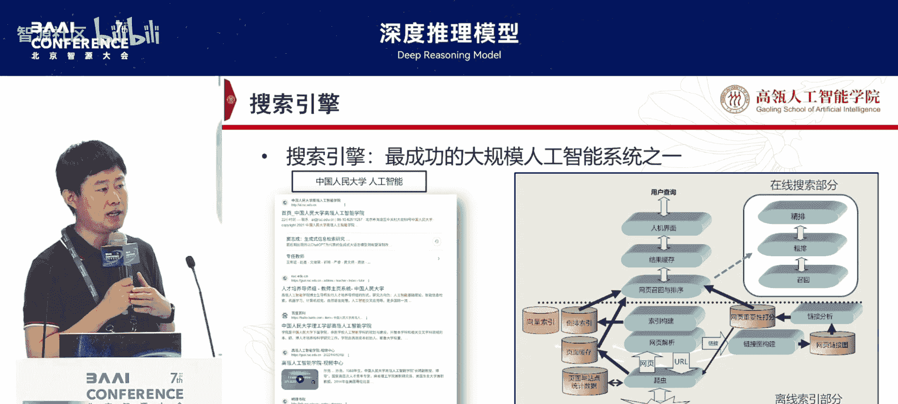

结所以这种搜索的方式呢有优点，也有缺点。优点。我们都知道，如果你的信息需求是非常确定的，而且是简单的，他可以在毫秒级给你返回结果啊，那用户非常满意。但如果用户的查询是比较复杂的信息需求。

比如说我这里举了个例子哈，这个例子是因为我前段时间组织了一次CCF的ADL我就问他，2024年CCFADL一共办了几期。然后我分别要他们的标题，学术主任以及报名的网站。大家可以看到。

我在搜索引擎里搜这样的查询，他不太可能直接给你一个页面，页面里包含所有合适的信息。因为他每一期的信息都是在不同的页面的。光有一次简单的搜索肯定是没有办法直接满足用户的需求的。用户自己需要去加工和处理。

呃，2022年底chGB出现之后，大家可以发现，我们其实有了一种新的信息获取的方式啊，比如说同样的问题，我查中国人民大学的人工智能，我查中国人民大学高龄人工智能学院的直播生是否值得读。

可以直接问语言模型，而且他会给你直接生成这种文本的答案，而不是一些网站的列表。那这种方式也有优点，也有缺点。它的优点是呢可以处理用户以自然语言形式描述的复杂信息需求。他就跟人聊天一样，对吧？

你的问题很自然的可以呈现出来，它可以去给你解解答，可以一步到位的生成你想要的答案，哎，不需要自己去打开那个页面复制粘贴理解合成最后写报告，这些步骤都解节约了。所以呃这种方式和传统的所有相比。

他正好弥补了搜索的一些缺陷，对吧？所以这个时候我觉得很多同事在座各位朋友可能都会想到一个问题，说这种大模型是。

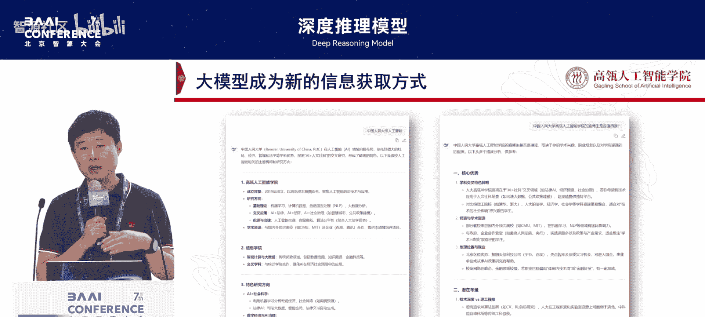

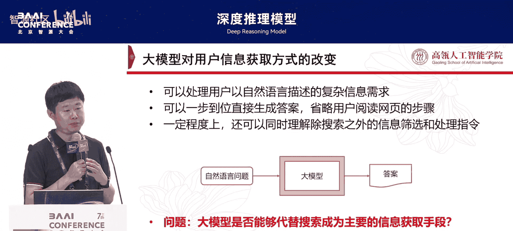

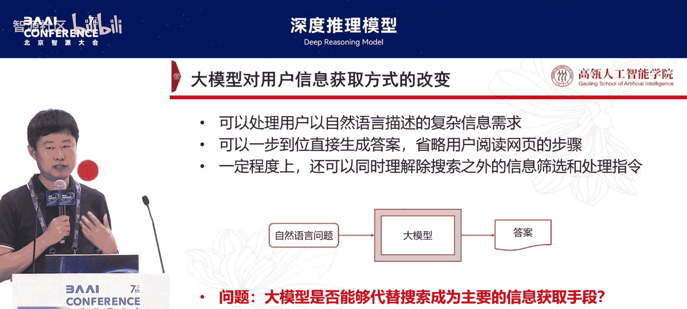

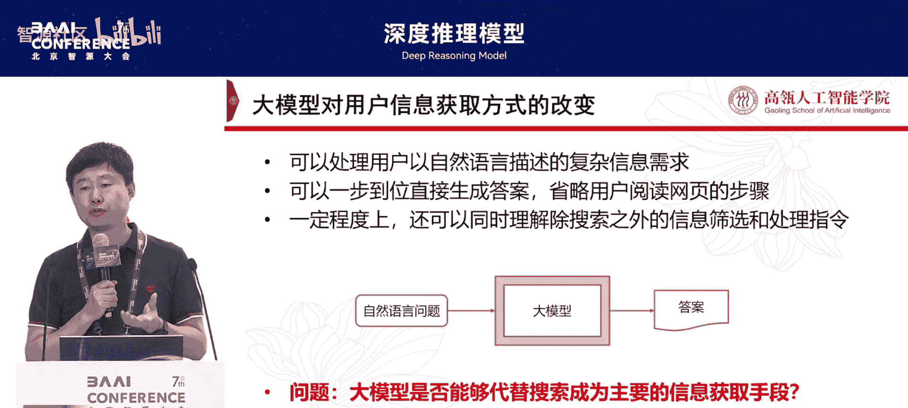

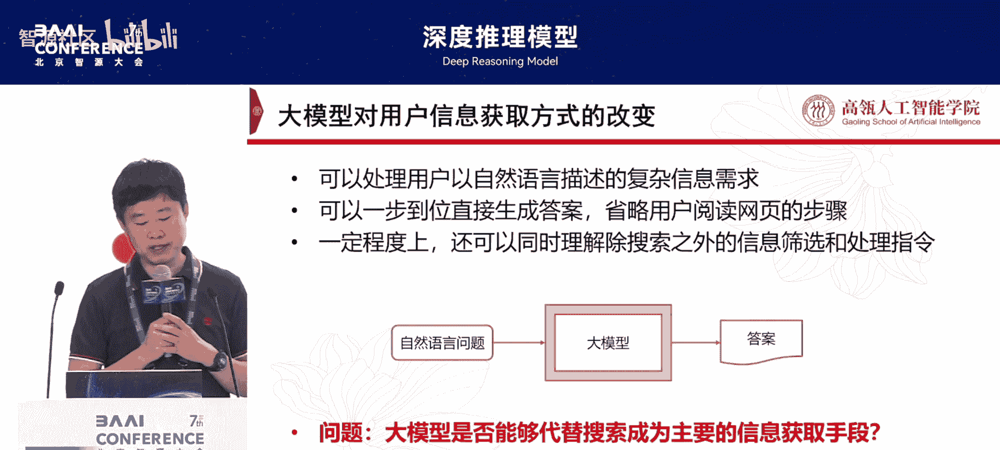

不是能够代替传统的搜索引擎成为主要的信息获取方式啊，我不是说大模型是不是能代替搜索，而是说在主要的信息获取这个任务上是不是可能会出现替代。那当然我相信在座的各位朋友可能都都知道我想要的答案，肯定是不能。

对不对？为什么不能呢？因为信息获取，既然获取的是信息，信息一定是准确的才是有效的信息获取。

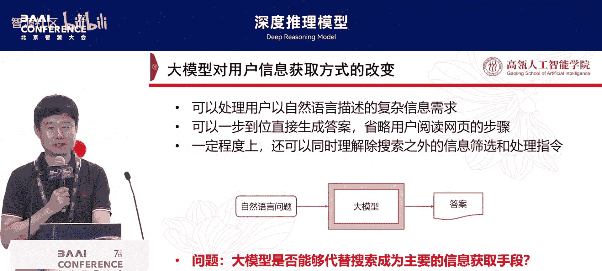

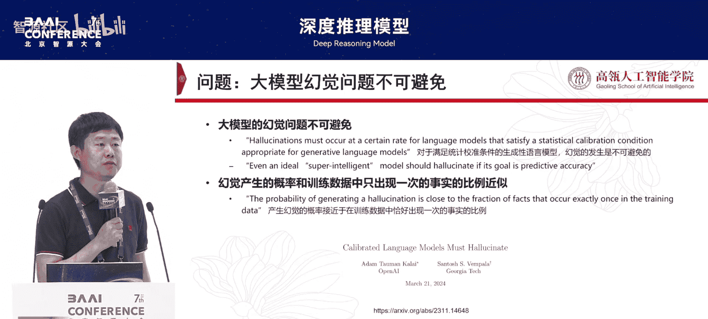

但是大模型本身就存在几个致命的缺陷。第一个缺陷呢，我们都知道就是所谓的幻觉问题啊，这个幻觉问题，而且是不可缓解或者不可避免的啊那这里面open他们也做过一些关相关的研究。

他们通过一些呃推理啊、证明啊等等。他们发现大模型的幻觉并不能随着我未来的人工智能技术的发展来去缓解啊，就是当你的他这里提到了，即使未来的所谓的ideo的这种超超级智能。

只要你的训练的目标是这种现在的自回归的生成式的语言模型，就一定会存在幻觉。而且即使你的语料里面每一条数据都是正确的，也会存在。这种幻觉产生的概概率和训练数据中只出现一次的事实的比例，基本上是成正比的。

大家可以简单的认为，因为大模型主要是对数据的一个压缩。所以在这个语料中只出现一次次的一次的f，它相当于是常尾的事实知识。那在压缩的时候，很有可能被。

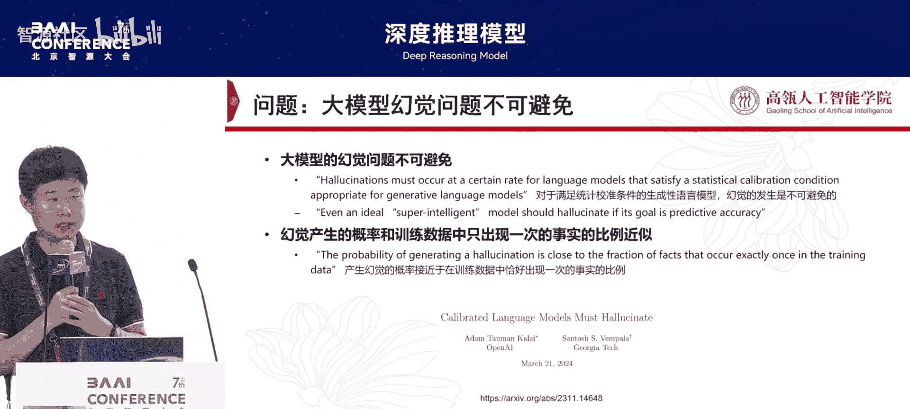

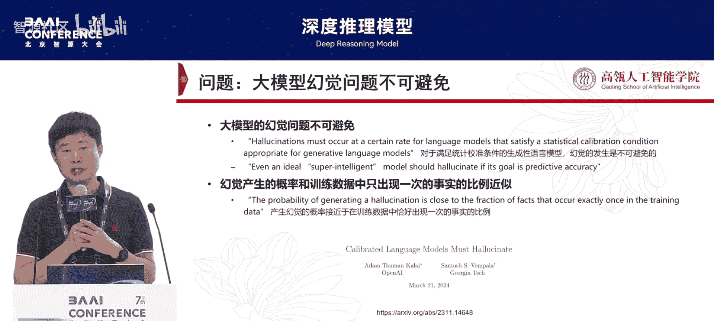

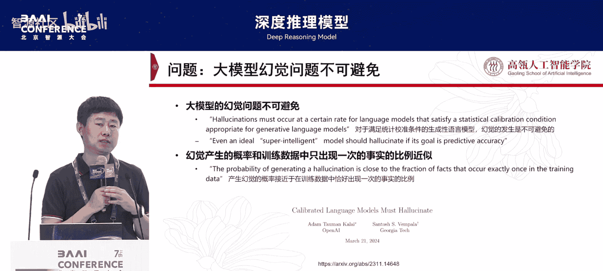

损失掉是吧？这个事情也比较容易理解。那除非是哪天我这个模型是真实数据可以原样的恢复回去的啊，就无损的一个压缩，那可能才不会存在这种问题。好，那我们来看看这种幻觉，是怎么样呈现出来的。

我还是刚才那两个两个问题。刚才我展示的时候，可能你们已经读过了，你们觉得他回答的很好。但是我告诉你从我知道这两个信息的正确答案，应该是什么样的人眼里，他回答的问题基本上没法看。

比如说他说我查的是中国人民大学人工智能，他给我列出来中国人民大学人工智能的第一个高领人工智能学院，这是我们学院没问题。然后他的研究方向，基础理论、交叉应用，伦理和治理。

但是我说我们学院最最最最我说这个火热的研究方向，一个是大模型，一个是信息检索，他都没有列出来。然后他列了伦理治理，包括这里面的数据隐私等等。反而我们没有什么老师在做。😊。

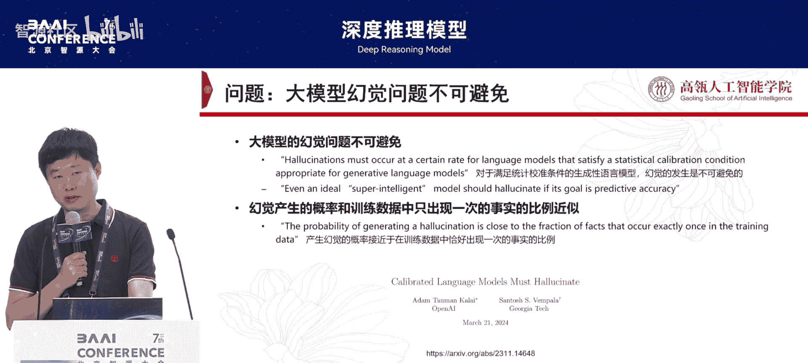

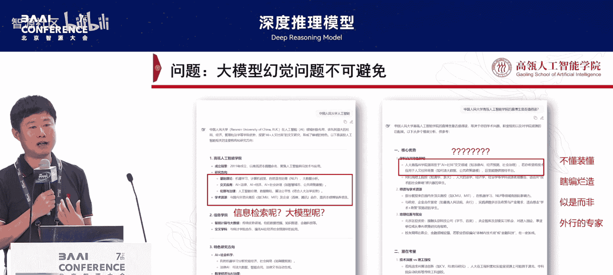

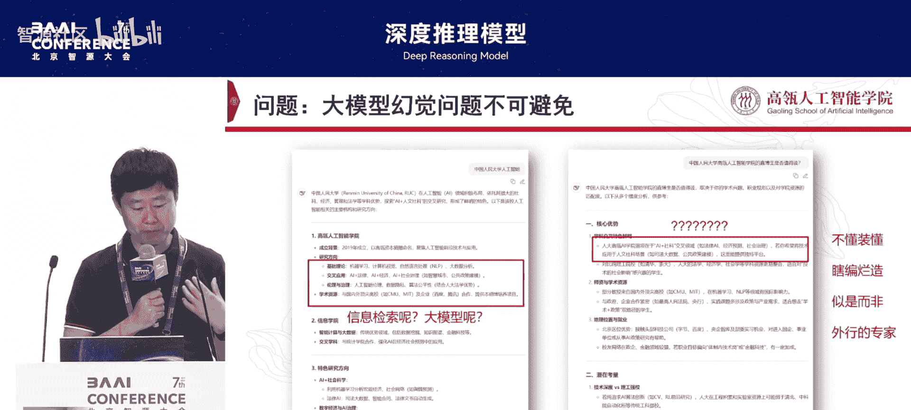

一个研究方向。所以这就是属于他给你造出来的。而且别人看上去好像还挺靠谱的。为啥呢？因为他觉得在人大大家看到他前面那句话，因为在人大有优势的人为社会科学。

所以探索AI加人文社科的教材研究自然就会产生后面这些研究方向。但是这个就是误导了，对吧？右面这个说我们的直播生是否值得读，他会告诉我，我们的学院会强在AI加社科。

知道的我们学院的各位朋友可能知道我们其实强的就我们核心的人工智能，包括大模型啊，信息检索呀，自然处理也都很强。然后并不是他想象的这个样。所以这个就是我们说的大家经常说的一个开玩笑的话说从这个外行的研究。

看大模型的输出是专家的输出，从专家的眼里，大模型的输出是外行的输出，所以他是不懂装懂，就是这种问题其实非常非常严重的。那他主要的问题就是确实是因为他的知识量不足的时候。

他可能又不可能准确的判定自己的知识边界，他要强制输出就会产生这种问题。好，那第二个问题。😊。

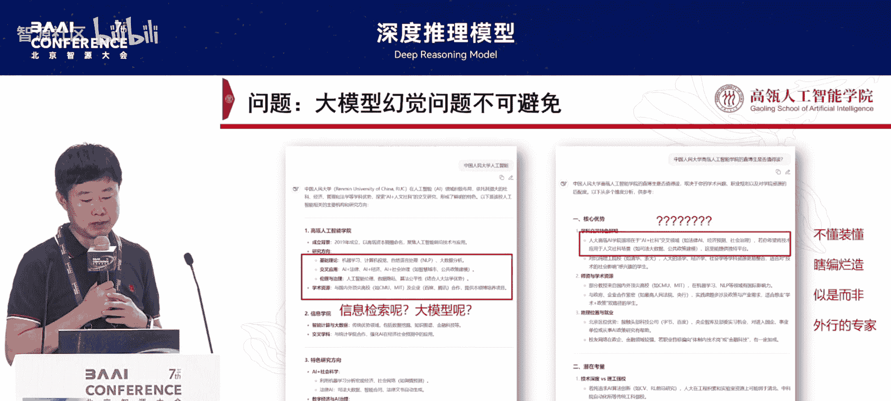

就是它的时效性问题。这里面正好是我前段时间做的例子，也和今天的主题相关。我问北京中关子学院和北京智源人工智能研究的院长是谁。第一个问题我不管。第二个问题，他看到他的院长写的还是黄老师。

因为他的数据他这里写的是截至2023年10月，这肯定是有问题的，对不对？就是我们作为信息获取任务，你给我一个过时的信息，我是不可以忍受的啊，那这种问题就是他的固有缺陷，幻觉时效性第一啊等等。

那这种缺陷在信息获取任务上，我觉得是致命的。大家知道我们以前经常出现在搜索引擎里提供了一个错误的检索结果，错误的广告都会产生很大的社会问题的，对不对？所以以这样的一个方式去支撑他的信息获取任务。

我觉得是很很很有问题的。在这种信息获取里面，这种溯源啊，这些东西非常非常重要。那怎么来缓解呢？当然大家都知道他缓解的方式肯定是两个组合起来，发挥各自的优势，弥补对方的缺点，所以就是搜索和。😊。

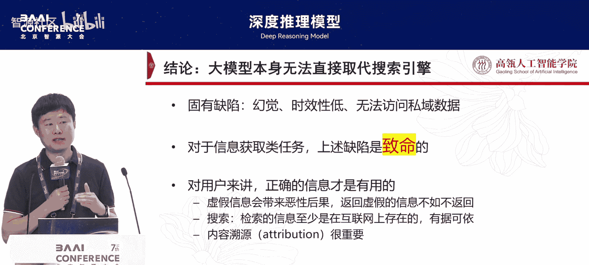

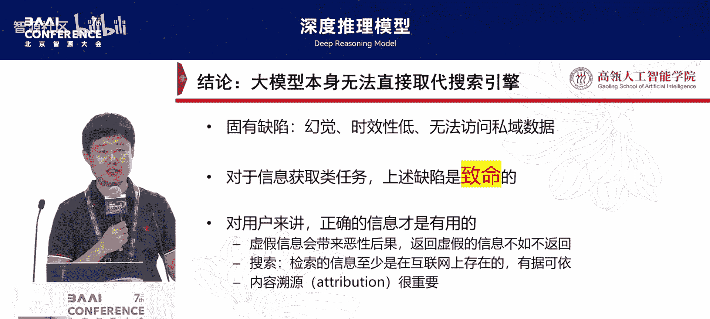

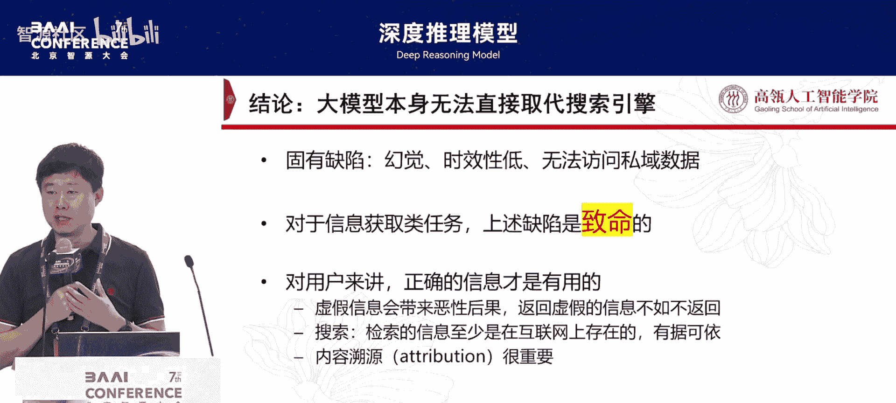

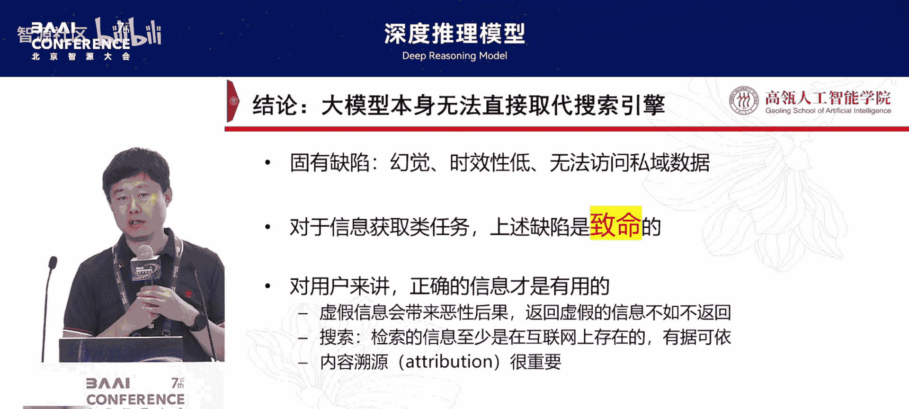

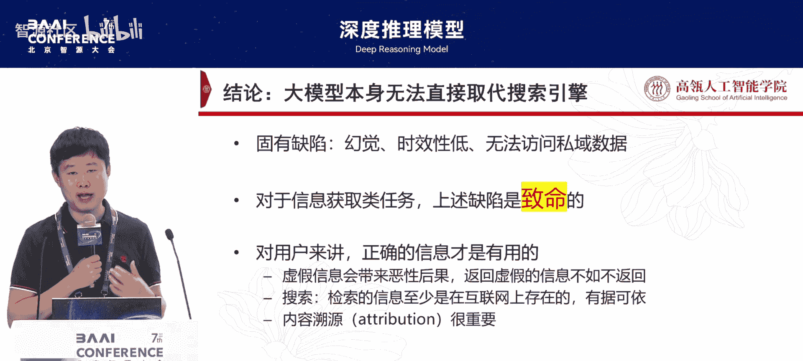

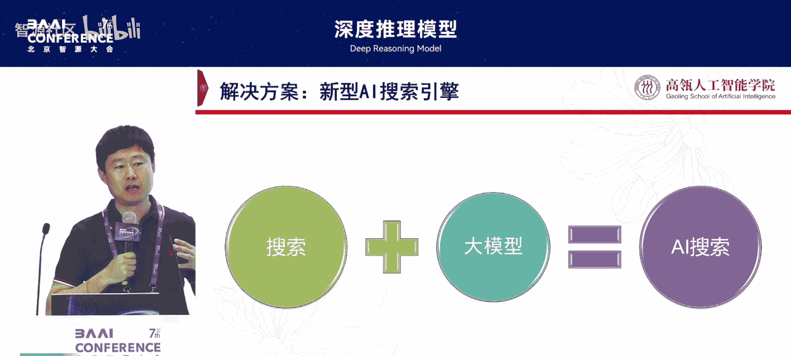

结合就产生了我们今天所谓的AI搜索。当然我们并不是说以前的搜索不够AI以前搜索排序也都是AI的模型。现在的AI大家一提到就想到大模型，所以更多的这里讲的是大模型大推理模型驱动的这种搜索的方式。

那第一个最简单的之间的呈现方式，当然就是rag对不对？就是他有知识的缺陷。那我就通过检索给他弥补外部知识，然后让他来去能够回答这个问题。那我们这里面给大家总结了一下rag的基本方式。

我同样问一个问题的时候，之前我是不知道的，但是我通过检索拿回到一些相关的知识片段。我把这个知识片段来支撑我回答这个问题。那我就能回答出正确的答案出来。

那这个里面列出了我们去年在这个rag上面做的一些研究的工作啊，大家感兴趣可以去查一下对应的方法的论文可以去看一看。今天我可能不会重点介绍这个部分。

那我们来看看现在有了raug是不是我们现在大模型就能代替信息获取的任务了。大家看到我们还是这两个ry，我现在让。😊。

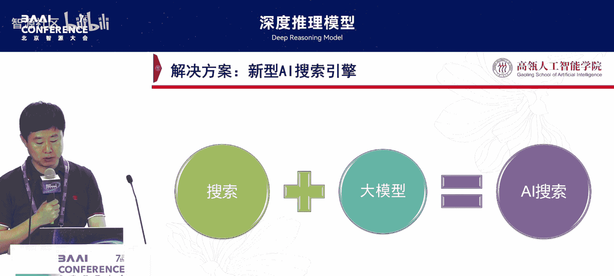

他连上搜索连上搜索相当于就是使用了raug啊，大家看看它的这个质量确实已经很高了。我刚才有个问题没介绍，就中国人民大学的强基计划，今年招了数据计算机应用有和没有，这是天壤之别对吧？

这是他基本上能回答对了啊，这是一个一个好的例子，但是我们也能找到好多不好的例子。比如说这是我当时做ADL的时候，我发的一个 queryry，就刚才那个 queryry2024年CCFADL一共办了几期。

他会找他会找他会找到49个页面，然后根据这些页面，他会告诉你办了11期，这11期是对的。因为他找到那个页面里面提到了CCFAL的总结，但是他下面给出的列表里只给了4条信息，肯定是有信息缺失的，对不对？

这是另外一个呃这个这个有raug支撑的有联网搜索的大模型，大家可以看到，他其实返回了好多，但这个里面他这里面提到了几个问题，一是他举办了12期。

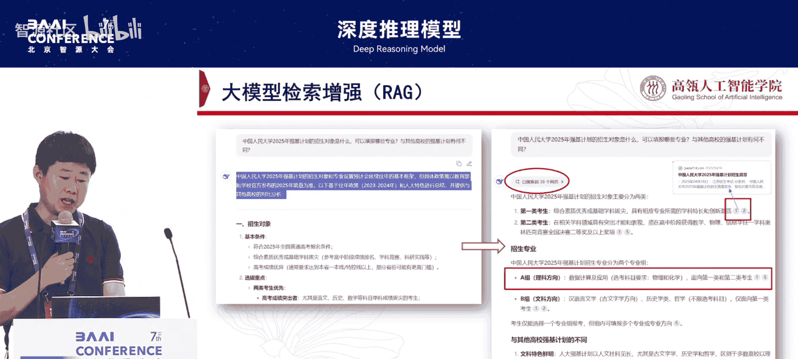

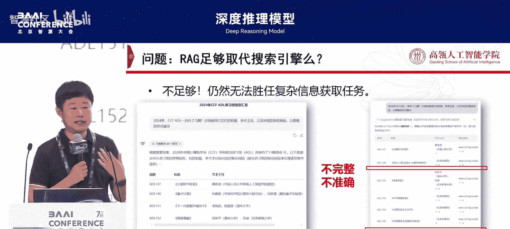

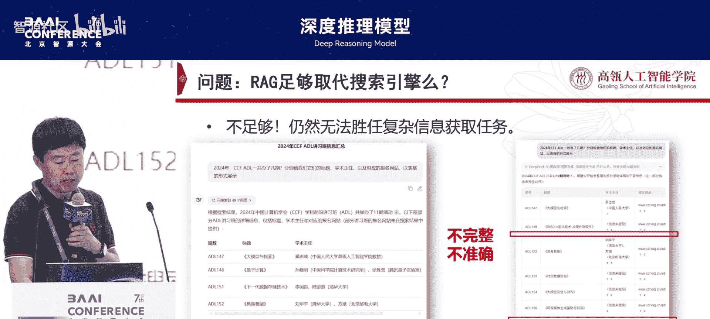

12期肯定是不对的，对不对？另外在座的各位，你们去看一看这个列表。作为一个普通的人，你会发现这个列表有问题，对不对？

147149中间没有148148之后直接152153154155156158156158是什么问题呢？因为这两期是今年我们办的是2025年不是2024年的，所以有漏的，有有多的。

所以这个也不是用户想要的东西。我如果把这个东西给我呃信息的这个需求者，他肯定会来来吐槽的对吧？所以我们说这种方式还是不能满足大家的复杂信息获取的需求。那人是怎么来完成这个信息获取的呢？大家想一想。

我们要是遇到这个问题，你会把它拆解，我会去搜CFADL搜到之后，我达到一些初始结果，我发现哎这个好像这些名字都是147啊，148，那我会尝试用这个序列去找，对不对？我往前找往后找。

然后我去抽取里面的内容，我发现它是什么时候办的。如果已经超过了。2024年已经到了2025年，那就终止了，我再往前找，对不对？我通过这种方式就可以获取到最终的信息。那这个过程其实就是人的行为。

所以我们说未来的信息获取是不是也能像这样，那就回到了我们今天这个主题，就是深度的推理模型，能不能在深度推理模型的支撑下，我们做这种深度搜索啊，就是把用户的行为通过推理模型来生成。

然后我们通过工具把搜索变成多次调用的一个工具来去支撑它啊，那这个就是现在呃大家知道有很多公司也在做啊，包括open app，还有dep research，还有jamany。

还有很多的公司都在做类似的产品。

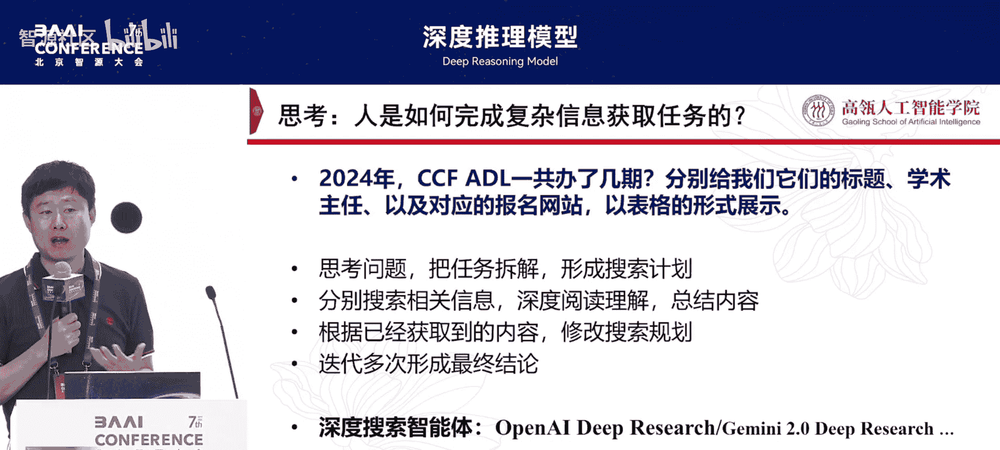

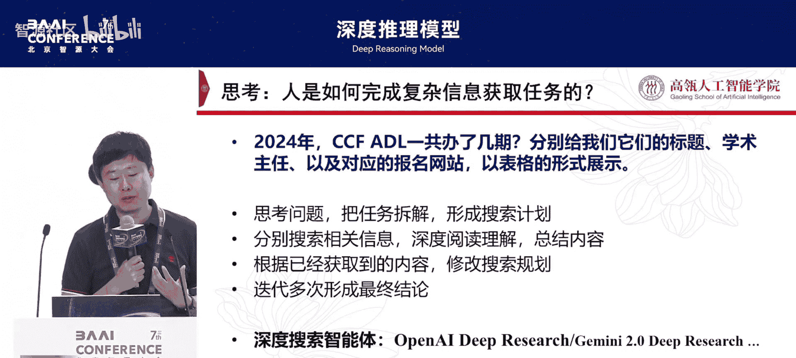

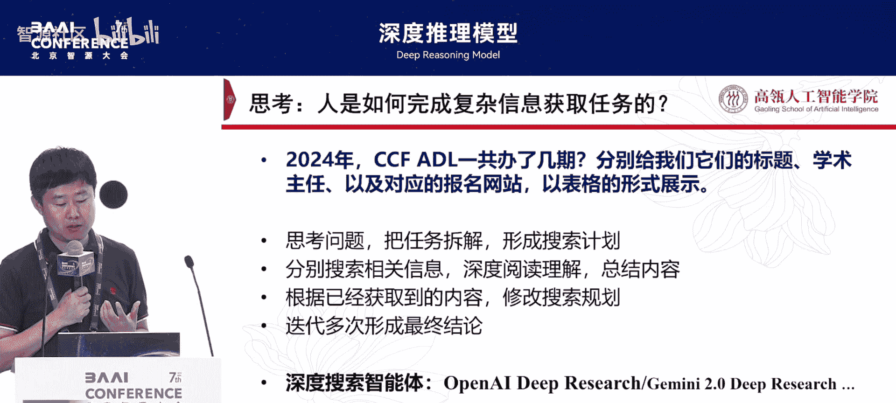

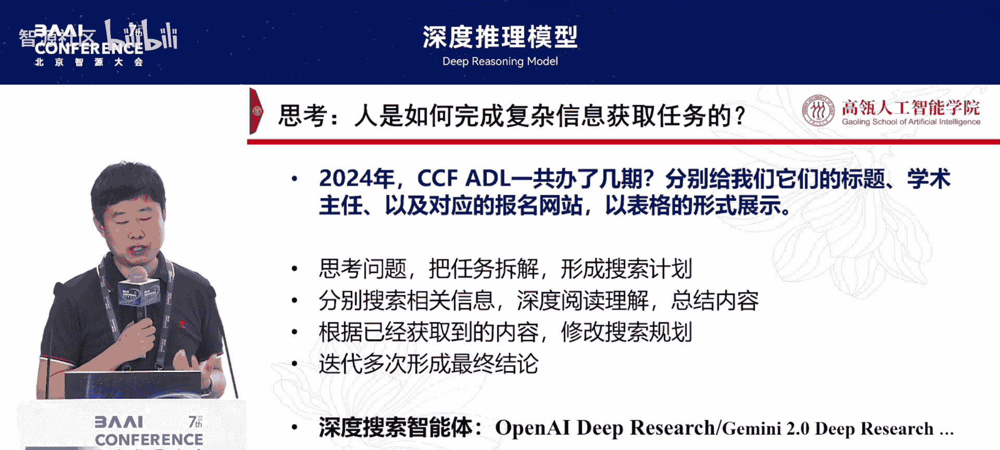

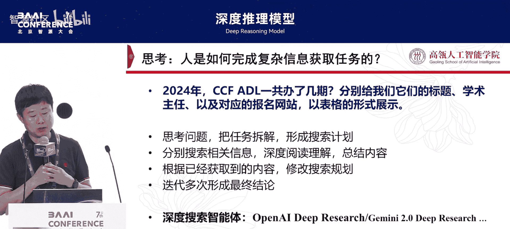

那这里给大家展示的是呃lock它的第三个版本里面，他当时释放的时候加了一个呃dep设试的能力。同样的一个query。大家看到他基本上可以做到接近完美啊，就是大家可以看到他的搜索过程。因为这个视频比较长。

我在右面列出来了。他搜了十几个query先搜AL2024加了list加了全部讲息班summary，他最后发现搜完这些之后，他大概找到了一个初始列表，他发现列表里有空缺，所以他尝试着补充148。

最后148它失败了，还是没找到，他又尝试补充150151152回头来他又找148，大家看到148和148，下面两个他补了1个2024就找到了。所以不同的query可能找到结果是不一样的。

但是最终他返回了一个结果，这个结果里面是10个，他少了一个，他少了145。这个逻辑出现在什么地方呢？因为他找到一个列表之后，他第一个是这里的146，最后一个是15155。他发现中间有空缺，他补了。

但是他没有想。到他前面可能还有，所以他漏掉了第1个145啊，所以这就是它一点点不足。但是整个过程已经接近于一个推理的深度搜索的这样一个一个任务了，对吧？

所以我们想如果我们能基于这种推理模型来来完成这种任务，那就是很完美的一件事。所以从我的视角上讲，推理模型是我们实现更复杂的深度搜索的一个工具，我们的主要不是推理推理是服务搜索的这样一种啊。

然后呢呃它推理模型主要完成的是我任务和意图的理解。然后我通过它来去协同和调用我的搜索工具，最终呢我来完成信息的整合。然后我基础的搜索会把现在的传统搜索摇身一变，变成底层服务。

我上面会有一个更高级的智能搜索来来完成这种深度复杂任务的这种获取。那这些方面呢，其实现在也有一些开源的工具出来。包括基呢它做了它的一个 research的这一个开源。

大家可以看到它主体方式还是一个workflow base。我把这个任务先分。😊。

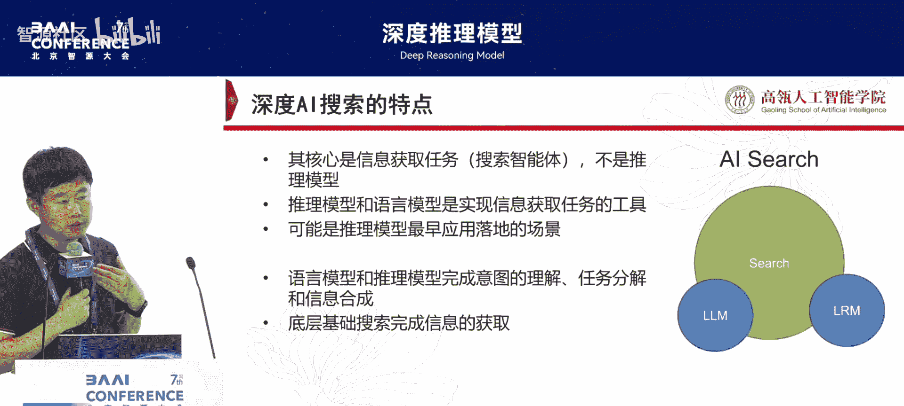

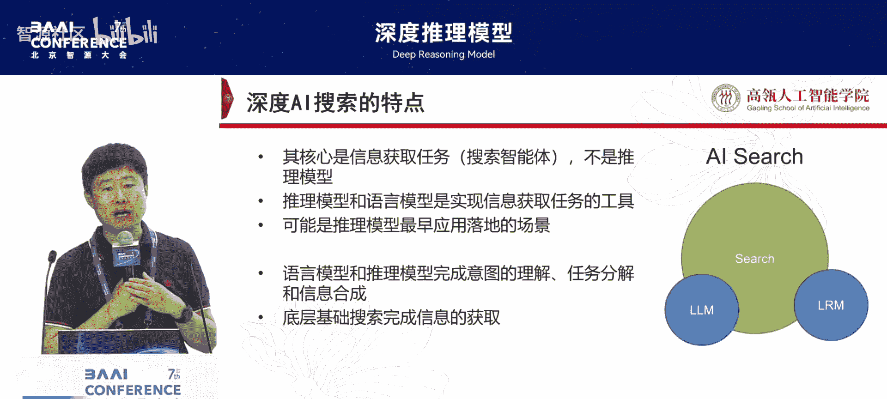

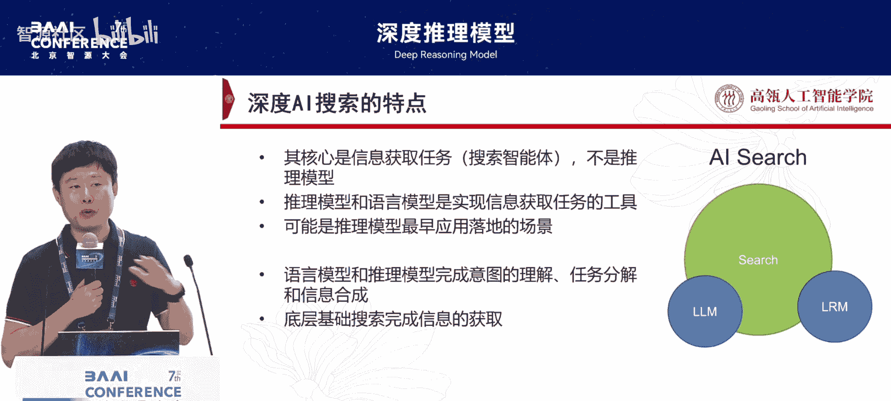

成生成目录，每个目录下的topic我会去做多次的deep search，然后生成那个目录下的内容，然后再去合成每一节的每一节里面再去合并，最后生成一个final的report啊，这是它的方式。

包括还有ep这个开源，它基本上也是这workflow base的方法。但这种workflow base方法，大家可以看到，它其实把一个模型调用多次分离的去做很多事情。

我们觉得这种方式呢很难让模型连贯的顺畅的统一的去思考这个问题，它没有充分的把深度推理的优势发挥出来。所以我们就做了一个工作叫做webthinker。

就是下面这个加红框的这个我们是希望基于现在的深度推理模型直接在整个推理过程完成我对这个问题的拆解思考。然后在必要的时候调用搜索网页浏览，然后必要的时候，我去激活它的写作，激活它的写作的检查润色。

然后最后合并这些工作都在一个推理链上去完成啊，那这是一个呃。😊。

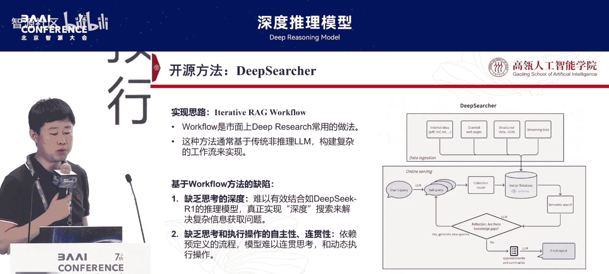

整体框架，整体上讲它是一个我们叫做边思考边搜索边写作。什么叫做边思考边搜索边写作呢？就是它不是分阶段的workflow。它不是说搜索完了去搜去搜索，他是思考一下发现需要搜索了，他就激活搜索。

这个相当于是弥补了传统的rag的里面，他没有办法准确的判定知识边界的问题，就是模型生成到这个时候，他自己觉得有点心虚了，推理到这步发现我知识不足，没办法帮我推理了。这时候他就生成一个请求。

能不能给我搜索好，然后我们检测到这个需求，我就会给他搜索，搜索完之后的信息，我会直接拼接到他的思维链条里面去，他拿到这些知识，接着思考，然后再去搜索再去思考好然后到一定程度他觉得差不多了。

他会生成一个请求。我已经有一些知识了，能不能开始写作，就去写作，写了一半发现又有信息缺失了，我再去搜索。

所以整个的这些任务的生成都是一个端到端的推理链来去完成的啊所以我们这框架里面相当于最核心的就是把搜索。😊，以及所做这些融合到一个整个的思考过程中，利用的整体是一个端到端的一个推理模型作为它的一个骨架。

然后在这个股架里面来完成整体的端到端的工作。然后呢，我们包括我们的报告写作也是一样的。不是说我把所有信息都收集好，收集到几百个页面，最后完成写作啊，不是这样的一个过程啊。

那这个里面大概分成这么几个核心的模块。第一个模块呢，我们叫做深度网页探索。就我在思考的过程中，如果发现它有信息获取的需求了，就会激活我们的dep web exploreer深度的搜索。

这个深度搜索完成什么呢？就是它需要搜索的时候，他会把搜索页面拿过来扔给这个dep web exploreer，它会把每个页面把它打开浏览出来的核心内容保留下来，同时去思考我还需不需要做其他的搜索。

同时我去思考我每个页面里是不是还有一些链接可以去点开，把点开的页面里的内容再拿到拿完之后我再去。是不是有更多的搜索？所以这个dep web explore它内部就是一个小的思索的单独的链。

它是在那个主链上单独拎出来一个子链啊，这是一个模块。那第二个模块呢，那那需要提提示一下的是这个dep web最后收集和整理出来的信息，是以摘要的形式返回给就这个虚线它会返回给主链。

所以主链上就会把当前收集到的核心信息拼接到这个链条上去啊，那第二个模块呢是这个报告的呃撰写的过程啊，那当然我们是有两种模式，一种模式是解决复杂问题，它不需要去写报告。那第二种是需要写报告的一种形式。

我们也是一样的，就是大家看到这条链，它是根据它的request自动的生成在什么时候需要去调用呃这个dep web explore什么时候需要去我要写一节写一张，然后这写一张的时候。

我还需要去检查它的内容。这个检查内容是看什么呢？因为我一直要一个到目前为止已经写做好的。我写完一章之后，我把它拼回去之后，我会让它去重新检查整个章节的结构。然后我把章节的结构的核心的headline。

就是它的section还有s title抽好，然后我把它返回到这个推理链上去。我这里面不会把我目前写的整个塞回去。因为整个塞回去的内容太长，会破坏它的思维逻辑啊，然后有的时候我们还会t整个it的工作。

有点像我们写了一半我前后整个润色一把啊，这些过程都是它自动来去去处发的啊，然后这是我们说的呃报告的撰写的这个模块。那这样的一个系统怎么样去训练呢？当然最简单的一种方式我不训练，对吧？

直接用它推理模型本身的能力。当然我们还是希望对它进行一个训练，那和前面的几位老师介绍的类似，我们也是用个强化学习的方式，这里面最难的问题是怎么样去收集强化学习的训练数据，以及怎么样设计这种re。

那我们的数据收集呢主要是。呃，采用了呃因为它不做强化的时候，也可以用它的proing的方式来生成很多这种链条。这个链条里面就是我们完成一个报告或者一个复杂问题的解决步骤里面，我们去有很多种变种，对不对？

那我们就要决定哪些是好的例子，哪些是不好的例子。所以我们做了一个对比的样本。首先呢就是我如果能拿到正确答案的就是就是好的。它比非正确答案的肯定要好。这是第一个。

第二个呢是同样都是能拿到正确答案的这个链条里面，谁调用工具少，谁就好啊，就是这个篇序相当于是我尽量节省不必要的搜索。第三个是我调用次数一样的情况下，我的推理步骤越少的，我也越好。

就我不希望他在那唠唠叨叨在那思考半天来回折腾，来回调用很多没有用的搜索啊。那通过这种方式呢，我们就构建了大概1万多条这种训练数据，拿它来做online的这种TPO的方式来去做。

当然我们现在也在做很多升级改造的工作。因为我们觉得这个过程中缺乏一些过程的监督信号。比如说你的这次搜索是不是能带来很好的检索结果，你的报告的质量到底怎么评估？我们最终在这两个任务里面。

这个问题解决的任务是涛它和正确答案的相似性。然后报告撰写，我们是用呃类似于GP4或者ep它模型打分的方式。那我们能不能有更好的打分的模型来去做这个事，这可能都是要去解决的问题。

那这是我们在呃一些呃任务上的一些评测，我们测了两个场景，一个是复杂的问题求解。第二个是报告撰写。那这个实验结果其实也是展示了我们不管在哪类任务上。

我们在各个数据上都是能明显的超过只用推理模型不去做我们刚才说的这种设计啊，然后包括用推理加r的这种方式，包括我们前面还做了一个O一简单的使用搜索的方式啊，那都容有明显的提升啊，然后在报告撰写这面。

我们也和一些必然的系统做了个。

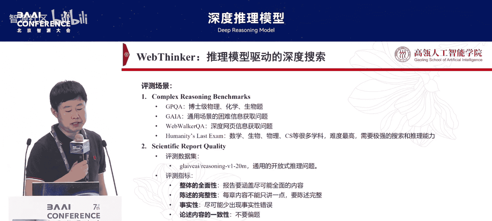

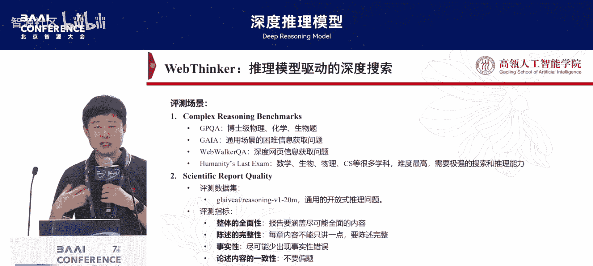

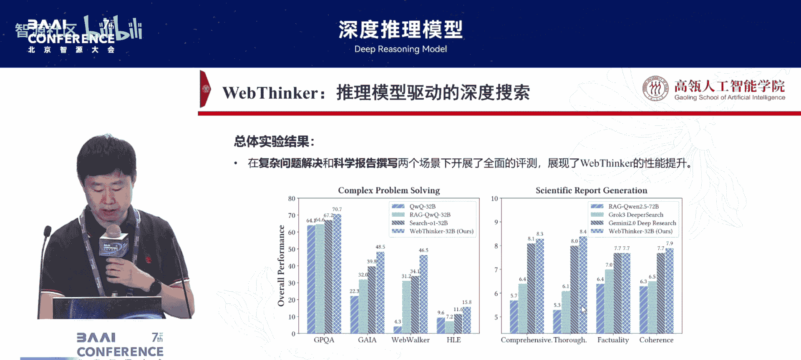

报告的质量也还是不错的啊，这是给大家展示呃它生成的一些例子哈。第一个呢就是纯的一个呃获取复杂任务获取信息完成复杂任务。大家可以看到它这里面调用了多次begin search和end search。

然后后面那段begin search和相当于是我们在子模块里处理完的信息，它会把摘要返回回来。所以主推理链的输出就会是这个样子啊，然后第二个呢是在中间ter了，他会去浏览新的页面啊。

然后这个这个那个呢可能就是我们在写报告，它在什么地方会ter写一节等等这些过程啊，可以直观的。😊，🎼这是我们的一个小的视频啊，然后展示完之后可能就差不多了啊。AI深入搜索引擎webthink。

🎼现有搜索引擎无法处理复杂信息需求。人大高龄研发并开源的AI搜索引擎webthink则可以深入分析信息需求，通过多步搜索跨云整合内容筛选报告生成，将用户需要数小时来处理的复杂信息任务。

压缩至几分钟内完成webthink具备四大技术优势。一、以大规模推理模型为基座一们主动识别推主发报告的充报告的那个生成的过程。2、深度浏览互联网在搜索到的网页上。

根据需要自主点击其他链接来获取更深层次相关信息。3、边思考边搜索边写作，通过并行处理，实现实时研究报告生成，大幅缩短内容整理和报告写作周期。

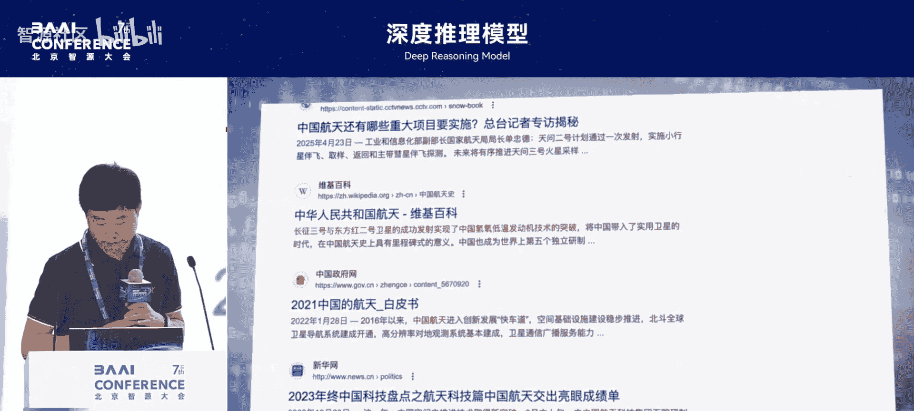

🎼基于在线强化学习策略，不断从用户交互历史中优化搜索策略和报告质量。当查询中国航天近5年的重大突破有哪些是系统首先搜索中国航天近5年的发展情况，然后对比整理是一个热搜索编生成过程。

而不是最终最后对各个工程的具体信息，进行详细挖掘，最终整合生成包含天工空间站火星探测这是最后有一步它会星研报告。🎼webthink迈入深度智能信息获取新时代。好。

那有了这样的d search是不是就做做好了呢？其实我们发现现有的很多dip search，其实还有很多缺陷。比如说对于这个问题，其实人只要搜一次，他找到这个列表，列表翻页，把信息浏览完就出来了，对吧？

所以其实我们还有很大的呃改善的空间。包括后面我们还有很多可以要去做的事情啊，那因为时间原因就给大家介绍这么多。最后呢我还是觉得像深度推理这样的模型，其实能够在很多领域应用。

我也希望能够在搜索这个行业能够推动现有的搜索引擎全面升级转型到新的AI搜索深度搜索的这种这种这种引擎。好，谢谢大家，谢谢好，谢谢高老师。然后我们由于时间关系，我们就一个问题。😊，好。嗯好的呃。

邓老师非常荣幸有机会提问。我是那个金融从业的一员啊。呃，看到您这个研究呢也非常激动。呃，因为金融行业一直来讲，对于信息的获取以及质量，包括后面的写作都有很高要求的。那么您认为您这块的研究领域。

在金融行业不管是投研啊或者投资这一块，应用前景，或者说它存在挑战主要是哪些方面，谢谢。😊，呃，就是我我觉得这个问题是个很好的问题啊。其实我觉得可能相对于互联网上的信息获取。呃，这种金融行业。

尤其是我们说做的投研分析啊报告，可能它更匹配一些。因为相当于我们金融行业，我要收集广泛的互联网的信息，包括我有的内部的资料，历史的投研报告啊，还有一些金融数据，所以我综合这些数据汇总起来。

来生成详实可靠的报告是至关重要的。如果我不用这种深度搜索的方法，只是基于大模型自己去写，闭着眼睛写，或者是我闭着眼睛去推导，它生成的内容里面应该会有大量的幻觉啊等等问题。

所以我觉得这个在金融行业用搜索深度搜索来去完成类似这样的报告或者研究的任务，其实是非常非常匹配的那当然也有很多挑战。就是说我怎么样真实有效的把各种不同的数据原来的数据都整合到一起。

最终生成一些有创建性的有洞察性的观点的呃新颖性的报告，其实还是挺有挑战的。尤其是我们最后怎么样。设计这个reward model，让他这种报告的质量也能体现出来，其实还是挺困难的一件事儿。好，谢谢。

