# 2025北京智源大会-深度推理模型 p08 Pretrain and test-time scaling of Ling models：张志强 -BV15UNszsE8T_p8-

嗯，大家好，我叫张志强，感谢赵老师的介绍啊。呃，刚才杜老师说，他的报告可能跟前面的报告不太一样啊，但我我觉得我的报告可能跟前面所有的报告区别都会比较大啊。

我的报告主要内容其实是跟pretraining的cal相关啊，然后后面会有一小部分呃关于这个tex time scaling，我自己的一些想法啊，然后呃呃前面那个吴一老师在最后打了个广告。

所以我在一开始打个广告。

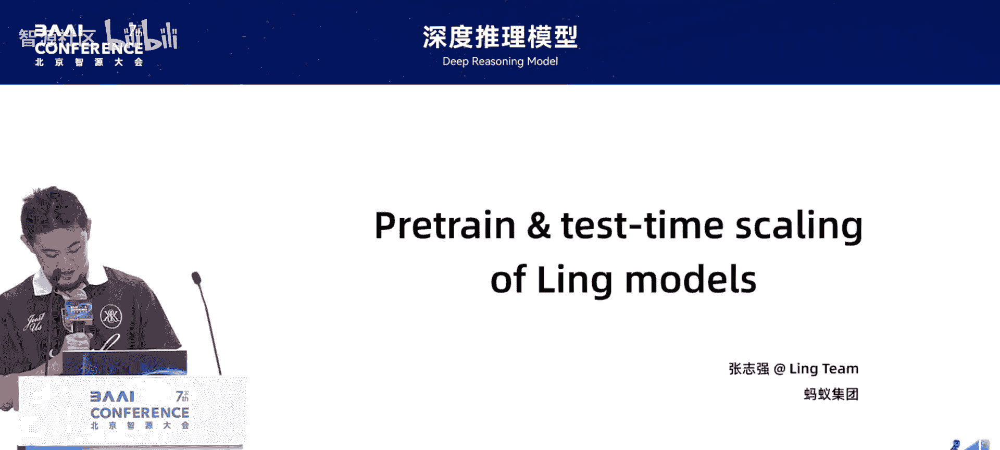

对我简单介绍一下啊蚂蚁集团的呃百灵模型啊，我们之前呃就是百灵模型的研发，其实从23年开始就在做。但是我们从今年的3月份才开始呃，基本上是完全投入到开源的这个工作里面。

所以会看到我们每个月都会往外去发布一些我们的一些进展。对，包括一些呃这个通用的语言模型推理模型和多不态的基座。对，然后名字上面呢是比较有意思的，我们取了lingus的这个前四个单词呃字母。

然后就把这个名字取成零。然后呢，当我们把这个名字确定了，叫零之后。我没有讨论到底resoning model应该怎么叫啊，然后就想着把第一个字母改成R啊了正好是个单词啊。

然后我就把这个名字叫成ring啊，然后最后啊既然都已经这么改了啊，那如果我们要发布一个这个态模型的话，那么这个序列应该叫什么我们就把很简单的把第一个字母再改成M对。

所以呃看到的这几个基本上就是我们的几个模型序列。对，然后呃我就不一一介绍了，大家可以去呃这个二维码应该都可以把大家引导到对应的face和的网页啊，然后我们在6月份和7月份会发布一些比较大尺寸的模型。

前面发布的都是一些相对小尺寸的模型。对然后这里还有一个我觉得是比较有意思的点啊，就是可能跟呃大部分的开源模型。

可能关注效果或者什么样东西不太一样的一点是我们在最早的时3月份开源的我们叫0plus这样一个接近300B的模。型呃，它并不是完全用呃英伟达的最高端的芯片进行训练的对。

所以这个模型其实证明了就是呃我们在国产的算力上去训练1个300B，其实也可以训练六七百B的模型啊，训练一个这样庞大的MOE的模型，可以做到跟高端的这种H10H800的芯片是los几乎完全一样啊。

ch mark肯定也是完全一样的那个效果。对，这个是一个我们认为比较有有趣的工作啊，但这里面包含了大量的debug的事情啊好呃我们也这个招人，也欢迎大家加入零的团队。对，所以呃广告就到这儿。

然后呃我今天的整整个内容。

都围绕scal law来去展开啊。呃刚才也有一些这个PPT的内容呃，提到就是在呃去年呃names24年names在温哥华的时候，呃，那个在openI之前的那个手机科学家讲到就是预训练可能是撞墙了啊。

我我是呃既做预训练也做I。然后呢我也在那个toplk的现场啊，但是呃从我自己的认知来看，我觉得这个还是一个非常值得研究，并且还没有研究透，然后也是很有用的这么一个工具。对，为什么说它是个工具呢？呃。

大家如果对呃ing law比较感兴趣或者做相关的一些研究，或者做预训练的同学可能都会看过open aI或者de在呃20年到22年那个周期发表的一系列怎么去s up这个langu model的一些文章。

然后那些文章里面一般会给出一些呃礼盒的。一些曲线的公式。然后这些公式可能会告诉大家说，只要我不断的提高算力，只要我不断的提呃增大模型的尺寸和增大数据的大小。我就可以获得更低的落实，获得更好的模型。对。

但是呃它是一个趋势？那我们有没有办法能把这件事情用在呃真正的预训练的生产任务里面，它能给我们带来什么样的一些作用。对我的报告可能主要围绕这一块来去展开啊，首先呃我们去研究skating分成三个阶段。

对呃，前期的研究都是针对d模型是去年做的研究。我现在先讲在ds模型上面的一些探索。那第一步的话是说呃或者换个角度来讲，就是呃做预训练最难的是什么事情。

我我个人觉得预训练最难的是外推到特别大的计算量和尺寸的时候的不确定性应该如何去对抗啊，这是我作。训练里面我觉得最难的事情就我们不可能在一个呃十的2526次方左右的计算量的模型上面去做多次尝试。

所以意味着我们一定要在前期把所有的stting呃，包括一些呃los，包括Bnchmark的一些预估的情况，全部都能能尽可能精准的判断和预测出来。那这个对于我们后续的launch整个训练来说。

它的风险是可以得到一定的程度的降低的对，换个角度就是说，如果我能做到。

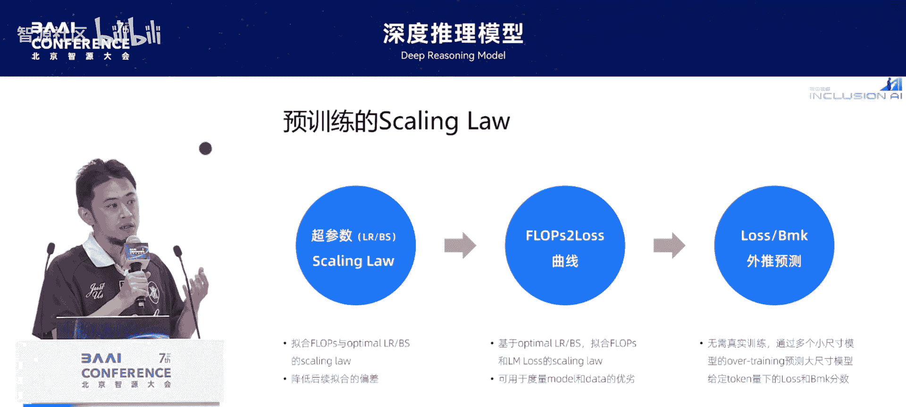

我不用训练就可以预测这个架构的模型。在训练一个比较大的投ken量之后，它的los应该收敛到一个什么样的位置。那这个这个信号就可以帮助我们去看真正训练过程中，这个是不是收敛的比较正常的啊。

这是这是我对呃s的一个就我们开始去探讨s，我们希望达到了一个目的，为了降低我们训练的风险啊，然后要去实现这件事情，我们分开三个阶段去完成这件事情。首先第一个是呃参考M在比较早期的一些研究工作。

包括拉在比较早期的一些研究工作，我们去探讨呃一些非常影响模型训练效果的超参数。它的s up的趋势是什么样子。能否有一个准确的去预估出这些最优的参数是什么样子的啊，然后它有它会带来一个好处，就是。

对于后续的礼合，就是后续这种所谓的fps to loss的曲线礼合，它会带来一个好处是你可以在最优的情况下拟合，那就减少了很大的礼盒不不对的风险。

然后第二部分是说我们基于前面礼盒出来的就是我这个训练任务我就用这样的ning这样 size接超参数，我就能够获得最低的。那在这个基础上我们去run取一些小的模型训练。

从而去拟合出一条fps到M之间的曲线就是我到底用多大的fps能够获得多少的los多低的。我们拟合这样一个。然后我们希望得到的效果是什么呢？

就是让我们看到在10的24到26次方这个平时正常训练周期里面这个这个ch里面，我们的我们的模型我们什么样的模型能够获得什么样的。然后但还有一个好处是我们可以用这样一种方式去度量我们。

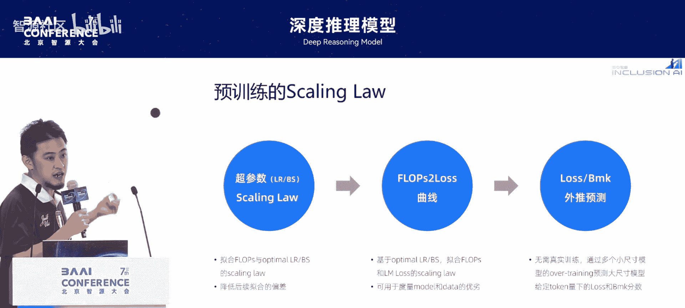

到底在架构上面做的修改，我们在架构上面做的选择和我们在数据上面做的选择是对还是错？它在特别大尺寸的模型上面，它会会不会反转？然后最后一个是我们希望能够达到一种情况，一种效果是我不需要训练。

我可以通过几个小的模型，用大概2%到3%的这个计算量，能否换取我在特别大尺寸的模型over training之后，比如说over training3倍到10倍之后，我能够知道在那个情况下。

它的落实什么样来去监控我这个训练务是不是真的是正常的。好，呃，这就是我所的说的三个阶段。后面我给大家呃汇报一下，就是我们的呃整个这个这个操作是怎么做的。

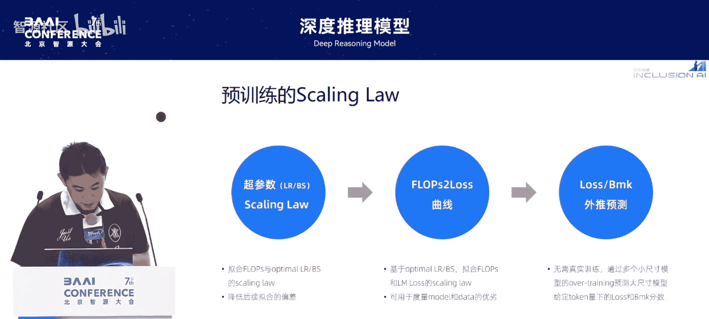

呃，首先第一步我们说的是你和呃meter就是对于dance模型而言，比较重要的meter就是 size和啊，我们去呃利用这个re的方式啊，我们首先用比较多的这种小的模型。

然后呢随机呃不是不是随机就是按照一定的这个间隔去撒了一些 size和单独的去做。然后我们找到opti的这个lo的区间。然后之后我们利用op的这些点呃。

在大家可以看到这两个图横轴是fps计算量纵轴是ban size和。那么在小的计算量的情况下，我们有一些这个最优的呃获得最优lo的一些对应的 size是多少。我们把它描在这个这个这个这个图上。

然后基于这些点，我们可以拟合出一条一条我们这个其实其实际上它是个曲线，但是这样看起来它是个直线啊，因为它是对数 linear的关系。所以呃我们描出这样一条线。然之后我们发现。

opimal的呃be size和 learningning跟fps就是跟模型的计算量之间是呈现一个对数线性关系。呃，但是对数线性环境一个是越来越大，一个是越来越小，就是我们越大的计算量越大的模型。

越多的数据，我们需要用更大的 size去推动它呃，越越大的模型，越大的数据，我们需要用更小的running去让它稳定的去训练啊，这是一个趋势。然后第二个是说呃我们可以去精准的预测在真实训练的过程中。

我们到底需要选择什么样的 size和ning。我们通过一些更大尺寸的模型去进行去验证这个在大的就是比如说在使的21到22次方的这么一个计算量上它是否准。

然后我们也用了呃最新的一些模型的训练相关的这种超参数来去验证说我们整个预测是否跟业界大家普遍选用的参数是一致的对，那呃这里面还有一些附带的一些结论，就是。呃，当我去改变模型结构。

或者我去换不同的数据的时候，这些东西有一定程度上都可能对有影响。但是它是否对这个op size learningning会产生影响。我们做了大量的实验，发现对于dance模型。

就是比如说类似一个标准的拉或者千万模型。我们去改变这个模型的高矮胖瘦，它是不会影响这个s就是per趋势的。第二个是说当我小幅度的去调整数据配比，它也不会影响。但是当我做特别大幅度的调整的时候。

这个东西会受到影响。什么叫特别大幅度就是我把原来的分布调成完全不一样。就比如说我有200个呃这个数据集，我会按照不同的这个呃配比来去选择这里面到底采样多少。

当我把所有的数据集的配比全调成一我做了一个这样的实验，我们会发现对于这样的一个数据分布剧烈的变化，会影响到ning size。然后还有一点就是。

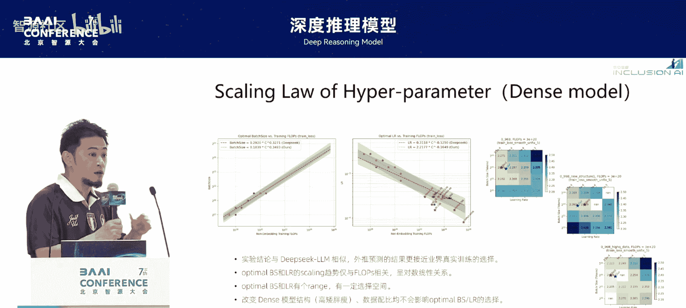

我们实际的训练不会用一个const的呃lening，我们会用一个 schedule，从 warm up到st到 decay，我们也不会说直接做一个恒定的特别大的ban size进行训练。

所以我们探讨了在ning应该做多少比较合适。然后得到结论就是写在这里大概是1%的 size说是1%到3%啊，他们的影响是比较少的啊，但是对于训练的稳定是有帮助的。而且对于ban size来说。

如果你在前期做 up的话会带来一个好处，就是你开始看到的效果会更好一些啊，这样对于大家向老板汇报来说是有比较大的好处，就是我训练这个型在一开始看起来还不错啊。

所以这些就是我们对于ning模型面的一个探讨。那么接下来第二部分就是我们有了opim的之后，我们去训练一批的就按照标准的做法，我们训练了一批小的模型，然后我们去拟合出了这个isps curve。

然后我们再去拟合模型。

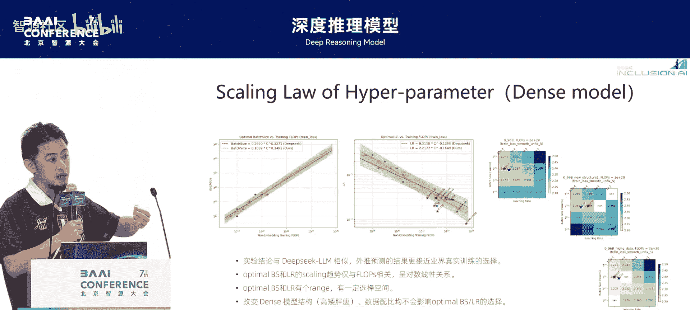

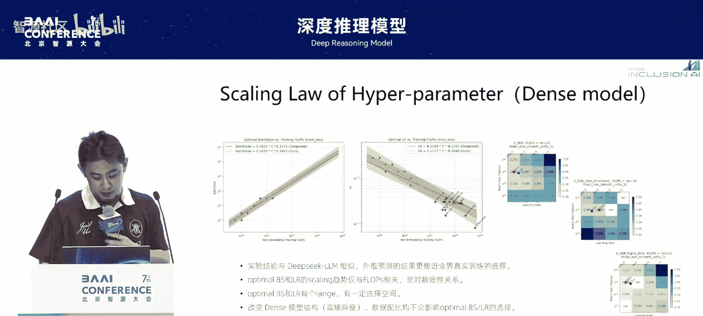

大小和数据的大小allocation的这个各个。然后这两个东西有什么用呢？它得到的结论其实跟之前的paper是类似的啊，那它的作用是说我可以去判断，比如说数据的好坏。

或者模型架构的好坏啊呃这里面有两组实验，这是这是完完整整做的两组不一样的实验。在不同的数据层面上。然后第二行是我们从数据的质量标准和多样性来看，更好的一份数据。那我们就会发现。

对于更好的数据模型是会更倾向于把fps分配给啊，或者是说整个scaling law会更倾向于把fps分配给更大的模型。呃，更少的数据。那反过来我们就可以想说，如果我们要看不同数据版本的优劣。

我们依然是可以通过这种方式来度量啊，因为直接用一个模型训练看los是没有办法对比两个版本的优劣的。大概率上我们需要训练一段时间之后，用一个比较大的模型训练一段时间之后。

我们再去对对比所谓的ch当的一个效果那这是呃一个呃我们对于这个这个模型和这个数据的容量的分配的一个定律。那么再进一步我们如果尝试想要去拟和los的话。

我们会发现之前的一些理和方法没有办法给我做的特别特别的精准啊，我指的精准是说我希望能够把los的预测控制到千分之5%以内啊，为什么是千分之5呢？其实呃我们会调整一些算子。

比如说呃做低精度训练FP8训练和BF16训练。基本上这两个los的误差，大概会在1到千分之1到千分之34左右。对所以我们是希。能够尽可能的控制我们预测的los的误差，不能太大。对。

然后我们发现说用一个这样的呃，就是这公式里面呈现这个对数反比关系去拟合los的外推。我们会发现这样的一个拟合方式，其实体现出来是一个比较准的一个拟合精度啊。

然后呃我们也可我就所以我们就通过这样的方式进行拟合。对于不同的架构，我可以分别进行拟合，重何推去对比不同的模型架构之间的优劣。然后另外一点就是在这个礼盒上，我们做了一些实验。

我们是可以看到它可以外推到比较大的这个算力的这个区间的。

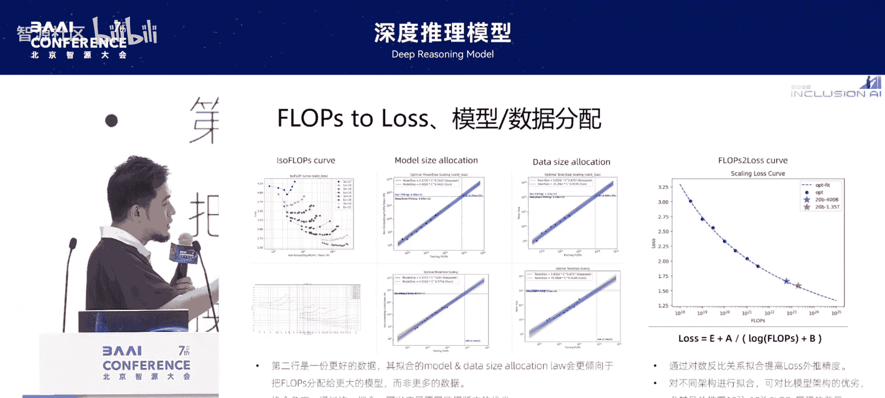

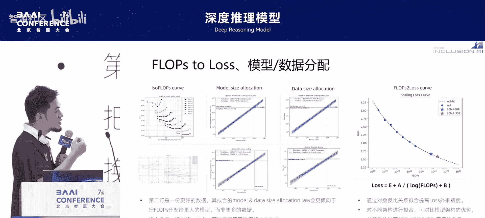

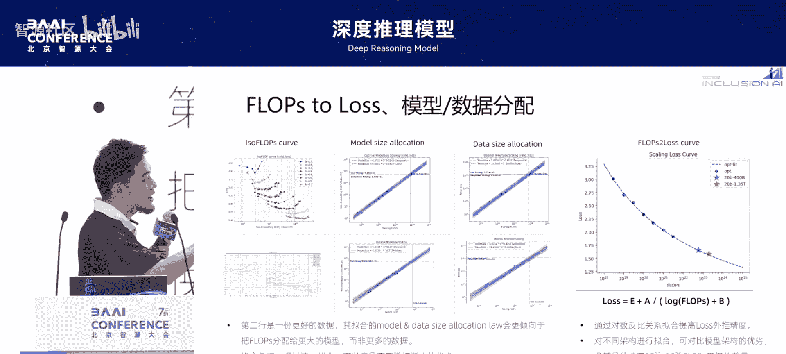

但是还有一个问题就是我的礼盒是基于opimal allocateated token来进行礼盒的。那么我们可以发现1个20B的dance模型，通过上面的这个token的分配的定律来来看的话。

它的optiim的 token大概是400多B。但是我们真实训练我们不太可能训练400多对220的模型，我们大概率上会训练10啊，甚至15T甚至更大的量。那这种更大的ken量，我们在做礼盒的时候。

我们就发现不管你这个在opti token的时候，你礼盒的有多准。但是在over的情况下，它的这个这个los gap会逐渐去放大啊，就达不到。我说我在真实训练任务之上。

我是想要能够达到千分之5以内的这个lo的误差。那这个应该怎么解决呢？我们呃其实也是大家一起开会脑爆了一个比较呃比较比较怎么说呢？比较heistic的一个策略，就是既然我用opti token去进行礼盒。

是可以达到很低的这个礼合误差的那我有没有可能在over的时候，比如说over3倍1倍。我依然用overtrain3倍10倍的小模型来去做外推的拟合。我们发现这个东西是非常work的。所以在这种方式之下。

我们对于比如说这里的1。35T就是连20B在3倍overtraining，就是opimken3倍over之上呃，我们可以把los从原来的1。5%缩小到千分之5以内。

对用这种方式就可以对los做一个就是千分之5以内的精确的预测。而这个预测它是不需要训练的。然后我们实际run了一个20B的模型的训练，我们发现它的误差就是在千分5以内。

这样就可以给给到我们说能在预训练的阶段做比较好的监控，看我这个模型到底有没有问题。

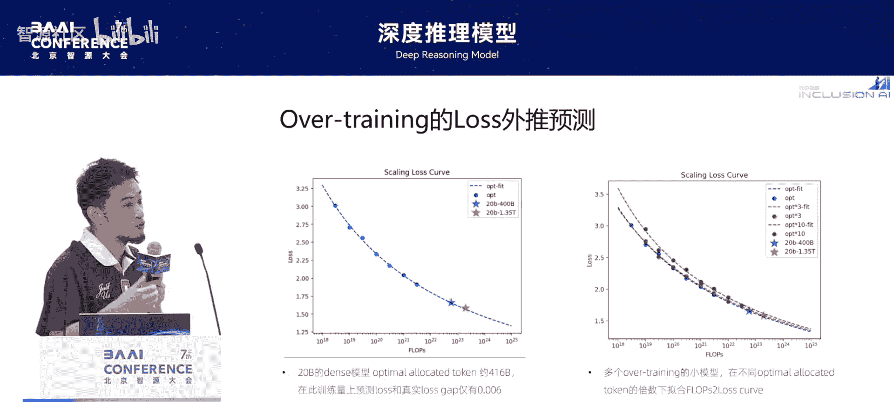

好，然后呃我们解决了d上面的这个s，包括比较准确的这个lo的你和问题之后，我们尝试想要去想另外一个角度，就是对于MOE架构的模型来说，我应该怎么去s我应该怎么利用去做ME架构的选择。

因为ME架构里面不管是专家的设置悉数度的选择，还有这种呃专家均衡的一些选择，都会对有很大的影响。然后最后一个是说呃我们有没有办法能够去看到底我训练出来一个所谓比如说激活10B的总参数100B的这个MOE的模型。

它跟多大的dance模型是等价的啊，这是我们希望探讨的三个问题。然后第一个问题其实解起来是比较简单的啊，为了控制变量，我们首先把ME的架构确定，那么一个确定MOE架构，其实某种程度上它就是一个d模型。

然后我们在做类似这推导。我们发现它的函数形态。

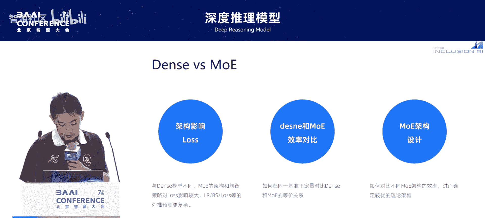

是跟dance模型是一模一样的啊，都是可以得到这样一个对数线性关系的一个礼盒啊，虽然绝对的值肯定是不一样的。然后我们调整这个MOE的架构，我们发现不管专家的吸数度3%到10%。

还是我用不同的专家的均衡策略，这个op size是基本一致的啊，但我们做的是单一变量的方式，后面会有lim的一些呃分享，里面还是会有一些局限性。对，然后呃所以我们得到一个结论是说MOE架构。

它的op的 size依然只是跟具体的fps包尤其是激活的fps相关，和架构和均衡和数据关联性并不大。

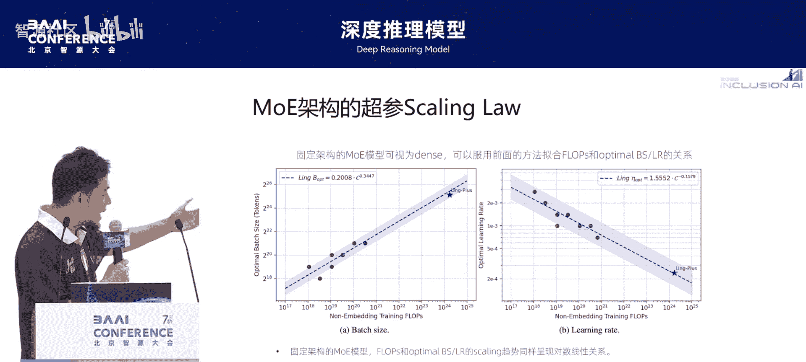

好，那么第二个问题，我们想要去回答说一个固定大小的一个固定架构的MOE模型，它和dance模型到底应该怎么样去等效啊，我们我们提出一个这样的一个思路，就是呃一个叫杠杆效率杠杆的的概念。

就是达到相同的los的情况下，不同架构的激活的比值激活的fps的比值。我们把它作为这两个架构之间的杠杆。那如果我要比较一个MOE架构和一个dance架构，他们的等效关系的话。

那就是我MOE的激活乘以一个倍数，就是这个杠杆的倍数，得到一个dance模型的大小。那这两个模型，他们在训练的过程中，los的曲线是基本上一模一样的。啊，我们通过这种方式去做分析。

然后我们做了呃我们自己零的MOE模型架构，就是第一代的MOE模型架构和我们的dance模型架构上的这个s的对比，我们会发现就通过大量的小模型的礼盒出来这个ps的曲线。

我们会发现我们第一代架构从light到max就从一个总参数大概十几B的模型到一个总参数接近700B的模型，他们的这个杠杆效率大概的rangech是在2。8倍到4倍之间。

而且这里面有一个很好的信号是说呃随着fps增加MOE的杠杆效率在扩大。所以这是一个非常非常健康的模型状态。呃，反之我们会发现有一些其他的模型架构，它在ps特别大，就尤其是真实训练的时候。

它跟架构就跟一个标准的dance模型或者一个标准的sof maxax和的模型来比的话，它的优势会在缩小。所以这个是一个非常好的实现。但是真实的训练成本。这个是理论的分析啊。

真实训练成本跟我们训练的英法相关啊。所以我们呃一般情况下来说，MOE的MOE模型的这个MFU会是dense模型MFU的大概可能呃5六十。对，所以实际训练成本上它不能不可能做到2。8到4倍。

大概会在2到3倍左右，然后能够换来跟dense是一样的模型架构啊模型性能。这就解释了为什么现在大家都会希望去训练MOE的模型。因为它确实比较划算。

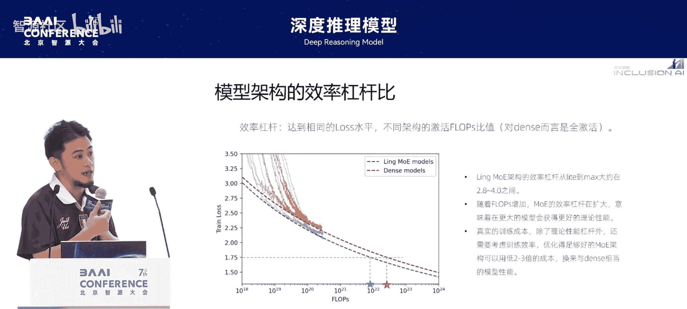

然后我们再看就是我们怎么利用这样一些一些方法来去做架构的判断和设计啊，就比如说对MOE来说，我们会呃有两个很重要的。当然有很多很重要的因素啊，这里列举两个，一个是专家的稀疏度，另外一个是专家力度。

专家稀疏指的是说，比如说我一共有32个专家激活一个啊，32分之1。如果我有256个专家激活8个啊，256呃，也是32分之1。那么在不同的稀疏的情况下，我们应该选择哪个稀疏度来获取最好的杠杆性能啊。

这是我们通过这样一个实验能够看到的。然后这个实验给了一个特别牛逼的结论，就是对于MOE的模型而言。

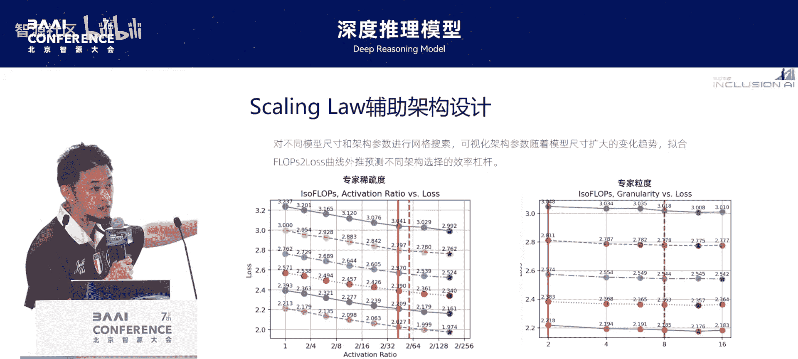

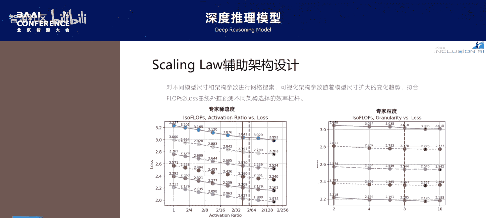

越稀疏就会换来越好的性能杠杆，因会会换来更低的落实。而且这个优势随着稀疏度成倍数的增长，是没有止境的。这就为什么现在大家都训练一些呃很大，然后激活参数比较小的模型。因为这是有很大的优势的。

但它的训练很难，这都是理论的分析啊。而对于专家力度来说，我们也会发现它并不是一个无止境的优化。比如说我从64专家到512个专家，甚至到更大的专家数，我们会发现在大概呃某个位置，在我们这个实验里面。

大概是384到256到384之间，他可能能取到一个比较好的值啊，但到512的时候，它其实就不会有更大的优势了。那这就意味着就当训512的专家，我们的训练的MFU可能会更低。我们需要做更多的工程优化。

说它是个不划算的事情。😊。

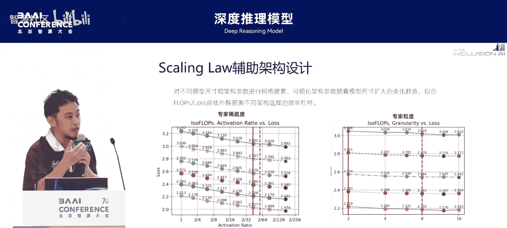

然后我们呃有了上面这些结论，我们做了一个验证啊，我们设计了一个更新的一个架构，就我们现在2。0训练的架构啊，然后我们训练了一1个5。5B的d模型啊，我们训练了大概一one练 token。

然后我们在训练的一组从64专家384专家固定的稀数度，然后激活大概800兆的个的模型。我们会发现在口径下，我们可以获得将近10倍的性能杠杆。但是在口径下，我们获得大概7倍啊，这个东西会收窄在情况下。

也可能是没法覆盖所有的东西啊，然后我们在32B的d和4B激活的ME模依然训练了接近一T的token量，依然是类似的这样一个情况啊，所以我们有理由相信如果把这个架构到one的就是到一T的模型的情况下。

它可以做到等效于300到400的模型，而它的训练成本大概只有4分之1到3分之1啊，这是我们通过。😊。

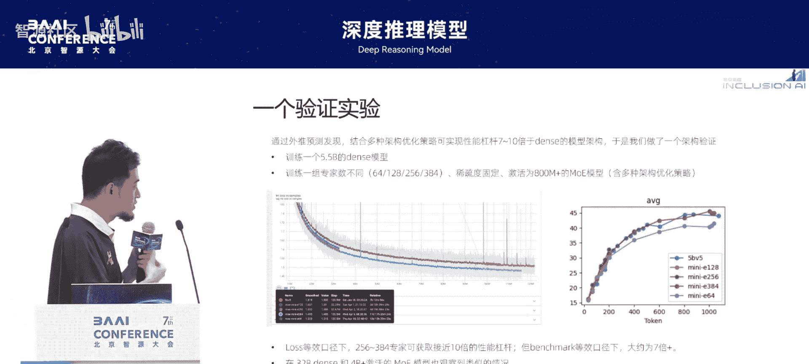

发现了东西。好呃，然后我这里简单说一下局限性啊。第一个局限性就是这个礼盒它其实某种程度是个贪心的礼盒。就我一般情况下都是控制单一变量，然后去做一个实验，然后再改一个变量，再做一个实验。

所以在礼盒的情况下，它会存在就是如果多个变量之间有耦合的因素的话，那么可能得到的结论并不是最优的。这是第一个。第二个是说我刚才讲的所有的东西都只跟模型架构的理论性能有关。但是影响模型的效果，其实是数据。

所以我们还会尝试去探讨说在数据层面上应该怎么去sll out和skill out。然后最后一点就是当我要真正把一个理论研究出来，它有比较好的杠杆性能的模型转化成一个真实的特别大的模型的情况下。

我需要做非常非常多的工程系统的优化。所以在训练的角度上，如果你设计出来一个特别稀疏特别大专家数的模型，它的训练难度是很高的啊，这是我们都需要去解的问题。

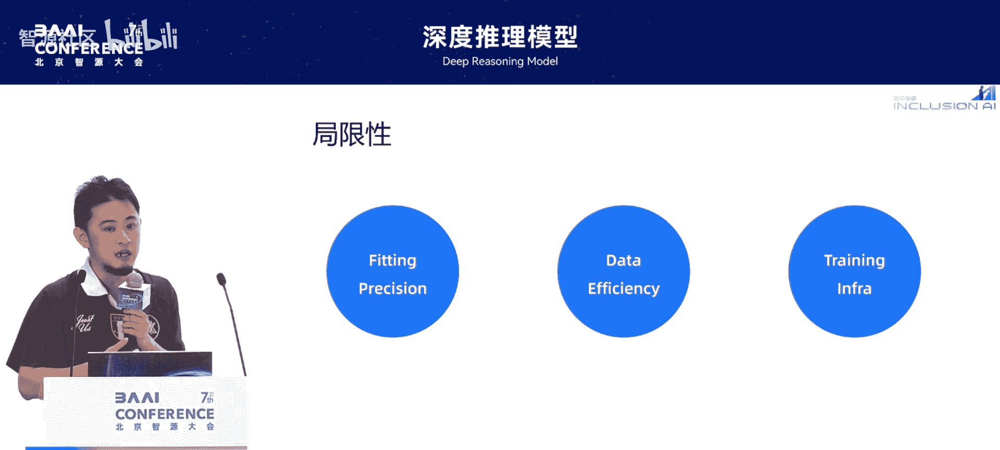

呃，然后最后这这呃最后我讲一下这个text time嘛，就是我们基于我们之前零的模型呃，做了一个我们叫ra呃light就比较小的模型，后面会有一个更大的模型。呃。

我们也发现说这个模型其实整体的效果跟现在so塔的一些推理模型其实比较接近的啊，我们在这个月就可能大概一两周之后吧，我们会开源呃这个模型数据，还有一些相应的训练代码和支货报告啊，然后最后几个问题啊。

就是这个是我我个人的一些思考。

因为前面讲的都是pre scaling law。那我们有没有可能去得到说所谓的text time scaling就是text time的 scaling law。而我们现在基本上大家可以看到。

就是说呃前面的很多老师都讲到了，通过IO的训练，我们可以去扩展模型推理的时候的fps。然后我们可以获得比较强大的，而且是很重要的是具有一定泛化能力的，很强的推理能力。但是在所有的已知的数据显示的时候。

我们so塔的thinking模型啊，不管是哪个模型，它的RL训练都不太会超过1万步。而这个训练的步数相比预训练那种上百兆的训练步数是非常非常小的啊。

而很多就是通过这种就是diill COT之后做SFT为起点。为了为了提升一些这个效果。然后再做RL训练大概可能几百步就会迅崩溃了。呃。

所以我我我会我会觉得是说我们现在只是观察到了tex time scaling的趋势，但是我们没有办法得到一个漏，我们没有办法去更像预训练这样比较精确的预测，或者像预训练这样，我要持续跑。

我有持续的收益啊，所以我认为这个可能是未来就包括我们团队，包括可能业界都需要去共同探索和克服的。为什么RL不能像预训练这样一直跑，一直一直爽。啊，而这里面可能需要解决的是系统的问题，算法的问题。

数据的问题啊，这里我就不展开了。好，我的呃报告就到这里，谢谢大家。😊。

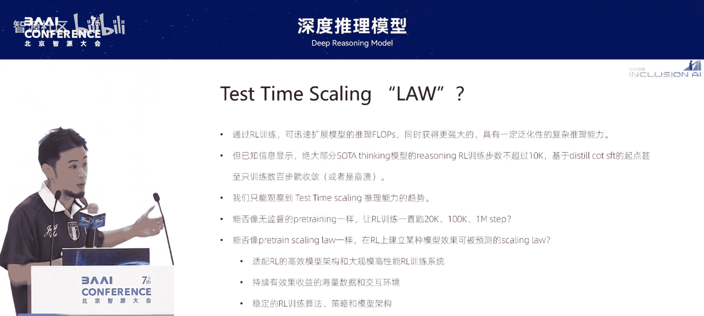

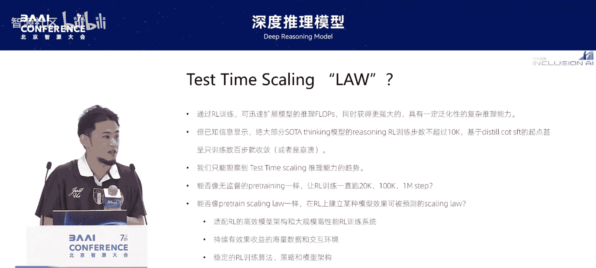