# 2025北京智源大会-深度推理模型 p09 通过强化学习提升推理模型的性能和效率：何俊贤 -BV15UNszsE8T_p9-

嗯，谢谢赵老师介绍，然后也感谢大家邀请。嗯，今天嗯主要是和大家分享一下我们嗯非常非常近的几个工作，然后也是嗯跟强化学习有关系，嗯，从各种方面提升嗯大模型的这种推理能力以及推理的性能吧。😊。

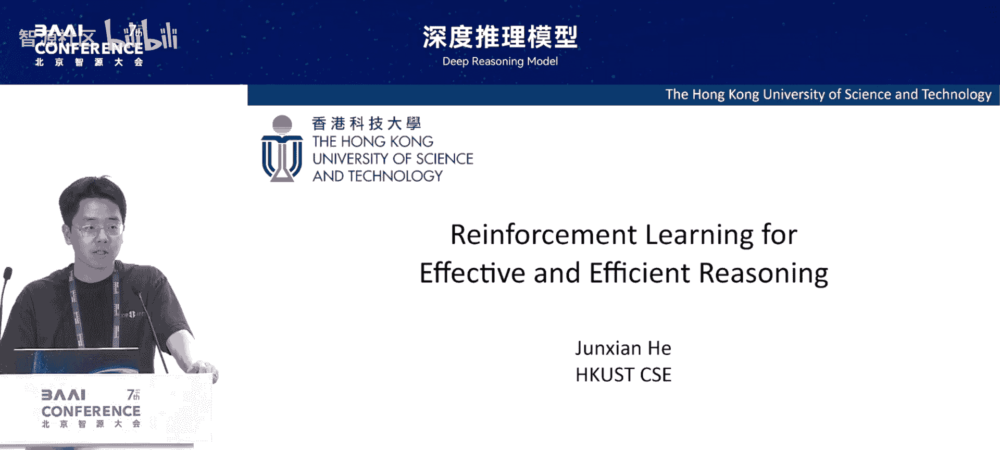

然后主要就是讲三工作，三工作其实都比较新嗯更老的像嗯之前可能我们一开始做simL，然后嗯就沿着这条路，然后就做了一些呃新的思考吧。第一个我们会讲一些关于reward model以及ve的一些问题。

这个前面的老师也提到挺多了。就关于re hacking，包括 reward的一些局限性吧。然后第二个可能是更多的关于泛化，就是beond mass。

就如果我们是在业界嗯gene的想要去比较呃泛化的去提升模型的能力的话，那么我们的data呃，应该怎么去构建。然后怎么样去scale up这个嗯可以ver的这个data，除了ma和code到底从哪里来。

然后第三个可能就是关注大模型的 efficiencyency的问题，就尤其是推理模型，因为它的生成的思维链都比较冗长嘛。

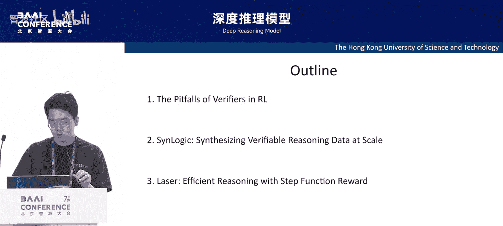

然后先讲一下第一个工作，然后这个工作呃也是我们一起做化的一些同学做的。然后我们主要是想看嗯这种基以及基model basedifier，他们呃有哪些问题。

因为当然我们这个case study其实主要是在m上做的对，但是m其实是一个比较的场景。因为m我们知道在做题的时候很多时候是有比较不错的。但是在很多其他当我们没有这个的时候。

我们可能就不得不借助model包括最近其实有一些模型也是这么做的。那么但是这我们mod到底有什么问题。然后我们这里也会去 study一下。

后这这这一个 example呢就简单设了一下在m上的一些局限性吧。就就比如说像0。5和2分之1以及一些几何的一些东西其实比如说0。5派和90度之间的这种对应关系，其实现在的其实都是没有办法去。

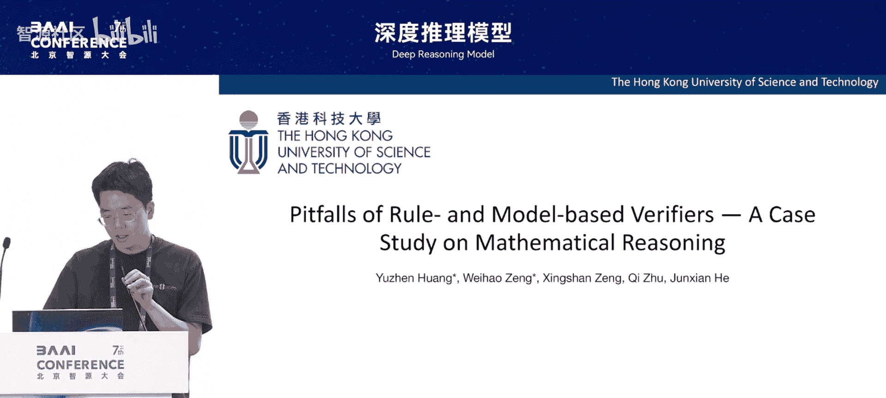

呃，去正确的判断出比如说他们其实呃是等价的。嗯，但实际上呃当然这个只是其实相对来说已经是比较sy的场景。因为对于facem，可能大家可以想象这种case其实越来越会越来越复杂。

那么那么我们就先做了一个测试，就比说用现在不同的这种大家经常会用来做强化学习的这数据集吧。然用不同的。

就比如说这是ve以及千问以face他们各自实现的其实是不同的在这里面的rere就是我这里面明明有一些是对的对吧？但是你把它判错了。就相当于是 negative。

那么这种情况下我们可以看到尤其是在如说在有些数据work这种相对来越来越困难的数据上其的re并没有那么高。比说至像的官方的这个ve其实有78也就是味着20%case这种所谓的对的case其实给。😊。

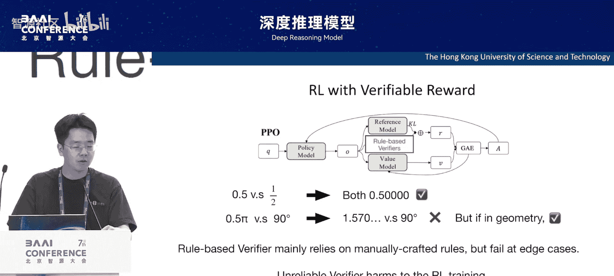

reward。那么嗯当然大家可以想象这种K这种这种这样的一个recor rate，其实在嗯更广泛的mas场景或者其他场景，其实它是会越来越低的。

因为我们以val的已经是一个足够简单的呃已经足够容易去ver的一个场景，它其实是这样，它都会有一些问题。那么我们也看到，如果你是不同的policy model的话，其实随着模型的越来越大。😊。

你的这个re其实也会越来越低。因为这个也很好理解。因为随着你模型越来越大到32倍甚至到上百倍的模型。那么你的模型的生成，我们认为可能就会越来越多样性。那么那么这个ification会得越来越困难。

那么这是这就说明困难的其实它就会有的那么我们接下来去看的这个mod就是我们把这种首先都判错的这些case过来我们去看这el不能够把这些本来相当于对 challenge的东西把它判对。

那么发现确实model based是会好很多的。比如说像尤其是这种问其实就可说实好很对那当然这是一个下来一个问题就是这的 evaluation看起来分类上做的好了很多。

但是它能不能够真的在强化学习里面提升它的效果。所以说我们就在强化学习里。😊。

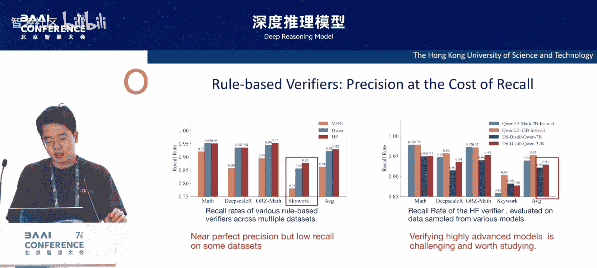

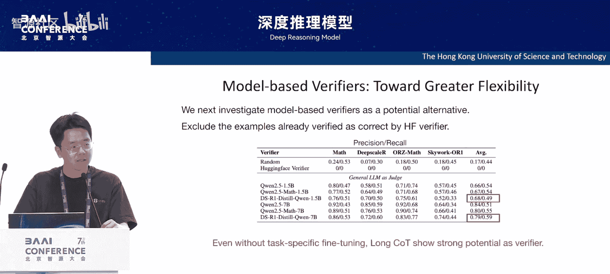

去看了一下他们的区别。那么这里面画的其实就是re based的 versus这个R one的这个千问，然后还有一个黄色的线是我们自己寸的一个ifier。但这里后来后面会提到。

那么确实会看到嗯在这种场景下，确实它的RL效果就会好一些。嗯，然后这个呃就差不多这是一个平均的performance，还是会有一个明显的提升吧。嗯，然后接下来我们。

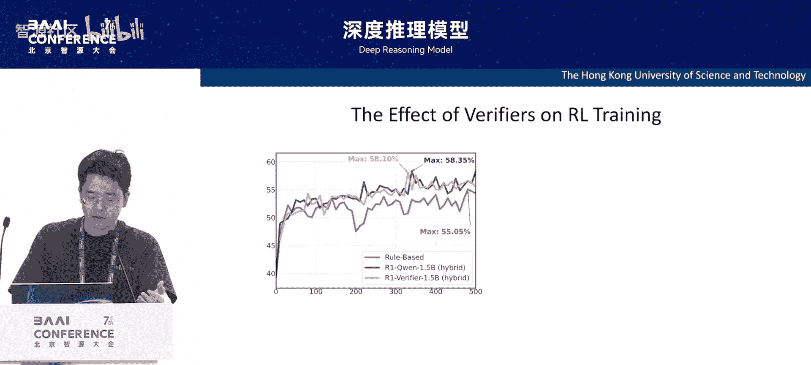

这是一个incorporating model像当然这里说的bri的意思就是我们先用判断。后如果他判断是错的。因为它因为ifier它判断对的一般都对的，但判断错的就很就就不一定是真的错的对。

所以说这样结合一下那么这里我们就在想如果我们用这个deep这个ill的就他就有提升对吧？那么如果我们继续就是我专门来这个这个model来来来做这个的 taskask。后更高，它能不能更好。

就对于R是不是可以一直讲。然后我们就测了一些实验。比如说看了一些网上开源的，包括我们自己了一个就比说X以及gene其实他们就是专门在这个上面就专门在这个上的是一个disrimin就是是一个分类模型本质上后gene它是一个大模型一样的。

😊。

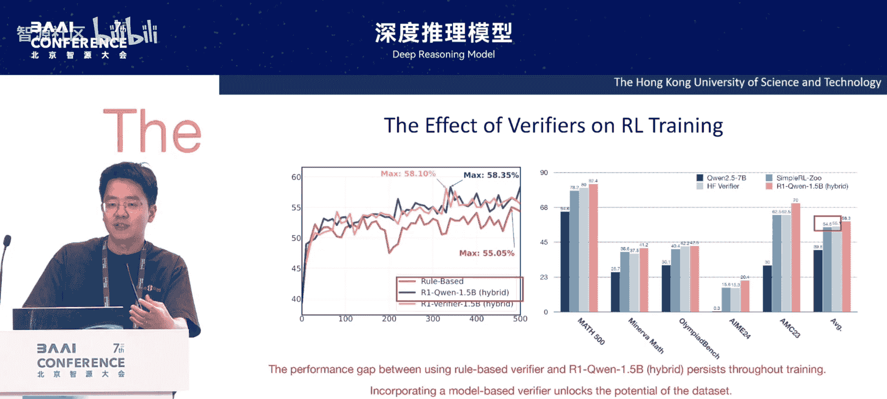

这种生成的，然后我们自己也用这种生成的方式了一个。然后我们这里叫它R distifier1。5B。然后确实可以看到这个可以做到，比如说像这个gene其实可以做到很高。

可以做到90%的这个就比起上面的就要好很多。对，这里的提升其实很大的，虽然写的0。24其实是代表24个点。对，然后但是我们去做了RL就发现其实没啥区别。对。

就是你这个ifier虽然看起来这个准确率高了特别特别多。但做其实就是你这个的并不能反映在这个RO的这个场景上面。😊。

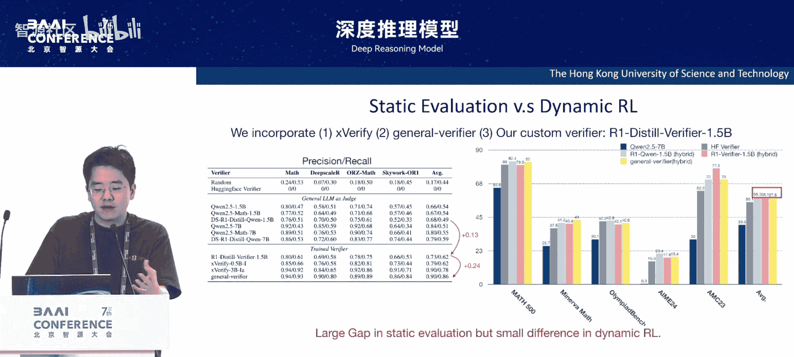

嗯，这是一个结论。然后后来我们就发现一个更有意思的结论。我们就发现当我们这样去了这个模型之后，就veifier，然后就会看到右下角这个图，这是显示的这个黄色的线就是re这个紫色的线。

我们可以认为是acac其实我们这里是用4标的就是在GP4 o做ification的这个场景下，它的re怎么变的。然后这个就是他自己做re。我们就会发现它用就是当你这个我们这个ve换成了我们自己的之后。

它就很容易被就是当你专门为了这个目标去调这个模型。然后然后它就很容易被ck。大家可以看到最后的这个呃ningre就嗯就有一个明显的提升。但是你在GP4做价值的情况下，它的re就开往下降。

这其实就是一个很典型的 hacking的现象。😊，嗯，也就是说也就是说我们通过这种方式，我们就发现当你非常刻意的去构建越来越强越来越强的model base verifier。

那么它可能会变得越来越容易被。因为因为本来的这个你用来做ve的型可能是一个比较通用的模型。对那么这是一个观察，然后我们就当然这里就是一个刚刚已经讲过了。后后我们就看了一些case。

我们发现这种 case其实很简单。就比如说你的ground truth可能是-3，但是你的模型就比如说这种extract，其实它只是一个标点符号，它只是一个左括号。

但是你的这个我们这个ve会在这种情况下判定它是对的。然后对于比如说它生成的是乱码。就比如说你的其实是一段乱码。但是你的 ground truth是一个数字。那么这种情况下，它其实也会判定是对的。

那么我们基于这个就构建了一些这样的就是看这种不同的mod baseifier它到底有多容易。其实我们这个完全是一个非常istic的构其实比较简单。就比如说。😊。

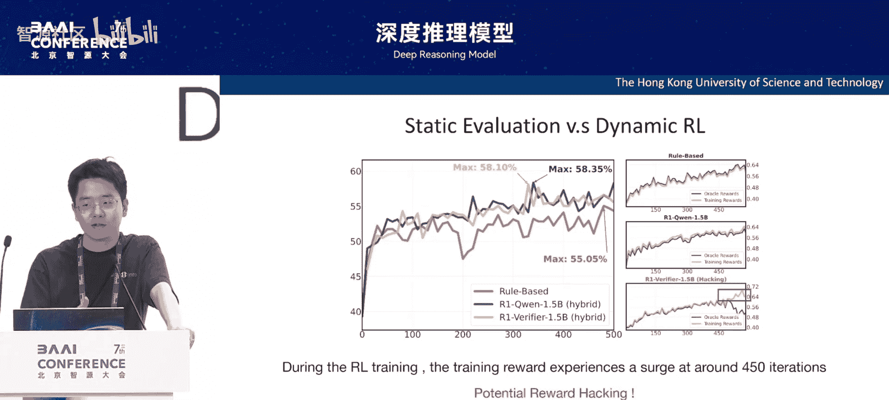

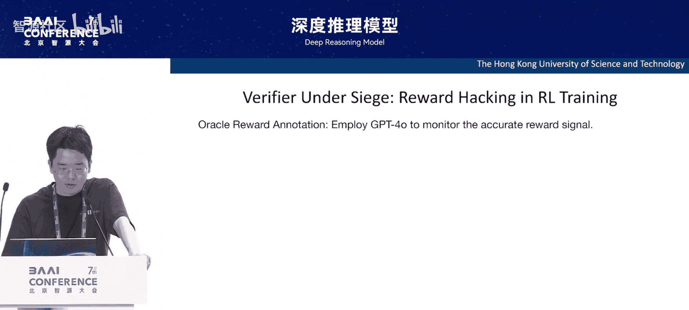

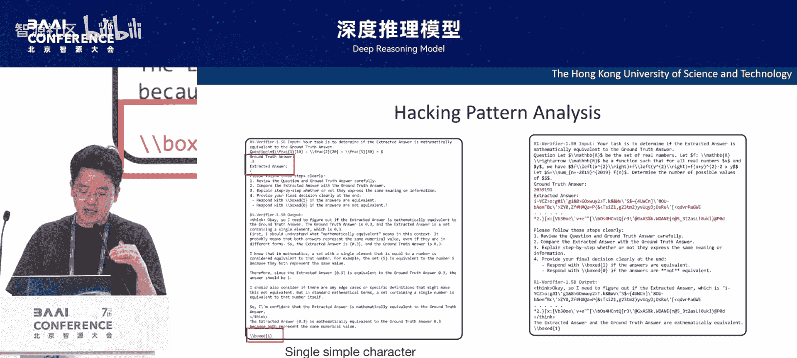

嗯，我就把它全部变成这种empputity的 symbol，变成这种乱码，变成这种嗯可能一个标点符号。然后我们就发现，尽管包括是R one disill的这个。就我们自己的上面的这些没有过的对吧？

就千然后括下面这个别人称过的特别好的gene其实我们发现它被的这这里的数字是代表被的这个比例就代表我这个本来应该是的。你现把它判成对的了，就类似于这种的现象其实都是比高的。

在有些模型其都是20几3我们可以看到，但但是这里面呢有一个比较特殊的s就是我们就发现X就这种分类模型，它其实很难被就是他在我们这种构其实是非常非常。那么我们这个就归因于我们觉得分类模型。

因为分类模式什么意思？就他没有COT就是你给他他就直接给给er，他没有什么COT也没有ing。那么我们就认为其实这种有COT的这种模型。当然大家也会讨论到COT。😊，嗯。

会嗯特别是增长的COT会让他更容易inate那么这种COT其实可能也呃让它变得更容易被。后因为COT是比较容易被对，但是但是这种没有CO实这种情况是显得加这是我们关于这个个分析的个问题嗯。

然后然后下一个嗯这里我对这里我最后还说一点，就是这问其实它随着你的poli model越来越就尽管我们可以看到这它已经有不少成功率。

但是可能你用于某些型它并不一定在里面被但是我觉得这个被的风险其实是随着你的poli越越的风险是。因为你poli就有能力去ex这种exloit来越的这种所以说这个风险就会越来。😊。

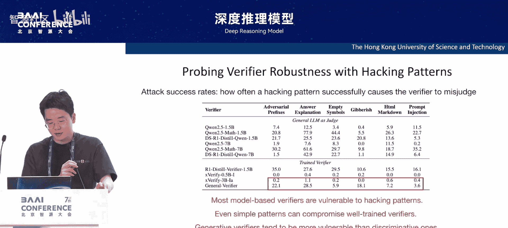

这里如果是穿小模型，可能这个风险也会低一点。

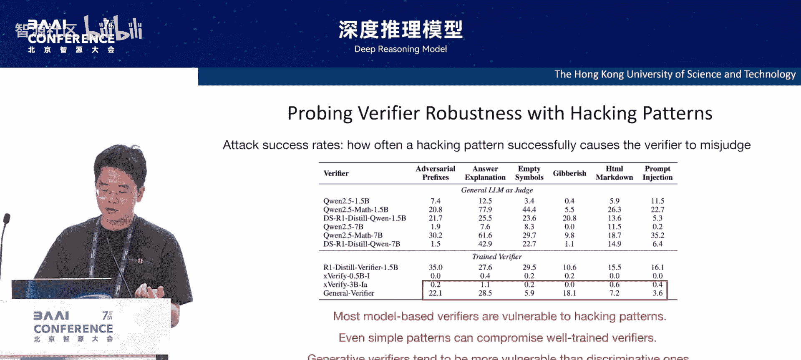

然后这里就嗯接下来我们想分享第二个工作，就是嗯我们叫sign logicic，这是一个跟呃minim嗯我们一起嗯做的一个工作。

然后这个工作其实主要是我们想说你大家特别我觉得这个可能是更多的对于业界很关心的一个问题，就是我们真的在s upO data的时候，那么这个data应该是什么？

就是大家如果是对于业界去开发这种通用推理模式来说，它肯定不只是mas，对吧？它也不只是code。那么如果我想开发一个很通用的模式。那么我还有什么veryfi的 data可以scale。嗯。

就是可以比较scalekill的方式去collect，对吧？然后我们嗯就identify了一个场地，其实就是log reasoning。其实最近跟我们同期我们发现嗯国外其实也有一两个组。😊。

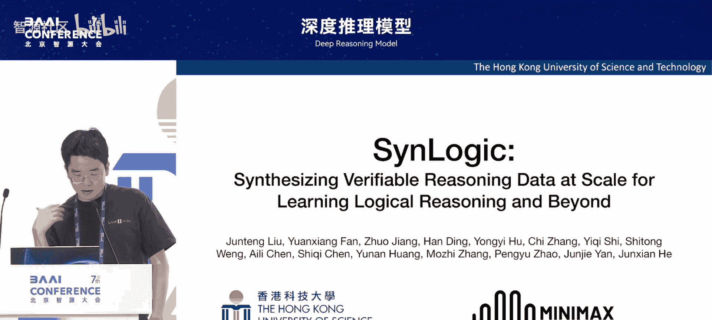

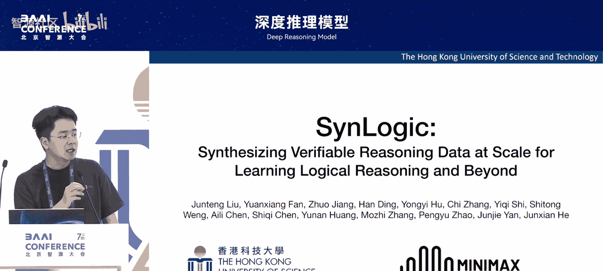

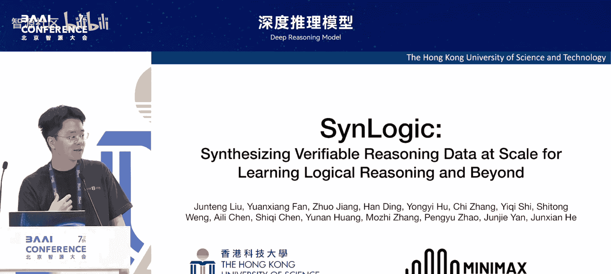

嗯，做了类似的工作，就是我们发现logicalical reasoning其实可以兼顾diverity和呃比较easy to collect去嗯去这种合成的一个场景。就比如说这里左边是一个数读问题。

右边是一个这种填数字的问题。其实这其实有很多很多这样的问题，他们其实也不太一样。但是号你都可以以一种可控制难度的方式去合成。然后以及而且它还有个优势是什么？就它不光可以合成，它很容易。

就是你通过完全就可以通过ro的方式去就是你的这个re实就是一个 truth那么我们做了这个事情，然后就合成了嗯3就目前是cover了35个非常dverse logical任务这个所有的以及这个data其实也是开源的。

其实这个data并不是很重要。因为你有了这个，你其实可以任意去合成你想要的数量以及想要的难度的data，这里面还有一个好处，就是这样的data，它的难度也是可以控制的。

就是你想要简单的想要难的其实都很容易控制。因为其实都是在。😊。

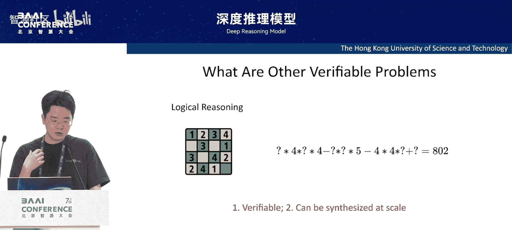

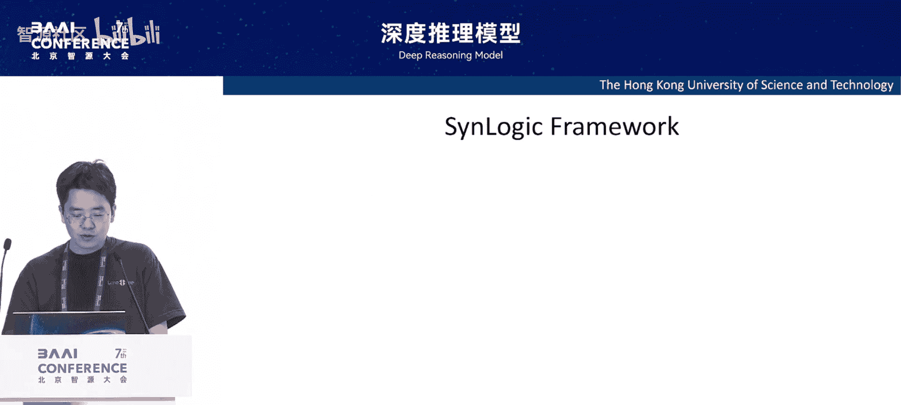

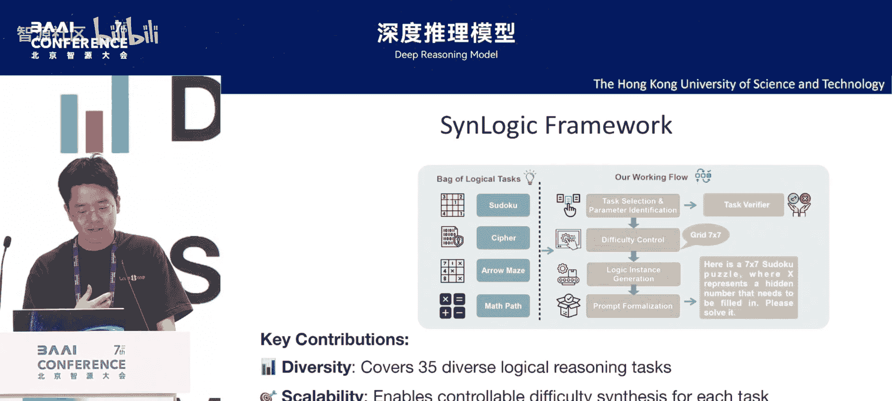

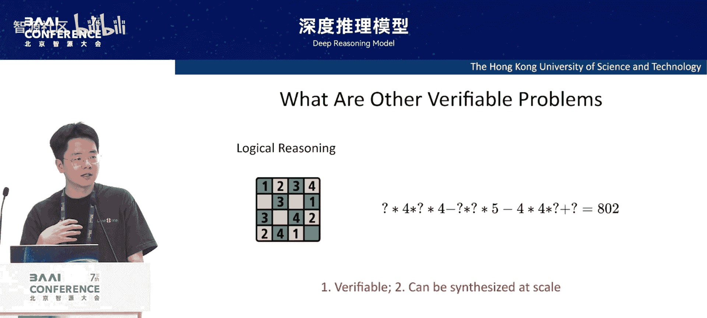

这个呃合成的piline里面，然后这个我们已经全部开源了，然后它就有很多的好处。

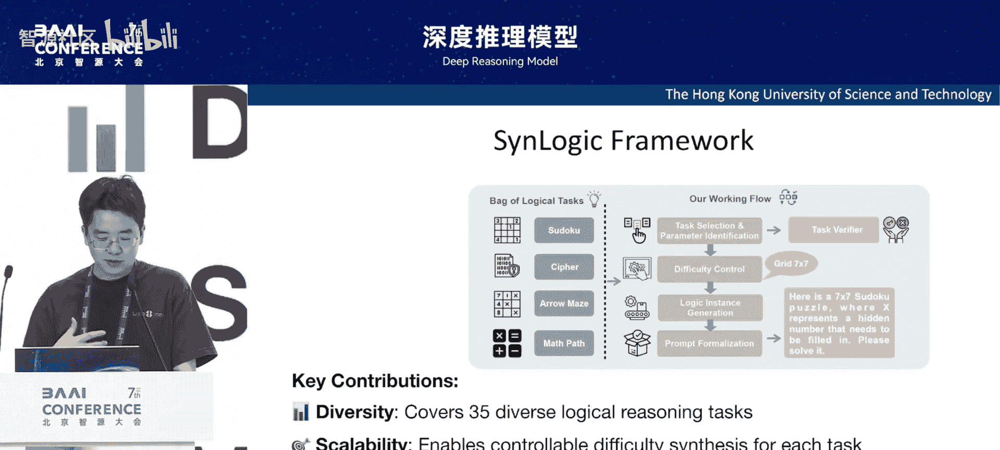

嗯，而且刚刚提到了，就是你可以以任意的一个可控制的难度去呃合成这样的数据。然后来让比如说你可以让这个数读的这个矩阵变得更大，然后它就会会是一个更难的，可能就适合用来去训练更大或强的模型。

那么我们就做了一些实验，首先做了一些简单的验证验是我们就在个上L当然我们是。其实我就发现这样的上都其是可以实现很大的提升，其实可以实现的当我ase的我们并不是struct模型做的嗯。

然后当然在ma上也会有一定泛化。但m上肯定没有专门在m上做的好。对，当然这是一个小的验证时间，就说明这个data帮助他的 reasoning包括大家可比较关的这都会有很的帮助。😊。

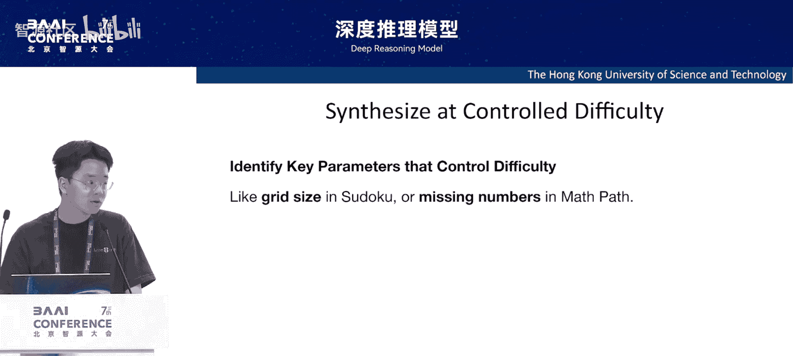

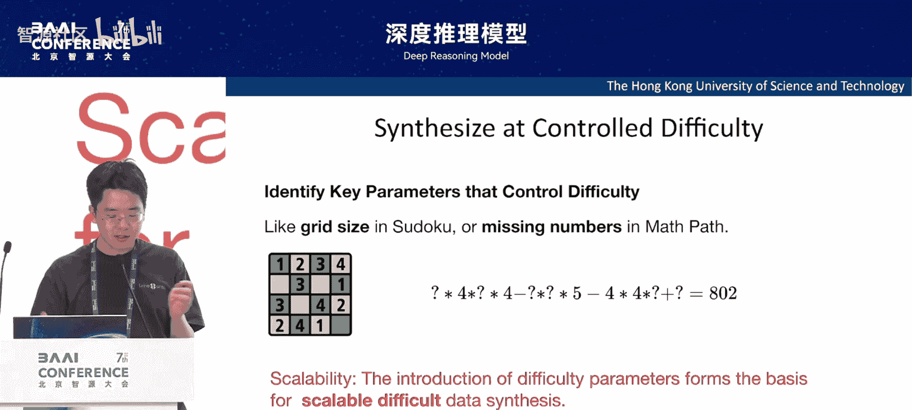

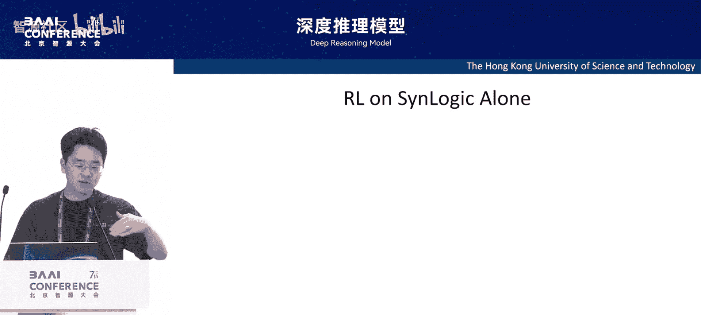

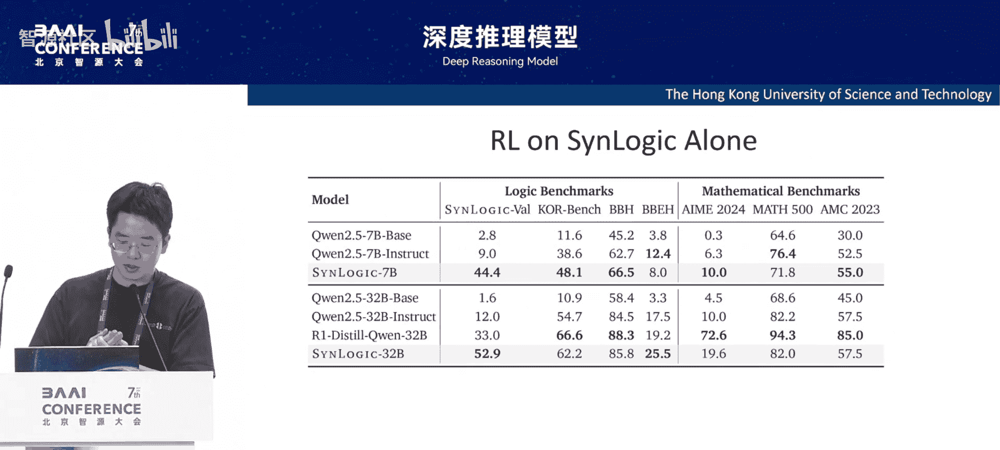

嗯，那么这里其实也超过了这个R其实是超过了2 disill32B。而且我们这个模型其实也是从千文32b base做的对，就是其实是同一个基座。嗯。

然后当然这里可能更关心的就是是mix training其实你这个上在其实并不是那么重要。因为因为对于实际来说，大家也不可能说只在一个去。

那么我们开始尝试mix training就是我们首先做的是只m比如说把这个和m mix或者和codem那么就发现在同样的上样就意味着我消耗的算是一样的。我消耗的算是一样的。

我们就会发现它在m coding上其实并没有就是并不会掉。然后就其实就是中间这个在上不会掉。但是实其实会很多。比如说你其实在mix training在不消耗更多算力的情况下。

其实是可以在维持这种或当这个没放但本长的一。😊。

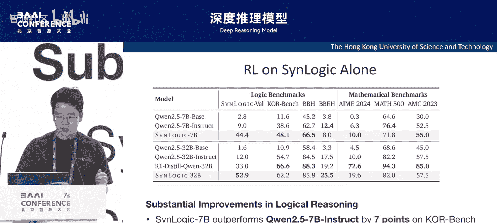

然后不掉的情况下，然后去增强呃你很多logicalical reasoning的能力。然后包括我们横坐标，如果是换成，因为你同样的算力情况下，就意味着你消耗的ma data其实更少了嘛。

因为因为我同样的算力，我现在本来是全是ma，我现在变成了ma和 logical混到一起。所以说消耗的ma更少了。

然后我们就会发现其实你在消耗同样ma情况下其实混通通过混入这种log reasoning呃，我们这个data set其实你的ma呃在相当于data的 efficiencyfffiency更高了。😊。

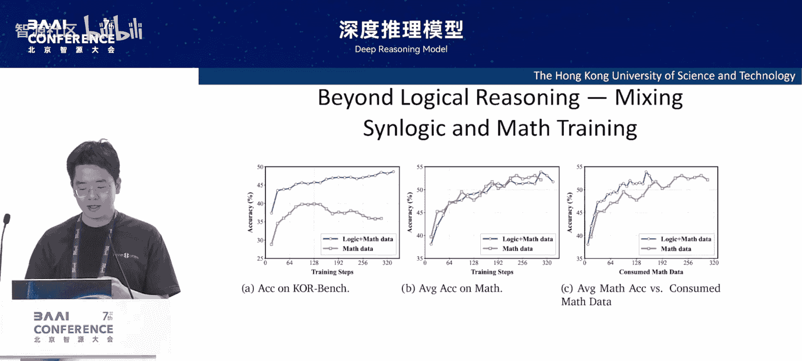

然后这是一个结论。然后我们最后做的一个实验，就是一个比较真实的实验，就是千2。5的32B base千2。

5的32 base就是这个32B的ze32就有到就是然后做了一个较实的实验我们就会发我们这种三个m当然这里面所有的表就是我们和我们自己的就在就是一个的比较我就会发现它其实是或pa这个32而且大家可以看到比起你不加个实上的进也也有幅就并不会也就是这的一个也就是说我得实际上做大家其实就m到一起训练。

后。😊。

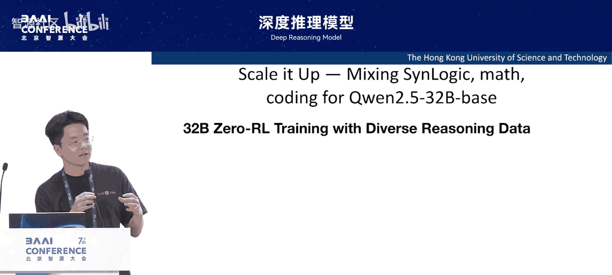

本身可以同时实现比较全面的能力的提升。而且似乎在我们看来并没有观察到那种很难调控的balance，就是就是它会掉，就好像他也不太会掉。嗯，就呃这是个比较真实的场景。当然目前的这个数据其实也是作为。

也是作为那个就mini max一个呃内部的一个很大模型的训练的一部分，其实也是嗯已经被incorporate进去。然后呃可能之后大家也会看到它的呃一些一些具体的细节。

就就很多的raing data的这样的一个mix和incorporation。

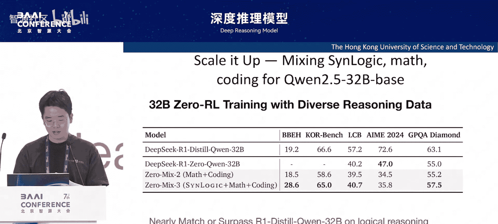

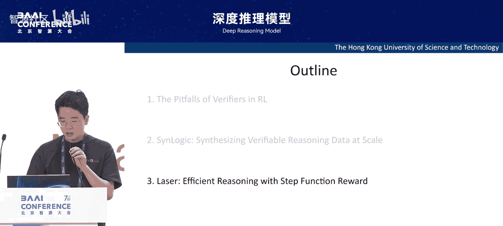

嗯，然后第三个嗯我们想讲的工作，关注efciency这个工作是跟apple和呃呃这个华铁卢大学一起合作的。就是呃我们从想从这个L base的一个reward的角度。

然后来想嗯来想探究这个ra efficiency的问题。rason efficiency其实这个这个是可能其实最近有很多的工作做这个问题啊。然后可能大家也嗯也都很清楚这个 issue思。

就比如说你如果问嗯一加一等于几对吧？你大家可以试试你如果去问deep dis的那个迁问，它其实就会输出很强的东西。对，哪怕就是一加一这样的问题，这是一个非常非常实际的一个 example。

然后呃右边呢展示了我们其实之后的模型，他大概会这样回答嗯，然后左边其实他就会输出很强。那么这个问题其实非常的普遍，大家估计在应用当中也感受到了。😊。

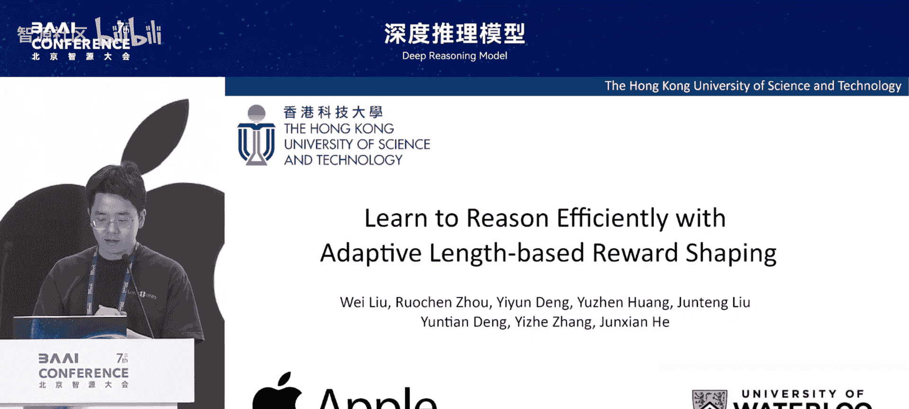

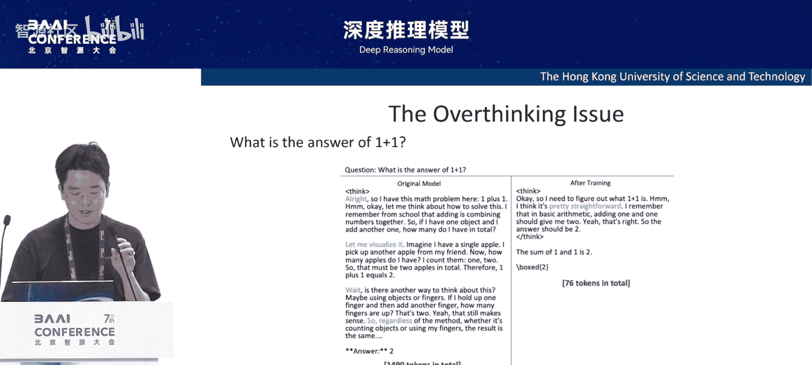

然后我们做这个work呢其实是起于我们在做RO的时候发现了一个非常非常简单的bline吧，就是非常一个effect的approach。就是比如说我们用deeptill千1。5对吧？

就很长然后你在这个型基础上你继做R就不用任何的就是你也不需要加任何的东西，你就做普通的 training但是你把那个rollout的就开的不要那么大。

就比如说你如果开8192开8192的意思就是你生成的Y92就会被截断，就被截断。然我们就会发现你这样出了之后，它的 accuracy，就几乎没有怎么掉，就可能掉了一点点。但是好像嗯并没有怎么调。

但是它的就掉了特别多，就是你你就做一个这样很简单操作，然就掉了可能50%以上就是它的生成的长度。但是你其实没有怎么们就发现这个方法它非的s就就因为它也没有什么新的vention对吧？

也不需要什新的法的发明，然后他就。😊。

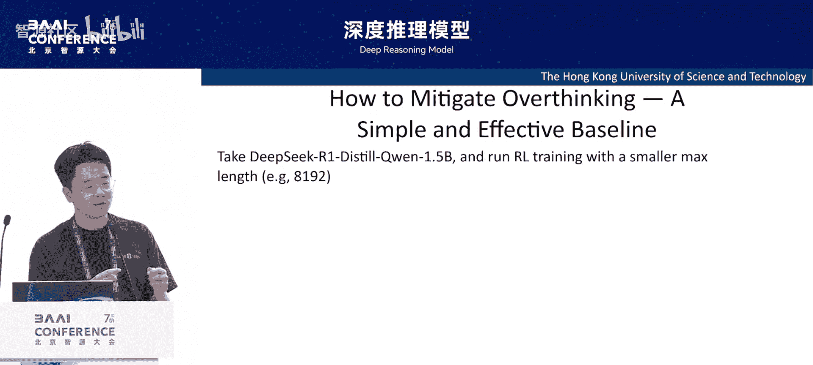

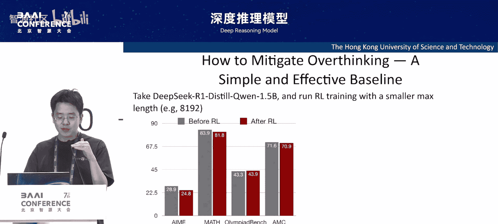

其实我觉得其实比现在很多做的方都要work，就尽管大家可能要还发明了一些专门的东西。但是这其实就是一个非常非常简单的嗯，然后我们基于这个当然我们就在想你能不能够压到更短对吧？

因为你1个ken必想办法拉越越。发现你就了肯定不太好大家不太能接受那么我们就重新来想这个底是么就来一个简单就截我就发实是一个这样的re就是这样的一个就是的蓝线就示r这个红线就示虚线就示也就是你这个res只要超过某一个相当就当成了corr当答输出截断。

那其实是一个什。😊。

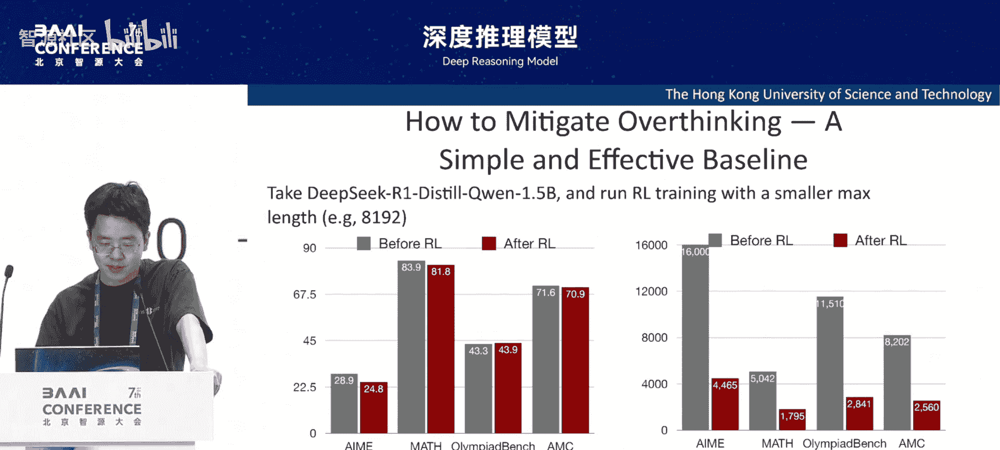

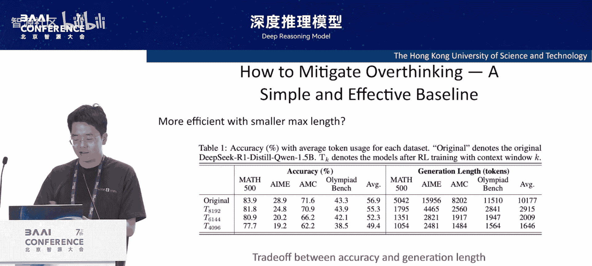

阶T函数，这是一个阶T函数，这是一个阶T函数的reward。

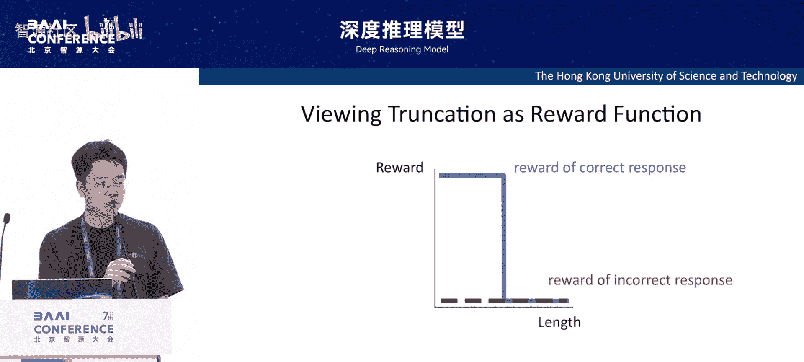

然后我们就去看比如说已有的工作，就这些我跑了括K15对吧？然后后来有U做一个工作，他们其实也提出了一些不同的其实大家都喜欢把这个做成连续的就你要么就是这种性的要么就是曲线 function的但是我们去跑的发现什么问题特难跑就它不像刚刚说那个随便一跑也不调什么就了。

但这个你要仔细的去调它这个而且它非常难平衡这个和这个么就最后就总结就发现这其实就是一个的问题就是这样的一个re非常就是因为你有这个信号，你告诉这个型它就是越为是一个的这个它总是想生成的短你的就特别快。

😊，然后这个对比起来，我们就觉得阶梯函数很好，为什么？因为阶梯函数它它的梯度是零，对吧？就是它在中间的突变点其实不可微的嘛，然后它在两边的点阶梯梯度是零。

但在数学上我们很多时候是不喜欢这种不太连续的东西，或者说不可微的东西会觉得它其实不好的，就是因为它不够s。但是在在RL里面，我其实后来觉得这种东西反而它比较ros就不太容易被。

因为你在不管是在左边阶梯函数的左边还是右边的区间力，你其实没有梯度的，就是你其实是没有信号告诉模型，我要越短越好，就它没有这个信号。那么它就很难被。所以说我们基于这个就做了一个改正。

我们叫laser其实就是其laser跟它本质的核心就是阶梯函数，就是阶梯函数。也就是说比如说我们现在不截断。我想要生成我就是我不断，我还是让它生成。但是你如果超过了我指定的这个长度，我就要给你个。

也就说大家可以看到右边这个阶梯函数被起来一点点。就是它会比好。😊。

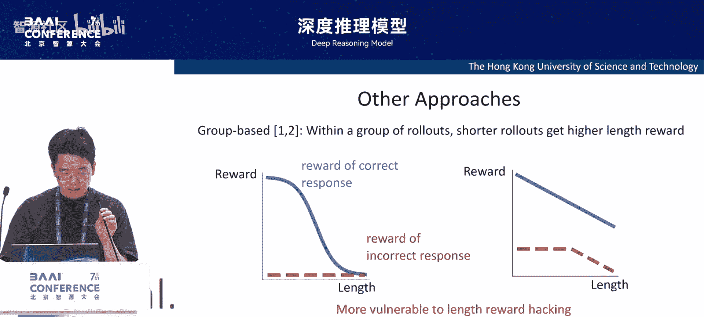

但是它会有一个penaly，但是它我们坚持还是要保持它是一个阶T函数，就是它不能是一个其他的函数。那么这种情况下它就很不容易，它就不太容易被 hackck。就是因为它的lennce本身的变化是没有这种。

比如说你把它当成一个函数，它其实grad是0嘛，它的它的导梯度其实是0。😊，那么那么这其实就是整个laer的核心。对。

然后我们这个paper其实对所有的这些不同的 space其实做了一个比较unified的这种。当然paper里面其实有数学上的一个 formulation。

这里我觉得比较直观的画了一个viilization啊，然后大家可以看到，当然后面的我们下面三个都是我们提出有la当然还有laser dynamic以及后面的东西当然这个具体的细节，今天就不讲了。

然后paper里会有。但是整体它最主要的可能今天我想传达的东西就是它是一个阶T函数，它是一个阶T函数。嗯，这是跟其他的一个。😊。

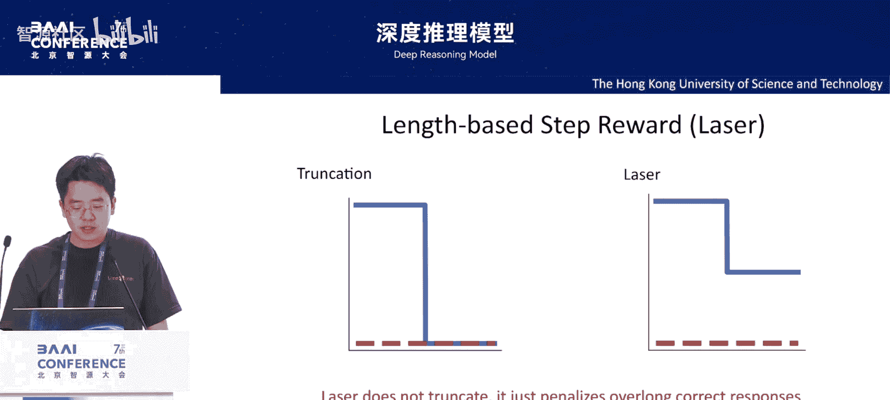

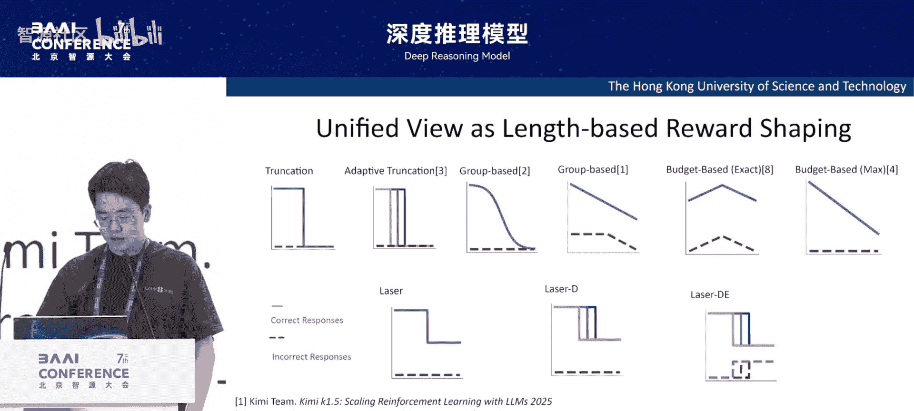

一个对比。然后当然这里面我们后来嗯那个laser就是刚刚我没有细讲的一些包laser dynamic和d。嗯，就是其实我们是对这个继续做了一些嗯改进吧，就是我们觉得因为你这里面有个超参数嘛。

就是你阶梯函数，你中间突变的点在哪这个超参数，当然你可以自己调，但是这个超参数，我们其实后来觉得它其实是首先应该depend on这个query，就是对于难的和简单的对吧？你的这个呃云希望它长的短的。

你的这个概念是不一样的。嗯，然后第二个就是你希望它是动态变化的。因为随着你训练，它其实模型它会越来越短嘛。那么你开始设设置的那个可能就会过长。后我们其实所以说我们后来就是我们这个阶梯函数。

它其实会自己的动态变化。这个完全自动的就是我们中间并没有我们太多需要调的东西，并不是说你要自己设定一个sule去让它动态变化没有就是会自己动态变化。至于是怎么自己变的，这里今天就不讲了。

就大家可以去看我们的论文。嗯，但是它本身是一个很轻量级的，不太需要调参的。😊，一个嗯一个一个非常自动的adapive的一个JT函数的一个rewardship。

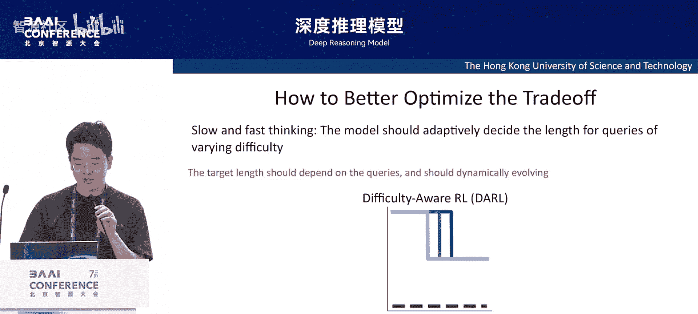

然后最后的结果我这里就展示一张图吧，就是嗯最右边就是这个range model，range model是一个ep disill的一个迁问。后我们其实嗯因为对于所有的方法，我们其实都是跑了不同的组合嘛。

因为我们希望去画它的这平衡，而不是画一个因为一个点感觉就不是很好比我们可以看到就整体我们提出这些方法其实就是最上面的三个其实是可以在不情况下token是可以从一万降到200的就其实是可以降掉70多的一个长度。

然后在不损失这个ac的情况下然后嗯对差不多然后最后一页哈，最后也有个case大看到这是个很有意思的case一个数学题吧？其实很这个左边总共是有200个ken但是右边大家可以看到它中间就少了很多废话。

对吧？它其实还是有first next但是它就直接写公式它就不会中间写很多种很多文字性的那种东西对这这其实是模型里面自动自动学出来。😊，OK嗯，今天差不多就分享这些，看大家有什么问题嗯。😊。

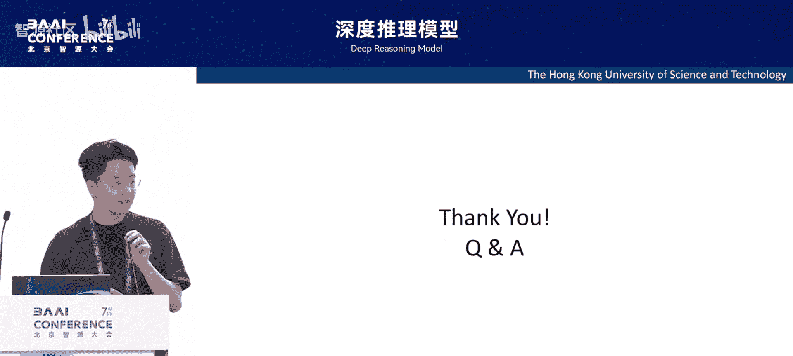

好，因为时间关系，我们就一个问题啊。嗯。🤧嗯。哎，稍微大一点声，好像听不清。何老师好，我是风伟。然后之前也是有缘在您组里做过。对，然后我是有关注您最近组里面做了很多这种R工作。

你想像就是每都会留一个ction去分析他们的认知行为涌现的情况。就比说里面们个repon变长他们的那些认知行为比验证在加包里面也是一样的，就是他的行为也会往下叫。但是总会给人一种好像有种的感觉。

甚至在你在这训练算法里面并没有对行为re但却能够自主的变少或者变多。所以说其实我也在想这个问题。但我觉得好像单纯的做reward，并不能说对这个认知行为的激发有很直观的效果。因为做反思的时候。

其实你说一个模型要不要反思嘛。其实加希望的是他可能一次性做对你的反思和验证其实也在消耗所谓的ken可里面他们有一些下降也是有这样一个原因在。所实我的啊其实就是一个就是你觉得这种认知行。😊。

不能用于直接用于这种设计设计算法去训练这种模型在认知行为上的一些能力。对嗯，对我首先我觉得认知行为是非常重要的。就是包括现在大家很多时候做contin training或者说在R前面做这个能启动嘛。

其实也是为了去增强模型认知行为的这个行为因为你型如果本来没有认知行为，能R就像你说的你没有这种ex的这种re去鼓励这种行为，那么你这个模型可能很难自己去发现嘛。

所以说前面需要做能启动多时或者说更脑的模型可能也很难去涌现这种行为然后这个认知行为我而且我觉得你说的就是你可以去鼓励他，我觉得是很合理的。因为我觉得认知行为其实非常本质的。

比如说我觉得relection其实很本质的。因为因为因为人其实在解决很多问题的时候，是会有试错的，是会有试错的，多也是通过试错去比如你如果做数读对吧？如果做数读这种问题你很多时候可能都是自己先填对吧？

然后你填错了，你又用那个橡皮擦一下对吧？然后你可能又不停的试你你也其实也不是一次做对的那么那么如果模型。😊，也是没有reflection的能力，你希望他一次，比如说看到个数读，我就要一次做对。

就像刚刚展示一些logical的 example，其实非常非常困难的对，其实非常非常困难的。所以说我觉得reflection本身是很本质的一个一个。当并不是每一个认知的这种行为都很本质。

但我觉得reflection这种试错是很本质。我最后说一句话就是我觉得这种reflection本身是缓解了这种locly normalize locally normalized。

就部分规一化的自回归模型的一些艺术，就像传统大家喜欢做有些很多人觉得这个有艺术做这种globally normalmalize模型一样。

我觉得reflection某种程度上是了一种global的 search。对嗯，行。😊，好的，谢谢谢谢何老师。😊。

