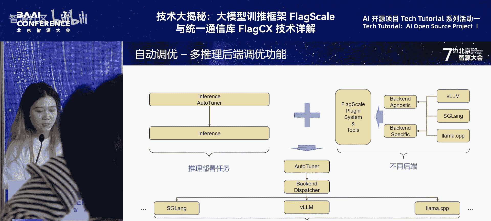

# 2025北京智源大会-特色活动：AI 开源项目 Tech Tutorial 系列活动 p02 基于 FlagScale 自动调优机制进行多芯片高效推理部署：吕梦思 -BV1oWNxz8Ew3_p2-

那我们进入到第三个环节，就是关于推理部署。那今年大家也知道呃最火的肯定是deep seek了。那对于系统领域了，最火的肯定是呃推理呃部署了。如果做系统的不了解推理部署，就是在今天这个时代应该是落伍了。

那我们欢迎那个智研研究院研究员，就是梦思来跟大家分享一下，就是flex skill怎么用flex skill做跨芯片的这样一个呃自动部署功能。好，谢谢。😊，これ。我觉得。呃，大家好。

我是来自AI呃智源研究院的吕梦思。然后我今天跟大家分享的主要就是呃基于flex scale自动调优机制的一个呃高效多芯片的高效推理部署。然后我们首先来看一下我们bl在在多芯片一键部署的时候。

它有哪些挑战。然后首先就是因为我们的国产芯片的话，部署芯片也比较多，我们的不同芯片，它有很多不同的对应的配置。比如说一些网卡，一些通一些环境变量，然后或者就是一些针对不同的芯片。

它会有自己特殊的一些设置。然后另外的话就是如果我们给定一些资源。然后我们如何要去对这些资源进行管理和部署，然后才能达到更好的一个呃一个一个推理效率，然后怎么样去对这些资源进行调度。

如何去对收到的一些query进行资源分发。然后另外的话第三个挑战就是我们的模型部署的一个环境都比较复杂。然后对于普通用户来说，上手门槛会比较高一点。然后最后的话就是对于不同的推理后端。

我们的性能差异会非常大。然后这个后面我们也会再详细展示一些数据。然后对于部署来说，我们的推理后端应该怎么选择。就这些对于对于普通用户来说，都是比较呃高的一些上手成本。然后针对这个的话。

我们之源研究院这今年也推出了一个自动发版的一个大模型平呃大模型自动发呃发版的一个平台叫flag releasease。然后这个的话是首个跨AI芯片的一个呃自动发版机制。

然后我们会是我们会非常容易的使用这个平台来把来把英伟达上面的一些呃模型部署配置迁移到对应的一些芯片呃AI芯片上。然后我们同时也提供了非常多的呃大模型的呃多大模型的版本，基于不同的一个芯片。

然后我们到时候可以我们可以在呃摩搭或者enface上直接去拉这些呃大模型版本，然后去通过我们最最下面的这一行flag scale去一件部署这个最优配置，最优服务的配置。

然后但后面的话我们就会讲一下我们如何去得到这个部署的最优配置。然后呃呃然后的话我们来介绍一下复硬件多模型的下面，我们会有哪些挑战部署场景的有哪些挑战。然后首先第一个的话就是现在的模型非常多。

而且产出的频率非常快。比如说年初非常火的de。然后最近又最近的千分千分3。然后这些模型他们每次出的频率，就不同公司出的频率也很多。然后每个模型，它的不同的尺寸也非常多。

然后他们现在一般的话给出的最呃部署配置都是在英伟达上的一个呃部署配置。然后针对我们不同的国产芯片的话。

我们会需要调整这些默认配置才能才能更好的去利用我们国产芯片的一些呃利用的我们国产芯片的一些呃基础的性能。然后第二个挑战的话就是我们现在的推理部署框架非常多。然后各个框架的话，超餐也比较多。

我们的不同模型要怎么配置才能达到最优的效率。然后我们也会通过详细分析不同的推理框架，然后不同的超餐对我们的吞吐和实验的一些影响。然后我们再针对不同的模型和不同的芯片都进行找到最优的一个配置方案。

然后第三个的挑战的话，就是如果我们有还是让样我们如果有一批固定的资源数量，然后我们怎么去分配这些数量，然后才能达到最优的一个部署结果。

然后我们这个我们fl skill也提供了一个功能去探索合适的一个部署实力。比如说我有8张卡，是每两张卡部署一个实力，还是每一张卡部署一个实力，这样这样性能会比较好一点。

还是说我们一张卡去两张卡去部署的话，如什么并行方式去部署效率会比较好一点。然后这样的话，我们会去探索这个这个这个情况，然后在固定资源下，我们会自动的实现吞吐的最大化，来保证推理效率最优。

然后这些的话我们呃最右边有一些解决方案，就是用户只需要提供，我们只需要在相对应的硬件上和模型上去调用我们的flag scale自动调优部署的一功能。

就会默认的就实现我们自动就生成最优的在当就会生成在当前硬件上当前模选定模型下的一个最优的服务部部署配置。然后后续去实际上线部署的时候，使用这组最优配置的话，就会直接部署就可以了。

然后就是我们的自动调优的多后端调优功能的一个介绍。然后首先我们fllash上上一节英语老师也讲了，然后我们flex框架的话是有一些训练上面的自动调优功能的。然后我们推理上也有对应的一些自动调优。

然后左边的话是我们比如说当前的任务为推理部署的一个任务，然后调用我们框架的自动调优部署的自动调优的功能。然后加上我们右边flex skill提供的一个多呃通过第三方库提供的一个多后端机制。

然后去去结合起来去让我们在推理的时候可以在多后跨后端之间进行一个性能调优。

然后目前我们flag scale支持的一些推理框架的话是有呃VMG long和拉maCPP这些适合不同后端不同场景的一些推理后端。然后这些后端的话，他们其实在不同芯片。

然后还有不同的场景都会有各自的一个优势。所以我们这边就可以根据自己就是用户可就大家可以根据自己的场景和芯片来，我们自动给调出来一组最优的一个部署参数。然后下面的话就是我们自动调优的一个一个大概的流程。

就是自动调优的话，我们会根据任务去分发到我们的对应的框架上，然后在对应的框架之间再去进行一个选择。呃。然后后面的话就是我们自动调优的一个一个部署一个部署一个具体的一个流程吧。

然后用户只需要通过输入模型和资源数量，然后我们就会去自动的根据资源数量和和最对应的一个后端就芯片去部署一个去自动生成一些自动构建一系列的搜索空间。

然后各个后端的他们其实搜索空间是相对来说又独立又有又呃又又有有一部分是耦合的，有一部分是互相独立的。比如说他们的并行方式，这些和资源有关的，这些是比较耦合在一起的。因为就是比如呃不管是SG浪还是VOM。

他们都有不同的TP并行，就模型并行或者流水线并行或者实力数量，这些和我们的总资源数相关的一些搜索空间。然后但是同时他们各自的后端又有一些各自的一些超餐。比如说SGVOM的话。

它会有各自就是配他的最最最最大。它的优点就是配置attention这个操这个这个操作就是他们对显存的分配KV显存的分配和利用。然呃我们对通过对这个显存分分页的大小的调整。

然后去去达到实现一个最优的一个推理部署。然后对于SG浪的话，它的最大的优势就是它的调度。然后所以我们通过调整它它类似的一些呃呃相关的一些参数来达到一个当前场景下最优的一个部署情部署性能。

然后我们通过这些呃资不管资源相关还是资源无关的套餐去构建一个具体的搜索空间。然后也就是绿色的呃这一点。然后通过这些搜索空间的话，我们会现在是通过呃网格搜索的方式去里面去生成对应生成每组的服务配置。

生成完之后会去利用我们第一页讲的那些flex scale那种一键部署的指令去自动的自动的先部署一下当前配置下的一个服务。然后我们提起来这个服务之后，也会有一些数据集的输。

因为我们需要去模拟现实场景下的一个一个当前服务的性能嘛。所以我们可以自己输入一些我们会会有会提供一些超参数输入，然后让用户输入一些和自己实际使用场景比较接近的一些数据呃数据的长度输入输出程度。

然后我们根据这些输入来自动构建一些数据集，去去调用这个服务，去看这个当前配置服务的一个性能。然后我们然后调完之后，我们也会有一些profi交呃信息来去对这个服务的结拿到的结果去进行一些分析。

如果当前的服务结果是比较是比历史的所有的信息都要好的话，我们就把当前的服务配置作为最优配置。然后如果当前的呃服务配置比较差的话，我们就去直接停掉这个服务去做去去重新启动下一个配置去进行进行搜索。

然后这就是我们一个整体的一个搜索的流程。然后这这些流程跑完之后，我们最终生成的就是一个在当前硬件当前模型下最优的一个呃一组服务配置。后续直接线上去部署的时候，用这组直接启动这这组最优配置就可以了。

当然我们其实这个流程里面也是有一些自动化。就是如果说我们直接搜到最优配置的话，我们就直接启动好最优配置了。就是这是一整套的一个就是直接把它放在部署前，这是一整套的一个呃一键脚本的一个工具。

然后我们这个的话，我们这个功能的话，目前也是支持多芯片多后端的一件部署调优，我们不不用再编写代码，然后只需要改一些在样务文件里面去进行一些配置，然后直接设置au tune就可以进行自动调优了。

然后我们对不同的芯片和模型的部署也提供了比较更加精准和更加高效的策略。比如说我们也支持针对实延这个目标函数去调优。然后我们同时也支持对吞土进行调优，就是根据不同的目标函数。

我们可能搜到的最优配置是不一样的，这个都需要根据都可以根据最呃实际场景去去进行调整。然后下面的话就是我们调优的一些测试结论。

就左边这张图呃呃左边这张图的话是我们基于服务端的一个框架呃服务端的一个自动调优的结论。我们在6款呃我们在65款5产5款芯片上去进行了调优的一个测试，就可以看到，就是这个是最最佳的一个服务配最优的配置。

然后这个点的话，它是最最差的一个服务配置。然后这条然后最不同的配置对于吞吐的影响最高，它甚至可以达到了3倍。就比如说如果我们在选的时候，就普通用户在选的时候，直接选到了最差用最差的配置和最好的配置。

他们之间差别还是非常大的。对于我们的成本来说也是非常高的一个区别。然后呃另外的话就是我们的最优配置，就是最呃。最后一个的话，它其实就是因为所有的框架，它都会有一些默认的呃预定利好的一些超餐。

然后这些超餐的话，一般都是针对英伟达芯片去设置的。针对我们国产芯片的话。其实不一定是最优的。所以我们会有一些对比，就是我们搜这个搜索空间里面搜到的最优配置，相比针对英伟达芯片上默认的一些配置来说。

它都会有2%到20%的一个性能提升。然后右边这个的话是不同的后端，对不同的目标很呃呃是不同后端呃同芯片上的一个自动调优结论。然后可以看到在不同的后端上，我们针对不同的优化优化很优化目标都有不同的表现。

比如说呃前前两个是VOM的配置。然后中间三个是SG浪的配置。然后最后两个呃最后两个是蓝马CPP的配置。然后可以看出第呃可以对比的话，就第一个VOM的配置和第三个SG浪的配置。

他们的村组其实差别是相比不太大。但是对于他们的手套实验来说，这个指标来说，他们的差别就比较就就SG浪有明显的一个优势。呃，是这呃，这是我们一个服务端。

还有服务端的一个调约结论和一个多后端推理框架的调约结论。然后因为我们的也是支持一个端测呃，我们也支持端测芯片嘛。所以下面是一个在我们在端测芯片上的一个调优结论。

然后左边的话是我们在端测呃在其中一个端侧芯片上对超参进行一个自动自动搜索。然后发现我们在端测芯片A上就最优吞吐相比最差吞吐，它会有61%的提升。然后端到端的话。

实延实延最相比最优相比最差会有38%的下降。然后这个芯片上就可以看出对于端测来说，其实呃我们不同超参对于吞吐还是或者是呃实验的影响来说都是比较大的。

然后对于端测B呃右边的话是端测B的一个自动超参调优的一个结果。就是端测B的话，它会更明显一点。就是最优吞吐相比最差吞吐的话，它会有40047%的提升。

然后最优的端到端实验相比最差的端到端实验会有95%的下降。就是说我们比较不幸运的话，选到最差的吞吐，它其实它就是性能会非常差的。我们最差可能会直接放弃当前框架的使用。放弃在当前芯片上去部署。嗯，对。

所以我们这边自动调优的功能的话，也可以帮助大家选到一个合呃选到一个合适的一个部署框部署呃部署配置。然后这样的话来降低我们在对应的芯片上的一个部署成本。Yeah。

然后的话最后就是我们的一个芯片易构pre decoding的一个部署。然后现在其实对于部署来说，我们在各种想降低成本的方法。然后对于大模型来说，它又是有有两个阶段。

一个是pre阶个d阶pre的话其实是一个计算密集型的。然后ing的话是一个ding的话，我们是认为它是一个呃仿存密集型的。为pre的话就相当于我们要输入一段话，然后首先对这段话输入一句话。

然后我们对这句话去生成第一个字，然后所以它的输入是非常长输出非常短的一个场景。然后对于来说，因为它是逐步解码的话，然后就相当于我们的每次的输入只有一个，然后去不断的去读我们的存在里面的。

所以它是一个仿存非常密集的一个情况。之前的普通部署的话，他们prefi和 decoding都是在同一个GPU上去部署的。这样的。和deing就会有一些资源抢占的一个情况出现。

就导致说如果我们想要pre呃pre阶段的性能更优的话， decoding阶段的性能就会有一些损失。然后如果想要让 decoding的阶段性能更优的话，就会要损失一些prefi的性能。

然后所以现在其实也有很多研究说是要把他们分开部署，然后让各自的芯片发，就让各自的阶段发挥发挥自己最最大的优势。然后就上面呃上面呃基本上就是上面的这些流程了。然后不现在乐制案面。

还有一些其他公司也都在做一些呃类似的类似的工作。去优化这个场景。然后我们这边的话主要是集中在跨芯片异构prefi decoding的部署。因为我们现在是在木西和天数和木溪上。

然后去去进行一个prefi decoding的部署。因为他们的不管是计算能力还是存储能力，都是呃还是存都会有一些差异。所以我们选择这两款芯片去进行呃进进行对应的呃对应的prefi decoing分离。

然后只目标是可以发挥各自芯片的最优最优性能。然后其中的通信的话，我们现在使用我们呃研研究院自自研的flagflag six去进行通信。然后flag six是可以一个呃一个高效的。

然后再可以支持很多芯片的一个异购一个跨新跨新通信。然后这个我们下一个同事也会详细的讲解一些。然后目前的话，我们的preview decoding分离大概就是使用使用呃flag呃flag six去进行。

去进行中间的一些KV cache传输。我们可以支现在当前可以支持多prefi和多deding的分离。然后同时我们也有一些也利用了上面的一些自动调优的功能去调自动去根据我们的目标函数。

自动调整我们的prefi的实力数量和deding的实力数量。比如说我们在天数上部署呃，我们对于当前的一个实力，当前的一个任务来说，我们在天数上用多少个线芯片。

用在木锡上用多少个芯片去部署呃prefi和部署deding阶段才能达到我们的最优的一个吞吐或者最呃才能达到最优的吞吐，我们也会去自动调整这个功这个功能。

然后这大概就是这这这就是我们prefi decoing分离部署的一个一个一个功能设计。嗯。好，对，同时我们现在也支持prefi decoding自动的一个扩缩容。

就是我们支持随时就是不受就不管是prefi节点的一个一个呃自扩扩容还是缩容，还是deding节点的一个扩容，还是缩容，我们都可以自动的支持不让呃就是添加或者删掉，不让其他的接不让其他的实力去受影响。

然后的话就是我们这边的，然后这这边这个的话就是我们的一个demo演示。然后左边可能大家看不太清。然后左边的话是左边这两张是我们在端侧芯片，上面是在麦克上，然后下面是在摩尔的1个AIPC上的一个一个演示。

然后右边的话呃一个部署演示。然后右边的两个的话就是我们整体的在麦克和摩尔现程的上面的一个动调优的一个演示示例。

然后这些示例的话都可以在我们讲台右边的右手边的一个那那那些演示区去进行一个实际上手实操的一个环节。然后因为我们这是一个嘛，所以大家可以去去旁边实操一下，然后看看有什么呃。

大家他可以可以输入一些自己的一些问题什么的，问大模型和大模型进行一些交流，看看我们大模型到底是怎么工作的。哦呃，大概分享的话就到这里，剩下的时间大家可以去进行一些实操。我们旁边会有同事。

会有专门的同事来来带领大家去进行讲解。好的好的，呃，感谢大家。那我们今呃现在到了一个非常呃精彩的环节，就是QA环节以及实操环节。就是呃为大家准备了精美的礼品。呃，凡是能答问呃能提问的。

能去体验的都有精美的礼品送给大家。但，数量有限啊。行。😊，刚才说那个模型的调优啊，它是刚才你说那个模型的调优，它是针对就是比如说我们机器人收集数据。

我要对这个模型嗯在后台自动调优你说这个调优和那个调优是不是一回事比验证模型是否是最佳的啊，不是说异构芯片之间的这个perform是是最好我明白您的意思是指模型性能是模型效最佳最那个的话其实是偏算法层面去去验证当前的算法当前的 checkpoint最优性能。

然我们这个调优的话，实际上部实际上线部测试那个自动调优。就是我们测当前的吞吐和实验就机器人反应够不够快现在调是机器人反应不够的反应够不够准可以这样那如果说我作为一个用户话，我想使用一个。礼品展示的方案。

那我自己还要另外一个方案才行，是吧？就是比如说用仿真，比如说来做一些这个模型的一些验证呃，模型效果的验证是吗？对对，什么对，我理解那边是有一对实施另外一另外一点。对，明白明白，好，谢谢啊。好。

大家还有哦。Yeah。哎，你好，我就想问一下那个就是au，他需要在这个真实环境上去进行调优吗？还是说我在我个人比如说电脑上就可以做仿真呃，你们现在呃现在其实是需要在真实环境上去调优的。

但是我们后续可以去考虑去做一个模拟器类似的，然后可以在任何环境下对对应的芯片去做调优。因为现在其实还是在最目标芯片上去调会比较准确一点嘛，最准确一些哦，理解了，就是还要搭搭一个真实的线网环境是吧？

对那就要介绍我们的flag release就是这种开箱即用的一个工具，然后搭下来拿下来一键就可以启动了的。好的，好，谢谢。哎，您好，我想问一下啊，比如说我们现在有10个芯片。

可以直接调你们这个一键部署的调优的吗？可以的可以的，直接就能用了是吧？对对对，嗯，好，谢谢。玉龙玉龙玉龙，你好，我来问一下，就是这个是可以提供给用户的一个平台，还是以什么形式提供给使用者？呃。

我们首先也有一个平台，就刚才的发呃发版的一个平台。然后另外的话我们呃刚才最后那一页下面我忘了说了，有我们的get up链接，就我们所有的功能都是开源的，可以直接拉下来上手体验的直接。😊，就是这两种信息。

呃，大家还有别的问题嗯。大家可以感兴趣的可以去我们右边去上车体验一下。呃，要要不我们可以大家可以围过去，让我们的那个工程师和研究员给大家展示一下。在不同的这个呃笔记本上，有一些是AIPC。

有的是华为的笔记本，有的是端侧的芯片，大家可以去现场去感受一下OK。😊，呃，我们后面还有两个比较精彩的那个报告，稍等一下啊，这个我们中间这个环节。😊，把代码拉下来之后，来，你可以讲好。😊，呃。

刚刚我给你找呃，刚刚观众问到我们这个具体的使用方式其实比较简单，总共就分三步左右吧。第一步就是把代码拉下来，就get clone。因为我们是开源的，直接拉下来代码。第二步呢就是做一个安装。

可以看到在项目里面有一个inst的脚本，把那install跑一下。就。就差不多完成了第一步的安装。嗯。看那有个ins色，然后里里面是有个脚本的，把它跑一下就可以。然后这是第二步。

第三步的话就是因为我们这个框架是面向一个多芯片多厂商的一个解决方案。假如您的设备不是主流的设备，而是国产芯片，我们还需要执行一个ipad的操作，就是把厂商的那些适配给打包出来，解包出来。

然后到这步其实就完成了安装，我们就可以去跑模型了，跑模型的话可以看一个命令的事例。其实很简单，入口就是这个run，然后配置的话，在ex里是现成的，我们就可以直接去serv它。在我们大理。后来等。呃。

到这儿模型其实就已经起来了。然后为了验证它到底起来了没有呢？我们往上面打个请求看看这请求其实就是克容命令发的一条HTTB的请求，内容呢就是让大模型给产出一个呃走失。可以看到这会儿就已经有输出了。

说明模型是正常部署的。然后呃，可以就改改这段就可以。中文应该也可以，毕竟这是千问，我觉得千问的中文再不行，别的更不行。现场敲一个试试来来现场敲一个中文的试试。对。😊，哎，好弄吗。输入法是不是不太好？

好了，就是这个要是想快速的到唐的末哦。じ。就是咱们自己的笔记本也是可以跑一些呃大模型，但是说太大了肯定也跑不起来。但是平时做一些开发调试啊和体验啊，或者自己做一些呃知识库，就是说比较隐私的一些知识。

不愿意上传到网上，就是可以自己搭一个小的这样的呃服务，然后呃自己去用，然后不用的时候你就可以给它上当掉。OK也对关机就行。目前这个效果不太好。因为它是str，所以我们没法一下看到全部就我们把这给关了。

对，这是一种模式。😊，就是说它一个token一个token的返回。所以说呃像一样，但实际上这种交互有时候不太好。像这种的话就是呃不是str的方式，就是呃一个request过去。

它立马给你返回一个完整的结果这个就是一个中文的刚才是我们预设的例子是英文的大家感兴趣可以体验体验，这是一个刚刚还有我们的自动调优功能，其实也是可以展示一下的，就是一系列配置在本上找到那个不太懂硬件。

但是你要刚才下面讲了你的配置要错了，你有4倍的太了。但是通过自动化在个本上不搜一个最好配置置刚刚是top我们部的模型给停了，然后再跑一个自动调优。😊，自动调优。把这儿改成auto。应该有现成的。

我找找历史。哎，就是这个其实action就变成alto to。然后这快吗？呃，这不不快，应该只能看一两个tsask。因为这条过程是很慢的，但即使他很慢，花了很多资源也是值得的。因为之后推理次数会更多。

就总之还是能省下来资源。这儿有一个小树，我看看。现现场debug。你看没有张瑞，其实是环境不对啊。好，现在哦我们因为有flag release，很多的镜像跟环境，我们其实给大家弄好了。

不用自己再配各种环境依赖。刚才是因为没有把这个康da这个environment给work起来，你可以再work就正常了嗯。呃，现在你看在跑第一个任务，然后总共有几个任务呢，在上面会打出来。

总共有8个任务。这8个任务具体的配置是啥？在这里我们可以看一下第一个任务是啥意思。2就是跑的时候用两个线程，苹果它不是有10个核嘛？其实它可以跑很多线程。

这用2NGPU layer就是说这模型有几层是搁在GPU上的0就是这组就没用GPU纯用CPU跑这模型。就是说模型里面的这些参数怎么去分它有几种分法，那就是不分，现在是不分，要不就按层分，要不就按行分。

其实就像TP这种概念并行方式的一种参数的话目前是是一个开源的推理框架跟viM浪一样，但是在端侧尤其是苹果本上，其实只有拉maCP能跑通那两个后端是不行的。嗯，这些其实用户都不用。

因为我们是一个就我们会自动的呃帮助用户去选择这款芯片上最优的这样一个推理引擎，然后调出最优这样配置。然后就一键的去我看看旁边还有那种端侧设备，就是说机器人上的用的那种设备上的。😊，哦，好。行呃。

我们现在讲的是可我们可以在天数之星的一个端侧的芯片上去进行一个VM的一个自动调优。然后呃它和训练的这个自动调优的使用方式是一致的，或者说无论是训练推理部部署的那个使用方式。

其实是在前端都是统一的用户只需要去设置一些压某。对它不用它可就我们去把屏蔽了各个框架底层的一些细节，然后可以让用户更加的更容易的去使用到这些这些技术。然后在这个配置里边的话。

我们就是呃一个是张量并行的一个size大小，还有那个流水线并行的一个s大小，这些都是可以通过去自动调优去最后去找出一个最合理的配置。然后对于VM本身我们还有一些它框架自身的可以调节的一些参数。

比如说是log。然后，还有一些那个最大的长度。对，然后同时的话就是用。户可以根据他的目标，就比如说我是呃整体的那个吞吐更高，还是说我们首次token更高。对，我们可以根据不同的。

或者说我们是呃针对一个延时低的一个场景。那我们可以设置不不同的目标，满足用户自己不同的需求。然后天数之星这个芯片的话，其实也是就是它就是这么一个小盒子嗯。嗯啊它就是这么一个小盒子。

然后我们可以直接接入到一个，比如说我们可以直接接入一个显示器，那我们就可以直接在上面去进行一个部署。对，然后它这个性能也还是非常不错的。然后尤其是在经过我们一个自动调优。我们可以和之前相比的话。

是真正可以做到在端侧上，我们是可以达到一个好的一个性能。😊，可以批本桌面几张。看到了风扇。风扇就很大，代代表着它计算能力很强。

