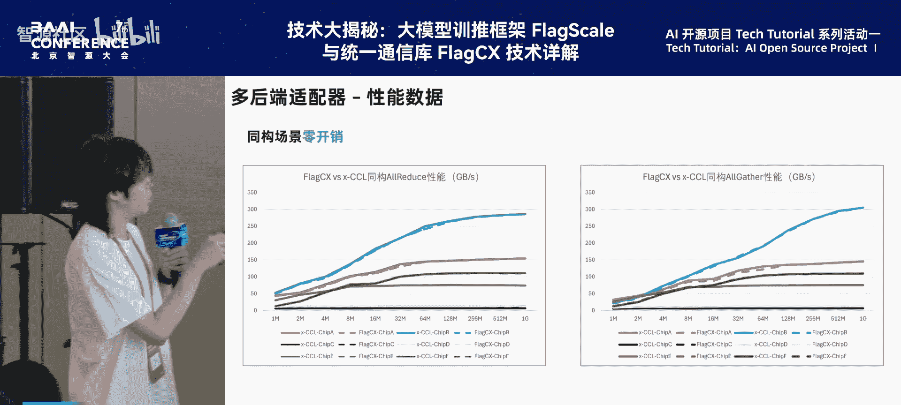

# 2025北京智源大会-特色活动：AI 开源项目 Tech Tutorial 系列活动 p03 基于 FlagCX 打造多框架 + 多芯片高效跨芯通信能力：常 韬 -BV1oWNxz8Ew3_p3-

我们下一个talk就是基于flex six打造多框架、多芯片，高效跨新通信能力呃。普通的用户可能比较了解，咱中国有在通信领域很强的。比如说华为的5G啊、6G啊等等。那在大模型时代。

其实呃通信做的最好还是英伟达有IBro啊，他们有自己的通讯库叫NCCL。那智源呢联合生态伙伴一起做了这样一个flag six，这个是一个非常厉害的一个呃通讯库，他能够兼容不同的芯片。

就是我们的异购混讯异构分布式推理底层最核心的一个组件之一，怎么让不同芯片跨节点跨node进行这样一个互联。那有请我们的呃智源研究院AI框架研发组的研究员常涛博士为大家做一个精彩的分享，谢谢。😊，呃。

大家好，非常高兴。今天来到这里跟大家分享关于flex six通信库这方面的工作。然后我今天主要报告的主题是基于flex six打造多框架、多芯片，高效跨新通信能力。😊。

首先我先简单介绍一下flex six。大家可以看到flex six左边的这个架构图可以非常明确的，然后说明我们今天报告的主题。首先它上接flex skill框架多框架，然后下接不同的芯片。

flex six它主要内部的插件，然后模块主要有比如说框架扩展插件，然后还有统一通信算子接口，然后在底层就有适别器模块，然后以及flex扩，这一部分主要是用于跨新通信能力的构建。

flex six它主要设计目标，首先第一个目标是实现同意芯片大规模高效稳定通信。然后第二个目标是实现不同芯片跨新高效通信第三个目标是基于统一编程模型，然后来构建一个自动化的通信算法编译。目前。

flex six v0。2已经发布，然后它现在是最新的特性支持6加2种原生通信库和自动拓扑探测功能。大家可以看到下面的支持功能，它可以支持英伟达天数武G木西昆仑新海光。

然后在拓支持上可以支持服务器级的拓拓扑探测，还有最优网卡匹配。另外另外一个特性是它可以支持11种易购集合通信算法，并且适用于多网卡单网卡的复杂场景。然后下面这块列出了主要的通讯操作支持。

包括re等等等等。然后最后它在多框架和多平台支持上，它可以支持，然后可以支持拍ddle，然后以及现在已经原生集成的浪潮的元导平台。接下来我将分为三个部分，然后来介绍flex的核心功能。

首先第一个是它的多后端适配器。flex的多后端适配器，它的目标是支持一键编译，实现多新高效同构通信。然后我们为了实现这个功能，主要采用了两类抽象。

第一个是通信库层级的API这一部分API主要是负责通信创创建，还有销毁通信操作，还有组操作。另外就是dise adapt这一部分是runtime级别，负责内存分配释放拷贝，然后流管理事件管理等等。

然后通过这样一套两类的抽象。然后flex目前就可以实现直接通过 make，然后通过选择不同的编译编译的flag就可以实现通过一套API，然后下发到不同的后端。然后并且实现高效的同构通信下面。

是目前flexs同购通信的性能数据可以看到，我们目这边采用的是all reduceduce和organgaer，然后主要是在6种不同的芯片上进行测试。然后图中实现是同构的原生通信库。比如说niko。

然后虚线是flexs。

不是通过flex six接口，然后是采用的实现的性能。然后我们可以看到基本两条线是可以重合的这就说明在同个场景，flexs可以基本实现零开销。同构通信讲完下面一个是flxis最重要的功能。

就是它的跨新通信能力。然后我们的目标是支持多种芯片高效异构通信。为了实现这个功能，我们在上述两类抽象的基础上添加了一个网络传输的抽象这一部分的抽象包括I或者C然后可以看右图右图我们可以看到基于这两类抽象通过 adapter。

然后还有unifiednet我们可以实现一个flexs原原创的基于DR的高效跨新 to p通信。然后同时我们可以利用L adapt它的同构集合通信能力两个相加。

然后通过flexs原创的 c to这样的一个算法可以实现高效的跨新通信能力。然后这里class可以简单理解为一个是一个同构的设备组。后内部可以采用。ni进行延生通信。

然后跨新跨classer就可以实实现跨新P to P通信。这样最后达成一个高效的跨新即口通信。下面我会。我会更细的，然后简单介绍一下跨新C to C算法。

首先我们给一个classer定义就是任意大小的同构设备组。然后我们我们知道然后一个跨新通信，然后它可能有多个classer，然后每个class它可能具备不同的拓扑构型。了然所以说比如说示例。

你现在有两个classer如右图，它可能有8个GPU8个网卡。然后第二个classer是8个GPU8个网卡，还有一种可能是8个GPU4个网卡。然后classer一是8个GPU2个网卡。

还有比如说3个classer，有的是8个GPU8个网卡，然后还有的是16个GPU1个网卡。然后针对这种复杂的拓扑构型。

我们通信跨新通信算法主要难点就是如何保证跨新机合通信算法正确性和可扩展性的同时最大化通信带宽。然后我会先从最大化通信带宽说起。然后我们的解法是通过自动拓扑探测获取最近网卡距离。

然后把网卡距离最近的rank作为inter rank参与跨新通信。然后下图就是一个简单事例。比如说我们有左右两个classsterclass一，它有4个GPU。然后同时它4个GPU都连着4个网卡。

那么它作为它用于跨新通信的inter rank数目就是4，然后右边的图，它也有4个GPU，但是它只有一个网一个GPU连着网卡，所以说它用于跨新通信的inter rank数目是一。紧接着。

我们现在已经确定了inter rank的数量。然后为了去确保它的正确性和可扩展性。然后下面就是我们的跨新C to C算法来实现这个目标。

我们可以看到就是因为inter是不同的class它的数目可能是不一样的。比如说就是第一种模式，每个class它只有一个inter rank，负责跨新通信。第二种模式，它是一个普通的多网卡模式。

比如说一个classer4个网卡。另外一个classer两个网卡，负责跨进通信。然后另外还有一种是所有classer里的所有rank全部可以用于跨行通信。

这个我们可以定用一个名字叫rank local来定义。然后所以说针对这种不同的复杂的网卡的构性。然后我们用于解决的办法，就是我们把跨新通信分为三个阶段。首先的阶段是pre阶段，然后是inter阶段。

然后是pos阶段。这三个阶段，然后对于不同的通信操作，以及不同的网卡配置，拓扑配置就可以去拆解成不同的跨新通信的实现。比如说右边那个C to C or reduce。

它在rank local多网卡的这个状态下，我们可以拆解为同构的reduce scatter，加上跨新 synrece，然后再加上同构的al reduce。然后在另外的两种网卡配置下。

它可以拆解成同购的reduce，加上跨新receive，加上同购的al reduce。然后同样的C to C altogether也可以类似拆解。这样的话，针对于11种不同的跨新几构通学算法。

我们就可以有不同的映射关系。下面我来简单的展示一下目前C to C算法的性能。首先第一个性展示是多网卡支持。可以看到，就是我们是在che a加che B上面做的做的跨行通讯测试。

然后我们可以通过flexBHC去手动的控制网卡数量。然后图中不同的颜色代表不同的网卡数，然后我们可以看到C to C reduce它在8个网卡以及大的通信量的时候，它可以超过单网卡的性能。

然后在4个GB的时候，然后可以达到单网卡的2。7倍。然后C to c同样在4个GB的时候可以达到单网卡的2。5倍，这就说明我们多网卡算法的设计是非常有效的。然后另外一个就是扩展性支持。

目前我们是在che a chip b chip c chip d上做了做了这样的跨新通讯测试。然后需要注意的是che C和 d是相同产生的不同款芯片。

然后flex目前是提供通过环境变量flex sixclass split list去去来切进一步切分。然后class。比如说我可以切分成单机class也可以切分成4个rank一个class。

然后我们可以看到，目前。😊，已经实现了4个caster的跨行通信。然后这边图，然后非常有趣的是就是cheap A加 chip B。然后它在的通信量增大的时候会直现上升。

但是che加上一旦加上cheep c chip d，然后它就下降。这是因为che C chipD其实他们本来设备就只有单网卡。所以最后实现性能也就被局限在单网卡这个带宽。

然后这这一页是稍呃我们去展示一下最佳性能实践，主要是organer和 reduce。然后其实可以看左边，我们是在cheap a chip B上面进行测试。然后是虚线是cheap a和 B两级。

然后用原生通信库进行的测试的性能数据，然后实现是使用C to C算法达造的性能数据。然后我们可以看到cheap a两级，然后它使用C to C算法在大的通信量情况下，性能接近原生的百分百。

然后cheap B两级它同样在大麦下可以接近原生通讯库的70%。然后cheap A加B这个跨性的测试，它同样在大通信量下基本接近原生通讯库两级的90%。😊，然后另外一面，all reduce这块。

因为我们还没有添加al reduced。更深深度的优化。然后他目前在在che A chip B上实现的C to C算法的通讯性能基本上能达到原生通讯库50%。另外一个值得注意的是。

现在C toC算法只是在大通信量情况下，可以达到和原生通信库相媲美的性能。然后但在小通信上情况下，它还需要更进一步的优化。然后最后然后我们就来到代价建模。

然后因为我们现在就是flex它可以允许多个classster，然后可以允许多种to构型，然后并且它还引入了多种优化技术。

所以说我们的一个难点就是如何在这种就是所有的这些参数变量内选取一个最优的跨清通讯策略。然后我们的解法就是构建一个基于C to算法的代价建模。

然后这个代代价建模的目标是支持跨清通讯算法多到端耗时的开销的建模。然后它会拆分所有C to算法三个step，并且进行逐一的开销统计。然后它使用的参数，包括比如说数目网卡数等等。

然后它采用的是阿尔法贝塔经典的代价建模构型。然后右图是一个简单的事例就是 to算法三个阶段。然后我们分别针对三个阶段进行进行就是预估。然后最后我们可以简单展示一下在che a两机上面。然后现在代。😊。

搭建模。的预估预估数据，然后可以看到就是左边的图是不同的网卡配置，然后在cheV2级C twoZ算法，然后和。实测和预估的准确值，然后基本可以看到是能达到80%以上。然后端到端开销的话。

可以看到我们的代驾建模基本可以达到90%以上。但是现在只是在che A这个机器上进行模拟。然后后续我们会引入更多的机器，然后进行真正的跨新卡的一个预估。

最后一部分我简单介绍一下目前flex six对于多框架，然后平台集成，然后和异购混讯的实践。目前flex six可以支持to和，然后它已经全部的通过了所有通信接口支持，并且单测覆盖率百分百。

然后目前在上我们基于flex加ex跑通了异购混讯，然主要是在che上面跑通的，我们采用了不同的机器数量，不同的模型，然后不同的异购类型，然后对比的是CPU中转的性能。

然后统一大概有4%到10%的性能提升。然后在le上面目前还没有实现真正的跨新的混讯，但是已经跨新通讯。然后我们目前这块测了对比了单机的然后和ni的性能数据对比，然后可以看到基本flex可以平替。😊。

然后最后呃浪潮元老平台也集成了flag six，然后是在cheap B和chi G上面进行了测试。然后这块简单列一下数据。对。最后就是简单的总结和展望。首先今天的介绍几个关键点。首先。

flexs通过CCL adaptaper和device adaptaper提供了多新支持能力。然后在这个基础上，通过net transport抽象，提供了跨新P to P支持能力。最后再在这个基础上。

通过C to C算法提供了跨新collective结合通信支持能力。然后目前flexxi已经实现了三个三个特性，高可迁移性。首先它可以一键编译支持多种芯片。然后目前是6种以后可能是16家，然后高拓展性。

现在它可以任意拓展到多个class。目前我们现在测试了4家，未来会会有更多。然后最后是高性能。然后我们现在最佳的性能优化实践已经能达到于原生通讯库90%。然后后续会有更持续的优化。

然后一些想法就是关于flexxi未来发展。首先flex six目前这个CCL adapter device adapter，然后还有nice transport的设计范式。

它和现在业界主要的一些通讯库相关工作，比如说MSCCL，然后geplink这些它是正交关系。并不并不相悖。然后我们可以后续探索实现和这些呃工作的协同作业。另外。

目前flexsclass它是支持不同力度的划分。比如说我们可以以rank为力度。几个rank作为一个classer也可以以单机为力度，以单机为力度的话，它就可以屏蔽单机内部的NV link啊这种通信。

我们只专注于跨新的网络通信，然后以及类似以后可以扩展到超节点，然后可以以一个超节点作为一个classer，然后后续探探索不同超级点之间的高效通信。然后然后C to C算法现在是只支持跨新集合通信能力。

然后我们希望基于这个能力，目前后续研发跨新通信自动编译技术。最后就是现在C to C算法虽然说只支持跨新集合通信。但其实它可以扩展到任意。

可以被拆解为castster内和caster间执行逻辑的实际的通信任务。所以说我们现在有一个应用，就是基于flag skill加flex six实现异购PD分离。然后未来会探索更多这样的通信作业的集成。

好，我的演讲完毕。然后欢迎就是大家可以多多使用flages，然后提供宝贵的使用意见，然后贡献flag open开源社区。感谢感谢常涛。那因为时间还比较充裕，就是说大家可以问一些问题哦。

还有一个跟大家剧透一下，就是我们flex six呃相关的工作呃，也在做一些国家标准，甚至国际标准。那国家标准这块是非常顺利的，就快立项，感兴趣的也可以去共建OK现在可以大家对flex six工作。

如果有一些想了解的问题，可以现场问一问我们团队的成员。😊，没有。哦，那个。有问题吗？没有是吧？行行，那我们就进。😡，那我么到有问题吗？哦，有。抱歉，我没看到。你这个flag six我不知道理解对不对哈。

你是不是基于像NCCLHCCLMSCCL之上的一层。嗯啊，对，就是flex刚才那个框架图，我这好好像调不过去了，就框架图上它有一个适配器模式，然后适配器它可以集成不同的原生通讯库。

就包括尼蔻MMCCL这那那那我注意到你这个是叫做CCL adapt，对不对？对那你还有一个dver adapt这个是这个主要是用于跨新的通信能力。因为我们现在的就是跨新的P to P实现。

它需要用到dice层的一些API比如说GDR内存分配这些然后不同的厂商，它可能有不同的接口。所以说的话，你还不能完全在比较高的高于CCLHCCL之上的一个抽象还不行。

还得具体设备还得case by case的调。呃，我们主要就是一个是CCL的抽象，一个是device adapter抽象。哎，那么你刚才最后说那个制定标准这个事情，标准这个事情，你们打算跟谁。

第一是打算跟谁联合。第二个的话是打算在哪个层面做标准。比如二层三层是打算在哪个层面做。这个我可以简单介绍一下。首先呢这个标准是跟电子资院指导的。我我们现在呃联合各个芯片厂商一起来做的这个标准。

包括运营商服厂商框架O这是参与的方。然后在哪些层面做呢？就是说我们是呃希望把整个通讯库给它打开，然后把里面的核心的部部分可标准化部分给做成标准。刚才您提到的那个比如说设备的抽象。

就其实我们是想抽象出一层。然后厂商他可以介入我们标准接口去做这样一个export分布出来，这样话换一个芯片，就是我们这个 flag six比如说符合标准这个通讯库他不需要做任何事情。

就直接可以动态的加载，然后run起来。那现在我看的。😊，最困难的地方是在于说你比方说link它是个私有协议。那么link的话又把中国企业排除在外了。

O然后华为的那个U的话也是个私有协议其实这个地才是最关键的。们这个是偏稍微偏硬件互联的标我们还是稍微偏上面的是通信库偏的对我可依赖它可能会都做兼容，但是不说非要求大家怎么样这你们做的那个层面的话。

解决性能解决不了啊。还是能解决。因为你通信比说你做一个6你硬件做的再好，你的算法你的上面的的不好也是很难发挥它的性能的这个中间有量级的区别。你比方说如果你是走这套东西的话，至少是5个微秒的话。

亚维秒方700到800个秒就能够把搞定那你在上面统一的话有何意义呢。我底下的话我到私有的协议。我明白，就是上面统一。首先就是说我们不清楚未来到底是哪个能呃出来，就是呃这个是偏软还是偏硬吧。

硬件层面上也有这样一个互联的这个标准。现在也在做软件上面也有OK其实每一层都有，我们是偏硬件之上的，因为智源还是做这种统一的开放的这个软件站。因为我们不做硬件。好，谢谢对对对，理解啊。😡，Okay。

还有没有问题没了没了感谢感谢你说的很好，就是说大家比如说N link switch这个是不是大家能做，因为它是带来一个最底层最核心的一个物理上的一个质变。对但是我们那是可能还是另一个做标准的团体在做的。

我们还是在这之上在做这个偏软的一个标准，现在link的话，他其实把中国有一些企业排除在外了。为啥这个我不太了解比方说华为就加不进去嘛。阿里加进去的话，好像也接触不到太核心的东西了解了解所以说的话。

其实这个他是相当于是因为那个是美国的跟挑战NVlink协议的几个公司组合起来的一个东西O那么中国企业加不进去，这个是很麻烦的个事情，那那我能理解其实刚才说这个互联协议，咱国家是有做标准的啊。

另另一个团队也在做这个标准的对讯库也有做标准。😊，嗯嗯，那个因为我们自己国家应该都还好。嗯，好的好的，谢谢谢谢谢谢。😊。

