# 2025北京智源大会-特色活动：AI 开源项目 Tech Tutorial 系列活动 p05 Triton 编程技巧和性能优化实战：李之昕 -BV1oWNxz8Ew3_p5-

那好，我们今天开始今天第一个分享，由我们智慧研究院AI编译器研发工程师李志新带来的tton编triton编程技巧和性能优化实战，有请之心。大家好，我是李智新。😊。

今天给大家介绍一下我们在tton这个语言上面的一些编译的工作和呃这个算子开发的工作和优化的技巧啊。首先我们看右面这张图在pytoch和kua中间可以找到chton这个名字。

它是一个生态位在toch和kua之间的这么一门语言，相比于kua呢，它可以给用户带来更好的应用性。那么相比于pytoch，它又可以允许用户做更多的操作。😊，那么ch适合于怎么样的情况，我们大概分为三类。

第一类是开发者的投入的时间会比较有限，需要快速的完成编写。第二类情况呢是我们希望它的性能还可以，不需要极致的优化。那么第三类呢，除了NV以外。

我们希望能够把这个chon开发的算子或者算法在多元的芯片上运行。那么如果基于这三个初衷，我们选择了chon使用开发呃作为开发语言的话，我们还可以做一些什么？能够让这个计算更快点儿。

那么接下来我们用flash mOA这样一个在今年非常热门的算法来作为例子，给大家提供一些在算子优化上面可以参考的思路和方法。整个的呃内容分为两个部分啊。首先我们大概介绍一下flash mailA。

第二个呢是我们在flash jams当中的flashLA实现当中用了哪些技巧，然后还有呃哪些可以推荐的其他的优化的尝试。😊，呃，因为后面的内容可能会比较硬核，比较干货，所以给他起了一些标题啊。

不知道大家能不能理解。如果这些标题在后面的。😊，具体的内容当中，大家有所理解，然后有所感触的话，然后我们可以Q一下前面这个地方。😊，首先我们看到flashmanA它基于这个MLA的结构。

主要是有两个方面的特征。第一个是低质压缩，为了能够节省一些存储的空间，对于输入的这些高维的间值矩阵。它通过一个特定的线性变换矩阵，把它投影到一个低维的空间。那么在这个低维的空间中。

我们对数据会进行一系列的计算和处理。因为获得了低质压缩的好处，可以节省很多计算和存储的数据量。那么在之后我们会通过一个线性变换矩阵，把它投影回原始的维度，从而完成整个的MIV的过程。

那么同时MIV还采用了分页KV缓存的这样一个技术，它并不是呃独有的啊，我们只是在MV当中应用了一下。我们把KV矩阵缓缓存的空间划分为多个大小为64的页。

通过一种类似于操作系统当中的页表的方式来对它进行访问。那么当数据进入这个缓存的时候，我们会根据数据的大小和它的访问模式，把它合理的分配到相应的页中。这样的话呢可以比较有效的管理内存。

避免这个KV会产生大量的内存碎片。下面这张图是deep seek在他们的技术报告文章当中为MLA画的介绍图。我们可以看到在Q和KV这两个矩阵当中有一个明显的低质转化的操作。

那么对对于这个压缩就可以给它带来一个呃计算量上面的节省。然后在flashMLA的部分，其实我们所需要处理的只有这个黄色高光的黄色高亮的这一块的区域。那么在输入之前。

网络就已经会把呃低质压缩的部分已经为我们处理完了。我们可以呃我们所需要处理的只有已经打包好的Q和KV cash这样的数据。😊，接下来呢我们看一个比较简单的flash attention，或者说ten。

它的结构。😊。

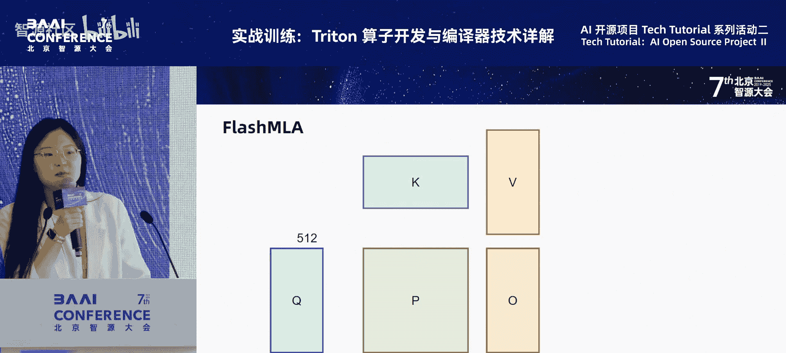

输入呢是QKV3个矩阵，然后他的。

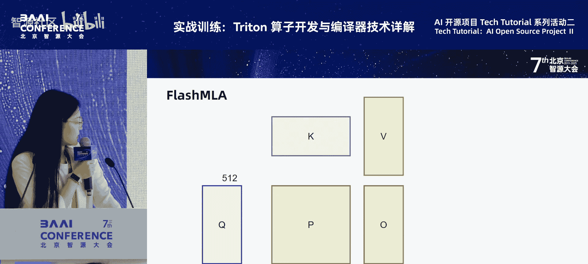

整个的计算流程大概是一个矩阵乘法，加一个oft max，然后再连一个矩阵乘法。那么相比而言，fsh多了哪些呢？

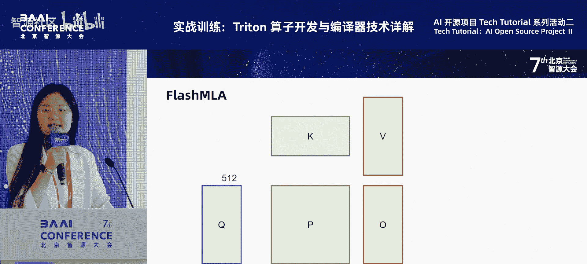

其实只多了Q rope和K rope两个部分。我们把Q和K都分为了两个呃功能的部分的矩阵，一部分用来做ro。另一部分我们不需要做它这个旋转的编码。

所以相当于在最内层的head这个维度会把50512加上64分两两个部分来处理。然后V是不需要这一部分的变化的。

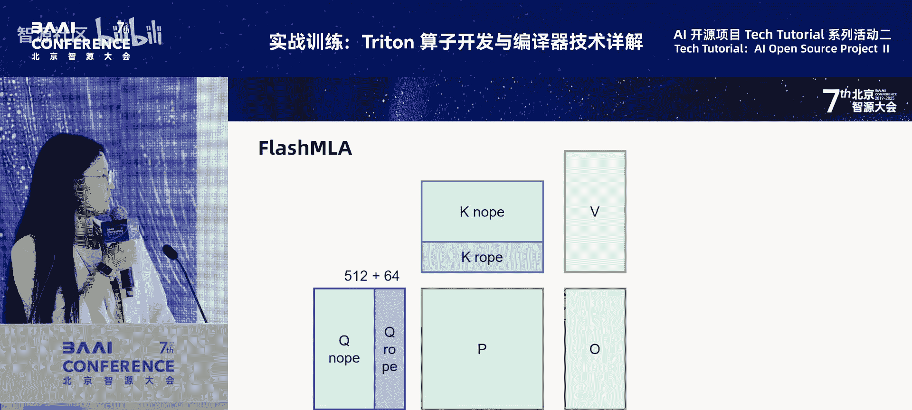

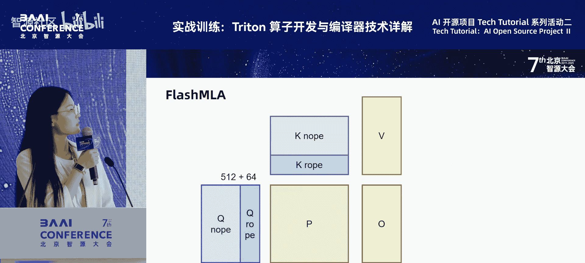

那么和最普通的flash attention相比啊，首先它的基基本的计算逻辑是非常相似的。第二个呢就是head分为了nope和 rope。第三个呢是我们在线flash更新的这个方法。

还是沿用了flash attention的设计。最后它会比普通的flash attention增加一个分页KV cash的结构。

但是呢这个其实是在flash attention to之后的版本也会也可以用到的。😊，那么在flashMV的chon实现当中是怎么处理的呢？首先我们可以看到对于。这个黑 them这一个维度呃，不对呃。

KV的序列长度这一个维度呢会做一个分块。这个是chon flash mA所实现的一个最重要的特征。我们会把KV的序列分块成32个部分。

然后使用一个名叫attentionlog的中间结果张量来存储第一部分的临时结果，然后用来做第二个部分的进进一步处理。然后分为两个阶段，第一个阶段是MAA attention。

第二个阶段是MAA softt max reduce V。那么我们在第一个阶段结果得到t之后呃，t logic之后，再把它喂到第二个阶段的函数当中。嗯。

所以分块内部的处理全部交给MO attentiontention，然后分块之间我们会还会再做一次规约的操作。这个是大概的代码啊，如果有看代码，大家会可能就觉得有点无聊。我们大概把重点圈一下。😊，首先。

MIV的tention它的核心在于MIV attentiontion kernel这一个部分，它是我们会真正放到GPU上运行的最重要的一个结构。那么我们把它放到GPU上运行，自然而然要做一些并行的处理。

那么它并行的信息在哪呢？在这个graded。也就是第八到第十一行的代码的部分，我们把它分为三个维度的graded。那么也就是有三个维度的并行会发生在GPU上。然后我们来简单的理解一下第一个阶段。

我们对这些张亮做了什么行为。😊。

首先我们进入一个Kel之后，会计算它的program IDD也就是我们在众多并行的这些呃grade上面找到哪个是我们当前要处理的graded，它的编号是多少？

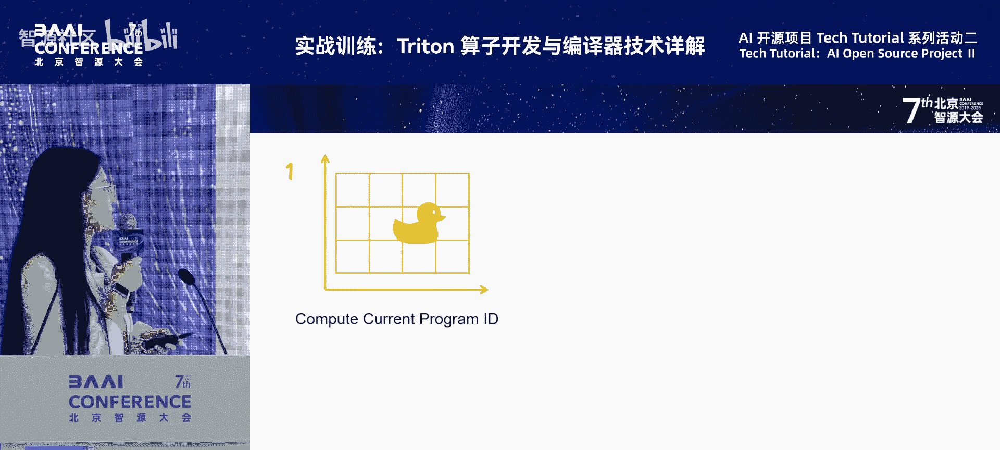

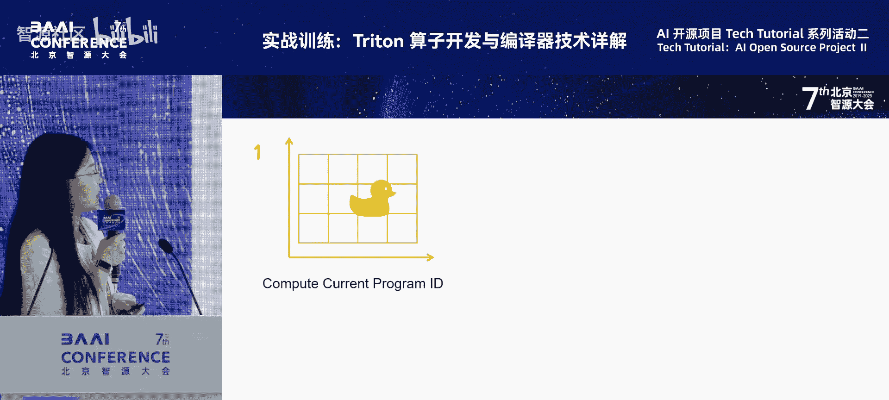

然后根据这个编号，我们就可以发现这么大的一个张量，我们需要处理的那部分在哪儿？使用这个信息，这个ID的信息来在整个张量中计算出它的偏置。

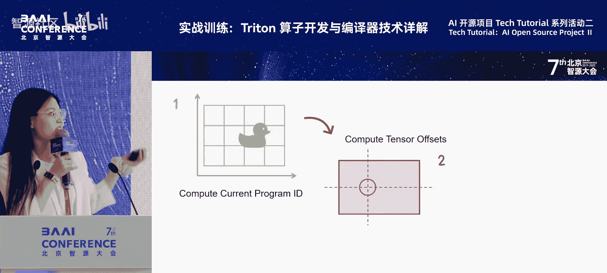

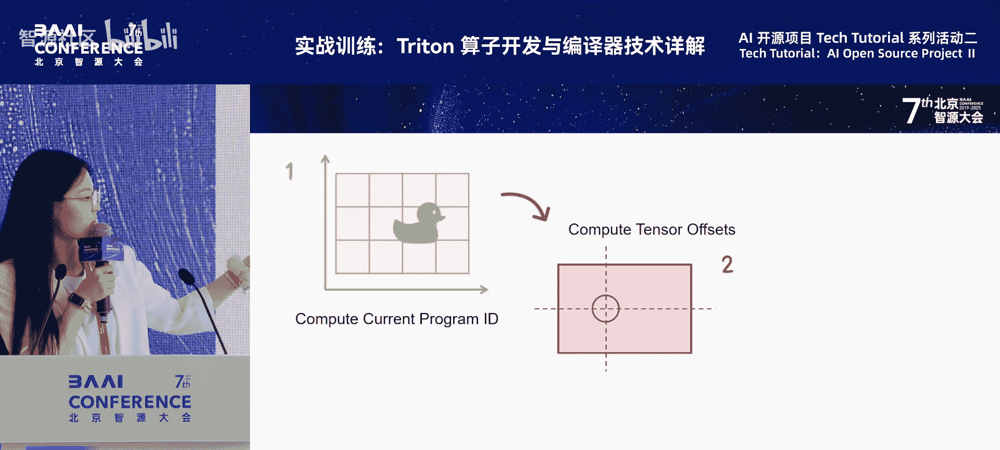

获得偏置之后，我们就可以以这个偏置，再加上它的起始地址来加载我们Q note和Q rope这两个矩阵。

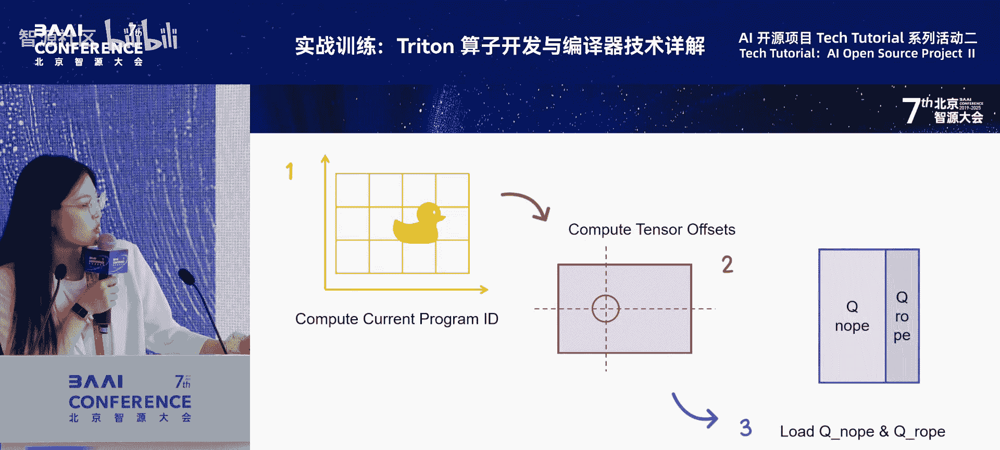

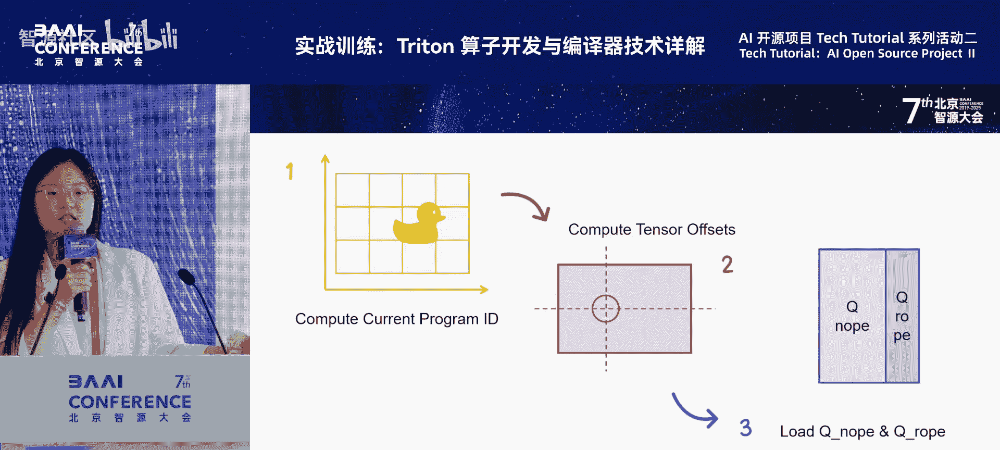

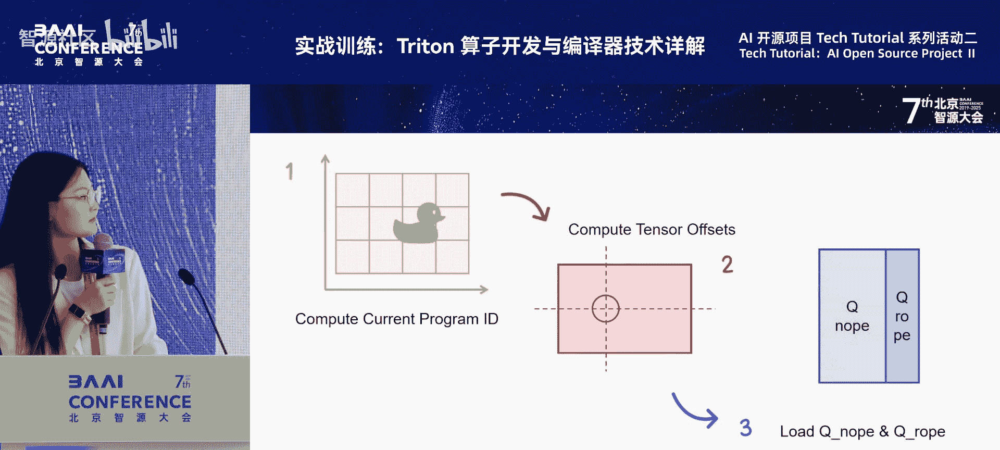

呃，想要拍的同学可以拍一下啊。😊。

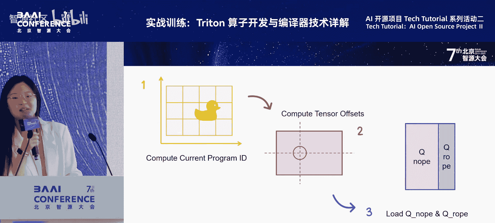

进度可能有点快。

第四步呢，获得这样一个矩阵之后，我们会为flash初始化三个矩阵，分别用来计算呃和存储flash这个阶段的max some和ac。

这两个这三个举证在后面flash当中是至关重要的。他也为我们flash的整个计算的逻辑提供了基础。

那么接下来和flash mail呃和普通的flash attention的结果是呃方法是一样的。我们会计算它整个循环的范围。然后在这个循环当中去做更多的事情。

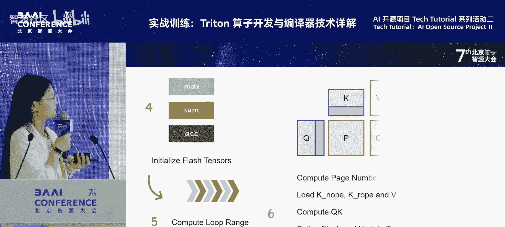

每一个循环体内呢，我们根据前面的信息会计算出来现在的KV是在哪一个页上计算它的地址。然后我们从这个分页的KV缓存当中取出K K rope和V使用这些信息，加上我们前面load出来的Q矩阵。

可以计算出QK的组织乘法的结果，然后再用这些信息去计算flash的。

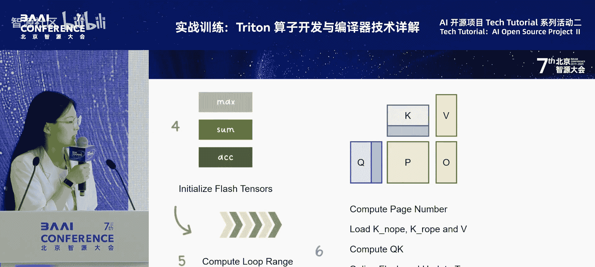

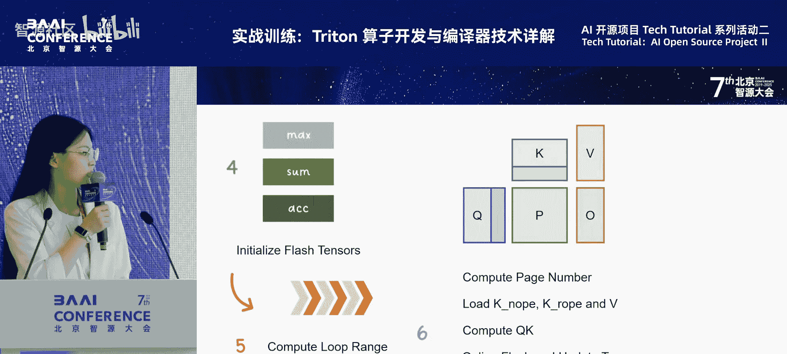

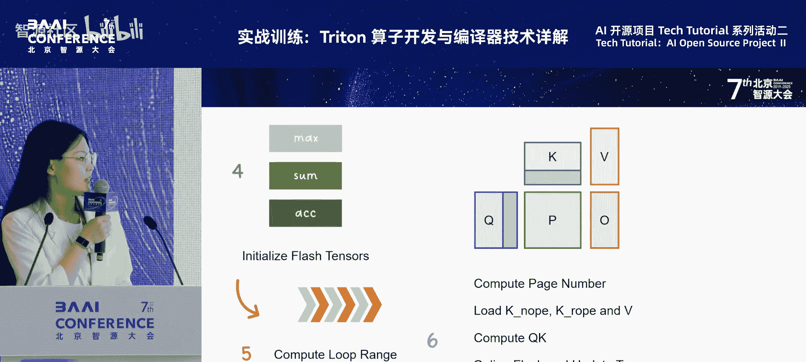

这些状态，然后把我们之前初始化的maxsome和ccumulator这三个矩阵做一个更新。

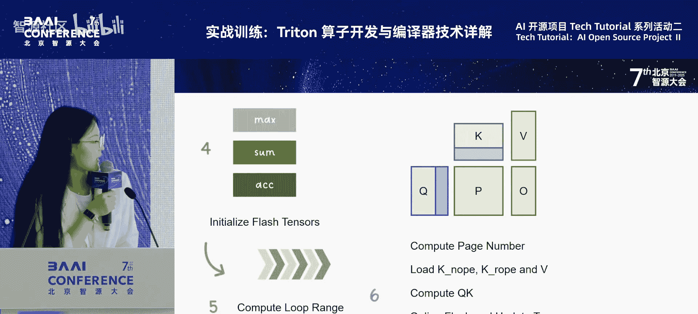

然后在我们刚刚计算出来的整个的范围当中，对。

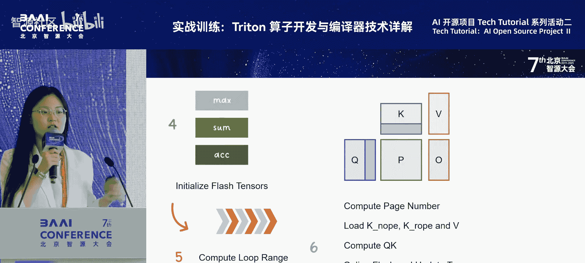

这个过程做不断的循环，直到我们循环的结束。嗯。那么结束之后，我们通过ACC除以some的这一个值，可以把它存到之前提到的中间结果变量当中，也就是这个attentionologist探当中。那么这样的话。

我们每1个KV的序列就会被分到32个不同的元素上。这些元素呢还需要在第二个阶段做一次reduce。接下来就到了我们的第二部分。也就是MOA soft max reduce V kernel。

它同样是在grade上面呃，会有不同的grade同时在GPU上运行。

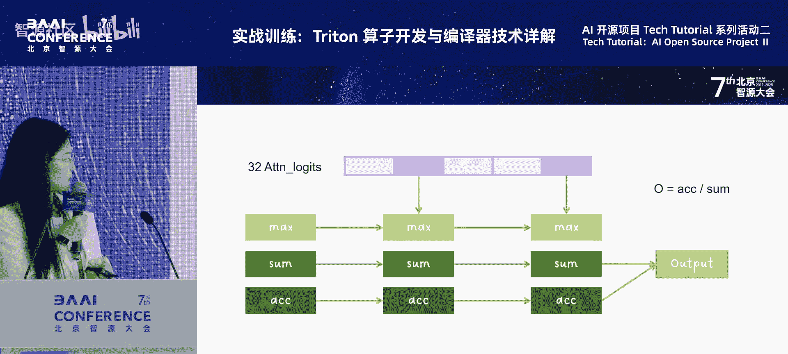

这个就是我们呃第二个阶段所做的事情还是比较简单的啊，跟前面的flash的逻辑基本上是一样的。我们只是把上一步得到这些信息，通过max sum和acumulate这一个同样的模式。

再次给它做一个在线的数值更新。最后能够通过s和acumulator的除法，得到一个最终的输出值。😊。

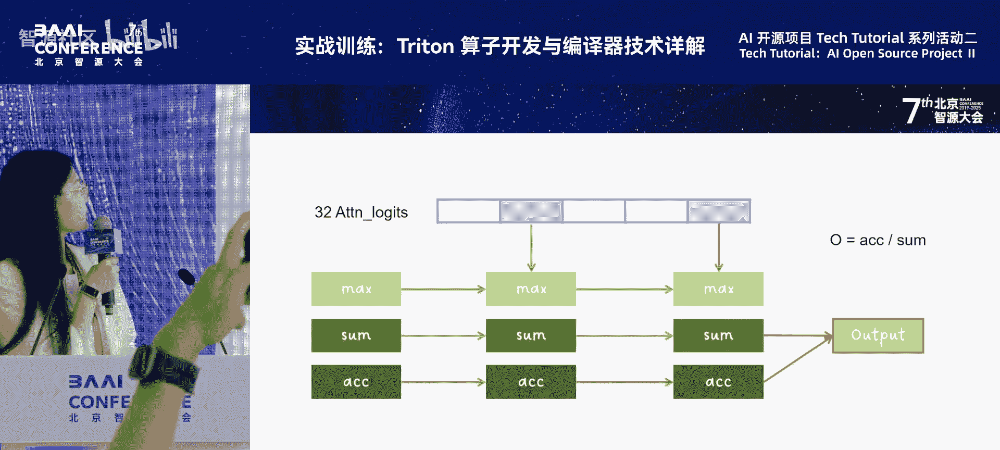

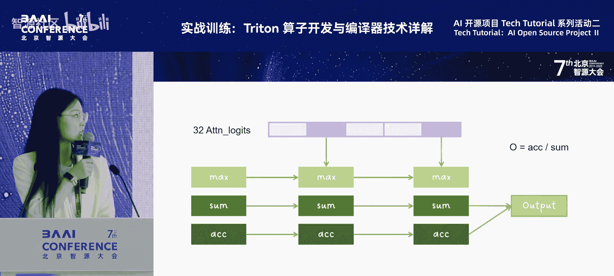

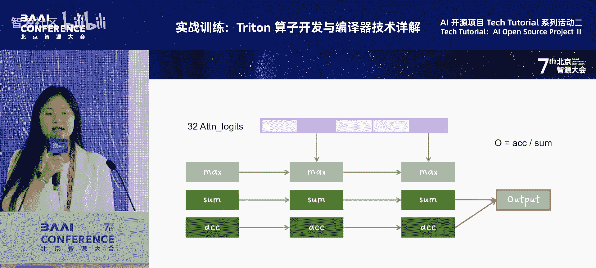

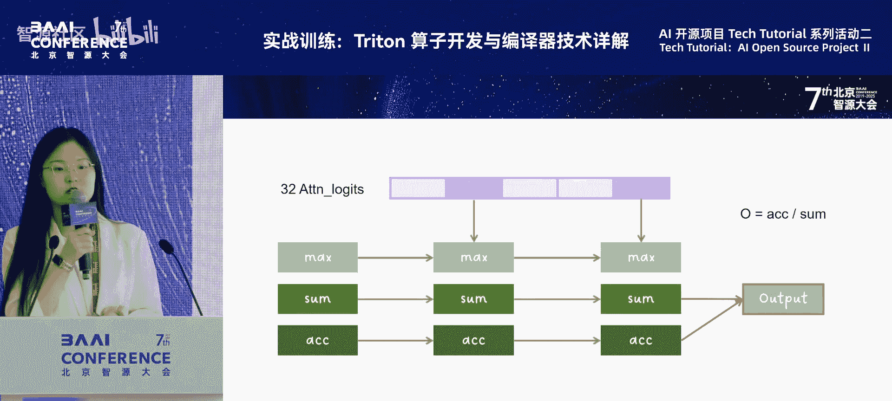

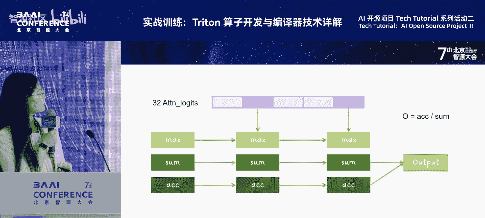

那么在这一套实现之后，我们可以看到这四条线分别代表了不同实现的flashOA的结果。首先最低的这一条是我们完全用toch原生的这些零碎的算子来拼凑成一个flashOA的算法。红色的虚线。

它可以是呃它位于这个最低的位置啊。因为我们这个图呈现的是它的处理的带宽，所以位置越靠下的话，就说明它的性能其实越差的，越靠上它的吞吐就越高。

那么第二条是黄色的实现是使用tton写的flashA这样一个比较原始的结果。可以看到它和这个toch的结果还是比较接近的，没有一个特别明显的提升。然而，在上面的两条蓝色和紫色的虚线。

分别是使用ku大学的flash MOA，也就是dpsy AI他们原生官方提出来的这个实现的版本的性能，以及来自flash in的实现。😊，那么这个蓝色和紫色的这两条线的性能对比可以说是遥遥领先啊。

我们这个tton在这里。相比来说，其实是性能非常不尽如人意的。那么在这个基础上，我们有哪些方法可以不特别费力的把这个chune的性能稍微提上来一些呢？这也就是我接下来要跟大家分享的主要是三个部分。

首先我们想要提高这个性能，就要关注一下是为了什么目的而提高性能。这个是来自于呃dKI他们官方为flashMA做测试的一系列的参数，可以看到其中大部分的参数都是一些固定的值。

比如说bach长一直等于128，然后Q矩阵的这个序列长度是一。然后K矩阵的序列长度是变化的。然后head的数量也是固定的。这个情况下呢，cute head是128个头，那么KV呢只有一个头呃。

以及我们最重要的。😊，im的维度也是固定的，在K和V上面，他们分别是512加64以及512。那么这个512加64，大家可以看到等于576，对吧？这也就是我们开头说的576项簿的这个降维打击啊。

我们通过这样一个固定的维度来把整个的KV的空间缩小。然后让它进行更快的计算，以及更少的存储。😊，同样的它co长等于处数据类型也是指定的。那么最大的变量，我们最需要关注的变量在于哪里呢？

在于这个sequenceence，它也就是KV矩阵它这个序列的长度变化。我们以101024这一个最小的为呃最小的尺寸为例啊。那么我我们可以看到在存储的caash当中。

它的序列大概是从1024增长到1278这样一个范围。那么其中最大的长度是1278。我们为了给他们做统一的处理，需要使用padding来做一个对齐，向上对齐到一个二的幂的整数之后呢，就是1280。😊。

这样我们在64为大小的分页方法使用之后，就相当于是每一个序列是20个block，每个block的大小是64。接下来呢我们看在这个尺寸下面的三个输入张量，分别是QKVc以及block table。

Q呢也就是我们用来查询的举阵。KV catch是我们把KV压缩之后的这个存储的序列。那么block table是我们用来在KV的缓存上寻找它所属的那一页的标志。因此，Q的维度啊分别是4个维度。

bach size呃 ofq，然后number head以及head dim它的形状就是1128乘以1乘以128乘以576。那么KV cache就会比较大了。它是block的数量乘以block的大小。

以及KV上面head的数量，以及head的维度就是2560乘以64乘以1再乘以576。那么用来在KV上查找页号的block table，它的大小是batch乘以number of block。

也就是128个batch。每一个bach，它有20个block的大小。

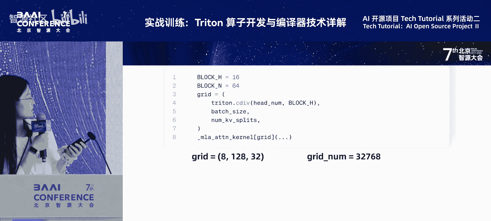

针对这个情况，带着这个信息，我们可以往前看到在最原始版本的chon实现当中有一点什么问题呢？

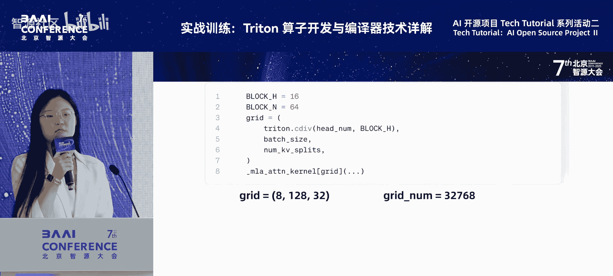

它对于MLA attention这一个 kernelel的并行进并行的数据的设置是graded等于第一个维度是head的数量除以block h这样一个常量的参数。

第二个维度呢是bach the size。第三个维度是我们设置了常量number of k split，它是32。所以我们需要调用8乘以128乘以32个这样的 kernel去运行。

那么它整体的grade number就等于32768。

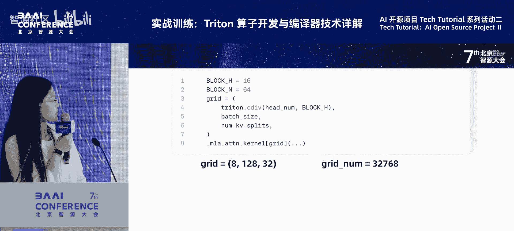

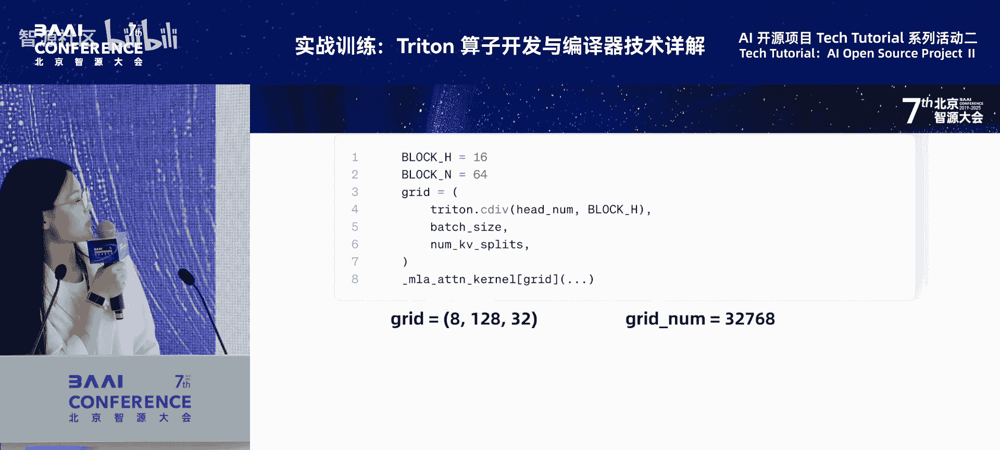

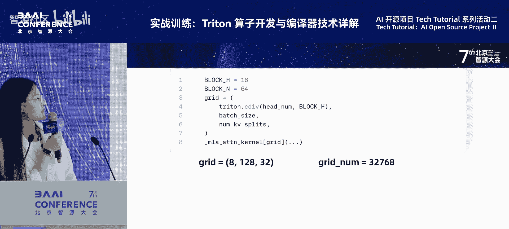

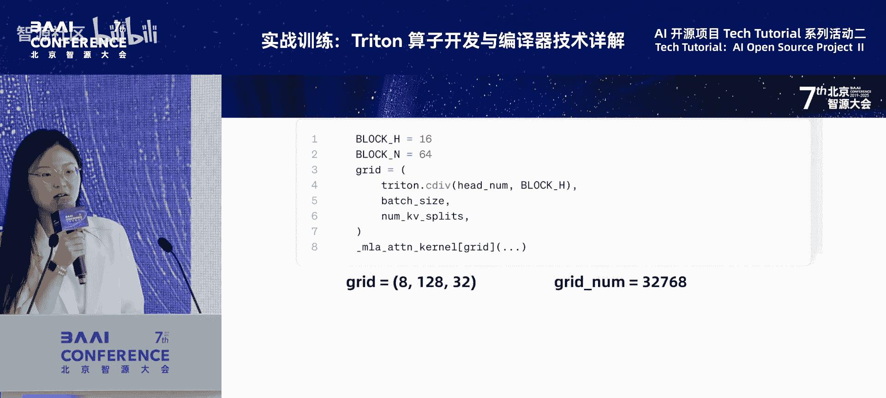

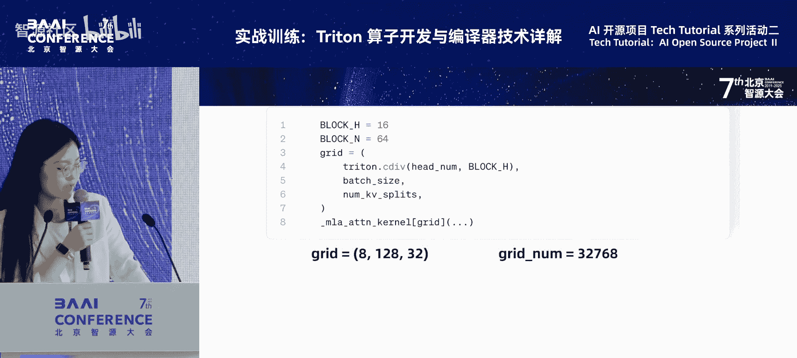

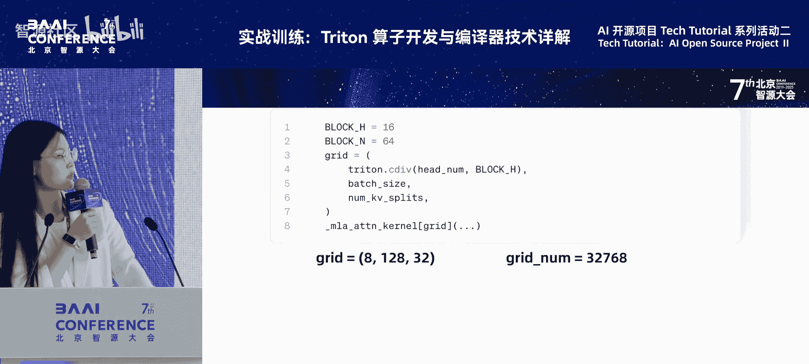

可以看到其实是很大的一个数字啊。比如说我们通常的H800啊之类的芯片，它上面的SM的数量其实只有100多个。那么经常做牛马的朋友们可能有感触啊？比如说我们把一个任务分配到32768个人身上。

然后我们的工位呢又只有100多个就会发生什么情况？首先第一个情况是，每一个员工他的工作量可能不饱和，对不对？😊。

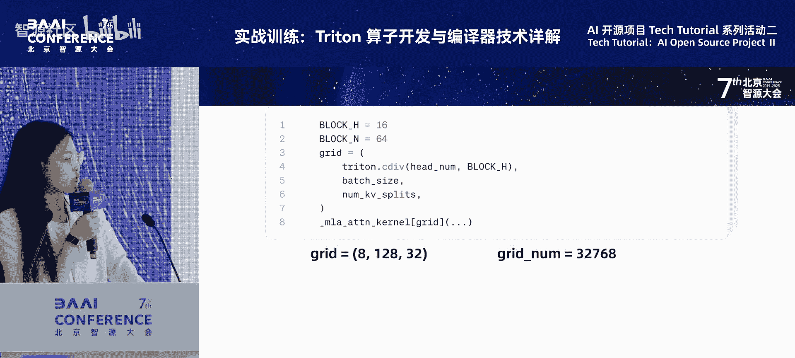

不饱和就会造成一个人力上的浪费。第二个情况呢就是我们每一个员工进来还要给他做入职培训。所以不同的员工之间，他们一些数据和经验没有办法复用，这个也导致最后累加起来，他的耗时是会很长的。

那么我们有没有什么办法可以减少这个耗时？然后做过牛马的领导的朋友们应该也有感触，也就是我们可以减少这个牛马的数量，然后让每个人做更多的活，对不对？😊，哦。那么接下来看柜里有三个维度。

我们从哪些维度去减少数量呢？

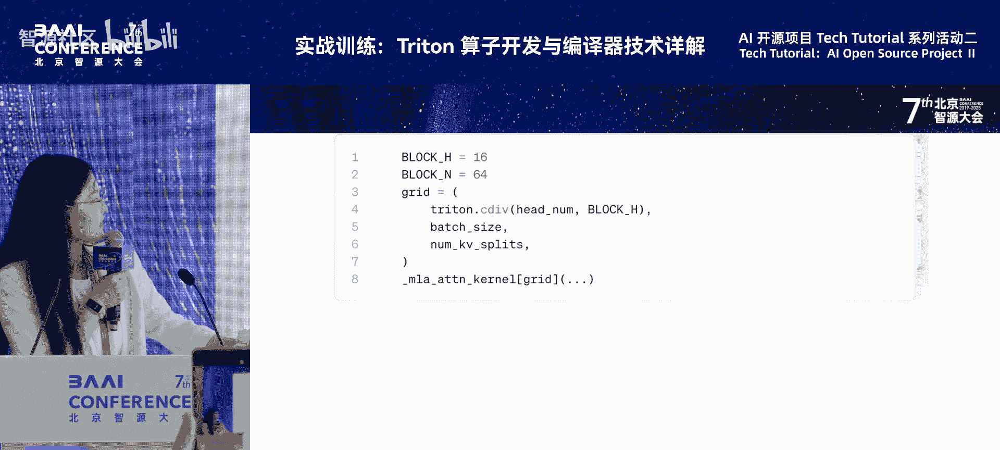

首先前两个维度，它第一个维度是头的数量的并行，第二个维度呢是半0的并行。这两个他们其实在划分到不同的规之后，他们的任务是可以完全不相关的。也就是说他们可以并行的十分彻底。

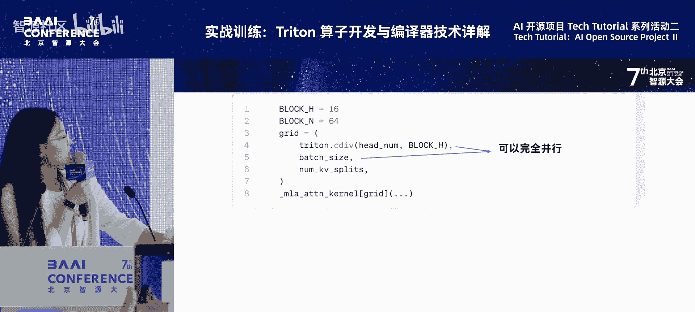

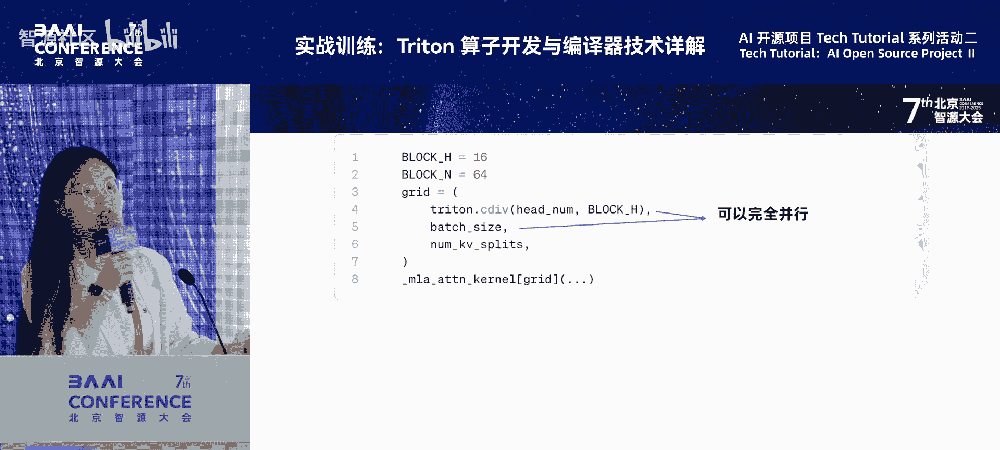

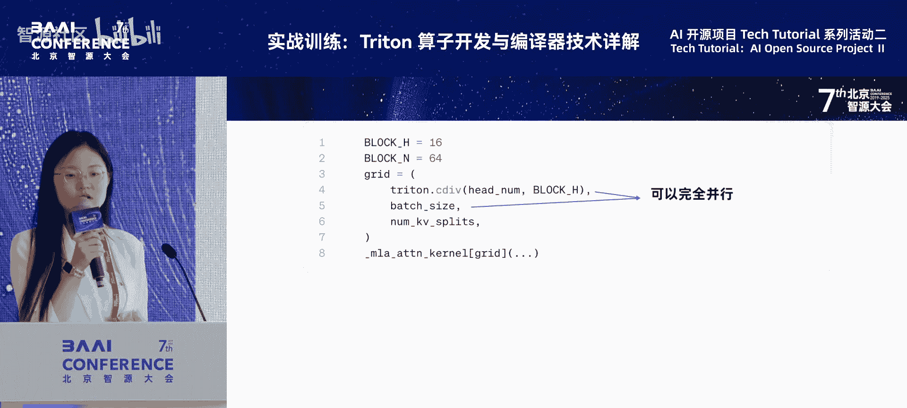

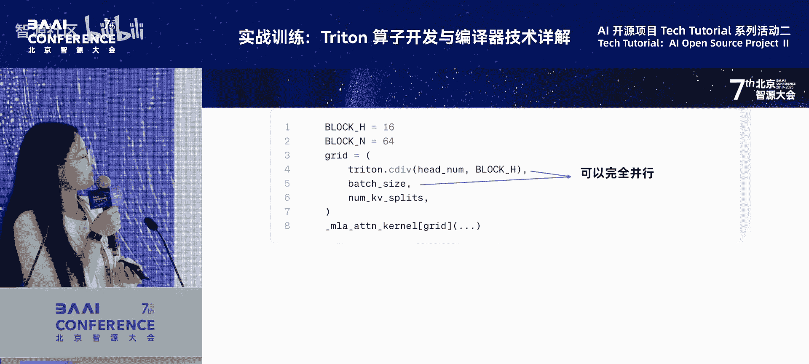

然而第二个呃然而第三个维度呢是number of KV split，也就是我们把KV的序列划分成32块。然后在第二步还需要对它进行一个规约。那么这个时候它是不是就会引发进一步的操作。

我们就需要有更多的处理。

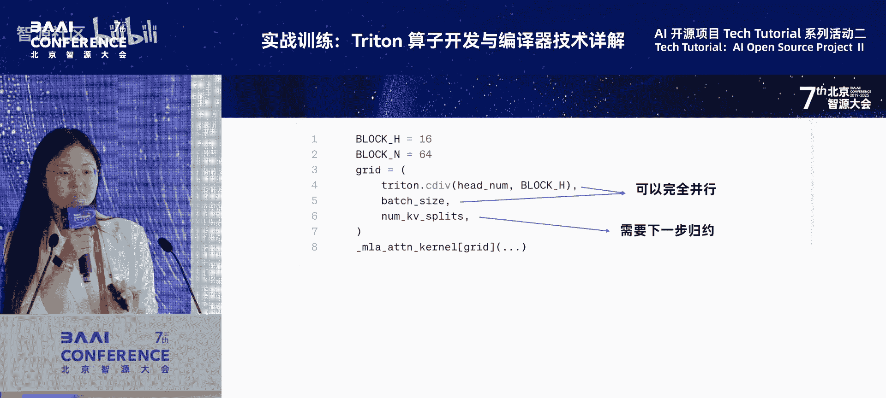

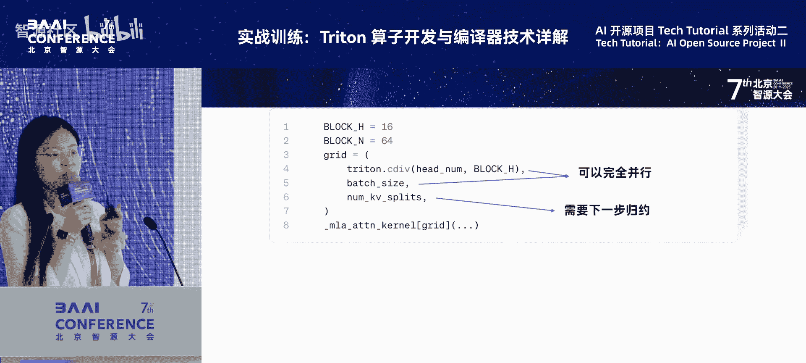

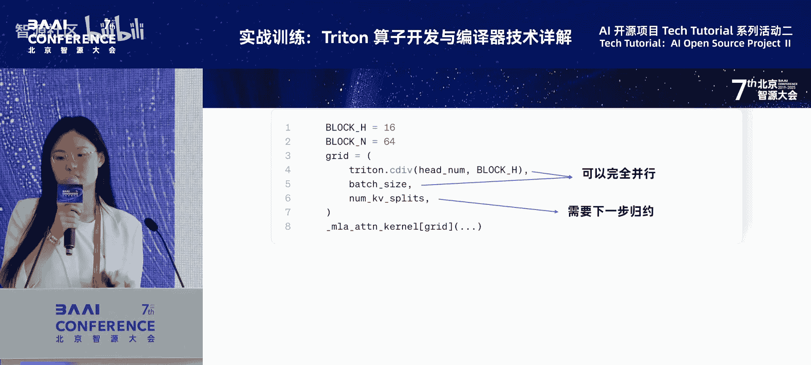

这是第一点。第二点呢，我们根据刚刚这个对于形状的推算啊，可以发现。batch呃bach维度，不好意思啊，这个红色箭头位置有一点偏差，它应该指到最左边这个Q的 batchch上面。😡。

bach维度它控制的并情都是发生在Q和block table这两个张量的最外层的。然后have number他的这个病情是发生在Q的第三位，也就是number haveq。然而。

number of k split它控制的并行位于KV cache的number of block和block size这两个维度。也就是说，我们在KV cache这样一个，它的数据量最大。

我们需要的仿存量最大的张量上，如果能够获到获得更好的局部性，是不是对于我们整体的性能是有更好的收益的。因此，我们在这三个维度的比较之下。

我们会更优先于选择number k split这样一个维度给它进行收缩，把它的病情给去掉。它能带来怎样的好处啊？😡，收错了之后，它大概是8乘128，那么我们的代码就会发生一些变化。

上面这部分呢是我们第一个 kernel的代码，下面这部分是第二个red这一步的代码。😊，可以看到在第一个我们会把这个当前bach的序列长度加载进来，然后在这个序列长度上分成32块。

每一个graded去寻找它需要处理的当前的块的位置。然后在这一个位置上去做便利和循环，然后以block n为单位不停的循环，直到。他需要的任务都完成了。当我们不再分拆KV cash的序列长度之后呢。

这个就会发生一些变化。也就是我们不再需要关心现在这个gr的处理的是哪一块。因为所有的KV cash的序列，当前这个bach的序列都是由一个。graded来处理的。那么我们的起点就变成0。

终点就变成了这个bach所需要处理的这个开始呃序列的最长的长度。然后还是以block为单位，然后在这个范围上面去做循环。第二个变化呢，也就是我们下面所说的这个reduce的序列。

因为我们把KV上面的这个拆分完全都取消了，所以使用sof max reduce在KV序列上面做的这个约也就完全不必要存在了。那么第二个阶段的坑呢，我们是完全可以省掉的。

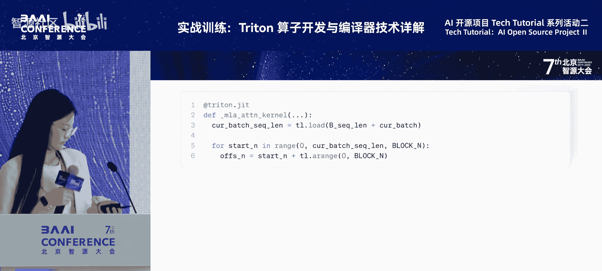

好了。接下来我们可以看到这样审完之后呢，它的G等于8乘以128。相起相乘起来其实等于1024。对于我们可能100多个这个SM的数量来说还是也许会有点大。

那么我们接着考虑在bach和number呃head这两个维度上去做进一步的节省。这样的话我们会提优先节省哪一个呢？有没有朋友可以回答我一下，如果是这两个之间做取舍的话，我们会优先节省哪一个？😊。

Yeah。我们从这个箭头的位置来参考，bach维度，它所处的都是Q和block table这两个张量的最外层。然而number head ofq它的位置会更内层一点。所以如果是内层的连续性更高。

那么对于我们的存储访问也是会更有利的。所以。我们可以通过控制block H的大小来调整在呃Q的头的数量上面的并行度。但是我们又不止于此啊，我们其他的一些参数，一些固定参数的大小也都是可以做调整的。

于是我们在这一步把所有的可能影响我们并行的参数都可以做一个au tune的方式。来给他做。性能的比较选择出最佳的结果。然后根据我们的经验，在H800和A100这两个平台上获得了最佳参数是这样的。😊。

H800我们会选择block H等于64，也就是128个头分到。分到两个不同的graded当中，每一个grade处理大小为64的头，然后block n是64。

也就是在每一个循环体当中处理的序列的长度是64。然后number works等于8number of stages等于3，让它以这个三为流水的级别在GPU上进行更快的运行。

与H800不太一样的是我们在A100上获得了呃更小一点的这个数量啊。blockage我们需要控制到32，然后number stages等于2，因为A。

A卡对于number stages等于3的这个share memory的需求量会无法支持。所以实测下来，我们这个是一个最好的结果。同样我们对呃batch这样的维度也做了一个并行参数的测试啊。

但是实测发现batch还是最适合彻底的去做并行的。我们把它分到更多的归业当中，会让它的性能会更好。😊，呃，这里还有一点小tck啊，我们发现bsh size其实它是在外面。

然后gradenumber ahead它是在内层。但是我们在graded的排序当中，head number是在外面，bush的 numberumb是在里面，这个就用到我们在t当中的一点小技巧啊。

就他虽然写的是2乘以128，但实际上给到 kernelel的信息是2乘以128乘以1。😊，graded是分三个维度的，我们把它从左到右分别叫为XY和Z。这个时候如果我们发射了一个graded。

然后在下一个的时候，我们会先从X维度给它增加增加下一个。比如说我们发射了000编号的graded，下一个就是100。所以它在X上面的增长是最快的。那么也就造成我们在最内层。

我们最内层的这个并行可以放到gd的前面，让它来更快的去进行迭代。第二个技巧呢来自于呃chen对于low的这一个语句的一个特殊设置啊，也不算特殊设置一个特性。也就是它和。这里有一个名字为mask的参数。

也就是我们需要读取的一个呃掩码。如果load的时候，mask不是为n的话，它的速度会比mask为n的情况下会更慢一些。那么我们看在这一段处理当中，我们需要把呃KV的。页表的编号来加载进来。

然后同时加载KV这两个呃tenor的数值。最后计算出KK之后，为了不让它进一步的影响到后面我们做max的处理，需要给他做一个呃T要点wear的m。在整个过程中当中，我们的mask出现了几次呢？

有一次、两次、三次。4次，其中有三次发生在了我们加载一个数据的阶段。那么其中最后一次呢是发生于一个呃对于QK的处理。如果我们把这一步的musask节省掉，其实也是可以节省呃加速一些数据的读取的。😊。

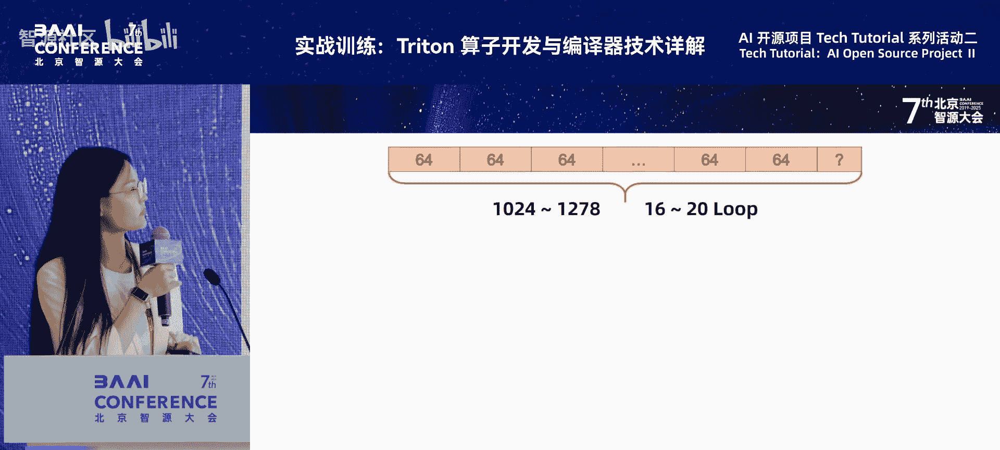

那么m是不是一个必要的操作呢？比如说我们还是以刚刚那个一组数据为例子啊，KV上面的序列长度，它大概在1024到1278这样一个范围分布。如果我们以64作为呃页表的大小的话，大概需要循环16到20次。

那么这16到2次循环当中，到底有多少次的mussask是必要的。其实答案只有最多一次。当我们的序列长度是可以被64对齐整除的时候，它是完全不需要使用mussask来作为加载的参数的。

只有在我们有一个64不对齐的尾块，这个时候才需要引入musask来把我们不需要的这些脏数据给屏蔽掉。😊。

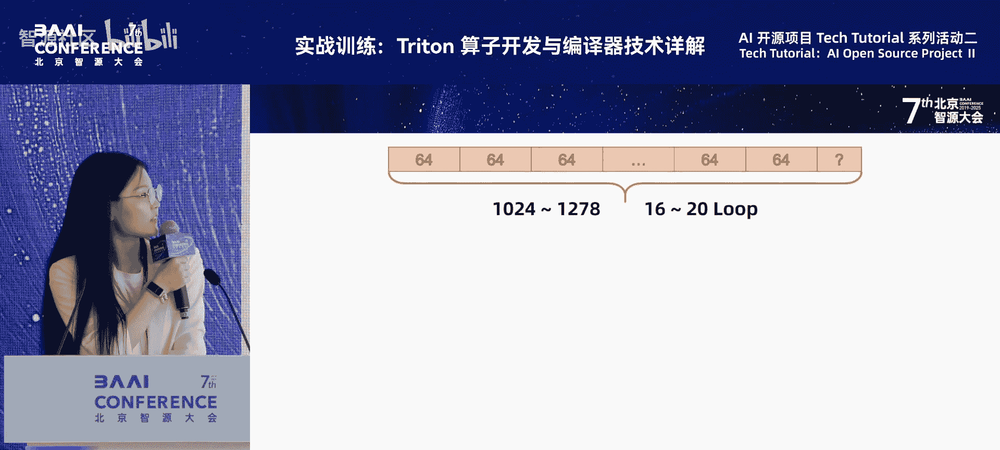

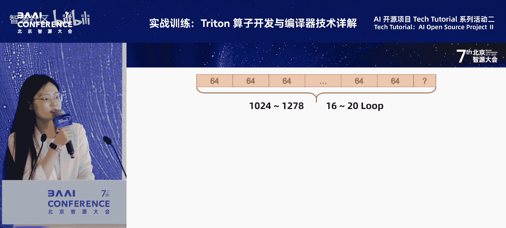

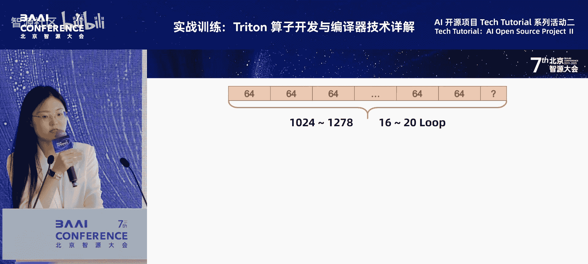

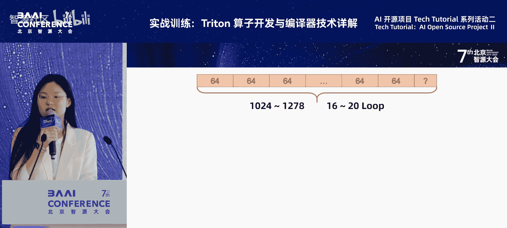

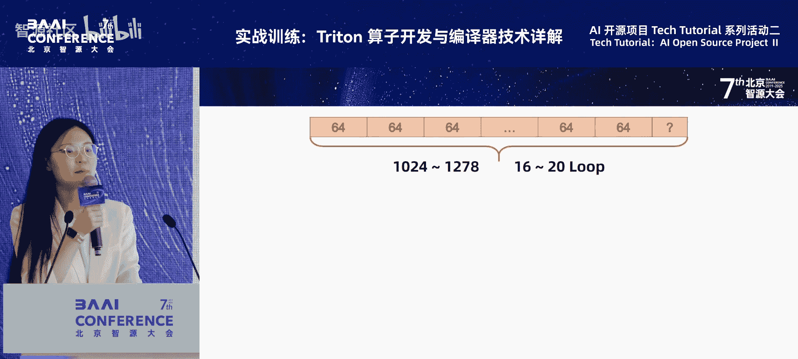

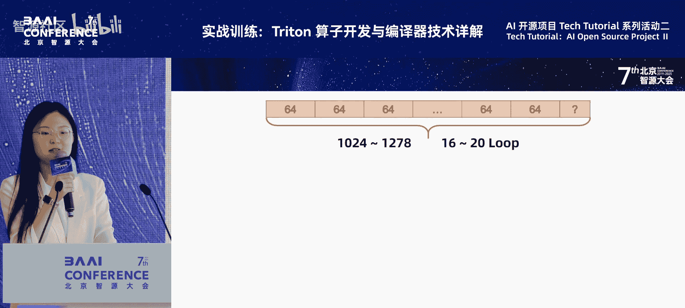

所以在最多只有一次的情况下，我们才需要用的msask，我们就可以把这最后一次和前面可以正常的去做节省性的这个load的指令分开。因此，在我们的代码中呢，可以先把整个当前bach需要的序列长度给加载进来。

然后计算一下它一共会做多少次循环。那么剩下有没有不对齐的尾块需要处理。在这个循环的过程中，它的加载都是可以使用最直接的TL点漏的这个指令，只有在最后一次，如果我们有剩余的不对齐的数数量。

才会把这个mask使用上去。这个是目前我们可以做到的一个呃triton实现的flashMA的结果啊，和上一张性能的图片对比，我们多了一条绿色的线，绿色的线呃。

右面的图例是flag mLAton它是我们在flash mflag jams这一个仓库当中上传的性能的水平，可以看到它比黄色的这条线可以呃还是提高了不少的。大概相比最优的扩大实现的版本。

大概是在55%左右的一个相对性能。呃，其实还是有很大的优化空间的。但是我们更多的优化还是要依靠对chton语言的进一步理解以及和呃硬件的更深层次的配合。😊，最后还有一点小技巧啊，是呃。我们目前没有使用。

然后但是可以给大家作为一个其他算子上面优化的参考，也就是work specialization这一个技术。它是在我们今年的2月份，然后由开发者提到排to的blog当中呢，在chton的2。2以及之呃3。

2以及之后的版本都是可以使用这个技术。😊，简单的来说呢，它就是把呃W分组，然后通过一个指令的指令序列的调整，使它能够在其中一个组上做所有的数据加载的操作。那么把主要的呃计算上面的负载分到其他的组上。

也就是我们前面说的那个小标题啊，照一方有难八方来看，只有第一个1到4的这一个组是处理呃，作为一个生产者来进行数据加载的。那么在加载之后，它就不需要和其他的之间呃执行同样的指令。

然后做统一的barrier，它就不需要等。那么在W5到8，然后9到12这两个组上，我们就可以使用第一个w group加载进来的数字直接去做MMA的计算。其实这个使用方法在ton当中也非常简单啊。

左边是我们这个autoune的一个片段代码。可以看到，在tton confi当中，我们除了设置一些常规使用的参数之外，只要再加1到2个参数。

第一个参数是number of consumer groups，也就是我们的作为消费者的。😊，word的数量，w group的数量有多少。比如说在这张图里面，它就是2。

但是因为呃这个ch它所支持的work group的呃work number的数量是有限制的，它可能不太支持12，更多的是比如说4或者8或者16。那么对于我们设置这个数字的要求会更多一点。😊。

第二个呢是number of buffers呃每一个呃work group需要的。需要做呃加载的这个buffer的数量啊，这个也是一个可调的参数。那么我们通过设置这两个参数啊。

去开启auto tune调优器，就可以在呃 kernelnel当中考虑使用它这个这两个work group的效果。在我们flash的实践测试当中呢，发现其实可能现在呃受限于开发的一个进度吧。

打开了这个 specialization的选择效果其实没有特别的好。因此，我们在官方呃在push上去的代码当中还是没有使用这个功能的。

如果你有比如说开发jas呃开发jam或者开发普通的tenion这样的需求。在官方放出来的这个性能效果的对比当中，它是可以提升10%到15%这样一个区间的。😊。

OK以上就是我们所说的三个可以在呃triton编程当中简单使用，然后并且提升它性能的一些小方法。啊，今天呢我们第一个talk就到这里，谢谢。😊。

