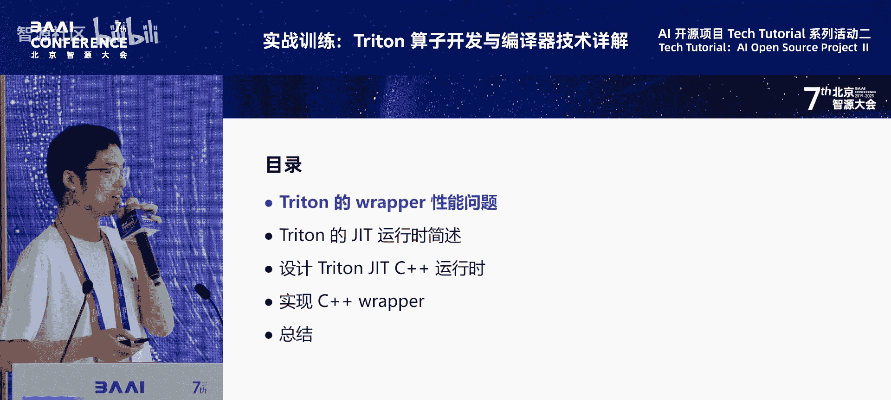
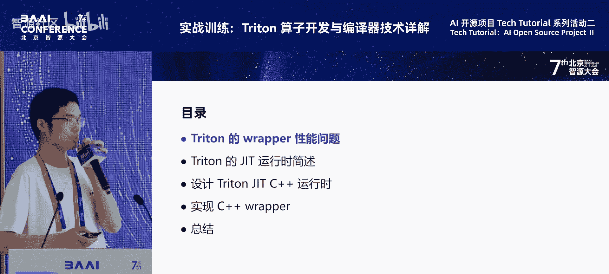
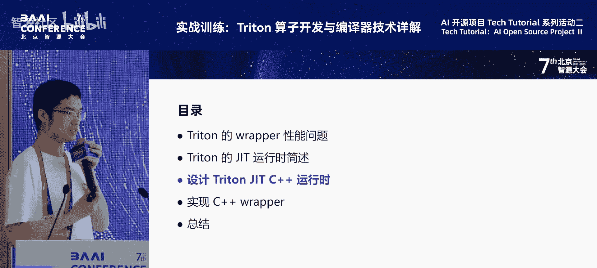
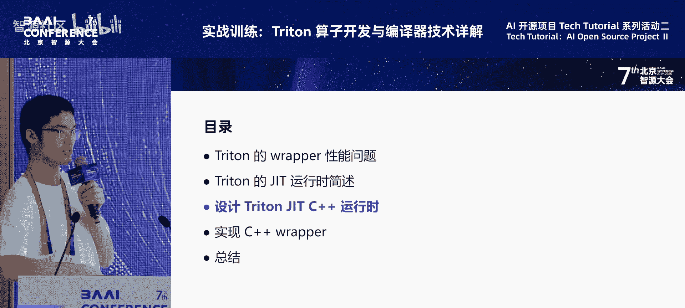

# 2025北京智源大会-特色活动：AI 开源项目 Tech Tutorial 系列活动 p06 FlagGems 算子运行时优化实战：陈飞宇 -BV1oWNxz8Ew3_p6-

嗯，大家好，我是陈飞宇。然后今天下午我准备的题目是嗯等一下PPT放上来，就PPT头上。哦，我要自己投OKOK我自己按就行。哦，好的。呃。

今天我们给大家准备的题目是关于嗯fag jam算子库中的运行时实战的一个运行时优化的一个实战。事实上呢我们讲的事情是一个比较偏独立的一个功能，就是关于说你用来写算子。然后在运行时上怎么进行优化。

它区别于我们刚上位同学讲的是本身的优化。我们这里讲的是CPU就主要是CPU的运行时的优化，怎么减少CPU的时间，减少 kernel呃执行之间的空隙时间。所以它和具体没什么关系。我们主要是讲一个运行时的。

然后呢fag jam现在他用了这样一个它可以使用这个运行时的优化的技术。但是它不限于fag jams中使用。如果他被别的库使用的话，我们会应觉得它也适用性更广。ok这里的话就是今天的目录。

首先我们来看一看呃tra算子的一个运行时开销，就是它的rappper问题。接下来我们简述一下我们如何去改善它的运行时开销。后面继续好，首先先一下，就是们正常用来算子的话我需要先讲明了两个概念。

一个就是说语言它是一个基于thon的嵌入式的呃领域专用语言，就是bedSL我们平时写的话呃左边这个是一个的代码是比较简单的一个呃向量加的一个代码。然后右边是它的一个rappper的代码。

其实主要就是处理一些输入分配啦，然后元素去推断以及这个启动配置的计算相关的准备工作准备好了之后我就可以去调这边。然后左边这个的语言呢。

其实它并不是thon语言它是语言管它长得像pyon它是用一个装饰器来装饰的这种就是我们常说的deating。

然后这段代码事实际上是嵌在python中来执行的，它是由专门的一个chon编译器来编译，然后再来执行它的编译产物。好。嗯，它作为一个嵌入式的DSL的好处，就是它的语言很像python学起来。

写起来的都更加方便。嗯，而且你调它的那个kennel的时候，并不需要显示的进行跨语言调用，它给你包好了，看起来就很像当掉一个正常的pyython函数。

但是它潜在的一个代价就是如果我的host program就是那个python的程序很慢。那么即便你的ken再快，你也会被它拖慢。呃，然后这里要回来再讲一下，就是语言在thon中的一般的使用方式。

它是一种基于及时编译的使用方式。就是说呃我们的这个及时编译的话，其实你可以把它的组成部分分两个，一个是运行时，一个是编译器左边为运行时右边为编译器。

然后运行时呢它需要计算这个tri function它的特化的信息。然后这个特化的信息指定了，我需要编译怎么样的。然后我把这个需求发给编译器编译器编译好了之后把可传回来，我再执行这个ken。

这就是及时编译器呃及时编译这个过程中编译呃运行时和编译器分别的职责。然后一般运行时会有一个cach来把已经编译过的缓存起来。这样子我下次用的时候就会更快一些。好。

然后接下来再讲的一个事情就是说我们如果用来给写一个自定义的算子，那么它的整个结构一般是这个样子的。就是最核心的话是这个呃的dri说是然后里面还有一层包装简单的包装叫comp的就是绿色的这一块。

它是对这个编译结果的一个很浅的一个封装是一个基于C就是运行时生成C语言的代码，并且编译的结果然后在外包的就是自己的一个它是一个不完整的不完整的函数。

它还需要在运行时补充这些类型信息以及常量参数的值这才能具体编译成一个。然后再往外层就是这个pper色这我们包了一些其他的功能就是前面所的数据计输入数据的检查以输出分配这些的功能包好之后呢它才是暴露出一个比简单。

处理的函数这样一个接口。然后为了集成到on的系统中支持tocomp的话，我们还会通过一个cusom up的方法来把它注册到to的调度那个派发器中pat中。

然后我们用的时候是通过to op library name name这样的方式。也就是说它市上有一层一层的包裹这些包裹每一层都是发生在运行时的，他们都有可能会有比较高的开销。然后我们实测的过程中。

其实也发现这开销是不可忽略的，甚至是比较严重的。我们后面的一些性能展示的数据会显示这个。好，然后由于它比较关键的一点是ton的这个运行时。

就是 function黄色这一层它是实现在python的那你为了使用方便你的rappper也写在python，你整个都是一个pyon层的函数。

包括说那个注册到toch的dispatcher这层也是通过pyon层去注册的，调用，也是通过python去调用，整个都是在python端的差不多。然后接下来我们简述一下就是呃上的执行的一个异务机制。

就是说我们假定一个方中，它仅包含一次 launch，而且 launch之后立即返回。然后由于ku它的执行，它是异步的，就是说你的主机线程一直一启动这个你就可以返回去做别的事情了。

然后呃你添加到GPU的工作队列上会有一个执行。然后这个执行呢，它是按序按先后顺序执行的。如果你不使用多 stream来进行concurrent execution的话。

然后这是一个它的一个简单的一个 diagram。还有一个简单的限制，就是说你可el至少要先 launch了，排上队了，你才能执行。然后根据一个算子，它的kennal的就是这个launch的时间。

以及以及它的呃kennal的执行时间的不同。你这样会发生两个两种情况。一种是我的laun很短。当然事实上你还有一个rappper前面我们所说的元数率计算这些的工作也要做的。

然后rappper执行之后是launch launch完之后，ken排上队，然后开始执行。如果 kernel的执行很时间很长，就是我们拿着这个方反复的去执行的话，它就会显示出一定的滞后性就un之后。

你要等很久才能执行。但是呢所有的 execution之间是几乎没有空隙的，它可以挤在一起挤的很满。但是如果你的可的执时间很短，rappper的时间很长，然后就会发生这样一个现状。

这样一个状况就说你laun了，它执行了，很快就执行完了。这个时候你的CPU的主机线程。还在执行下一轮的rappper，这个时候他还没准备好launch下一个kennel，这样子的话。

GPU之间就会形成一个空缺。这种情况实际上也是一个比较普遍的情况。在很多模型中会有很多小的算子小的可nel。然后嗯。科al的 launch一般是6到86到10个微秒左右吧。嗯，回去。呃。

这里我们举一个比较简单的简单的例子，就是一个呃some是一个reduce运算，然后是1个416乘4K的FP32的探ser沿着第义为了reuce。它是这个size相对来说比较小了。

然后我们就可以看到这里是一次launch，然后这个是对应它的那个kennel的执行，他们之间的时间间隔是比较短。然后我这里做了一个程序是这样子的，左边这一部分是调用toch的。

右边是我们自己写一个some的，然后再用thonpper把它包起来执行。就会发现说他的之间的间隙很大。那这些时间其实主要都是rappper的时间。

因为他在处理它的输入分配以及输出输入检查输出分配相关的工作，他没做完这个之前，他没法laun，你就得等。然后。😊，这里显示的是一些时间，就是说我们的K的执行时间是差不多的。

甚至tri的你还要时间还要快一些。但是整体的执行时间，我们主要是看这个两次K launch之间的时间差来粗略的作为一个rappper的开销的估计，它的时间就比你用to取的来慢慢很多长很多。

因为to的这个主要是用C加加写的。然后。他的间隔只有17。8微秒，然后这个就达到了87微秒了。哦，这个是它的代码的测试代码。然后还有下一个例子，就是这个ad ten。然后它的代码也是在这里稍微展示一下。

我们做了很简单的一个简化，就是我们不做t promotion，也不做sha broadcasting，也不做错误检查，什么都不做。就是一进来我就分配一个输出，然后直接分块就算了。即便是这么简单。

我们也可以回来看他的。两次con launch之间的时间差达到了61微秒。也就是说你尽可能的简单的写，已经没法再减了，你都会花六十几个微秒。这是它几乎是它的一个下限，它很高的一个下限。

所以呢我们会觉得这里这个问题是值得优化的一个问题。好的。呃，然后我们这里还做了一些在实际模型中的一些分析。我们使用的是lama3的模型，然后就是那个prom的长度是10。

然后batch size是一单样例推理生成10个token的时间，就会发现它的整体耗时是呃是。480毫秒累金，也就是再加3个0的微秒。OK480微秒，然后呢的时间是179微秒，呃。

很大的时间呢其实是在空缺的。然后呢，ku的整体的API的间隔。我们这里其实减粗略的视维它的 launch之间的间隔有一些像mem copy这些我们有算了。然后它的平均间隔是27微秒。

然后当然我们也做过一些实验，就是如果你用ch去替换其中的很多算子，这个间隔可能可以达到80几90微秒，它会膨胀很多。然后呢，平均的可的执行时间呃，这里是最小的是一点几微秒。

最大的这种矩阵层什么的复杂的可能会700多。但是它大于66微秒的 kernel的数是占呃15000多中有2800多个大于6微秒。也就是说大部分的 kernel的时间其实甚至都不如一个长。

因此我们会想办法去优化这个运行时的开销。然后当然解决这个问题，有很多种方法，你不一定要直面这个问题。你可以做一些整图级别的方案。比如说做opion我的更大我的更少，那我的间隔也更少这是可以解决的。

然后你可以把你的图的执行先cap下来，然后再re。但是这个对使用的话，它是有一些限制的，不一定什么情况都很方便。然后还有就是如果做LM的时候呢，你可以做一些系统级的方案。

比如说那我想办法增大让一个的时更长这也是O的。但是作为一个算子我们也会想着作为一个op library我们想要直接去减的开销，我们不能纯纯靠这些graph或者是解决方案。😊。

所以我们解决方案就是我们把rappper和runtime实现到C加加，这是一个比较直接的做法。然后呃它可以保证我们仍然使用trion来写kennel。也就是说你写可nel的语言依然是接近python的。

你可以用python来开发，都测试好了。最后你再用C加加写个rappper来降低它的运行时开销。OK接下来我们开始先了解一下triton原生的这个JIT运行时，他干了什么。

然后以便说我们要在C加加自己写一个运行时，我们应该怎么写。

O。啊，首先就是tradon它的去方其实不是一个完整的函数，它没有办法提供足够的信息来编译成二进制代码。然后它事实上还需要它的参数的类型。这个参数的类型也不是在函数签名的。你要传的才知道什么类型。

还有编译器的常量参数的值以及非常量参数的一些特化信息。比如说指针是不是对齐十6啦，整数是不是等于一这些信息，然后还有编译选项。

比如说你要用多大的block size以及你编译到什么样的architecture，这些都是要在运行时才能确定的。它就称为特化，然后还有运行时的话，我们传了很多参数，有一些参数是给编译器的。

有一些参数是给可的。呃，你要做参数分发这样的工作。然后这里我们可以简要的把它的一些关键代码抠出来，就是说它编译的时候，这个是去function，还要补充很多信息才能编译。

然后运行时的时候有要提取一个one不是所有的ar只有一部分是，所以这些工作就是运行时，它主要处理的工作。呃，我们来简述一下，就是个traingcomp的时候的要素的汇集。这里是列了一张表，呃。

有兴趣的同学可以一个一个来看。但是关键点就是说它有一个参数分发的逻辑，就是每一个参数它实际上有不同的行为的就是。有一些常参数是常量参数，它是给编译器的，不是给可的。然后呢有非常量参数。

非常量参数中还有两种，一种是要特化的，一种是不用特化的。特化就是我们刚说的像整数是不是整除16啊，是不是等于一这这些特征。然后其他的呢tenser要提取参提取值，提取数据指针的值，提取数据类型。

这些都是比较常规的了。呃，我就不V一细讲了。然后参数的分发规则的话，我们可以看到有几种类型的规则，有静态的规则。这里的话呃。参数的具体分发规则是和一个具体的函数联系在一起的。

然后我们将这个称为静态的签名，那不是一般意义上的静态，而是指参数分发逻辑跟入参无关。比如说它是 expert，那它就不是 kernel的参数，还有不需要specialize的参数。

那么它就只影响signature，它不呃它不会影响，而且它是传给 kernel的，有一些参数呢就需要根据实际的参数传入的参数才能确定。比如说值为n的，会直接溜掉。如果是需要specialize的。

那就要看如果它是整数，那么就看它的值是不是一是一的话，就会从 kernelnal参数中丢掉。然后。除此之外，如果是它是整数或者是指针，就看它是不是整除16，这些都会影响 kernel。

比如说在MV的GPU上是不是整除16，甚至会影响能不能使用tensor core。好，然后上上面这个是编译过程。然后接下来这个是运行过程。运行过程的话，它的最核心的部分其实是调用 driver API。

然后它所需的信息就是首先你需要知道这个 kernel是什么，然后还有launch conflictfi需要知道它的g stream share memory这些东西，然后还有s每个参数的地址。

然后这些信息呢也是从运行时的船的参数里来提取的一个是我要有complied kernelcomp kernel是从那他提供了co function用来给driver API执行的。然后呢。

从tensor参数中提取 data pointer。非ten参数要提取它的value，然后graded和stream这些都是比较常规的启动配置了，所以就正常操作就可以了。嗯。嗯，这里有几个简单的例子。

就是说我们简要的展示一下，比如说这里面有一个常量参数，对吧？它是cons expert，然后这里一共有7个参数，但是我们编译出来的PTX中只有三个参数，因为常量参数不入 kernel的参数。

然后还有这些比如说这三个参数do not specialize。那么它的值就不会影响我们的 kernel生成，无论传什么值都是同一个 kernel。啊，还有一个是矩证层相关的。

比如这里有一个ABC3个矩阵MNK3个维度，然后还有每个tensor的MNK3个维度上的stride。然后我们真的去调的时候呢，会发现呃，如果它的探sor都是连续的那么有些stride就是一。

然后分析一下就是这个PD代码中，我会发现这里9个参数。这里的话除了常量参数之外，一共12个。但是事实上12个9个刚好差三个差的就是这三个一。这里演示的是一些规那个参数分发规则的实例了。

我们把这一套弄明白之后是为了复刻的哈。然后接下来再讲到的是呃tra运行时中的cach，它其实是有两个cach的，一个是tra function的ca，它是单个据 function的实例。

就是你这个 function有多少种可能的它会缓存在内存中，然后它包含的对象是一个可以被驱动执行的 function的实力。

然后另外一个是tra compiler的cach它是对所有句 function都通用的。你在你的电脑上运行所有编译过的所有可都会缓存在它的cach directory里面。

它和具体的 function签名特划后端，甚至是所有产量参数啊编译选项以及tra的版本ku的版本都是有关的。那是一个在文件系统上的缓存。也就是说。

当你从可那不从去 function那边来查询要不要编译的时候，即便他要求编译到了compilr也不一定真的编译。因为compilr自己还有一层缓存。然后他给我们的一个inside。

就是我们真的自己去写一个run time的时候，其实我们只用写run time，就是刚刚那个图大图的左边这部分，这边是compilr的部分。其实我们可以去复用的。

它原本这个compilr怎么管自己的缓存，我们照样怎么管，我们不用重新造这个轮子。好，接下来我们梳理了一遍，就是tradon它的原生的这个JIT运行时。那我们来看一看我们的C加加运行时怎么写。

呃，首先在开始设计之前，我们先想一下，我们打算怎么用，就怎么用，决定了它怎么实现。呃，我们这里假设在实现一个ad tensor这样一个算子，然后呢，它的输入是两个const arrive。

然后返回一个新的tensor。😊，然后我们希望怎么做呢？就是我依然用chon的python代码来写来写kennel。然后呢，写完了我要想在C加加端来用。

我假设说我想要构造一个类似python中的那个deator jet这个东西，它会构造一个ch function的实例嘛。我们在C加加中，我们打算也这么写，那我们就构造一个实例。然后呢。

由于我们的代码还是python代码，我们不太习惯在私家加中嵌字符串，那个嵌的也很生硬。所以呢我们就指定它的代码所在的路径和这个函数的名称就行了。然后构造一个实例。

然后接下来我们就算这些graded啊什么的来准备参数，然后直接就执行这个括号这里就执行。然后呢这里面呢有两两部分的参数一部分是固定的。

比如说这些stream是要的block grid size是要的那umb么 of what这些编译选项也是固定的，但是每一个具体的 kernel它的参数不同。我们这些是以可变的参数来传。那，希望这么用。

但是我们怎么来实现呢？就是。我们希望达到的功能是样，但是会有一些问题，就是说怎么复用chdon的函数的缓存。比如说我在这个函数里用了，就这个atten里用了这个chdon kernel。

我在别的地方也用，那我又构造一个实例，它就不是一个实例，那他自己的缓存就没法复用了。那我。我们怎么样复用它的实力，这是一个。然后还有就是怎么样支持不同的签名的 function。

比如说我换一个不同函数签名完全不同，我仍然构造一个这个实例。这个实例，它的operator括号就是这个调用方法怎么写它的签名怎么写，它的逻辑怎么写。

我要不要为了每一个具体的 function去sclass一下，然后在现场来co建一个subclass出来，然后再及时编译，然后再调要不要这么做。呃，其实技术上都是可行的选择，只是我们会希望做的简单一点。

我们呃就用了不同的方法吧。我们接在体讲每一个细节了啊，首先是我们最终设计出了这样一个 c加加的run time它跟之前我们那张图演示的pyython time是很相似的，依然是中间一刀切开。

左边是运行时，右边是编译器。然后我们这个运行时的库就是叫加加run time它提供的主要的类型是一个叫 function一个叫然后 function和thon端的这个 function常对应。

它是可以对应于所有的去 function的实例的。然后每一个实例里面会管理一个缓存。缓存里面装的就是ch kerneltra kernel就是对酷bin的一个简单的封装了。呃。

它依然是你进行一次调用的时候，函数和参数填好传进来，然后它会计算key，然后去查它在不在缓存中。如果不在，我们就去触发compile。如果在就直接用。并且我这里要重新挑一些ars，有一些s是给编译器的。

好，然后到了编到了compr这边，我们前面也提到，我们依然可以用原本的这个compr，我们不需要自己重新写它的cache管理这套，我们依然复用就行了。

然后这里就涉及到我们怎么去把这个所需的这个specialize信息传给compil了。我们这里用的是一些字符串拼装的形式，但这个也不是呃性能的关键点，其实所以还是OK的。然后编译好之后呢。

我们把路径返回来，然后加载出来，再置入它的最 function的缓存中就可以继续使用了。然后为了使用这个功能，我们自己包了一个单独的standonecomp的脚本，然后它就是为了去触发它的调用。

因为原本的那个它是存在python里写的。我们为了方便在试家阶端调的话，我们就把它抽成了一个单独的脚本。然后呃 function的，你要实例化的话。

你要提供pa和 name这样子的话是为了避免在C加加代码中直接通过字母创建一个 function这种嵌法就有点类似numb代码在on代码它的硬程度是一样的。所以我觉得我们不太希望这么做。

那我们就用pa和 name。然后另外还有一个就是 signature，就是我们前面所说的那个参数分发规则。每一个去 function它都有一个具体的参数分发的规则。

就是我们会用一系列的枚举来表明这个参数的参数分发的行为一个是它是常量参数，或者是用于特化的非常量参数，或者是不用于特化的非常量参数这样子。哦，回回到来一页，我们在运行时是需要就是在构造它实力化的时候。

我们要通过一个jat signature的脚本去提取这个的。它是运行时的，它不是写在代码里，不是写在每一个具体的函数代码里的，它是通用的。所以你得要运行时去分析一下这个st signature。呃。

然后接下来讲一个比较关键的点，就是说我这个tri function是一个类，它不是一个类模板。那么它怎么支持不同的去 function呢？我们用的是呃现加加的可变参数模板来实现的。

然后既然它是可变参数模板，那它就可以支持任意的参数的组合，而且它也可以捕捉这里面的参数类型。如果你要拿它来去做转发到另一个函数上也可以做。然后因为使用了可变参数模板，那我们就不需要subclass了。

我们只需要用，然后去编的时候，它会编出很多个版本的这个operator call就行了。然后这是他的签名，然后还有他的使用，就是因为每一个去方选它的这个参数分发逻辑不同。那我们单有签名还不够。

我们不是把这个接受来的参数完整的转发给另一个函数。我们还要在里面实现参数分发逻辑。这里的话我们是使用了C加加17的表达式折叠的方法。足够的去处理每一个参数。然后。呃，我们要构造三个列表。

一个是用于特划可nel的 key之后来决定我要编什么样的kennel。另外是要收集调用可nel的参数，就是把那些传给编译器的参数踢掉，只保留传给可al的参数。然后最后获取他的可nal实力。

然后就用呃驱动API去执行就行了。大约就是这么个逻辑，就是这里是它的operer括号的关键技术就在这里。我们用的是可变参数模板。然后有一个这种专门用于处理参数的函数叫阿 handlele。

然后用它处理所有的参数处理完之后拿到connel直接去执行。它就是这么一个用一个模板就解决所有我们就懒得去写这种运行时代码生成的事情了。好，然后还有就是这个memory catch。

我们也是每一个方组有一个ca，最后做的比较简单，这个是跟on差不多的，这个我就不提了。然后它的的部分呢是一个很轻的抽象，它是直接调驱动API的。然后呢未来的话如果我们要针对不同的后端。

我们可以呃调用不同的后端的API可以在这里做成一个模板类，然后类模板，然后用跟对应不同的后端来调不同的驱动API。好，然后最后还有一点是关于我们前面所说的两个python脚本，一个是抽取静态签名的脚本。

一个是触发及时编译的脚本。他们都是python脚本。这是因为python那个on的编译器，它就提供了python的入功能的入口。他没有他没有那个独立的C加加的库或者可执行文件什么的。

所以我们就用呃嵌入python解释器的方法去执行这两个脚本。然后呢。由于它不会频繁调用，所以python解释器嵌入的效率也不是首要关心的问题。然后我们呃由于里面用了嵌入python的。

所以比如说你用它去写了一个算子库，然后又提供了python的bidding。做了一个python的 extensionion，他可能会调到CC又会再去来调embedpython它的。链路就是这么个样子。

然后接下来例子是我们去实现一个C加加的pper，然后大体是这么做的。首先有我们要自己实实现一个pper。

这里是一个pperpper里面可以用我们的去终去然后最终们通过 library就是加加注册到的pat然后你就可以这库名和算名这使用它套流程就这个样子。如果你还要支持更多的功能。

比如说让他支持支持 auto你还要在端给支持添加一些功能，比如说ister fake但这些都是不是的重点稍提一提体的子就是子我了个。

这里面呢他会用tenser以及at ten的一些呃类型来做参数，然后可以使用atten内部的API来做原数据的推导，然后构造 function的实例，然后去调用，大约就这么一个流程。呃。

然后自定义算纸的话，我们就通过touch library的 APII来注册这套是C加加API可能大家不是很熟，可能更熟的是在python端用那个custom up这套方法。但他们的功能基本上是对应的。

这里的话有一套这种touch自己的用于描述函数签名的schema语言，这个也比较简单，文档里也都有。然后在python端，你可以漏这个编译出来的so，然后我们就可以去用。比如说这里我们。

添加了这样一个some。然后你注册了这个library load出来，然后你就可以这么去用了，就提供一套完整的使用方法。然后如果你要给他注册呃原数据计算，就是那个fake就是mettter计算的话。

你可以在on端再写一些其他的功能。然通过通过的 check就可以保证它能够被系统使用然后接下来我们这里做了一些实验呃，这里迅速解释一下，就是说我们做了很多种运行方式来测它的运行时开销。

对于那件算子的话是指的是我们直接调某某它的测试是在加加端写的。然后还有一种测试是在on端写的我们调某某某算子。然后还有第三第四种呢就是我的测试是在端写的。

然我的pper呢就是用了on运行时都是然后第四行是我再把它注册到里面去。后。第五第行呢就是P就是指我们用 c加加运行时加C加加的pper包好，然后直接使用。第六行就是这一个的实现。

再给它注册到获取的pat中就是第三第四是一组第五第六是一组。好，接下来我们看一下一些测试的数据。就是这个和这里用的是128K的大小的FP32的128K的元素。这个呢就是16乘4096沿着最后一个维度。

首先看第三第四行呃，或者先看第一第第一第二行吧，就是说这个是lip纯纯的函数是在C加加测试也是在C加加。然后它的时间那那个的间隔是14微秒17微秒。然后他的on端和加加端的时间是相不多的。

然后呢如果我们直接在thon端用，那它的时间是6182微秒，也就是说你不用做什么，你直接用它就已经耗时很长了。如果你再把它注册到的 dispat里直接就给你上升到10微秒140微秒了。

它相比来说会增加很多的运行时开销。但是如果我们用C加加的运行时加C加加的整套写完下来，它的时间是146和的这个C加加的时间是差不多的。你只可以看到我们这么做确实可以减少它的运行时开销。而且。

你再把一个C加加的实现注册到touchto special里面，它增加的开销不会很高，14到1716到24。相比这个61到182到140就少了很多。所以这套方法我们认为是说它可以降低它的运行时开销。

可以达到和原生的ku加C加加的这样一个水平。OK这里就是我们的一些总结，就是说呃你把它的rappers现在C节加可以降低运行时开销，但是他会要求你把整个运行时都给搬过去，这样比较方便。

然后如果有更好的Gtypython interpreter的话，可能可以把这些00碎碎的python code的提升效率。嗯，这个就是今天主要的take takeO。喂，感谢飞宇的那个呃精彩的分享。

我们现在有一个短暂的QA环节。呃，现场大家有问题的话可以问一下我们的呃飞宇。😊，奥K那边。你好，想请问一下，就是刚刚提到就是说tra它在呃c在编译的时候，会对一些变量做specialization。

然后这个策略我们现在实现的是怎样的呢？就什么变量会做什么变量不。我们用的是跟tri原则一样的策略，就是它只会对这个整数以及指针做特化，就是指针的话，就看它是不是整除16。如果是整数的话。

就看它是不是16，以及看它是不是不看它是不是整除16，以及看它的值是不是等于一。嗯，明白，谢谢。😊，我们还有哪一位呃朋友有问题？好，那个我们的工作人员给这边一个话筒，会者给你。啊，那个我问一下。

就是这套C加加的运行时，使得这个triton算子在这种GIT，尤其是这种小算子啊，在JIT模式下的运行性能端到端上有了一个很大的提升。但是如果比如说我想给它扩展到其他的芯片上。

因为刚才看都是围绕这个扩大扩大的实现。对，如果扩展到别的后端的芯片上，那么需要做哪些方面的工作呢？OK我们开发的时候事实上只考虑了一个tri kernel这个类。

我想的是说未来如果我们想要扩展到其他的芯片的话，我们可以在这个类里面扩做扩张，把它变成一个。针对不同后端有不同的类。然后作为一个类模板这样子加进去。然后对于像ku达一样的这种驱动API的话。

它就是要提取每个参数的地址，然后以插储类型的方法做调用嘛。这样子我们是可以做到的。然后由于我们在预想有可能有一的后端，它的驱动API不是这么做的。它不是插储类型的，它可能要生成C函数。

然后生成一个C库再去调的话，那我们就需要捕捉它的类型。然后由于我们用的这套模板的方法也是能够把入仓的类型给捕捉到的。所以我觉得应该可以适应这样的需求。

所以说给每个算子单独写的这个C加加的就是那些rappper的部分，那那就那些部分是不需要重新写的对吧？啊，对，rappper的部分不需要写rappper的部分只需要用这个tra function就行了。

它的运行里面才会调到具体的comped kernel，那个才会跟设备有关。嗯，好，谢谢飞宇。😊。