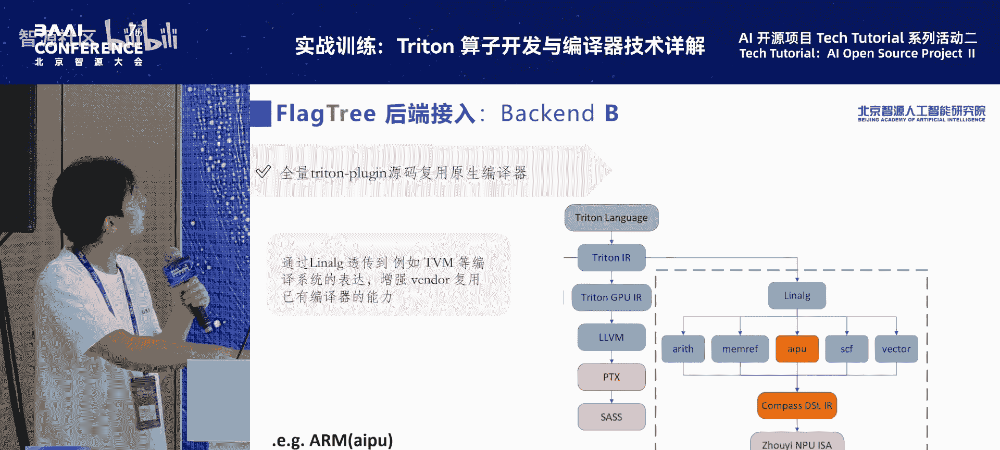
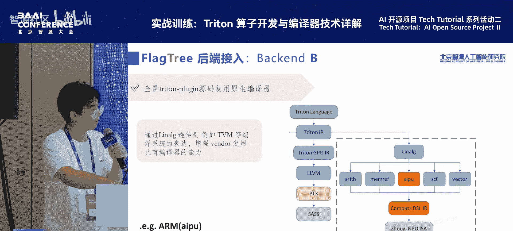
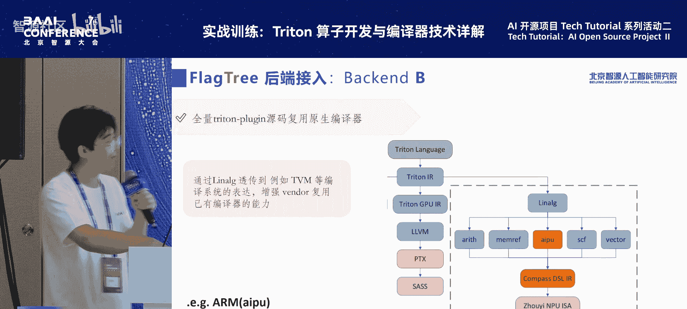

# 2025北京智源大会-特色活动：AI 开源项目 Tech Tutorial 系列活动 p07 FlagTree 多后端统一编译器设计：郑 杨-杨锐林 -BV1oWNxz8Ew3_p7-

是有请我们智源研究院AI编译研发工程师瑞林给我们带来f多后端统一编译器的设计理念。呃，大家好嗯。大家好，我是杨瑞林。然后由我给大家带来flag tray多后端统一编辑设计的这样的一个报告。呃。

本次报告呢分为四个环节。第一部分我将带大家简单了解一下什么是f tree。第二部分呢我将带大家来介绍一下从一个用户呃层面出发，如何去接入flag tree。那么也就是AI芯片的一个接入范式。第三部分呢。

我将介简单介绍一下我们关于基于这个呃tra share的做的一个FIR层的一个中间层优化。第四部分我将介绍一下这个fag tree我们的一个愿景。Yeah。呃，首先第一部分呢是关于flag tree啊。

那flag tree呢这个项目呢是基于这个open airtrainton啊进一步发展和延伸出的一个compar项目。对，其关键在于扩展了两方面的内容。

第一部分是针对于traton原生呃open air trainton原生的这个多后端能力支持不足的局限性。对我们以拓展它的这个多后端能力为这个基座。

进一步呢去释放第二个我们的优点就是在各种后端的这个抽象的层面上呢，我们会去。统筹这个各种芯片的通信与他们的特性，做进一步的这个上层次的优化。那么这一层次的优化呢。

就会体现在我们刚才介绍的FIR这一层的这个层面上。那么flag tree呢整体的规划呢是分为两步走。第一步呢，我们是将这个快速对接，使能各种各样的异构设备，然后去初步释放各种异构设备的一个算力。

那么第二部分呢是基于各种易构设备的这个特性。对各种AI芯片，他们会有不同的特性。那基于这种特性呢，我们会抽象出它的通信。那么去统筹各种AI芯片的通信与特性。

在中间层这里中间层就是我们刚才提到的FLIR做进一步的深度优化。然后以达到进一步的去压榨我们的这个算力。嗯。呃，首先呢是flag的一个定位。那么这个图呢其实开场的时候，春雷老师已经给大家介绍了。

我在这里再简单的提一下吧。对，其实flag tree呢是在我们这个flag o以及智源的一个面向多种AI芯片的系统软件中的关键一环。这一环呢是处于这个整个flag o的一个基座环节。

那我们把这个视角放到一个宏观的视角来看，整个flag o呢是在这个这个这个多种的芯片软件债的这个过程中呢起到一个承上启下的一个作用。

那么向下呢它会去管理啊各种各样的AI芯片是之算力呢是最大的这个进行一个释放。对，实际上呢这个flag o是这各种AI芯片以及上面深度学习框架的一个枢纽型的存在。

那么flag tree呢在flag o里面，也就是对接各种AI芯片。的第一层啊第一道门。呃，flag的发展规划呢是说fag我们从24年的11月开始立项，然后到3月。

我们发布了fag开源的单版本多后端的V1。00V0。1的版本。那么在与智源大会的同时期呢，我们会发布fag的V0。2版本。然后在我们计划在25年底就是今年底啊，正式发布fagV1。01。

0的性能提升版本。那么这个版本呢是基本上将会全面建成这个多后端统一的一个一个基座，是多后端的能力啊，充分利用到最大化啊。

并且在这个我们的呃中间层也就是FIR这一层的中间层呢做更多的基于各种AI芯片通信的一个优化。那么呃下面这两张图呢，实际上是我们从flag tree101。

0版本到flag tree的一个next版本的一个呃眼镜和迭代。对，1。0版本就是全面的使能多货端能力。对，然后第二个呃第二个部分呢，flag tree呢就是进一步的去基于这个呃呃硬件抽象的通信扩展。

对拓扩展出他们这个通信和特性。那么针对iflect trade的0。1版本呢，实际上是基于现有的不同厂商的tratter呢，他们的这个兼容模式是较为发散的。所以0。1版本会兼容现有的适配方案啊。

在它代码库上形成一个统一。那么在短期内，这个短期内就是在今年底内会全面的实现单仓库多版本的多后端支持。那么基于我们要解决的问题呢，其有三个重要特性。那么第一个呢。

我们发现呢现在的不同厂商接入treton的主流变译路径有两种。那么第一种呢是基于这个traton gPU dialect。第二种呢是基于linux dialect。

那么flag tree呢第一个优点呢就会兼容这两个dialect的编呃这两条这个tra能GPU以及linux的两条变译路径。那么第二个呢是接入形式灵活。

那么在某些厂商想接入这个flag tree的过程中呢，会有一些这个专利敏感。对，或者知识产权敏感问题。那么基基于我们要解决这类问题，那我们允许啊某一厂商它的一些专利敏感或知识产权敏感的代码呢。

以这个二进制文件。例如像SO的动态动态户。对，以这样的形式进行一个脱敏。进而呢啊接入到flag tree中，然后更进一步的可以进行一个端到端的一个连边作用。那么第三部分呢是架构的插件化设计啊。

那么flag train呢支持高度差异化的一个模块，对相关的芯片平台呢可自行维护这一模块，那使之拥有这个快速验证与跨平台编译的能力。在我们flag trade的next version的版本上呢。

对我们预计的是。提供三个特性。对三个最主要的特性。那么第一个是提供多种接入范式，我们会新增FLRR仓库。就是刚才提到的基于tradsha的开发的一个中间层仓库。对。

那这个这个仓库呢是基于这个李娜d like的一个扩展。那么第二点呢是我们会统筹一个异构编程接口，以及这个呃跨平台编译的支撑。对，通过通过这个兼容式的扩展语言层呢，会添加指导信息，以提高性能。

那么这一块就如支持DMA以及shahared memorymory的这个硬件感知型优化。第三部分呢是需求侧导向的一个技术公关。那么针对从需求侧这类需求侧，就例如是模型测啊或者算子测等等。对。

基于这些需求测传导的重点算子性能呢开展技术公关。并且推广到其他芯片的后端呢进行进一步的借鉴优化。接下来我将简单介绍一下这个flag trade的AI芯片的机肉范式。这一步呢呃这个环节呢是想介绍的是说呃。

不同的厂商如何进一步的就是在具体实施上接入我们的flag tray。呃，在此之前呢，因为不同因为这是一个 tutorial，不同的厂商接入flag trade之后呢。

实际上他们绝大多数都会以接入这个flag jams对进一步的去接入flag jams实际上在工程实践中以及实际经验中呢。

这两个环节是分不开的对所以我我也会将简单的介绍一下flag jams的多后端的接入方式。那么在flag jams这一层呢，实际上我们在这个通用的一些通用的标准库。

对以及一些通用算的实现的基础上呢下一层呢，我们会增加一些 load等管理层。这些管理层向下呢会进一步管理各个厂商易构的包括像fi以及fi以及这个window specialized的这个特的对然后这些进一步的P以及一些通用OP呢会透传到我们下面这个。

flag tree的这一层。对，那么flag tree的多后端呢，实际上是在这个FIIR这一层做了两条路径的这个兼容。

那么进一步的呢呃flag tree呢它是联动的呃这个flag jams和flag train呢是一个联动建设关系。对，那么在flag jams这一层的东后端呢，它有如下几个特性。把我简单介绍一下。

第一个是能够兼同不同厂商的traen版本。对易购芯片的这个部署呢实接灵灵活化，一个敏捷化。第二个呢是跨方式的一体衔接。我们会统筹一个敏捷开发与高效维护。第三个部分呢是定制调优空间。

并且呢定制启发式的算法以及策化的厂商策划的算的实现。对，然后可以看到右边这个图从上到下，对，从上面就是flag jam，然后以一个结构化的视角来看。

会有一些啊对中间的管理层就是d s detector啊，这些中间管理层调到进一步去调到这个back下面呢会进一步去管理各种不同的芯片厂商的一个后端这些一个户端包括一些啊 confi配置啊。

以及特划的算的实现。那么这些策划的算策划的这些模块呢，加上我们january呃这个这个通用性的这个OP实现呢，进一步会调到这个flag trade的最终实现中。

那么以flag tree的这个结构视角来看呢，我们的这个需求导向是从flag jam上面下来的一个 kernel会透传到flag tree呃，退会透传到flag tree里面。对。

进行进一步的多后端呃多后端的适配。那么flag tree的呃进一步多后端适配呢，主要是两个大的冲样方面吧。第一层呢我会在通用的这个Rmod里面加一层我们的FLIR这一层。对。

这个就是刚才提到的呃我们会在这一层做各种硬件的通用性设计。对，将他们通信统一起来。那么这这些通信呢会传导到这个serpart下面。

soldpart也就是呃完全的这个winnder specialized的一些异构的一些特性。对这两部分联联合起来呢，我们会就会产生一个呃多后端的一个flag trade的版本。

那么flag trade的多后端呢，其实目前有在这个flFLIR这一层吧，主要有三个核心的这个关键点。第一个呢是允许允许这个程序员呢通过注释嵌入。通过注释嵌入的这个方式呢，以提示这个优化的信息。

那么它是对程序员友好的对，也就是在我们编码的时候呃，在某一行以一个hit的这个注释的形式呢，对去透传到透传一些attribute到我们的这个编译器中，然后做进一步的优化。第二部分呢是增强性能的一些改进。

也就是第一部分的一个延续。在第一部分实际上讲的是一个前端语言层的一个描述。第二部分呢是针对进一步到pass里面的一个描述。第三部分呢，我们会保持性能和编辑的可预致性。好呀。然后接下来呢。

我会基于前面两个较为宏观的这个结构化的展示呢，会进一步的介绍如何进行一个具体接入的实施。对，那么flag tree代码的核心的设计这个后多后端的核心设计原接入原则呢是两个部分。对。

一个是tatton plus chain源码结合二进制混合的接入。第二部分呢是全量的traton plus g源码标准接入。那么第一部分其实还分为了两个子呃子子标题。第一个呢是全量plin源码。

复用原生的编译器。第二部分呢是部分吹tonplin源码完全透传至MIIR系统。对于第一部分。啊，那么部分的这个traat源码呢，如何去完全透传到MR系统的这个接呃，这样的一个接入方式呢。

主要是体现在两个部分。第一个部分呢是硬件相硬件相关度较高的模块啊，如以动态库的这个可以以动态库的形式进行一个较调用。

这一部分是针对于这种刚才讲到的知识产权敏感的呃知识产权敏感或者这个特性敏感的硬件硬件信息敏感的这一部分厂商，可以以二进制的形式进行一个接入。那么第二第二部分呢是其余的模块在以part下。

一部分的这个pl的代码。为提供。那么这那么部分查进源码这个接入完全透传到MMR系统的这个部分呢，主要体现在两个厂商会是一关键的这个体现，一个是天数，一个是这个。木些。

第二部分呢是全量的这个tat源码复用原生编译器。这部分的典型代表呢是ar，也就是IPU的这个这个后端。那么其实通过lin透传到例如TVM等编译系统的表达，以增强winer复用已用编器的能力。

那么这一部分呢是针对于某一些厂商，他在这个接入这个t之前，可能以TVM等一些啊其他的编译路径对接入到呃其他的编译路径已经做了很多编译相关的优化。那么那么在现在现在想要接入的时候呢。

他们会去全力的去复用这样的一个结果，以减少资源和人力的一个投入。

第三部分呢是全量的traatton plugin源码的标准接入。那这部分就是保持了一个traatton呃和这个traatton官方呢是保持一个相对一致的一个方式。

是在shird party下提供comper driver以及specialized air module等全量的pin source code进行一个接入。对。

这部分接入呢是例如华为的升腾是采采用这样的一个接入方式。接下来呢我给大家分享一下这个我们在FIR层，也就是基于这个traredent share的发展的1个FIR层的一个优化。

这部分呢我们是通过扩展了一个flag hint。这个fag hint呢也是一个呃也是一个实际上它是一个noation的一个comment。对，在编在这个traatton前端层呢。

它体现为一个comment这样的一个形式。那么会基于这样的形式呢，做一些这个性能指导的扩展。对，那么在前端也就是tra language这层呢，那么就是基于这个comment做一个扩展。

那么体现在呢开发人员在注释的时候去啊使用flag hint这样的一个关键字，对进行一个用户提示。那么紧接着呢它会透传到这个tra rR这一层去扩展相应的attribute。那么其进一步呢。

再下一步就会扩展到我们的这个FIR这一层，会基于刚才透传这个基于刚才trainnIR这一层透传下来的attribute模式设计各种的优化扩展pass。对来进行更进一步的支持。

那么实际上从设计理念上来讲呢，分为前端终端和后端三个部分。那么前端通过扩展这个traIC去解析这个f train hint到呃MIR的这个tribute里。那么在这个终端的部分呢。

那么会去设计各种各样的优化pas对以利用各种各样的优化pa，以充分的去呃利用这个不同的attribut的这样的一个呃优化模优化范式。

那么对于后端呢是我们会给一个有选择性的呃by specialized的一个注册。Thank。紧接着我会讲一下这个第一部分，在这个全单语言层的这个扩展。那么我们的语法呢，实际上就是以这个这个井号呀。

加一个hit等这样的一个一个字段吧。对，提示这个开提示呃提示这个开发者呢去使用这样的一个注注解。对，然后它的具体表现形式如下。对，可以我们这个开发人员呢可以去编写这样的一个comment。对。

然后以进行进一步的能力指导。那么这一部分呢实际上也给了用用户两条这个可选的路径。第一部分呢是这个window specialized hint，它会有一些winer特性的一个前缀。

比如说Nway shared memory。对，那么以及这个架构无感的这样的一个无前缀的这个hi。这部分呢主要是例如比如说呃 pipelineline的这个呃tage pipeline等于2。

那么在AST这一层呢，首先呢呃将这个上述的这个语言层的代码传导传导到这个pythS解析器里面呢，我们会进行一个语法解析，并且进行一个二次的正确性验证。对这个正确性验证呢实际上分为了两部分。第一部分呢。

如果我们能够验证到这个其想用的这个特性 attributetribute，在其他的这些win上也存在的话，那我们就会做一个呃crowin的这一个hi conversion的一个转化。那么第二部分。

如果这个我们检测到它的hi指导是完全错误的话，我们会呃silence ignore就是完全忽略掉这样的一个hi的提示。对，去保证它能够成功编译。那么在DTIR这那么在TTIR这一层呢。

它的具体的tribute的一个一个一个插入呢，其实是以以下以下的一个形式。它会扩展TT它会通过增加一个呃hit的tribute到这个关键的OP。

这里也能OP就是一个loadOP去进一步的扩展TDR的 dialect。Yeah。然后在这个中间层呢，那么我们会去做一些pe呃，中间层的p的优化呢，实际上是第一个是添加专用的这样一个pass。

对于这个解析这个hit的解析以及传导来说，第二个呢是执行一个二次性的验证。对，在我们去呃用用这些这个硬件信息优化之前呢，会做一个二次性的一个验证。然后最后如果前两步都没有问题的话。

我们会rerite这些啊基于这个正确的这个hiint的pa的去rerite这些operation。然后最后呢，实际上我想向大家报告一下这个flag trade的一个愿景。

那flag tree的愿景与目标呢，第一个是我们希望打造一个更强的编译技术啊，通过面向多种AI芯片的统一增强的这个编译器呢啊和相关的这个代码工具链仓库，变这个零散为统一。

打造这个面向多元芯片的AI编器啊，那同时呢我们会聚合各方的这个研发和创新力量，培育更强的编译辑技术。第二个呢是我们想为用户打造真正统一的编译器，构建真正统一的一个代码仓库。

使得用户呢能在上层使用的时候不被这个各种分散的生态对所困扰，为上层用户提供一站式的吹藤支持。对，为上层的包括像算子库学习框架以及这个算法开发形成统一的这个编译器依赖。对。

然后下面的话是我们项目的这个getE和get help的地址。对，希望这个有兴趣的伙伴们能够为我们贡献这个积极贡献一下代码。对，感谢。然后我的演讲到此结束，谢谢大家。呃，谢谢瑞林的分享。

我们现场可以有呃一些名额呃，可以给到问答的环节哦，好那个。😊，呃，呃，我想问个问题啊，就是刚才提到我刚才看到那个界面上有AMD的那个呃GPU对吧？呃，对呃，也就是说呃，可不可以这么理解。

就是在一个呃机箱里有AMD的GPU卡，再加上英伟达的GPU卡，或者再加上天数的呃，也可以同时运行，是不是呃，这个是我们致致力于打造的目标。目前只是说呃，我们能够支持不同版本的在不同机器上的一个编译。

但是没有办法进行异购的使用。呃，那就是呃我还有一个问题，就是呃呃安装了这个呃就是呃这个叫什么呢？什么tflag tree flag tree呃，f tree这个前提条件下，好比说我用英伟达的GPU卡。

是不是需要安装英伟达的扩打。呃，我们会需要安装他的一些driver，对一些一些真正他的driver是需要的。嗯，对对对，最底层的一些编译的driver我们是需要安装的啊，然后另呃就是。嗯。

那个像其他的呃非GPU卡类的卡，是不是可以加入到咱们这个flag tree里面的编程编译环境里来。呃，是的，像一些CPU的架构，我们也在逐步的支持。哦，非CPU类，好比说网卡、智能网卡类FPGA卡。呃。

这个我们后续会有规划，但是目前确实还没有支持。哦。好，谢谢谢谢啊，感谢您的提问。呃，我们还有现场提问的朋友吗？好。呃，不好意思。不到。f呃，没问题，下面我们可以再聊你好您好，很快问您一个问题。

因为今天我看主题是tton，那么flag flagag tree它和tton之间是不是必须的关系，就是说我不用用 flagag可不可以可以的flag tree呢实际上是traton的一个演进版本。

其为了解决traton两个两个不足的一个问题吧。第一个是open eye这个原生的这个官方的支持呢，它对多货端的支持的是有局限性的，那么这就使得我们没有办法把很多的这个算力聚集在一起。

形成一个算力一体化的这样的一个建设。因为现在的这个人工智能，它对一个算力基座。那么为了打造这个算力基座呢，我们不能让各种算力变得非常零散。我们的愿望就是让这些算力能够使用更简洁的这个方式统一的接口。对。

能够把他们的算力完全的释放出来。😊，就是重新编译的这个呃一般的时间周期是什么样的？在不同的这个芯片上，重新编译。对，因为您现在因为刚才说的是不run time去同时去支持调用。

现在的阶段其实就是同一套代码，然后在不同的算算在不同的芯片上边您对它做从编译。他可以再基于不同的去转，对吧？对那我从我从扩大上我从因为达上边转到呃其他的芯片上这个周期用您这个呃ff的话，呃。

会会不会有这样的一个评估。因为我知道可能不不同的复杂度是不一样的。对呃您指的是使用周期是吗？呃，比如说我编译的话，对我我不是使用就是您您做这个事情就是一次性您不需要对它先做一些定制。

用fag基于原来的这个代码结构去做一些新的定制，然后再去再去转嘛，还是呃呃对，就是如果不同的厂商在接入模式上。的话对，这样的一个周期可能是因这个厂商而异。包括如果是GPGPU啊想接接过来的话。

那么他们的复杂度就可能稍微小一点。那可能大概一周内对一周内能够进行一个接入。那么对于其他的，包括像DSA类的这样的一个芯片厂商的话，因厂商的这个芯片特性而异。那可能从呃一周到一个月的接入的周期都有。

好好，那我们呃谢谢瑞林的一个分享。😊。