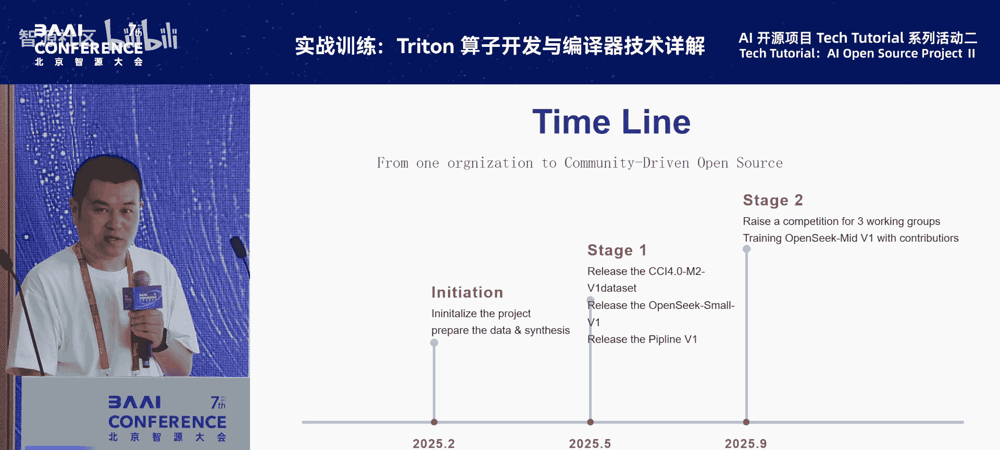
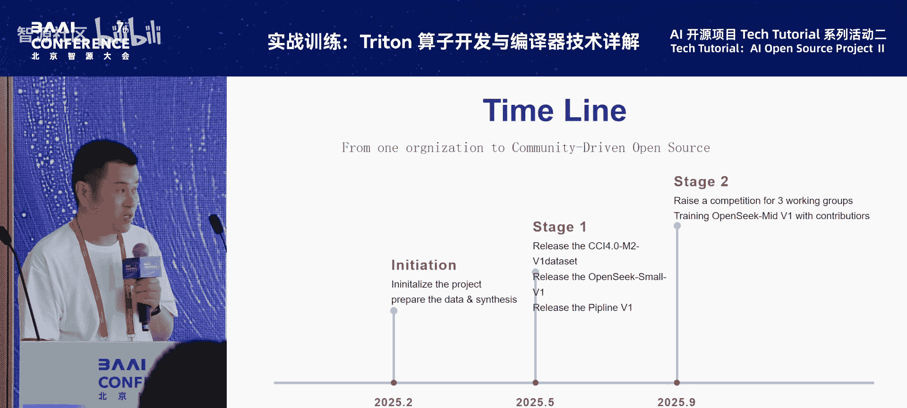
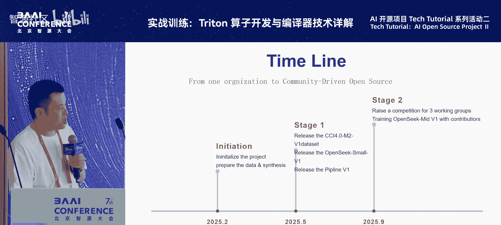
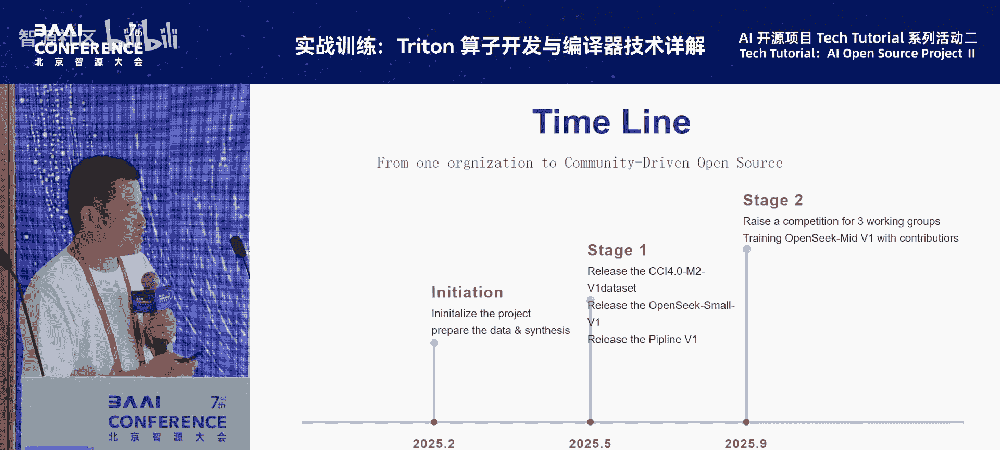
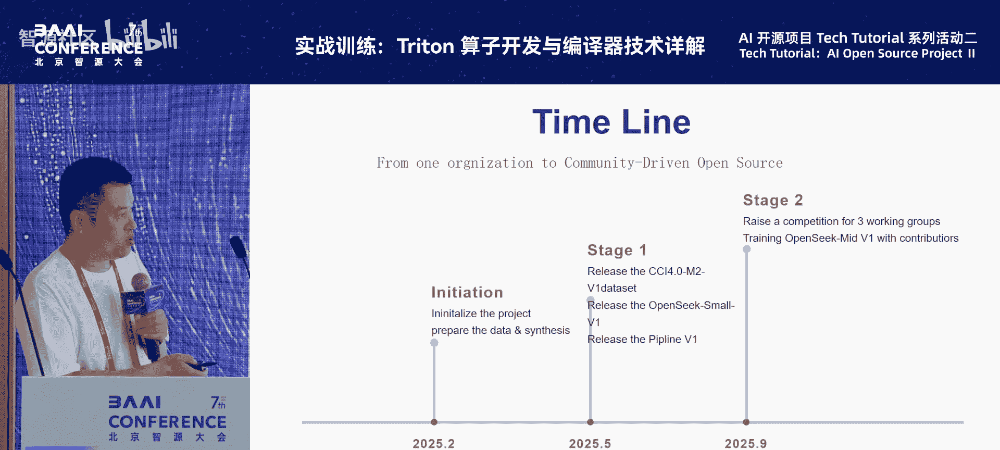

# 2025北京智源大会-特色活动：AI 开源项目 Tech Tutorial 系列活动 p09 OpenSeek：开源驱动下一代 AI：王良栋 -BV1oWNxz8Ew3_p9-

最后一个环节，我们请到智愿研究院算法专家王栋梁给我们来压轴的演讲。他带来的主题分享是open sick。 openen sick他有一他也是一款开源的项目。

他主打的是算法呃数据和系统三位一体的一个开源理念。那有请王栋梁呃给我们带来精彩分享。好，行，谢谢主持人的介绍。哎好。然后今天这个报告厅呢，主要是围绕这个系统侧做了很多工作。比如说有讯推一体的。

然后有自动那个并行的。包括刚才下午呢主要是。呃，下午呢主要是讲了一些算子优化的一些事情。然后今天我报告的题目呢是。😊，今天我报告的题目是open seek这个项目。opens的项目。

如果大家关注到昨天的报告的话，其实主要是讲这么一个故事。😊，就是说就说我们组呢我们团队的话主要是之前是做那个语言模型的训练，然后数据级的一些优化。然后同时我们还负责这边的一些相关的一些开学的工作。对。

然后也是一个契机吧，就是deep今年的话它的一个现象级的这个这个这个这个爆发的话其实可以归结为三个方面的一个高效。第一呢就是数据级他们相对训练量比较小的话，能达到一个更好的效果。

另外的话他其实包括他的开源之的话，释放了就像那个开源社区开放了很多比如说架构测的算子测的这么一些优一些优化。然后第三个方面的话，其实他们在模型训练的策略方面也做了很多工作。

所以说我们就一个想法就是年初开展了这一个项目，就是说我们想集合我们自己的一些能力，然后集合整个开源社区，然后去开启这么一个事情最开始是在年初的时候，我们就启动了这个项目。

然后现在目前完成了第一阶段的一些主要工作，主要工作呢可以包括两个方面嘛。第一个方面其实。😊。

我们发布了一个呃CCR4。0的一个数据集，呃，是一个中英双语的数据集。另外一部分的话就是我们也呃随着这个数据的发布，也发布了一个模型。啊，最后一部分的话。

我们为了更好的促进和呃那个开源协作者开源共建者的一些合作共建的话，我们也release了一个流程，方便开源共作共建者呢做一些更好的一些实验。然后提出更好的想法，然后加入到我们那个项目当中。😊。

对，整个我们的工作流程的话会分为三个方向吧。第一个呢就是一个众筹的数据方向。第二个的话是一个比较基础的，比如说系统方向呃，最后一个是说我们如何把这个在这个数据上，然后在这个系统上面能提到一个更好的效果。

对，因为之前主要已经讲了很多关于系系统侧的一些。比如说我们在我们这个项目启动支出的话，然后我们的系统侧其实在短期内就已经帮我们实现了这dV3类似的这个模型结构。

比如说像那个max那个ken predict这么一个比较特色的这个组件。另外的话比如说我们对MOE这种模型，尤其是细度MOE的话，有很多并行策略的这个调优的一个技巧，或者是设置。呃。

就是ssem团队呢会给我们做了很多的这个支持。呃，今天呢主要会介绍另外两个方面，就是数据和算法。啊，刚才也提到，我们其实主要是第一阶段的一个一个一个贡献嘛，就是发布了一个CI4。0。

这这个中英双语的这个数据集。对，是大概在5月上旬去发布的这个数据集呢主要包括两个部分。第一部分的话就是我们可以称为base，就是说一个中文和英文做预训练的数据集是怎么去构建的。

怎么去做处理和做比如说做清理啊，做巨虫或者做质量过滤这么一个流程。另外一个比较大的会议是我们这个项目比较特色的，就是说我们在这个预训练数据集里面加入了COT这么长城推理的部分。

这也是我们这个数据的一个特色啊，今天我会展开呃按照这两个部分就分别去展开。😊，就回到我们这个b流程的话，比如说大家会关注预训练数据集构造的话，通常有这么几个主要的阶段嘛。第一个阶段，比如说去重。

因为数据连有很多重复啊，第二个阶段的话，我们会做很多的这个呃质量的过滤啊，质量过滤的这个分类器怎么构建的话，其实有一套比较呃比较比较完整或者逐渐迭代的一个流程。啊。

最后的话会引入一些基础的合成的一些方法。呃，以及比如说我们会做一些比如说后处理的一些lo的一些过滤。呃，整体上的话这边会贡献一个比较大的占比的部分。对我们也是基于我们这个产出的这个模型对比了一些。

比如说我们之前做的1个CCI3的HQ这么一个中文的这个数据集，以及现在呃在英文领域里面比较表现比较好的。比如说HQ就是综合来说我们绿色的这条曲线就是在我们训练就是5兆M50M这么一个模型的尺寸上面。

它是能达到一个相对好的一个效果。这其实反映的是不是说就说我们在中银双语中银双语这么一个这个数据集上面的话，我们这种呃数据集的一个这个基础以及它的配比可能是有一定的这个优势。😊，就回到我们具体的话。

就是说我们中英双业。那么中文呃英文是怎么构成的话，我们主要是参考了这个CC他们的一个构建流程。因为他们这个流程相对是比较的一个流程。其实他们主要一个特点，就是说在第二个环节。

他们做了这个多路来源的这个quality的这个的一个得分。他们把这些做了一个集成，就使得说相比之前比如说单一的一个过滤的话，它能达到更好的这个召回率。对。

另外的话就是我们要使用这个数据及作我们这个基础来源的话，我们会发现一些问题。比如说我们通过我们对人工的一些呃确认和标注的过程当中发现。

由于比如说大概由于是由于他们在一些细率的去重当中会导致一些生成一些比如说高质量的。但是这个文档比较短，但是会出现一些连贯性差的一些问题。所以说我们就主要是想通过这种连贯性的这个力度。

然后对数据做一些进一步的这个过滤。我们怎么发现的话，就是说首先通过人工去过滤嘛。另外一边我们发现了一个现象，就是说我们把所有的样本通过我们20多类的这个斗妹的这个标注之后呢，会发现它在不同的斗位上面。

其实这个los本身连贯系的这个指标的话，它的分布是不一样的。所以我们要做这个los过滤的话，其实我们不可能一股脑或者整体全局的去做。我们是通过不同的斗妹去做的那做了这一步的话。

我们也配套了做了一些实验嘛，做了一些校论的实验。就是可以看虚线的话，其实就是我们原始的这个CC的这个部分啊，那个实现部分是我们做过后处理的部分啊，相对是有一定的提升。其实这也是符合我们预期。

我们呃我符合我们的这个预期。😊，另外一部分CS4。01个大头就是中文数据集，尤其是中文网页数据集是怎么做的这个整体的流程，我们是仿照了这个newCD这套在应用上这个流程。

这个相对来说它有一个刚才也提到一个一个大最大的特点，就是说。之前我们做中文那个质量过滤的话，通常只是一个质量分类器。现在我们自己训练了三个，就是两个叉L robot的一个模型。

一个基于fast的一个模型。由于这三个模型能起到什么效果呢？比如说大家都保持在准确率90%以上。由于不同模型，它倾向的是捕捉模捕捉样本的这不同的侧面。

所以说最终会导致召呼率整体是比如说有40%可以提供到70%这么一个量级，整体上就可以从。😊，从我们收集到这个外配置里面，这种网页里面去得到质量差不多，质量水平均等，但是会得到更多来源的这个数据。

就是同样我们合成的这个中文数据给我们找一个对标的。比如说我们找了我们质检前移版本，这个版本的主要特点就是说它只有一个质量分类器。所以说整体是看曲线的位置的话，它是有一个比较好的一个表现。😊，啊。

就同时说我们怎么衡量说我们这个质量分类器效果好的话，我们是做了这么一个实验。就是我们由于是三个质量分类器嘛，然后我们把它的汇聚得分。然后通过分筒，通过通过它的那个值的大小，分筒，就是横轴的边。

然后对于每个分筒的话，我们可以就直接训练一个小的模型，然后再评测它的一些终端的指标。从这个曲线上面去看，就是说随着质量一步往往往右去质量越来越高。然后再在终端上。

比如说在中文的这种平均意义上的这个bench mark上面，它整体上是一个正向的这其实反映了我们就是这个质量分类器的效果是符合预期的。😊，对。就在我们C4。0里面，另外一个主要的部分就是这个合成的数据。

这其实是我们一个特色。😊，就是这么有交代一个背景，就是说。就是25年的话，就后面一段时间大家都会关注这个长城的这个推理嘛。然后就有几篇文章就是会体现到说到底我们是在后训练里面做COT呢。

还是说我们在预训练里面混合出更多推理路径的这个这个这个这个数据呢，或者有些人会说比说已经结束了类一些一些一些一些那个观点。对这这三篇文章的话，就是给了大家一一些一些现象嘛。

其实有有一个呢比如说就是他们有的时候会对比比如说千问或者么这个模型，就会发现千问的模型其实在预训练阶段之后，结束之前其实已经具备了很强的这个基础。对另外一的话一篇工作的话。

就会说有些模型其实在训练的过程当中，就是在他预训练过程当中，其实它的推理能力是逐步提高的。所以就是说这个预这个COT的这种推理能力并不是在后处理阶段去增加的。而应该是在这个阶段就已经完成了。

对包括清华的一篇工作，他会说他是通过比如说我对一个问题采样比如说256次。然后看他整体的这个准确率。😊，但是我们会发现，就是说所有在呃就是后训练这个阶段，它并不能超越这个范围。

这其实也是相呃相应的佐证了。我们说我们如果在预训练这个阶段完成了很多，比如说长城推理或者是各种推理路径的这个数据上的补充的话，其实就是抬高了这个模型的这个天花板。对。😊，就是我们也想到。

比如说预训练语料里面，大家什么的领域啊什么的这个类型都是有的。但是有没有一种，但是它会缺少一种方式，就是显示的就是大量的去构造这么一节推理的路径。

就这其实我们就是我们做这个COT这个过程的一个一个一个初衷。那我们是怎么在预训链里面加这个COT的这个格式的话其实整体比较比较自然的就是这样比如说我们会通过这个外部比如说外部网页里面筛选一些高质量的部分。

比如说像数学啊代码或者像ki啊，或者像这种不像像那个学术论文这么一些筛选去高质量的部分。然后会对一个一个整体的样本做不同的这个章节的划分。对，基于这个章节的划分，其实我们请求大借助这个大模型的这个方法。

就是说我们整体这个文章是怎么形成的。也就是说我们有了一篇原始的文档，然后通过借助模型的方式去去做那个补充把那个中间。COT的过程试图尝试通过这个借助语言模式的方式尝试恢复出来。比如说我们落到一篇。

比如说一般的文章里面，哎，就是可能就是说我去怎么去编写这个文文章。对，是怎么去分不同的段落，这么去点演进。如果放到一个数学题的话，可能是我解问题的不同的这个步骤。对，有这么一个思路的话。

就是说我们有了一些 data，然后经过这么流程就能得到我们的这个COT的数据。我们也在我们的所有的数据现在都已经开源了。尤其是COT的这个部分的话，我们把我们中间过程的任何的所有的这个字段。

如说包括这个分段的字段以及s的这个字段都做了这个开源。到时候大家可以去尝试去选择不同的这个这个这个字段。😊，对，有了这个COT的数据，因为我们是在我们预训练里面加了这部分字金。

那么怎么去验证说到底这个能带来什么好处呢？就常规上我们会会做这样的一种实验。比如说我加了COT数据和不加。😊，再比如说常规的去，比如像中英文的一些理解类啊，或者常识类或者知识类的一些班车mark去做啊。

这个可以看到，其实是有一定的这个提升。但这个提升幅度不是不是太大。此外呢，我们设计了就是按之前说的三篇论文设计了一些不同的这种实验，就是通过他们论文的一些给我们的一些实验的方向。

然后来佐证我们这个数据的引入其实是正向的。这个实验是说比如说我们也是对比了。比如说有COT数据和没有COT数据。他们在训练过程当中。

在一些呃在一些长程推理或者这里面是reflection这样一些构造的数据集上到底这个能力是不是越来越强，就通过这个实验发现，比如说蓝色的这个点，就是说我们在不同维度的这些数据上面。😊，啊。

这这些构造的这个数据上面确实是随着我们这个训练量。对有COT的这个数据的这个训练模型是要比没有COT数据的模型，它的整体的是斜率是更高的。😊，对，此外的话就比如说我们加了COD数据。

因为我们的COD数据有原始的文档。就比如说像数学，比如说像方MS这个数学，我们也合成了QV，我们也同时补足了说它中间的一个思考过程，就是COT我们也通过这个一阶段的SFT的这个对比方式。😊。

我们可以从下面最后两行看到，比如说尤其是最后一行和前面的一些对比。我们就是看如果我们显示的加到我们这个COT的这种合成方式的话。

这模型比如说像在数学的一些指标是要比模型只加这个成文本或者加SFT这个Q这问答对是有一个比较大幅的这个提升。这其实也验证了我们COT确实是补足了这一些推理路径，能达到一个更好的一个效果。😊，那。

此外的话就仿装那个比如说像这篇文章就是提的，就是也是之前一一篇文章提的。就是说之前比如说我们用呃就是对比说拉马和千问，就是其实千问的话。

它有更多的这个他们在预训练结束之前就已经有了很很充分的这个推理的这个能力。所以说我们在拉就是研究这个这个文章的一个做法。我们在上做了一些两个任务吧。第一个是down这个任务。

另外一个是像GS8K样个任务来体现说我们加了我们COD数据，其实是有助于我们后面这个比如说像SFT啊加RPU这么一些长城推理任务的。训练稳定性啊效果的一些提升。呃。

大家可以看一下这个这个对比的是比较比较充分。这个唯一的一个变量就是说我们比如说有一个base模型拉嘛，然后一个base base模型的话，就是说大家做了比如说一定数据量的这个训练。一个实验组的话。

就是说我在。增量训练的时候是用的我们自己的合成的这个COT的数据集之后又做了。比如SD又做了这个GRRPU的这个啊最终会在GRPO的时候表现。你可以看到。

就说如果在CPD上加了我们自己合成的这个COT数据的话，它整体训练以及它最的这个呃这个正确率是有一个不错的一个提升。😊，对，前面是整体介绍了我们这个数据部分。

我们做了一些比较详尽的一些实验来佐证我们的这个数据不同的阶段的这个效果。那另外一部分的话就是集入到这个算法，就是做算法这方面或者做模型结构的这方面。

其实有很多比如说你做这种呃呃这个这个上下门窗口的一些一些一些变种。或者你做一些，比如说我们会选择更好的这种 size或学习率，这其实都属于这种就是这个算法这方面的这些工作。就是我们这里面就是想说的。

就是我们探索了一些在3这么结构，包括我们在我们数据及这个基础上面做了一些一些一些实验嘛。第一个实验就是说数据配比的实验。就是我们当时我们就是提了。0的话，我们就是想因为我们有很多比如说有原始的这个配置。

也有抽取的这个知识，也有改写的QV也有合成的数据。那我们怎么去设置不同的这个权重呢。😊，我们这里面就是给了一篇参考，就是说继续发一次证明这么一个一个设置。就是说基于这个设置。

我们会把比如说把knowledge的部分和rewrite这个部分做相应比例的提升。同时对我们合成的这个COT数据做10倍的这个上采样啊，这么一个效果的话。是要比纯粹。

比如说我们什么都不做上采药或者下采药的效果是有一定的一个提升。对，这是我们做了一个数据配比的实验。另外一个实际上就是集中在说，尤其是这。ep3这种细力度的这个专家模型的话。

技术专家模型有哪些参数是能带来效果的。就是我们除了在基础的比如说像学习力和那个做了很多这个呃那个前置的一实验之，另外一些效果影响比较大的。说大家初始化的这个所有权重的初始的这个标准差。

比如说尤其是比说像我们专家选专家的时候，这个路由器的一个精度，以以及比如说像那个3，他自己虽然是提了这个没有辅助这个然后作为这个专家专家那个作为这个去掉这个专家的这个辅助。但是但是他在这个极端情况下。

其实是加了每一个样本级的这个辅助那这个如果是说这个这个系数调的不是很好的话，整体的效果其实也不会很好。另外一个3它有一个比较那个比较大的一个就是训练目标的改进就是。😊，的这个这个这个呃这个小模型结构。

就说除了你在这个MOE这种里面，比如说现在看到新的文章啊，比如像小米啊，或者像那个miniCPM这种4，它其实在这种单体的模型上加这个也是可以有利于这个模型训练的一些效果。就是我们这些实验的话。

也是做了比较充分的去验证。就是说如果把所有这个策略打包的话的话，我们是在我们这个平均的这个所有的指标上都是有一个比较大幅的这个提升。😊，这回过头来也就是想，比如说depV3效果为什么好？

其实他们在这个训练的这个策略里面，具体具体落到比如说不同结构的或者不同系数的这个设置，其实他们也是做了很多不错的这个工作和探索。😊，对，就基于我们有了数据，有了一些自己的一些实验的话。

现在我们是训了1个720B的呃总参数量1。4B，但是激活参数量只有0。4B的这么一个小的MOE模型。对，可以从这张图上面看出的话，其实虽然我们的训练量很小，但是我们整体在效果的话。

比如说已经是跟那个欧某的一些效果是比较接近。整体上它呈现出了一些，比如说比如说那个呃效率比较高的这么一个态势。啊，另外一个的话，我就是我们给出了一个小的模型。

这个称为这个small V一的这个baseline。这个是整体上训练了模型结构和之前的版本是一样的那整体的训练量是100B。这个的话会会用到我们后续的一些实验或者和开发者共建的一些流程当中。😊，好。好。

剩下的时间就会给大家介绍一下这个我们就是发布了一个的目的是什么这个目的的话就是我们会把我们所有的这个代码都开放出来。另外一部分的话。

我们把我们所有训练的这100的这个数据也做了开源就说就是大家可以拿到我们的代码拿到我们的数据就可以很快的去复现我们的这个。

同时可以尝试一些比如说像数据配比啊或者数据策略啊或者模型改或者模型策略这么一些工作啊，大家也可以通过这种的对比啊或者终端评测的一些对比然后把那个好的一些效果或者什么东西反馈给我们这其实就是说我们怎就是在这种个力度希望就是开源设计的一些参与者跟我们有更好的这种合作另外一个方面的话。

就是和州这个算法大赛是共建了这个第四届的这个大赛这个里面有三个赛道吧。第一个。😊，到底就是说呃现在数据已经在那儿，我们会给一些数据。但是如果调整它更优的一个数据配比。另外一的话。

比如说我们会有没有这种数据策略，比如像课程学习的这样一种策略。第三个的话就是有我们有没有更优的，就是提升效率，就是从那个系统角度上，比如说提升效率啊呃或者是说比如说改算子啊。

或者是改一些并行并行的一些算并行那个通信的一些算法。然后这三个赛道，大家可以扫码关注一下这个比赛的一些近况。😊，对，回到这个流程里，就是由于我们比如说基于这个flex skill这么一个一个工具的话。

它其实很好用。就是它所以我们做实验，尤其是做这种算法测的实验。比如说做数据实验或者模型训练的实验。其实改两个配置啊。第一个配置呢。

比如说你想做实验就要实验配置改改你运行的一些检点啊第二个做一些那个训练配置。比说改改你的数据配比啊，改改你的模型参数啊一些设置。整体上怎么用呢？就是比如说分这么几步啊。

第一步的话我们也提供了一个比如说在那个docker hub或者是阿里云上面提供了一个镜像，大家可以把这个镜像拿出来就可以作为我们的基础环境。

另外的话比如说我们会把ex或者是我们open这两个库然后下载到本地啊，这是第一步第一步完之后的话，第二步的话，我们会把我们100的这个这个数据下载下来。

大家可以从模单或者上面或者从智源的这个上面去下载啊。第三个部分的话，我们其实就很轻而易举的。😊，去。复现我们这个base line。对，有了这个bline的话。

比如说这是以我们之前做的一些数据实验和算法实验为例，大家可以做就是开发者可以做哪些事情呢？或者参赛者可以做哪些事情呢？比如说调配比的实验，大家把这些数这都是百分比百分占比。

大家可以把这些百分占比做一些修改。当然你可以比如说到底怎么修修改的话，可能要对应比如说离线的一些优的一些策略。另外一部分的话，比如说你想做一些算法的。比如说到底是设操选择更好的操参的组合呢。

还是说会自己额外加一些模块，然后来整整体就是提升这个模型训练的这个效果，其实改动并不多。对，大家可以可以可以通过我们的这ub去尝试。😊，对，这是我们整体open sick的一个界面。

就之前也有很多的这个贡献者，很多机构的一些参与。整体上是我们get up的这一个链接。😊，哦，就回到最后的话，就是呃这是我们这个呃整体资援的这个flag open整体的一个体系。

就说我们就说比如说以open sick为例的话，我们是呃基于下面很多底层的一些好的一些工具，然后支撑我们上面模型的一些训练。好，整体我的分享就到这哈。😊，好，谢谢点亮。嗯。

