# 2025北京智源大会-特色活动：InnoVibe共创场 p02 大语言模型训练后优化技术研究：帖桂尧 -BV1nNNJzJEx6_p2-

那下一位同学是来自于华中科技大学的贴桂瑶，有请。呃，各位老师同学，大家下午好，然后非常荣幸能够在这里与大家交流。我是呃这1分钟的reporter谢桂瑶，然后来自华中科技大学。嗯。

接下来我分享的是我们之前做的一篇serv，也就是关于post large language model的post training。😊。

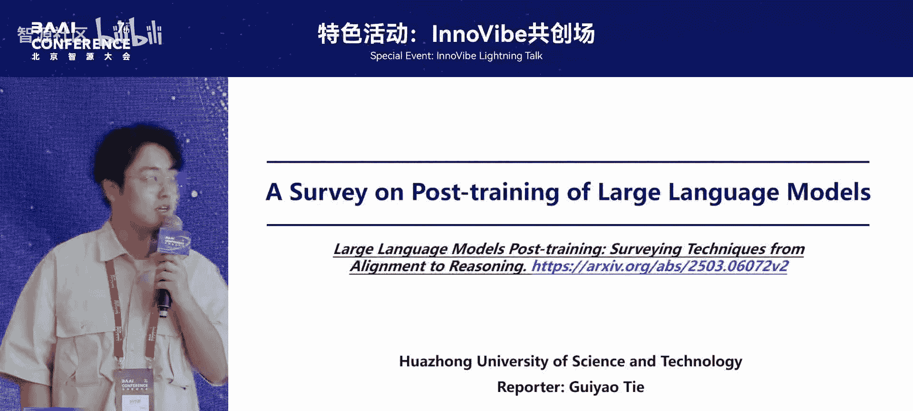

然后接下来我将从以下几个方面来展开介绍。呃，因为时间原因呢，我这里也是每一块都就是浅尝辄止一下。

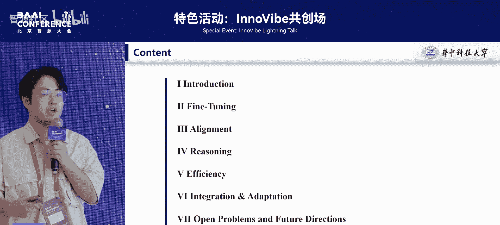

，然后首先呢我们先看一下，就是关于大模型post training的一个整体概况。呃，我们这里在technic方面呢。

我们将它分为了呃ingment reasoning呃 efficiencyency以及adapation这5大块。然后呃在那个d size呢方面呢。

我们将其分成了像dlog reasoning以及code这7种类型。呃，而且post training的应用也是非常广泛的。

比如说我们从这种propro到 reasoning带到我们日常生活中的这个interaction。呃，由此可见呢。

post training是使大模型从通用的LM转化为我们现如今这种专业化的就这种实用型LM的一个关键。呃，然后这里呢就是关于post training这个technic方面的一个概览。呃。

首先呢就是 tuning阶段。呃，这里就大概是通过监督微SFT来教导模型学习一些已那个已有的知识。然后利用比如说RLHF或DPO来进行lement。

再接下来就是我们目前现在比较关注的这个raing提升方面了。然后最后随着模型这个规模的增大呢，这个 efficiencyency也是非常重要的。嗯，然后我们从右边这个图可以看这个时间线可以看到。

就是posting training技术的发展也是非常迅速的。呃，比如说从2018年到2022年呢，我们见证了像but和PT这种呃预训练加微微调的这种范式模型的一个崛起。然后随着LHF技术的逐渐成熟呢。

我们也出现了像这个GPT这样比较具有影响力的模型。然后从2022年开始呢，就逐渐转到了我们这样一个深度推理的阶段了。呃，比如说越来越多的这种dooma技术的以及像va这样的呃多模态模型层出不穷。呃。

然后特别是今年年初这个D出来之后呢，也带带动了这个混合专家模型MOE这个架构的一个兴起。呃，然后话不多说，我这里就先讲一下我们的第一块，也就是，上面这个图的话就是这个最常见的我们的监督学习SFT。

然后这里呢我们通常来说就是首先获取了一个呃预训练的那个M然后从高质量的视例数据集中去对其进行然后这个数据集通常就是问答对或者是我们的呃指定响应对。

这主要的目的是就是使我们的通用LM开始向我们想要的professional的LM开始转化。然后下面这个就是强化微调，强化微调，它通常是在我们的这个SFT之后的，也就是说我们可以看这个图A的这一部分。

然后图B的话就是呃比如说我们可以用一些强化学习的算法。然后经过由SFT model生成的这些res之后呢，设计一些目标的re来对其进行更深层次的优化。呃。

然后第二个主题就是alment其中这个基于人类反馈的强化学习，也就是RLHF就是其中的一个比较及时类型的工作了。然后呃这里我们人类在其中起到了就是比较关键的一个作用。

比如说我们他们可以通过对不同模型的输出进行排序来产生一定的反馈。那么我们就可以利用这些人类的偏好数据来训练一个reward model。

那么这个reward model就可以用来呃呃学习并预测人类的偏好，从而指导我们下一步用强化学习对LM进行ning。然后下一个下面这个就是更直接的一个办法，就是直接偏好优化，也就是DPO了。

DPO它简单来说就是用直接用偏好对来优化我们的这个poli model比如说这个这个chen的respon或者是reject。然后这里它就是不需要。显示的训练一个额外的这个rever model。

也就是减少了我们这个对齐的这样一个过程。呃，然后第三个就是我们的reasoningreing也是我们接下来以及未来比较重要的一个研究方向。然后我我们这里只是总结了之前它就是比较流行的一些方法。

比如说这个self refund，然后我们将它归结为了4个类型。第一个就是内部的se。也就是说LM可以利用它就是它需要自己来评判自己的输出，然后产生feback。

并且根据它自己的这个知识以及推理能力来进行迭代的一个优化。呃，然后B部分就是这个外部的self。呃，相对于内部来说的话，它其实就是可以利用一些那个外部外部工具，比如说我们可以用搜索引擎来查检索一些信息。

然后将这个feback融入到之前的这个迭代优化当中。呃，然后C和D的话就是关于AB的一个反听定版本的。这这里主要是为了说明我们不仅可以通过像zero shot这样的形式来使用模型的这些能力。

还可以通过特定的数据来微调，使其获得这样的能力。呃，然后最近呢也是就是出现呃发表了许多关于比如说adaptive thinking啊，还有raing的一些工作。

然后后续我也会将它就是融入到我们这个raing的这一章节中。就比如说我下面这个链接，这个MMR是我们之前就最近的一篇关于多么太raing的一个工作。呃。

然后就是如果大家有相关的论文已发表的或者是未来的都可以那个及时与我分享。然后我我们来一起交流。呃，然后第四个方面就是这个efficiency。呃。

这里我就简单来说一下 efficiencyfiency的话主要分了3块。第一块就是模型压缩。模型压缩里边上面这个是我们的这个po trainingation。

它这里主要就是呃降低模型权重的一个呃那个性能的这个指标，也就是说我们可以将32位的这个浮点数降至8位整数，从而来减就是减少模这个模型的一个尺寸。呃，然后下面这个就是我们这个呃参数减值了。

这个是在之前神经网络时期也是比较常见的。也就是说我们可以减出神经网络中的一些呃权重或者是连接，从而构建一个更为稀疏的模型。

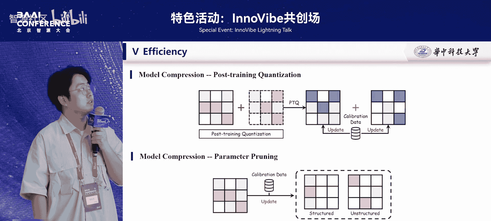

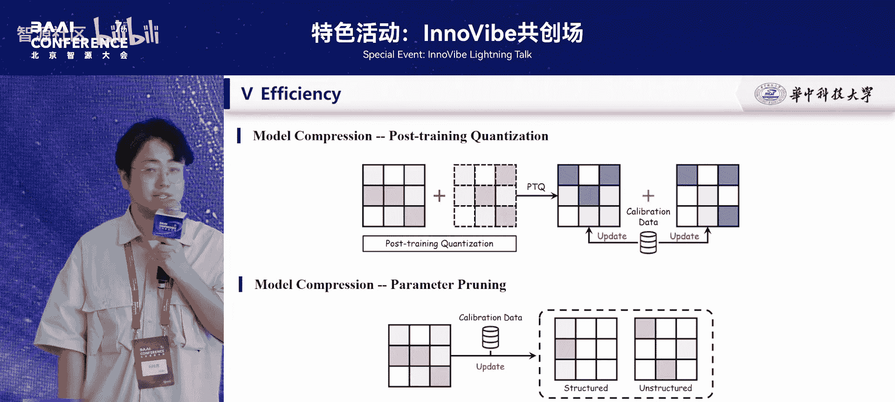

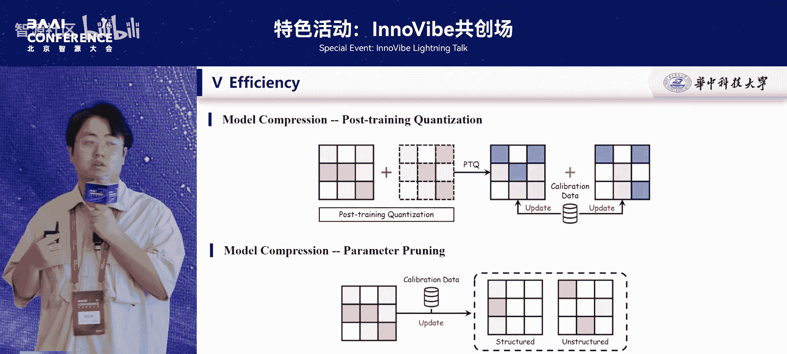

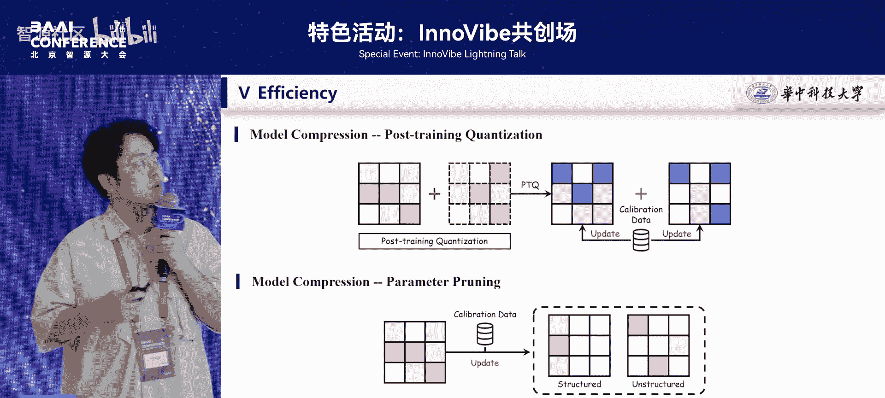

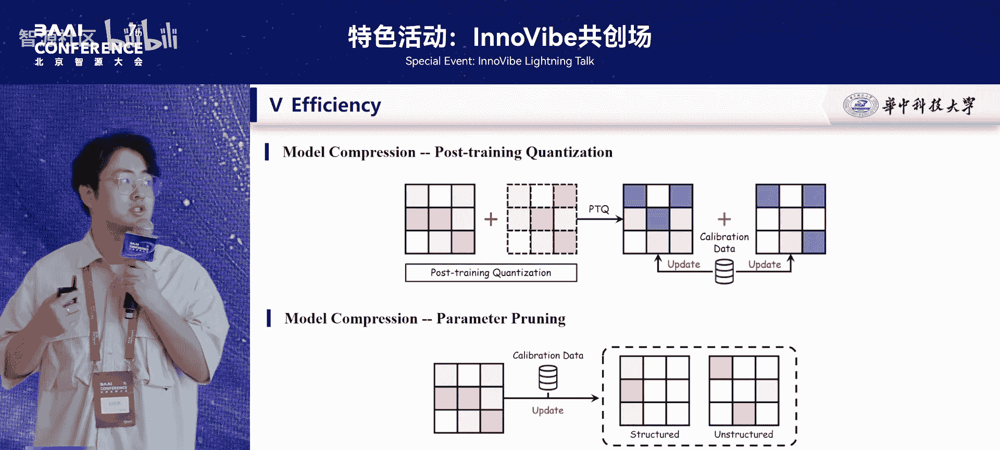

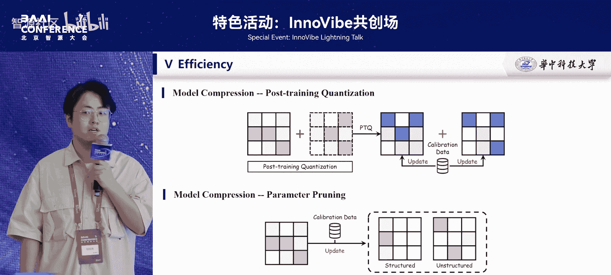

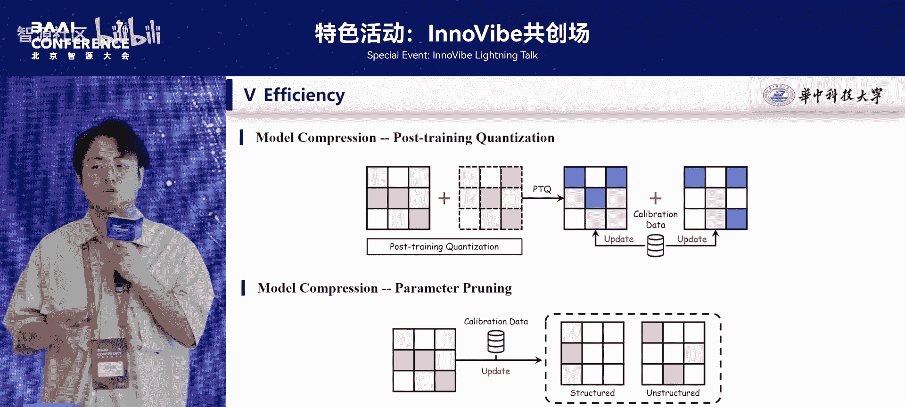

嗯，然后在其中更常见的呢是这个参数高调微参数高效微调，也就是PFT了。然后对于PFT我们也将其进行了三个分类。

第一个就是itiveFT这里呢主要就是在原有模型架构的基础上就是选择了一些新的少量的参数融入进去。然后lect的F呢就是在原有模型架构上选择其中一小部分子集来进行然后最后的这个re的这个FT就是我们选择了其中一部分的输入来进行train。

然后在推理的时候将它和原始的这个模型架构在一起，然后就可以降低这个提高这个模型推理的效率。后最后这个就是ledge的话也是我们就是之前时间网络时期比较关键的一个基础点吧。然后是因为那这出来之后呢。

我们将这个led。

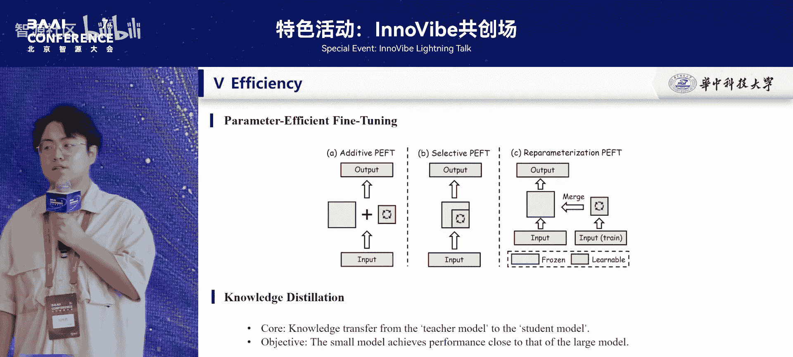

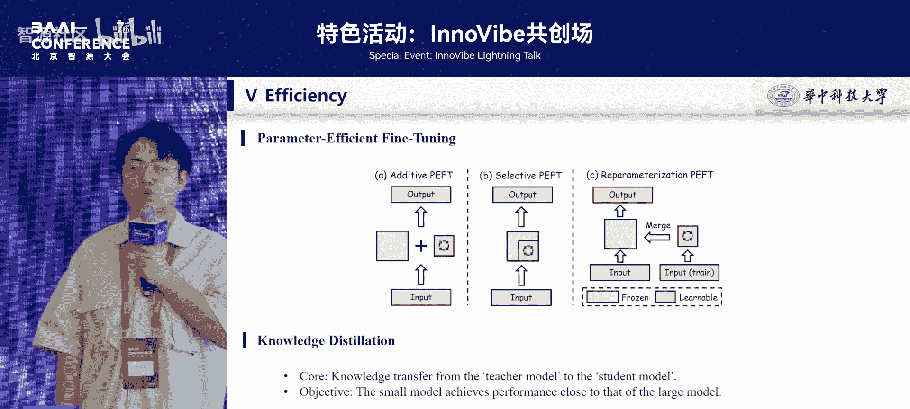

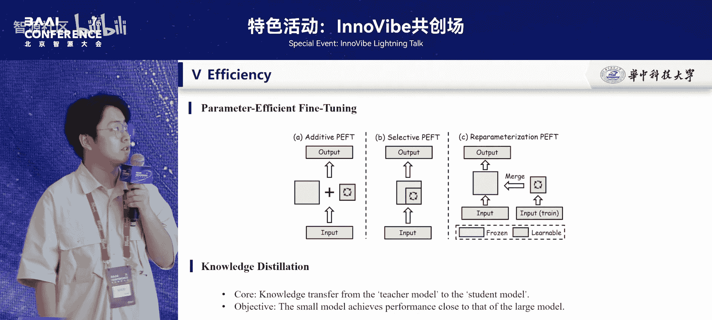

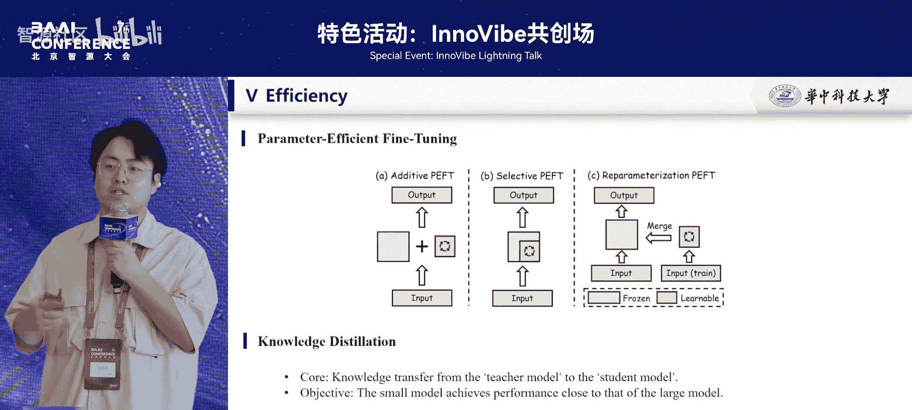

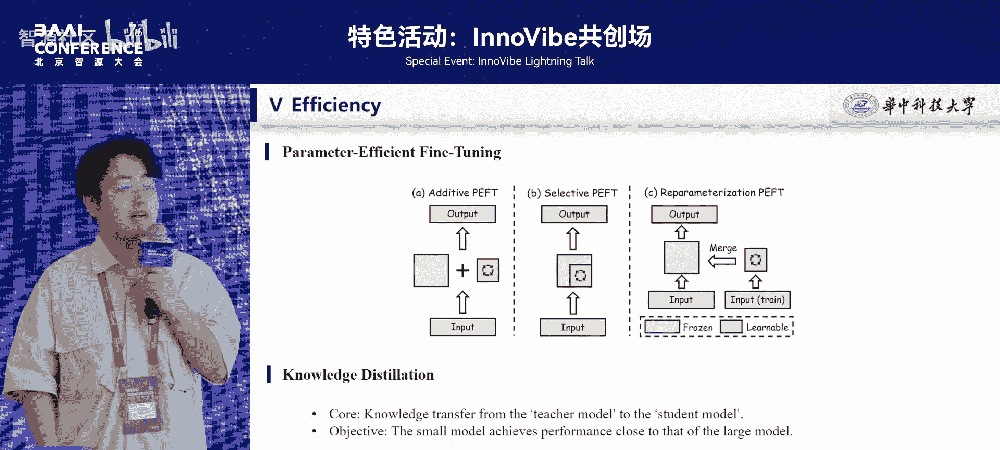

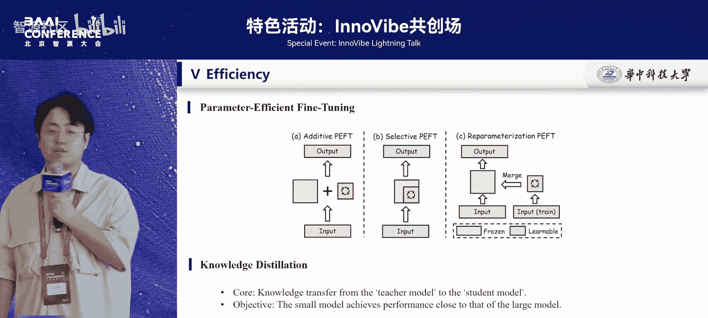

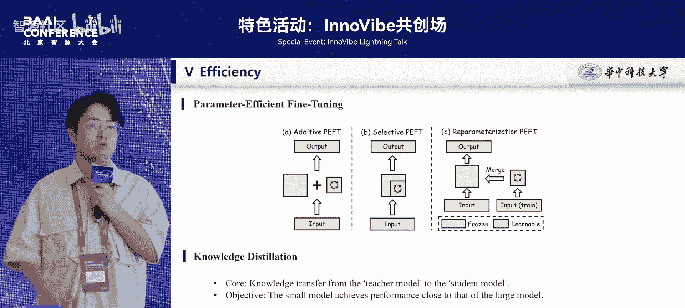

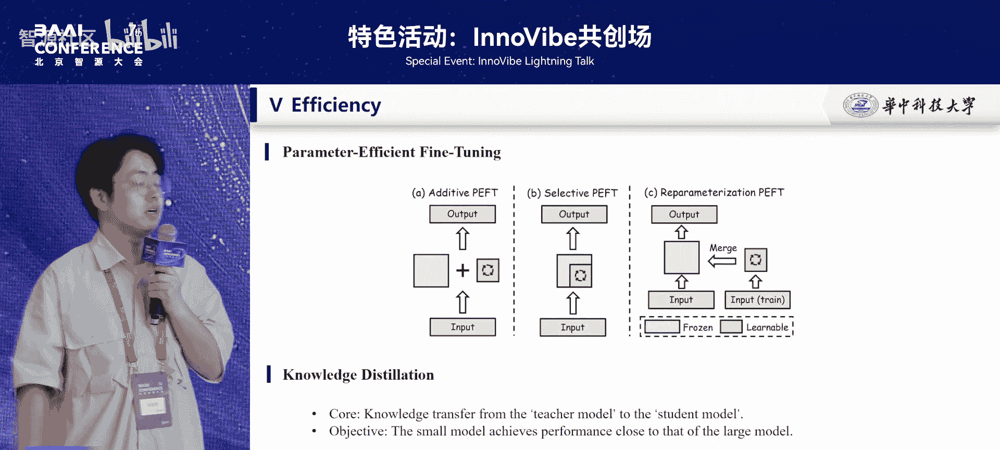

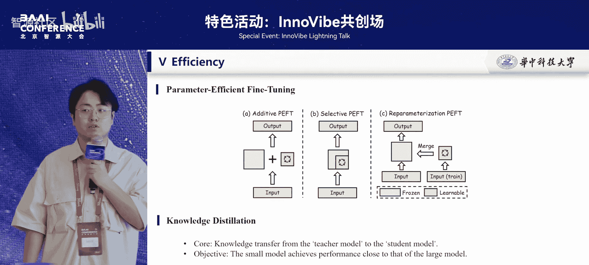

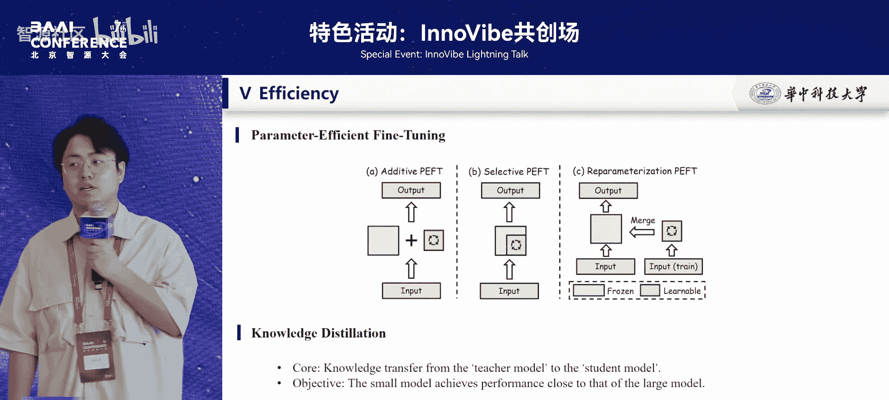

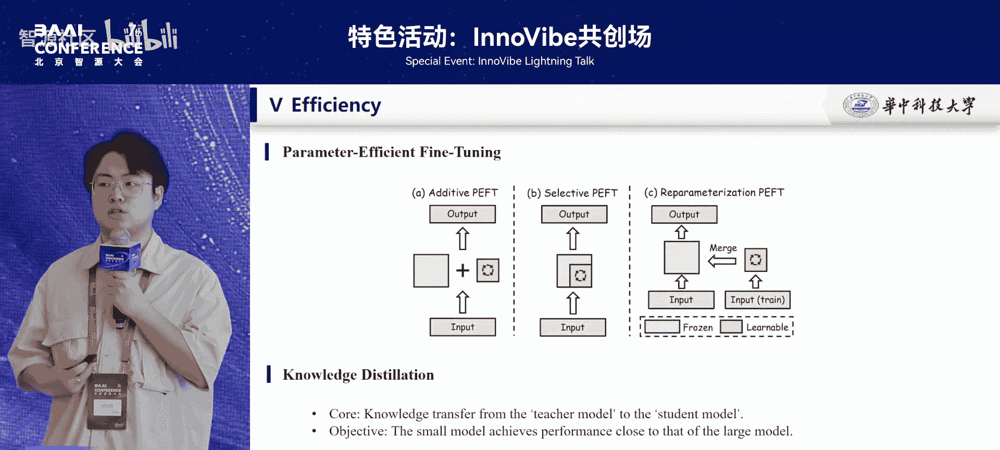

也化为我们就是po training efficiencyffficiency里面的一个。

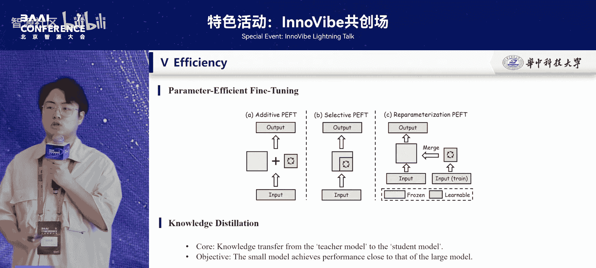

嗯，然后最后的话就是这个集成和adation的这一方面。嗯，首先第一个就是多态集成。多态最近也是就是目前也比较火。然后多态集成的话主要是使模型能够识别并处理各种来源的信息。

比如说我们的文本图像以及音频等等。然后这里简单来说，其实就是针对每一个这个模态来设计一个模态编码器，然后再设计一个conor来对其不同这个不同的表示，从而实现一个综合的推理。

下面的这个就是另外一个比较有意思的领域，就是modmargemodge的，我们也主要分为三类。第一个是呃权重级别的marge。第二个是输出级别的marge。三个就是model级别的marge。

然后model级别ge其实就跟我们之前提到的这个MOE是就ME就是其中一个比较显著的例子。说我们可以用一个ro来选择哪一个expert来完成当前的任务。也就是印证的那。

呃让专业的人来做专业的事这样一个概念。我说一下我觉。然后最后一个关于这个抖的技术，就是这个检测自强生成REG了。呃，这里出现的目的是因为RM通常会出现幻觉，或者是他会使用一些过时的信息来回答我们。

OK那么我们就这里就通过RAAG来增加这个知识库来提前检索相应的这个文档或者是知呃知识片那个数据片段，然后呃将它作为上下文一起输送给LM来完成最终的这个任务。呃。

然后最最后呢就是我们提出了一些浅薄的就关于未来的一些探讨。呃，比如说第一个的话就是这个推理增强，也就是嗯我们如何来就是构造一个下一代的这个就是超越目前的这个RLL架构。

然后实现一个应对未来这种更深层次的多步骤推理的这种复杂的任务。呃，然后第二个的话就是可扩展性。也就是刚才那位同学所讲的，我们如何来高效的posttrain下一代这个超大模型的这个LM以及多模态模型。

然后这个关于这个伦理和bes，还有这个动态融合，我就不多说了。然后这里想提到的就是这个trust framework。因为我们认为在未来的包括学术界以及工业界来看。

就是如何来构造一个能够适应上下文的这样一个可信安全的框架，是接下来包括我们的产业落地啊，包括部署的一个重要呃一个关键。然后最后的话就是这个创造性的智能，也就是说我们如何让L产生更深层次的智能。

以及类似于达到媲美s two这样的一个思维能力的一个呃智能。呃，对，然后我关于post training的这个分享就到这里了。然后大家如果有相关的呃意见和呃论文，后续都可以跟我讨论，谢谢大家。好。

感谢贵阳。

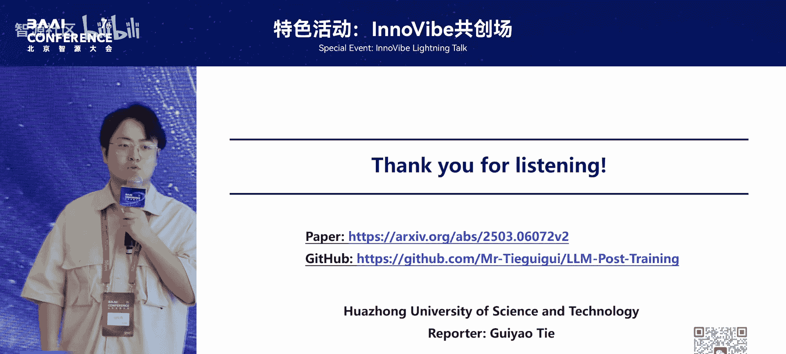

