# 2025北京智源大会-特色活动：InnoVibe共创场 p04 从马尔可夫推理过程中涌现的原子化推理：滕枫蔚 -BV1nNNJzJEx6_p4-

下一位讲者是呃，童风卫对。然后他给我们带来是那个从马尔科夫推理过程中涌现的原子化推理。好，有请。对。对，刚才我没太注意，就是我我们开我开始我们可以做一下自我介绍。好好呃大家好。

我是叫腾风我觉得我可能是今年整个资源这个会议可能演讲嘉宾。我去年刚从人大高学毕业。现是在港那边做然后我也在非常积极的找后面的机会。那给大家一个吧，我也非常感谢之前的讲者可能都已经提到了这个事情。

好那么 time呢其实我可以用一个非常简单的比喻来说明。就比说近在高考嘛那两两个小时给你做一个考试和你4个小时做那理上你用4个小时做。

你肯定是不会比两个小时做要更差的就是这种就是我增加大模型在推理阶段的一个计算资源的投入。那理你的效果少是不会变差现象。那像常的火。但其实很就已经够窥见一的。

就是我们都特别熟悉的COT那T的它的核心原理是什么？就是。😊，逐步的推理因为那个时候的大模型真的就是那种IO推理你问他个问题，直接给你判答案，他没有所谓的思维过程。

所以那时候COT作为一个很简单的ing一就能够给大模型提提提提供一个很好的个效的增加对那么其实呢COT它既一个简单的提示策略。

也可以为可能很多人在设计设计算法种数据构建的去希望让模型去增自己延长思维链这个能力。以这是两个策略。一个是通过可通过一离散的框架和一些提示的策略去非训练的引导M去不断的增加它的推理时。

另外一种是通过训练也就是非常火的soning就是通过训练方式让一个模型在一次问答之内就能够去主动的用各种手段去延长自己的推理。以这就导致了两个两个衍生出来的一个大类其实我这边工众呢就是偏没有训练。

对然后我最开始做这篇论文的。😊，什么呢？其实非常之简单，就是我觉得人可能会更喜欢简单的东西。这篇论文其实是我的第一篇一作论文，然后就是在推tter上发了一下，就是非常简单的一个个人的宣传。

就获得了我完全没有想到的一个浏览，也有chman的一个转发。对虽然说大家都喜欢简单东西，可是我们面对的是什么这种类似叉叉 of的工作得越来越复杂。

最开始面可能有趣有graph到后面这个structure可什么超图啊，什么方块啊立体结构都出来了。甚至后面有一些生僻词可能经出来了。那个可能要查词典了。

但是我会觉得说能不能我能做一个既简单然后效果又好的东西。😊，甚至我在这里面还提出一点，就是说可能我们曾经以为那个很简单最简单的COT可能都没有那么简单上面这个图展示是我们理解的那个 originaliginT它就是一个呃链图嘛。

但是这个链到底是什么意思2意好像没有特准确定义那我给一个话，就是2它的推出就是你的你提出2出的要和2它是一个生成序连接。那如果我把这个边改成一个依赖关系呢？

就说我就比说N2它被N一指向要个意着你生成的要看他们的一个信息就改个家如果过代替来个生成序的话曾经我以为简单的COT都会得复杂后面的T维数思维图么的根T的基本假去那个就难这边也展示一下他们。😊。

呃呃呃历史信息和一个输出信，就上面的那个上面的颜色是偏那个偏深音的颜色是那个历史信息，然后下面的浅颜色是他们的输入信息。对大家可以看到就是。这些思维数或的思维图在推理过程中。

他最后那个历史信息会记得越来越多，就导致你当前要做的推理。他可能因为你维护了这种非常复杂的叉叉 of的结构。

会导致你后面的呃历史信息会特别可能多都不是你当前的推理需要的所以我希望把这样的历史信息结出来就我推理的，我只要关注我当前需要什么就我当前这个状态需要什么样的信息好，那其实如果说要摆脱历史信息依赖的话。

那什么玩的最限，那肯定是马尔可夫过程为马可夫过程是有无记性的好，那我们在这里可以做一个非常简单推导。就是我在这边展示的过程以及他里面个换成好，那么可看到在做这种思维生成的。

每一个新的下一个元素无论是思维还是问题也，都要这些完整的信息。那如一个理想化的马尔夫过程的话。😊。

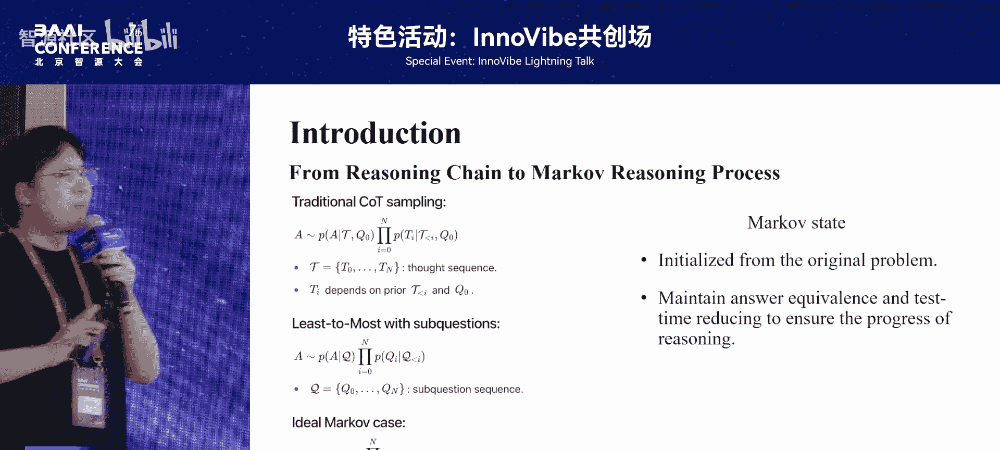

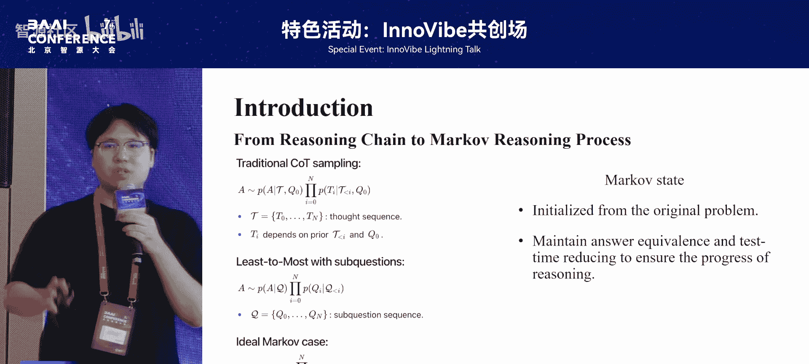

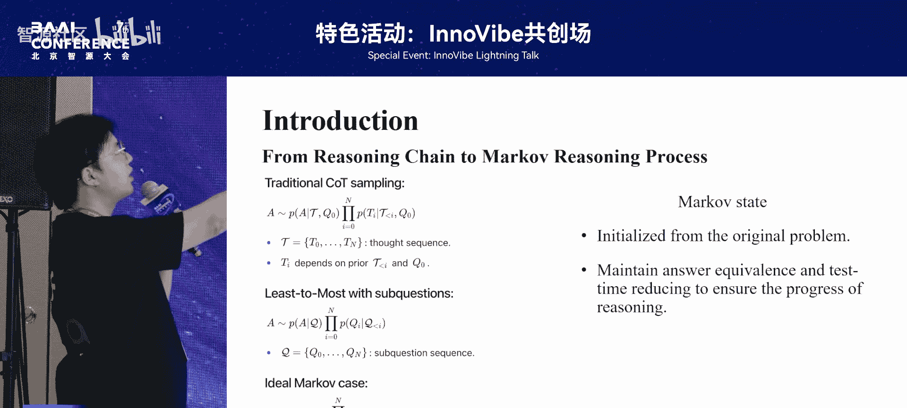

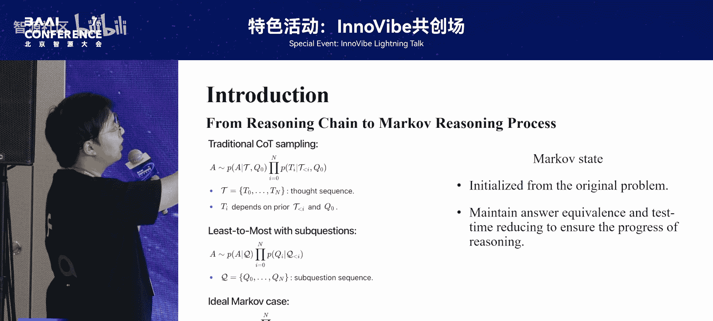

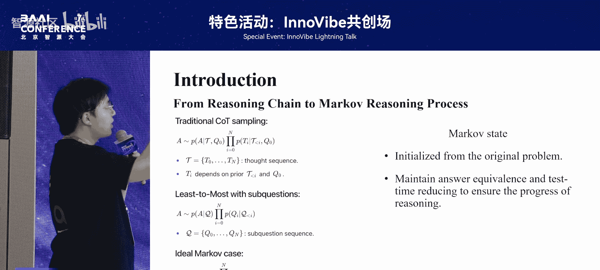

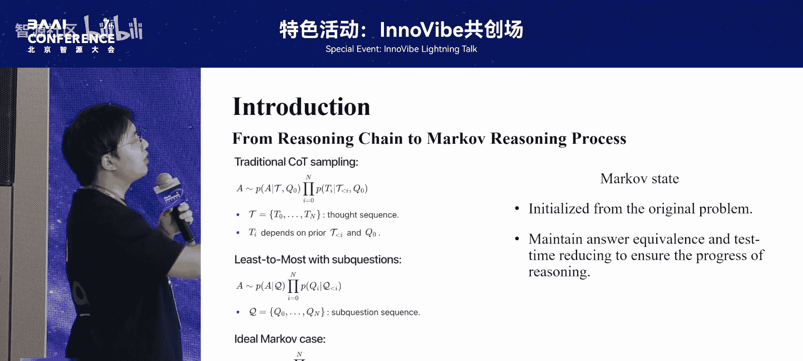

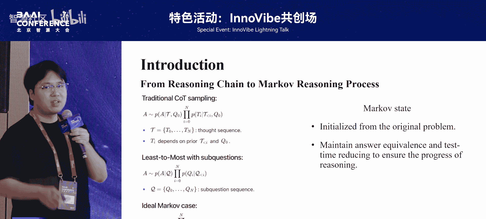

他其实应该是就是QIE，它仅仅是依赖于QI对，这是一个非常理想化的呃理想化的一个公式吧。大家其实都知道正常的问题，它怎么可能有马可克性质呢？这个是很难去做一个满足的对。

但是我就是我最后推出这样形式是以做一个简单推导。就为什么我们最后这个马复练这个元素选择是一个ion。是因为你想想，就是你最后的这个答案是要从最后一个元素里面推出来。那你最后一个元素应该是问题。

然后你马复练里面最开始那个state，它又是从这个初始问题初始化的。所以。😊。

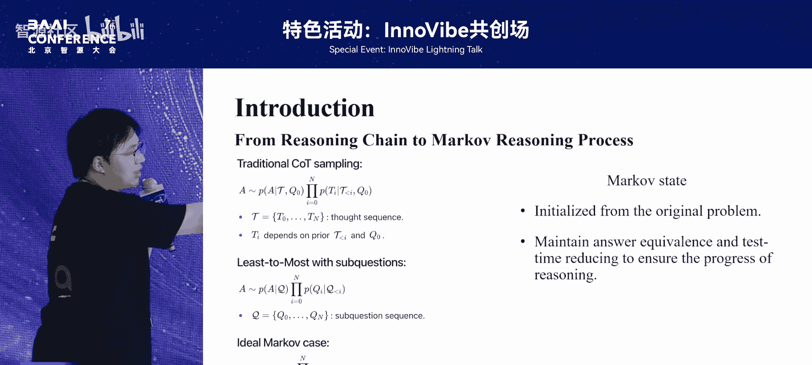

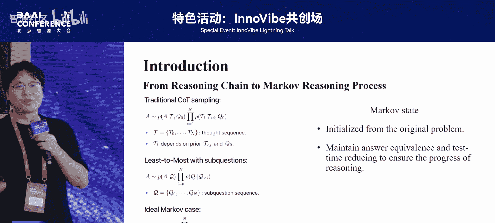

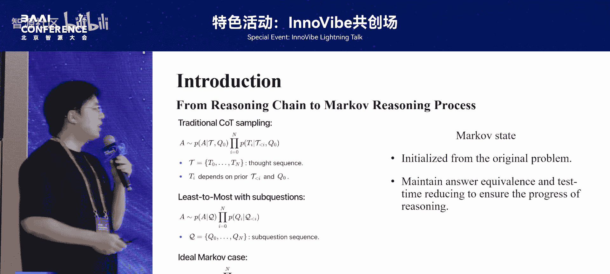

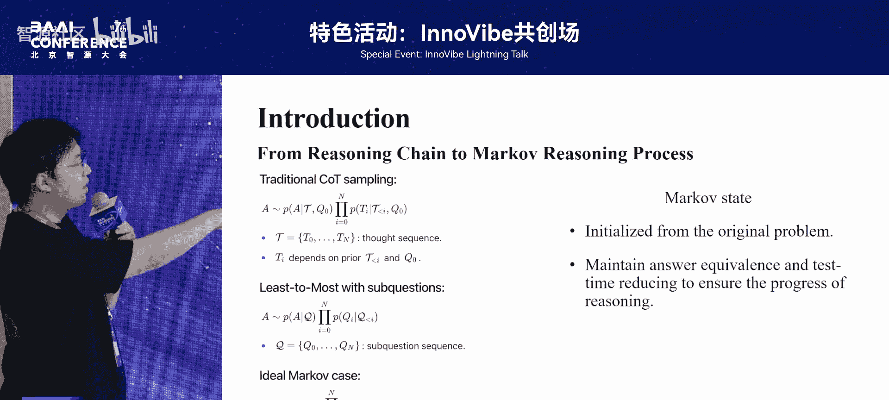

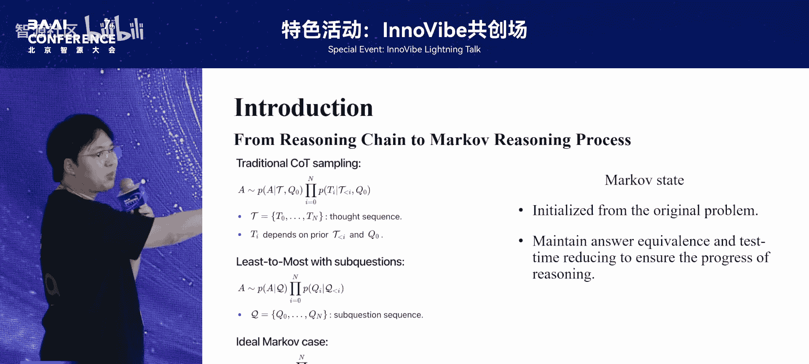

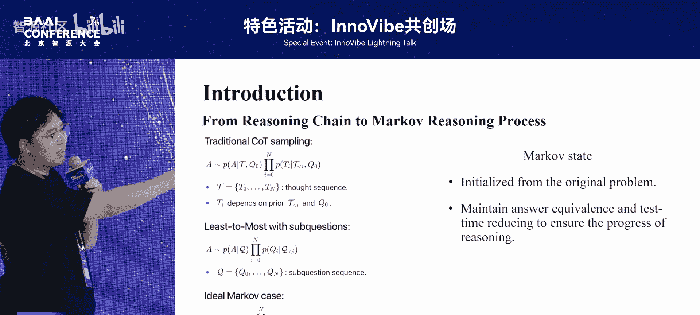

能够简单推导下最后的应该是由一个问题所去包装的。所以就是最后这个公式展示的形式。好好，那既然这个公式是比较理想化的那其实就可以做一个简单的中间步骤，就是我们要做一个两阶段的状态转移。

就是说我可能直接同一个状态生成一个完全无记忆性的下一个状态会比较难。那我就先生成一个graph一个中变量这个呢是一个由D所构建的一个推理过程是把推理过程换成个D然后每个元素的话可能是思维也可能问题这个我不做多制。

然后他可能先生成然后graph去生成下一个那个问题哈。那么你如何通过这种问题之间的转移去构建你的推理过程。因为你不可能说你最频繁的过程就是你这个问题都不变你永远是原问题。

那你也能做这个过程你有没有记忆性。所以我在这里面提出一个点就说每一个ion既要维护说因为你看最后的答案是从N推出来的那说明在这个序列里面每一个包装的问题，它都是。😊。

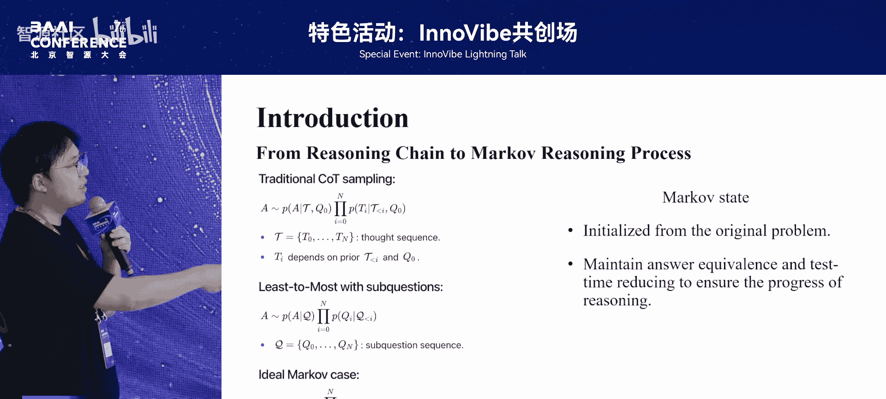

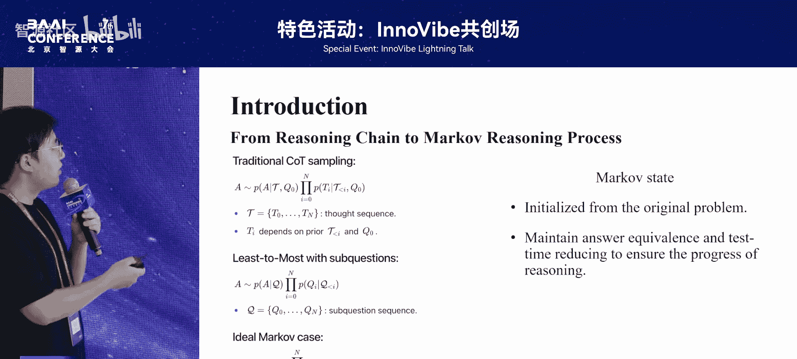

原问题的一个简化版本求解它就等于求解原问题。对，然后这个问题训列应该要保证一个推理时的下降。就是你做这个问题，你所需要的推理步骤越来越少，这样你才能够把马尔可夫的过程构建成一个确实在进行的一个推理过程。

对，这就是一个呃呃基本的性质定义吧。O那这就是一个的一个过程。对？你看最开始那个问题啊，它可能是一个三角形的问题，后面拆成1个DAG然后你把我们会通过pro引导的方式说你独立的问题，你可以把它丢弃掉。

因为独立的问题就是呃。你把它作为一个可能已已知的信息，或者说已经排除过的错误探索，然后把它固定到后面的问题描述中，就作为一个不要求解的一些信息。对所以看到后到后面这个问题越来越简单。

最后你实已经看不出来Q已看不出来是问成一个简单方了。然后又因为我马是常基础的结构，所以它会有特别好就是说你的马可夫每一个都是无记性的每一个都是不依赖前面就是你执行每一个每个大Q里面的任务。

你都不需要不要看前文对然后就是因为我觉得非常好的可以一个非常不错的集成。就说你可以把我们这个T生成的个问题都以甩都无所谓。理了那其实这里面示了过。😊，对还有一个更加呃高阶点。

我刚刚说其实这种基于点的集成。那我既然说了这种马可链是对COT这种替换，那能不能就让马复链代替TOT代替GT里面这种出来的那思维就完全代替COT这是我后面做的一就结合反思机制结搜机制去加就加深它的一个马服链的深度。

最得个特别好的结构，就称之为涌现的原子化的结果。就是因为你的这个呃马链里面的这个测试在下降，到最后一步的时候，就是假设你通过数搜通过反思慢慢的去加深它的那个深度。

它最后生成个它的复杂度是和你每一步生成独立子题复杂平近似近似且这里面会你近似你果越这是个特性。因你想投入计算资源都不一定能够带来效果提升。😊，非常好的性质。对，然后知道这到 work了。

对也是预告一下我后面会做的一个工作，我正在做的一个工作就是我现说了嘛到我最开始的呃部分就是COT来现在也有很多人觉得像其实相原的提升点说他做一些这种推理的策略的能力，他会主LM更强。

这里我用了就是港大俊贤老的那个他们的工作他们两个做的是不同的事情，一个是做那个就是实现一个他们都分析了这种呃呃模型里面他们不同的这种推理行为的一涌现的程度。

其实可以看到你的型的能力增强也就是带来COT延长其实会伴随着这种他们会更加喜。😊，更加喜欢用这些呃高阶的一些推理方式。对，但是这个算法本身又没有去激发模型要做这些事情。

所以我觉得这里面是个很明显的gap。所以我现在在开发这样的一个可以说是算法框架吧。就是说呃我相信 framework里面会有很多沧海一珠一样的工作。

就是他们很多的设计目前的呃呃 model可能还没有去关注到。但是我觉得很多这种设计里面，可能真的如果被模型学习到的话，可能真的还会会有超出现在这种模型的一个效一个效果。

所以我的就是说呃如果你就是请用我们的算法去按照你对推理的理解去训练出你自己的搜塔。对这是我未来会做的一个工作。啊，谢谢大家。呃，谢谢谢谢陈同学。我们现场有问题吗？嗯，哎，好嘞那个。😊，哦。呃哎，您好。

就是您提到呃，就是您工作的出发点是COT它会就是访问ON长度的一个上下文进行推理嘛。所以您对它做了个压缩，变成马尔可夫的过程。

我的问就是那怎么看待像像pa attention像 attention就比像这种那他们实际上也是比如特别 attention。那他其实也是维了一个马尔可夫的状态嘛。

他也不需要去访问一个欧文的下文长度或s attention他可能访问一个一部分的下文。那您怎么对比就是这些模型上的方法和您的方法之间的这样一个呃优劣或者不呃他们更多的应该是应该是偏入模型架构设计吧。

我的更多这种的一种框架。但是我要说一下啊，也感谢就是我一些同学他们也是跟我分享这些东西吧。就是这种pa他会在这个时代里面会有特别不好的在于他可能没法自主的做延长对我觉得在这个场景下面的话，他。😊。

只能是做到一个呃向下的兼容，做不到一个向上的金融。我这个话其实跟他们没有本质上的冲突。就是如果你拿这些呃比较有意思的 attentiontenion的设计设计出来的一些模型。

完全全全给套的这个框架里面去做。但是其实我也非respect这种在基础模做改进的一个呃这些科研者吧。虽然目前可能还呃商业界可能更多的还是这种传统的atten的这种设计。

但是我觉得如果能在影层上面做这种自由的这种ken token长度这种s的down或者up的话，它的效果一定会比现在的 model要有一个更加好的理论上线。对所以我觉得对跟我的工作不冲突。

但是我也非常看好他们的这个研究。嗯，好，谢谢。因为那个时间限制我们只有一个问题啊，那感谢那个彤同学。