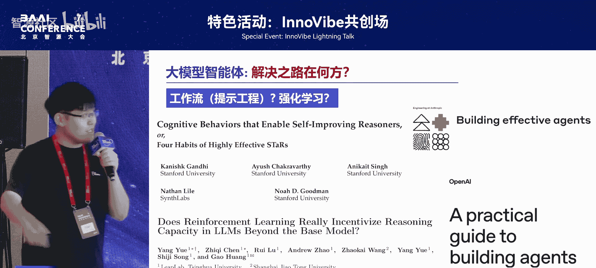
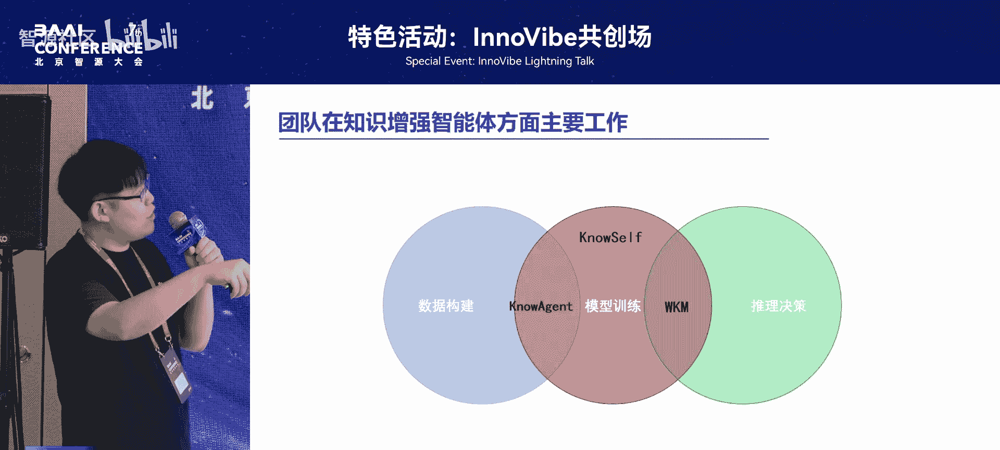
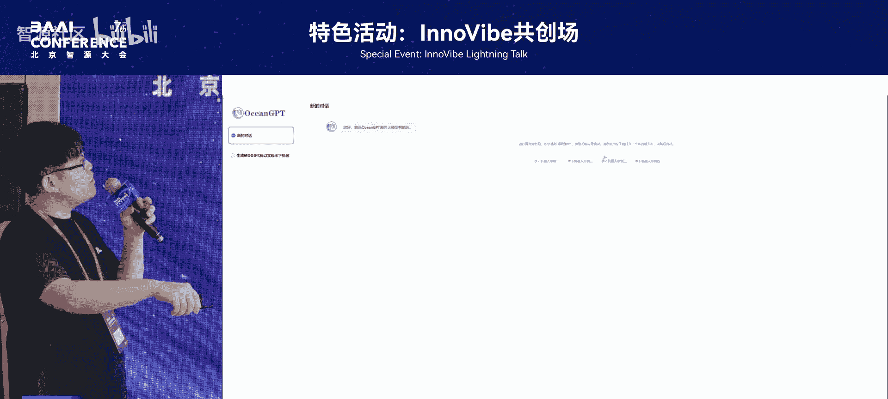
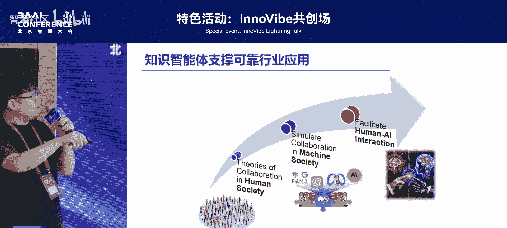
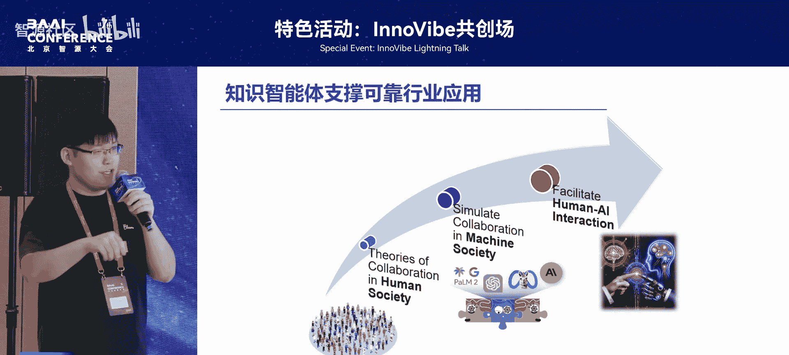

# 2025北京智源大会-特色活动：InnoVibe共创场 p05 知识智能体 问题、方法和应用：乔硕斐 -BV1nNNJzJEx6_p5-

我们下一位是来自浙江大学的张顺飞，对吧？好。那个他讲内容是这个知智能体OK好。呃，大家好，我是来自浙江大学的博士生乔硕飞。然后非常荣幸今天能在这里给大家分享一下我们组在知识智能体方向的一些探索。😊，呃。

首先什么是大外型智能体？因为今天H的top非常的多。所以我们用一句话去简单的总结，它就是它可以通过递归式的目标分析与价值对齐机制，将呃我们人类一些模糊的一些指令去进行一些呃子任务的拆解。啊。

那么典型的应用，比如呃呃open eye的 different research。但是呢呃我们说大模型智能体它的本质其实是大模型。那么大模型它有一些问题。呃。

这里我们用一个比较形象的动画动漫图像去表示它尤是这个叫刚中智脑。其实呃这个它目的呢是我通过一些营养液，通过一些呃信号让大脑以为我处在一个什么样的状态。那么其实大模型也是这样的。

我们人类去人为的给它灌输一些预很多的预训练语料，包括后训练的一些指令以及轨迹数据这样的东西，让大模型觉得我处在一个呃QA的一个环境中，或者在做一些剧身的这样智能体的环境当中。

但其实大模型的这些一系列的训练策略，没有让大模型学会与真正的物理世界去沟通。那么但是我们想要做的这些智能体呢，其实它是需要长手长脚的，它是需要与外部的物理世界去感知以及推理决策来包括它需。

要学会自主的持续性学习，来适应不同呃不不断变化的外部环境的那么呃这就带来了一些大模型的一些问题。比如呃我们团队最近在探索一些数据科学方面的东西，我们发现其实嗯像人类做的人类专家。

比如我去做一个数据分析任务，我们很有很多的先言知识来去做一些呃嗯对他engering或者是那个可视化的一些工作，但是对于大模型智能体来说，这些任务变成非常的困难。嗯。

它的这个在很多任务上的这个成功率都是非常的低的。😊，呃，那么大模型智能体的这些问题呢怎么去解决呢？其实目前主流的智能体框架，嗯，包括在市面比如或 research。

我们推测他们大概率的这个方法呢其实是基于一些人为构造的一些工作流的。那么工作流的优势是它是可控的，就是我可以让大模型去遵守这样一个工作流的框架来去执行一些任务，但是它的缺点呢就是它的灵活性不够强。

它的泛化能力比较差。那么随着R出来之后呢，一些很多基于强化学习的智能体工作通过强化学习算法来去解决，也不能解决，就是缓解这个增强这个智能体的一个泛化性。但是呢R本身存在一些问题。

比如它其实只是去激发嗯大模型本身的能力，而没有给他去未尽新的知识或者是新的能力，以及它可能带来一系列的不可靠以及幻觉的一些能力。那么未来呢我们应该怎么去。

解决了那我们提出了一个叫做呃知识智能体。那么为什么要有知识，为什么我们要把知识引入智能体呢？其实嗯大模型它本身上是一个统基于统计的一个模型。那么基于统计的模型，它固有的存在一些缺陷。

比如呃它只是在不确定性预测上的一个固有性，以及它缺很多时候缺缺缺乏一些先验知识。那么比如说呃很多智能体，我给他一个任务，它会先去盲目的去试错。那么呃这在很多其实在很多智能体应用场景。

盲目试做其实不可行的。如果你呃进行了一个action。那么很多时候它是不可回溯的，另外就是可靠性的问题，那么我们目前就是通过流程性知识，比如workflow去缓解它。呃。

那么这里我们就提出了关于知识智能体的三个科学问题。第一个就是在高度不确定性的这个环境中，如何能够将多种知识去动态的去调整，以来确保这个智能体决策的可靠性与协调性。呃，第二个就是当环境在不断变化的时候。

我们怎么去设计让智能体去自主的可学习的记忆与呃去更新自己的知识框架，来提升智能体的这个动态的适应性。那么最后的就是呃我们知道我们人类去学知识时，其实是基于自于好奇心呢？但是智能体的。

我们是人为他去被动的去学习一些知识的。那么怎么让智能体去基于自己的好奇心，主动的去提升自己的创新能力，也是比较呃关键的一个问题。呃，那么我们其实在探索的过程中，将知识融入的过程呢分了三个阶段。

第一个是在数据数据构建的阶段，第二个是在模型训练的阶段。第三个是在呃推理决策的方式。呃，由于时间关系，我们就我非常简单的介绍一下我们在这三个阶段做的一些工作。嗯，第一个是noation。

它其实在数据构造与训练的时候的一个优化策略。因为这个工作是非常早应该是前年的一个工作。所以当时呢智能体其实还是比较初步的。我们就发现其实智能体在做action的时候，它有很多违背常识的一些动作。

那么一个很简单的思路，就是我可以把动作之间的关系构建一个构建一个action graph来现在约束它的动作。那么我们把这个graph输入到模型里面去构造让他遵循这个graph去构造高质量的轨迹数据。

那么在用这些轨迹数据去训练模型。那么模型能力得到提升之后，我们通过这个graph再去那个合成更多的高质量轨迹来这样迭代的去一个个 model。那么这个就是在数据与训练层面的一个工作。

那么下一个叫word model其实它是一个。

知识模型。因为呃这个工作的它的这个action graph其实是人人类根据先验知识去构建的。那么这个如果我换一个场景，如果场景比较复杂，人类其实是很难去呃每一个场景都去构建这个东西的。

我们可以让模型自己去在环境中探索，来总结这些知识，并把这些知识入到一个knowledge model里面。那么这个model因为model本身它是有一定泛化能力的。

它可以缓解人类这个呃因为这个时间和能力成本的限制的一个缺陷。那么呃在解码的过程中，我可以把这些knowledge和agent的一个概率分布去做一个加权来去约束agent一一系列的行为。

那么这个工作其实是在训练和解码阶段去做的一个增强。么下一个是完全的一个训练的一个知识。因为我们在一系列的知识增强智能体的工作中发现知识不是总是对智能体的决策有帮助的。嗯，一些坏的知识或者是没用的知识。

反而会给智能体的角色带来一些负担的。另外有很多工作其实也表明也在推测其实transformer它是不会推理的。它只是一个高级的一个模式匹配器。

比如我各种各样的轨迹输入给他他只是在匹配这些轨迹之一个推理模式，但是并没有学到真正的推理能力。那么我们想怎么能够让智能体根据自己的能力边界来去根据也就是根据自己的需求来去调用外部知识。

这其实和人类是非常相似的。就是我们不会一个东西的时候，我们才去查果我们会一个东西再去查这是一个非常浪费时间的一个过程。那么在模型里面其实这就非常浪费ken以计算资源的过程。

那么如果我们去旦我们调用的知识是没用或者错误的，反而会带来角色效能一个下降那么这就是我们提出个动机那么这个其实是一个基于数据驱动的框架，我们训练上去评判。😊，模型对于自己能力的一个能力编界的三种情况。

然后我们引用了两呃两阶段一个训练。因为这个呃是去年嗯去年我们就开始的一个工作。它就是比较简单的一个训练策略。

通过SFT和一个呃类DPO的一个算法来去呃训练模型的这个对自己认知编那个能力编界认知的一个能力。最后在解码的时候。

我们呃通过融入两种特殊token来判让模型自己判定它自己呃是否需要调用知识来判来的一个呃让模型去高效的调用知识。那么其实在我们之后呢。

有像sR one以及research这种呃基于R one范式讲化学习范式的一些工作。他们呃与我们工作其实本质上都是一个目的，就是让模型去自己学会怎么去调那个外部知识。呃。

那么我们想其实他知不知道自己要调用外部知识，以及我们更大范围上，比如我是否需要调工具来解决这个任务是我自己能解决还是工具才能解决。这么其实他终极形态都需要模型对自己的能力有一个认知的。

那么这个也就是模型大模型智能体要实现真正的自主，其实需要自我意识的。呃，那么这就是我们关于智能知识智能体的一个技术战的总结。包括对在呃数据构造阶段以及训练阶段，我们其实呃现在还没有工作。

比如呃我在这个强化学习的reward里边，我把知识引入进去，以知识作为其中一个信号来去增强智能体。另外在infer阶段，我们可以把知识呃喂给模型。

也可以它知识也可以作为memmem的一部分来去帮助智能体。呃，那么关于知知识增强智能体，我们其实也在探索一些应用。那么第一个应用就是关于水下具身智能。

因为水下其实是一个还是非常一个呃呃没有被探索的一片蓝海。那么它需要非常需要一些自主智能体来引入进来。那么目前我们也就探索通过人类指定呃通过大模型的这个代码设成能力以及MCP一些服务。

怎么让呃人类到这个这个智能体的一个action之间去用知识增强的方式来做一个贯通。那么第二个场景其实是。

呃，数据科学。因为我们现在想让大模型帮助我们去做research。那么但是OK呃在做research过程中，他需要呃去处理一些数据呃这个机器学习的算法。那么其实现在的大模型呃。

在算法上其实是能力是非常弱的。那么其实人类已经有非常丰富的经验。我们有很多的论文，有很在卡go上有很多的比赛的呃提交。那么我们完全可以把这当做一种知识来源来去作为呃模型进行机器学习算法来一种参考。

来这个让模型更好的去进行这个算法设计。呃，那么我们也希望知识智能体能够支撑这个可靠的这个智能体的行业落地应用。呃，那么以上工作也是我们团队的其他同学，以及在呃张宁玉和陈华军老师的指导下完成的。嗯。

谢谢大家啊，谢谢秦志飞啊。那个呃关于知识智能体，还有或者是有没有不同的看法都可以提问啊。

没有问题是吧？没有问题，那我们就进行到下一位讲者。好的，谢谢大家。那个这位女女生，对。你们是怎么去处理这种直识关系？比如说呃就是一步动作和后面长远动作之间的关系啊。呃，您是说这知识在这里边的作用吗？

就是怎么去处理？呃，就是比如拿拿很多信息，然后怎么去过滤这些知识。然后呃你第一步动作你要去检索后面好几步吗？就是怎么去规划就是长远的这个动作执行。嗯，我们是这个知识是可以是多种形式的。

比如是以graphra形式的。比如我们让智能体在错误和成功的这个轨迹之间去总结我为什么执行成功的，我为什么执行失败的。那么这些知识可以作为呃自然原文本。

也可以作为structure的一些knowledge。😊，作为我可以作为pro，也可以作为一些鲜艳的概率分布来去给到唉这个智能级，让他去决测下一步的action是什么。对。

就我们聚焦的主要是下一步action至于长远的action，其实它是依赖于前面的一些action。好的，那个感谢。销售费。

