# 2025北京智源大会-特色活动：InnoVibe共创场 p07 AdaWorld  A Highly Adaptable World Model for Decision Making-高深远 -BV1nNNJzJEx6_p7-

下一个是来自香港科技大学的高生远对吧？他的题目是A the worldhighly adaptive world model decision making好的。好，谢谢主持人介绍。对，然后大家好。

我是呃来自香港科技大学的高生远。然后今天很很高兴能有机会在这里跟大家分享一下呃我们关于世界模型的一个新的工作叫adda word呃 adapt word model for decision making就是他对于任何通用的这种决策场景。

他都能够快速的适应。😊。

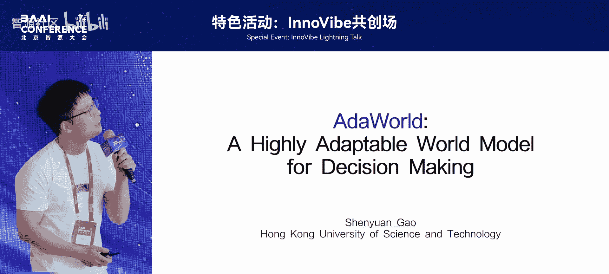

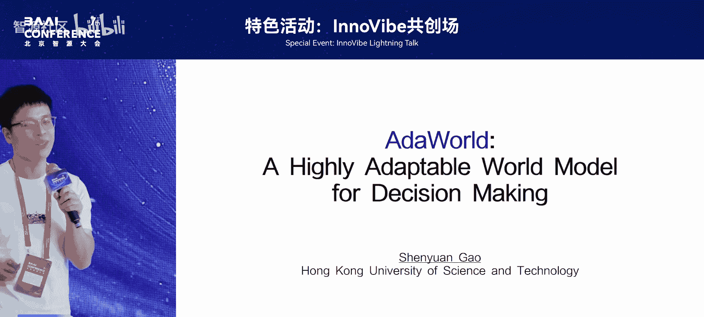

对，然后首先的话我想介绍一下这个word model的概念。然后可能大家或多或少会听到呃在最近两年会听到这个词。对，然后word model它具体来说是什么呢？就是它其实是一个状态的一个转移的方程。

对然后我这边借用了英伟smos的这个word model这个示意图。它的功能简单来说就是你知道现在这个状态。

然后你想要做什么把这个conl signal或者说我们叫这个action输入给这个word model之后，word model会把下一个状态告诉你对，然后这个最这个简单的功能。

它其实就是对世界的一个模拟，就是我们人在世界中做各种各样的事情。然后我们就能可以看到我们的决策带来的后果。对，所以说有了这样一个对世界的模拟之后，其实你可以做非常多的事情。

对首先最简单的话就是比如说我们训一些ag然后它有poli。然后我们想快速的知道这个ag的效果怎么样，我们一般来说我们不希望高成本的在现实生活。😊，去测试。然后假如说有个word model的话。

我们就可以让他在word model内部去进行测试。对，然后呃你通过wordor model的话，呃，他可以告诉你agent未来会怎样。然后你也可以用这个未来呃作为一个反馈。比如说估计一个reward。

然后你就可以去优化这个policy。对，然后假如说没有policy，或者说或者说你有个比较弱的policy的话，你也可以做这种look ahead search。

就这边就是说的这个model based planning，就是你可以知道你每个角色的后果。然后你可能做决色的时候同时想多一个，然后选一个后果最好的对，然后另外的话就是还有可以做这种数据的合成。😊。

对不好意思对，然后现在的话像谷歌啊和这个呃其实都提出了一些很好的这种甚世界模型，都视觉效果都非常惊艳。对，但其实是呃刚才说的就世界模型它不仅是预测未来的状态，同时还有这个conrl signal的控制。

所以说世界模型还有很多问题，对，所以说我们这个工作研究的是个什么问题呢，就是我首先想给大家讲一个，就是我们人的世界模型是怎样的对，其实我们每个人中其实因为我们有智能智能就说明我们有一个世界模型。

但然后呃比如说我们遇到一个新的环境。然后这个比如说是个游戏嘛，然后他给你几个按钮，我们一开始不知道这每个按钮是干什么的，然后我们人就会呃每个按钮去按一下。然后那个ag在游戏里走两步。

然后我们就看到这个画面，我们就大概能猜到这个每个按每个按钮是干什么的。就比如说这个按钮是往上那个按钮是往下。然后所以说我们人只需要非常好非常少的。😊。

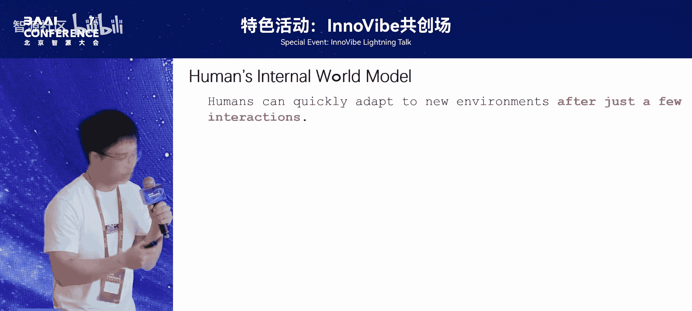

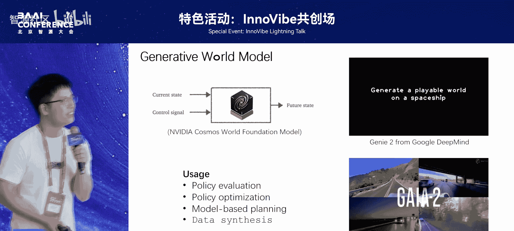

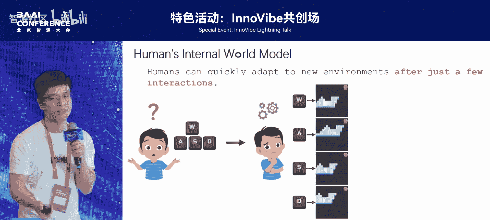

这种呃尝试非常少的交互，我们就能快速的知道一个环境，新环境它的世界模型是怎样的。然后当看到一个新的场景，然后这个agent在一个新的地方做一个不同的动作的时候，我们也能快速猜出来他是做啥。对。

但是对现在这种事验模型，他视觉效果虽然非常好。但是呢他们都需要非常多的这种训练数据呃，训练step数以及非常大的和数据去得到这个呃控制能力。所以说他他的这个adap的过程是非常低效的。😊，对。

所以我们想的是怎么让现在的事业模型能够达到这种人类级别的这种快速的适应能力。就看到一个新的场景，你做简单的几次交互，你就知道哦这个验模型是这样的后我们发现主要的问题其实是这就之前的这些视生成模型的话。

他们都是先从无标注的频个 model们通过大量的这种标注数据以及大量的种一控的个 model对所以我们想的是假如说我们能够在这个阶段这个字体有点问题。

就是假阶段就把这个信息就是每个视频中它的action信息是怎样的告给个 model那这的话他就知道了多这种广泛存在这种a这话在到一个新的场景时候，他就能够非常快速的适应以说我们就这个视频中。😊。

我们抽取了一种lantaction，就它不是一个具体的action标注。但是它是一个通用的这个action信息的表示。对然后在时候就把这个信息给加上。这样的话呃在测试的时候，或者说在应用的时候。

我们可以做非常多的这种事情。就一个例子就是说我们可以快速的把一个我们见过的一个一个动作迁移到一个新的一个场景中，这个功能也是非常有用的。就比如说呃我们比如说我们想教会机器人做很多事情，对吧？

然后比如说我们人做一个动作。然后这个机器人呃他看了这个视频之后，他可能就能想象自己在一个新的场景下，不同的位置。呃，然后不同的背景，但是类似的功能它就能够完成这个动作。对。

然后另外的话就是呃我们通过非常少的这个交互就能去把我们这个模型adap成各种各样的具体的这种世界模型。对，然后就可以做planning之类的事情。😊。

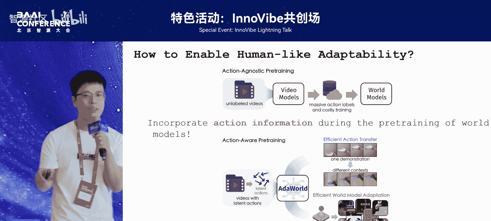

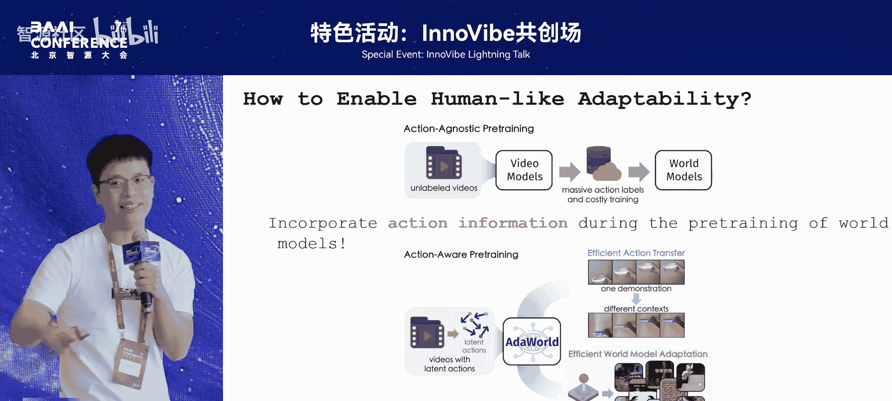

对，然后这是我们数据级。对我们为了让我们这个视验模型能够足够泛化，我们采了一个比较大的一个数据集吧。对，然后采的方法也很有趣，大家感兴趣可以自己具体看一下。对，然后问题又来了。

就是刚刚我说我要引入一个这种影视的这种action作为一个通用的action信息表征。但是怎么从这种视频数据中去得到这个action表的那又是一个问题。对。

然后我们我们在这里其实做法是我们引入了一个就是我们具体我们训了一个这种auto，然后端，他把当前帧和下一帧告诉这个der后我们只把当第一帧告诉他。

然后同时把第一帧和第二帧压缩出来的一个非常短的这个也告诉这个der然后整个网络训练的目标是尽可能好的重建出下一帧。然后你会发现因为因为中间这个nt action它是一个非常低的非常紧致的。

所以说你要很好的预测出下一帧的话，你这个非常低的。😊。

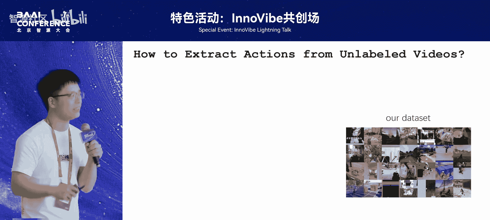

这个vector你必须尽可能压缩出从上一帧到下一帧中最关键的这个信息。对，然后在决策场景中的话，这个信息往往一般就是action。因为其他的这些变化其实是可以被decodeder预测出来的。

只有这个action是主观的。所以说你必须把这个action给comppress在这个latent actionction里。😊，对，然后这个la action的话，你会发现就是它是非常的呃呃有表现力。

然后同时它也是跟场景无关的。就是我们把左边的这个视频中的la action提取出来，然后放到一个新的场景下去做一遍。你会发现他做的虽然这个可能东西都不太一样。但是他做的是同一个这个action。

所以它的表示能力非常强。对然后于是我们就用这个呃就用这个呃la action去我们这个word model。对，然后通过这之后，我们其实就知道了各种各样的la action，它应该是导致怎样的后果。

所以说他就可以容易的被这个la action操控。所以说你通过这个la action做一个媒介再去做 adaptap的话，它是非常高效的。😊。

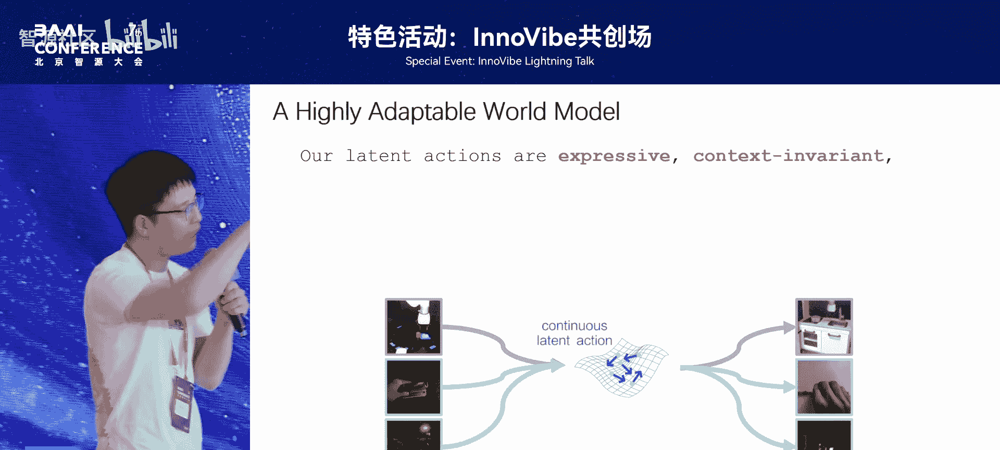

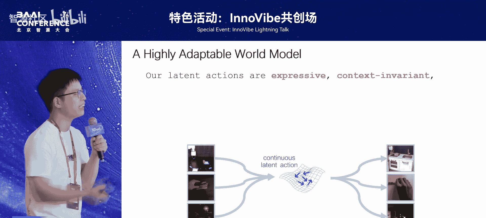

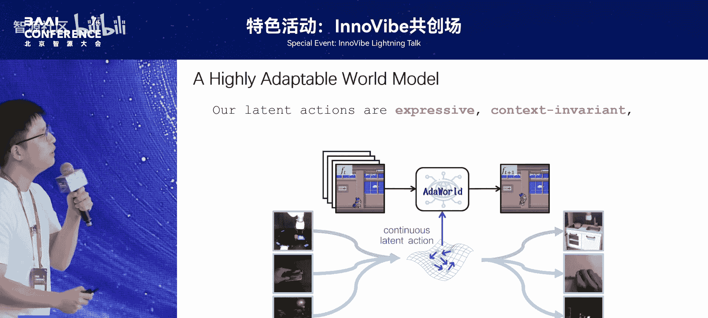

对，就是各种各样的这种呃具体的这种应用场景。比如说游戏啊呃机械臂啊、机器狗啊呃自动驾驶啊呃你各种各样的action，你都很很快的能把它去微调，往那个latent actionction上去对齐。对。

然后这样的话你就能只需要很少的step数，以及很少的train sample就能得到一个可以被应用的一个视觉模型。

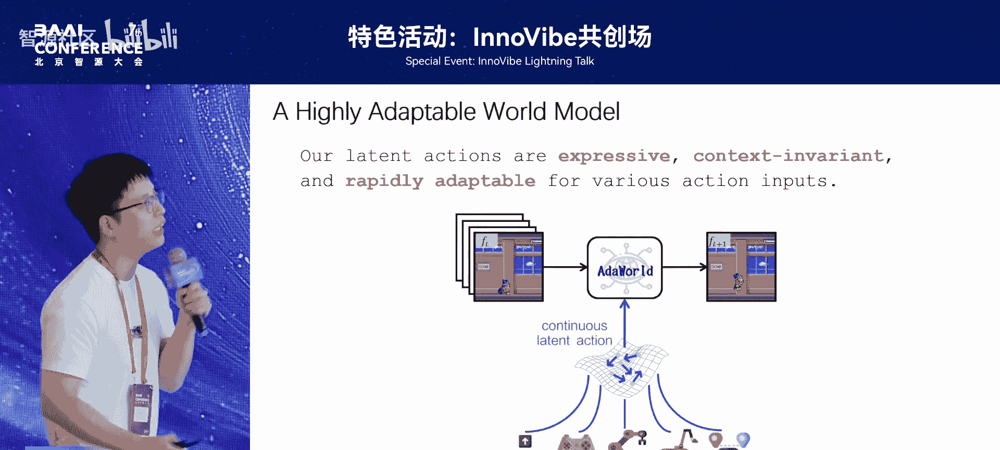

对，然后这是之前的一些呃呃这是一些实验结果，就是像之前的模型。因为它是呃做这种unlabeled的 traininging。对，就是他train阶段他是没有见过action交互的呃这种模式的。

所以说的话你只用很少这种训练sle和数据的话，你让他 adapt成一个微新的一个世界模型。就比如说我们拿我的世界，然后我想让一个世界模型去模拟我的世界，他 adaptap其实是非常慢的。

就比如说呃你劝了200步，它好像有点提升，但是后面他就提不上去了。对，但是用我们的世界模型的话，就是他一方面他可以adap的很快，就他能很快的就能知道怎么去控制这个这个游戏。对就是你你只需要300个帧。

然后你你只需要200步，它就能很快的被控制。对，然后另外的话，他最后的效果也会更好泛化率也会更好。😊。

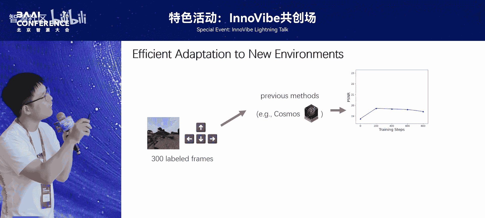

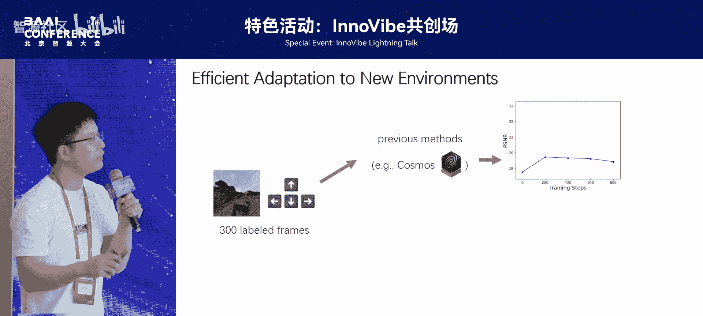

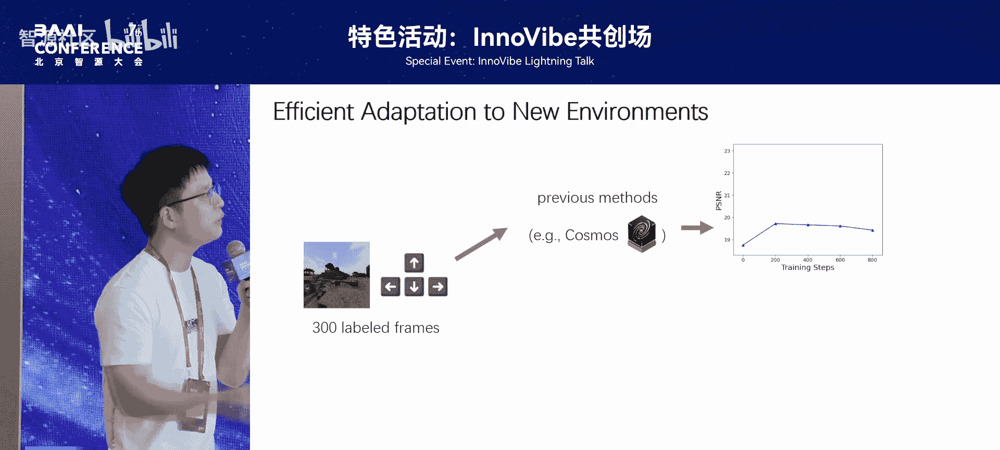

对，就是呃ad的更快，然后control的也更好。对啊这边举的是这个我的世界例子，然后它是一个离散的输入嘛，就是你按按键盘什么的对，但是其实你对其他的这种呃连续的输入，就比如说自动驾驶的轨迹啊。

然后比如说机械臂的它这种电机的控制啊，都是连续信号嘛，你其实也可以ad的很快。对，就是因为这个la action它是一个很好的媒介。😊，对，然后刚刚说的就是你由世界模型之，你可以做非常多的事情。对。

然后呃还还有一个就是我我的型很快之后，你可以很容易去完成非常多任务的就是就是正我所说 model可以告诉你这每个决策它带来的后果是什么。

以说你可以到你有了这个相对场景的这个word model之后你可以自定一些re就比如说我要去拿这个拿这个萝。后就比说设定算个然后用这种搜索的方式。

你用里去搜索你就可能去让达那个我还这个械比你希望这个方推对应的位置为我模型只需要快的常以说之前的的话可能需要很多数据。😊。

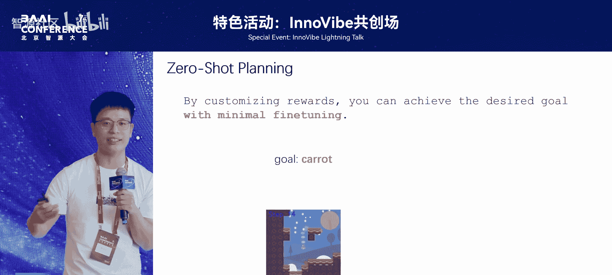

去劝这个wordor model才能去完成这个任务。但是我们的很快，然后控制的很精准的话，呃，我们我们就能很快的去呃实现这个任务。对。😊。

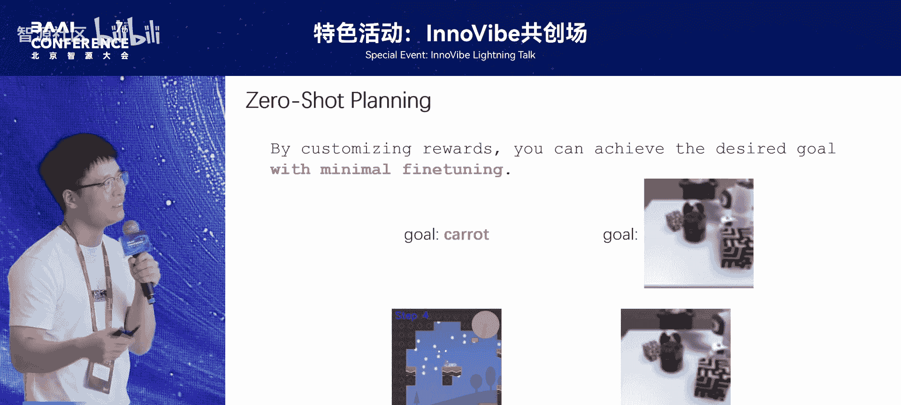

对，以上就是我呃这个简单的介绍。对，然后非常感谢大家的聆听。好嘞，现在到了那QA时间。😊。

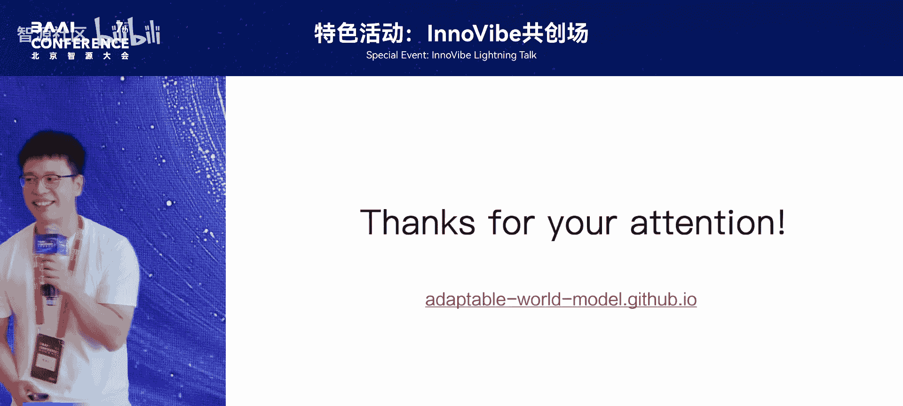

好嗯，请改位这伟梅。非常感谢您的讲解啊，对于我本人不是做事件模型这一块。但是我有个小问题啊，就是您在呃您刚刚提到。😊，区分动作的时候是直接把那个给抠出来，呃。

就是您怎么去判断我背景的变动和动作的变动带来的这个对，这这是其实是一个自动的一个过程。就是你刚刚说我怎么提取那个 action是因为是这样的。

就是对于大多数决策场景来就比如说背景上的些动作它都是就相对来说是可以被预测的。假说背景里没有其他的agent的话，对就是因为是这样的。

就是agent的action它一般来说在决策过场景中它是最难被预测的。因为它是主观的，就是你不知道那个东西会在怎么动对但是背景的话比说比如说水在流啊这种它都是可以被预测的。所以说der足够强大。

它能够预测的话，你这个 action它只需要去捕捉跟这个决策跟个ag自己动作最相关的那些信息好我是不是需要分两步。第一步先训那个der。就是先训一个比较好的对首先这个。他得有比较好。

他得有一定的预测能力才能做出你这种区分。对，但是你可以用一阶段训练，就是你你一起训练，然后端到端的去优化。我还有一个问题是你刚提到这个你你们的世界模型更适合于就是很能自适应吧。

它是一个就是我在一个新的游戏里边它会自己做出一些决策嘛。对word model是这样的word model的话，你可以你可以用一个word model自己去让他去得到决策的结果。

你可以也可以让他去跟一个agent去进行配合。对，就是就就呃最差的agent就是一个dom policy嘛。就比如说你有三个按钮，然后你你三个按钮都是以3分之13分之1的概率去按。

然后假如说你有个word model的话，你就可以去优化这个这个策略就是从三个三个提供了一个比较好的初始概率是吗？😊，哦，他他会他会优化这个概率。对，就是呃就是优化这个概率分布。

就就是呃你你你三个都选一遍，然后你让word model让你选出最好的那个结果是什么？他他他就把其他两个坏的这个概率变成零最好的变成一嘛？正常来说。

比如我用强化学习的话让他从从都是就是你说那对于世界模型来说，如果要引入强化学习的话，应该是怎么一个流程呃，就是你用A去去跟事业模型去交互。然后世界模型把re给 agent。😊。

然然后他就去优化就最大化reward啊，就是他会提供一个更好的reward的action reward是吗？就是相比于 word model它的近似也在于就是它是环境的替代品嘛。

就是你本来的话就是比如说你这个agent呃，你要去比如说是reward中的agent的话，你要去做优化的话，你要跟这实世界进行交互。所以很慢。所以说你用个re model去替代的话。

假如说你有100栏卡，你就可以跑100个环境。对，就就是你可以快咱们的方法的优势是在于这个世界模型更好的提供了reward嘛。😊，不是也不是吗？对，不是对对他ad的更快，就是你只需要很少的sample。

很少的training cost就能得到一个啊这个线下的讨论吧，反你们线下或找机会再聊一下啊。😊。