# 2025北京智源大会-特色活动：InnoVibe共创场 p08 面向理论指引的高效数据压缩：王少博 -BV1nNNJzJEx6_p8-

好，下一位讲者是来自上海交大的王少博，他讲的题目是面向理论指引的高效数据压缩。大家好，呃，我是王少国，来自上海交通大学人工智能学院。然后今天很荣幸在这里给大家分享一下我们组在数据压缩层面的一些探索。

然后今天的题目是面向理论指引的高效数据压缩。😊，呃，首先大模型时代，这个数据逐渐成为一个呃影响计算成本的主要因素。在之前可能大家会考虑把模型的参数量给sll up上去。

比方说呃就是deep seek或者是千万这些模型，我们看到越来越大的这些模模型的参数量。但是实际上呃到2025年其实呃业界的一个共识是这个参数量基本上达到上这个万亿的规模。

然后有有些人会说这个预训链是不是已经终止了。那么参数压缩这个工作呢呃这些系列的一些探索呢，基本上也也已经相对来说比较完善了。因此呢现在大家可能更关心的事情是我怎么考虑把数据来压缩。

因为单次单次计算的过程中，这个数据的规模会越来越大。那大家可能比如说会考虑一些长下长上下文，以及一些更多的易训练数据。那么所以说我们关注的点是如何去利用目前已有的这些数据，就是我们筛出那些高质量的数据。

以及我们如何去合成一些更高质量的数据来辅导我们的模型的训练。😊，对，所以说数据规模已经逐渐记载这个模型参数量，成为一个影响大模型计算成本的主要因素。那今天呢就是我想给大家呃分享两篇工作。

是我们组在数据压缩上面的探索。首先我们先聊一下这个高效数据压缩它的这个目的到底是什么。首先呢是效率上就是我们希望去通过更少的数据达到相似的性能，这个性能可能可以是训练的时候的性能，也可以是推时候的性能。

我们最最终目标是实现一个加速。比方说我们原始的数据可能会有比方说需要10个小时的这样一个训练。那我们通过压缩之后可能就需要比方说30分钟训练，但是我的性能是差不多的。这是第一个是效率上。

第二件事情就是性能上刚刚也说我们呃一种方式是直接通过压缩的数据可以是让我们尽可能性能无损。同时呢我们也可以考虑去合成更高这样的数据，让它的性能甚至会有一些提升。呃在这个高效数据压缩上主要有两种范式。

第一种范式是基于筛选的范式。比方说。😊。

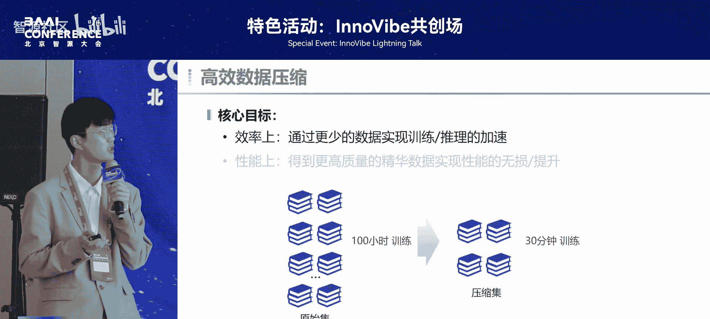

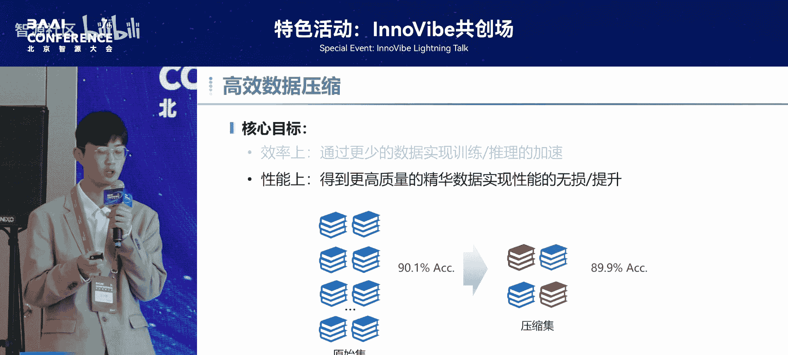

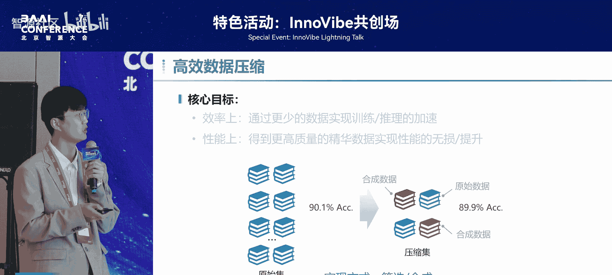

我直接从5万个样本里面去选100个样本，这是非常直接的一个方式。另外一种方式是基于合成的。比方说我先先合成很多很多的样本，然后我再筛，比如说最后就筛成几百条样本。

但是它的呃这个这个数据不一定要直接来源于原始的这个数据集。但是它可以是不一样的。但是它同时呢呃会提供更好的这样一个质量。😊。

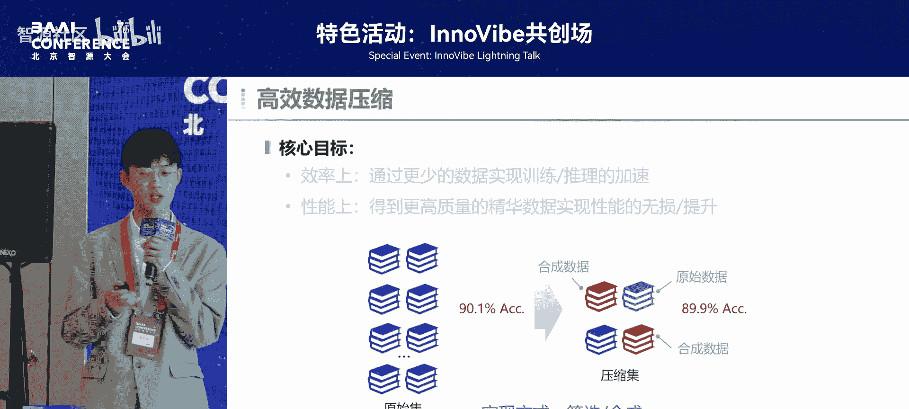

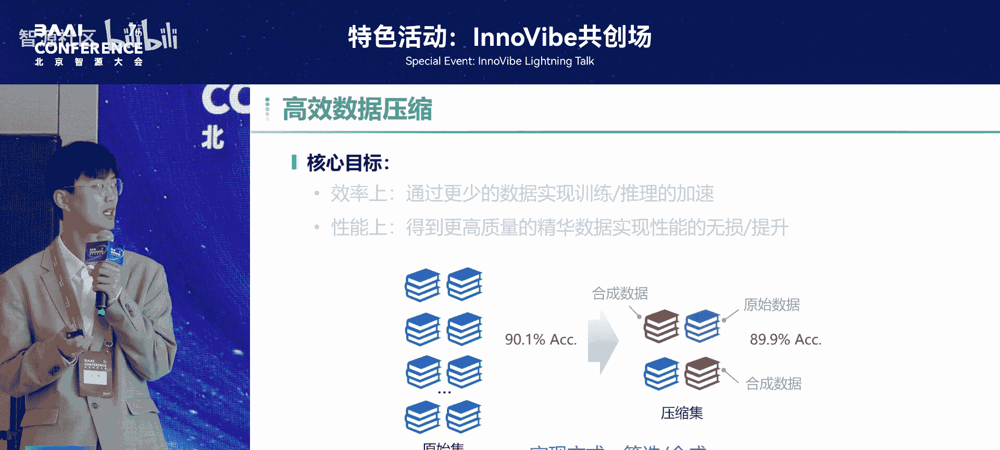

呃，今天分享的第一篇工作是我们团队在COPR2025的一篇满分论文。然后这篇文章探究是在视觉数据集上如何做一些比较高效的数据压缩。😊，呃，首先我们先回呃简单介绍一下这个领域到底是怎么做的。

然后目前的方法的话主要是如这个图所示。呃，我们现在有一个原始的数据集，有一个压缩的数据集，然后我们会对它同时会进行一个网络。然后这个网络是在每一步都进行更新的。然后在这个更新网络上会抽一个信息。

这个信息一部分来源于原始数据集，一部分来源于压缩数据集，这个信息可能是需要自己设计的。比方说有些人设计成提度，有些人设计成特征，有些人会设计成轨迹等等等。

然后我们会把原始数据集和压缩数据集的这个特征会做一个匹配。呃，这个信息会做一个匹配。然后同时呢这个网络也也是在这个过程中进行更新的这是一个双部优化这样的过程。那这个过程的话就会有一个非常致命的问题。

就是它显存的开销是非常大的。比方说我们测一下，在用一张A100来测一下这个显存的开销。那发现呢其实很多非常简单的方法在非常小的数据集上，它实际上这个这个就om memory对。😊。

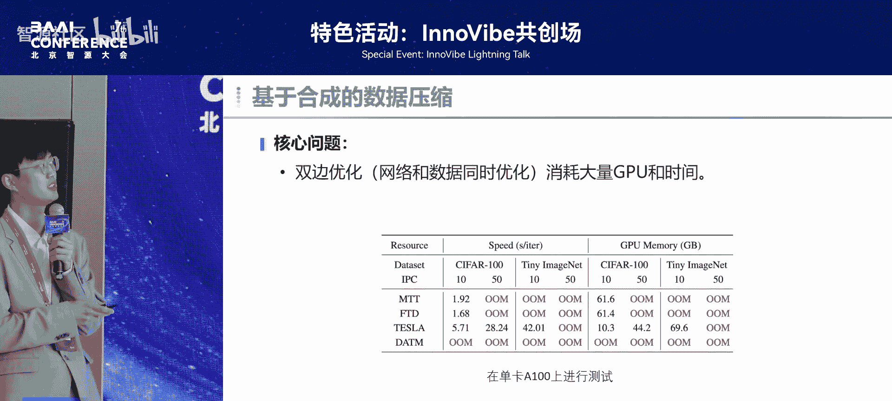

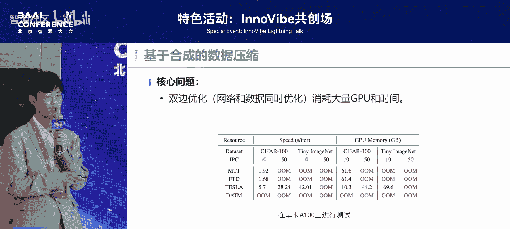

那基于这个问题呢，我们提出了两方面的这样一个动机。第一部分的动机是我们能不能把这个双面优化简化为一个单面优化，就是说我直接匹配核成数据集和真实数据级的这样一个信息，而不去更新网络。

也就是说我们把这个这部分网络更新的这部分给扔掉。那实现的方式就是我们通过一个模型来做一个参数的融合，这是第一个第一个部分的改进。第二部分改进就是对于到底用什么信息来进行匹配。呃，我们这里采用的方式是。

通过数学上采用特征函数这样一个度量的方式来寻求这个原始数据集和压缩数据集在这个分布空间上的这样一个匹配。然后这个在数学上可以证明是跟呃概率分布是严严格上是一一对应的。

然后这个是我们主要的一个 pipeline。然后我们会把合成数据集和政式数据集都未进同一个网络抽一个信息。然后我们会算它各自的特征函数。然后我会算它特征函数的这样一个距离度量。

这部分我们的目标就是让合成数据集跟真式数据集在分布上是对齐的，这是一个minize的过程。那么同时呢我们还有一步mimize，就是说我这个特征函数到底是在这个空间中的哪些点进行采样。

这个采样会涉及到一个参数。这个参数呢是通过另外一个非常小的一个网络来学习的那这个网络的目标呢，就是去maximize在这个空间上呃合成数据集和政式数据集的距离。那通过这个方式minmax这样一个框架呢。

我们就可以实现一个非常高效的这样一个数据压缩的这样一个匹配。😊，啊，这是我们的一些性能，就是我们会在性能上比之前的方法会好好一些。

然后会在小分辨率、大分辨率以及跨架构的各种实验上都会展现一些比较好的性能。😊，然后这是我们的一个例子，就是我们实现了。比如说这个数据集上实现了300倍的GPU减少以及20倍的加速。同时呢我们性能会更好。

甚至超过欧电大赛的这样一个性能，这是我们的一个实验结果。😊。

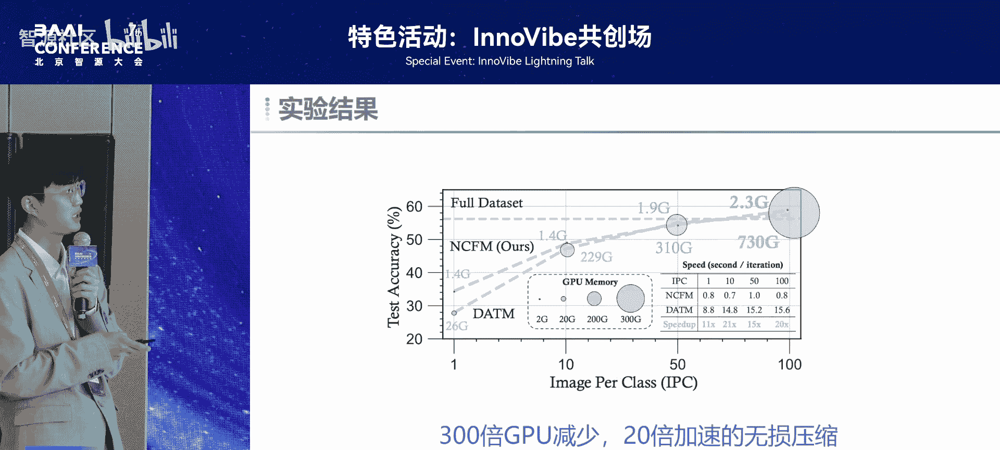

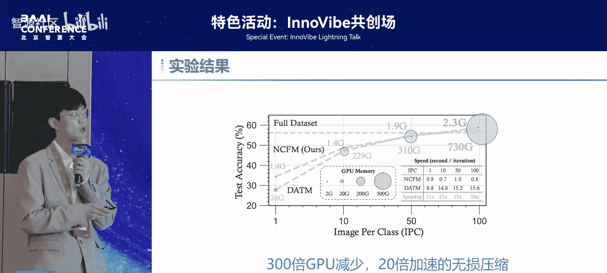

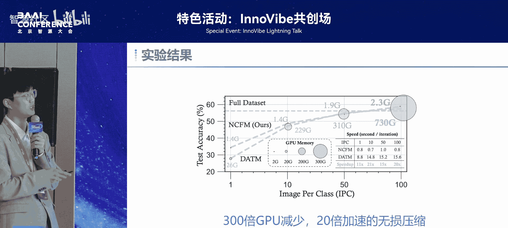

然后前面那篇工作我们介绍的是视觉上的基于合成的范式。啊，下面这篇工作呢，我我们是介绍一个我们最近在ACL上的一篇呃大模型上的一个高效的数据压缩，跟之前合成的范式不一样。呃。

这篇工作里面我们是直接做一些筛选。😊，然后首先还是回顾一下目前大模型上到底是怎么做这个数据压缩的。呃，大部分的范式大概是这样子，就是我先有一个原始数据集。

我先呃基于这个原始的数据集去用一个打分的网络去更新个非回调一个网络。然后根据这个网络，我在做一个top筛选。这top筛选的时候，我会基于各种各样的指标。

但是这个指标大部分的人呢他会采用一个比较启发式的方式。比方说基于相似度，基于重要性等等。那这个方式可能没有没有一个理论的这样一个依据。😊。

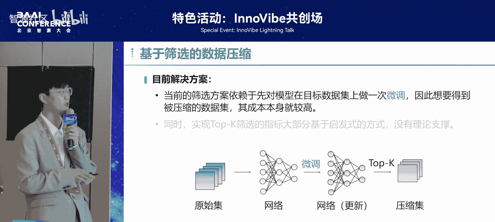

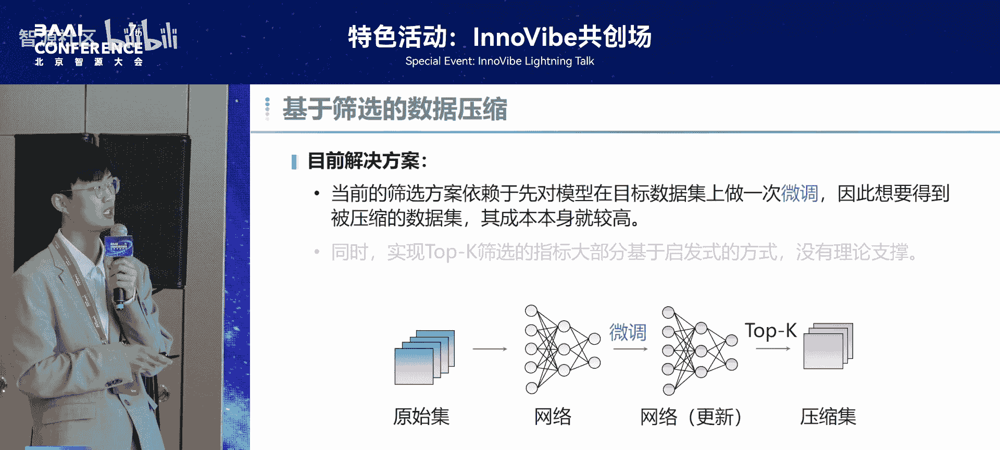

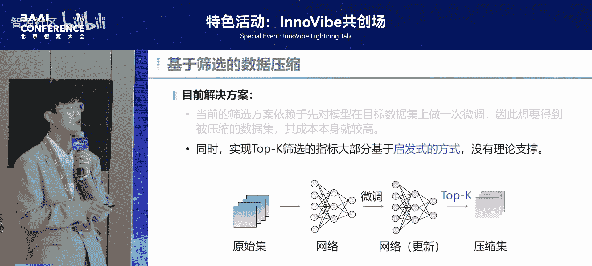

呃，根据这两点，所以我们就提了一个我们这篇文章的一个motivation。就是说首先第一点，我们希望我们不需要微调，就是我们直接通过模型本身的这个能力来选数据。

那具体来说我们是用上下文学习和这个注意力机制来来选数据。第二点是我希望有理论保证。就是这点其实上下文学习的一个比较好的性质，就是我可以证明在呃这个上下文学习中学习学到这个样本。

选到这个样本跟SFT的样本是有一些关联性的。第三点就是efficency就是我们这个方法还可以做这样一个事情，就是我可以用小模型来指导大模型的数据筛选。😊。

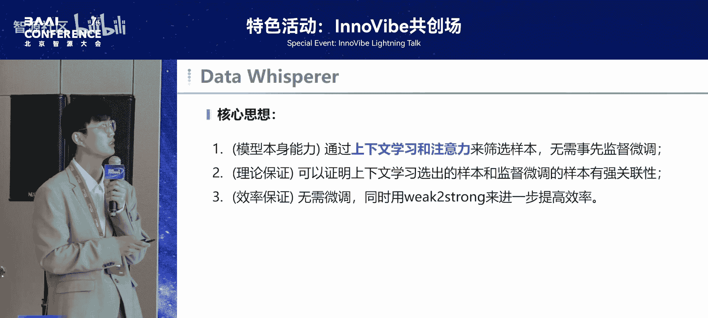

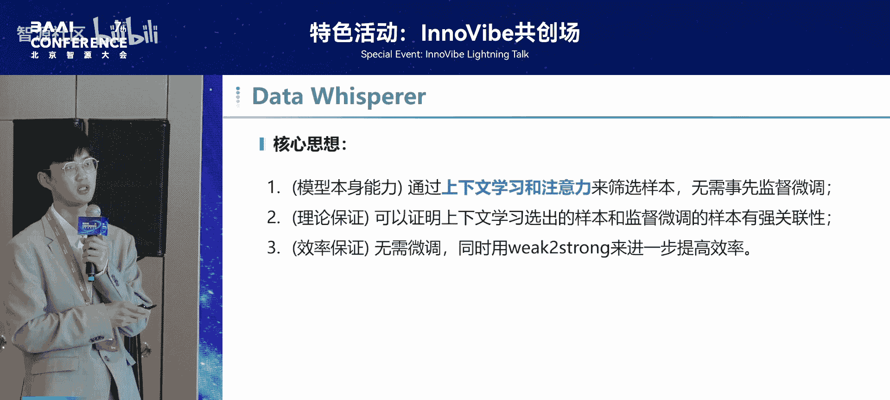

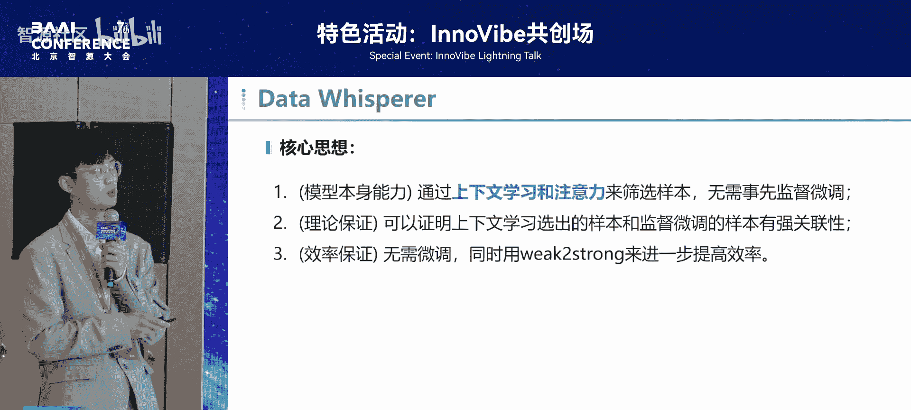

然后这是我们具体的一个呃流程图。呃，首先我们从训练集中会呃第一步我们是从训练集中sple一些QA队。比如说我有5个QA队，然后我在sle在训练集里面sple三个呃问题。

然后我希望看这5个QA队的质量到底是怎么样的那怎么做呢？就是把他们做一个 learning。就是我用呃如果说这5个问答队能够比较好的作为demonstr来指导这个QA的回答。

那么认为这5个呃dedemonstr可以认为是个比较好的这样一样本。😊，但是这里光这么做比较难义务。就是说我其实这里是等价的考虑的这5个demon的这样一个重要性。

比方说我这里会有个aver score，比方说是0。78，就代表着这5个demon的这样一个打分。但这里的话大家都知道就是这个大模型它会这个里面它的位置其实是非常影响它的预测。

所以说我们再通过ten来给他这个分数来做一个加权。就是我们看一下这个rstken prediction上的这个tention matrix里面部分个de对这个这个影响。

把这部分分数拿出来作为这样一个权重。所以这样的话我们就可以得到一个比较合理的对这5个demonstr的重要性的评分，然后会重复很多次。呃，最后就是得 score就是每一个的这样一个分数。

最后我们top作为我这个压缩的数据集。大概是整体的这样一个流程。😊，然后我们的方法的话，在各种模型，比如说lama千问miss上都有一些比较显著的一个提升。然后甚至有些情况下。

我们可以超过hold data set这样一个呃这样一个性的10%的这样一个case。呃，然后我们的任务也做了各种各样的任务。对。然后呃接下来就是可以直观的感受一下我们的个性能，就横坐标是这个时间。

纵坐标是这个我们的performance。然后之前的很多b line的话，它都会集中在右下侧。也就是说它需要更多的时间。但是实际上它的性能没有特别好。

然后红色右上角这个红色三角形代表是直接去fin这个完整数据集这样一个开销和性能。然后这是我们的方法在左上角，所以说它的这个效率和性能是兼固的。然后同时呢我们也可以做 strong。

就是我们发现用更小的模型来指导更大的模型去做数据筛选，它其实不会要点，甚至有时候会更好。😊，OK以上就是今天工作的分享。然后我在这里放了两篇工作的这个二维码以及我的微信。如果大家如有问题可以联系我。

谢谢大家。😊，好的。嗯有没有现场有没有问题？呃，您好，就是您提出的这个数据压缩的方法。就是呃我的问题是关于第二篇工作。就是您的实验都是针对同一个 domain命。然后难度也是比较相似的这样一个数据集。

那我想问的就比如说在一个真实的一个你去SFT一个大模型的过程中，那你用的整个SFT数据集，首先是包含多个 domain命的信息的。

难度也可能是差别很大的那这个时候我们呃怎么把这个方法去扩展到这样的一个场景中去。谢谢。就是这篇这篇文章我们其实还主要是探究 specific的这样一个问题。

然后呃可能他确实如果说你要做比较gene的问题的话，可能t会受到一些影响。可能就是可以动态调整一下。比如说你先去做哪部分领域的筛选，然后这样循序渐进的可能会比较有优势。好的，谢谢嗯。他问题。啊。

谢谢王总。