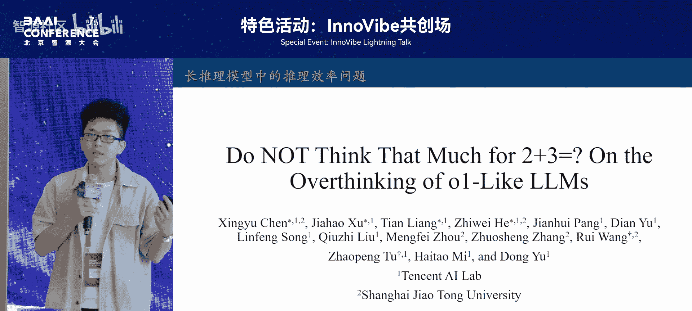

# 2025北京智源大会-特色活动：InnoVibe共创场 p09 长推理模型中的推理效率问题：王 越-陈星宇 -BV1nNNJzJEx6_p9-

下一位是呃，下一个talk是长。呃，推理模型中的推理效率问题。然后讲者是苏州大学的王悦和上海交通大学的陈星宇。呃，hello大家好，我是上海交通大学的陈星宇。

我和我的合作者王月今天将给大家带来常推理模型中的推理效率问题的一个分析。嗯，从R一这一类的长推理模型出来之后，他的因为一个类人的一个推理行为受到大家的广泛的关注。而我们的问题是。

长推理模型在思考的时候是否做到了一个高效。我们发现在长推理模型里面频繁出现的两种思维模式。他们其实会导致我们一个推理效率变得更低。比如说自我反思的行为，它可能会发展成一个overthink过度思考。

它会在简单题上反复生成已经得到验证的答案。这是在思路切换这一个点上，它可能会发展成underthink。也就是说我们在难题上可能会欠缺呃会欠思考。嗯。

首先我会给大家带来我们在overthink这方面的一个研究。这篇文章也已经被ICML2025接收。

overthinking是指模型会在一个简单的问题上反复生成冗余的同质化的解答。比如这里面是QWQ对一个很简单的问题，2加3等于几生成的回答里面包含了13个不同的解答。每个解答都得得出了答案。5。

那么这一种对简单的问题反复生成解答的行为，其实是极大的浪费了我们的一个计算资源。嗯，在这里的话，我们的解答定义为就是完整包含了推理步骤和答案的一个片段，我们就成为一个解答。

那么我们首先发现这些冗余解答对正确率的影响其实比较低。我们这里面统计了不同位置的这一个解答，它的一个正确率。我们可以看到在第一个解答的时候，模型的至少有85%的问题就已经得到了解答。

就是它的准确率已经达到85%以上。在后续的一些解答中，其实它的呃只主要就是对这个答案进行验证。并不影响最终的一个正确率。然后我们发现这些冗余解答里面的一个策略的多样性其实是比较低的。

如果我们我们用呃GPT4O来进行一个策略的检测，我们发现第二个呃策略里面啊，在第二个解答里面，我们只有40%的可能性会引入一个新的解解答策略。

而且这些新的解答策略会随着我们这个解答的一个数量增加而逐渐减少。所以越到后面模型越容易去重复前面的一些一些推理的方法，所以也是一些冗余的生成。此外。

我们还发现overthinking现象在简单题上面会更加的明显。我们列出了在麦500数据集上面不同难度上的一个解答密度，也就是每1000个token里面包含多少个解答。

我们发现随着我们的这一个呃难度上升，这个解答的密度直线下降。也就是说在越简单的问题上，它包含的一个解答就越多。这其实对于我们的一个整个的效率来说也是非常的不利的。那么基于我们的一个观察。

我们提出了两种指标，一个是呃用来衡量正确token占比的一个产出效率以及衡量一个策略多样性占比的过程效率。我们可以发现，即使是R一这样的先进的模型。

它的整个的过程效率以及这个产出效率也只有50%到60%左右。也就是说至少有一半的token是冗余的。我们提出了一种呃基于偏好优化的方法来缓解这个overthinking的问题。

我们呃通过精简我们的一个模型的生成来构造一些比较短的精呃比较精确的一些正样本。然后我们提出最后的一个最优的方法是我们只保留整个生成路径里面的第一个正确的解答，以及一轮额外的一个验证。

然后我们的一个结果可以表明就是在呃数学推理数据计上，我们的方法可以保持性能，但是可以减少至少一半的一个生成的token呃token的生成量有效的提高了我们的一个推理效率。呃。

以上这部分是我们关于在overthinking现象上面的一个研究。接下来请我的合作者王月来给大家介绍一下一个underthink的现象。呃，大家好，我是苏州大学的王悦。然后刚才新宇介绍了。

由于这个过度的反思，会导致模型出现overthinking的问题。然后接下来的话就是我来介绍一下，由于过度切换思路，会导致模型进行一个underthink的问题。具体来说的话。

可以看一下右边的这个case，这个是QWQ模型在那个AME的一道题上面的一个表现嘛。可以看到他在回答的过程中不断的出现了alernative进行切换思路这么一个现象。

然后的话以我们think的一个定义就是说模型他过早了放弃正确的推理思路，导致在面对挑战性问题时，推理深度不足。就是说在右边的这些他切换的思路当中，其实在前序思路当中有一些其实是正确的思路。

但如果他继续把精力花在这些思路的后续的推演上面，这可以得到正确答案的。但是由于他把这些思路放弃了，导致他最后的回答是出错了。对，其实在那个阿姨出来之后，切换思路一直是认为是一个非常好的一个推理模式。

就是很像人类这是一个题做不出来之后，他切换一个更好的思路进行回复。但是的话就是在我们的前期实验当中，我们发现有两个实验观察。让我们开始怀疑切换思路这个行为是否真的是一个非常好的行为。

第一个实验观察就是说在错误回复当中，他的思路切换现象是明显增加的。就是左边这张图红色的是那个错误回复，绿色的是正确回复，可以看到那个错误回复当中，他切换思路的现象是明显增加的。

而右边这张图的话是在难题当中的思路切换频率也会更高。这个是在mas这个数据节上面从难度从1到5之后，他的那个切换思维切换思路的那个频率的数量。对，基于这个现象。但是上面这张图的话。

我们只能说是这个切换思思路切换这个现象跟呃回发呃错误回答是有一个相关性。但我们并并不能说是有一个因果性，就是说切换思路就会导致模型做错。因为对于人类来说碰到一个很难的题，它也有可能不断的切换思路。

我也有可能是一个正常的现象。所以的话，后续我们又补充了一个新的实验，就是衡量这些被放弃的思路当中是否是有一些正确的思路。具体的做法的话，就是我们让大模型根据呃被放弃掉的思路进行一个续写。

观察它这个续写出来的那个答案是否是正确答案来判断这个思路是否是正确的。然后基于这么一个呃判断思路是否正确的指标的情况下，我们有两个观察，就是错误回复中，其实前期思路是有很多是正确的，但是它被放弃的。

就是左边这张图，然后第二个观察的话，就是大部分错误回复中，其实都是包含至少一条正确。推理思路。也就是说模型在他做错的题目上，其实是有很多思路，它其实是正确的。但是可能由于他的训练的一些问题。

导致他放弃了这些正确的思路，导致最后模型做错了。对，上面来上面介绍了这个模型是underthink现象是一个非常显著之后，我们引入了一个量化指标，去评价这个模型。它的underthink是有多么显著。

具体的话就是说我们认为一个模型如果他最后是回答是错误的。而他如果之前的推理思路中是有正确的话，那他是有一个underthink这么一个现象。那它比例就是在于在第一个推理正确推理思路完成被放弃掉之后。

他后续又额外推理了多少taken的这么一个比例，就是他underthink的一个严重现象，就是第一个推理思路，它已经其实可以得到正确答案了。但是他被放弃了。后续他又做了很多的额外工作去换一些别的思路。

但是他最后没有得到正确答案。这一部分ken就是被认为是比较低效的这么一个推理ken所以而如果一个错误回复中不存在一个正确思路的话，就可能这个模型它没有理解这个问题，就是所以他会尝试各种多样化，但无效。

思路。但是这么么一个现象的话，我们就认为这不是一个underthinking问题。只有在一个模型它回复错误，且有思路是正确，放弃思路是正确的情况下，它是一个underthink的这么一个问题。

然后右边的话是我们对当时的一些长推里模型的一些呃定量的检测吧。可以看到，即使是IE这个模型，它也是会有很严重的这么一个underthink的现象。

然后基于上面这个underthinking这么一个观察的话，我们也提出了一个很简单的基于这个解码约束的这么一个推理策略。具体来说的话就是我们观察到模型切换思路这个位置。

其实绝大部分可能是alternative这个词。然后也就是说所以的话我们想要的直观的一个想法，就是说我们想要去降低alternative频繁出现了这么一个概率，那它就有可能去坚持它本来被放弃的那些思路。

呃，具体的一个做法的话，就是说就是右下左下角这边一个公式的话，它直觉上的一个解释来说的话，就是判断当前位置。首先我们要记录一下，就是上一个位置ernative出现的位置。

如果当前这个解码的位置和上一个出现的位置过于接近的情况下，那我们就会去惩罚这个ernative出现的概率。具体来说的话，就是我们会平去打压那些频繁出现的aternative。

就比如说如果他三四百个ken一个思路才说了一两句话，那他又想要换思路，那我们觉得这可能就是一个很不好的underthink的现象。所以我们想要把这个现象给他惩罚掉。

对右边的话也是我们的一个实验结果看到在和一些模型上面都是有一个非常显著的对模型准确率的一个提升。也就是说其实让模型坚持它原来已有的思路，他有可能就是正确的，它不需要被放弃掉。对。

最后总结的话就是说我们常推我们发现常推类模型在简单题上是很容易出现overthinking现象，在复杂题上会出现underthink现象。然后这两种现象的话都会导致推理效率的一个降低。好，谢谢大家。

报告结束。好的好的，有没有现场有没问题。啊，这儿。啊，你好，我想问一下，就是因为关于overthinking的问题啊，就是因为我看你们的验证集的话，三个验证给了三个验证级的例子都是数学的验证集嘛。

是否overthinking这个问这个做法只是在领域下会比较适用。这是第一个问题。第二个是你们说保留了一个wifi嘛？他那个wifi是怎么做的呢？我想我想请问一下。😊，呃。

首先关于这个overthinking的一个适用性的问题的话，overthinking它的现象。其实如果你实际用RE或者的话，你会发现其实在普通的日常的问题上，他也会进行一个思考，就是反复的思考。

比如说会做一些假设之类的。但为什么我们选择数学呢？是因为数学它比较好验证，所以他并不只在数学出现。对，然后关于的问题，我不是很清楚。你可以再稍微你说你保留了一个单轮验证嘛，就是你单轮验证的那个哦。

对对对对，就是因为我们。呃，识别出来就是他整个完整的回复里面的每一个不同的解答之后，我们是可以判断每个解答它一个正确性的。我们就只保留了第一个正确的解答，就相当于我把后面这冗余的都丢掉了。

O等于是在问在筛选了。等于是对对对对对，是的是的。