# 2025北京智源大会-特色活动：InnoVibe共创场 p10 VLA on Wheels  Empowering Vision-language-action Models for Mobile Manipulation- -BV1nNNJzJEx6_p10-

好的，那我们请下一位啊呃王子维来自南阳理工大学，他的题目是VOA on wheels。哦，好呃，感谢大家呃。😊，我今天给大家带来的这个talk呢，主要是怎么把BOA模型用到移动操作上去呃。

首先做一简单的自我介绍哈呃，我现在在南阳理工大学做助理教授，然后是这个缺意义chool。然后我的主要研究方向是巨神智能呃，巨算大模型和这个机器人manulation。😊，呃。

首先介绍一下这个移动操作的背景哈。我们大家现在对于操作本身并不陌生啊，但是为什么我们需要移动操作呢？移动操作指的就是说除了手以外，我们对于这个呃底下的 base也需要同时进行一个移动。

那是因为在我们日常的很多的呃这个生活或者是工业生产中啊，我们需要在与不同位置的物体进行交互。比如说做举个最简单的例子，以这个做饭为例好了。呃，需要从冰箱里面把食材拿出来。

需要到那个那个厨房的那个台面上把东西切好，需要到那个炉灶的边上去加热这些食物。所以说不仅是手需要动，那么足也需要动，所以这是一个holdbody control的一个问题。😊，嗯，呃。

但是现有的BLA呢基本上都是这种fix space的呃BLA可以看到这个可能做的很好，把这个鞋子装到盒子里面。但是我们大家可以看到，现在如果在一些mobil线定下的，这个是用的allo的一些一些视频哈。

就是说呃它还是会比较困难啊，就是说很难把这个呃物体真正的把它放好。😊，呃，那么为什么会出现这样的情况呢？呃大家可能就会想了呃，移动操作把VOA用过来不就很简单的说一个巡航的方法。

也就我们所说的 vision language navigation VON加上1个VOA这个问题不就解决了吗？但事实上并不是这样子的，为什么呢？因为。

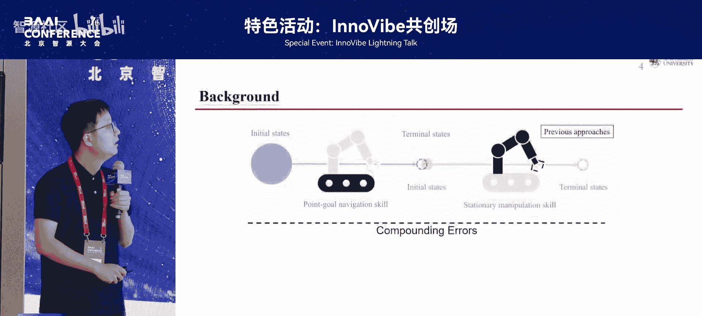

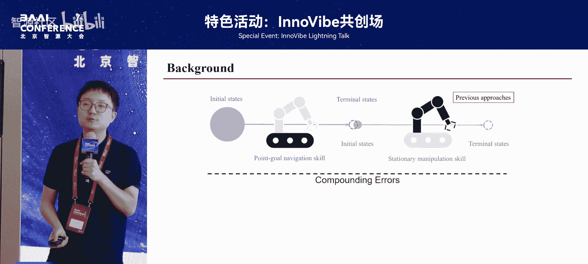

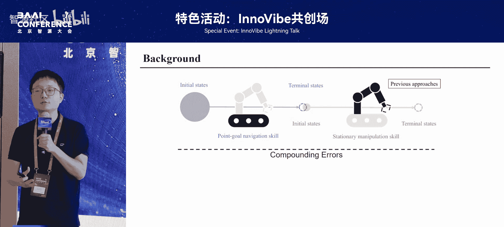

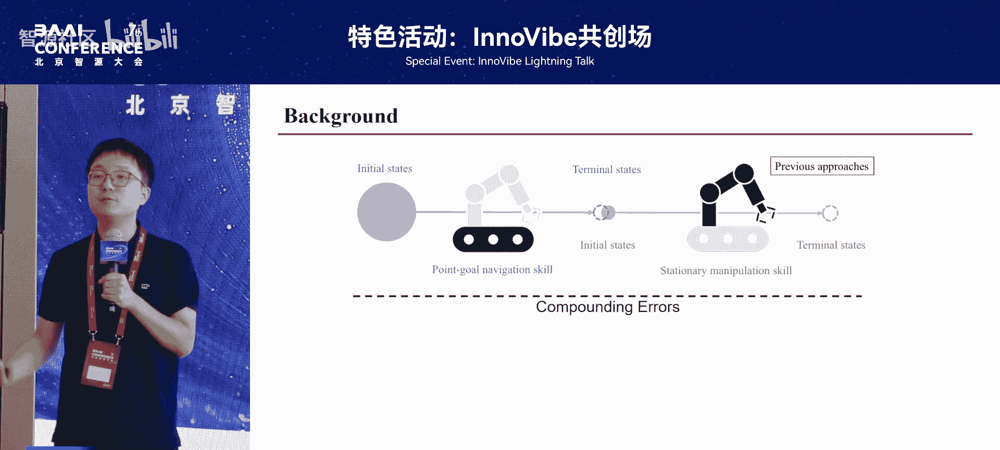

巡航的方法，它的目标是说我要找到那个物体，他并没有考虑我后续的操作应该怎么去做。比如说我要找到一个这个剪刀啊，我要把这个剪刀抓过来，那它完全有可能站到离那个剪刀刀尖的方向。

那么这样子这个操作完全是做不了的。所以说为了考虑后面的操作呢，我们移动操作的base的docking point的选择是非常非常关键的，是影响成功瑞的最关键的因素之一。

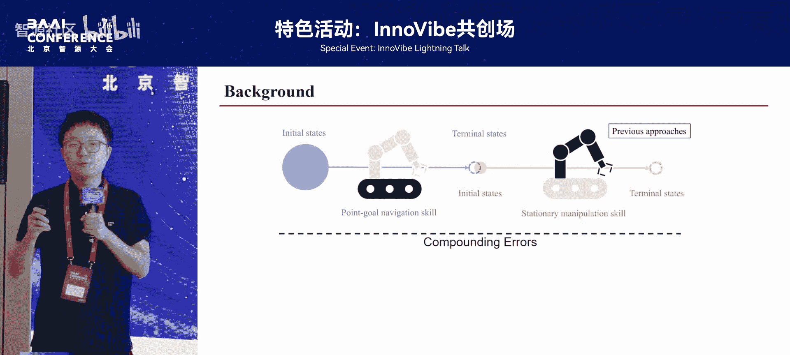

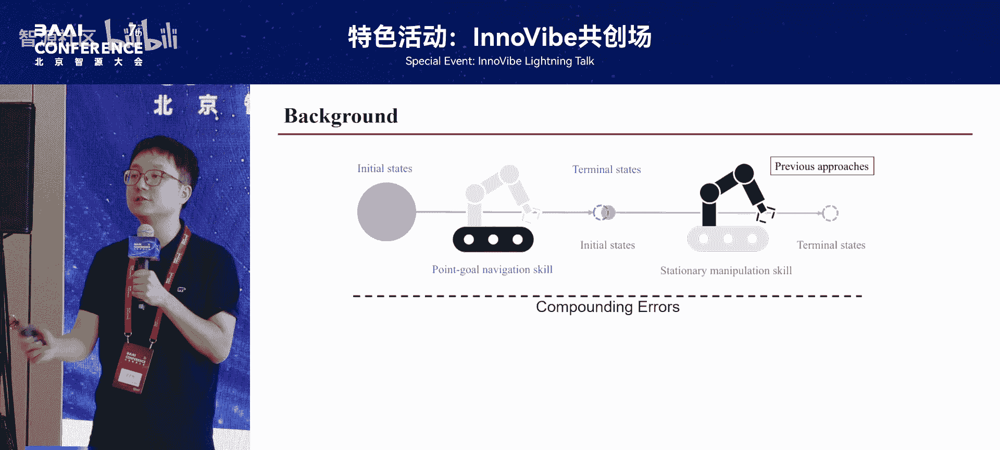

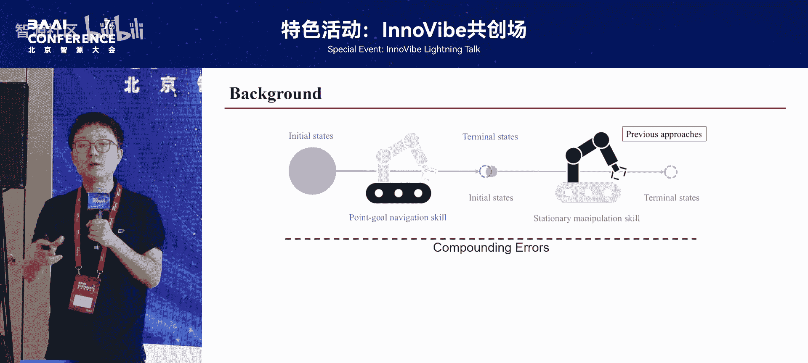

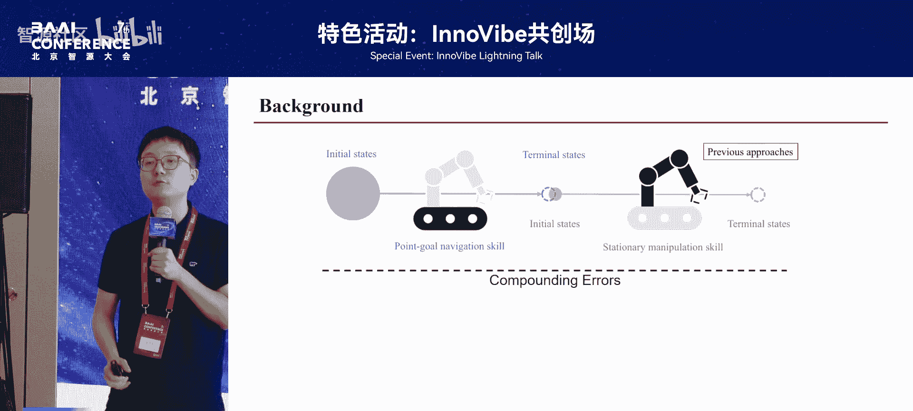

所以这里指的就是说巡航的VON的末态，就是它站的那个位置，并不是一个好的操作的mantuation的出态啊，所以这就是我们出现问题的很重要的一个因素。那么具体来说的话会出现什么问题呢？

比如说我现在巡航我可以找到这个瓶子，但是我把这个瓶子抓起来，但它是抓不到的。因为我的目标只是找到瓶子呀，我并没有说把它要抓起来。那么第二个呢，就比如说我也是要把那个瓶子抓起来，但是这个瓶子呢。

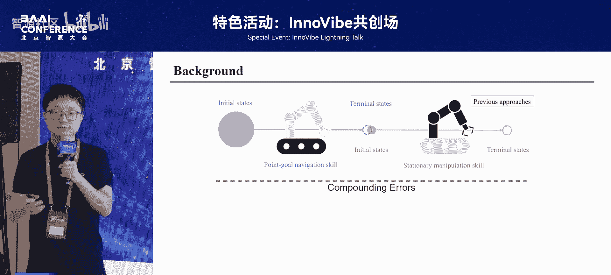

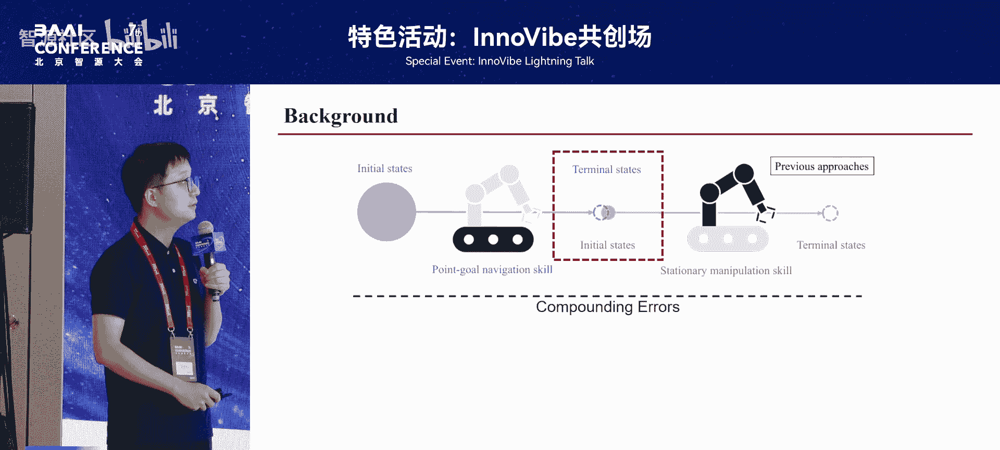

他在这个柜子里面，我如果直接去像这个样子去抓的话，就会碰到这个这个柜门。所以说这个就是现在啊VON加BOA直接拼起来就会出现这样的一些问题啊。那么我们重新分明了一下这个问题哈。

原始的方法呢就是VAA加VN呢，就是我们先要explore找到那个物体。那么最后呢我们可能有一个m就可以了。但是呢我们需要我们的的方法呢，需要从中间加上个阶段。

我们叫explit也就是说我们需要选择一个合适的站立的位置啊，我要能够接下来去操作那一个物体啊，最后再做操纵。

所以说我们在中间会有一个新的阶段last navigation也就是我们这个ex的一个一个阶段啊嗯那么。😊。

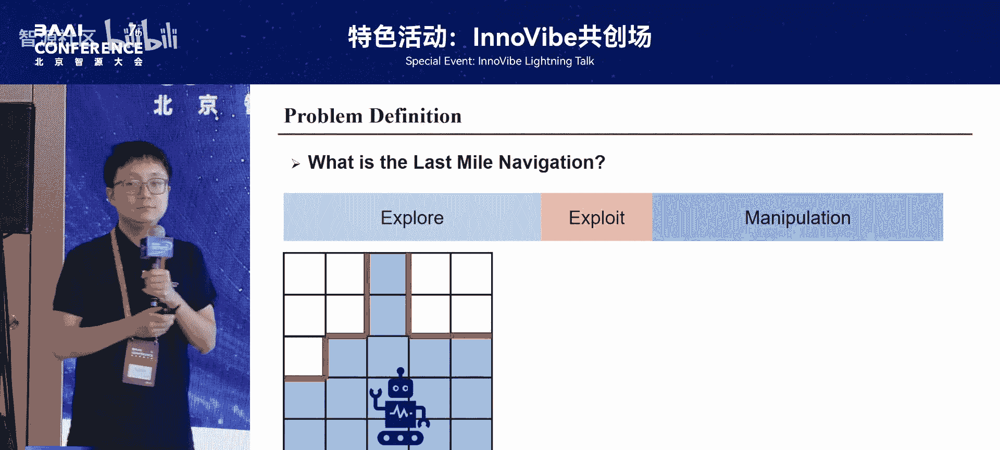

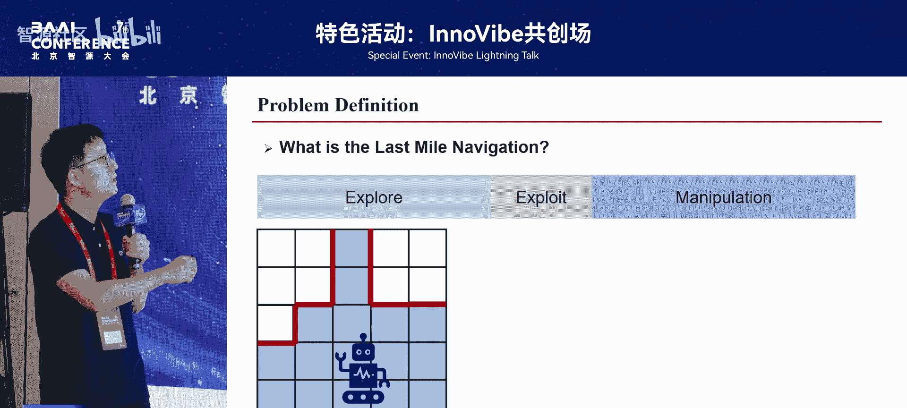

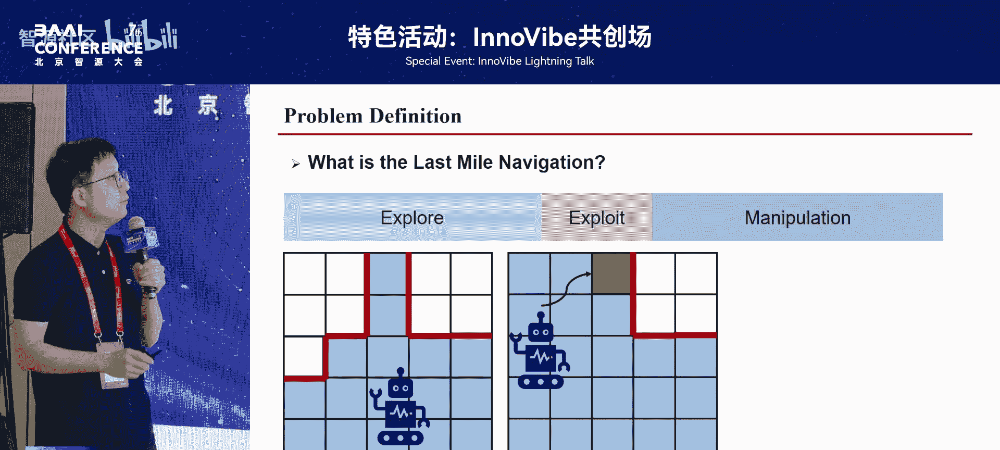

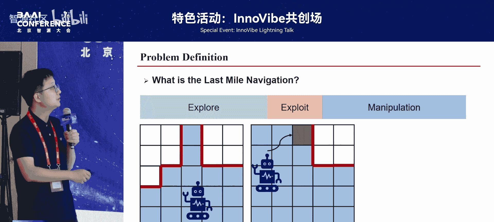

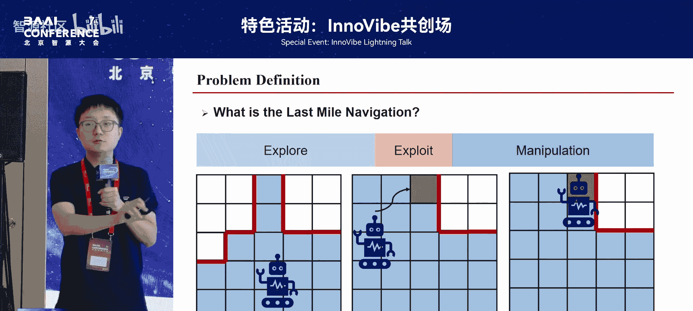

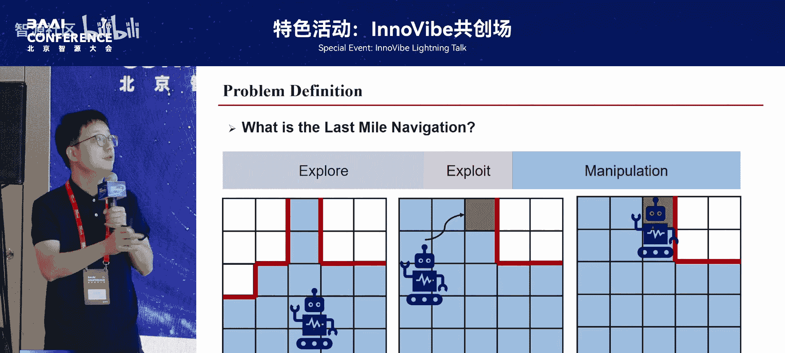

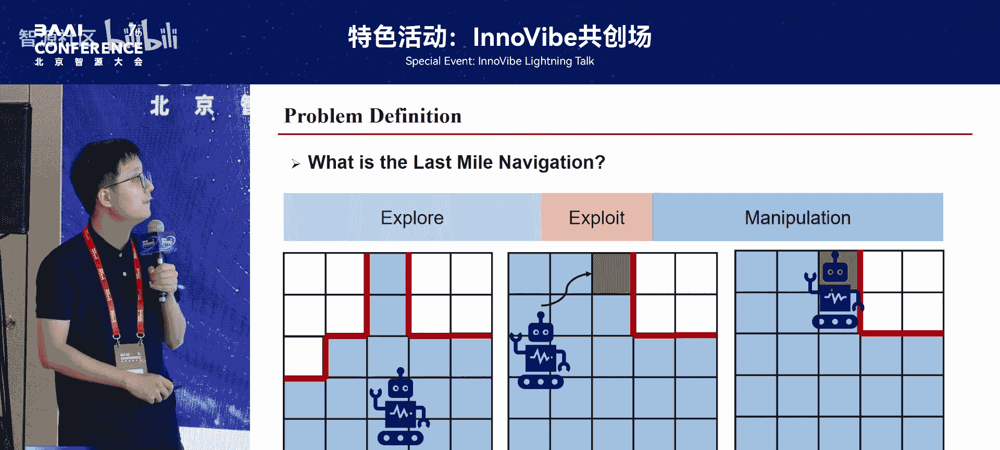

把这个问题我们想明白之后呢，整个的框架其实变得非常的intuitive。呃，为什么呢？问题不在于说VLA不能够用VOA其实是能够用的。那么问题在于说我们的do point选的不好。呃。

即便VOA知道我要去抓那个瓶子，但是我够不着啊，或者说我即便知道我要去抓那个瓶子，但是我会碰到那个柜门呢，这是问题。所以说呢，我们仍然会使用VLA的输出。啊。

就是呃VI的 point时我的手要去到这个位置。只不过我们现在需要去找一条合适的手脚协同的路径，使得我的爪子最后能够去到那个位置啊，这是我们核心的一个关键。

所以说呢我们就基于VLA的这个呃fix base的预测。基于我们提出的一些constrain，啊，比如说避碰啊，比如说连续啊的那些constraint，我们去搜索一条base和手的轨迹。

使得它能够达到这个VOA预测的那个那个重点的那个位置，这个思路就是比较intu。啊，那么呃具体的做法呢，这里我就大概介绍一下，就是呃我们会用1个VA去预测呃接下来的那个位置的变化。

这个跟传统的VA的是一样的了。那么我们就得到了nex time就是的这个这个位置。那么基于这个位置呢，我们就会去给每就会就会去呃定义一个这个呃目标函数，这个目标函数包括什么呢？

包能不能够得着的reability，包括是不是平滑，包括是不是有碰撞。那么我们把这个问题变成了一个motion plan的优化问题，直接去解这个优化问题啊。

我们就能够搜索得到一条呃这个base的和这个手的一条一条轨迹。那么这个是我们的一些呃实验结果，可以看到呃，这是在OVMM上，这是非常呃呃移动操作里面非常流行的一个top。

他们也呃一个一个ch他们也举办了两节这个的一个比赛，我们看到原始的方法，他们的 rate非常的低，为什么会非常的低，就是因为选的不好，经常就会出现东西够不着，或者是碰到其他的东西的原因。

所以试 rate非常的低。那么我们在征集上呢也有一些这个呃实验，可以看到，即便是一些比较困难的任务。我们呃也有一个呃还还行的一个成功率。嗯，因为移动操作现在成功率相对来说是比较比较低的嗯。😊。

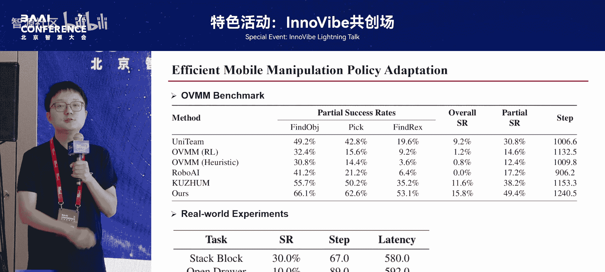

那么是不是这样子移动操作的问题就解决了呢？啊，我们就在想它会不会有其他的问题。根据我们的实验呢，我们发现这里面仍然有问题。为什么？因为VA训练的时候，它离那个物体是比较近的啊。

那么如果我们现在一个移动操作刚开始离物体肯定是比较远的。所以说这个时候的规划的那轨迹很有可能就不即便我能到那个地方，那V规划就是错的。

所以说我们想着能不能用一些泛化性更高对视角更加鲁棒的一些模型来做这个轨迹的规划啊，那么我们这个呢也是受到这个recap的一个启发，那我们就就不用VA做规划了。

我们看能不能就说用一个VM来做一个规划那么仍然是一样的，我们会给当前的场景呢提一个keypoint就是关键点，那么关键点呢其实是代表了我有哪一些物体的关键部分是需要我接下来去交互的。

那么我们把这关键点的can选好之后呢就是在3D里面一个会选好若干个关键点。😊，我们会有个大语言模型啊，就是来选择我此时应该去到哪一个关键点啊，那么只要关键点出来了，要去的地方也就出来了。

要去的地方出来的话呢，跟之前的拍line是完全一样的。我就搜索一条轨迹，然后我就能够啊去到那个位置，够到够到那个点啊，这就呃完成了整个拍line。

OK然后呃剩下的一个任务呢呃呃那个这个呢对于我们的整个over six rate也有一些提升。也可以看到呃，即便是基于ho robot这样的一些一些方法，他们的这个 six rate仍然是比较低的。

那么我们这个方法呃加上这个呃 V N作为这个关键这个这个key point key point的那个呃选择的方式之后呢，相比于用V a，我们又进一步有一个提点 vA是我们刚刚讲的上一个方法。

然后呃moto是我们刚刚现在介绍的这个方法。嗯，最后一个事情呢就是在于说我们如何去把整个场景要表示进去。因为我们刚刚可以看到就是要一个M来生成一个合适的一个轨迹。那么它仍然是一个的，它就这一帧嘛。

就这帧数进是的。但是我们想的移动操作，它经常是一个长程任务。比如要做一个范，那可能要十几步的操作冰箱啊灶台都有。所以说我们必须对整个场景有一个很好的一个理解，我才能够生成一个很好的 point呃。

那么对于场景进行表呢，现在有很多很多的方法进行表2D的3D的像点云像s graph2的 graph但这些呢他们都有各自的一些缺陷。比如点云呢就是它复杂度比较高尤其是你整个场景来说的话。

那点云的量其实是非常非常大的。那么如果只是一个s graph的话呢，那他可能就是说会忽略掉一些几何的信息。因为这个跟巡航的区别在于说巡航是说我找到那个物题就可以了。但是。

移动操作指的是说我最后不仅找到他，我还得去。在交互。所以我们必须要有一些几何的一些信息在里面。所以说我们就想着能不能把二级的优点做一个结合啊，提出1个3D的1个s graph。

来表证整个场景来做最后的这个do point的选择。那么呃这个3D的 graph呢其实也比较的直接。我们就有两层啊，第一层呢还是语义层面，因为语意我们肯定得要的。我们得知道这是一个什么东西。

它的颜色啊它的纹理啊以及物体之间的这个位置相关关系距离啊朝向等等。同时在底下这一层呢，我们需要加入它的一个几何信息，这个几何信息我们用了一个非常紧致的一个表示，也就是说我们用一个凸包的方式。

就是呃一个一个物体的，我们可以给它计算一个突包啊，这个凸包的顶点就作为它的一个表示。然后呢这就是我们整个场景的一个表示。第二个表示，我们会有了这个表示之后。

我们会首先在这个物体周围选择一圈那个can就 point candidate基于这个一个cos map包括reability啊，包括一个碰撞性，就是说哪些是有可能我能够去的。因为那些完全不可能的。

我基本将就不用考虑了，就是它根本就到不了那些地方。所以。基于这个potential的 candidate，我们再去把这个s graph出到大语言模型里面，让他去选择我此时应该去到哪。

比如说就像这个里面一样啊，我要去抓那个碗，但是呢三不行，它会给一个理由。也不行给才是最好的。所以说选通过这样一个具有常识的来进行一个实现。

这个也是我们的一个结果level one的任务呢是比较短程的操作任务。level two呢是这个也是比较短程的，但是场景相对来说呃比较复杂一点的。然level three呢是比较长程的一个任务。

可以看到我们的方法在这个level two three面提点都是非常的明显的那是因为尤其是在长程任务上面我们必须要有一个全局这个理解才能保证它的这个是对的。

如果只是单帧或者是这里讲到的一些直接结合起来的话，它是不具有整个场景的感知能力。所以。一步错了，那整个pas就废我掉了。嗯，然后最后呢我们这里啊会有一个demo呃，在这个长城的移动操作任务中。呃。

也就是说我们呃会直接给一个指令呢，就是比如说他要喝水，喝水的话会我们会先用一个大模型啊，就这个直接就拿来就用了，把这个喝水，我们要去做些什么事，给分解成若干步。然后呢这个机器人呢就会根据这个指令。

比如说bras cook的 corn啊，来把这个东西给呃抓起来啊，就是我们那个demo。嗯。OK呃，最后就是这是我们实验室的一个网站和这个一些公众平台呃，也欢迎大家关注啊。嗯行。

看大家有没有什么问题精场的讲演，感谢王子维。对关于去身智能有没有问题？😊，有。哎。哎，你好，就是我看您最后讲的那个呃3D的graph那块，我特别感兴趣呃，我想问一下。

就是当您对他在进行一个凸包的各种提取之后，他对他的这样一个感知的频率效率这块会不会有一些影响。因为在操作过程中，好像对感知的这个频率感觉要求还是很重要。嗯，呃感谢的问题，这个问题我觉得非常的好。

就是呃我们之前就在为什么我们用突包，其实在那之前呢，我们用了很多呃其他的方法，比如说去提他的3D的表征。比如说点名的表征啊或者GS的表征啊，啊，都是因为他呃太慢了，就是因为速度上面我们没法接受。

但是突包这个会非常的快，因为我们可以。就是呃通过一个比较快速的方法能够把它的凸包给计算出来。所以这个几乎对于我们的感知是没有影响的。那如果他比如说对一些布料呀，这种非刚性物体。

或者说一个物体上面可能是一个整个的饮水机上面，但是有一些按钮，它可能是一个小的物体，它就是可能有层级的这种情况的话，那它是也需要就是分层的去提吗？还是怎么处理这样的嗯对。

这个问题就取决于我们的想要把这个问题考虑的多精确，那么我们呃最开始提凸包而没有用boning box的原因就在于说这个椅子，如果我们用 box就是一个长方体嘛，那这部分空间是利用不上的。

但是事实上这部分空间是可以利用的。就是我可以穿过它去拿那边的东西是可以的那么您刚刚讲的那问题也是一样的。就说如果我们需要对饮水机做一个这个任务里面就有对饮水机做一个非常翻的操作的话。

那么我们就需要去把这个事情做成一个arch的这个按钮就需要有个非常精细的表示如果我们只是说饮水机。啊，没有这么精细的操作放到儿的话，那就无所谓。就是我们可以粗粗糙一点。嗯，好，谢谢。还有其他问题吗？

好的，感谢感谢我们下哦，还有一位OK。😊，哎，你好，我是国防科大的博士生。就是我想问一个问题，就是就是你那个环境是已知的环境还是未知的环境未知的境就是机器人从一个就是在训练好的这样的一个模型。

然后直接可以在一个未知的环境里面执行这种移动导航，还有抓去的任务嗯，就是这个位知的环境不是说我在比如说AA房间里面训拿到比如说在中国训拿到美国去去测试另外一种完全不同的风格。

而是说我就在这个这个A这个这个房间里面训。但是我这里面的东西呢，今天有可能会被摆的不同的位置上去做各种各样其他的事情，就是但是我是说的是这种位置，就是物体他之前基本上都还是见过的，只是环境变了。

但是就是物体还是之前见过的对吧？或者是非常相似的似的，不能差别太大对，好，明白了，谢谢。好的，那我们再次感谢啊。

