# 2025北京智源大会-特色活动：InnoVibe共创场 p11 Extrapolating AI Agents to Open-World Tasks with Natural Language：谷 雨 -BV1nNNJzJEx6_p11-

然后那个我们下一位讲者是来自俄亥俄州立大学的古语。讲的内容是呃开放世界的AIags。嗯。你好。哦，这边就直接可以开始了是吗？大家好呃。

我今天这个报告的题目是extraating aI agentsop world tasks with natural language。呃，然后我可能讲的不会特别techn。

我希望大家就是呃听着也可以轻松一点。然后对于我个人来说，因为本来也只有10分钟，所以可能很多细节我想讲也讲不清楚。嗯，所以这个更多是一些就是更high level的一些观点。

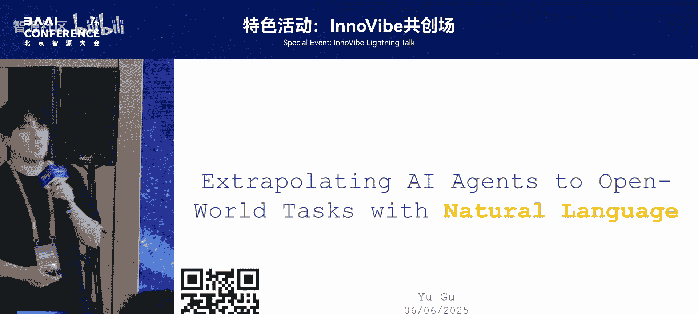

嗯，首先就是A镜的这个东西，对吧？就是智能体啊，大家都知道这不是什么新的东西。这个可能在这个AI开始研究这个人工智能很早的时候，对吧？就有很多人讨论过什么东西被能被称为。

什么东西智能体智能体定义非常简单，就是你任何东西只要能和环境交互，对吧？呃，你可以去感知环境，你可以去环境中take actions，这些东西都被能成为都都可以被称为智能体。嗯。

然后最近就是这一波智能体的热度，其实大部分都是这种就所谓的这种powerowed by agents powered byM对吧？就比如说这种cloud的这种computer use。

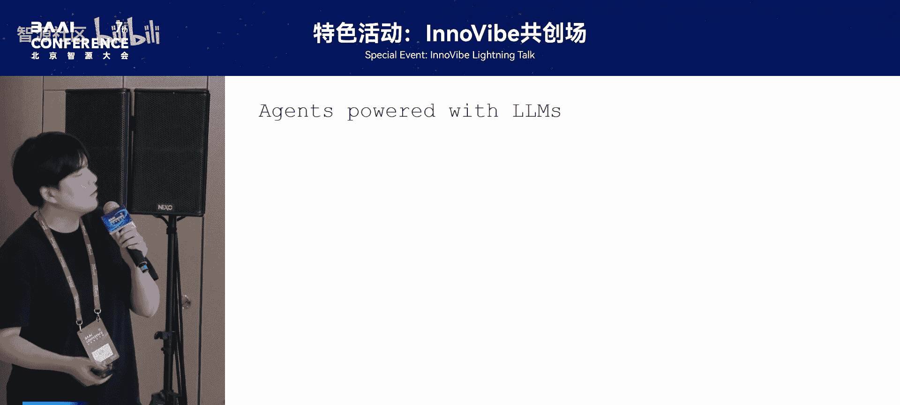

呃，比如说google的project mariner，比如说这个op operator，对吧这些其实都是这一波的智能体。其实我们在谈论的智能体都是这些就是被LM赋能的智能体。

就是这一波的这种新的新的这个ch和热度。

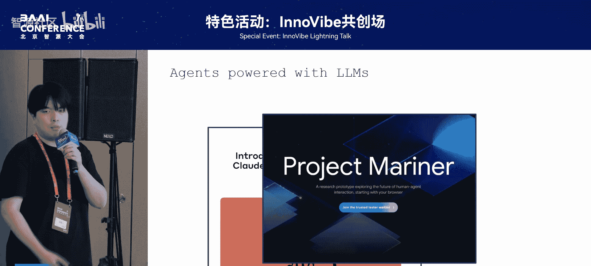

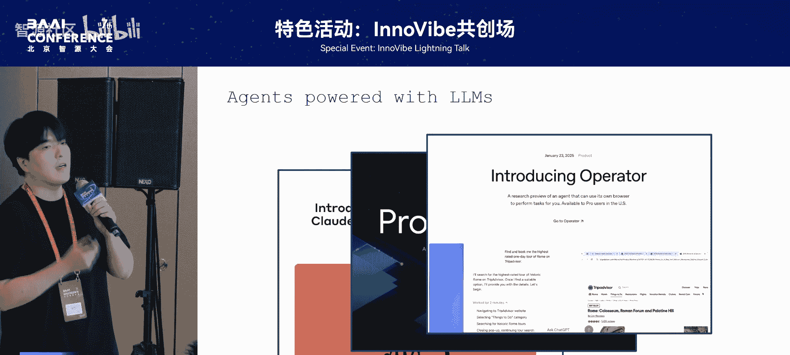

嗯，但其实并不是每每个人都喜欢这件事啊。就虽然现在可能学术界这个可能产业界资本都到处都在谈论智能体。

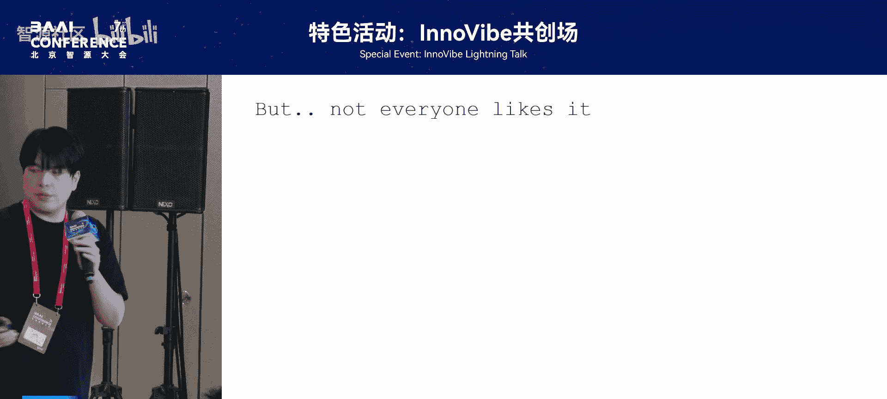

那其实有很多这个学术界的人，尤其是之前来自这个强化学习community。和这些这个多智能体 community的人，其实他们很不喜欢就是这个所谓的这个LMag。

或者这个能够用语言去这个和环境交互的这种agent。比如说很多观点，他们会说啊，他们有些人会说这个LMag根本上就是错的啊，可能会有人说啊这个嗯。

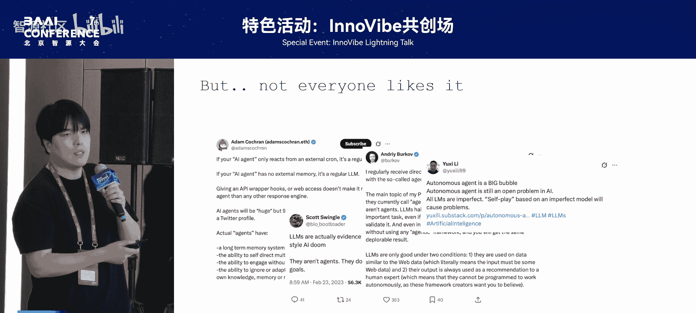

在智能体验研究中加入这个自然源啊，它是一个distruction。他可能不是必要的。或者有人说你这个自然语言或者语言，它只是用来负责这个communication啊，它只是用来这个交互的。

它和智能体本身可能没太大关系。所以其实我今天想做的事情很简单，对，就像我说，我今天其实不会讲特别techn，我其实就想做到一件事，就我想要为这个自然语言在智能体研究中的这个角色证明，对吧？

同时也是想要告诉大家，就是尤其我们这些NOP背景的研究人员，以及这个可能LOM或者 languageguage intelligence in general相关的研究人员。

在这个智能体的研究中到底扮演了一个什么样的角色，对吧？这个就是我今天的报告想要达到的目的。总的来说，我觉得有两点啊，就自然语首先它这个包含了就这个目标空间的一个结构。

然后第二点是自然语同时为这个policy提供了一个鲜艳。后现在看可能有一点抽象哦，我接下来会具体去解释我是什么意思啊，所以现在就是不理解这两句话也没有关系。嗯，首先要更好的理解我刚说的这个事情。

首先我们想要去看一下，就是传统的这个强化学习的智能体研究里面，它缺了什么东西。这是一个非常这个typical的这个RO的一个sing对吧，就是这个这个公式。可能如果大家对长安学习比较熟悉的话。

就会很清楚啊，但不不熟悉也没有关系。就是大概只要知道就是强化学习有一个很根本的一个这个sing就是。就我们的目标是要去最大化一个reward function。呃。

然后这个目标通常不会直接被建模在你这个就是这个agent里面，而是他会通过就是人去间接的基于你这个目标去写一个reward function，然后然后来优化的。你就比如说下围棋，对吧？

你不是直接告诉这个ag，你要赢对手，而是说你有这个关于胜负的一个reward function。他如果赢了，你可能会得到一个正向reward输了或者一个n reward，这是常规的一个做法。😡。

然后你根据这个re function去优化它，然后你得到一个这个最优的policy。这个policy就是把状态映射到这个动作空间。就说白了就是这个智能体要知道在什么样状态，做什么样的事情。

就这个表面上看起来没有任何问题，对吧？像阿尔法 go或者大量的这种RL的研究，完全就是这个范式。但但有一个可能的问题是什么呢？就是我们现在在这里为每一个目标。

我们都会去优化去学一个就是独立的学一个对应的policy。😡。

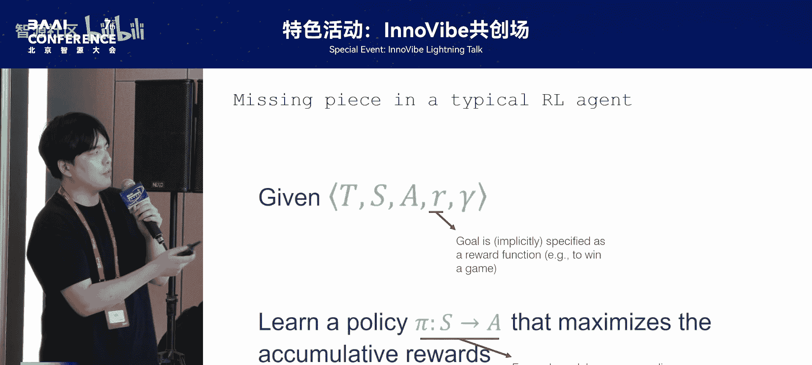

对吧这个对于比如说下围棋之类的任务是非常呃完美的。在真实世界中，我们有很多不一样的任务，要维持这个任务有一个特点。首先他目标是固定，他就是要战胜对手。所以你有个固定的reward function。😡。

但你在很多这种就是开放世界的场景里面，你会有很多多样的目标，对吧？你就比如说机器人在你的这个家务环境里面，那你可能需要他帮你做各种各样的事情。😡。

然后同时对每一个目标你都需要人来标这个reward function，然后来学这个policy，对吧？按我们这个传统的RL的假设，所以这样的话你就很难去泛化。因为你把人给involve进来了。

就意味着你每做一个新的事情，你可能就希望人再去标一个新的re function，然后再让这个就R1的去训练它。😡。

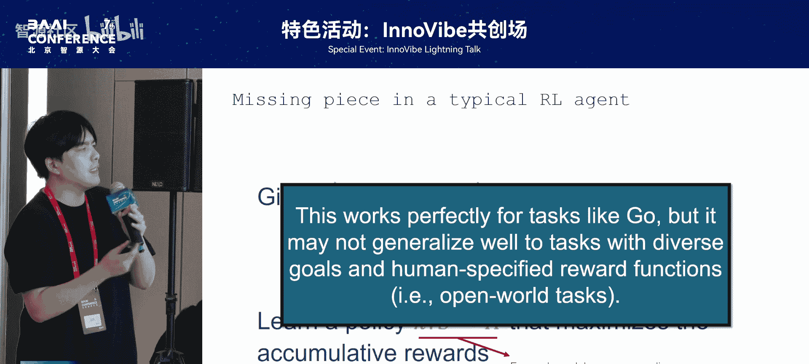

啊，可能呃这里有一个更直观的例子可以帮助大家更好的理解。就是为什么这样它是一个很低效的方式。就比如说这边有两个目标啊，第一个目标是做木板，第二个目标是做木棍。呃，如果按传统R setting。

你可能就是为每个目标，你单独写一个reward function，然后你单独去训一个policy。😡，但有一个问题是什么？有问题是目标它是有结构的。😡，什么叫目标为结构？其实我刚开始也提到了。

就为什么说我说自然语言能给目标提供一个结构结构的意思就是说对吧？当你知道怎么去做木板的时候，intuitively很直观呢，它应该也能一定程度上告诉你怎么去做木棍。这两个目标它就有相关性。

如果你能在学习过程中利用到这种相关性。你的simple efficiency就会好很多。那现在的问题就是我们现在需要为每一个目标独立的写一个re function，然后去训一个policy。这样的话。

这个学习的过程就是非常的simple efficient。😡。

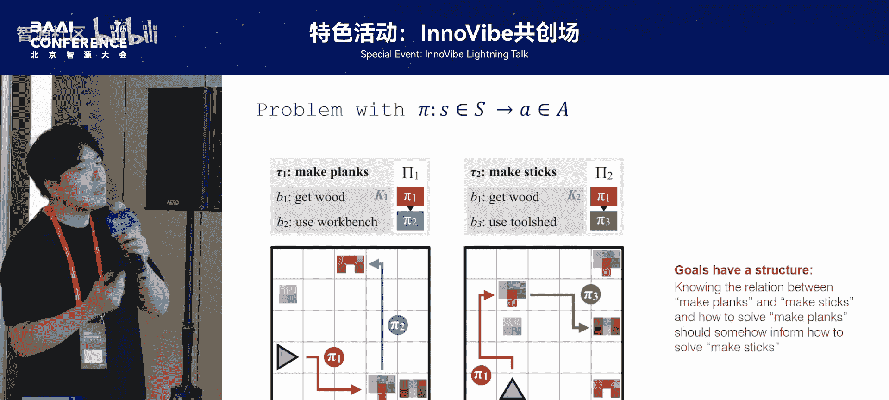

但我们最终的目标是要去handle这种就是这种开放世界。非常重要的目标。比如说这个是来自我们组的一个工作。一个是一个个 web一个里面就是你为每一个网站，你可能可以用语言描述你想要完成什么事情。

然后你这个可能智能体就会在你的网页上完成这些点击自动去做到这个事情，对吧？你想要去训练这样一个非常全能的你是不太可能说因为每一个可能的这个目标都写一个 function。

然后去训练它这个成本和代价太高了。所以有什么样的sution呢？就我们要怎么样才能做到就是更simple efficient的来学习这样的就开放了世界任务的这个这个智能体。

而其一个非常简单的这个非常简短的答案，就是我们需要对这个目标空间进行一个显示的建模。有这里想要解释一下这个是什么意思。比如说这个是左边这个是我们一个传统的一个stting。对为每一个目标，对吧？

我们可能会独立的去学一个policy，比如拍一拍二拍三拍4。😡，这时候我们没有考虑对目标进行建模。但如果我们对目标进行建模的话，对吧？可能我们就可以构建一个从目标空间到这个policy的一个ming。

但这件事有什么好处呢？这个时候假如有一个新的目标。😡，那你其实可以根据就之前这几个，比如说G1G2G3G4到这个policy space mapping，其实提供一定的预测能力。

比如你可能大概可以猜到这个新的目标的policy可能大概在这个位置。😡，对吧对，所以这是一个非常直观的一个解释。但你要做到这个事情，其实核心就是两个模块。😡，就我们想要做到这种事情呃。

假如我们能做到这个对吧？他的se非性质会变得更好。因为你可以只学，比如说G1G2G3G4，你就可以去预测G撇了。你不需要一个新的re function。😡，但你要做好这期是，你需要两个inreient。

第一点就是。😡，你需要对这个目标空间有个很好的建模表示方式。第二个事情是。呃，你同时还要有一个好的方式能完成这个目标空间到这个policy space一个m。你只要同时符合了这两个要求，对吧？

其实我们就能就是达到刚才我描述的那个比较理想的状态。啊，其实这个就是我今天这个分享主要的一个核心思想。然后最关键的一个命题就是其实我们可以通过自然语的建模来同时完成这两件事。

那么可以通过自然语言来建模这个目标空间。同时自然语也能给我们提供，就是从这个目标空间到这个policy space的一个映射。😡。

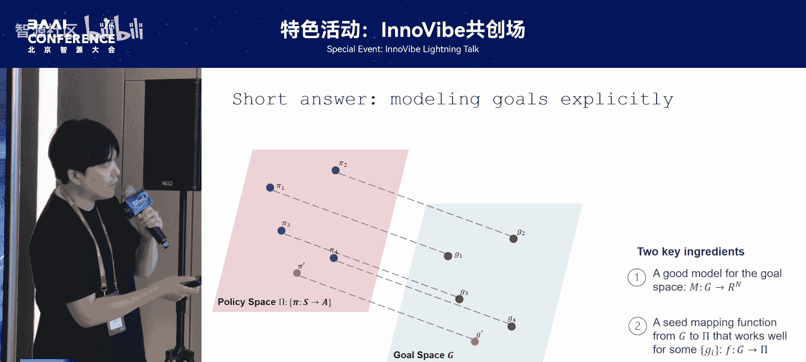

嗯啊，这边我会先就是简单定一下，就是我说的这个op外推或者泛化是什么意思啊，这个其实意思很简单，就是假如说当你这个 agent。😡，他已经会做了一些目标之后啊，他怎么样去handle一些新的目标。

比如说这个G1G2G3G4，他已经会做G1G2G3G4，怎么去handle这个G prime，他就是一个泛话。😡。

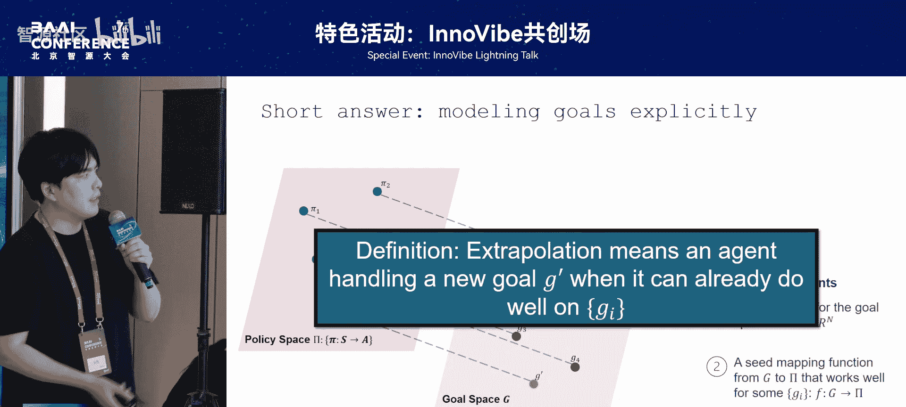

然后基于这个其实呃我我后面我不会讲这个工作的细节，就大概有两个模块嗯，就是我们怎么样呃让这个就好的去泛化基于对自然的建模大概有两个模第一个工作就是首先我们需要去理解就是就是基于自然自然建模的泛化这件事要理解这件事情。

首先我们要做就是比我要我们要定义就是我们怎么去定义哪些是就哪些目标是本来就会的同时我们还要有个办去定义这个就和这个新的 prime这个目标之间的关系因为你的泛化是由你已经会的事情你将要去做事定义然后首先其实在LM时代之前。

你想要定义这个过训练数据就能控制这个第一部分工作就是我们当造了一些训练数据。同时我们根据训练数据和测试数据关我们定义了几种不同类型的泛化。最简意思就是比说当你这个。体他会回答奥巴马老婆是谁。

他肯定也应该会回答川普老婆是谁。然后另外有一个叫这个组合的这个方话。这个例子可能就是说你这个智能体，他会回答这个奥巴马老婆是谁。

同时他会回答这个川普去哪上大学的那这时候他可能有预期他也会回答就是奥巴马的老婆是去哪上大学的。然后最极端的一种情况，可能这种所谓话，就是他可能能回答奥巴马老婆是谁。

然后这是一个新的任务是是什么时候出生的对吧？看你来完全不相关。😡，而在这条路线上其我们有两个工作，一个是就是set up了这个一个这个整个框架。然后第二工作就是基于这个框架上面一些in。

我们做了一些更好的这种model design细节我不会去讲了。第二部分的话就是我们要怎么去构建这个目标空间到这个policy space映射对吧这个也是我刚说过一个非常核心的模块其实这个有一个很简单就是你的自然语言其实code了很多过程知识就过程知识能够帮你去完成很多事情就比如说你直接去问对吧你要做一个a你步内要做成你要怎么去做其实可以直接告诉你一步一步应该该干什么事情。

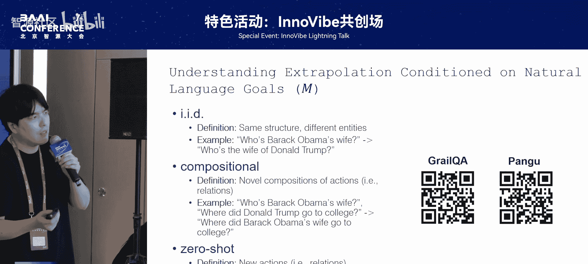

所以这种构成这协议可可以被利用来，就是呃作为你这个智能体的policy的一个condition。嗯，然后这个具体工作这个因为这个时间关系我也不会再讲了，就是大概就是基于这个in我们有两个相关的工作。

一个是就通过自然语言去赋能更好的poli另外一个通过自然语赋能更的就前面有一个同学也提过这个word model和 model planning这相关的工作。其我们这个也是非常相。

但我们是这个 web这个场景底下就相于这种可能汽车这种更散的更连续的这种空间web的这个动作可能会更更离散一些。比如他会预测各种这种点击的这个效果为什么它语会更丰富。

所以这个其实也是一个就是比较一个的场景O所以这个这个细节时间关系就不讲了。后就到这个开头这个重要的P这就是我今要表达的个核心思想就自然语言的ing以来就助智能体的化这些事情啊然后回到开头这些这个争论。

所以我想说的就是。

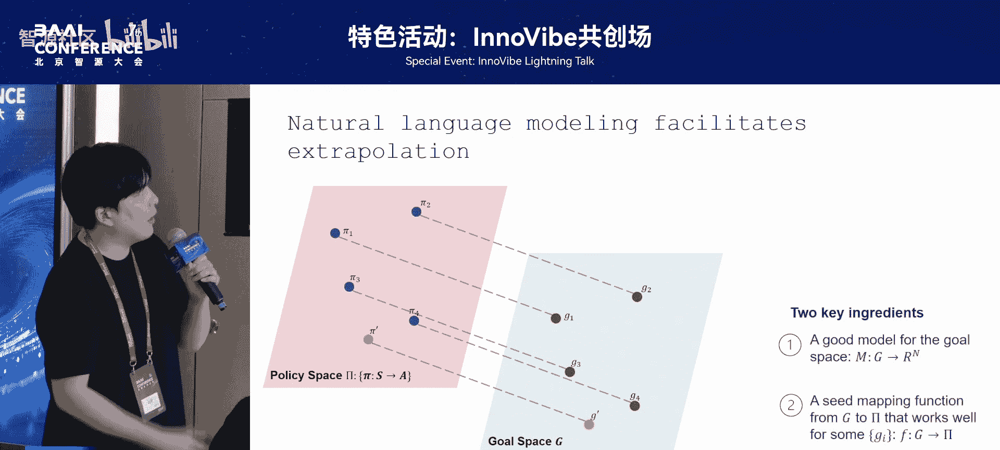

自然语言它其实一定程度上提供了一个非常有效的，就帮助智能体在开放任务开放世界任务中泛化的方式。但有一点我需要强调一下，就是我没有说自然语言是一个必要条件，有没有说这个智能一定需要自然语言。

因为人的很多推理也不需要自然语言。我只是说在当前这个背景底下，就使用自然语言是一个非常有效的方式。😡。

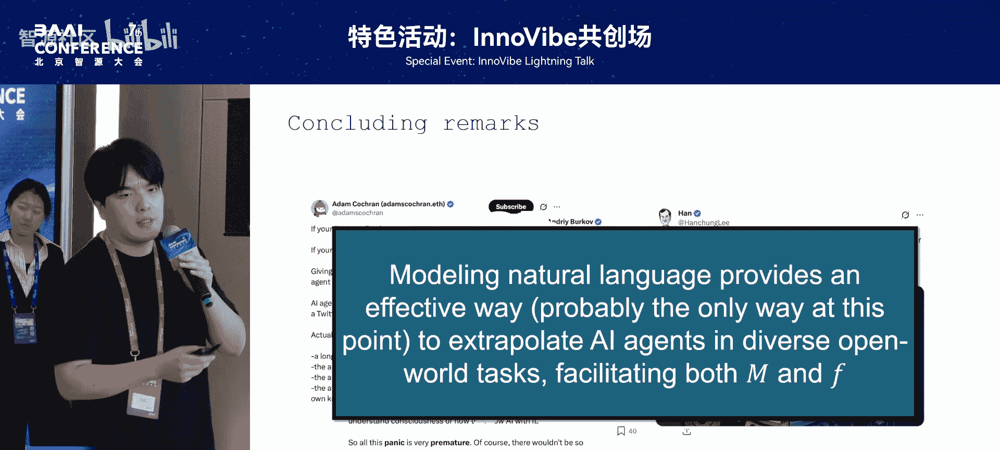

OK呃，这个就是我今天提到的几个工作，就是但我今天就没有时间去讲细节，这个比较抱歉。然后呃大家有什么问题，就是超时有点多，不好意思。

没关系，我们现场有问。哎，你好，我我我只是听了你那个就是汇报，就是挺感兴趣。因为我是做那个英国强化学习的，也是跟word model有关的。刚才您提到那个离散的语言跟连续的图像。

就是就是我做一个呃不是感觉不一定很合适的例子，就是比如说在英国开车跟在中国开车，能不能直接把那个英国的那个模型直接在中国。然后靠右，我直接靠左，就是这种你的这种从文字离散的这种到策略的这样的一个映射。

到这种连续图像的到策略到到策略的这样的一个映射。😊，呃，这个具体的建模，因为我是做那个因果结构模型的嘛，就是就是可能这个比较偏细节一些。

对我我觉得就首先我肯定不是做这个方向的specific direction，我不是做这个。但是我就有一些，就首先我刚提到的这个就是自然语，比如通过自然的这种pri来帮你具体怎么建模的，这是偏细节。

你你说的是比如我那个word model那一块嗯，对对，其实那个很简单，就是我们其实直接让LM去simulate the outcome of an action。

比如说呃你这个输入就是你当前这个网页的状态然后你输出是这个呃不是你这个是网页的状态和这个一个动作。比如点击某一个but而输出就是这个but带来的这个change的 natural language description也是有一个类似结构图一样的一个结构嘛。

没有结构，其实。嗯，没有，就完全就这个东西就是自动提取的。呃，你输入就是你输入就是当年网页的截图。😡，当前法页的截图以及你的动作。其实我刚那有一个例子，但那个我没来得及讲，就是有一个截图。

然后有一个动作。然后这时候你去prot你的LM这个动作会带来什么样的影响？那比如说你点击了一个这个某一个商品，加入购物车这个button。😡。

他可能就会预测你做这个动作会带来的是这个商呃这个商品没加入购物车，或者你跳转到你的购物车页面，就类似于这种东西呃，他能够隐视的学到这种你的文字跟你的这样的一个动作之间的一个相当于关系。就是一个对。

这个其实是我刚刚想说的，就是。首先这个东西。我们有两个setting，一个是你直接用GPT4，你不需要任何学习让它去可以。另外一个是我们其实用GPT4去产生数据去训练一个模型。

所以这个根本假设还是就是我说的就是这个language的就你语言本身就提供了种因为你的语言，比如你的M实本是对各个网站它的function它是有一些常识的知识的他知道做这个作可能带来什么所以这其实也是我刚刚想补充的就是你你刚说这个开车这个开这个例子。

其实我觉得这个就是我刚刚说的这个其实可能的一个局限性就你并不是所有场景底下你都能用自然语言去提供这种为你下游的poli说自动驾驶的那种场景。😡，在那种场景底下，可能更重要的是去。

找到一个就是不依赖于资源pri，但同时就非常sim efficient的，就是从这个go space到这个poli space映射就那个F嗯，好，谢谢。有有机会一定要拜读一下你的文章，看你怎么建模的。

我们可以可以线下再讨论去。