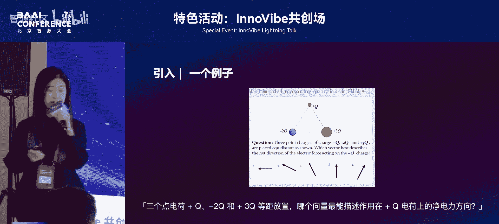
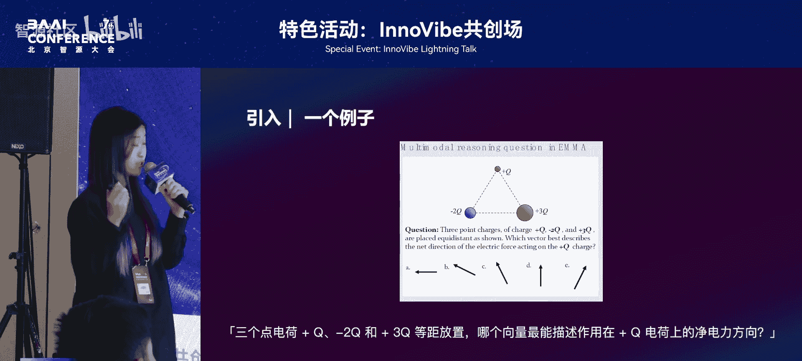
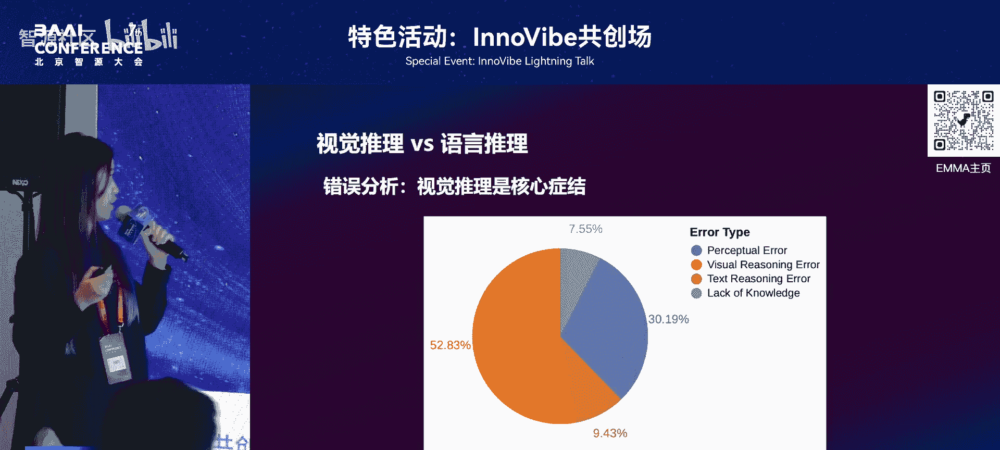

# 2025北京智源大会-特色活动：InnoVibe共创场 p12 Can MLLMs Reason Think in Multimodality；顾嘉炜 -BV1nNNJzJEx6_p12-

呃，下一个讲演是关于那个多模态思维的对吧？多模态思维跟推理。然后讲者是中山大学的顾家伟，欢迎。对。啊，大家好，hello呃，我是来自中山大学的数计生顾佳伟。

今天很高兴能有机会在这里给大家分享我们在多模态推理上面的系列工作，以及对下一代多模态智能的瓶颈和心范式的一些思考呃，reing的能力从大语言模型出现以来，它就被作为涌现能力的一个关键特征。

所以一直以来它都是备受关注的这么一个能力。而在多模态大语言模型里面的推理能力应该怎么样去体现呢？而且在多模态大语言模型，现在的多模态大语言模型，它已经能够在模态之间进行推理和思考了吗？

如果我们想要回答这个问题。首先要回答更加基本的问题。什么是多模态推理。我们可以来看一个简单的例子，上面是一道物理题，我们有两个红色的正电荷和一个蓝色的负电荷，我们要对它进行受力分析。啊，很简单。

同性相斥异性。😊。

江西，所以我们就可以得到最后的合理的一个方向。在完成这道题的时候，我们没有注意到的其实是我们首先需要分析题干的图片和题干的文字信息。然后运用我们的物理学知识，对里面的受力方向在脑海里面进行一个模拟。

然后把它在草稿上面绘制出来，最后得到一个合理的方向，并且要把它跟我们的选项之间进行一个比对。最后得出一个答案。这种在呃文本和图像当中不断的反复进行思考的这么一种能力。

我们很自然的就可以把它认为是一种多模态推理的能力。而现在的大语言模型多模态大语言模型，已经能够很好的完成跨模态的推理思考了吗？还是同样一道题，我们可以来看一下GPT4O的回答。

在它已经知道了同性相斥这么一个原理的情况下，其实它是没有办法判断排斥力的方向。的比如他没有办法分清楚左上角和右下角这两个力的方向。而我们也会怀疑这么一个例子，它会不会只是一个个例的情况。

所以我们提出了一个增强的多模态推理Bchmark也叫呃它叫M码。M码当中的每一个问题，其实都没有办法通过在单一模态当中进行独立思考来解决。而每一个问题它都需要我们对视觉和文本的思考。

进行深度的一个交互才能够进行解决。这也是M码这个Bchmark和现在主流的一些基准测试的核心区别。呃，在我们现在的榜单上面，大家可以看到这些模型的排序。

其实是模型在跨模态的推理能力上面是存在着明显的瓶颈的。即使最先进的jimiac2。5pro这样一个模型，或者是已经能够进行视觉工具调用的O3O4mini模型的表现，依然距离人类专家的差距超过20%。呃。

再深入去看一下呃，多模态大言模型和人类专家的表现到底有什么差异的时候，其实有一个有趣的发现。大家可以看到，在人类在完成一道题目的时候，往往会倾向于借助简洁的手绘草图来进行视觉化的思考和空间模拟。

而对于模型来说，它会依赖于非常冗长的文本进行详尽的结构化的文本步骤的推理。而我们在这也就意味着人类和模型在处理同样的多模态推理问题的时候，的思维模式是不一样的。因为他们有非常强的一个语言逻辑的能力。

而较晓的展现出这种类人的以视觉为核心主导的直观灵活的推理策略。呃，我们还对OE这个模型的例子进行了一个错误分析，可以看到统计的结果和我们的直观的观察是一致的。大多数的错误其实都是视觉推理上的错误。

其次则是感知上的错误，最后才是文本上面的错误。

呃，意识到了这个问题之后，接下来非常自然的另一个问题就是我们要如何去提升MOOM在跨模态推理上面的能力。首先会不会COT可以解决这个问题呢？

我们也尝试了在呃现在的这些题目上面进行一个文本的COT最后的结论是COT的效果是分化的。并且它对于视觉密集型的任务来说都是有一个负面的影响。这里的分化的意思是说呃，对于开源模型来说，文本的COT的策略。

它往往是有负向的作用的。哦，往往是有正向的作用的。但是对于闭源的模型来说，它往往是有负现作呃负向作用的。第二个，会不会我们尝试testcomp scaling的方式，它能够解决这个问题呢？

我们也尝试了三个不一样的testcomp scaling的策略，分别是多数投票b of n锦标赛选择等策略。这些策略我们能够增加在推理的时候的计算量。它能够在一定程度上提升性能。

但是这个幅度是非常有限的。这也表示我们仅仅在推理的阶段增加文本COT的候选数量，其实是难以弥补模型在视觉推理上面的短板。第三个也就是现在大家非常火热的一个范式，会不会我们通过ILcal能够解决这个问题。

通过强化学习能不能提升这种跨模态的推理能力。我们可以看到，现在开源社区上有一些工作。在M码的基础上面进行了一个测试。比如说rethinker，它使用了Ical的方式caling到了72B之后。

在M码的ch上面是有一个比较好的表现的。在开源模型上面是可以达到一个so塔的性能。呃，所以其实对于前两种来说。

这么一种通过IL s的方式是它ma be promisingmising就它有可能是以后会有一个非常大的作用。呃，总的来说。😮，前面所探索的这三种方式都揭示了在未来的多模态智能的发展趋势中。

一定会从现在的语言指导的推理模式转向更深入的模态之间动作协作的模式。而且也有一些非常显然的，我们可以看到的一些新范式的出现。比如说我们不再scaling现在的这么一种模型的架构。

而是对一个统一的MLMS的架构进行scaling。另外一个就是我们在生成阶段的时候，可以增强视觉生成的交互能力。而不管是哪一种新的方式，对于我们来说，更加重要的都是认清楚了我们现在的这个挑战。

我们也可以意识到在未来当中会有不断更多的方法在我们的benchmark上面进行一个更好的测试。呃，目前我们这篇工作已经被IML2025接收，也欢迎大家。如果感兴趣的话，可以跟我们讨论。呃。

我们之后也会有更多的多模态推理相关的工作。如果有兴趣的话，也可以联系我们进行交流，感谢大家。好，谢谢顾佳伟。我们现场有问题可以提。😊，嗯。再给一点时间。好的。你好，我其实呃也是做那个动态相关的。

其实我想我非常认同您刚刚说的就是现在的那个大模型，它其实没有那个视觉视觉推理的建模能力嘛。嗯，那其实我想问一下，就是因为现在大部分的态都是把我们的视觉部分token。

然后变成那个呃文本一样的那种token一起输入到大模型里面，我们有没有可能对这个大模型本身做一些改动，让他可以更好去理解。是有的，就是现在的多模态大语言模型，它之所以强，其实就是因为它本来的LM强。

所以它会体现出来非常强的文本上面的能力。刚刚说的这种架构其实就是新范式的第一种，我们也会尝试把图文混合的进去训一个成统一的大模型。我们让他们在图像和文本的表征的空间上面就是一个统一的。

现在也有非常多的工作，现在在完成这个方向。比如说变色龙呃，还有字节的bago等等，他们都尝试在。😊，模型的架构和训练的数据上面就对本来的架构上面的这个问题做一个优化。谢谢。这样的问题哦，好的好的。

还有其他问题吗？那边有那个麦克，没有没有。我想问一下，就是咱们这个东物胎推理，现在只是涉及到这个数学问题和这个物理问题吗？有。不是的呃，我们这个数据集里面的话，它有呃数学物理，还有coding这种问题。

而实际上现在东模态推理的话，还有日常场景下的。比如说我给你一张图，里面有一群人在打篮球，你要告诉我里面正在投篮的那个运动员的球衣的号码，这其实也是一个视觉推理的问题。而且他们要更注重视觉上。

并且因为他是没有文本的。而在数学和物理上面的话，他很很多时候其他其实还是文本主导的。因为你需要写解题过程嘛。对这个问题就是你刚才提到那个COT那一块。是我之前有尝试在文本上做COT他确实有效果。

想问一下这个这个在东模他这一块用这个COT去做的话，他这个效果会怎么样。我觉得这个主要取决于你的任务。比如说有一些图片，你只需要对他进行一个caption，然后再进行一个COT的推理。

它就能够答出来的话，这其实往往意味着这个推理过程。其实是不需要这个图片的信息的多轮交互的，你只需要看一次模型就可以回答对这个问题。而很多时候你是需要对这张图片进行交互的。

比如说你需要放大这张图或者你需要画一条辅助线。这种情况下的话，COT呃大部分的场景下是不会有增议的作用的。但如果是我刚刚说的那种。比如说我可以把这个图所有内容用文字可以描述出来，描述的非常清楚。

并且准确。那么它在文本的COT上面很有可能是可以得到一个增议的。😡，那你我想问一下，你们有涉及到这个检测和REC这种任务上的吗？REC是是呃detection这一方面的哦。

视觉有的检测这个任务它也是很偏向于视觉。所以他其实在文本的构造上面就会有一个比较大的困难。这个视觉hey的任务。呃，您是尝试过用文本COT，它是work的吗？对，有试果是可以的。

是直接step by step就就是一步一步推的意思。嗯，在我们的实验里面，这种类似detection的任务，它其实还是比较偏视觉为主导的。所以在文本上面的构造的话，它没有表现出一个很大的争议。

OKOK谢谢谢谢。那好的，谢谢这位观众OK。