# 2025北京智源大会-特色活动：InnoVibe共创场 p13 机器学习势在催化计算中的应用：李文韬 -BV1nNNJzJEx6_p13-

呃，那么下面我我们有请那个清华大学李文涛来为我们介绍机器学习是在清华教材争端应用，涛上来。😊，呃，各位嘉宾大家好，我是来自清华大学的李文涛。我现在是清华大学化工系的直播一年级。我的老师是王孝南副教授。

今天非常荣幸能够在这次会议上给大家分享我们在机器学习室和催化计算中的一些研究。呃，我将结合一些具体的研究案例，开展这次的分享。呃，我的分享将从以下三个部分展开。

首先我会从背景方面去介绍催化剂以及催化计算的重要性，以及机器学习室这一个相关概念。第二个会结合具体的研究案例，包括这个呃应用场景和模型结构。

第三个会去总结在这个呃机学习室这个AF scienceence这个领域的未来的可能的研究方向。

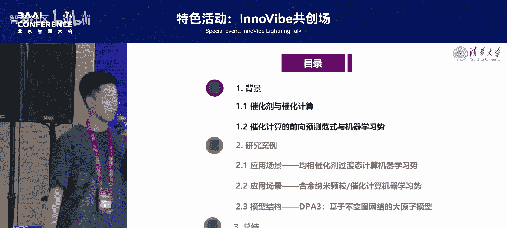

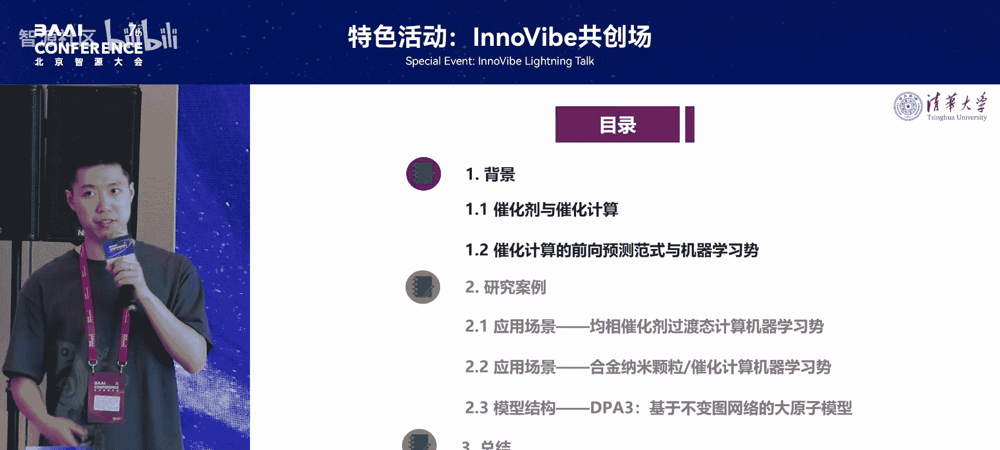

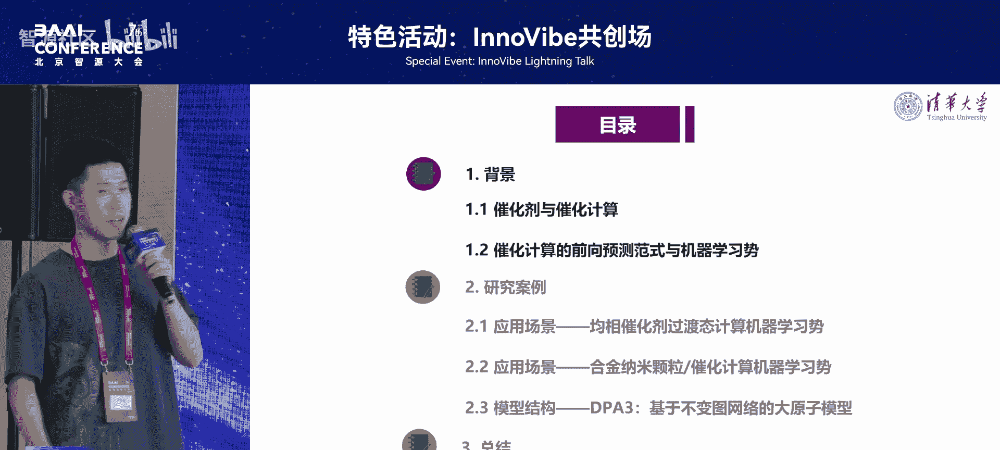

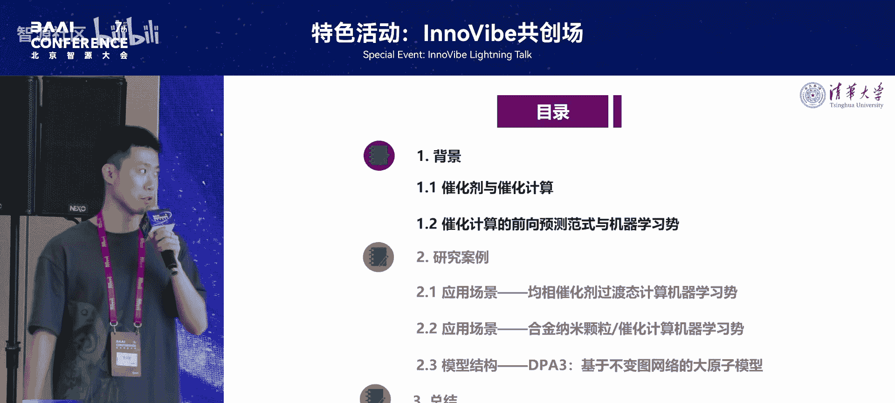

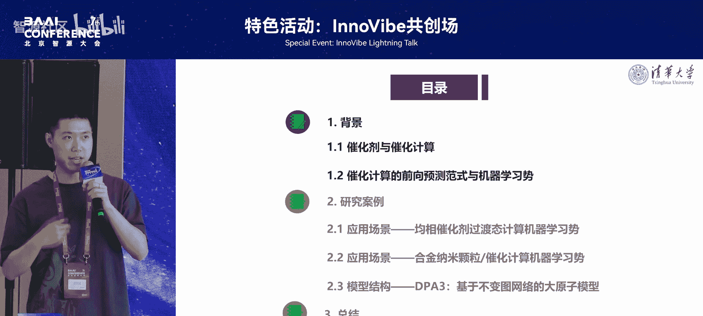

呃，催化剂是化工材料中的领域的基石，呃，催化剂可以降低反应的活化能，提高反应速率。呃，并且呢可以提高反应的选择性去生成预期的产物。同时呢也可以降低反应的条件，从而降低成本。

但目前呢传统的催化呃催化材料的研发存在的很多挑战。因为现在的这个催化研发呢，如果是基于试实验的话，大多是基于试错式的这种研发范研发范式呃，研发周期长、成本高。其次呢这个催化剂这一材料呢。

它的设计空间也是广阔而吸疏的，难以快速探索。尽管是这种专业的这种研究人员也很难去快速的得到一个高性能的催化剂材料。呃，接下来是介绍一下催化理论计算的一些概念。

催化理论计算是将量子化学常用DFT去得到材料领域的一个体系的一个势能面，应用于催化反应体系的建模和分析。计算模拟呢在催化研究中是具有重要的作用的。它一个是可以揭示催化反应的机理。

比如说计算这个反应路径过渡态，从而验证或者提出新的机理。第二个是预测催化剂的性能，包括这个活性选择性和稳定性。这些性能呢都可以为实验提供理论指导，从而减少试错成本，筛选更高效的催化材料。呃。

目前呢基于前项计算预测的催化研究三大范式呢，可以分为三类。第一个是催化理论计算。第二是材料性质预测。第三是机器学习室。在催化理论计算方面呢，催化理论计算虽然它的精确度会相比后两者是很高的。

但是它的计算代价昂贵。光一个材料样本呢，它可能需要数个小时或者数十个小时的计算，所以说难以进行大规模的筛选。第二个是材料性质预测。材料性质预测的速度快，但是呢由于其缺乏足够的物理信息。

难以泛化到一些下游场景。第三个是机器学习室，它兼兼具了前两种的优势，具有效率较高，并且呢呃具备了这个呃比较全面的物理信息，能够更精确的描述材料体系。呃，具体而言呢，在实现层面呢。

呃基于几何图神经网络的机器学习室，它是呃可以把这个可以图结构的形式去处理处理催化剂数据。在基于这个DFT计算的标签数据集上。进行训练后，他可以替替代这种呃DFT或者量子化学的计算方法。

去得到材料体系的势能面，从而进一步揭示这个催化的反应机理和预测催化机的性能。呃，目前我将结合呃第二部分，我将结合几个研究案例去分析呃呃，去介绍。首先是这个均向催化计过渡态计算的机忆学习室。

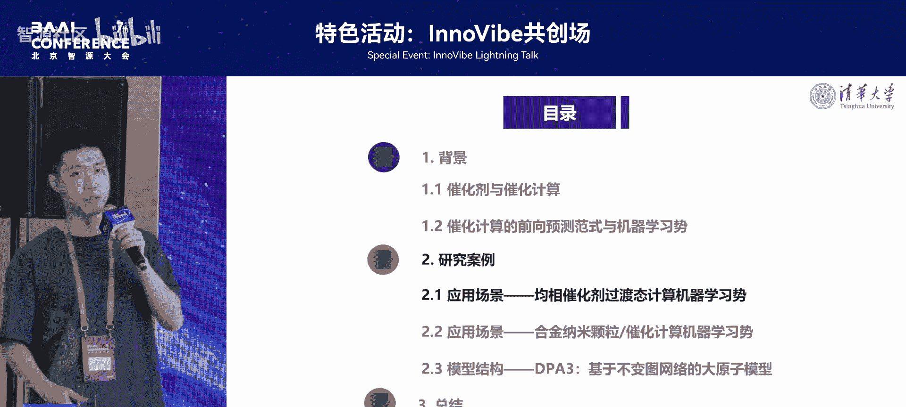

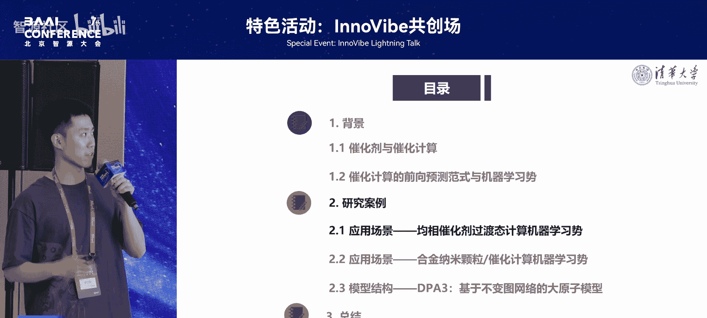

呃，催化剂的活性前面提到了是催化剂的一个重要的衡量指标，而反应催化反应的过渡态能量是反应活性的又一大重要指标。因此呢我们构建了这个迈向催化剂发现的一个过渡态搜索的示函数模型。

它的简单的呃三个阶段是分别是这个结构和训练数据构建。呃，这个过渡态示函数的训练，以及初始结构生成和大规模的催化剂筛选。呃，我们选取的是一个乙烯加氢的一个反应。这一简单的一个反应体系。呃。

我们的这个催化剂是老金属呃，结合这个零配合物的一个均像催化配体会这个配体它会影响这个催化活性。在数据准备阶段呢，我们从数据库获取了数百种催化剂结构，用这个呃量子化学计算。

也就是DFT加NEB的方方式呢生成了60万的单单点数据集。在这个试函数的训练上面呢，我们通过迁移学习的方式去降低数据需求去提高精度。呃，在性能验证方面。

我们的过渡态能量和结构的预测呢和DFT结果高度吻合，适用于大规模的筛选。这个结构和能量的这个具体的这个对比呢，可以在左下角这张图上。呃，对，然后我们进一步结合这种生成算法。

对于一些呃未见过的这种催化剂结构呢进行生成。生成出来这种无标签数据集呢，我们通过我们的整个工作流程呢，结合这个基学习室去呃预测这个反应的过渡态能量，最后得到的这个top50催化剂呢。

再经过这个呃催化的理论计算验证，保持了一致性。同时呢呃结合了一个这个呃我们是呃把大模型用在了这个呃这个基理分析上面，结合这个理论分析，表明这个大规模筛选的催化剂的反应的过渡态能量的趋势呢。

是符合已有的材料知识的。并且呢我们把它总结出来的几条ro呃，这些ro可以给这个呃催化的这个专家提供一些启发。对，第二个场景是这个意向催化，也就是合呃这种晶体晶体材料的这种合金纳米颗粒的催化机学习师。

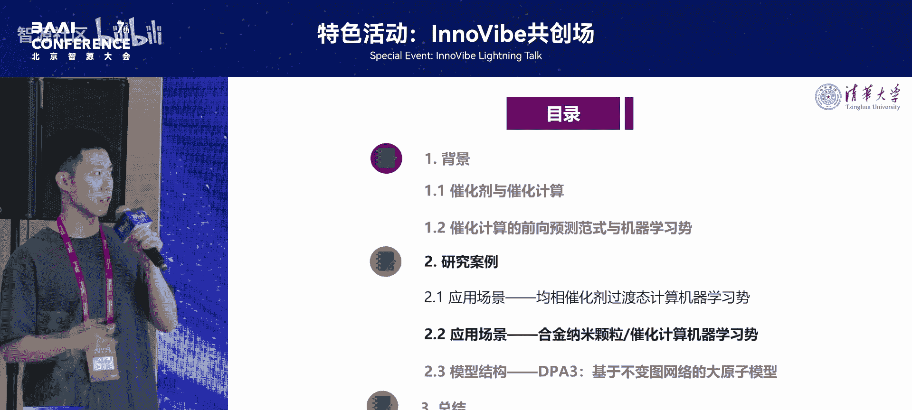

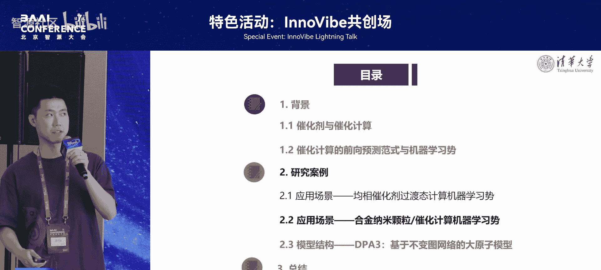

呃呃这个晶体表面能呢，它是反映的呃这个催化剂的这个稳定性表面稳定性的一个重要指标。前面提到稳定性是一个非常重要的一个指标之一。

因此呢我们通过构建这个表面能的机器学习室呢去预测这个呃意向催化剂的这个表面的能量。表面能量呢又是评估这个晶体表面的可合成性的一个重要指标。呃，我们通过这个呃同样的。

我们通过这个主动学习的这个流呃这个框架呢去构建了一个合金表面能的持续数据库。这一个数据集呢包含着50种金属元素，6000种合金和12000种这个合金的表面形貌呃，花费了超过34万次DFT单点计算。

涵盖了mate projectject里面所有稳定的23元合金是领域内呃最最大的这个高精度的合金表面的数据集之一。呃，同样的，我们训练了这个呃表面能的机器学习室。

这一这一机械学室呢在我们的预预留数据集同分布数据集，还有这个OOD数据集上都表现了较高的精度。然后右图展示的是对于几种常见的这种晶体材料呢，我们通过预测它的表面能。

然后通过这个wo规则去构建出来的这个晶体的表面形貌和我们DFT计算出来的这个晶体的表面形貌的一个对比，也可以看到是具有很高的相似性的。同时呢我们和这个呃实实验组达成合作呢。

就是对于一些呃一些一些常见的这种晶体材料的这个表面进行了合成和表征。并且通过这个呃像这个大元模型作为一个呃知识提取的这样的一个工具。从文献中提取了一些催化的信息和表征信息。呃。

从这个实验角度和这个文献的角度，都验证了我们这个计算结果的准确性。对，目前的这个呃目前这个呃论文呢已经是呃有预应版上线，但是它还在imppriible之中。

但是这个模型已经是在这个呃这个论文它附有的代码链接开源。研究者可以通过漏这个模型去预测未见未在这个数据集中的一些呃晶体表面，同时呢也可以通过这种少样本微调的方式，让这个预训练模型能够快速适应下游的任务。

呃，第三部分是这个呃我合作参与的一些模型结构的一些研究。呃，主要是这个DPA3基于呃不变图网络的一个大原子模型。

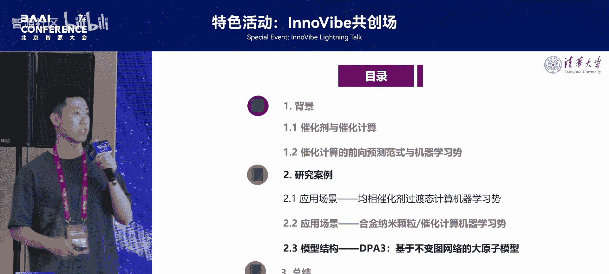

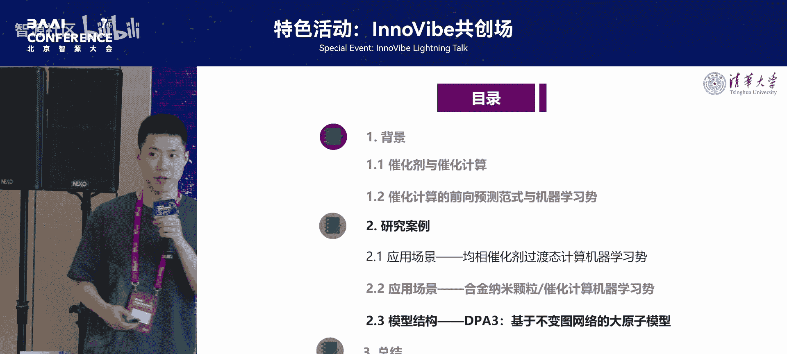

呃，目前呢机器学习室的发展呢逐渐走向了一个更大更通用的阶段。因此呢，大原子模型的概念也应运而生。大原子模型及描述一个呃描述一个能够呃在一个大规模的呃量子化学计算或者DFT计算上面训练的一个能够通表示各种材料体系的势能面的一个通用模型。

呃，正如呃然而呢在这个呃自然源处理领域呢，scaling law成立及这个模型参数量数据量和计算资源的叠加。呃，模型性能能有能有提升。但是这个呃这一现象呢，在大原子模型角度呢并没有得到进一步的验证。

因此呢我们去呃去提出了一个这样的一个基于线图理论的一个机器学习式的一个模型。它考虑的这个点边，还有这个角度二面角的一些几何结构信息，同时涵盖了一些呃涵盖了一些对称性的消息。

并且呢这个模型去满足了这样的一个物理物理不变性。比如说旋转呃排列和呃平移的这样的不变性，并且满足了能量守恒。这一这一个模型呢，它先天具有能够很好的描述原子间相互作用的这样能力。呃。

我们的这个DPA3模型呢在呃各种数据上都取得了很好的结果。这里展示了一个部分的一个在测试器上的表现。我们验证这个模型的参数量的这个scaling也可以在这个右图所示。随着这个陈述的不断增加呃。

这个模型的这个lo曲线以及它最终的性能都是有所提升的。在同一个模型架构上面。最后是总结部分。目前呢AI驱动的这个材料科学呢呃它主要分为三大方面，一个是构建更全面的数据集。第二个呢是构建表示能力。

泛化能力更强的这种模型结构。第三个是寻找更加前沿、更加有挑战性的科学问题。目前呢机器学习社参与的这种呃催化研究呢也也进入了这三者的循环。呃，我相信在未来呢。

通过更准确、更更高效的这种示函数的构建呢的参与呢呃可以有助于这个呃催化的这个催化的研究者呢产生更多的灵感，从而促进下一代催化剂的发现。呃，以上就是我的分享，谢谢大家。非常感谢李文涛博士为我们带来的分享。

请问现生有什么问题吗？😊，非常感谢您的分享。呃，我看到您第一个工作里面有提到您用了迁移学习呃增加它的泛化性。我想问一下，这里的迁移学习具体指的是怎么样的方法，对对对。

就是迁移指的是我们模型是先进行了一个这种有监度的微调嘛。因为像这种过渡态的数据，它其实是因为我们是要测过渡态过渡态它其实是一个一个分子结构或者说一个催化剂结构，它在一个非稳态条件下。

我要去预测它的能量和受力，并且呢是要在这种是它其实是要在这种反应的路径上的这种非稳态结构，所以说我们需要有这样的一个呃就是过渡态的这种视函数数据集进行首先进行训练，而不是 scratch这样训练。

所以说我们是加载了一个这个就是一个有个叫trans one x的。它是做这种小分子上面的反应，它也是一个过渡态数据。就是它也是一个反应。😊，附径下的一些非稳态结构，但是它不是一个催化剂，它是小分子。

我们是在小分子上先先进行了训练，然后再load进来去去去做，再去做微调。这样子意思是中间是过了一次微调的。对对对对对，行行，谢谢。那个大家还有其他问题吗？如果没有的话，就。好的，谢谢文浩博士。

