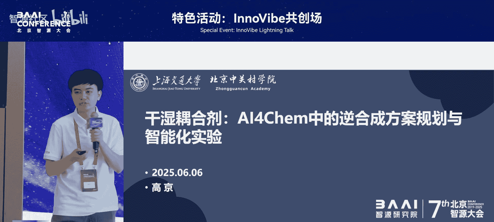
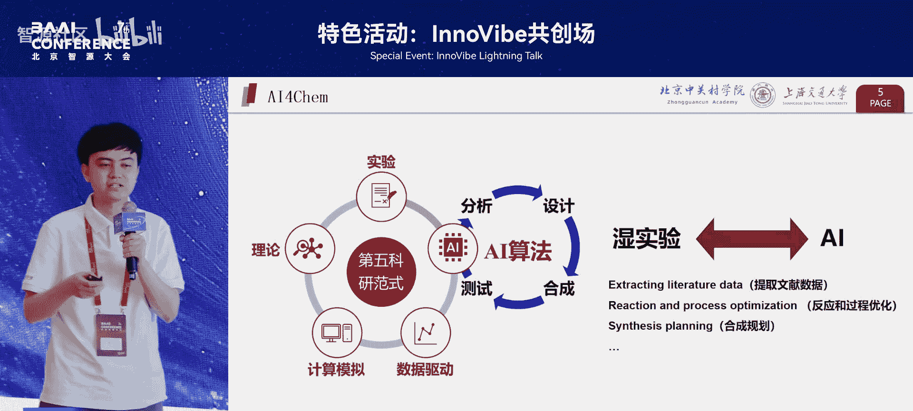

# 2025北京智源大会-特色活动：InnoVibe共创场 p14 干湿耦合剂：AI4Chem中的逆合成方案规划与智能化实验-高 京 -BV1nNNJzJEx6_p14-

好，那我们就有请下一位讲者呃高进博士。然后高进博士现在是北京中关村学院学生项目的工作负责人。然后他曾经参与过这个深圳科技UBbOS的核心开发工作。

他为我们带来该社合技AF中的一恒的方案的规划与智能化实验。那么有请高进博士欢迎。😊，嗯。好，各位来宾和老师同学们，大家好，我是来自上海交通大学和北京中关村学院的高金。

那我今天给大家带来的主题是干湿耦合剂AF chemistrytry中的硬合成方案规划与智能化实验。😊。

那AF science实际上这几年一直都很火。那我们最早追溯一下的话，可以到1957年发表在sence上的一篇文章。那它就是用计算机系统去查阅美国专利局中的化学信息记录。那这一个这个研究呢。

实际上和60年后的今天，也就是第四科研范式，基于数据驱动的。实际上是并无二致的那现在我们讲AF science，它又是第五科研范式。它实际上就是和原来1到4里面的实验理论，还有第一性原理的计算模拟。

以及数据驱动，把这几个环节结合起来，从而形成这个第五科学范式。那去年呢这个来自多伦多大学的alen教授，他们团队呢实际上是给AF for chemistrytry或mate只做了一个任务的总结。

那其实一共是分成6个大类，像是刚才这个李博介绍的这个机器学习势能，还有像是这个性质预测构项生成等等。这些任务可以说在干实验算法里面已经取得了非常明显的成果。但与此同时呢。

我们也需要注意到这个AI在干实验算法上的突破，最终还是需要和这个实验结合起来的那AI在实验里面有没有相关的工作呢？那这里实际上还是有很大的这个蓝海是需要大家去发掘和探索的。

那如果想要和这个师实验结合起来，我们可以看一下一般这个科学物质实验一般是怎么做。那一般就是先要选取一个特定的体系范围，然后是借用计算模拟，或者是数据实验数据驱动的方式。

我去对这个问题做一个建模做一个模型预测。然后我就得到一个候选的材料。那候选的材料之后，该怎么样融入到实实验的环节呢。

那很多这个课题组就把它丢给了我们一线实验室里面的硕士生博士生啊去真正的实现了这个所谓人工的智能，让他们去规划一个自然科学的实验，然后把它执行出来做一个数据和报表的相关分析。

那右边这一块实际上是目前自动化实验室和智能化实验室在建设过程中极度匮乏的这样一个阶段。那我这里可以把它总结为需要7个方面的内容。然后如果你要再精炼一点的话。

就可以借用这个深士科技张林峰他之前说过的一句话，就是我们要努力的让AI模型去学会这个读算做这三项能力。那读其实是什么呢？那顾名思义就是从这个化学的文献里面去把有用的知识，以结构化的方式提取出来。

我这个这个这个方面的工作呢，实际上和我刚才提到57年在s上的工作其实是一样的。只不过今天我们有了 language model的加持，我们可以面向更脏的数据。

比如说左边的这个化学式结构是以及里面的图表去做对齐和理解。那后第二个部分就是算算的话就是现在第一性原理的计算软件，或者是你通过模型建模得到的一些预测的性质。然后最后就是做就是我。😊。

这个试实验如果想进行下去的话，那他一定需要一个调度的中控和一个执行的平台。那我们小组呢其实就是对右边这个蓝色的部分实际上做了一些这个努力的贡献。那第一个想介绍的任务呢，其实就是呃有机的单部拟合成的预测。

这个实际上是在会议里面已经就是火了还算好多年了。那简单介绍介绍一下背景，就是说如果我在医药领域有一个特别好的这个化合物。如果能够达到非常好的疗效或者特别高的用处的话，那我就可以通过这个呃拟合成的方式。

要最快或者是最优雅的能够把这个化合物给大家设计出来。那现在的方法呢，一般是说基于这个模板或者是半模板的方式，用图网络去对分子做一个表示和建模。那如果我想超出我的这个模板库。

那他就没有办法实现一个呃能力的扩展。所以后来就有人用这个transformer去对smes字符串。就这个化学式的字符串去做一个编呃去做一个编码。呃。

但是他们呢能够让transformer去理解这个smell字符串的这样一个。😊，表达的规范。但是它其实忽略了一个问题。就是说在我们拟合成的任务里。

它的反应物和产物实际上是共享有一个骨价的那这个股价的表达顺序实际上也需要让这个模型去能够理解。所以这里是做了这个位置编码和这个smll字符串的顺序的一个增强的方式。

然后可以在这个template free的方法，在top一 accuracy上可以达到66。2%的精度。那第二个任务呢，其实是来源于这个去呃半一年半之前。

这个cder组和d mind的团队在23年年底就是发表的这个两篇nature正刊。那其中他们提出的自动化实验室的实际上有很重要的一环，就是去做无机化合物的拟合成这个任务和有机的相比。

它又简单又难简单在哪呢？因为它不需要去做多步的这个规划，一般有机合成往往是通过一锅法的方式去直接得到的。所以他只要能够找到对应的前驱几合条件就可以。但是它又很困难，困难在哪。

因为之前这个有机合成是有美国专利局或者等等。有一些人在规范的去整理这样的结构化的数据。但是如果是到了这个无机拟合成领域呢，它实际上就来源于这个文章里面mess的一小部分。

我们今天确实有这个呃language model去做这样的方式去做清。但是这一段内容的信息密度确实太高了。而且很重要的一点在于，这一段往往是这个重复率出现比较高的。

所以这个科研工作者往往对这一段的表述会为了尽可能的降重去非常呃非常细就是细腻的做一些这个人能理解。但是模型不太能理解的这个语言的变动。所以我们测试下来，不管是这个V3或者CB4。1。

他在这个数据提取上还是没有达到一个很就令人满意的结果还需要很多人工的干预的那如果有了数据，这里我们最重要的做好这个任务呢，就是去对原来的这个合成方案，把它化为一个知识库去做知识检索。

也就是利用每一个产物去把他们的相似性找到。通过相似性检索出来。已有的这个化合物，我就可以把我要预测的这个前缺体的类别标签，就从1000个就缩小到20个左右。

那这样子我就可以呃让模型达到一个很高的精确度的预测了。然后这个是相比。😊，去年发表在尼ps24上的这个工作还要再高出三个点。那实际上如果我有了这样一个实验的方案，我要用什么样的原料，什么样的条件。

什么样的阶段。那我接下来实际上就希望这个方案能够得到一个执行。那就像我刚才所说，我们这里就需要一个调度的中控。那这里呢就是和这个绅士科技开发的这个unabOS。

我们这里呢是通过就是支持多种编程语言和多协议的串口，就希望让这个一线的实验室能够得到一个自动化的升级，以及可以让这个一线的硕博生可以从实验里面解放出来。然后更多的把这个精力投入到思考里面去。

那右上角呢是一个就是我们实际网页上和这个真机去做联动的这样一个视频。那现在绅士科技也是和教育部一起发起了一项这个有机智能实验的一个比赛。那总奖金也是高达20万，也是欢迎大家扫码关注。😊。

那有了一个调度的中控。那现在今年这个巨身智能可以说非常的火热。那我一定是需要有一个呃这个信息去给到我们的这个具身智能的执行器。那这里在化学的场景里面，最重要解决的问题。

就是我有非常多的这样透明的实验仪器。我们都知道，如果具身智能想要抓的准，抓的好。那一定需要对被操作的物体，有一个非常准确的位置估计。那这里呢我们是提出了先用diffusion去把透明的表面做一个掩码。

然后针对透明的部分单独去做一个第一表面的抽取。然后可以看到，相比于之前的这个高斯重建的工作，我们可以实现一个非常好的效果的提升。

那也是同时构建了这个包括试管烧杯等等这个化学实验室里面常用的设备仪器去做了一个数据集，也是欢迎大家扫码关注这个工作。那最后我们有了这样一个准确的位置估计呢。

那我就可以用机器人、机械臂等等的方式去操作实现这样一个抓取，或者是其他实验室里面的操作。那这里呢是我们设计了一个VLA，然后把化学里面的动作进行一个拆分。然后对于每一个动作。

因为我们刚才有了一个非常准确的位置估计，我这里就可以再借用RGB的信号，它的估出它的位置。然后借用Diffusion policy去生成它的控制轨迹。然后右边的话就是我们一个呃并没有加速。

没有倍速的这样一个真机演示的视频。呃，那实际上我们现在处于一个非常好的时代，我个人认为呃像是前年大火的这个呃语言模型。然后今年呢巨深智能又特别火。那如果可以归结一下，就是说科学智能在一直的产生数据。

而大语言模型呢又是对知识做一个抽取和压缩。而巨深智能又赋予AI一个交互世界的能力。我相信这样子的三方如果联合起来，它一定会实现一个知识的飞轮，然后让我们这个AGI的这个道路，可能最终有一天可以实现。

然后最后也欢迎大家这个加入呃rethink lab，上海交通大学的实验室，以及加入北京中关村学院。好，谢谢大家。😊，好，非常感谢呃高坚博士我们大家进场分享。😊。

