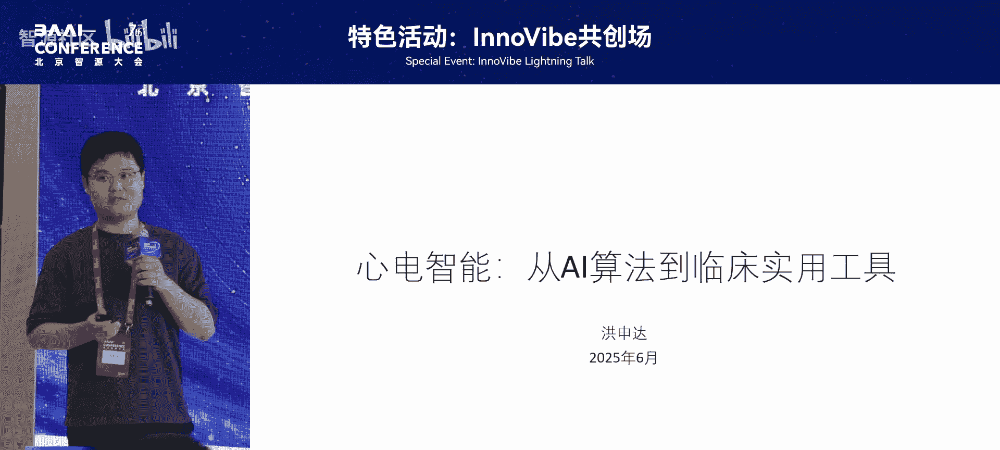
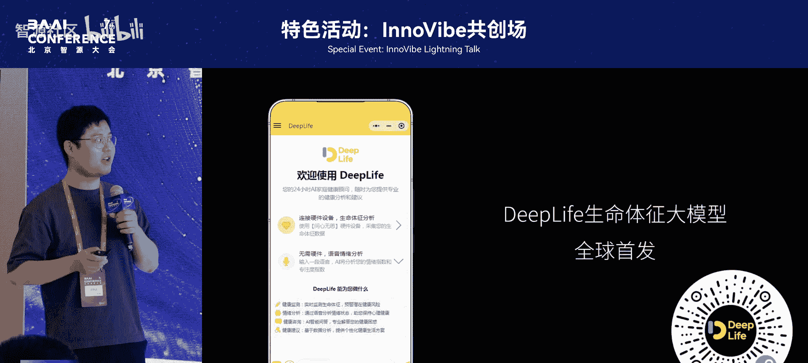
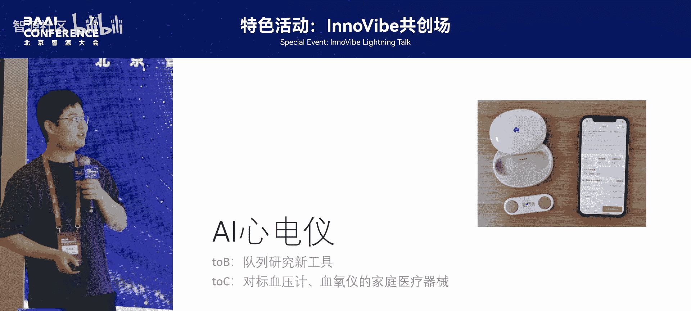

# 2025北京智源大会-特色活动：InnoVibe共创场 p15 心电智能：从AI算法到临床实用工具-洪申达 -BV1nNNJzJEx6_p15-

那我们有请来自于北京大学健康医疗大数据国家研究院的助理研究员呃，副呃助理教授副研究员胡生导师，胡是哪个教授，他家为我们带来题目名为新念智能。弘牙算法到临床呃，到临床实用工具的报告，有请胡胜达教授。

好的呃，感谢大家的关注啊。然后呃今天今天稍微讲一些跟大家之前的稍微不太一样的工作。然后呃主要是呃简单回顾一下，我自己从为一个这个做人工智能的人，现在在北大医学部里面工作。然后呢，从算法如何落地。

特别是呃简单来说就是一个非常小的点去探寻AF和 science这个小的方向的一个呃一些工作吧。然后我的主题是呃新电智能，从AI算法到临床试用工具。😊。

呃，首先这个新店我觉得可能就是叫做既熟悉又陌生。呃，从1924年，其实他有他的高光时刻，就是获得了诺尔尔医学奖。然后呢这个发现心电图肌的机制。再到今天2024年右边是我们自己做的设备。

然后采集的一个心电图，100多年以来，其实他整个采集的方式是没有本质的变化的。所以他其实是我自己认为是AF science一个非常绝佳的研究视角，数据没有门诊的变化。那么另一方面的话呢。

近年来其实大家发现过去觉得心店我们去医院里面体检的时候会采心电图，然后会医生告诉我们可能有早搏啊，心理不齐啊，或者就房颤啊等等。但是近几年其实很多医学顶刊，发现心电图跟很多疾病之间有关联，除了房颤之外。

跟我们的心衰，对我们的血液的一些指标，比如说贫血，包括甚至全益死亡，其实都有关联。所以说我们在想就是在AI时代越来越多的疾病跟I心电之间存在关联，它其实也是给我们提供了一个刚才一样的一个视角。

就是一个绝佳的研究视角。所以我们在这个领域里面做了一些探索啊。最后就是像右边这样，就是我们希望发现新店跟所有很多疾病之间的关联，以及说我们如何使用这一种数据去做一些疾病未来的一个风险的一个识别。

那么当然呃现在比较热门的还是大模型啊，刚才很多人都在说大模型。呃，但是呢就是我们希望大模型能够变成一个家庭医生。但是呃如果大家想的话，我们在医院里面跟医生仅仅通过对话沟通。

是不可能这个准确获知我们的健康状况说我们必然需要去对接一些不管是健康监测设备也好，还是医疗器械也好。所以我们自己开发了一个叫做ep life的一个生命体征大模型。然后呢，这个重点其实不在于模型部分。

其实重点在于我们如何让这个大模型能够理解我们设备所采集的这个心理号，特别的就是心电信号。今年我们在下半年的话呢也会对接更多的像戒指啊这个眼罩啊等等脑店啊PP等等这种信号。

然后我们希望打造一个由健康监测设备加大模型在居家场景之下能够做健康监测管理的这么一种AI家庭医生。😊。

呃，所以为了达成这个目标，其实我们过去做了相当多的工作。呃，首先就是数据。当然我今天比较有底气，在这里说我们在新店这个领域里面做的还是不错的啊，一个很大的底气，就是我们确实有很多数据啊。

这个是我们在前年年底公开的一个数据集它的一个特点就是非常大。然后我们是使用了来自180万个人的超过1000万份的一个心电图，对我们在这个数据集上面做了一些后续的大模型的一个工作。

那么当在这个新店信号数据作为一种持序数据的话，这个是我几年在期间做了一些工作了。最终就是我们公开了一个这个这个网络。然后呢大家其实不只对新电信号比较有用。对于很多身体信号都还比较有用。然后呢。

大家可以通过一些比较简单的这种结构化的设计去设计一个大小宽展厚薄的一个卷神经网络。然后呢一般来说都能达到一个的一个效果。😊，那么呃后来的话呢，这个是我们最近的一个工作。

然后呃下个月会这个代表在AGMAI上面，然后呢就是使用了刚才的两个技术做一个结合。然后我们探索了呃十2导人心天信号，对于呃150种心理失常诊断的一个效能。当然除此之外呢。

其实我们还做了一些其他有意思的探索。就是心天信号能不能准确的识别出这个人是男是女，他的性别是多少，以及他的年龄是多少。还有就是对于某些呃有创检查的指标。

比如说呃心梗的患者会测抽个血查一个叫NTPBMP的指标，然后我们通过心电图也可以推断出这个指标到底有没有高风险，包括预测未来发生慢性肾脏病和慢性心电管疾病的一个风险。

这个我们觉得还是比较有意思的一些工作。那么呃在技术方面回到我们这个大模型这一块，呃，大家可以去试一下，不管是新看各种各样的大模型。其实它第一无法理解心电信号。第二他也没有办法去呃纹身图生成一个心电信号。

所以我们也是在心电多模态这个领域里面提出了一个新的概念，就是心电信号作为一种呃我们通常认为它的信号数据。但是它其实也会存在着心电图的图片，然后呢，心店上面这些波形参数，包括医生对它的一些描述文本等等。

然后呢，这种多模态的围绕的心电相关的数据。我们如何建立一个这个大模型，让它能够做纹身心电，然后呢心电声纹或者是一些波形的这个呃这个分割啊解读啊等等啊，这个是我们最近正在探索的工作。那么当然最后的话呢。

这个呃在算法方面已经就是大概到这个地方为止。我们其实下一步想做的还是能够提出一个临床能用工具。我们最近是做了一个这个设备，然后呢是通过微信小程序的方式可以去通过使用。

然后呢我们是希望能够作为一个对标血压计跟血养仪个家庭医疗器械。然后这个事其实是大概几年之前我们参加了那个互联网加的大学生创业创业大赛，然后拿了全国的金讲，然后呢整个软件硬件算法都是我们自己做的。

所以现在也拿到了一些医疗器械。大家在京东天猫还有拼多多上面都能找到我们这个工作。然后当然的话呢主要还是在AI算法方面我们做了一些探索，希望让人工智能能够体现AI医学的温度。

比如说我们专门会计算一些模型去做这个设备导联倒置的识别。因为很多用户都是老年人，所以他的有时候看不清那个字可能会拿反，包括这个同一科设备，如果多个人使用的话，它的数据如何去做区分。

我们发现其实每个人新天信号也是不一样的。新信号也可以。

去做用户身份识别，以及我们如何呃非常简单的调用一个IG吧。然后呢给大家做一个解读。不知道大家有没有做过体检啊，这个体检报告上医生会告诉你有窦性心率，有多少人会去百度上搜索窦性心率是不是正常的心电图。

其实我们也是想解决这个问题。😊，呃，那么呃这个是去年那个人民日报健康客户端对我们做了一个报告。然后呃总的来说呢，就是我觉得呃一个很很大一个研究意义，就是我们真的能够让更多人享受到呃人工智能的价值。

通过我们人工智能的这个算法，通过我们的这个这个设备，通过我们真实跟临床医生的一些合作，我们目前在很多家医院里面做了各种各样的这个开展各种各样的临床实验，包括房颤患者、心衰患者，然后呢瓣毛病的患者等等。

做他院前的筛查和院后的健康管理。那么今天因为时间关系然后呢很多工作员进行当中，如果以后有机会的话呢，也希望可以再跟各位分享一下。😊，呃，对，最后简单做个总结，就是我们呃在技术方面是新的模型架构。

然后呢呃一些训练策略，一些知识。然后呢，算法是相对比较精准应用的。然后呢，我们在解决临床问题的过程中，其实呃也有很多医生在用我们这个设备做一些这个医学的新发现，然后呢去做一些新型的无创检测。

然后呢居家检测，包括AI家庭医生这么一些信型概念的一些验证吧。呃，我们是做了一个算法加设备加微信小程序的一个便携的患者健康管理系统。呃，对，以上就是我现在正在做了一些工作吧，然后还有跟一些医院有合作。

然后也是刚才提到了，希望未来能够跟各位老师同学再去讲我们在临床方面一些更多的工作。好的，然后我们现在在医学部里面做AI医疗。如果各位老师同学感兴趣的话，也欢迎合作，或者再加入我们lab。

然后大家一起去探索啊人工智能在医疗领域里面一些真正能够落地的，真正能够让每一个人都使用到人工智能技术的这么一个场景吧。好的，谢谢大家。问题可以提问啊。😊，大家现在有什么问题吗？就是可以接手提问。

或者线上嘉宾有什么问题啊？呃，你好，我想请教一下，就是你们训的那个那个医疗的基术模型，你们是用了新的bandending方法。

把什么心电图给呃就是把那个变成token给输入进transformer里面吗？还是说对呃我们有一个很有意思的发现啊。

就至少在新电信号数据上面呃自研督学习跟这种trans的架构的效果其实还不如CN所以我们现在一个感觉就是当你的样本量足够多的时候，最简单的简神经网络的有监督学习效果就是最好的。当我们现在在做一些探索。

就是呃把那个呃新店以token的方式做编码，然后跟文本做对齐，这个是我们在多模态那块做了探索。如果我们只是为了做一个端到端的检测任务的话，其实最简单的方法效果反而最好。当你有足够多的数据的时候。😊，哦。

就是所以说呃现在做的这个是不是把它变成token再去生成的那种呃诊断那一块没有然后多一块是成token去做哦还有个问就是释这方面的进展从临床角度来，目前大部分家看到纠缠还能。

为因医发大家都是先用了解决问题之后再步的去发现所会关注但不纠缠后你那模型是多少的呢都务感兴趣看一才兆兆兆谢谢谢。😊，Yeah。

