# 2025北京智源大会-特色活动：InnoVibe共创场 p17 面向具身智能的在线三维场景感知：许修为 -BV1nNNJzJEx6_p17-

那有请我们今天这个应道外国活动最后一场嘉宾来自于清华大学的徐学伟博士。他为我们带来的报告题目是面向集训智能的在线三三维场景感知。那么有请徐伟博士好，谢谢。😊，呃。要等一下是吗？嗯，好，大家好，呃。

我是来自清华大学自动化系的许修伟。然后我今天的题目是这个面向巨深智能的在线三维场景感知。😊。

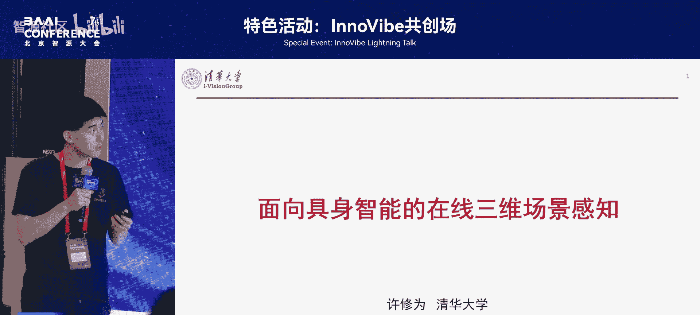

我们要做的事情就是去精准的呃去理解我们三维空间中的所有的物体，并且将它们识别出来。这个为下游的各种具生任务。比如说呃任务规划导航和操作提供了一个坚实的基础。然而目前的三维感知方法。

在应用到巨生机器人的时候，会面临许许多多的问题，导致他们无法实际落地。呃，具体我认为体现在两个方面上，第一点是在于效率层面。在瞬息万变的现实场景中，这个机器人他往往需要探索一些未知环境。

而在探索的过程中，这个机器人的规划决策和运行是得跟场景的感知同步完成的。因此，我们的场景感知的输入应该是一个实时在线的视频流，而非是提前重建好的场景。

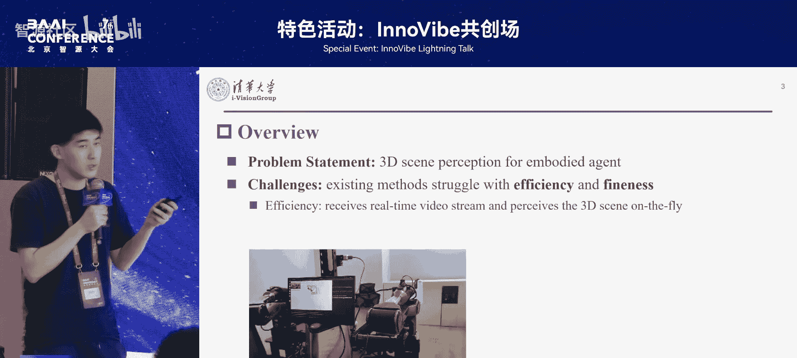

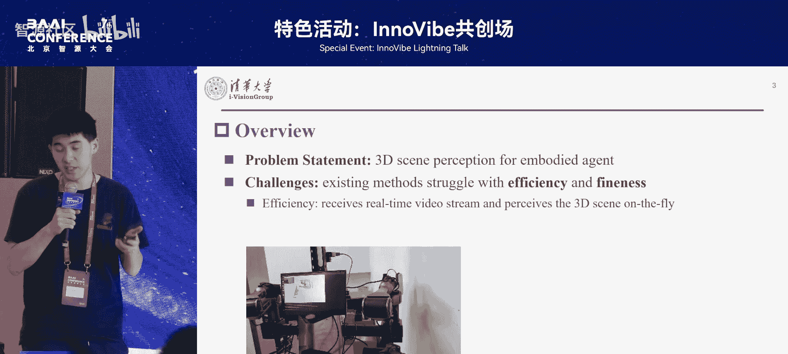

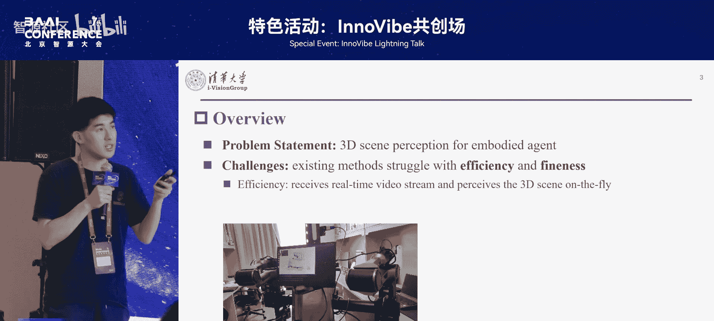

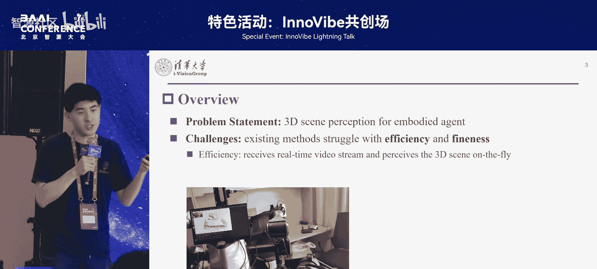

第二点则在于这个细力度，我们希望能服务于各种各样广泛的剧神应用。所以我们希望能把场景中尽可能多尽可能细的物体给它检测，并且分割出来。那么以上的挑战就激发着我们去提出一种新的三维场景感知范式。

它需要具有三个特征。第一点是它需要有很高的质量。无论是这个准确度还是泛化性，都是作为1个3D感知基础模型必须要的能力。第二点就是刚刚说的在线推理的能力，它不应该是提前把场景重建好。

然后收集完场景数据之后再去做感知，而应该是随着机器人的探索和移动，去同步的完成场景的重的重建和感知。最后我们希望它有一个很高的效率，它可以直接部署在机器人的边缘端，而非是运行在云端。

并且在边缘端也希望能达到实时的运行速度。那么为此我们提出了inbody，也是我们发表在艾 clear25的一篇oral论文。呃。

我们通过一个基于2Dvis foundation model和通用ins query的表示方式，去比较简单的实现了以上的种种目标。

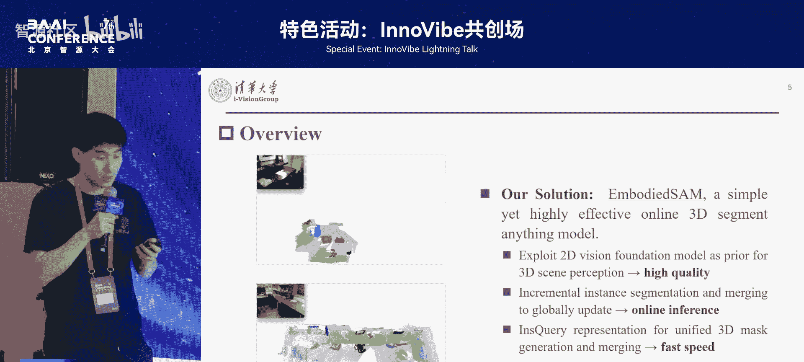

嗯，那首先简单的过一下一些相关的工作。我们的目标是训一个这种实时在线，并且精细度高，有很强泛化能力的三维感知模型。但是如果纯从3D数据去训这样的模型，其实是几乎不可能的。因为在数据的质量和规模上。

3D的标注和2D相比是不在一个数量级上的。但是与此同时呢，其实在2D领域已经有非常非常多非常强大的微mod。比如说sam，比如说dno这类的模型，他们已经展现了很强的通用的感知和识别和泛化能力。

那么如何将2D的VFM运用到3D感知，其实就是一个很有前景的研究问题。😊，像sam3D和一些相关的工作，他们就进行了相关的研究。对于1个3D场景，他们捕获了他们周围的RGBD的观测。

然后将sam运用到每一帧RGB上，去得到2D的分割结果之后，将2D分割结果投入到3D，并且在3D空间进行手工融合，从而实现了3D空间中的呃比较精细的这种感知，并且可以在零样本的条件下，我只通过调用sM。

而不需要任何训练，就可以实现场景的分割。😊，但是他们仍然面临非常非常多问题，导致他们其实呃完全无法使用。那么第一点就是他们其实是独立运用在每一帧的RGB帧上的。也就是说他们没有运用上我这个RGBD视频。

它的持续信息，也没有用上深度的这种丰富的几何特征。那么第二点，他们的这个融合是先在2D中做感知。把2D的sam mask投到3D，然后再去做手工融合，手工的融合，无论是速度还是对超餐的敏感性。

其实都是难以接受的。那么最后他们都是离线的方法，他们需要提前收集好整个场景的数据，而不能说我机器人一边走，他就一边感知速度也非常的慢。

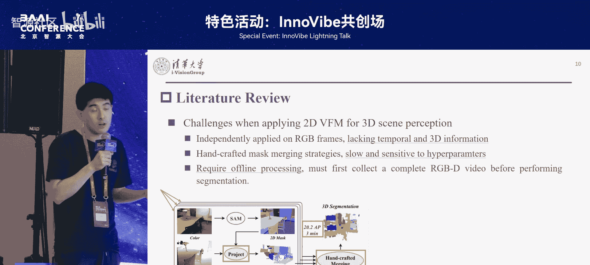

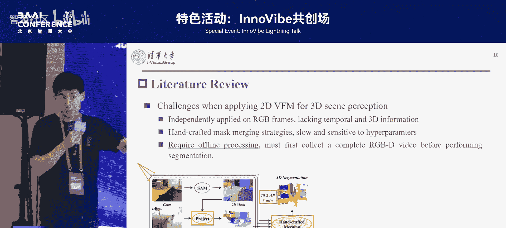

那么与之对应的我们的方法呢则是希望解决以上的所有问题，它可以实时在线的去直去直接处理RGBD视频流。它一边采集数据就可以一边去完成场景的感知。

同时它的速度是此前方法的二三十余倍之前的一个方法处理一个场景可能就需要几分钟。但我们的话只需要5秒不到，并且性能也是在它的两倍以上要高得多。那么我们接下来就讲一下我们是怎么设计这样的模型的。

首先我先简单过一下这个在线三维感知的一个sing，就是以下就是一些比如说语音分割目标检测和实力分割的一些任务。对于一个在线任务它的输入，比如说在时刻T。

我我们是可以拿到从第一个时刻到第一T个时刻的所有的GBD观测。那么我们有我们的RGB有深度有相机的内外参，通过相机内外参可以把深度转换成世界坐标的点云，但是在时刻T的时候，任何未来时刻的信息是不可知的。

我们需要在任何时刻都预测迄今为止，它所观测到的场景的一个良好的感知。😊，那么随着这个场景观测的增加，场景会越来越大，物体会越来越多，所以感知的复杂度也会逐渐增加。为了实时在线的去完成这样的一个事情。

我们提出了一个增量式的感知模块，我们将感知分成两个部分。首先是如图所示，我们对每一帧输入的RGBD只感知它当前帧，只对当前帧的电源去进行分割。之后，我们将当前帧的分割结果融入到过去的所有的呃mask中。

相当于把它拆成了两个步骤，一个是单帧的分割，一个是针间的融合。😊。

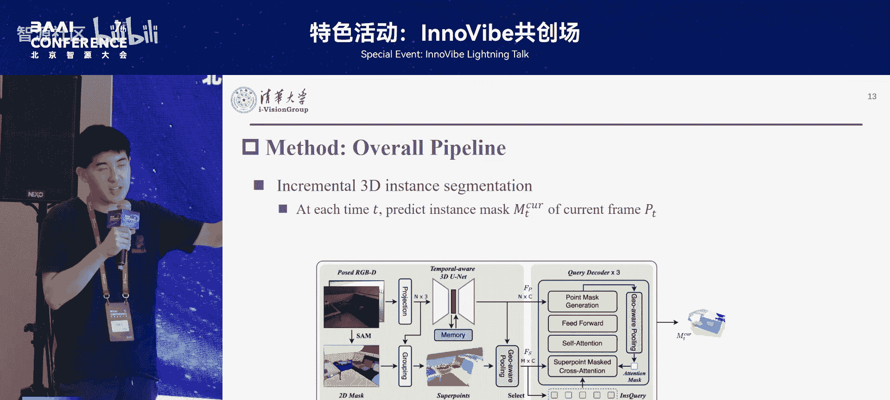

那么首先在这个单帧分割方面，我们其实提出了一个querylifting和ment的思路。我们想将2D图像输进来之后，我们用一个fas可以非常快的分割出1个2D的初始的分割结果。

然后我们想把这个2D分割结果投到3D，变成一个可学习的3D token来进行非常高效和呃这个精准的3D融合。那么我们首先对于每一个呃分割出来的，就是这个RGB分割出来的sam mask。

我们可以把它投到这个深度图转成的点云上，得到对应的suppoint。那么假设我们这这呃在我我们当前帧可以拿到N个点云，就是N乘三的点云。然后我们有M个这个sam mask。

那么我们就可以得到对应的M个3D的sup point。😊。

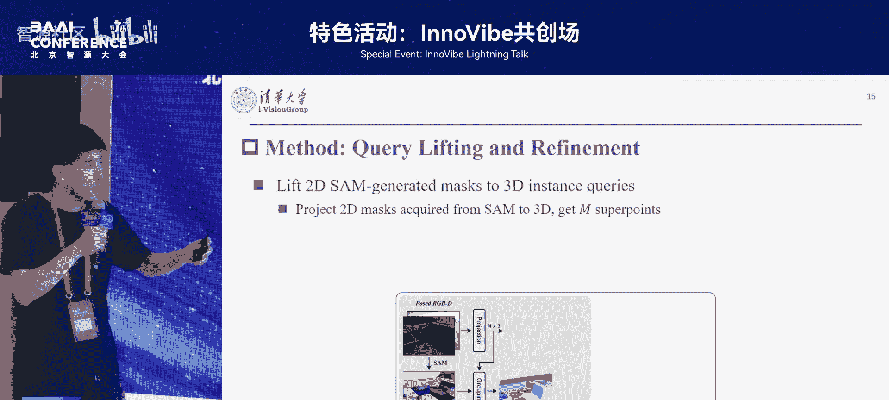

之后对于N3的点云，我们可以单独提取它的主点的3D特征。这里我们使用了我们在CPR24中呃提出的一个这个实时在线的这样的一个3D时空间特征提取器。那么用这样的提取器。

我们就可以把一个实时的在线的G视频流充分的利用到它的2D和3D信息。那么完成了特征提取之后，我们可以拿到当前帧的N个点级别的特征以及M个超点。那么我们可以做一个池化。

通过这个池化就可以把N的点级别特征给它铺到M个超点级别的特征。那么这M个超点特征也就被我们选为query去用来贯穿后续的整体的流程，拿到了inquery之后，我们通过一个类似于trans的结构。

通过若干层的迭代，将这个query进行逐层优化。并且最后通过每个query预测出它所对应的3D实力这个过程中，我们的实力mquery是一一对应的。也就是说每个query会跟一个实例完全的绑定住。😊。

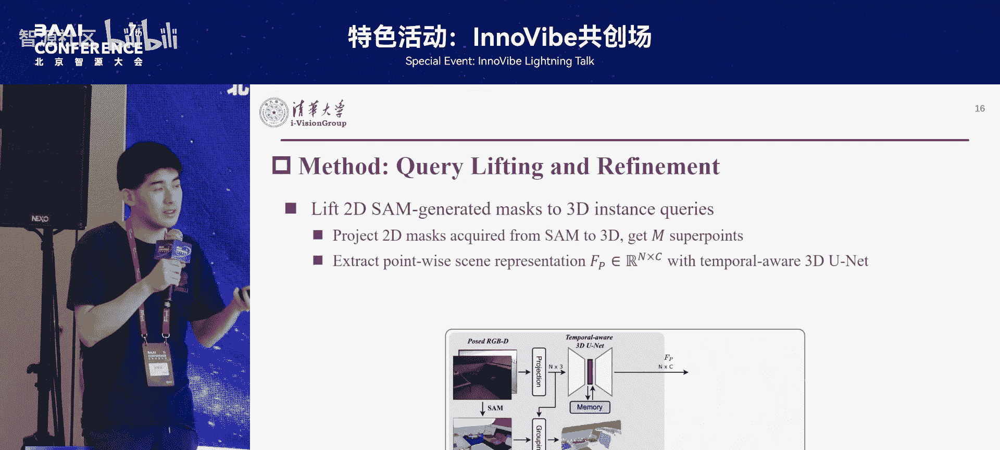

那么接下来当我们预测出了这一帧的m，也就是这个M current之后，我们希望将当前帧的mus融合到过去帧的mask之中。如果两个物体，比如说对于同一个桌子，我在两帧都观测到这张桌子。

那么这两帧的这两个的就应该合为一反之则应该注册一个新的物体的I但是其实这个它非常非常的困难。为什么呢？因为做这个融合，我们需要去做两个for循环。

首先便利所有的过去的然后第二个循环便利所有的当前帧的m对于两个循环出的每一个我们需要去根据这两个m取出它对应的点云，并且去计算相似度，无论是for循环还是点云的取出还是相似度的计算，它都是无法并行的。

因为点云的数量是不一样的个它可大可小。那么我们取出来的点云数量也各不一样，最后可能要通过之的式去计算距离。那么这样的时开销是难以承受的。传统方法，他们在计算这个步骤的融合往往需要数秒钟甚至数。😊。

秒钟才能完成一帧的融合，这个是无法接受的。而对于我们的方法，由于我们已经有了一一对应的mask跟query的关系，所以我们可以把这个mask的融合问题转成一个query的合并问题。

而我们知道query它是一个规范化的向量的表示。所以对于过去帧的M个 queryry和当前帧的N个 queryry，我们只需要进行一次矩阵乘法，就可以拿到M乘以N的这样的一个相似度矩阵。

就可以在瞬间仅通过一次乘法就完成所有的相似度计算，速度相比之前可以提升近千倍。但是我们又发现其实仅仅通过这个，因为它是用来预测mask的，它的能力其实并不在于物体的辨别和物体的表示。

如果仅仅通过它来计算相似度，其实表示能力是不够的。因此我们又继续提出了三个这个针对性的这样的空间表示我们从预测出了它的几何对比和语义的相似度。那么这三种相似度。

每一种都可以用矩证乘法计算出属于他们的相似度矩阵。这三个相似度矩阵和三为一就可以得到最终的整体相似度，我们将其进行减知和二分图匹配就可以拿到当前帧分割出来的每个m应该跟过去的哪个m进行合并。

那么最后对于匹配上的m，我们只需要将它的这个掩码也也就是m去进行拼接，并且把他们的对应特征去进行加权即可。而对于没有跟任何过去帧匹配上的物体，我们则简单的为其注册一个新的全局I然后实验部分的话。

我们在一些主流的数据集上都实现了性能和跟速度的so塔，并且也有非常强的泛化能力。这个就不赘述。😊。

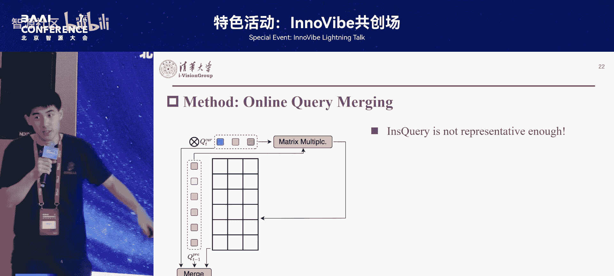

过了。然后我们其实研究了它的这个速度的分布。我们发现目前我们用一个fa可以实现20毫秒的推理。然后我们的3D部分大概是80毫秒，也就是说可以实现10个FPS的推理速度。

而且目前的时间瓶颈主要在于3D back100毫秒的时间里面，它占了69毫秒，也就是说只要未来我们只需要做一些3D back的压缩。那么我们的速度其实可以再往上提一个台阶。

提到20FPS甚至30都是不在话下的。然后我们的可视化展示了我们的一些三个学出来的属性，它具有很强的空间能力对比能力和语音能力。然后这是这个是一个数据级的一个简单的demo。

我们在这个机器人动态的观测这个场景的过程中就可以实时在线的完成场景的重建和物体精细的分割。我们还将我们的方法部署到了真实的机器人上方法是直接运行在机器人的边缘端算力上。因此它其实不需要任何的云服务器。

然后它也能在线下实现一个实时在线的场景的感知。这里pos我们是用。😊。

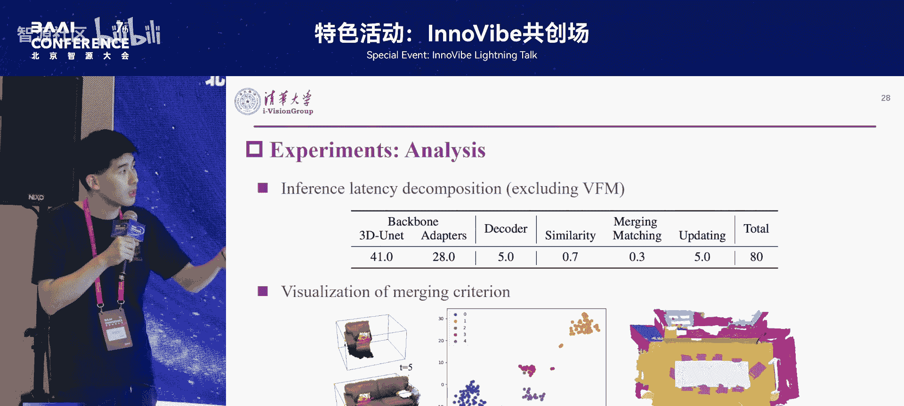

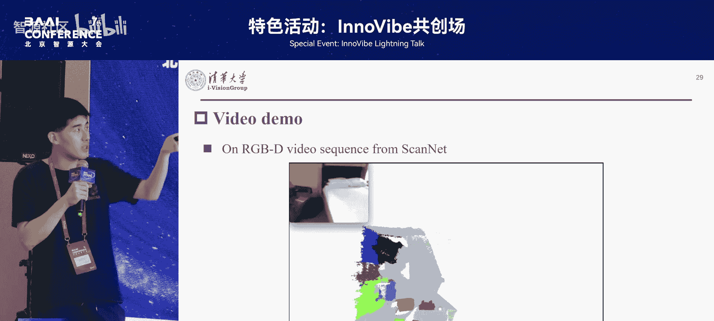

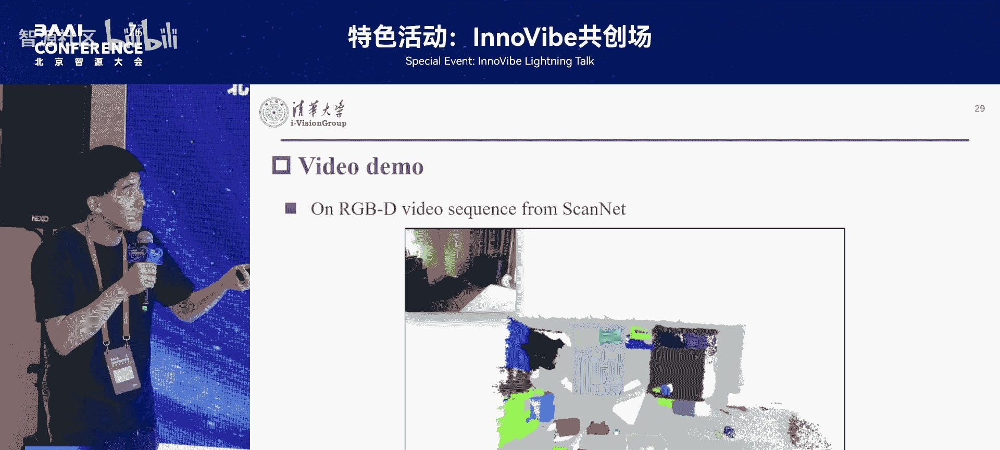

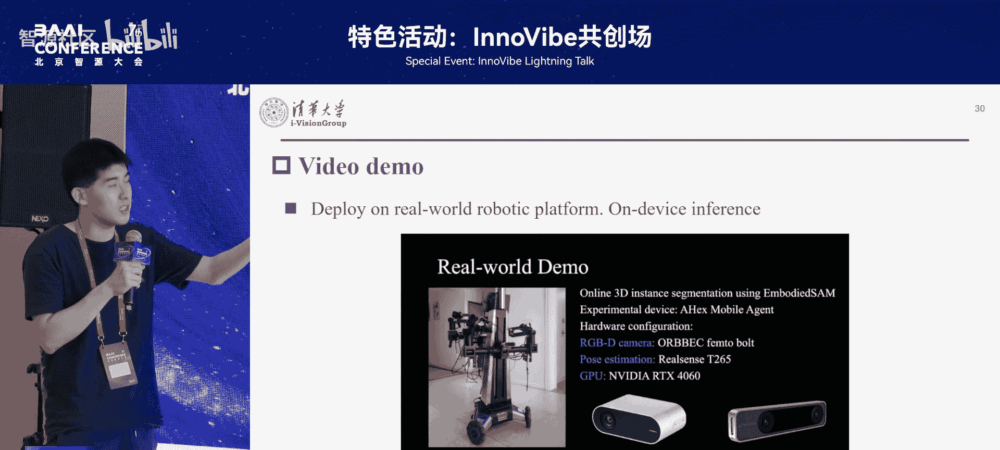

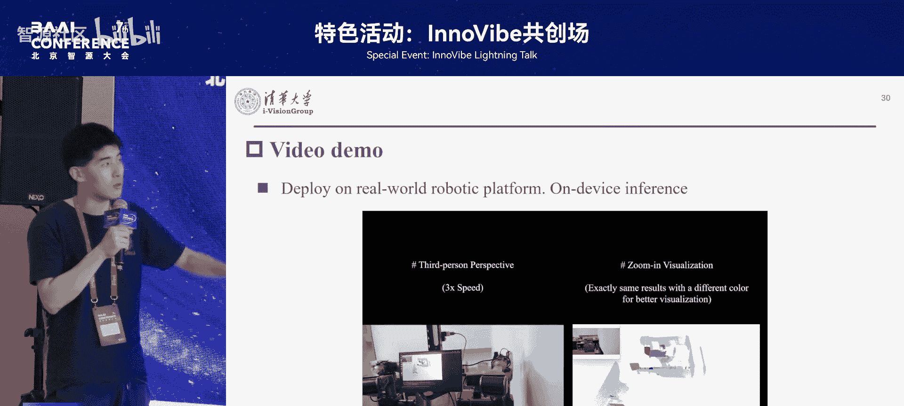

re265去进行获取。而深度相机我们使用的是奥比中光的这个bo，它可以把我们平时常见的一些办公室环境做一些很好的重建和分割，而不需要任何相当于是一个泛性很强的一个模型可以直接落地。

然后基于我们的在线实力分割，它可以做些后续的应用呢？这个其实非常多，我们这里也给出了一些简单的探索。说拿到了在线的3D实力分割结果之后，我们可以将实力转成对应的节点。那么我们就可以构造在线的3D场景图。

基于在线3D场景图，那么就可以用语言模型进行推理，从而去完成导航任务。我们在导航方向目前已经发表了两篇文章，都是用在线的3D场景感知得到的场景图以及LM推理来完成任何目标导向的导航。😊。

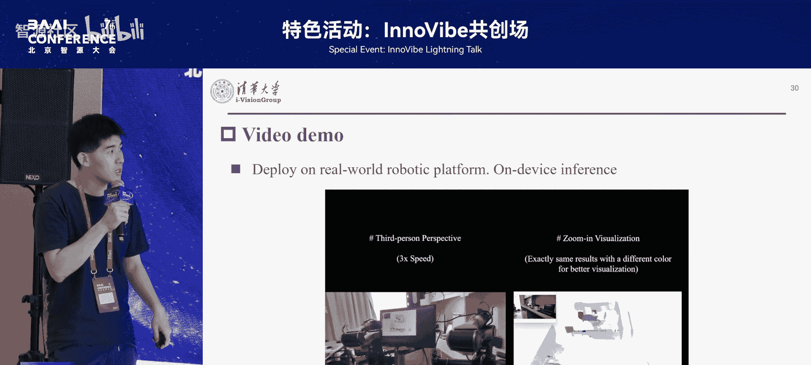

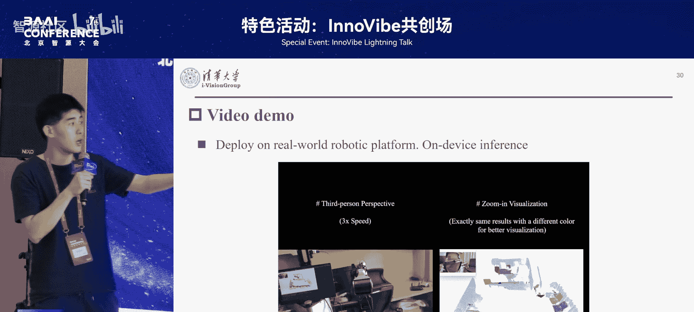

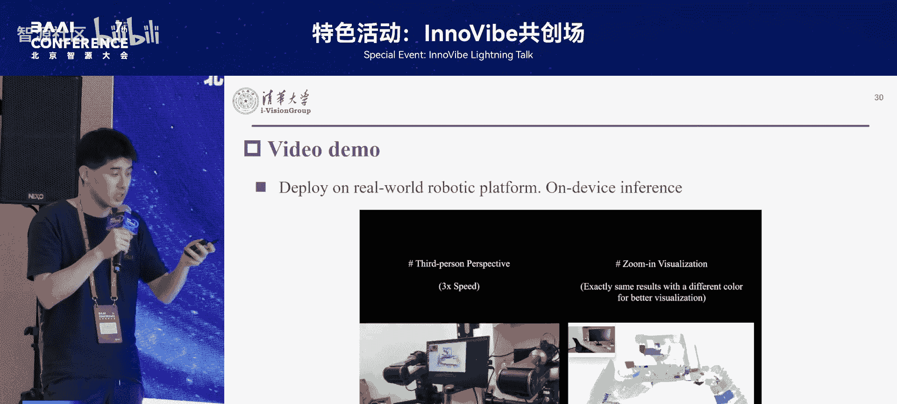

对于视觉语言导航，我们可以把它建模成一个约束问题。同样可以通过在线场景图加以解决。呃，然后最后简单的放一个demo，我们的方法通过在线的3D场景感知和在线的场景图推理。

可以实现这种大范围的呃这种任务的完成。比如说VLN他可以去取一个外卖，然后他可以根据人类的指令去自由的去根据空间中的物体去做groundunding，去做探索，去做操作。对。

然后因由于时间原因我就不详细展开了。😊，好的，以上就是我的汇报，谢谢大家。😊。

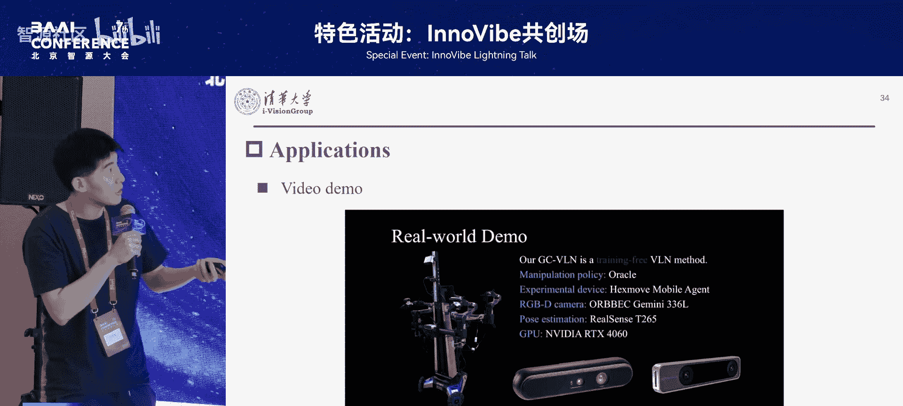

那感谢徐威博士带来的精彩的分享。那么我们最后一次提问环节，各位线上线上的嘉宾有想抓住这个机会的吗？😊，许博士你好，那个我想问一下，就是说呃在你的这个工作中，因为因为现在的许多这个物体检测和物体分割。

它是呃基于1个2D的。然后呃像是在室内中也经常是先用2先用一个任务相关的1个2D检测去检测出来之后再再去分割出来这样的一个个2D的这样的一个信息。然后在您的这个工作直接是在一个3D上面做一个分割。

那它后续的话，他这个呃和那个他的语义，还有说它这个呃几何的信息，怎么着让这个大让后续大模型去做一个很好的任务的一个理解呢上下文的这样嗯，好的，谢谢你的问题，就是对于这个3D分割。

我们要看他用的是就是他具体用在什么样的下游场景。比如说对于导航这个任务，我们通常只需要关注我们场景中有哪些物体物体间的空间分布是哪些就够了。所以这个时候我们其实只需要知道每1个3D。

物体它的空间坐标就只需要1个XYZ，甚至包括一个大小，其实就可以了。那么对于更加精细的一些任务，比如说一些呃呃移动操作或者说操作任务，那么这些任务它需要对物体的几何有更精细的建模。那么这方面的话。

其实也需要通过一些对应的技术加以解决。比如说我们最近其实也有探索，就是基于一些这种桌面级别的分割，然后用来去引导一些操作。对，所以最后总而言之的话。

就是如果说是要通过大语言模型的推理去执行一些具生任务的话，我觉得还是看任务吧。如果是导航的话，其实物体节点就完全够用。如果是操作的话，可能还需要加入一些端端端的东西。好的好的，谢谢。

