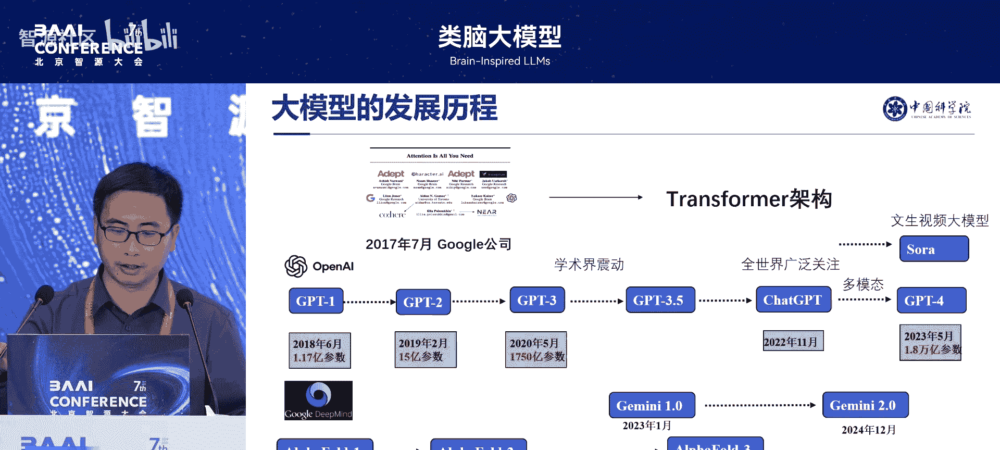
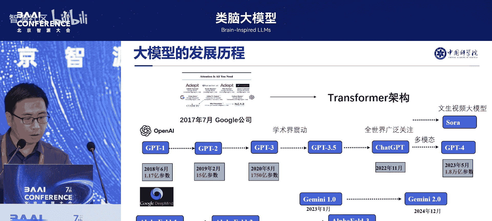
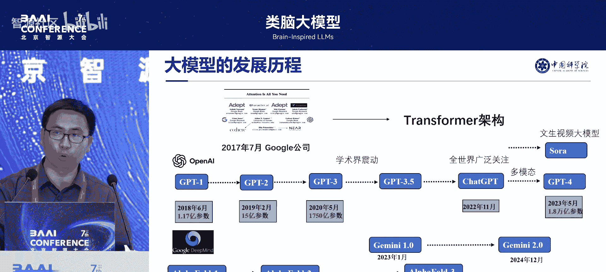

# 2025北京智源大会-类脑大模型 p02 主旨报告一：李国齐 -BV17xNjzMEer_p2-

好，非常呃感谢马老师的介绍，也非常高兴呃，有机会来到呃。😊。

支援大会分享我们的工作。呃，我的报告的题目叫做内导通用智能大模型。

我的报告主要是从呃三部分呃。阐述第一个部分是研究背景，主要是介绍呃呃，我们。做内脑大模型的一个研究的当前的一个一个一个现状和为什么我们做这样一个研究。第二部分是呃介绍内脑通用智能大模型的呃。

比较重要的科学问题。呃，第三部分是我们目前的一些进展。

啊，首先是我们可以看大模型的发展历程。其实现在大模型基本上都是源于2017年谷歌的这篇tenOUD的这篇论文。

呃，这篇论文提出了一个叫做transform的架构呃。但是确实open AI呃发现了这样这样一个架构，它具有一个可以扩大的一个可以扩大到一个很大规模的一个潜力。

所以他们最开始呃去发展的GPEGPT系列的这种大模型的工作。呃，而谷歌呢他们最开始其实是沿着AF size的这样一个方向呃。

小off fold他们在这个方向也创造了一个呃从论文到获得诺贝尔奖才几年的这样一个记录。

那么呃毋庸置疑，其实现在已经进入了大模型时代。呃，大多数科学家认为，通用智能的主要途径是大模型。因为呃大模型在canule的驱动下。从GPT1的1。17参数到GPT4的1。8万亿参数，现在规模越来越大。

其实我们面临的一个问题，就是呃，因为现在计算机可能无法承受大模型对模型规模的增长的需求。而且很多很多公司也在探索大模型的边界，它的规模边界到底在哪里？在在这里我们需要思考一个问题。

就这种无止境的模型增长是不是一条正确的道路？我们如何找到scan之外的一个可以持续驱动当前AI系统到一个新的阶段的通用的AI的系统？那么在在大模型时代。

在scanning驱动下的智能算力系统的功耗问题也是日益的凸显。现在AI的双利平台都需要大型的电站去进行供电。我们也迫切需要研究新型的。低功耗的智能计算系统。

那么呃当前一个现状就是目前主流的大模型基本上都是依赖于transform的架构。从GPT系列到Tep。

那transform系列它它有它的优点是它呃很有很好能能能够在大功模的GPUGPU上去呃高效的呃并行。呃，但是他的缺点就是他的训练的开销的问题。他的训练是随着他训练长度是2次方增加的。在推理的时候。

它的呃时空复杂度也是线性增加。所以呃目前的一个现状就是。呃，transform系列这种架构，基于sof max attention这种，它其实很难支持这种超长序列的序列的呃问题。

比现在主流的大模型基本上都是就是支持啊64K或者128K的这种序列长长序列的学习。这长序列是指什么问题呢？就比如说呃如果说我们把呃像一个超长的这种电影或者电视剧呃输给大模型。

或者是一个比如三国演义这样一个输给大模型，让他写摘要，或者是问问他人物之间的关系。其实这种是需要非常非常长的这种序列的支持。其他也是理解的，他也是限制了这种这种呃当前模型的一个智能的水平。嗯。

另外一方面，其实我们知道呃大脑的能效事野远超现在的GPU。呃，我们知道GPT3是1001751参数，现在呃大模型基本上都是在千亿参数。到万亿参数这样一个规模。Oh。另外一方面。

我们大脑如果说我们把把大脑用一个参数化去去描述我们大脑的时候，我们知道大脑的神经元它基本上就已经是在呃千亿的量级，已经是跟现在大部分的参数参数已经是一个量级了。

但是一个神经元呃是跟呃1000到1万个其他的神经元相连接，做突触连接，这已经是又又是高3到4个数量级。同时在这我们还只是把大模型呃，把把大脑看成一个呃点神经元模型，事实上突触它是一个一个有有很长的长度。

如果说你要呃进行呃按照一定呃去进行离散化和离散化的时候，它一个神经元。需要几百个呢，就是几千个A方程去进行描述。这个时候我们我们估计是但是我我们自己的估计是大脑其实参数量是呃。

是有到100亿左右的这样一个参数量，但它的功耗只有20瓦左右，所以大的能效比GPU应该高10个以上的数量级。

这也就是说现在我们用全世界所有的GPU也很难以模拟这种我们目前呃在特别精细程度上的这种大脑大脑的建模。所以我们我我们在想，那我们是不是能够借鉴大脑的信息处理机制，去利用神经科学去发展。

去研究新一代的AI的基础理论。和计算架构。呃，但是我们做这样一个研究，会面临一个挑战，就是神经科学跟人工智能之间存在一个鸿沟。这个图上面一半上面一半是神经科学，下部分是人工智能。

我们知道神经科学它侧重的是呃精细的结构和生理的细节。而人工智能侧重抽象的结果和计算的高效性。所以现在现在像现在的GPU主要是呃针对于呃计算高效性去设去去设计的。

所以现在GPU很难去呃支持这种精细结构和身体细节的AI的模呃神器呃这这样的一些网络的模型。就是造成了神经科学跟人工智能存在这样的混沟。也就是说。

目前我们很难构建一个有具有大规模的有精细结构身体细节的这种呃神经元呃网络的模型，在GPU上能做高效的训练。那么我们我我们的一个呃思路就是说想去对比现在大模型和人脑之间的差异。呃。

我们我们知道大模型是呃用一个公式来表达可它是呃它的基本的计算单元是点时间模型，加上自助义的机制，加上transform的架构，或者是一个网络的架构。呃，而人脑呢，它是它的基本的计算单元是一个呃。

我们叫做数突神经元模型。它是它的一个单单个神经元是呃是呃像一个树状树状树状的形状。上面是有神经环路和呃一个呃全脑尺度的大脑尺度这种动力学的过程。

那么我们在想有没有可能把人老的这种这种结构能够去融合到现在大模型的架构里面去。啊，如果说能融进去，我们希望能构建一个内脑通用智能的大模型的架构。那么我们需要我我们我们在做这样一个呃研究的时候。

我们那就需需要思考。我们如果说把大模型和这做对比的时候，现在大模型有哪些不足的地方？我们有自己三个有有有三个自己的观点。第一个，我们认为呃，当前的大模型的生物的可信程度比较差。呃。

他没有利用大脑网络丰富的多尺度动力学的特征。呃，比如说包体动力学和束图动力学。呃，这上面是有有两个图。两个图啊，一个是左边是点神经元模型，右边是一个数图神经元模型。那么数图神经元模型呢。

它呃它呃有有有不同的分支，然后每每一个分支上可以有有多方式的结构，而且每呃它会有而而且每个数每个分支上它可以有不同尺度的这种参数。也就是说他能带到不同的尺度的记的记忆的能力。

但是现在目前大模型是基本上都是呃点基于这种呃，不管你规模多大，都是这样一个点神经模型。另外一个方面就是我们认为现在大模型它的功耗过高，它没有充分的呃体现我们大脑的这种呃一些低功耗的这样一些特征。

我们大佬之所以功耗低，我们呃我们认为他可能是这样的一些机制，包括呃0一的这种信息交换。呃呃，包括事件驱动动态计算。因为我我事件驱动动态计算是指呃。

我我在我的我的计我我我是根据不同的输入去激发这个网络里面不同的计算单元，而且这个计算单元只占非常小的一部分。而且他还可以做非常稀疏的这种这种嗯。叙数的加法。

我们认为我们认为这些是这些是低功耗大模型架构的一些重要的基础。但目前的大模型主要是做呃稠密的举证的举证和举证举证和向量的这种乘法。另外一个第三点就是我们认为当前的大模型。

它没有发挥神经元种类的多样性和编码的多样性。造成他的通用性和泛化性能不太不足。比如说我们知道我们的神经元其实是非常多样的，有兴奋性的意制性的。同样一种神经元，它有它的形态，它的参数各异。

那么我们希望如果说我们我们认为大脑之所以它具有很好的通用性和发挥是，就是因为它有这样一些种类丰富的神经元。那么这现在这样一些其实没有在现在大模型里面所反应。好，我的第一部分是主要是呃呃研究的背景的介绍。

主要是想就介绍呃当前当前大模型基于trans的架构的发展，其实呃它是有自己的问题。我们希望能够借鉴人脑的这种低功耗的优势去思考现在大模型架构，它可以怎么怎样去发展。

那么第二部分就是介绍呃内脑通用智能大模型的它的呃主要的科学问题。呃，这个也是只是我我们我们自己的一些一些观点。

呃，我们前面我们提到我们其实是希望去架构一个从神经科学到人工智能这样一个桥梁。呃，我们我们认为构建这样一个桥梁可以通过数出计算去构建。那么具体来说呢，是我们希望构建这种速通脉冲神经呃脉冲神经网络。

去构建一个呃通用的量小大模型。呃，为什么为什么我们觉得数图迈冲神经网络可以架构一个从神经科学到人工智能的桥梁呢？是因为它具有一些特性。首先是它具有这种呃我们把它叫做内生的复杂性，叫做时空动力学特征。

它能够去呃去呃。比较好的就是去模拟一个神经元的这样一个真实的这样一个他的一个呃。一个呃受到刺激之后，它的这样一个动力学变化的过程。同时它神经元之间可以也是以这种灵异的脉冲进行通信。

它也可以做这种事件驱动的系数加法，包括做动态的计算。那么如果说我们能构建基于这个构建出一个呃内脑大模型。那么我我们希望它能够达到这个目的是它能够呃跟现有的大模型。

能够在性能上去做直接的PK它能够性能达到哪就超过现在的大模型。同时它代价能够有降低。呃，所以我我们我们认为那卖出神经网络，卖出神经网络它可以。做到找到计算高效性和生物合理性的一个平衡点。

因为我们前面呃说到呃呃神经科学跟人工智能之间存在一个鸿沟，它是难以兼兼具这种计算高效性和生物合理性。那么我们认为脉冲神经网络它是有可能找到这样一个一个平一个结合点，一个平衡点。呃。

脉冲神经网络呃跟呃叫做specike neural networks，它呃是我们呃研究呃当前内脑智能主流的一个网络。呃。

跟它对应的是叫做我们把它归结为呃A叫做 artificial neural networks是现在深度学习领域主流网络，包括像MLP包括RN包括CN包括transformer。

都可以归结到这这样一个一个类别。它主要它的基本的计算单元是我们前面说的这种点神经元的架构。那SN它的主要的计算特征是呃，做事件驱动的这种系数的加法。呃。而AN呢它主要是做稠密矩阵的相应的乘法。

所以SN它的能效理论上来说是可以非常可以非常非常高的。所以我们认为脉冲神经网络是低功耗人工智能的一个重要的条件，一个重要的途径。那么我们如果说我们要构建呃内脑大模型，那么它有一系列的科学问题。呃。

他主主要就是需要有支持构建内脑大模型这样一个基础的理论理论体系。呃，我们认为他的一个总的科学问题就是我们如何。突破当前大模型主要是scand驱动这种一种方式。

去构建构建基于内生复杂性的这种通用新型的通用智能。通用内脑大模型技术架构。在这里边我们提到一个概念叫做内生复杂性。它的它对应的是叫做外生复杂性。因为我们认为现在当前的大模型是基于外生复杂性。呃。

什么叫做外生复杂性呢？就是现在大模型它是基于。呃，它的基本的计算单元都是都是固定的，就是这样一个点神经元的结构。呃，我们只是通过把它的神经元的数目增多，把它的参数量增大，把它的数据。

增多把这种算力这种呃增增大去用更多的数据，更多的更大的规模去提升这个模型的能力。这个是向外扩展它的复杂度。那那我我们的思路就是希望去。去换一个呃换一种思路，就是我们要打开神经元的内部。去基于内生复杂性。

去借鉴神经元内部丰富的这种动力学的特征，它的内部的结构去提升这个模型的能力。那么呃这个这个大的科学问题，它可以分为几个层面。首先是在单个神经元层面，因为神经元层面是这个整个大模型它的最基本的计算单元。

那我们在单个神经元层面呢，我们是希望去呃前面提，我们用数图神经元的模型。呃，输出神经压模型去替换现在的这种点神经压模型。要做这样一个替换呢，我们要解决几个问题。一个就是它的这个呃这个神经元。

它的训练的成本，它的训练速度它要并行化。同时他要呃我们通过这样一个神经元去构造这样一个构造这样一个网络。它能够为这个网络提供这种具有通用性和发化性的这个这样一个呃一个计算的基础。那么在在网络层面呢。

我们呃需要去呃考虑这个模型的架构。我们是呃希望去呃找到这种非transform的这种呃线性复杂度的这种架构。因为前面我们提到transformer是二次二次，它的复杂度是二次增加的。

那么我们如果说构建出这样一个线性模型的基础模型的架构了之后，我们再把呃这种一些列脑的特性能够融合到这个架构里面去。包括它的呃piike的这种稀疏，呃，包括它的事件驱动，包括它的呃这种并行，都能融合进去。

我们需要构建这样一个面向大模型的事件驱动的线性自主意力机制的脉冲网络。同时，在高效计算层面呢，我们要融合现有的大模型的优化技术。

同时要把SN这种大模型内脑大模型它独有的这种优化技术去呃在GGPU上去做它的这种训练和推理的这种优化。在扩大层面去进行优化。要构建这种大规模的01的脉冲网络的训练加速，要让这个大模型。

它能够训练速度更快，规模更大，性能更好。那么这样一个架构呢，它其实是从模型算法需要从模型算法到训练平台，到到软件，再到呃内脑芯片。但目前我们主要是验证这样一个大模型的能力的时候。

主要其实呃在模型算法和训练平台上面。呃，我我们我们的设想是去构建一个百亿到千亿那样级的这样一个呃那老大模型。他其实可以分为呃三个三三个侧。呃，一个就是它的边缘测。

边缘测它主要是可以去做这种传统的视觉任务，可以它测重的是做极低的功耗，一般参数的规模是小于小于百兆，一般是几兆或者是十几兆。啊，在端侧它可以做一些大模型的一些垂直领域的应用，吧一般是3B到10B左右。

呃，在云端呢是做这种主要是做呃大模型的云端的训练或者推推理。它要去平衡它的性能和它的训练的代价，呃，是希望能够到百亿到千亿的量级。那么那么但是我们要做这样一个呃内老大模型呢。

它其实一直呃我我们也说刚才说到提到用这种数突迈出神经网络去做去构建。呃，脉出网脉冲神经网络它长期来面临一个困境，就是他的缺乏学习算法和计算的理论。它跟NN之间的性能差距过大。我记得我2019年的时候。

其实在志愿也做过一次分享。其实当2019年的时候，那个时候呃，卖出神经网络在硬币net上面都还不能做到一个收敛的结果。好，这个是我的第二部分，就是主要是介绍我们要做这个内脑通用智能大模型。

它主它的主要科学问题，以及它目前存在的一个一些瓶颈。那么第三部分呢，我们是想介绍我们目前的一些进展，以去说明为什么现在已经到了一个可以做这种内脑大模型的这样一个一个时机。

那首先呢我我们我们可以看，其实刚才提到了一个问题，就是脉冲神经网络，它曾经跟深度神经网络之间的gap太过于大，它在很多性能上都都差别巨大。呃，所以说我们在这说他的它的性能一直呃差了有大概有几十年的时间。

但是在这个领域，其实这几年发展非常快，尤其从23年、24年到25年一系列的工作呃，在它的架构训练和性能方面，我我觉得都已经取得了一些突破。目前其实在纯在这种计算机视觉领域，基本上各种任务。

包括你的呃分类检测分割任务上，基本上都已经只落后一年左右的时间了。那在这里面我们只列列举了一些我我们我们课题组自己的一些一些工作。呃，他主要是呃我们在在在那个new上面，在ICML上面。

在呃在米在triI上面呃，有一系列的这个工作啊。这一系的工作呢呃主要是在那个呃他的训练的这种训练算法，它的训练复杂度，包括它的一些应用呃，架构取得的一些一些进展。

那我下面可以呃有几个可以呃给稍微简单的介绍一下。一个就是说我们比如说我们在神经元层面，我们在神经元层面，我们呃在今年的ACL上面。

我们呃提出了一个叫做输突启发的这种多房式多分支的并行的呃脉冲神经元的这个这个结构。并且我们把这样一个神经元去可以去验证了它在一个呃较大规模。在这个规模还不是特别大呃。

去实现呃可以做一个长序的一个建模的任务。另外就是呃在架构方面，我们提出了这种权益部的脉冲驱动的线性自助力的的呃这样一个架构。呃，我们把它叫做V1V2和V3的版本V1的V1的版本是在2023年呃。

我们在这里面我们提出一个叫这个算子。他去做这种QKV的这种注意力的时候呢，它QKV里面每个元素都是都是这种零1的元素它把原来这种举证和举证的乘法变成了变成了呃一位的运算。

以它的呃能效理论上来说能提升40到80倍。而且呃我们在呃在我们在V3是今年的上面，我们在innet上面能能达到86。7%的这样一个水平。其实跟呃跟AN的水平已经比较接已经已经比较接近了。

但是它的这种呃它的推理的代价只是它的大概是能提升5到30倍。另外就是我们呃我们我我们我们今年在我们在去年的new上面，我们提出了一个呃就是mate叫做mate LA的这种线性线性模型的统一框架。呃。

我们呃其实现在线性模型这几年发展的很火，像manba是其中的111一个代表。呃，我们我们我们把线性模型做了几个主要的分类，包括线性的transformer，包括状态空间模型SSM包括线下RN。呃。

我我们认为这些线性模型之间其实他们本身上来说是可以相互转化的。他们是可以用一个同用一个通用的框架去去去描述啊。同时，现在现在模线性模型某某种意义上来说都是对这种 max的一种一种逼近。

但是目前的线性模型都不是最优的毕竟我们把最优的毕竟它有几个条件啊，这几个条件在我们的mate1里面可以同时可以同时满足。那么我们在这个基础上可以构建呃线性大模型的统一的框架。呃。

另外就是我们我们在我们在去年我们在在呃ncomp science上面，我们提出了这种基于内生复杂性呃，去架构呃神经科学到人工智能的桥梁这样一个一个思路。

就是我们认为要向内借鉴神经元的一个一个呃丰富的结构。呃，nature呃，这个文章是在nature compete上面也被评为2024年他们呃呃最受喜爱的论文。呃，整个在这个年度里面排名第二名。呃。

这个期刊对这个研究曾经发表一个评论，他说，AI的研究更加贴近工程与应用，而行侦科学的研究更加具有探索性。研究团队挑战这一传统的观点，并表明。更详细且生物上更真实的神经元模型。

可以推动深度学习取得更大的进展。啊，另外我们在应用层面，我们呃把基于这种SN的这种呃呃做计算机视觉任务在物体检测上面，我们呃呃这是我们是ECCCV上面的一篇论文，也获得他的满分。

同时获得了最佳论文奖的提名。他呃在coco数据集上能够达到跟优录V8持平的水平。呃，同时它的能能效能有也是5到20倍的这样一个提升。这个工作呢它的最大的意义在于。

它弥补了SN与当前人工智能主流模型的差距，展示了SN它做低功耗计算的强大潜力。呃。呃，另外我们也提出了呃，在去年的上，我们提出了这种叫specike LLM的这样一个脉冲神经元的大模型量化框架。

它主要是把现有的一个大模型去量化成一个呃脉冲神经元脉脉冲脉冲形式的这样一个一个工作。呃，我们提出了一种叫做呃OBS这种框架去检测神经元的显著性。呃，同时去用变用不同的根据它显著性去去决定它的呃时间不长。

我们用一卡了80G的A100呃，16个小时可以完成人脑规模70B的那ma模型的量化。呃，同时我们就是我们今年呃其实在投的tAI的一篇一篇论文。我们前面都是在计算机视觉领域的任务。

我们去呃去验证脉冲神经网络它的能力。但是呢它其实在这种包括它的这种呃检测呃，包括它的这种呃分割上面，它其实很难超过现在的大模型。呃，超过现在的现在主流的AN的模型。呃，但是在这个任务里面。

我们我们把这种他认为我我们在这种3D的这种点名的数据上面去呃去做的话，我们其实发现了它能够超越主流的AN的模型。所以我觉得这个工作其实还是还是挺重要的。

因为我们原来一直都希望在某个场景上中超过现在超过现在A。呃，同时我们在训练平台层面，我们之前跟那个呃呃北大田玉红老师，我们也开源了S3的训练平台spec jny。

能够呃能够呃在CPUGPU层面去支持外出神经网络训练加速。呃，包括我们现在其实正在和那个国产GPU公司去训练7B到70B的量级的这种呃内脑脉冲大模型。我们希望去打通从呃国产的数据到到国产的这种呃呃。

基础模型到国产双利平台这样一个全站式的研究的链条。呃，我们我们目前其实在那个7B的模型，我们在呃呃呃墨西的国产GPU集群上已经已经训练结束了。我们我们在这个我们在呃这个模型。

我们大概是用了150B的数据，用256卡，大概训练了10天左右。那其实在呃在MMYUU效和呃JSM8K这个数据上，它的它的那个目前的性能其实在线性模现在所有的线性模型里面是最优的。呃。

它跟呃跟其实跟那个跟千问呃还有一定的差距，但是我们只用了150B的数据，千问用的是1。4T的数据。同时我们也把这个7B的模型呃在手机端进行了呃部署进行测它的速度的测试。

我们发现我我们发现我们没有做任何的优化的时候，其实已经能够是它的推理速度能快2倍以上。我相信如果说我们进一步的做优化的话，它的速度再提升呃，才提升2到22到5倍。也就是说最终能到呃。

我我感觉能到呃8倍左右的，其实是是非常有可能的。呃，像这个是我们在呃TB上面，比如说我们做的一些呃一一个例子，就是这样一个编程的一个例子。其实他还是也也是给我们给他一个任务，之后，他也有思考的过程。

然后最后给出了能够完成这些任务。啊，另外就是我们我我们在在其实在这种低功耗的那个验证场景下面，我们也是把注意注意机制的SN去部署到这种呃改算一起的一部列脑芯片上面，这个我们是跟实时科技合作呃。

去呃去验证，其实呃在很多的边缘动的场景，它确实是可以做到极低的功耗。因为我们可以去呃去把呃这种脉冲神经网络它的f rate呃控制到极低。同时跟异步的这种芯片去结合的话，它能够呃在计算的时候。

绝大多数的计算单元都处于近息的状态。所它近期功耗是在能在能在毫瓦的量级。呃，这个是我们我们呃最近也是最近的一个一个工作，我们是呃把15亿的参数在FPC上能够去进行呃进行部署。它在呃推理的时候。

也只有这种呃整个只有系数的加法加法计算，它的动态功耗只有大概131313瓦左右。另外就是我我们提供了一个框架。我们认为我们构建了出这样一个呃把这种呃每个神经元就有个脉动态的脉冲脉冲的这个过过程。

其实是可以去我们对这个呃脉冲大模型能够更深层多一个维度去观测它在不同的输入下它的一个动态的过程。也就是它能去做一些可解释性。啊，最后是我们这样一个我们的这样一个综述。我们我们在pro of hV上面。

我们啊在电脑计算呃去做了一个比较详细的它的一个一个介绍。它的呃主要的研究的它的基本的概念，它的主要的研究领域，它的研究的研究的这种呃。呃，挑战它的趋势，我们都做了一个比较详细的介绍。呃。

我们认为去要去构建这个从模型从算法到软件到数据到到芯片这样一个内脑基础的设施，去构建它的生态。好，这个是呃一个广告，就是如果说有有感兴趣的，可以联系我们科技组去，包括推免和。

和了呃实习，谢谢大家。好，那个非常感谢李国奇老师的精彩报告，看大家有什么问题。😊，嗯。好，感谢李老师的精彩报告啊，有一个问题就是刚才你也提到了，就是在立朗大模型里面。

现在有一个呃痛点就是多尺度的记忆的问题。然后在刚才您介绍的几个呃工作进展当中，我也认真学习了，包括您的文章，我也学习过。但是呢就是在记忆的多尺度这一块，我其实就是特别是常识层的记忆这一块啊。

不知道李老师您有什么样的设想，或者后续有什么样的呃技术路线。谢谢啊，好好，这其实现在目前因为我今天呃我今天这些报告，其实很多很多工作都还没有发表，就是我们也是我们目前的一些想法。呃。

至于那个我们现在目前是基于这种呃数突神计元去构建呃呃他的大模型的技术架构。那么数突神计元呢就是它其实有会有不同的分支。而且每个分支上，它其实你你是可以有那个可以有一个开关的。

相当于是你这个可以控制这个这个数值是开还是关。那么它可以去。他可以去。去呃根据你不同的输入，它它是选择呃，相当于是这个这个分支，它它是要保留还是不保留。那么这个时候呢。

它其实是可以去构建一些长长的和短时的这种去保留这种记忆的能力啊，这个从基本的计算单元上来说，然后呃我认为要构建这种要或者这种长序列的这种记忆能力呢，是是因为呃这是一个架构层面的问题。

就是主要是现在transform，它去它没有这么大的那个那那个资源去支持。如果说你有足够的资源，其实传form物理论上是理论上是可以的。

所以说我们是用这种呃线性模型的架构去呃去去能够去构建它的长序的这种记忆的能力。嗯，好哎。看看大家还有什么问题。呃，那那个要不我先问一个呃，因为那个刘老师的报告很精彩。

因为从这个数突的神经元到大型的这个脉冲神经网络都有。呃，我的问题就是说呃您说了这个数突神经元和点神经元非常不同，它是有一个内生复杂性嘛，但它呃是不是和就是多个点神经元的组合其实非常相似。

就它和多个神经元，多个点神经元组合的这样的一个小的这个微环路，或者是一个这样的微架构有什么样的区别呢？呃，我觉得这我觉我觉得这个问题问的挺好的。

就我们我们其实在那个就是我们去去年在那个呃NCS上面的论文。其实我们当时是做的一个工作，就是我们说三个立的神经元。如果说它是以某种结构的时候，它其实可以跟一个HH的神经元去呃某种意上来说。

它可以在神经动力学这个上面，它可以是等价的。但是这这有个前提，就是你它是以某种某种结构组成。而且就是某种结构组成呢，呃，我们去在验证的时候啊，发现在在很多任务上面，它虽然是有等价，但是它需要更大的规模。

更大的规模和更大参数量去做同样这样一个复杂度的这样一个呃动态性能的逼近。呃，所以我们当时呃就是依依照这个我们说其实你把单个神经元做做复杂。在宏观层面，在网络层面。

它是有可能是能够降低降降降低这个这个计算量的。因为其实呃。我我刚才提到就GPU他其实没有办法去呃就他去做这种精细神经元的模拟，它其实代价是更高的那为什么你还要做把这个做复杂了？

就是我们认为它就是呃有有一个是神经元层面，一个在网络层面，它其实是会会会带来呃会带来不一样的地方。就是另外就是说你你包括你如果说你是一些小的神经元，它去结合的时候，它其实里面会有一环路。

也就是说你在训练大模型的时候，你会有不不稳定性。就是因为你一一一个网络里面你有你有反馈的时候，就就有可能有有可能是呃它的那个动力学特征，都都可能有就反正就是稳定性就有很大的问题。

但是这种呃这种数出神经元，它其实某种意义上来说，它会具有具有那样一些特点。但是呢它的训练的时候，呃，只要如果说你能在GPU层面解决它的训练代价问题，是有可能能够技术保持它的稳定的这种这种训练。嗯。

好好的好的，谢谢李老师。😊，看大家还有什么问题嗯。哎，李老师，我之前拜读过年的很多文章，就是我看现在SNN的文章，它验证它低功耗的优点都是算一下理论的功耗，并没有在实际的就内脑芯片上面做部署。嗯。

我猜测这个可能是因为一些神经形态芯片，也就是内脑芯片比较贵，不太常见。😊，但是我觉得就S它最终验证它低功耗的优点，肯定是需要部署在这种神经形态芯片上面。

哦看您觉得就是神经形态芯片什么时候可以发展的比较成熟，就跟现在的CPUGPU1样。😊，好好，谢谢。其实我们刚才这上面其实有一个工作是我们跟那个实时科技那个是是可以在是那个是实测的工号。

但是那个就是他他呃主要的问题就是他那个网络规模比较小。在在大的网络规模上面去。其实后面我相信张老师和张老师他们其实在那个硬件上面，目前呃呃也也有进展也有进展啊。李老师您好，我想问一下。

就是呃现在的这个人工智能模型和大脑其实区别的地方有非常多，就是细节上面就不说了。但是我就想问一下，您是怎么选择从哪些地方来模拟大脑，就是因为它不同地方太多了。

就您怎么知道您选择的这个点是可以改善性能降低功功耗。这个这个首先就是呃可能可能可能在呃做这个科研的时候呢，很多东西你可能刚开始也只能去去去去呃猜测，猜去想。

那么我们我我们我们的一个思想就是说我们把这个网络划为几个层面。一个就是它的基本的计算单元层面。还有就是它的那个网络架构层面。

还有就是你你呃因为你的这个网络肯定是根据你的基本单元构某种连接在形成的这个网络。然后在在这个网络上我怎么去做高效的训练。那么在这几个层面的时候呢。

我们就在想那每个层面它会有自己的这个呃呃核心的需要解决的问题。那首先比如说我们在基本神经元层面，我们就在想那那现在大模型现在的这个模型，它的基基本单元就是这样的那我们有没有可能把它呃去替换掉。

那替换掉的时候，就面临一个问题，到底是你要有一个多复杂的这样一个一个神经元去替换啊，这个神经元它替换之后，你仍然在在一个大规模上，你仍然能不能保持呃能够去高效的训练它，就是在网络层面肯定就是在讲。

那我们现在现在哪些机制，哪些重要的问题，我们能在这个网络层面能能够去反映。那我我们选择就是认为它呃主要是从那个计算复杂度上去去解决。啊，当然就是。就是说如果说还有很多细节的层面。

包括你像那个因为在神经科学里面，他有很多神经环路呃，这样到底有没有可能反映到这里面来。其实这个里面其实我觉得是它可能是一个需要逐步逐步探索的一个过程。

就是我们在一个已有的现在跟跟现在大模型能够尽量的那个能够比较好的自然的能够也能借量它的技术。我们在这个方面，再往再往神经科学那边再看看能能够推多远。谢谢，那还有一个问题。

就是说您觉得您现在构建的这个内脑大模型，还有呃哪些方向不不足？就是您未来希望还从哪些地方去改进它。呃，我觉得他他不足的地方就是说他其实目前来说，我们现在呃他他主要是内脑大模型。我们前面1个PPT也说了。

它其实有四个层面啊，一个就是它的那个呃模型算法层面，一个是它的呃训练平台。后面其实包括它的有软件和硬件，呃，我我们其实现在目前主要是去做呃去验证现在的那个内脑大模型。

它其实是很多呃能够跟现在大模型能够直接呃能能够性能或者是通用性上都还有可能有优势。但是目前其实我们还没有这种呃特别合适的这种硬件架构去完全把呃把这种呃模型的那个能力能能够反映出来。

其实刚才也有也有人问到这个问题。就我我我认为它其实最终其实要还是要做这种软从从那个算法到软件到硬件这种一体化的这种这种协同去构建它的生态。我觉得他呃生态是非常重要。因为只有。在这个生态的旧础上。

才能够让这个领域能够呃快速的迭代去去发展。谢谢。好，那那个我们时间到了，呃，非常感谢刘老师精彩演讲，然后也非常有启发性。然后刚刚那个刘老师也说到了，我们需要这个算法，然后软件硬件的这样一个系统的工作。

