# 2025北京智源大会-类脑大模型 p03 主旨报告二：张悠慧 -BV17xNjzMEer_p3-

所以我们下一场报告就是来自清华大学计算机系的张优惠教授，他将为我们带来通用类脑计算系统研究的报告。嗯，张张教授是国家高层次人才计划入选者。

获得包括国家科技进步二等奖、高等教育国家级教学成果奖二等奖、北京市自然科学一等奖、世界互联网大会领先科技成果奖等国际国内奖项1余项呃，研究领域为新型计算机体系结构类脑计算机术软硬件。

下面就让我们以热烈的掌声有请张优惠老师为我们带来精彩报告。😊，非常感谢呃马老师的介绍啊呃，我的题目是通用类脑计算系统研究。嗯，在讲这个之前呢，我我因为刚才听了李老师的报告。

也是第一次这么非常系统性的听关于内脑大模型的报告。感觉有两点比较呃，一个就是说是咱们可能。电脑大模型跟通用大模型的不同地方就在于它的内生复杂性。这个我觉得我是一定能的听进去了，对吧？第二个呢也有提到。

就是说哎，我们要怎么去发挥它的优势呢？可能更多还要借助于。给整个系统的整体上来发挥这个类脑的低功耗和高效能的这个特特点哈。好，谢谢。OK好，所以这是我的两个感觉哈。那么我本人呢是做呃计算系统。

就是技术软硬件这一块啊，包括芯片和这个编译器这一块，所以呢整个来说呢相当于是做这个infr这一块啊，所以更多的是从这个角度来切入一下。呃，整个报告呢分成这么几个部分，一个就是现状与挑战啊。

一个呢就是因为我是做系统嘛，所以更多的并不care你的具体模型是干嘛的。但是你模型的计算特征，我是比较care的这个事情。😊。

第三个呢就讲哎，为什么说我们这个是通用的啊，这个引号哈，加个引号是通用。第四个呢就是我们的一些目前正在做一些探索工作。O啊，现在就言归正传哈。这个首先两张非常简单哈，一个就是说咱们内脑这一块呢。

还是尤其近几年还是在蓬勃发展哈，这个22年的有篇文章就提到哈做内脑系统对吧？可以涉及到各个层次，那刨去你上面的应用和算法不算，因为我本人是做系统对吧？不太care，就上面这两部分我我不太专长，对吧？

那从系统到体结构到电路哈，那这个还是好一点。那再往下就就是器件和材料，这个也是不不太擅长，但是呢如果拿这个关键字去搜一下咱们这个HXpl上面，最近几年发的文章啊，从有史以来发的文章。

跟最近三年发的文章会发现就是说这些各个层次从这个系统开始，从从材料器件电路到体结构到系统发现哎近三年最少它的文献篇数。😊，占有史以来3分之1以上。哎，就是这这大家很活跃，进步很快。刚才李老师也提到过了。

对吧？在很多智能任务方面已经接近，甚至某些点上面已经超过了深度学习的水平。那对整个领域来说是一个非常好的一个现象，这是一个蓬勃发展说的第一点。第二个呢就是说那也要说它的现状一个不好的地方，对吧？

其实就是刚才有位哎我不知道是同学也好，或者说老师也好，就提了个问题，对吧？就为什么我们现在这个电脑芯片。😊，没用上哈，他问的很委婉，对吧？太贵，我觉得不贵哈，因为不太就整个软件系统比较碎片化，不太好用。

说实话对吧？那么这个呢也是有一篇文献作为佐证，就是今年年初nature发发了一篇review对吧？comp scale对吧？它里面提到了就说软件系统呢是一个芯片碎片化的现状有这么几个相关的问题。

我看起来就特别与我有共鸣。第一个就缺少应用和软件通用规范，对吧？就算法不好移植有很多个form在做这开发，但之间一致性很差。第二个呢缺乏跨平台的编译工具。第三个呢就硬件的可扩展性这不是说你芯片本身。😊。

能力扩展，只是说你缺乏统就有很多种类型的电脑芯片架构各异，缺乏统一的抽象层。这就导致就说你很多的做这个技术软件的对吧？它是完全以芯片为核心。but up把这个系统长起来。

所以整个的各个层次啊都绑定在你这芯片的一些底层约束上面去，导致相互之间这个跨领域哎，跨跨平台这个性能非常差，对吧？就右侧的两个图，就是上面那个就是年初那个文章里面提到了，就说你看像这块对吧？

就有很好的这种跨平台编译器像op XLA像TVM已经存在了，对吧？非常明晰的把前端中间编译，把后端清晰的分开，有比较明确的界限，但内这块呢是没有是空白对吧？而且有意思的是呢，就这是25年初的文章对吧？

实这个文章里面的就这个在在之前前16年19年就一类似的一篇。😊，一篇论文也提了这个事情。这个里头好些作者都是共同的对吧？就就6年以前说过这个事，过了6年又说了一遍。好像还在呼吁这个事情。

我们希望有一个co compiler，对吧？但是好像这个地方没有focus，对吧？没有没有太太多的改善。那为什么呢？对吧？那先不管他怎么着，对吧？就说我们现在目前来看呢。

一方面就是说整个内脑系统发展现状，蓬勃发展没问题，应用计算也是右上角，对吧？😊，不同新的应用慢慢在支持进去，应用类型越来越多，整个水平也在非常快速的接近，甚至有的已经超过了DN。对吧，但另外一方面呢。

硬件也很多啊。不同的架构对吧？从传统的可能。这个尚老师在下面spin make的绝对主力就是他做的对吧？就控制流这块对吧？到基于新型的这种。😊，呃，实经形态期间这种，尤其是数据流这个为主。

整个跨度非常大，每一个都有自己特点。但是呢他们的工具链呢像是包括它的应用，对吧？都是纵向绑定碎片化，对吧？所以这样就面临一个问题，就是说用件特征，因为它种类很多嘛，对吧？这上面你体结构跨度非常广。

那整个系统那可不就是那怎么把它结合起来，让大家用的比较比较方便，比较好编程，那就就是个圈ing的对吧？所以刚才。😊，那个那个我我没看清是同学老师也好，就就提了个问题，对吧？这为什么我们还有没有没有用到。

对不对？很大一部分就这个原因嘛，是吧，就这个原因。😊，OK那么怎怎么去解决它。那么首先就要分析一下，看就是内脑神经网络对吧？它这算特征的分析怎么说。首先刚才就是说那个李老师也提到过，对吧？

就不像深度学习，对吧？深是已经他的训练算法已经收练了，对吧？以BP为核心的法向传播SN的训练训练算法呢还是一定程度上属于探索阶段，对不对？所以他还没有收练，对吧？那么举个例子啊，这个并不全，对吧？

就是我们也在以前篇文章我们也提到过，对吧？就整个的SN的训练算法，其实。😊。

嗯，也也可以分成那么几几一个谱系哈，就越往左就是越偏DN是吧？有的是DN你训练完之后直接转过来，我就不用训练，就微调一下就行了，对吧？有的呢通过一种梯度下降这种变形，对吧？就BBTT这个最有名。

还有一种呢就通过替代梯度的算法，那实上也是梯度下降，对吧？那还有一种呢就是通过局部算法STDP那反正有监督无监督，那么这么几个大类，所以他呢远远没有收敛，对吧？而且呢从着从左到右呢。😊。

生物的合理性在递增，对吧？同时呢我们也知道这效果在递减，对吧？所以这个还是有很大的研究余地。OK那么这个会带来一些什么什么样的现象呢？就是刚才也有李老师提到过了，对吧？就是吸数计算试验驱动是。😊。

SN它的低功耗的一个非常大的一个来源。那么我们也发现就说。说系数计算，那其实它的脉冲发放率就是嘛，脉冲发放1员之间，它的吸出率这个发放率是相对非常悬殊的对吧？就是我们也观察到。

就是说生物神经元它的发放率远远小于DSN直接训练出来的。同时再小于DSN你从DN转化到SN就是发放率来说，这个DN转化过来这个相对来说最高。😊，纯粹生物真实性能的最低。数量就相差大概是这三次方式是更多。

就是发放率。那么同时呢就是说我们知道这个整个这个发放过程呢，可以看成是1个SPMV，对不对？这个是发放向量，这是连接矩阵嘛，连接举阵是是是稀疏的，它吸数性。

它的 pattern可能随着网络不同也有很大的不同。它的它的这个这一块，那稀收率也有很大的区分，对不对？那这个时候呢，我们知道就说。😊，如果把它呈长出1个SPV的话呢，我们知道SPMV里头。

你不同的吸收程度，不同的吸收性的分布，对它的最优算法是有很大的影响的。就你找不到一个最优算法说哎我普视所有的S这是不可能存在的没有那换句话说这方面我们说吸收计算好，它能带来低功耗能带来很多效果。

但是要问一句，它的这个分布是什么样发放率是什么样子，这样你才有可能找到一个最优的一个结果，对不对？是吧？这不是一句泛泛的话那么再往下呢我们也说事件驱动很重要，对不对？那 work吧？

前续发放后续带动一遍突出随之带来一定的计算那实验驱动很明显是它的一个阶算特征。😊。

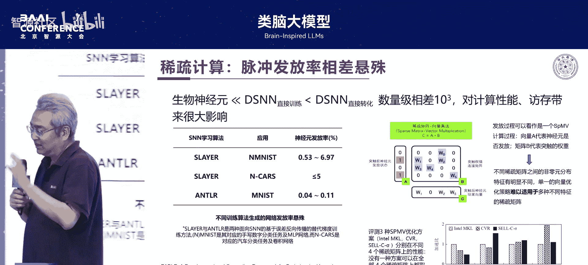

但是我们说事件驱动的时候，那么请问你是在哪个层面说这个事件驱动？如果在软件或者算法驱动这个层面，那么事件驱动是一种软件架构，对吧？它特点就是说呢通过事件的产生传递和响应来组织设计软件架构模式，对吧？

这定流程有外部的事件来推动这个事情。事件驱动的优势。这个那那么抄了某个教科书之类的对吧？是提高响应速度吞吐量，便于扩展维护，便于可维护性可可伸缩性。没有提低功号什么事情，对不对？

就是事件驱众这种模式并不天然带来低功号。你需要有硬件和编程层面的一个配合，才有可能带来。但这样疑问的话呢。😡，那你应该怎么做很多种做法。比方说通用处理器微架构层面，这些人不是做电脑计算的。

他是就是整天研究CPO叉86R怎么做优化来。😡，适配某些场景，这个也是个研究热点。在在伊斯卡michael这种会议上也算算是个小的一个研究的一个小热点。哎，他们提到就是说通用筹率这层面呢。😊。

它的微架构是不适合实行驱动的对吧？那么它主要是针对那种所谓商设置中的serv类似这种方口就种web server这种场景做微架构优化。那么下面就撕B那个一啊，尚老师在底下，我就半闷弄斧了。

我至少理解一里头它的实件驱动这种编程模式是基于内核终端机制来驱动的，是吧？就基于阿玛这种软核终端机制来驱动。那去年我们发了一篇麦克的文章，那么。把这线驱动这个模式呢。

在硬件层面通过act message去驱动，就是做了一些硬件层面的更底层的一个支持。也就是说我意思就是说呢，我们说事件驱动，那还问了你的事线驱动是什么意思？哪个层面的事线驱动？这个层面还是在这个层面。

如果在这个层面你是怎么做的？这个对你的效果有直接的影响。😡，对吧就是所谓低功耗到底怎么实现的？我觉得是有直接的影响。OK那么再一个就是我们自己的一个工作是吧？就把它组合起来之后呢，发现哎SN好归好。

对吧？细疏现在修的非常好。SPMV那们的扩展性不好。😊。

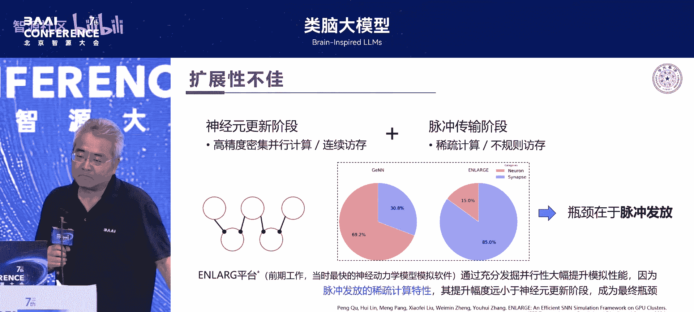

就是这是我们以前做的工作，对吧？就是。

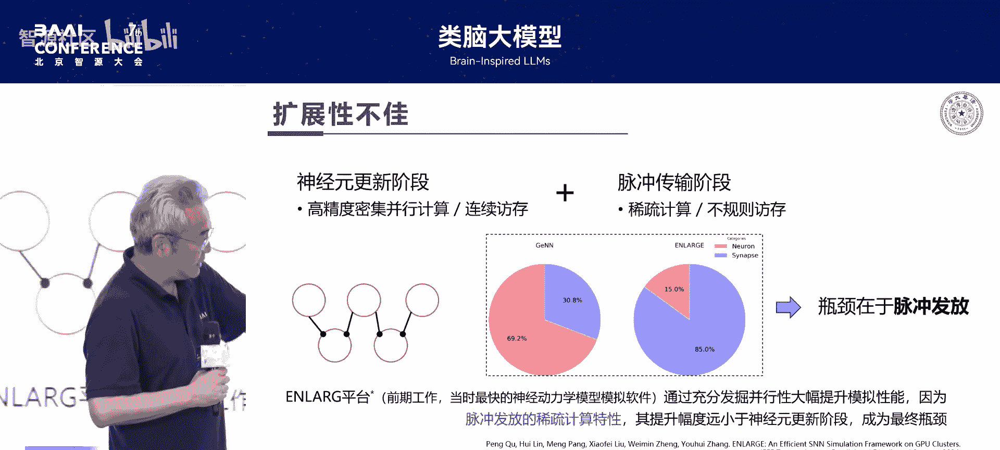

几年前那吧，当时就是我们做了个SN的在GPU上的一个软件的。这个仿真的程序，对吧？OK那么当时跟居恩比，居恩是。

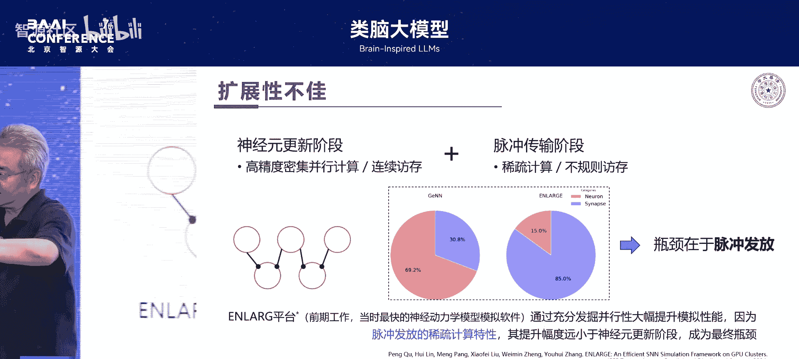

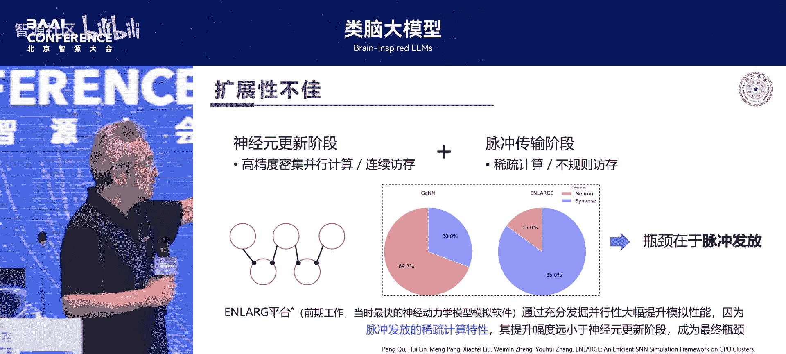

这几年前了，对吧？当时最快的一个开源的1个SN在单CPU上面的一个模拟器。哎，我们发现这给他优化之前呢。他的计算。

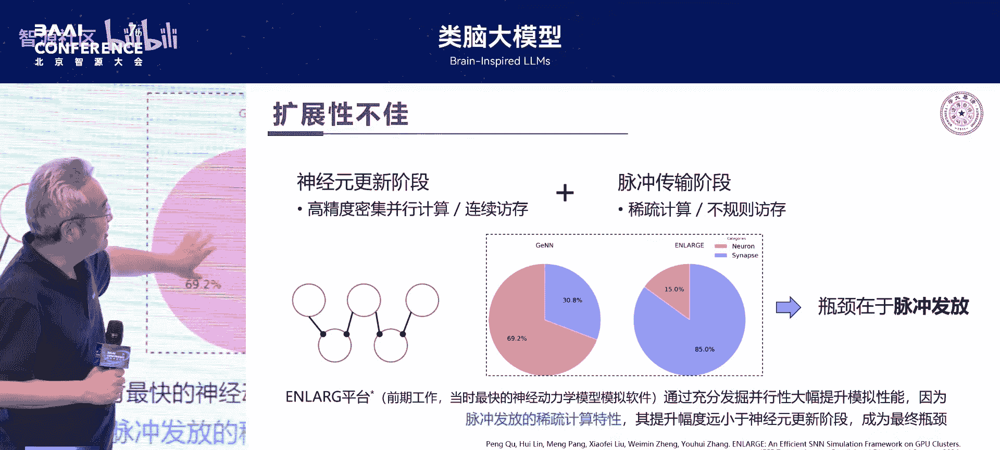

加上这个突出上的吸疏信号传播，这个主要是计算哈，这个实际上主要就仿存了，对吧？计算跟仿存比是7比3优化之前完了我们就两头做软件优化，分别做啊GPO方面分别拼命做。做完之后呢，反过来了。😊。

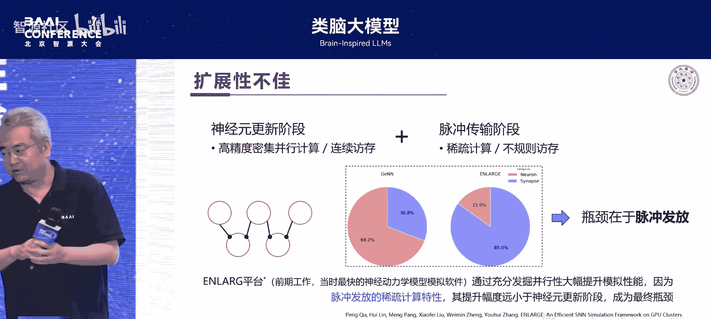

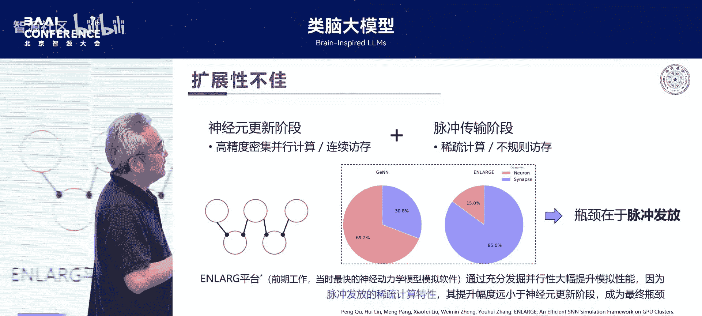

这个计算15%，仿存85%。那换句话什么意思呢？就是他的神经元更新阶段。😡，时间种类很多，对吧？但是对通用处理器来说是个好东西，为什么呢？它是高精度密集并行计算连续仿存。这个对CPU来言。

对GP来讲都是非常好的事情容易解决，对吧？脉出传输刚才说过了是SPV的过程，吸收程度各个不同，所以它就比较差。对GP来说就很差。计算不规则存，所以瓶颈在这个地方，对吧？所以瓶颈在这个地方O。

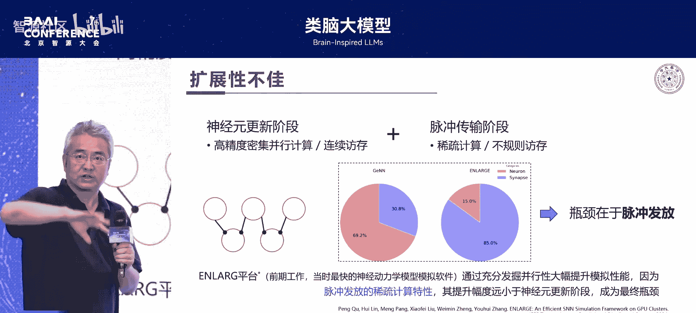

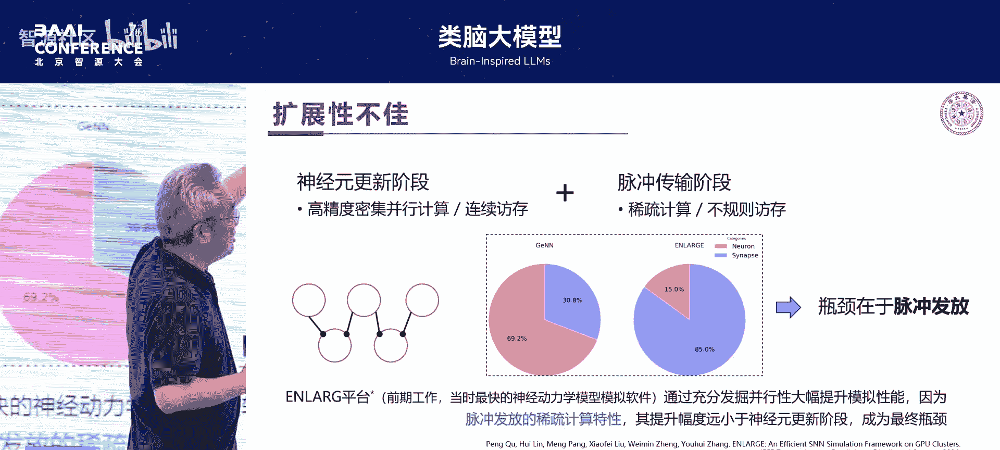

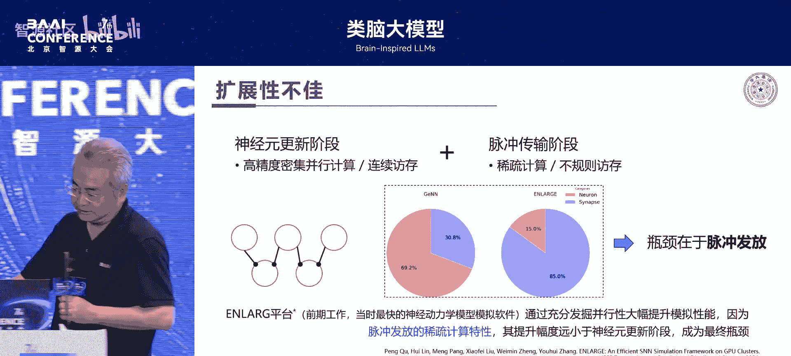

那这种瓶颈呢，包括如果我们把它放大到多个节点，就多卡多节点上去把它scalell out的话呢，那发现这效果也不好，因为为什么呢？

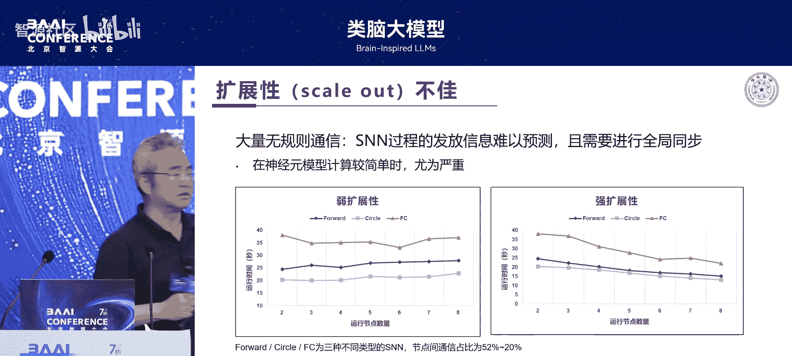

时间之间存在大量的无规则的通讯，对不对？他们之间的发放信息难预测，却需要接行时间不上当中同步。那么当时间模型计算较简单的时候尤为严重，对吧？因为你相当于计算占比降低了，所以你这通讯。

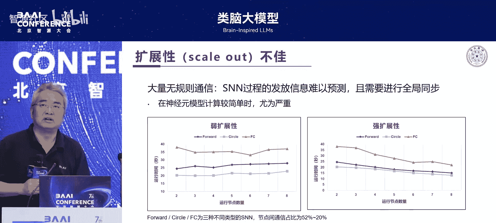

那这个不太友好的部分站高的 out就很差，对吧？但若扩展性还好了，对吧？就是随着节点的扩展，你负载同步扩展的话呢还可以呃，强扩展性呢就是就就比较差一点，但不是最差啊，是个是弱线性的这么一个一个趋势。好。

所以我说这话题总的意思就是说呢当我们讨论SN的时候，对吧？它稀疏它驱动啊非常好。

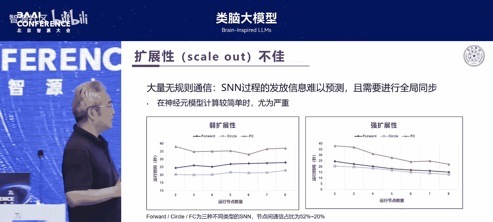

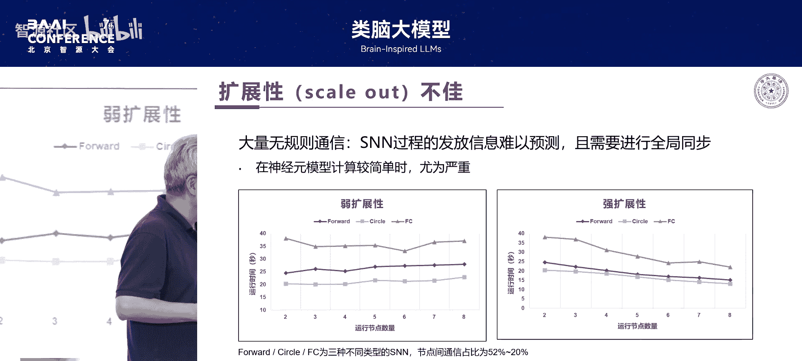

但是他并不说自然就带来性能功耗的增强。这跟你去实现是有很大关系的。得看它平均在什么地方是吧？那怎么去解决它什么那个要点。

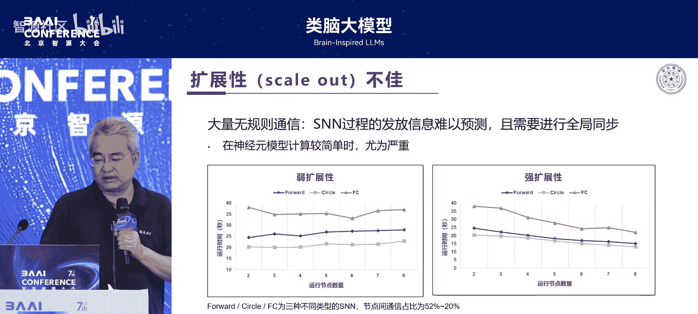

那么如果我们解决这个问题，那反过来讲的话呢，就说那刚才又回到第一部分啊，就是我们题目叫做通用类脑技能系统，对吧？那么刚才说过了，这个通用电脑计算系统里头，就目前电脑计算系统呢。碎变化比较严重，对吧？

碎变化比较严重，就大家不腾二摆做自己的工具链，去开发自己相关的应用。那就是。呃，那那么反过来讲的话，那通用计算这个里头是怎么来做的对吧？像连编译器就起到了一个很大一个作用，对吧？

我们知道就说哎通用计算也有很多种很多种语言，有很多很多种处理器的SA。😊，对吧那如果说。也像另郎那样。but腾 up往上做，那就是N乘N的复杂度是吧？一个语言你要做一个。

或者说一个语言你要去适配N个电脑芯片。那就不是N乘N嘛，对吧？但所性通计算反展到现在已经不是这么做的对吧？它变成什么，就就是两个中间层，对吧？中间IR、上层I和底层I啊，对不对？中间表示。😊。

统一的把上层语言转换成一个统一的。比较上层来呀，对吧？你底下的。

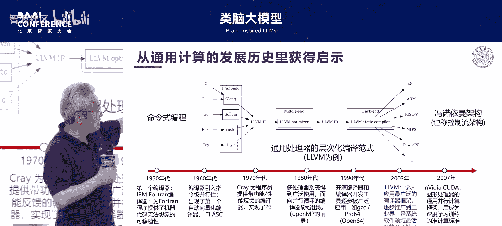

这么多通用处理器，一个底层AR来出像，那就变成N。乘一加上一乘N的这个复杂度，那就是通用编译器的这个发展的逻辑。LVN也好，GC也好，都是这么做的对吧？但这两年呢也不说这几年了啊，就最近若干年来对吧？

我们知道就说。目前从1819年以后，对吧，就所谓目前是这个。领域专用体结构的一个世代了是吧，就是18年的两位图领奖获得者，就19年做了个报告，就说哎。今用十年体结构的黄金十年，领域专用体结构。

这个大行其道，对不对？那这样一来呢。也就是说，目前计算机领域的DIC这个时代，他所面临的问题跟内脑面临的问题是类似的。为什么这么讲呢？就是原来我们这边比方说都是通用处理器，对吧？你种类繁多多归多。

都是符合诺面架构，做一个统一的出现。但DSA完了之后呢，领域通呃领域专用架构。那就是更加的变化多端了，对吧？另外一个呢，上层语言刚才说过了，我们以前这个语言呢C也好，rust也好。😡，都是通用语言。

他并不偏向于某个领域，对不对？但是这几年尤其这个也还是AI带起来的，对不对？就随着AI编程框架我泛使用呢，这种领域语言。声明式的语言替代了命令式的编程语，对不对？也就是说语言的抽象层次更高了。

微架构种力变得更多了，软件离得越来越远了是吧？可以这么来取。那这个时候编译器怎么做，对吧？那又对编译器提出挑战了是吧？本来你加入两个中间层就行了，那现在不够用了，对吧？因为两个两两头离得越来越远嘛。😊。

现在就变成MIIR这种。😡，新的这种编语框架这种事情思路了，对吧？就你两头拉的都要越列。那中间层首先要多加几层，那这个很直观，对吧？那第二个什么呢？就是我们经常会说哈，有个什么什么计算，它很特殊。

它有一些特征什么什么什么对吧？但你把它特征拆开来算，对吧？就是每个计算某个什么什么计算，它有特征A特征B特征C，对吧？A加B加C是你特有的，但A或者B或者C本身不是你特有的，本来就有对不对？😊。

所以我们针对A可以设计个方言，对吧？从上层逐渐地下到底下这个硬件这一块。针对B也可以设计个方言，将D价上来。那这样的话呢，你出一个什么新的什么什么计算。就是你只要你原来这种方言。

针对不同阶段特征方言设及的越多。你越来一个新的计算，我也许就有越大概率，从原来这里面找出一个组合，对不对？把你这个特征的这个组合给你覆盖掉。也就是说我可以复用编译资源。

那么这就是就这么来的计思路就这么来的所以我觉这个很重要，对不对？这个已经用到DS领域了。我大家越来越接受编译器就用这种思路对不对？那我们是不是在脑领域可以借鉴一下，对吧？这是我的一个想法。

我们做起初的工作，那最后一个启示呢就通构启示对吧？😊。

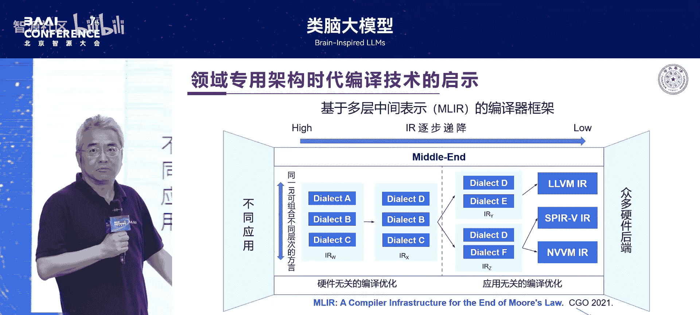

OK抱歉。这个其实跟我们。很多可能做的现在有点反其道而行之。就是我们知道在通用处理器领域呢，先是复杂制令器，对吧？就说硬件提供的原语比较接近于应用的语义。😊，后面呢才是risk。

就现在是risk大行其道，对吧？intel内部也是rissk为主。OK那么也就是说你你的硬件源语相对简单。😡，有软件，有编译。组合成越来越复杂的原语，来应对各种应用的需求。

那么这个呢我觉得也许我们可以拿过来借鉴。我们在这个比较早的工作，我们在前期也发了一些工作，哎，发现就说这道对于存算融合这种一组器的架构啊，这种简化的原语，好像相对来说比这种复杂原语，它的效率。😊。

要更高一点。那么它跟应用语金正差别呢可以通过编译器来解决啊，这是我们的最后一个启示哈。那在这记础之上呢，我们做了一些探索工作，对吧？就是最就就回到主题了，就是通用利呢计算这个通用到底啥意思，对吧？

实际先就是我们希望能采用这种。😊。

对，现在很多都做8腾2盘做来做，对吧？那我们希望就是采用这种通过这个受到传统通用处理器，它的层次化的这种。😊，包括这种简化硬件的源语这个事计思路的影响。

就希望能够采用系统层次化与软硬件去耦合的这种技术路线，对吧？研发通用的类导计算系统。就是说我的硬件不是特定于你某个或者某类应用的。我中间的这个编译层，也不是说是but up来特定于你某种芯片的。

我们说希望是cro compiler这种来法，对吧？那么这方面的话呢，除了上层啊，这个我们不太ca啊。因为现在主要是往底下在做一个呢就叫做一个软硬件去耦合的。😊。

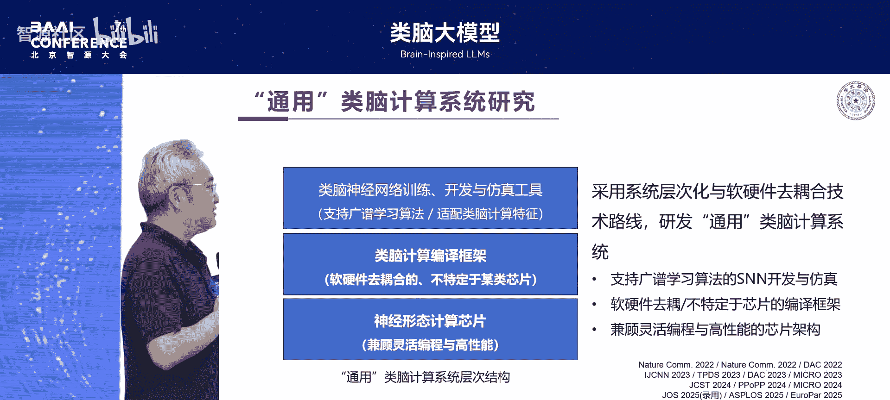

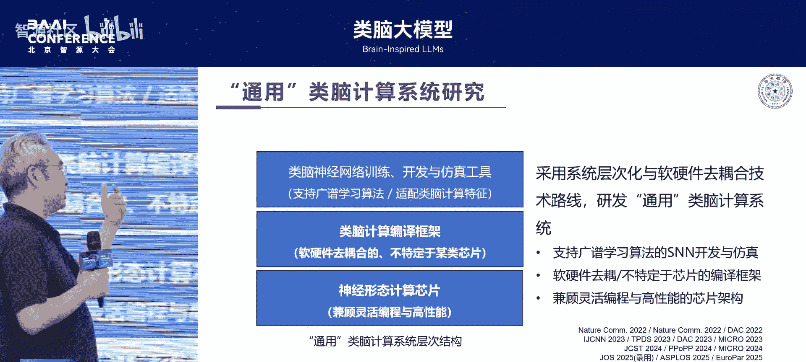

不特定于芯片的编缘框架，对吧？就是弥补你各种各样的应用语义这么大差距，底上那么多的芯片种类，把它给它app给它弥补起来的吧。第二个呢，那个芯片架构呢也希望就探索一下能不能兼顾。

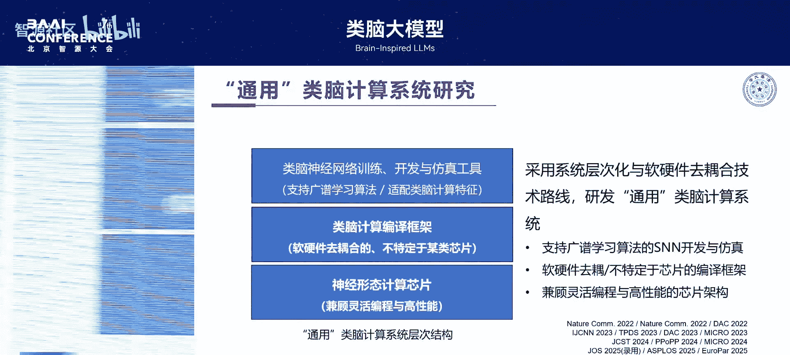

编程与高性能的这种镜片架构，电脑芯片架构。因为有的时候缺乏确实发现就说如果你底下芯片做的太。太太特定化的话呢，这个这这个中间层也弥补不过来，对吧？就是这个没办法。OK当然我们也会发了一系列的文章啊。

我稍微非常简单的说一说。😊。

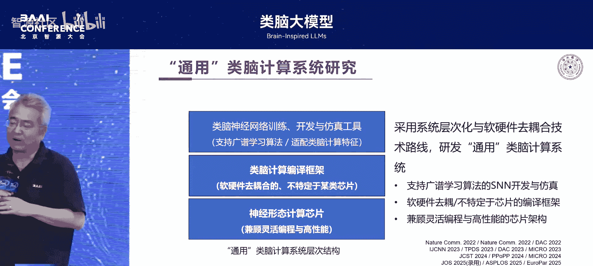

第一个呢就是我们知道哈。😊，刚才提到过，就是脉冲发放是SN的瓶颈，对不对？那么我们的一个整个的一个去做这种芯片架构的话呢，我们需要给自己立了个前提啊，要求得基于成熟公益就是最成熟的公艺。😊。

不用我们不说。相对未来的存在融合啊什么什么都不提这个事儿，我们就28对吧？就是1614，就这种你现能拿到手的这种工艺，对吧？那就希望呢就是以通用内核为核心，发完阿都行，对吧？进行非 ho的架构的扩展。

我们不希望做做太特定的扩展，这个没意思，对吧？以及一般性的指定扩展。😊，那然后针对一些特征做优化，对不对？希望能够兼顾。通过内核，它的灵活可编程高精度计算，我们甚至需要浮点对吧？有些场合就需要浮点的。

对吧？再提升阶算性能或者效能。那么这个时候呢就我们面临一个事实，对吧？一个就是说呢SN的能源效率来源于其事件驱动的特性，这肯定是当然事驱动就说你必须在硬件层做支持了，对吧？

包括相关的空间时间的部性对不对？另外从融合融合神经网络的是SN特定的对吧？一个趋势的话，刚才李老师提到过了对吧？就神经性动力学型高精度经济模型规模方向发展，对不对？那么这里面就面临两个矛盾。

就是我们要跟通用处理去融合的话呢，就面临两个矛盾。第一个就说呢通用处理本身因为它是基于时空局部性的通用处理被架构它大的前提就是时间空间局性。这个在实件驱动在中间这地方它不满足。

所以它是不能有效处理时间驱动的现在这种架构第二个呢。😊，这个规模越来越大，对吧？权重越来越大。高密度的存储Dra其实包括HBM对吧？HM本质也是Dram，对不对？它封装的更那个什么一点。

也是不能有效处理吸数性的。因为它的空间局部性也不好是吧？就这两个是大矛盾。那么怎么去克服他。那第一点呢，很简单，刚才说过了，对吧？😊，随源更新阶段和脉出传入阶段，计算密积仿存不规则。平音在后面，对不对？

那就想样办法看。神经元更新阶段对吧？虽然神经元更新本身是一个稀疏事件，但是绝对数量是可以的，而且算的时候呢，它是高精度密集并行计算，连续仿存非常友好。所以这样的话呢。

可以用软核可用通用处理器用向量来实现，这个很简单这个事情对吧？第二个呢就是这个是瓶颈，对吧？慢冲阶段修集段不规的存那这个就要求就高了在这个地方吧？我们可以进行定制化硬件设计，把可编的部分交给向量处理器。

那怎么定制化呢其实也简单一个思路对吧？个体结构里面非常简单，就是想办法把计算跟存相覆盖，对不对吧？就说白就说你计算当前第N个神经元的计算的时候，😊，去事先去访问DN加一个神经元进行访存。平静在这儿嘛。

对不对？那如果你这个仿存延迟能够把当前这个计算延迟给它覆盖掉，那你这个计算就可以拿软核去做了，你就不用去做硬制定制电路了，对不对，是吧？那你灵活性不就增强了吗？就这么个来法，对吧？就这么个来法。

那么基于这么个思路呢，但是这是22年的工作啊。😊。

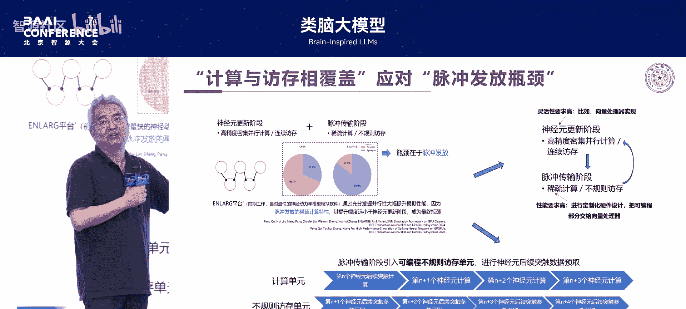

我们就提出就是对税计算特征的一个一个架构，对不对？那么上面是计思路就不说了，对吧？那方案优是这样子，对吧？就提出了一个另要计算的一个经典指令集，对吧？因为我们这边它的计算高并发的特性就是神经元那块。

对吧？做向量计算，做多精度的精算指令，支识浮点啊呃定点浮点都支持。😊，然后呢SN的计算大家知道有个特点，对吧？它控制流很简单是吧？所以呢你可以做条件复制指令。😊，循关指令可以简化可以简化一点，对吧？

那主要在系数计算不会则仿存这个地方，对吧？我们引入了一个多元仿存。😊，模式处理的一个单元，对吧？也就是说在你计算当前时间的时候，想办法把下一个。周期要取的数据把它取进来。但这个地方呢。

就说你这个多元仿存模式呢要灵活一点，要适合SN的这个仿存的这种需求，对吧？所以呢我们测完之后呢。哎呀就觉得。呃，他的绝对性能就超过了叉86，对吧？那么。跟GPU比呢，因为我们是IPG这个本身对吧？

性能比比较显著。在某些小型的重要性代测规模下呢，就绝对性能也超过P10，但P100也是比较out了，是吧？但是我们是个很小的IPG芯片，对不对？那么这里面的主要的一个。微架构上的一个优点就在这个地方。

对吧？就这是个读取内存的这块latency，它完全覆盖了计算和写回。对我们就说这个计算跟仿存相覆盖嘛。我我这个仿存是我的瓶颈。那他的这块能够把完全把计算覆盖掉的话，那么当想办法我要把计算做的灵活一点。

什么神经面都能支持，对吧？OK这是我们的第一个工作。那么第二个呢就更更近了一步哈。😊，就引入了事件驱动。哎，这个具体细节我不说了哈，就是总的来说呢，就是把这个就是这个神经元的简单的那个一个方程，对吧？

😊，但这是前项的inence其实我们后来做了扩展工作，就是后项也是可以支持做些小小改动就可以了。可以支持。那么这个地方就是我往往下走吧哈，就是这个地方就是相当于把这个数据呢。

就是神经元状态就是输入是局部数据，对吧？你要把它放放放在片上的局部存储上面，对吧？😊，突出零点矩阵，那是最大的这个东西，那放在片外对吧？那么是脉冲是一过性数据，不需要存，对吧？

那就是由它来驱动计算就可以了，对吧？就这么去弄。那么我就具体不说了，具体说完之后就咱们就回到这个地方，对吧？最后就做完之后呢，就变成这个样子，就说这是个片上综合结构，对不对？😊。

PO1PO2就是神经元内核，对吧？它片上呢存了一些把神经验相关参数都存在它的片内，就河边的那个switch pad memory上面SM这个是对吧？完了之后呢就是说。😊，那么这个是。这边状态机输入数据。

对吧？这像那个软件，对吧？它在上面一直在中间的跑这个函数。那么它里头所需的数据啊。那么都是存在就它包括神经元本身的参数和你要去取的。就是你要发放之后。

你要相当于在SM在外存那个地方把你连接举阵一行取出来嘛。那这个行的index也是存在片上局部这一块的。就说他这个这个函数跑的时候，所有的数据都在局部O好，那么当他一旦取完之后呢。

他通过片上的这种我们做了扩展叫做主动消息扩展的吧，就发一个消息就相当于是计存器到计算器这核的计存器到另外一个计算器的一个消息发送把这消息推过去。😊，触发后面这个计算就specike了。spaer出发后。

后续本地神经元的计算。那么这样一来的话，你就会发现就说哎。同时我们又在啊这个不详期不说了，就说我们同时在这个ma control上面做个扩展，对不对？使它也能支持这种模式。

那么最后就是我们就确保哈就是脉冲信号触发你的一个回调函数，就你的你那个激发激发函数脉冲触发你后端神经元的时候呢，所需的全部数据。😊，啊，全都是局部的，或者是来源于。这个消息推过来的。

就说你这数据啊不是去取，是推送过来的，就是你被事件毁掉，这样呢就确保所有所需的数据都在本地。那或者在这个消息头里面。也就说你就任何计算的时候，我都都有都有数据局部性了，对不对？是吧？那这个就是。😡。

不规则仿存所面临最大问题。我们通过这个方法把它克服掉，对吧？那么效果也不错，对吧？就最终我们看一下就是。😊，绝对性能大给A100，就我们做了当当端的测试。因为整个。呃。

内核是RTO这个整个就是综合完了啊。呃，这个这个大概这么个效果，就是A100的大概差不多10倍左右，对吧？同时也跟那个。81年的S plus的上面的一个asic的这么一个。呃，SN的这个去做对比。

就是我们是。这个软核是rissk five的做了一些扩展。那么绝对性能是Aac的，大概7。9倍这样子。那么特点就在于就说我们通过这些方式，对不对？就能够充分的把这个。片外那就用的HBM two对吧？

HBM two是把它这个带宽能够用的非常的充分啊，就通过这种异步这种放存这种事件驱动这种方式啊，就在软核上做一些扩展，就能达到这样的效果，我觉得这个是值得尝试的OK好。

那么最后呢就是我们也做了一个就是基于多通之间表示这个计算的编译框架哈。那当在开头对吧？就基于MIR去做这个多种。😊，哎，这个电脑芯片，包括CPU的这个一个统一的一个编行框架啊，这个是做了一个事儿。好。

那么最后就想提一点，那么这个东西大概会用到什么地方呢哈？就是那现在至少目前来说，我们一个应用趋势呢，就是刚才有提到过，对吧？就实音动机的模型。😊，向高精度经济模型发展，对吧？那其实现在的许多系统呢。

那当软件算当可以更慢一点，对吧？尤其像是GPO其实对于系数计算的利用率，像比如说大型SPNV对吧？你要在GP上面P去算的话，他峰值利用率达1%肯定都没有，肯定没有对吧？那很多领导芯片的话呢。

因为它是偏向AI去做的对吧？所以对很多高精度，他支持的不是太好，对吧？所以我们觉得这个地方还是有一定的机会，对吧？就是。😊。

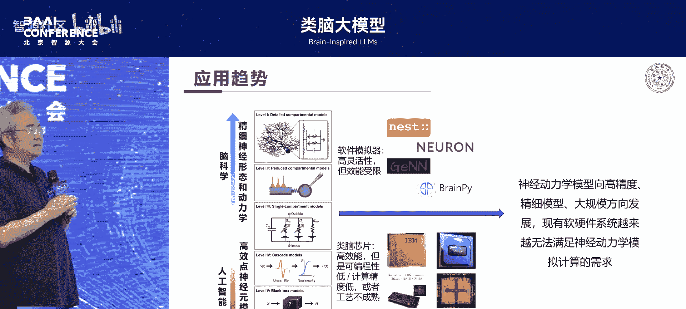

跟通用数据器内核相紧密融合哈，就是一方面就是利用内核另外好边程序，主要就是这个fi，我现在拿它在改，这是浮点，对不对？那么特定的部分呢，就通过刚才这种指令级的扩展呢。

包括一些微架构的扩展啊尽量去提升它的系数计算啊，系数仿存的这个性能。所以我们这边呢也是呃大概近两年留了两次片啊，这个慢慢在推向实际上的应用。OK啊，效果还是可以。😊，好，最后就做一个小结没时间到了啊。

姐姐这个其实这个不是小结了，就看一下右边这个图啊，这个实际上是我们17年一篇文章跟高光荣教授啊，高光荣教授是非常有名的国际上提这的学者啊，也过世大概有4年4年前过世了。

但是跟才一篇文章里面提出这么个这不是关联这个事实啊，他意思就是说呢A发展历史啊，AI是三起两落，对不对？他认为就说你金中这有两起的时候呢。😊。

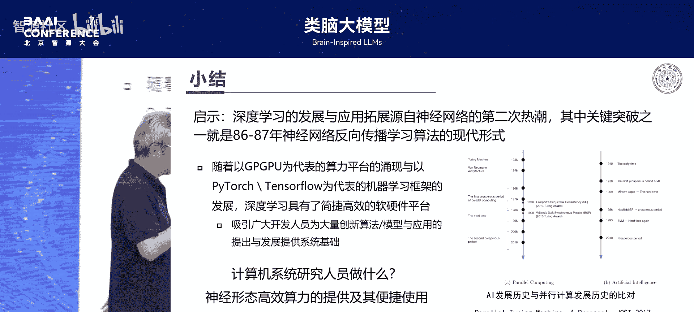

都是跟并情计算的新盛是密切联接起来的但也许是这种巧合，也是这种必然。但换句话就说的话呢，就最近这一次的0几年到10年1010年以后吧，对吧？这个AI的这种提升提升。

可能更多呢是因为有GPU的平台和他这种打这种排这种对吧？一方面就是非常高的计算。计算的算力平台。另一方面呢，就是说非常友好的开发工具提供了这种。便捷的基础软硬件。促进了广大AI人员开发创新模型算法。

因为的热情，对不对？那么我相信就是在内脑这个领域，对吧？就结合刚才那个同学还症那个温同学的问题啊。为什么很少这个电脑芯面在用，对不对？那我们希望计算机系统这边能做什么呢？能够提供高效的电脑专利，对吧？

不但要高效，另外需要有些技础软件或者开发工具，让它能够便捷使用，这可能是我们的责任，对吧？好，谢谢大家，我就讲到这哈。😊，好，那个非常感谢张老师的精彩报告。嗯，因为那个时间的限制的话。

我看我们应该就一个问题，看谁那边有问题嗯。嗯。非常感谢教授讲的会非常精彩啊。那我想回到通用内劳的一个原问题，因为老区别最重要的一个特点，它是用语言来思考。

所以我们现在呢我觉得对语言本身的科学化的问题呃是一个大问题。我们通过16年的研究，第一个问题，把五笔字形升级为四维字马，就每个字是个编码。第二个问题，这四维字马。我英语只能表音，不能表形和意。

我这个四维字马又能表音，又能表形，又能表意。第三个问题，我这个四维字码每个编码可以对应10万多个汉字的唯一编码，所以通音字的问题可以解决。第四个问题，我这个思维字码能对应全世界的所有语言的底层。

也就是说我一个四维字码能对应汉字，对英语日语法语德语。所以这些问题解决了，但是这内脑这个我确实不懂，所以给你请教一下，如果这样的一个语言的底层编码，怎么在通用的内脑大模型当中去运用。

因为我觉得你从系统论的观点来看，你把内脑通用内脑看成是一个复杂系统。啊，这个我觉得是个非常好的一个呃方向。我也非常认同。所以在语言这个底层编码上，怎么跟内脑大模型，特别是通用内容大模型去融合。

想请教一下这个问题，谢谢。不好意思，我觉得这个问题呢？我觉得李老师能不能回答一下，这因为我觉得你好像不是针对内导系统来问这个问题的哈。大家更多的说你本身的那个编码方案好像做了很多。

我不知道这我这个回答是不是合适。😊，😊，不要钱。充一句啊，如果我觉得未来真正要实现你刚刚提出来的通用内劳大模型，必须要解决语言的底层编码的问题。它才是真。因为我们我们为啥你们刚刚说了低能耗高性能。

那为什么呢？其实你用的语言来推理来思考嘛？😡，这是底层啊，如果这个底层不解决，我觉得未来的通用内涝大模型。😡，不是道法自然，不是天人合一的，不是最优的。而且呢我觉得从系统上的观点来看。

必须要把语言的底层编码这个东西在你整个系目当中怎么去考虑进去。对，这个你好，谢谢啊。那我觉得您这个这个我大概听懂了，我觉得这个说的非常好，当然就是当然我本人是做系统的。所以对我来说的话呢。

就是您这个就属于这个在应用层面怎么对语言做一个通用的一个建模，一个表示的问题，对吧？我相信这个包括李老师他们应该一直在这方面做这个很好的工作，好吧。哎，对我呢赞成您的观点啊。OK好，谢谢。😊。

