# 2025北京智源大会-类脑大模型 p04 主旨报告三：尚德龙 -BV17xNjzMEer_p4-

嗯，下一位是那个。中国科学院微电子研究所的尚德能研究员尚研究员其实在这个类脑机计算机方面是这个专家中的专家。

他是中科呃中科南京智能技术研究院副院长、江苏省呃脑机接口重点实验室副主任、南京市类脑计算工程研究中心主任、中国神经学会会员参与领导了科创2030项目7585国家重大科技公关项目欧盟HBP项目等等。

荣获中国科学院科技进步一等奖、美国第十届PCBMCM科技领先奖、数字一等奖、国家85期间重大科技成果奖等等奖项。嗯，发表论文150余篇专注一著四部。

主要成果为问天一的类脑计算机KS2850计算机KSG2300高档服务器sneak类脑计算机等。今天他将为我们带来题为问天一类脑计算机及应用汇报的精彩报告。嗯，欢迎尚老师。谢谢这个主持人的介绍。

也谢谢这个李老师，还有这个资源大会邀请我来去做这个呃报告。刚才李老师讲的算法。张老师讲的系统，我觉得我的题目挺好的。问题一，内脑计算机机器应用。我从工程的角度来去给大家解读一下内脑计算机。

以及刚才张老师讲的非常多的这个内脑的一些基础的，从系统方面啊，包括架构上的一些基础的一些理论啊方法，就是看我们在这里面，因为我今天整体来讲没有展开。

但是呢可能有些地方呢呃看看和张老师的这个这个想法是不是不谋而合啊。

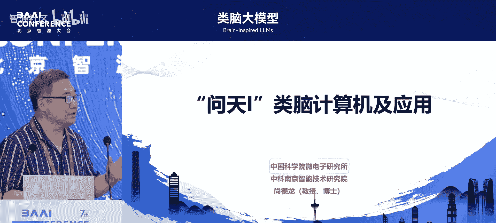

呃。

哦。我今天报告呢分四个部分。首先呢我们讲一下问天一内脑计算机呃，我这块我快速跳一下吧。因为这个啊是是是这样，就是说我们首先介绍一下问天一那脑计算机啊，它是目前啊目前我们这个计算机呢支持5。

3亿的神经元这个下图这个是我们个机器搭建的机器上图呢是我们的2023年10月17号的时候啊，我们去这个开的一个发布会一个内脑的计算机服务正式启动启用这么一个发布会。它是5。3亿神经元2500亿的出处。

目前来讲呢是世界上规模第三大的第一大呢是第二大我们这个53亿应该算是第大。当最近呢2他把这个50亿的神经元好像也也在去开发再再去做。所以说要这么算呢。

我们应该是第三第四了那整个机器呢是这样们这个里面包括有这个6个7个标准机柜有6个呢是我们的自的芯片和绑卡构成的那么。😊，每个有小机箱的有24个，总共绑卡，大概是576块绑卡呃，有大概有近3万颗芯片。

是是是是这么一个情况。呃，那么为什么去做内脑计算。其实刚才这个李老师啊把这个整个的这个这个基础啊都讲了，那么也也大李这个图其实李老师刚才也有，就是在21年之前啊，这个大概是两年翻一倍。

目前呢3到4个月翻一倍，这个从算利的角度啊，实际上我拿到数据大概是每两个月翻一倍，比他还要夸张一些。😊，那么这个算力的算力的提升是对人工智能发展，尤其是大数据大模型的这个这个需求是机迫的一个需求。

但是从我们计算机。因为张老师讲的做计算计算机系统。其实我刚下面会讲，我的背景更是更贴近计算机。就是说从计算机的角度来讲，我们对算力的提升其实是已经有瓶颈了。这张图呢是我用了21年的一张图。

那么大家可以看到，实际上我们从这个计算机性能上来讲基本已经趋平。就是灾去提升计算机性能的话已经非常非常有限。而且呢在我们之前的计算机性能提升呢，更多的还是依赖于半导体技术的一些更新。

就是比如说我们工艺的进步，大家都能都能知道三大米、5纳米、7纳米，其实我们工艺的进步，对计算机性能啊提升啊，工耗的下降还是带来非常大的影响。😊。

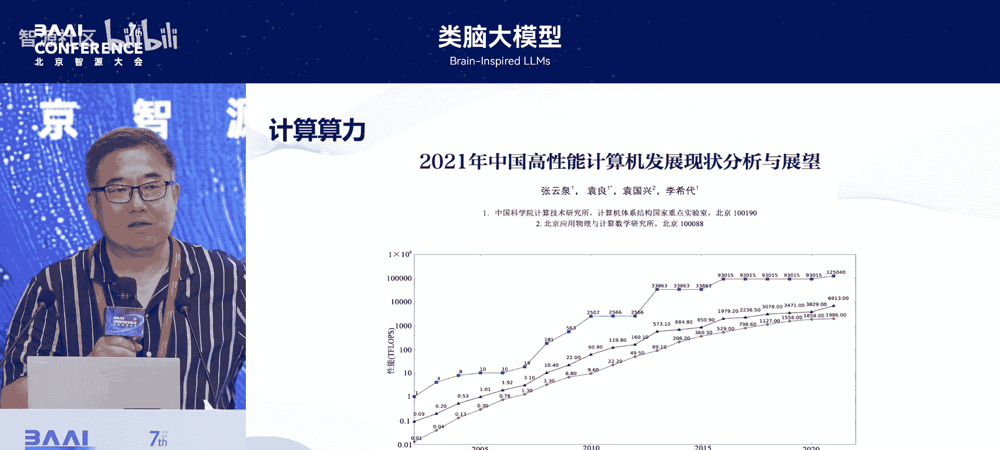

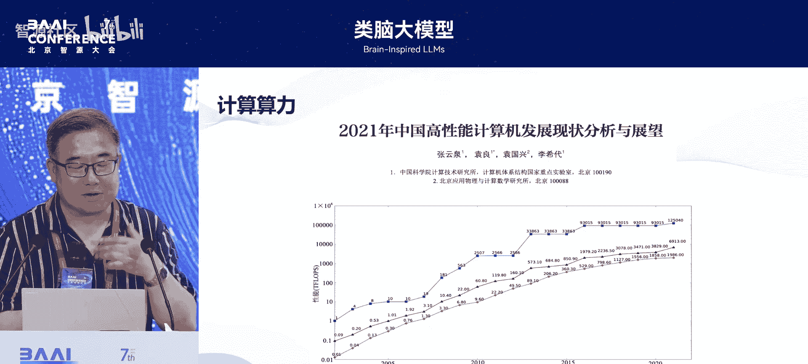

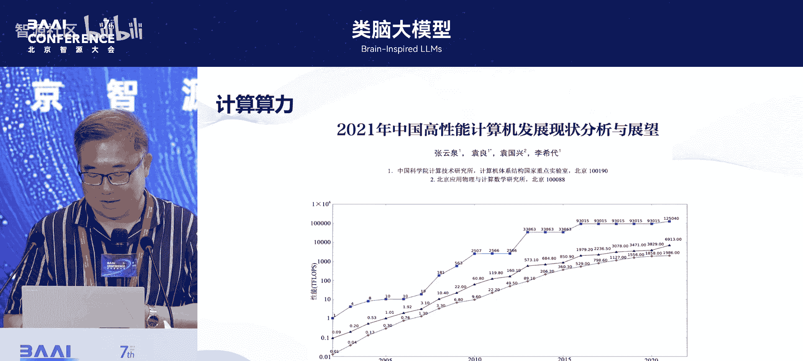

那么我来谈一下自己的这个这个这个整个的一个工作经历吧。实际上我是参与也是比较运气吧。我是参参加和领导了这个我们国家的自主的小型机呃，CPU和系统的么研制工作。这是第一台呢是叫KS2850。

这是1991年完成的。在91年的时候，我们这台机器是1。2个Bpsps是min instruction per second。其实呢和我们对照的计算机相比，我们听说20%。😊。

但这个机器呢实际上我们完全是自主设计的。就是说我们当时因为从就是就是刚张老师也讲过这个系统。其实我们当时面临的问题呢，我们超作系统没有，我们一定要是走兼容。所以说这台是这台机就是是兼容的。

这是一个复杂指令机的一个系统。那么我们这图啊都不是原图，但是这里面只有一张图是原图。这个这个左边的图啊，我只是把这个机柜和我们当时一个用的一个四高度的呃PB版。因为它完全是分离原件件搭建搭起来嘛。

就是宇飞门打起来的。那么我们用了4块4高度的这个呃PB版来完成这个CPU系统的设计和完和完成。在这整个工作中，我的贡献是我把高数据存储以及总线的控制做了一个非常用的多状态机来去完善的管理起来。

这是我对整个计算机的贡献。😊，那么呃右下角这块呢，实际上是我们叫做KG2300高档服务器。实际上大家可以看到这本书阿尔法体结构。我不知道但这个里面呃比较早的了，实际上这是第一期的就是美国第一期公司。

就是叫做数字设备公司。其实从计算机架构上来讲，其实这个第一期公司是有非常多创新的。那么这个也是当时的呃最快的所谓的最快的计算这个计算机，它是经典指令机，就是指令机的。

那么这张图右下角这样带PPB板卡这张图是是真实的图。但是这张图实际上是我从深维拿来的。因为这份工作的，实际上就是我们深威超算的第一版，是这样其实你看啊这个整个的性能在3到3。

5个ps其实这是我们从就是说想说什么，就是我们从计算机的角度来讲，一直在不断的追求追求这个性能提升。😊，那么回到我原先的团队，那么这个呢我们又从从计算机的整个发展呢。

就是说我们从40年代的这个发明计算机到5六十年代，从一点点的从这个战国时期到到到现在，我们基本上就是这个叉86底系up体系已经比较归一了。那么实际上呢，我们在82年的时候呢，已经在走一些小型化。

这是我们团队的早期的一些工作。比如说BBB型mic，这是1982年的工作。那么呢呃右上角的呢，这个话是就是说我们大家现在比较呃非常熟悉的up处理器的第一代芯片。

这是这也是这这是这是这个呃在做这个呃这个呃小型化和往便携式便携便携这个电子设备的方向发展。但是呢我们在做的过程过程中呢，发现一个什么问题呢？由其是刚才我们讲的阿尔法体这构阿尔法那台那个处理器。

它整个65的能耗耗在的clock。那么那么所以说我们在接下来工作中，就是说我们一直就是探索如何去降低功耗，这是我们有了我们这个E步的processor chip这个amule就是一二三代。

那么第一代呢是有81993年完成的。那么整体来讲就是说我们一直在去追着性能，追踪功耗去走。但是我们在902000年98年左右的时候呢，我们也发现了这种问题，就是说。我们当时就是当时是不是我啊。

是我的老板，他已经遇见到了说这个未来的计算系统。那么如果孩是按这套路去走的话，应该是我们走走不通。所以这个是我们有的。有了我们这个内脑计算的什么，为什么要去做内脑计算这么一个期趋始。

实际上这里呢是说我们当时在做内脑计算的时候的两大目标。一个呢是说我超大规模并行计算资源，如何来加速生物脑功能的理解。再一个是呢逐步深入的理解的生物脑功能是否能牵动和带动更加高效并行融错的计算系统。

其实用这两个角度去讲的，因为这个是为什么就这么做呢？因为我们当时去做内脑呢，也是希望就是说我们接鉴脑，但是我们也知道，实际上我们对人脑的理解并没有那么深刻。

包括我们现在实际上我们还依然不知道我们把N多个神经元集合到一起，到底是到底它的功能，它能怎么展现。而李老师讲的三个历术神经元可能能够从某个角度能体现出HH模型的一些特性。但他他终究不是HH模型。

这是我们的一个一个发展。所以说我从这开始呢，刚才张老师提到了，所以说我们在2011年的时候呢，完成了这个其实实际上这是第二版的的一个呃一个芯片。那么我们在这个呃16年的33月份的时候呢。

我们完成了这个50万个处理器盒的这么一个呃叫做电脑计算机平台。在18年的时候，18年11月份的时候完成了100万处理器合。当然这都是虚数啊，应该是47万多和9十几万，所以都是虚数。

我下面可能会会把这个这个数字具体计算一下。这是我们在国在国外的一些工作。那么回到我们国内，因为19年回来之后呢，我们就开展了这个问天系列电脑芯片以及计算机的研制工作。那么实质上呢。

从我们是从原理机开始的呃这个设计的思想和理念呢，是想提供一种这个多种存储和外置结合的灵活性，以及呢我们的互联架构能提供更大的互联灵活性。就是我们希望能够有非常大规模的。因为从从我们自身的来讲。

就是说我们不论是5亿10亿。其实和我们。😊，人脑和百亿相比呢，还是一个微不足道的一个数字。所以说我们希望呢我们能够有非常好的一个灵活性和可困难性。同时呢，因为当时我们在做命克的时候，实兴也碰到了。

就说我们这个完全SN的这种架构或者这种计算模式呢，实际上我们面临这个应用的这个一个迫切压力。就是说我们的应用。目前从算法层面上讲，还不能完全去支撑我们这个这个这个SN的这个这个内脑计算机这个这应用。

所以说呢我们是也希望能够支持未来的算法的一个发一个研发发展。同时呢我们也也希望能够支持内脑架构的研究以及芯片的仿真仿真验证，这是我们当时原理机的这么一个思路。

这个右面的图就是我们当时用的这个PG芯片当我们自己设计的板卡以及接口。所以说这是我们一个整体是我们自己的一份工作。那么这个这个这个原理机呢开发成功之后呢，就是说我们这有30块的FPG板卡。

以及版间的互联当然是用这个是光纤去做的。因为整体上我们这更加想着去建证功能，而非是性能。所以说我们对这个这个要求并不是高。但同时呢我们能够实现呢大概是能够实现57万个神6万神经元规模嘛。

那么这个工作呢就说大家可以看到下图的中间这个其实我们有非常多的存储其实当时呢也是在去从存储的角度，因为大家都在提进准计算以及这个存储的一些瓶颈。说我们做一些突破。

所以这也是我们在做问天一问天一的过程中呢其做的一些。科学科学的研究。这下面可能会会讲一下。其实在这呢，我也一直说，其实我们问天一啊，我们继承了这个呃这个就是这个我们有非常多的一个工作。

包括ar处理器构成的基本来源。刚才张老师讲过ar处理器是中断，其实是这样的，所谓的是这个事线驱动啊啊，不是中断开始的，是神经元开始的，就这个这个是从神经元来处是带动中断的是是是是这样这么一个过程。

这块可能有很多东西呢，就是说应该我觉得张老师这边就是已经看到和和发现了，可能就是说从这个处理技巧上，呃，可能这个这个可能会还有很大的一个探索空间。

那么另一个呢就是我们也是采用了这个一个通呃通过root这个传输的这个脉冲形式。实际上我们这里面是两个网络在里面，一个是叫做这个脉冲这个片上网络，一个叫做系统片上网络。

系统片上网络呢更多的是和这个我们这个存储，以及我们外设去做接口。同时呢我们这个通过root通过ro这个路由呢。我们有6个方向的互联。呃，以便于更加高效的去来构建我们的网络。

以及这个这个更加提高这个实时性。那么我们在继承继承了这个呃这个设计的理念的同时呢，其实我们也做了一些开发。比如说这个我们这个共享存储。这个刚才张老师讲到的存储的概念。

就是说我们在存储就是采用了刚才张老师说的这个我们来事先去准备数据。但同时呢我们把存储。因为我们是个大芯片里面现在虽然是我现在只有16个处理器。

但实际上呢我们未来的目标应该在160或者更多的这个这个计算单元呃呃这么一个规模上，其实我们会有非常大的一个这个存储瓶颈在在这个和存储接口上。

所以我们也还通过存储器的控制权的转移以及乱续以及其他的一些技巧性的东西来完成了一些相应的工作。那么这份工作整体算力上，我们在有30%提升。同时我们在互联上，下面我会举一个例子，互联上的东西。

那么以及我们在生物神经元模型上呢，也是从这个降低这个存储参数量上也做了很多的工作。😊，那么我去举一个例子吧，其实这是我们互联上的一个一个一个一个示意图吧，其是左侧这个这同步电同步传输。

这个我不知道大家这里面有没有做电路的啊，因为我本身是做架构，但是我的一个比我是非常愿意做电路的。因为我有非常多的漂亮的电路。那么这是个同呃一步电路一步电路通常呢需叫握索，就像我们两个人说话似的。

你一句我一句，我们俩之间有个默契，对吧？那么中间是同步同步就是现在我们现在计算机呢，经常用到的，就是说我们在一个同一的时钟节拍下去来完成各种各样的操作，那么这样的话，实际上带来个什么问题。

尤其现在随着电电路规模的变大之后啊，这个节拍或者是我们这个步伐，一定一定要要做用到最坏最坏的可能。那么右侧这个就是我回国之后提出了一种新的一种传输方式，我们这么做类同步，实际上是什么概念是完全是自时踪。

😊，我们自始终，那么自始终的通过这个现言词，同时我们又是一个一个可伸缩的elastic这么这么一个东西。那么它就在什么？就是说如果我能够满足我们在同一个步伐上，我可以按同步去操作。

那么如果我满足不了的话，我去按照一步去操。但同时呢我们因为只有自始中呢，我们把异步的这个握手的时间又给消灭消灭掉了，同时这也是既节省的功耗，也这个提提高了一个传输传输效率。

就是我们开展的一个一些基础的研究工作。我只是举了一些例子。其实其实除此之外，刚才也提到存储呃，包括这个神计算的方式以及呃这个呃。呃，互联呃一些一些一些基础工作，包括这个新书新书化的一些工作。

其实这些都是我们的一些基础工作。这个呃但是我们我们这个团队呢有有有个问题就宣传的非常非常非常差。这个这个项面我们是怎么改进。这样这个我们整个问天电脑计算机啊，我们从芯片设计开始。我们大概生产了4。

2万克芯片。那整个的良率呢不是很高，大概8080。我们大概整个也就3万3万多个多一点的性别是是是个是个完好的。那么我们通过通过这个在互联封装设计啊，一板卡设计啊，绑卡调试啊。

也最终我们完成了我们这个电脑计算机这么一个呃一个一个构建工作。那么像这块呢可能就给大家来看一下我们这个一个一个非常激动人心的一些时刻吧，跟大家分享一下，这是我们这个当时在说第一块芯片。

我们小规模生产之后啊，这个点亮的个过程这个第一次就成功了，这个还是还是令我比较这个自豪的，否则的话这可能也就没有今天的问天了。那随。😊，后呢我们就开始开展了PPB板卡的设计。

以及这个PP板卡的互这个调试工作。那么这块是3个33块芯片的一个互联工作。这里面呃这个这个协调这个联调工作，这里面实际就是我们有一些新的一些这个互联的一些技巧在里面了。呃，这块呢一个简单的做一下比较。

因为这个我们一直说我们的问题实际上是跟是完全是有同同同同组同桌。那实际上我们这里有一些也有一些这个变化。比如说从这个知识神经元数目上，我们是。3亿。但是我们是用了576块板卡以差不多3万块芯片。

他们是用了这个大概有差不多6万块芯片来支持10亿。那么从这个支识神经规模这个模型上来讲呢，我们除了这个呃支持所支持的外，我们还支持HH模型。

这是可能也应该是目前唯一能支持HH模型的一个电脑计算机以及用户自定义的一些模型。包括下面我会讲到一些工作。同时呢我们在网络模型上呢，我们有一些自己的创新工作。

比如说我们子细胞这种下面我会讲为什么去做这件事情子细胞的融合胶子细胞的这个神经网络加上进去了。那么从工号上来讲，因为我们有些改变嘛，所以说我们大概是每个芯片是1。1瓦。

它是一网那么总结下来的话就我们用实现同等算，我做了一下规化。😊，我们大概少用了10%的硬件资源，那额外耗出了0。4%的功耗。我们实际上同样的一个计算算利。

那同时呢我们提供了更加呃更高的一个用户定义和配置，以及编程能力。同时呢我们也是支持HI模型，也是自定义的一些网络模型，这是我们机器的一些特点。呃，这是我们一个机器的一些形式，包括我们的芯片啊。

我们绑卡呀、小机柜啊，以大机柜，右侧这个就是我们这个大机柜，这个在在这个。所以好了。但是实际上呢，这个我们的功耗呢这个呃呃可以用手去摸，并不烫手。这个这个是说还是功耗还是蛮低的这个这个技术目件。呃。

下面呢我会讲一下我们的电脑计算机软件及算法一些工作。这是我们的这个架构。就是说我们提供了一个完整的一个问天领脑开发的工具链。当然了也存在张老师所说的。

我们这都是属于都是自己家的这个这个这个就像有点类似于我们计算机发展类似60年的这个战国时期各有各的东西。所以这是我们自己的这个呃内脑的个一个开发工具链。

目前来讲应该是国内这个这个最完备的这么一个电脑计算机系统之一吧。软件系统，我们打通了这个芯片架构软件编译算法模型软硬件的这个系统全全产业链条。

同时呢我们支持这个呃这个就是这个文字文本的编辑以及这个重新界面。呃在此在此基础上呢，我们也提供了一个叫做就是外部端的一个访问。这块呢就是说我们在23年10月份的时候呢，这部分基本开发完成。

但是没有完全结束。后来我们这个工作都出点差差错吧。就是说发现多少偏了点这份工作。😊，目前还没有完，但是能用能用的话会有一些bug在里面。所以我们下面呢看百度分工的怎么能更更加完善完善起来。

这是这是我们这个软件系统。那么整个它的工作的一个机理呢，是这样，就是说我们通过用户的这个内脑编程这个这个这个语言或图形界面去完成我们这个用户编程。下面我会讲一下这个稍微讲一下这个编程的一个过程啊。

那么呃第二步呢，我们会通过这个把这个网络进行拆解呃映射呃之后呢，我们形成了神经网络的数据下传，通过这个网络下传到我们这个计算机上。我们计算机呢呃来去开始执行。

通过把这个一些运算结果来去返回给我们这个呃这个house的端来去展示出这个运算结果。事实上我们这个机器，实际上我们虽然是。有中断，因为是我们采用的处理器这种这种架构。

因为这个采用处理器这种架构就像我刚我一开始所介绍的。因为我们呃人对我们人脑的理解还并没能完善。我们呃那么我们希望我们能提供非常强的一个编程性。

这是我们采用采用这个处理器这种呃作为基本单元一个一个一个基本触发点。那么实际上我们整体的一个一个这个触发呢，完全是试验驱动的，实际通过specike是通过这种脉冲来去来去完成的。那从应用端来讲呢。

我们就是从这个设置变译器以及创建总群创建连接以及设计这个设置这个记录信息呀，以及这个仿真执行啊，获许自助记录信息啊仿真结束，这是我们一个一个基本流程。那么这个我们现有的一些这个神经元模型。

包型我们都支持包括我们自然的一些模型。那么同时呢我们也支持非常多的一些这个这个这个神经元这是模型模型突出的一些模型，包括这个静态的突动力学啊，权重可突出啊，静态突出结构动力学啊。

权重可结构可测突出啊等等等。那么更多的是我们再去在这个建立连接上，我们做了非常多的工作，包括这个连接所有的啊，包括这个这个大概有1三四种吧这互联的一种关系。

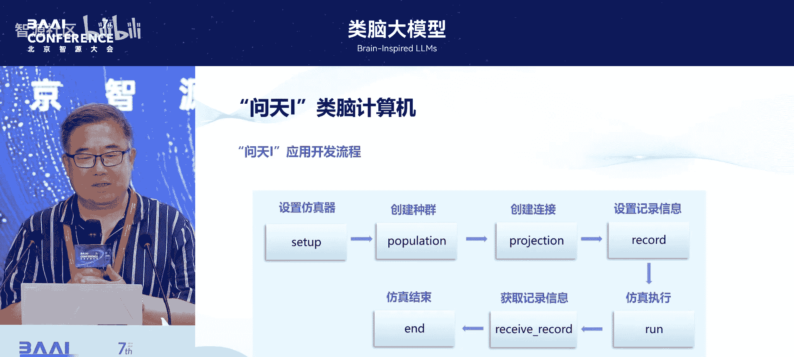

那么除此之外，除说除了我们这个软件的工作之外呢，我们在这个呃算法层面。刚才其实李老师讲过呃呃讲过长识记忆的东西。虽然我们这个呢和李老师呢李老师呃讲的这个这个这个算法可能多少人的才。

我们整体来还讲来来讲还是从模仿脑的机理。我们想从更加基础的更加本质上来去探索这个呃SN或者迈冲性的网络的一些算法。所以说我们是从这个角度来去做这个呃做一些科学的研究。那么我们也发现了。

就是实际上这个做SN的记忆表达能力的问题，就是如何来提高这个更好的来表达这个记忆动态记忆。这是我们想做。同时呢这个可能对于未来的一些在智动驾驶啊，巨人智能机器人然穿承设备上都有非常大的一个应用场景。😊。

那么这块呢，就是实际上我们是Li弗神经元。其实这块呢就整体来讲说，我们从这生物可解释性到我们的计算的这个简易化。那么是我们这个产生这个是这个是Li神经元模型，这个是这个发呃发展那么一基础。

但是我们也发现呢它在这个模电位重置的时候，实际上是记忆能力的局限性的一个一个体现。那么我们解决这件问题呢，从两个方面，一个是从这个呃网络的结构的方面，我们。在这个脉冲神经网络的基础上呢。

我们引进了这个胶质细胞的概念。同时呢就是我们建立了新的脉冲呃神经元离子连接以及胶子离子连接，也是胶质间隙连接等。那么从改善了这个神经元状态与突出的连接。

这个这份工作呢可以说是首次讲这个脑胶子细胞动力学机制以及其网络结构的参数学习和全局时中时空信息整合应用在SN领域，呃，通过丰富的信息处理单元和网络连接，扩展了传统的SN单一的信息处理维度。

使其具备了全局调控能力，克服了传统SN局部记的局限。那么这个整个工作呢是通过这个一个是调整神经元的状态，调整突出的状态以及信息整合。呃。

通过新增的这个网神经元模型和突出模型来去改从胶组胶质细胞来去改变的这个这这是我们这个BSN那么除此之外呢，我们在神经元模型上。刚才应该是李老师讲过的突出模型。其实这也是突出模型。我们是是在这个借鉴了可。

做的这个递归蘑菇体的模型。这个在神经层面上呢，我们开展了一些来去改变这个SN时空维度上记忆保持能力这份这么一个工作。那么我们通过新增的一个突出电流动学。刚才李老师讲过这个开关。

我不知道跟是不是有异举同工之力。但是这里面就是说实质上是做一个常识记忆来去通过整合输出结构和递归连接，呃，应用了半欧拉的这个这个方程来构建新的离散解来解决了时空连续记忆保持。但实际上这个工作呢。

我们在我们的工作中又得到了非常呃用我们的一些实验来去验证工作这个这个有效性。但同时实际上在实践中呢，我们还有个状态爆炸的问题。这个可能在未来也会解决。因为刚才我讲李老师讲过64K和128K个常识记忆。

实际上这也是我们从硬件实现上面层面上也需要去考虑的。当然这块呢刚才和张老师讲的也有一些类似，就是我们有一套这种像能怎么去拆解。我们或者是么了这种这种一些。一些技巧性的东西在里面。

那这个就是我们把这个这个利用这个蘑菇体的胶子细胞的爆出小车上了。那么这个成功避重避端率大概超过92%，这时间有点有点有点赶。那个呃计算量呢我们减减少了40%。

那么下面这样我把这个应用给大家呃简单介绍一下这块可能也涉及到我们怎么去用我们天那脑计算机。际上我们首先呢我们选择了是一个数学的个NP问题那么这是一个多节点高耦和强约束这么一个全局一次性的问题。

那么这个数数出大家这个数读大家都都了解，它是一个像九九宫格的每一行每一列不能有同样的数字，它只能蹦到1到9对吧？还有同工不能数数据，那么这个工作呢这个东体设计呢。

我们从这个呃从建立这个总群以及建立这个这个叫做说叫做数据盘面的一个总群，以及我们的胶子细胞的总群来去构建这么一个网络。那么具体来讲，我们以这个例子为每一个单元啊是这个每个单元格。

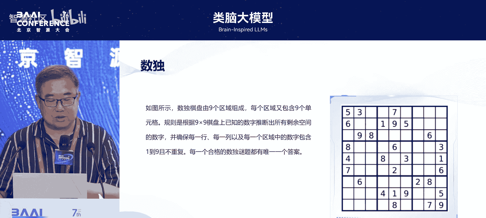

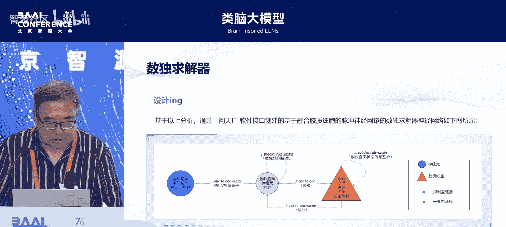

没有因为他们可能是1到99个数，每个单元我们有9个神经元来表示表表示它。那么通过这种脉冲竞脉冲频率竞争来来来来实现决策。每个神经元呢还会有一个正向的自机，也会有呢来同行的这个同工的意志性的一个竞争。

所以说这是这是我们一个基本的一个模模块。那同时为了能够去把我们这个初始值设进来呢，我们也有一个一个初始条件，也是通过一个神经元来去设立起来。当然我们这个只是一个实现方法不一定是最优的。

并不是所以说这个时在未来呢可能我们也会去在这个算法上和实现方法上有深深入的了去去去去加深一些工作。那么这个工作整体来讲就是说这个里面就包括我们在这这个population这个总群的建立一些连接。

以及这个互联的一些关系的这个这个工作，以及我们这个把这个胶质细胞的这个种群呢也建立起来。同通过文本去描描述进去的。那么我们来去建立这个回收机制去去。😊。

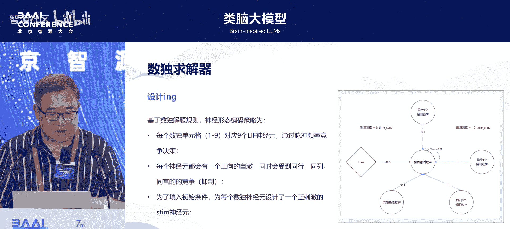

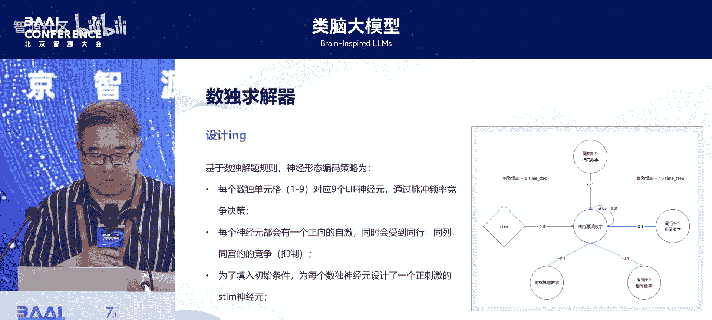

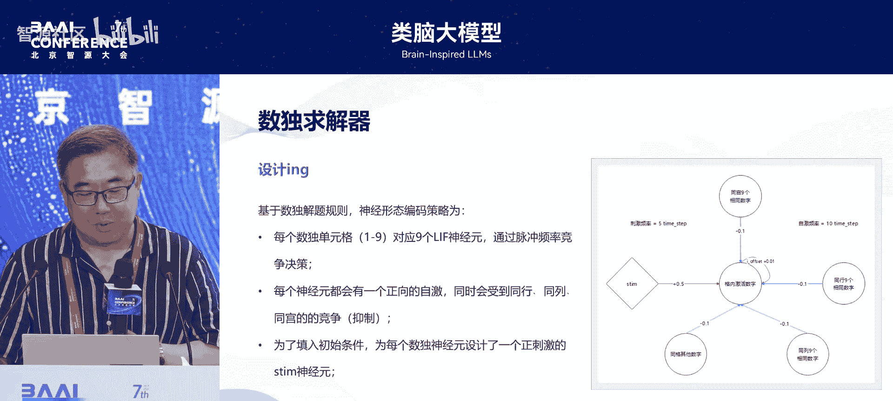

和我们的house的打交道。那最终呢我们来去去让让他的话，这是我们的一个实际的一个一个一个一个工作的这么一个展示。那么从整体呢一个评估上呢，我们对这个速读的这个一个一个数两种数据集呢进行了个呃分析。

那整个成功率呢在第一个数据集的百分之百。那么我们整体呢减少了92%的计算量。呃，那么第二个数据集呢，我们这个大概是99。999是什么概念呢？我们大概在一作时间范围时间的范围内呢，我们只有一道题没有解开。

那么相比于这种就说用这个硬性的去连接的话呢，呃这个这个回溯的方法呢，我们大概有88%和92%的这么一个一个这个计算量的减少。第二个例子呢就是我们这个交通其实呃交通灯至私行控制呢是交通流量调度问题。

可以看成是个连续时空的流量控制状态控制。实际上这也是非常智慧城市中的非常重要的一环。那么我们这个交通智慧交通这个这件这个工作里呢。

我们建立了车道以及耦合关系模型以及车道车流调控模型以及交通灯及其时空逻辑模型以及车道互负载的实施呃估计模型。那么右侧这是我们的一个网络模型，我就不去讲了，这也是一样跟前头一样，是怎么去构建它。

包括population的建立啊，互联连接的建立啊，以及这个影射关系的建立啊，以及互相彼此之间的一个开关啊约束之间的一个建立这个描述文件。那么最终呢我们来去把这个道路的负载信息呢编码层平均脉冲发法率。

再讲这个道路负载的变化量呢传递给了这个路网的一些表达神经源种群呃，最终呢我们这时空切换逻辑。种群的叫脉中信息转换成真信号灯的一个一个工作。那么我这是用这么一个小的视频给大家。🎼那去看一下。

随着人口和经济的不断增长，交通拥堵问题、道路安全问题以及环境污染等问题日益严重。传统的交通控制方案采用固定配置策略，无法准确预测和优化调度，无法做到区域自适应控制。

🎼问天智慧交通系统依托于问天类脑超级计算机，是首个脉冲神经网络大规模智能交通控制系统。其中，问天一类脑计算机突破了基于脉冲神经网络的计算模型、体系架构、类脑硬件系统、类脑软件系统及应用开发等关键技术。

具有计算能效高和实时性强的优势，较现有计算系统能效提高数十倍，达到国际先进水平。🎼基于问天一的智慧交通系统，具备低功耗、低延时、低资源占用、快速部署、调控规模大、调控效果优等特点。

可以轻松实现交通单点、交通干线以及区域内的协同控制。以南京市建邺区地图为例，目前路网中共有车道8000多条，红绿灯路口800个。为了模拟早晚高峰期间的车流量。我们往交通路网中每小时注入14000多辆车。

通过一段时间的交通调控，从地图上可以看到，与强化学习智慧交通系统相比，问天智慧交通系统中的拥堵较少。🎼通过展示界面下方的折线图，我们可以看出，与强化学习智慧交通相比，计算机系统性能指标方面。

问天智慧交通系统的功耗和资源占用降低了95%。交通系统性能指标方面问天智慧交通系统的平均车速提升了100%平均等待时间降低了90%碳排放降低了这其实这个这个这个整个比和经济的我们先把它停下来。

实上这个是比较。那么从这个资源内存数据占有上呢，我们智慧交通呢大概是13兆币。那么用GPU的话大概305兆大概也是二十几分之1%。那从呃能耗来讲呢，我们单路口大概是1。91。9个这个这个。

那么他们这个用GPU是49毫焦大概是25分1%是这样其说我们整个实验呢包括这个轻量级的以中等量级重量以及这的这种ic这种这种漏的这么这么一种不同的设置。实际上我们从整体来讲呢，不论从这个计算的资源。

来讲，还从这个交通的资源上来讲，都有非常大的一个提升。呃，第四部分呢，实际上我想去呃去去去去跟大家呃这个汇报和请教一下。一个是就是说从这个呃内脑计算芯片平台。那么我来归纳现在有多种的计算芯片代表性的。

包括SN融合CN的以及CN加li的以及实方法的数字模拟以及定制处理器以及这个算的那么从还有计算平台也是自主系统，从软件上呢刚才张老师也讲了，那么实有系统拉的tel呢有意向一统现下但是还是比较难的。

从算法上讲呢N架构加li的个激活函数。那么还有CN和SN的融合的以及我们纯SN的应应用上很多，但是都没有这种杀手集用。这也是我们面临的非常大的一一个困境。

怎么能够去去什么样的能够合这个内脑呢这可能也是我们需要去探索。那么我们自己的工作上目前来讲呢应该是分那么三方面，一个是我们正在开展的处理脑科学探索来实现智能有现。比如说这个。😊。

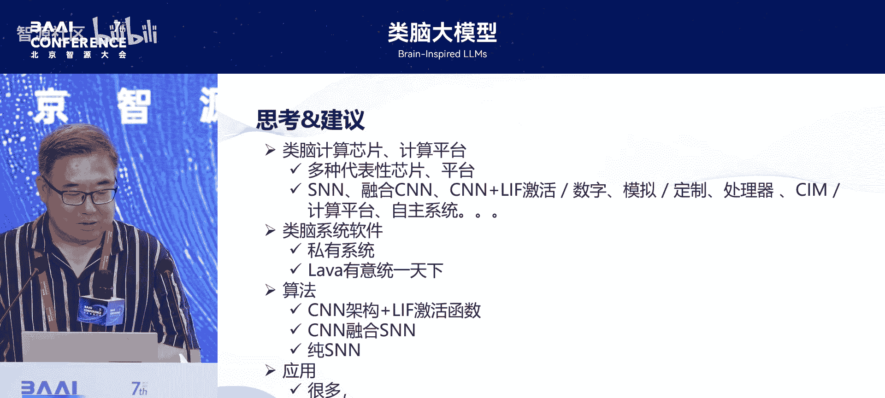

呃，这个脑的探索啊疾病的这个一个预防啊，这个脑仿真这个角度。再一个从计算模式，我们再去做一个感自算这么融合的一构计算自主系统来解决这个交互呃实时性难以及任务动态管理难题，解决这高性能计算。从算法上讲。

我们可能主要瞄准瞄向的是新人融合SN和纯SN。其实在这呢呼吁一下一同来去努力，共同构建这个内脑计算生态。这是也是非常重要的。因为内脑呢是个新兴的一个学科，这一个领域，非常非常前沿。

需要大家一起来共同努力，才能把这件事情的，是这种推到的高度来去来去实现这通用人工智能，这是我的一个汇报，谢谢大家。嗯，非常感谢尚老师给我们介绍问天一和他的一些上面的一些算法和应用。嗯。

因为时间的问题可能也只有一个或两个问题。然后呃。😊，那那边嗯。呃，老老师您好，我想请教一下，就是说到SNN总是就是强调它的低延时和低那个性低性能的消耗。呃，有没有可能他在某些领域产生出更加强大的智能。

那如果有的话，他将以什么样的形式去实现。所谢谢。呃，其实我是赞同他应该呃因为我一直认为SN是通向未来人工智能的一条途径。所以我非常认同您说能够产生非常强大的智能。认同这个。但怎么去实现？

实际上现目前呢从我的理解上，SN的从硬件平台上呢，就是说已经有非常多的各种各样的平台。但从算法上来讲，应该还需要非常多的，尤其是纯粹的SN的算法，这个还是有待大家一手开发。

这样才能把这个这个这个您所说的这种强大的智能去体现出来。你比如说我人脑先就是世界上最最智慧的一个一个器官，对吧？那么它就它就代表说我们这个这个最最强大的一个智能嘛。我是这么这么认为的。

不知道回答那您的问题没有。😡，好，谢谢谢林老师。😊，嗯，另外啊。哎哎，老何就您刚才提到了SN的这个问天计算机有低时延的优点。就但我理解就SN它的推理是多步的，是有多个时间步的。

但普通的AN它只有一个时间步。所以为什么SN比AN的时延要低？呃，这个是那是个好问题，但是是是这样，从我们自己呃。这个我我我我我这么能回答回答一下好吧，因为我我本身不做算法啊，这个我我来这么回答一下。

就是说实际上我们是个多个时间部，这个不假。但是我们的时间部呢，实际上就是说呃从如果从哎西安的角度来讲，就是他是呃。数据一个大量的计算来去产生这个结果，对吧？但我们实际上我们是多实进步。

但是我们不是个大量的计算。你大量计算是非常好使的。嗯，对我我这么理解，我不知道对不对，因为我我本身不做算法，对OK嗯。但我理解就AN他那种大量的计算可能够通过在GPU上面并行，所以说可能就一下就算完了。

但是你现在是这样，就是我们像刚才张老师讲，其实GPU这个大量并行，我们有效的数据其实是非常少。再一个可能是不是要强调一下稀性OK嗯，好，谢谢老师。

