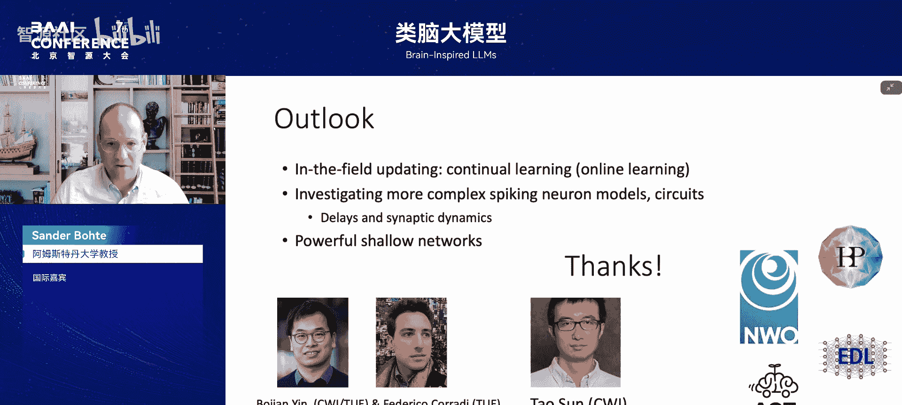
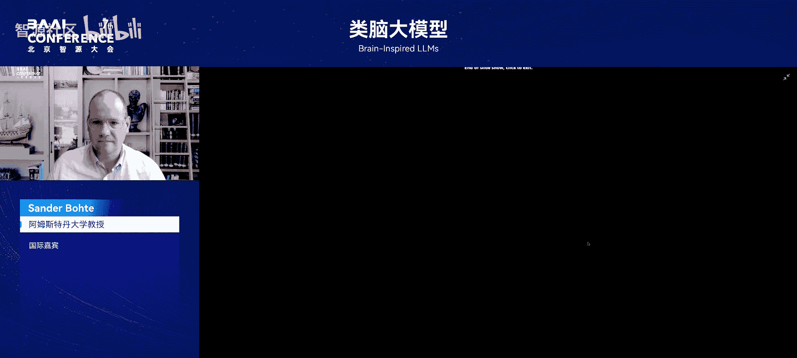

# 2025北京智源大会-类脑大模型 p05 Sander Bohte-国际嘉宾 -阿姆斯特丹大学 教授 -BV17xNjzMEer_p5-

啊，各位专家各位同学，大家下午好啊，我是吴继斌，来自香港理工大学。今天呃下半场我是大家下半场的主持人。然后在接下来的时间呢，我们非常有幸请到了两位来自的教来给大家做内脑计算相关的一些分享。

首先呢我们第一位嘉宾的名字叫来自于阿姆斯大学。然后我剩下的时间可能用英文给大家做介绍了W machine learning group and is also part time neuroscience at the of hisD in20 and three on the topic of neural network he has been working in this for over20 yearsin2004 he rejoin cW as a junior permanent to work on distributed neural models andag system。

😊，In 2016， he has cofounded the CWI machineine learning Group where his research bridged the field of neuroscience with applications by developing advanced neural network models。

 his research has pioneering in development of advanced and efficient Spy neural network。

 including seminarnal works on supervised learning with Spike time coded network called Spike Pro Okay so it's our great pleasure to have Professor Sand Bote with us here today。

So hello Sand Professor Sander， so nice to see you here。 So I'm G and I'm the MC for today。

 so I would like to pass the following time to you to share your insight on this topic。

 So the topic for today is scaling Spikking your networks。 Alright， let's welcome Professor Sand。😊。

Yes， thank you very much for this very kind introduction。

And I also want to thank the organizers for inviting me to talk here。 and I hope I can。

Bring some new insights to all of you。So let me share my screen。See it's visible， yes。So yes。

 so good afternoon for you。U。I wanted to start with this little movie。

 and I hope it translates well over the video。And it's obviously a snake。

Being a bit aggressive to a cat。And the amazing thing is how insanely quick the cat respond。

 and I'll come back to that in a bit。So what I'm going to talk to you about today is。First of all。

 why are we discussing spiking neural networks？And I'm going to discuss with you some of the things we've been working on here for the last five。

 six years to scale up the accuracy size。And also just to get more out of spiking neural networks in general。

 and then I want to also make some comments on outlook and what we are working on currently。

So I'm going to quickly go through this because I'm going to assume that everybody kind of knows what spikeiking neurons are are。

 but just to remind you。The neurons in the brain actually communicate through electrical pulses。

 spikes。And those spikes travel along wires connecting these neurons。From one neuroer to the other。

And then when they arrive at the next neuron， they go through a synapse and the synapse， the ceds。

 neurotransmitters so that it influence the state of the next neuron。And then when the neurons。

 the next neurons reaches a certaintain。State itself， it may or may not emit other spikes。

So that's the rough biological picture of how all roughly 100 billion neurons in our brain work。

Though spikes travel to the synapse， they change the potential of the next neuron and they could be positive or negative。

 and that's what we call these synapses either exitory or inhibitory。And when enough spikes。Add up。

Inter excatory input into the neuron。 You reach a kind of a threshold。

 and the neuron itself will fire a spike further to other target neurons， and it will reset。

That's very rough how real neurons work。Now， why are we looking at these spike ignorance？Well。

 the main notion， of course， is that our brain has a lot of these spike ignorance。

Each of them makes 1000 to 10，000 connections to other neurons。And it runs。

 And this is something that I only discovered yesterday， on average。Nurance。

 we think higher about once every 1000 milliseconds。 So it runs at about 0。1 Hz。

Now because those neurons are so little active， the brain is very efficient。

 it runs at about 20 to 25 wts in a very constant way。

 and then we don't really have a clue how computationally effective our brain is。

 but we think you need a big data center with many， many GPUs to simulate a brain like that。

So that makes our brain very， very energy efficient。

An energy efficiency that we haven't achieved yet， we're still about a factor of a million away with our current artificial neural networks。

The other reason， there are two other reasons for looking at spike neurons， one is that。

Bike ignorance are actually event based。So when an input arrives。

Over enough current arrives at the neuron it will immediately respond。

 and this is different from what we usually see in in other approaches like a standard video camera。

 it would run at 60 herz or 120 herz， which means it runs at a fixed interval。

 whereas if an event based system you can respond immediately。

 So this is one of the things that allows the cat to respond so quickly because it can respond as soon as the snake tries to。

To attack the cat。And finally， and this is a rapidly emerging technology and fields that a lot of money and this is going into。

We are increasingly trying to connect our technology with the brain in what we would call typically neuroprosthetics or neurotechnology。

 and here at some point， and this is a bit of a Kg thing to say。

At some point we expect to read and write directly to spike neurons。

 and I'm saying like that is because if you look at the current technology that's really not the case。

 but you can imagine that if you eventually want to get as much in and out of the brain as possible you would be wiring up individual neurons。

So now at the same time， there's also a bit of a bit of pushback on on spiking neurons。

 so why would you not？I go for Spiking neural networks。They're very great， they're energy efficient。

 they allow you to do all these things。The thing is that right now the sparsity in these spiky neural networks is so。

 so。 And by sparsity， I mean， if you time step through a network。

 you take a step and you inspect how many neurons are actually firing。

 you can calculate how often the neurons fire。 and right now that for many for the applications we have。

That is about5 to 20% of the time。And then if you start doing the math。

 like if you build a chip that runs spiking neural networks， you find that that is a tricky thing。

 exploiting sparseness in activity is very tricky。 you need very， very sparse networks。不。

And if you go with these kind of numbers， like 10 to 20 hertz。And you multiply that by 1000 to 10。

000 connections， you really have a lot of activity coming in and out of neurons at all the time。Now。

 one of the questions that people have been asking is actually very recently。

 and I should credit here Simon Forpe and and and Dan Goodman， who were looking into it。 This。

 So Simon Forpe said this number of 1 to 5 Hz in the brain。 Is that really true because。

It seems much。 and he's a biologist by background。And then。

IfIf you start studying the biological literature and you find in more detail。

 you find that actually it looks like the brain is much less active than people believe in the Spiky neural network community。

 so it's more like 0。1 Hertz。And I have the citation here， so credit to Dan Goodman。

 who ducked this up。So it might actually be much harsher than we currently have。

And a final issue is and of course， you have a whole session about that now that。

The current spike in neural networks that do useful things and are efficient do not really have the power of transformers。

 diffusion models， such as safespace model or Cox model。

 So if you look at modern ANNs and how powerful they are in terms of computation。

Our spiking neural networks are not really there， or at least not in a way that helps you achieve some of these other benefits。

So why again， what what is it that we want to learn from the brain。

 so the dot on the horizon of my my research in many ways。😡，Is to figure out how the brain works。

And and。If you zoom in a little bit， you are then asking。

 how do spiking neurons in the brain learn to compute。

 and this is a question that's really not answered at all yet。

And this question leads to many real research questions， like。

 how does the brain learn in an online manner immediately？

How does brainHow' is the brain able to keep on learning without running massive replay sessions in your brain。

 or maybe it does？How does the self supervised learning in the brain work。

 how do we actually learn with reinforcement learning？If you look talk to biologists and want to。

 they will show you that if they're investigating how brains work， they typically work with animals。

Now， of course， animals you cannot instruct so animals you train through reinforcement learning。

 typically like monkeys， you give them a bit of apple juice if they do it right。

And then logically the other question is， okay， so this brain。

 it cannot really invert weight matrixes or any of these things that happen in artificial neural networks。

 so how does that work， how does local credit assignment work？And then finally， and this is。

 I think basically the question that's been motivating me for the last 2020 years。

 like is there more than。The number of spikes that neurons emit in terms of what spiking neurons do in the brain。

 is there more than just this analog value that we think of when we talk about spiking neurons and compare them to artificial neural networks？

So just to remind you， we've come a long way in a fairly short time。 So this was beyond K， of course。

 you， Everybody knows it by now。 And in 2019 at a。At a very big semiconductor conference。

 he talked about spiking neural networks and hermorphic architecture and he very bluntly said， like。

 look， nothing even comes close to current state of the art and practical tasks。 and at that time。

 he was very much right。And then of course， logically， you say。

 why should you build chips for algorithms that don't work？

So this was the starting point then where I had an excellent student。

And we we looked at this and we really tried decided to push the boundaries and see how far can we push。

Sppicking neural networks in terms of high performance。

So the first challenge was to get spikeiky neural networks up to acuracies that people would recognize as useful。

Before that， that was really not the case。So what we show what， of course。

 was known is that if you have the description of what the spiky neuron does。

Like where every time there's an input spike， there's a potential that goes up and it leaks out again。

And then another excitatory spike comes in。 So the potential goes up。

 it reaches a threshold as a reset and it keeps accumulating again。

 This is the dynamics of a very simple spiky neuron。 If you make it a little bit more complex。

 you can say， well， this threshold。Where the neuron actually will fire？

iss actually increased every time a spike goes out and that adaptation will then leak out of the spiking neuron。

 This is a little bit more complicated spiking neuron model。

 They're still quite far removed from from realistic models of spiking neurons。Now。

 if you write down the math for these two types of neurons。

 the simple one is called the leaky integrate and fire neuro and the less simple one is the adaptive leaky integrated fire neuro。

Then you see that you can write the dynamics of these neurons。As a recur self recurrent system。

 So the the input， the internal variable， the potential leaks out if every time step。

And according to this very simple differential equation， and there's a spiking function。

 So you can write it up like this。 So the the current time step of your potential depends on the past time on the past time step。

And so on。And if you have an adaptive neuron which has this spike。

 this threshold that goes up and down， then you actually have another self recurrent loop。

 so now you have two internal states that evolve over time。

Now that means you have a recurt neural network and if you have a recurt neural network。

 it means if you want to do arrowback propagation， you actually have to arrowback propagate through time。

And the tricky part with spiky neurons is that。You somehow have to。Have to adapt the spike ignorance。

You have to go through the gradient， the spikes of the gradient。

To get output through the gradient sorry， slightly distracted here。

So the issue is that if we make the graph for a spiking neuron。

 a lot of things are constant like you have at a continuous output， you have a membrane potential。

 but then you have a spike and then you have another membrane potential and the spike is not differentiable。

So if you do the gradient if on the loss function， you will run into a problem here at the spike。

Out a way around it。 And I in a way， I did that a while ago， But Emin Neci in particular。

 made a very nice contribution that made this very clear。

You can put in a function for instead of this non differentiable part。

 you put in a surrogate function and everything actually kind of works。

Once you have a circuit gradient for your backward pass in the network training。

You can use PyTtors to train your network。Including the all the spikey urine parameters。

 and that was something we could not do before。 So before like in my my 2011 paper。

It that's Matlap code， all the gradients have been written out by hand and that's very unscalable and its exactly the whole reason。

 the actual reason behind the。Deep learning。Their revolution。So if you do this and you push。Your。

 your optimization of the networks。 You see that all of a sudden spikey neurons start working really quite well。

Even exceeding。Some of the performance of standard recurrent neural network approaches like LSCMs and starting to approach the state of the art of recurrent networks at the time。

So you achieve high accuracy with fairly sparse activity in my spiking neural network。In this case。

 it was about5 to 20% parrsness。And this is work from 20220 and 21。

 and of course since then a lot of people worked on this。

 the results have improved a lot in particular by using delays in your spiking neural networks。

 but now we are at the stage。Where。So， where these things can't really work。

 we're no longer asking the question that John LaC was asking that says these things don't work at all。

There is still。An issue though， if you use back propagation through time。

 the memory usage is prohibitive， that is it increases。Linearally with the number of time steps。

You also have the problem of finishing and exploding gradient， as particular。

 the longer you go back in time。Forbe propagating， the worse it gets。And it's also offline。

 you have to wait until the end of a sequence before you can do an update。So on the one hand。

 so we succeeded to a large degree in scaling up accuracy， issue is no longer accuracy。

 but now the next challenge of course is can you make any seriously big networks out of this？

And here we pushed。A way of doing online learning and we modified our spiking neurons to be more。

Suitable for big networks， so I want to take you through that in a bit。

So we were inspired by this work from Kagan and Salally grama in ICML 2021。

Where they showed an algorithm for learning on online matter， training recurrent neural networks。

 in an online manner I through what they call forward propagation through time。And this is again。

 work with Boyon and Federico。U。And what Kark and Sal gramar showed is that。

You can design a weight update in a neural network。That converges to the optimal solution。

And the general idea is that you have to find and have a slide on that in the next slide。

 and you can find a consensus of weights over time steps。

 There is this thing that even though you at every time step， you might be calculating an update。

You actually have to figure out the。A single update for all the time steps and that helps you to be more efficient and get away from this back propagating idea。

Now the reason we were really interested。😊，Is that they showed that their forward propagation through time actually improved over through time on select problems。

So this was the very simple problem they demonstrated it on it's called the ad task。

 the fun thing is the ad task goes back all the way to the original paper by Horier and Schmmituber where they introduced the LSDMs。

And the goal of the add task is you have a sequence and it can be arbitrary long。

And there are two inputs into the network， one is the control input and the other is a value。

And the task that the network has to achieve is that at two points in time。

 the control network will say you should remember the value。

That is currently present as a input value。 So basically the network has to add two numbers up somewhere in the whole stream and then maintain them until the end It's of course。

 a very suitable problem。For。For learning sequences。And for LSTM's depth have to maintain memory。

So this is intriguing， right we can do better than BPPTT。And just to clarify that， so in BPTT。

 you have to go back through the network at every time step and then also back through time to account for all the influences of current change on past activations。

And what FPTT allows you to do， and that's why it's online learning。

 is it allows you to immediately learn from your input。 you don't have to go back through time。

Now let me sketch what it's actually doing of course this is the contribution from Kagaal。

 but their real realization and it's in the graph is that every time you calculate an update for a single。

Synapse or weight。You can estimate how much the weight change。We'll change the loss。

 and that's what it says here。So if you do a single update， you will get an estimate for this value。

If you go to the next step， you will again get an update and estimate about that。

So every time you have a loss and you go through your network， at least just straight through。

Then you will get an estimate of how much this weight is changing a loss at that time， but of course。

 in the end， we're really only interested in one weight change。That minimizes the total loss。

So what the algorithm actually does it it keeps a kind of a running average of how much。

This particular synapse is changing the loss， and that's what it's using as a trace to jointly use the current。

Rraadient and the average past gradients to update the weights。And if you want more details。

 I recommend to read the paper， it's interesting and it's a very different way of thinking about updating inre neural networks。

Now， a very natural question is to ask。Whether FPTT actually learned temporal information。

 So we did a little experiment error。 We have very simple system， law and system。

And we train a very simple recurrent neural network。To， to learn。

 to predict the next step in a sequence， and we can train it with for a propag through time and just plain backpro。

 So there this added idea， this notion of a running average of the the relative weight loss gradient。

Does that really solve our problem？And of course， if it predicts right。

 then you will see that the network should really follow out the curves and if it doesn't。

 it will go all over the place。And that's exactly what happens if you just do backpro on such a problem。

The predictions will trace out trajectories that have nothing to do with the actual Lourz attractor。

 whereas if you apply the forward propagation through time。

 you see that the one step prediction is learned very well and it follows the curves。

So it works on these kind of temporal problems。Now the second thing we introduced is a more complex neuron。

We call it the liquid time constant spikking neuro。

 it was inspired by the liquid time constant regular neurons。嗯。And what it does it adds a part。

To the network。That changes the dynamics of our spiking neural network。So in a lot of ways like the。

Toge。The memory units in LSCMs， there is an input going into the Soma。

 the computing part of the neuron， but also there's a separate set of weights that calculate a second value that influences the soma。

 and in this case it influences the time constant of the spiking neuron。

This was inspired also by the fact that FPTT really demonstrated this benefit。For。

I get networks where I was gating in the neural unit。Now， if you do this。

 you see that suddenly your spiking neuro can have very different dynamics。

 depending on how you set these weights that determine the。Dynamics of the time constant。

So you can have very contra。Counterintuitive behavior， where， for instance。Here we。

We put a current step current into the spikeiking neuro and it increases and then it decreases again。

 this the current that goes into the number of spikes into the。Despite the LTC neuron。

And then you see that depending on the weights that you have for both the inputs and the。Dynamics。

 you can have behavior where firing rate goes up and then actually goes down。

 even though the input goes up。So you can have very strange dynamics out of this neuron。

 depending on what you put in and how you change the time constants。Now。

 of course we did this because。This ad task actually needs it。😡，So as I said。

 the add task is a problem with two strings of numbers， x and y， x in 021 y in0 or1 when y is 1。

There are two y's that are one， all the others are zero。

 and you have to add the corresponding x values together as an output and the thing is this does not converge if you have a long sequence like  a thousand times step。

 this does not converge with back propagation through time on LSCMs or other RNNs。

We also found that if we use very simple spiky neural networks with BPPTT or FPTT。

 it doesn't converge either。And that's what you see in the graph Now of course I wouldn't be telling you this。

 but if we have these LTC spike ignorance and we train with fire4 propagation through time we can learn the task even on these very long sequences and that's the red curve here that you see in the graph。

So now we did a systematic comparison and we use the DVS gesture data set。

 it's a data set that has been captured with an event based camera。

 so we have all these events a long stream of a second of events。And we can study this。

 we can study the number of the length of the sequence by chopping up these events and collecting them into frames。

 so here you would chop it up in four parts and have four frames。

 but you can choose any number of frames up to1 thousand0 or even more in this case， how many。

 many you want。And we did that for this task with the same network and we compare different。

Approaches。Where all these approaches show the downsides of regular methods。

So one is that if you run a standard LSCM at some point。

 it will just run out of memory because it uses back through time。

If you use spikking neural networks， it'll start decaying and it will also run out of time as you increase the number of frames。

 so you can split this stream up in 20 frames or you can split it up in  a thousand frame。

All these methods start having real problems if you run with 100 frames。

 also with these liquid time constant neurons when they are trained with back through time。

 but of course， once we train with forward propagation through time。

 we find that it will all stay very constant and in terms of performance and it will work well also for very。

 very long sequences， we don't have this problem with vanish gradients anymore。

And the other reason we can do this is because the memory use is independent of the sequence length。

Now an aL here is that this does not only work for LTC neurons。

 we could do the same tricks for much more complicated neurons that have much more biological validity。

Like ECcaage neurons and Hokin Huxley neurons， now they were not tuned to high performance。

 but before nothing was able to actually train these neurons because they have these parameters that allow very complicated behavior。

Now the big advantage of forward propagation also is that it uses constant memory because you don't need to go back in time so you don't need to store all the past activations。

So the more frames you get， the amount of memory stays the same。

And that means that we can now train very large spikking neural networks。

 at least very large compared to what was there before。And we demonstrated this on a Yolo task。

 the object detection task and object recognition。Because up to then。

 spiking Yolo networks were essentially converted。And not traineded。

 and I needed many simulation steps。To。Process a single frame。

They were also typically hybrid networks。 they had other problems。

 and they had very high firing rates， so they were not very sparse。

Now we trained a liquid time constant network with forward propagation through time and you could do and then with this we could do end to end training of very large deep precurrent neural networks and we called it like tiny Yoola V4 which is 19 layers of network with over 6 million neurons。

And。Here for every frame， we processed it for four to eight time steps and that allowed a standard GPU to run at about 60 frames per second。

Training memory for this big network was about 14 gigabytes。

 so you can imagine that you can actually scale this up significantly。

Back propagation through time is entirely infeasible for such a big network。Because it takes much。

 much more memory。But with forward propagation， we then， I mean， by now it's been improved。

 but we then were're able to achieve state of the art on the Pascal VOC problem。

And that's what published in 23 with。Again， Boyn and Federico。

Now there is one thing I wanted to note。 there is a very recent paper from Chenzhen Ma。

 and I'm probably mispronouncing this a bit。Where they show that in many of these。

Problems like DVS gesture that's up here。You can get very accurate performance。In spiking networks。

 if you actually don't consider the past， does this is unlike my example。Of the Lawrence attractor。

If you do this right， it doesn't need to be a big problem。 Now if you look carefully in their paper。

 you see that worst of all they find。The reason they don't need the time all that much or the temporal history is because they are clever about normalizing。

So there is something about doing normalization， right in spiking networks that helps you a lot。

So that's the first comment。 And the second comment is， and we tried this。

Is that this really works if you have this number of time steps on these problems。

 if you have 20 time steps。You don't need much in terms of time。But if you have much more time steps。

 like you split up DVS gesture in many more small time steps。

This is no longer the case and we have a temporal problem again where you need to learn over time。

Now， of course， it's very relevant if you want to port your neural network to neuromorphic hardware because that's going to run in real time no matter what。

But it's an interesting venue， and normalization is something we probably need to look into a lot more。

Now I had one more thing， I don't have time for that。

 but I'm going to point out where it is and why it's interesting。So we can scale up networks。

But not yet to transformer sizes。We are still left with this question， like。

 can we do more with spikes than just this rate coding。That everybody is implicitly assuming。

And here we showed together with a postdoc here Taoson that you can do efficient uncertainty quantification。

Now， uncertainty quantification。Is asking what the probability is that a predicted outcome will be measured。

 It's very important in many real applications。whether you make a decision in autonomous driving require some sort of assumption about how likely your whatever machine learning method you have。

 how how certain it is about its estimate of whatever it is like is there a human yes or no。

 if it thinks there's no human， but I'm only 40% sure。

Then maybe you should be much more careful than otherwise。And of course。

 medical domain and large financial oppositions have the same issues， many。

 many cases you want to estimate how certain your machine learning solution is about what it's proposing。

Now， let me quickly go over this。 So the main thing is that we showed that if you have a spiking network and it's doing for instance。

 a classification。You have to run the network for a number of time steps just to get an output。Now。

 what we show is that you can simultaneously。Use these time steps to also generate an estimate。

 And you do that by applying a way of drop out in the network while you're running it。

 It's very efficient。 It gives you good results。Um very close to stated to the golden rule。

 like ensemble methods if you do it properly in measurements。And you get comparable performance。

 you can also extend it to regression， so it's a general method for spiking neural networks。

And I believe this is actually critical if you want to run spiking neural networks in the real world。

So at least some ways of achieving more out of spike ignorance we got， and we have， other ideas。

I still wanted to conclude with some critical notes。So right now。

 spik in neural networks really are not。Spare enough in many ways。

 at least they're not sparse enough。To make it easy to justify building digital neuromorphic chips。

嗯m。And and one of the problems seems to be that Sir gradients induced ratecoats。

 There was a nice paper in Muips 2020 already about that， and ratecos。

 by definition mean that there are a lot of spikes。

Now at the same time as Dan and I saw him just pop in already。

 and that just mentioned is that the brain is probably running really much more efficient than our spiking neural networks right now。

 the brain might be running at 0。1 Hertz。So we need to go much farther and it is possible。

 the brain shows it's possible。And if you go much fasterer。

 your neuromorphic chips start to make sense and ways to go there might be dendrites， delays。

 coincidence detection， signaling agreement essentially。

 so there are ways to think again about can we do more with spikes？And finally。

Current SNNs do not have the power of transformers。

And here my observation is that a lot of these architectures from ANN and AI architectures are not a very good fit for the dynamics of spikeing neurons。

And more， the brain is shallow and recurrent， so these very deep transformers don't make at least not the way the brain works。

And there might be a big role there for complex spiking neurons because real neurons in the brain are much more elaborate than the point neurons that I even I today showed you。

 and they have a lot of differentnobs and bells and whistles to change things in a clever and dynamic way and this is something we're working on。

So this this also is to why my own。Interest right now are lying along the problem of continual learning because eventually we want neuromorphic chips to update in the real world without talking to the cloud。

We are investigating more complex spiking neural models。

And circuits to include delays and synaptic dynamics in a clever way。

 and we are also investigating how to make shallow networks more powerful。

Maybe using these more complex spike neurons。And that is what I wanted to talk to you about today。

 so I thank you all for your attention and I again thank my cos， Boyenne。

 Federico and Tao on all their contributions and hard work on this and of course there's also my funders here in the corner。

Thank you very much。

Okay thanks， Professor Bote， thank you for your inspiring talk on sharing your stories on scaling up。

 spiking your network， both in size and accuracy and also your critical notes to share with audience。

 So due to the time constraint， I think we can only take one questions from the audience。

 So anyone have a question can raise your hand。😊。

Okay。Hello， thank you very much for your wonderful talk。

 my background is competition neuroscience and I'm actually working on modeling the complex cells and this the neurociit I was previously part of the human brain pro HP my question is about。

😊，When we think the complex biking cells。Is it necessary that we do BPTT？

Is it possible that we do some spars BPPTT？We just need to take into account the sub threshold。 We。

 we can cut get rid of this， the spiking part。 Actually， for example。

 we only need to take into account the membrane voltage， say at -45。 then it's enough。

 So so is the part， is it necessary for us to take fully into account this membrane voltage。

 I think that's。AWist of， you know， the calculation。Yeah。Ooh， that's a complicated question。

I can make some。Some notes on what we are so so in my 2011 paper。

 I proposed a different way of calculating。With spiking neurons。

 that is not so dependent on spikes so you can get around the spiking mechanism in a different way。

And then indeed， you are much more interested in the potential rather than the spiking。Um。We know。

 of course， from a computational perspective that STDP largely depends on the potential on the neuron rather than the exact well in combination with the exact spike times。

So I think there's a lot there like forward propagation through time shows you also that you don't necessarily need to go all the way back in time as long as you keep some。

Traces in your synapses。And of course， we know there are these things in biology。

 synapses I always tell this to people， synapses take up a sizable chunk of your genome。

 the encoding of synapses， theyre they're big machinery。They are not simple multiplication factors。

So there's all kinds of dynamics and memory and other things going on that probably allow you to do clever local computation with the minimal machinery possible or the minimal amount of effort。

But how that exactly relates to what the membrane potential is。

 I wouldn't have a good answer right now。I think it's a very valid question and a big potential area for new algorithms。

 yes。Allright， I think thank you very much， Professor Bote， for your sharing。

 So let's sense again for Professor Sand Bote。 So yeah， thank you very much。😊。

