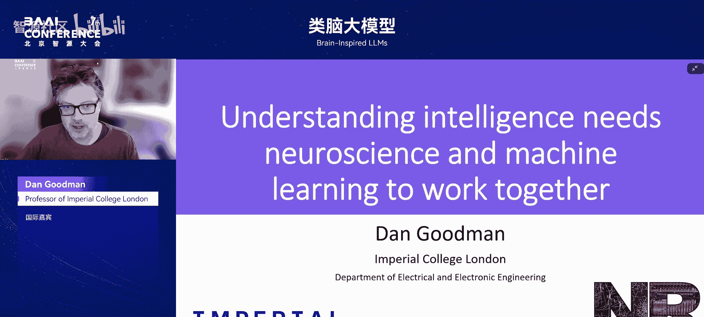
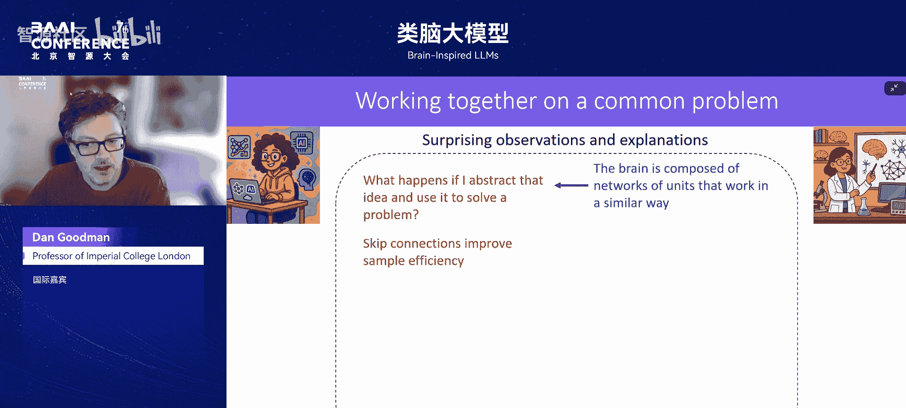
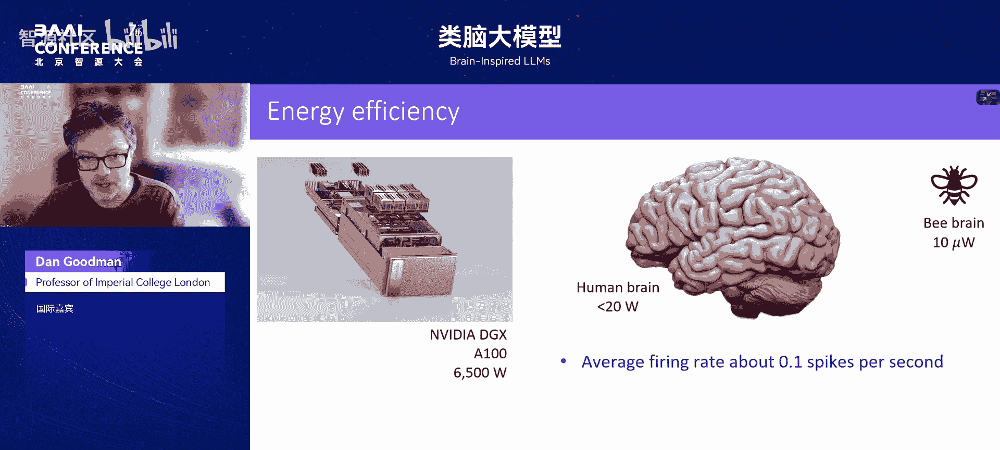
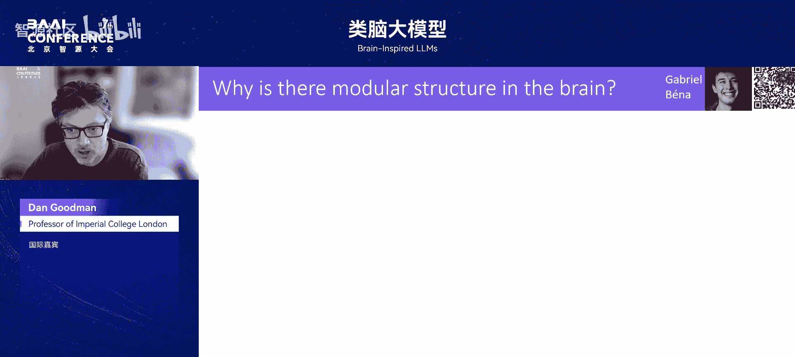
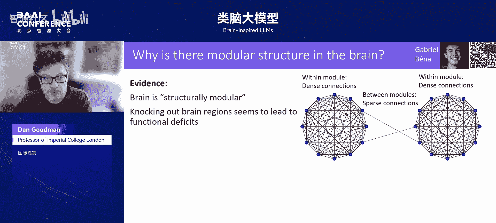
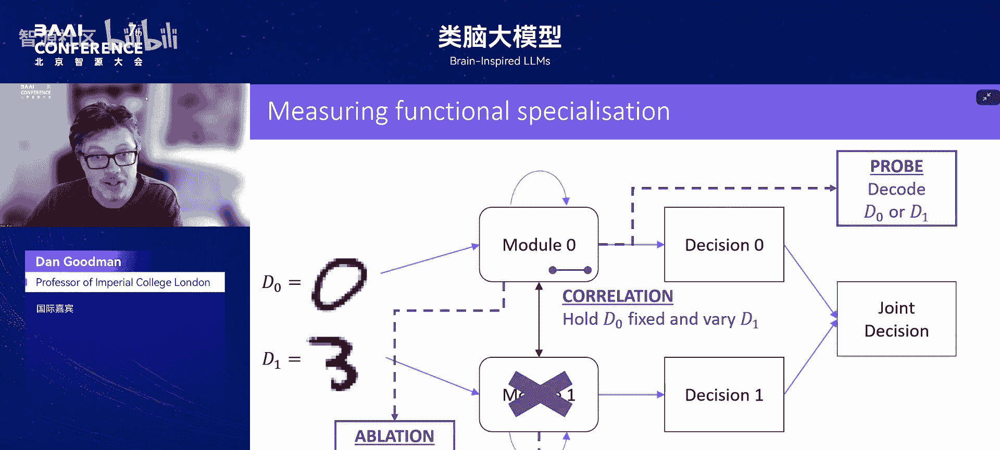
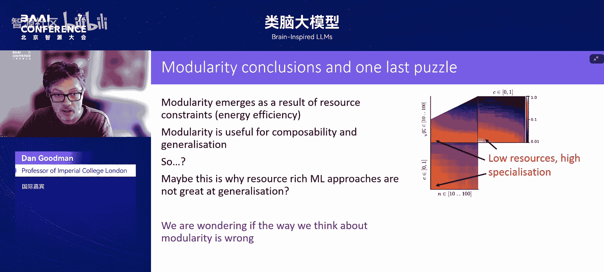
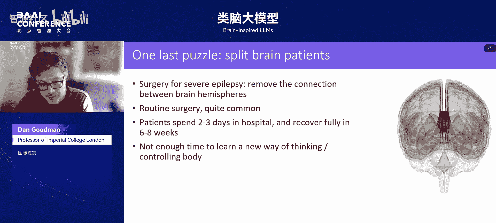

# 2025北京智源大会-类脑大模型 p06 Dan Goodman-国际嘉宾 -Professor of Imperial College London -BV17xNjzMEer_p6-

Okay， so the next speaker will be Dan Guman。 So he is a professor from Empire College London。

 So Dan Guman is he has been working in the intersection between neuroscience and AI for decades。

 and he's interested in unifying principles underlying intelligence system。

 including biological system such as brain and artificial system。

 So today he will give us a talk on understanding intelligence needs。

 neuroscience and machine learning to work together。 Alright， let's welcome Professor Guman。a year？

Yes， I'm here。Hello， professorfessor Guman。 So yeah， thank you for your patience。

 We have been delayed for a few minutes。 So I have a give a brief introduction on your background。

 So now we are welcome you to give a talk on this very interesting topic。

 understanding intelligence needs neuroscience and machine learning to work together。😊。

Great thank you very much Im just going to share my screen here Also when when your microphone is on。

 I get feedback from my voice， by the way， if you could turn the microphone off， thank you very much。

😊，まま。好。Okay。Are seeing my screen okay？Yeah， it's okay。That's great。Great， all right， so yes。

 so thank you very much for the invitation to speak at this event it's really appreciated I hope it's going to be an interesting talk。

😊，I'm going to try to give today a slightly different perspective from the usual one on how I think the fields of neuroscience and machine learning can hopefully work together to do better both of our problems than we could if we worked alone。

So you might heard this phrase neuroAI recently。For those who haven't heard this phrase。

 I'm going to briefly explain the idea。And then I'm going to say why I think it's not quite right and give a slightly different perspective on how we could be doing this。

Okay， so in this little cartoon that's coming up we have over here。

 we have our machine learning researcher and over here we have our neuroscientist。Okay。

So historically we know that neuroscience has been a big influence on machine learning。

 so we can talk about McCllak and Pis in 1943， or we can even go back to Thornddykin 1898 and his experiments on animals that led to the idea of reinforcement learning。

More recently， machine learning has also been an influence on neuroscience， for example。

 with ideas on the machine learning ideas of reinforcement learning or optimal control。

 explaining some findings in neuroscience in the 80s and 90s。Of course。

 like every other field these days， neuroscience also uses machine learning in many different ways。

 particularly since of 2014。😊，However， the influence of neuroscience and machine learning seems to have pretty much disappeared recently。

And that's led some neuroscientists to create this movement called neuroAI and the idea is to say。

 let's go back to those happy days and maybe our ideas can be important for the future development of machine learning。

But this is met with some resistance machine learning researchers aren't really interested。

 and I think it's understandable why because at this point in time。

Machine learning researchers have a very good argument to say that they understand learning better than neuroscientists do。

So what do they have to gain from this？Well， I want to argue that there is something to gain。

 but it's not through machine learning researchers listening to neuroscientists telling them this is what the brain is doing。

It's through both fields working together to try to understand a common puzzle。

And that common puzzle is what can produce intelligence？

And this isn't just how can we build intelligence？and it's not just how does the brain work。

 it's a more general question about all of the ways in which intelligence can arise。

And I think to understand this requires more than one perspective on intelligence。

 you need at least two different types of intelligence to be compared so there's in a way there's two that exist right there's machine learning and there's the brain and both of these seem to produce something like what we would call intelligence and so by working together sharing notes we have different perspectives on what intelligence is。

And this can actually be very productive because if we understand the general conditions under which intelligence can arise。

 then this is likely to help both of our separate fields understand their own problems better。

If we know what intelligence generally is， maybe we can understand the specifics of human intelligence and similarly。

 maybe we can understand the specifics of machine intelligence。

So that's basically what I want to suggest is the way forward for these two fields to work together。

😊，So what does that look like in more concretely working together as if it were a common problem？

Well。I think it looks like both groups putting what they think is the surprising observations and their explanations into this sort of common pool。

 and in this common pool we should explain things in a sort of common language that is understandable to each other。

So I'll illustrate that with a couple of examples。嗯。Part of it is what we've seen historically。

 so we might have a neuroscientist observing many， many years ago that the brain is composed of networks of units and that these units seem to function in a similar way。

And then a bit later， we had。Computer scientists asking so what happens if I take that idea。

 I abstract it， and then I use that idea to try and solve engineering problems so that's sort of the origin of neural networks。

And that's a very productive relationship for everyone。

 both for neuroscientists and for machine learning people。

And of course it goes the other way around right so for example。

 maybe we would have a machine learning researcher saying we have noticed that skip connections improve sample efficiency。

And that might travel them to neuroscientists like my postdoc， Marcus Gosh， who's been asking， hey。

 the brain has get connections too maybe they're doing the same thing。

 or maybe they have some other role。And that's what his project is about。

So what I want to talk about today is how there are lots of open questions。

Unsolve puzzles about the brain。And maybe some of these are important for the brain's intelligence or maybe not for some of them。

And perhaps。The answer for why they're important for intelligence won't come from neuroscience but may come from machine learning or maybe it'll go the other way maybe we'll realize that this has this important role in human intelligence and perhaps that can be used in machine learning all of these are possible right and new ideas could be inspired by this in all sorts of ways。

So all right， so what are some of these puzzles well I'm going to go into a couple in more detail a bit later。

But just to give you a taste of some of them， but I'm confused by here's the first one。

 So we know from。From a number of experiments now that at least in many areas of the brain。

 most of the synapses， that's the connections between neurons。Or weights in a neural network。

 they only last for a few hours or days。Before they disappear。

And so that really messes with our idea of how we learn stable memories or skills if this basic fundamental unit of the network is changing so rapidly。

 so we don't know the answer to that and we don't know if there's some reason for this。

 whether or not it has some functional advantage to doing it this way。Another one， we know that。

You can actually predict the activity of neurons in the visual cortex almost as well from knowing what the animal's facial muscles are doing。

 as from knowing what the animal is looking at。😊，Which is very surprising because we think of visual cortex as the sort of primary sensory area whose role is to process visual inputs。

U， so you would think it would be more much more predictable from knowing what it's looking at than knowing what the animal is doing。

So。Presumably the brain has some reason for organizing its computations in this way。

 What is that reason we don't know。嗯。All right， last one of this of this little and little collection here。

Quite recently， we've observed neurons sending each other little packets of RNA。And those。

Those RNA can carry about a kilobyte of data。And they wrap the RNA up in virus like sort of hard shells and catsulate those。

 and that then travels through the brain from one neuron to another， the other neuron picks it up。

 opens it out and translates that information in some way。

We have absolutely no idea what's going on here， the genes that control this seem to be important in learning。

 but that's about what we really know about what's happening here。So there's a lot of mysteries。

 there's a lot of things that the brain is doing that we really don't understand。

So I guess I would like to say if a neuroscientist tells you that this is how the brain works。

 don't believe them because there's so much we don't understand about what it's doing。Instead。

 take inspiration from the brain and from the strange things that we're observing about it。Okay。

 so' that's my general framework here and now I'll get into some more specific work。Yeah。

 so I'm going to talk about how some of our work fits into this general approach。

 but as a bit of background， I just want to talk a little bit about the energy efficiency of the brain。

Both because it's important to understand what I'm going to say next and also just because it's really amazing。

 I think。

嗯。As we know， machine learning runs mostly on GPUs and these are very power hungry。

 so here we have one running into the killerWts。

And by contrast， the brain is estimated to use less than about 20 watts。

 so it's doing a much more energy efficiency job。And actually， we can take this a lot further。😊。

So the brain of a bee， which is actually pretty capable if you think about it。

 it can do complex visual processing， it can do navigation， it can do social communication。😊。

This brain is only running on 10 microwatts。Okay。And there are some really amazing features of the brain that go into this energy efficiency。

 for example， and Sandra just mentioned this before。

 we know that on average each neuron sends about one binary message one bit binary message every 10 seconds。

Just if you think about that in terms of memory of parameter quantization。

 that's a really very extreme form of quantization in some way。

Another way of looking at this is suppose that in order to code something useful with a neuron。

 it needs to be sending messages a rate of let's say 10 spikes per second。That means that。

For the whole thing to run on average， 0。1 spikes per second。

 only about 1% of the neurons in the brain can be active at any given time， so it's a very。

 very sparse activity。

We also know that the total energy usage of the brain only varies at any given time by about 5%。

 and that doesn't matter what task you're doing。 So if you're doing something really hard with your brain。

That weren't at most that will use 5% more energy than if you were doing something very easy。However。

 the amount within a given particular area of the brain can vary a lot more than this。😊。

And what this means is that the brain is working on a very tight energy budget。

And it's using some sort of very efficient scheme to control all of these resources。

So I think if you're looking for another puzzle about the brain to investigate this would be a great one。

 we don't really understand how this level of control and this resource efficiency is being achieved。

Okay， so moving on to our project so we were actually interested in a different question we weren't immediately interested in energy efficiency the question we were asking is why is there modular structure in the brain？

And I should say this is work done by my PhD student Gabriel， and if you use this QR code。

 you can get our paper which was published earlier this year。I'll have that up at the end as well。

Okay， so let me start by telling you a little bit about the evidence so we know that the brain is what I'm going to call structurally modular。

What does this mean？Well， it means that it's divided into different areas or modules。

And that there are distinct patterns to the connections between those areas and modules。In this case。

 in this diagram here， I've got two modules。Within each module。

 every neuron is connected to every other neuron。But between the modules。

 there's only a small number of connections。Okay， so this is what I'm calling a structurally modular neural network。

It's never as extreme as this in the brain， by the way。

 this is a sort of artificial example to highlight the point。

We also know that these areas or these modules sometimes seem to have specific functions。

So if they're damaged， you lose some specific skill。For example。

 you might lose your ability to speak， but not your ability to write。

So the fact that there's structural modularity and those modules sometimes seem to be functionally specialized suggests that maybe there's some connection between them。

Maybe whenever you have structural modularity， you'll also learn functional specializations。

So this idea isn't usually said out loud as clearly as that。

 but many people must think it's so because a lot of work in neuroscience at least is sort of somehow based on this idea being true。

So。😊，We decided to test this idea and we did it using a machine learning approach。

So this is a neuroscience question and it's tested with a machine learning model。

And I think hopefully it might give insights to both neuroscience and machine learning。

 so for me it's exactly the sort of thing I was talking about before。All right。

 so what did we do Well， we trained artificial neural networks with this structure here。

In a task that was designed to encourage specialization。What do I mean by specialization。

 this task had two clearly defined subtasks and the idea is that one module would specialize in solving one of the subtasks and the other module to specialise in solving the other subtask and everything was set up to try and encourage that to happen。

I'll tell you more details in the next slides about what exactly that task was and what the network was。

 but the answer to our question turns out to be not necessarily。😊。

So let me just explain this graph here a little bit。On the X axis you have structural modularity。

 so this is a measure of the amount of modularity in a network that varies from zero and zero means not modular at all in this case it would mean that every neuron over on the left side is also connected to every neuron on the right side and that's like saying that there's not two separate modules they're all just one big module。

And it goes up in this case where there's two modules to a maximum value of 0。5 and 0。

5 would mean that there's only precisely one connection between these so these were all fully connected this is all fully connected but there's only one connection between them so that's as modular as it could be and still have these two networks these two modules connected。

On the Y axis is a measure of specialization that I'll describe in more detail in a couple of slides time。

And it varies from zero， which basically means that both modules were equally involved in both of the two subtasks。

And if it takes the value one， it means both modules。

 each module was specialized on precisely one of the two subtasks and not involved in the other one。

So what we find is that this specialization does emerge。

 you can see that it starts off very low and then it ticks up right at the end。嗯。

But it's only at the very extreme end of structural modularity。

 it's only when there's a handful of connections between these two modules。

So this suggests that this using structural and modularity isn't a great or certainly not an easy way to get a functionally modular or specialized network。

For neuroscience， this is a big problem because if you look at the amount of modularities of structural modularity you see in the brain。

It's never bigger than about 0。4。Which means you're never in this region where you would see that it would induce specialization。

 you're always in this region down here where it wouldn't induce specialization。

But this doesn't mean。嗯。This doesn't mean that there isn't functional specialization in the brain because I said earlier that we know that there is。

 it just means that it must be coming from some additional feature or constraint on the network。Now。

 we can't list。Every possible feature that could do this。

 but one interesting one that we found was about resource constraints。

So when the network only has a few resources， specialization emerges at a much lower level of structural modularity。

But resources is just another way of saying energy， in other words。

 an energy efficient network might be more likely to find functional modularity or specialization。

And we know that the brain is very energy efficient。

 so this is an interesting possible explanation that could also be relevant to machine learning in a way that I'll come back to in a bit。

Okay so that's a high level view of what we did in this task in this project now I want to give you a bit more details of the exact task and the model setup in this sort of simple case that we studied this slide and the next one are going to be a bit harder to follow than what I've said for the rest so do please feel free to ignore what I'm saying for the next couple of minutes。

Okay， so here's the precise setup of the task in the model。

 so we take two separate handwritten digits。And we feed those into separate networks。

Separate modules。And each of those modules are densely recurrently connected。

Now we connect those two modules by a sparse connection。

And this connection has a fraction P of all of the possible connections right So if P is1。

 every neuron is connected to every other neuron， if P is close to neuron to0。

 there'll be only a few connections between them。Now， each network is going to make a decision。

An independent decision。And then the network together will make a joint decision based on whichever of these two individual decisions is the stronger or more certain。

And finally， I need to say what the task is。And it's a bit strange。

So what the network has to do is return digits zero if the two digits have the same parity。

 in other words， if both are even or if both are odd。And otherwise， if they， like in this case。

 if one is even and one is odd， it has to return digit one。Okay， that's a slightly weird task。

 so I should say why we designed it like that。The idea for the whole setup is to maximize the chance that the two modules will specialize on their digits。

But at the same time， they do need to work together。However。

They only need to share one bit of information to solve the task。

 they only need to share the parity of their own digit with the other module。

And the reason this setup encourages specialization is because first of all。

 each module is only receiving sensory input directly from one digit。

So for this module to get sensory information about this digit。

 it has to travel via this other module。嗯。In addition。

Each module has a real task to solve on its own， and we set the number of neurons so that it's fairly close to the minimum needed to be able to perform the task better than chance。

So this means it doesn't have any resources to waste in duplicating the effort of the other module。

And then to further help minimize the amount of interaction required between the modules。

 that's why we force them to make separate decisions。

 each of these decisions is just a vector of logics and the final joint decision is whichever of these two has the highest single logic value。

In other words， whichever module is more short of its answer。

So you can see that there is a direct solution to this problem which has perfect specialization。

 so each module would solve its own digit， pass the parity to the other one。

 and then based on those parities it would either give its answer about which digit it thinks it's looking at or it would just give a flat distribution as its decision in which case that's allowing the other module to be the one that makes the joint decision。

And so that's because we've set it up to encourage specialization。

 that's why it's surprising the results from the previous slide。

 that it's only when the modularity gets really extreme beyond what you see in the brain。

 that the sort of functional specialization emerges。O。So one more slide on technical stuff。

 and then I'll go back to the more general stuff。So how do we measure functional specialization it's actually quite hard to do this there is no accepted definition as far as I know and so what we did was to take three different definitions based on various ideas people have suggested and show that they all give。

😊，Qulitatively， similar results。So the first definition is based on correlation。😊。

You correlate the hidden states of one module with itself。

When presented with different pairs of digits。So you hold one digit fixed and you vary the other。Now。

 if the module is specialized on the fixed digitchit。

 the correlation between the hidden states ought to be very high because it's not depending on the one that's varying。

However， if it's not specialized， the correlation would be low because it's affected both by its own digit and by the other digit。

So this gives us a way of telling the extent to which it's specialized on processing one over the two digits。

In case you're interested in philosophy， this one is related to Jerry Fo's separate modifiability criterion of modularity。

You don't need to worry about it if that's not your thing。

So the second definition is to just directly test if the module is able to do the subtask we think it should be able to do。

So we freeze the train network。And then we train a probe module。

And the probe module is its task is to decode either digit zero or digit one just from one of the two modules hidden state。

Again， if this module is specialized on this stitchit。

This probe ought to be able to decode quite well。If it's not specialized on this digit。

 this probe should fail at decoding that digit。And then the third definition is to do ablation。

 so again， we freeze this network， we train a single decoder， and it takes inputs from both modules。

And then we delete one of those modules。Now， if the modules are specialized。

 then deleting this module should only affect thisIS decoder's ability to decode one of the two digits。

If it has an effect on both a similar effect on both， then it wasn't specialized after all。

This is also related to Photo's crition of domain specificity。So as I said。

 it's kind of surprising they all give very similar results。

 so it seems that at least in this case we are measuring something real and common。

Okay， so let's recap what we found out about functional modularity。嗯。

We saw that when the resources or the energy are low。

It's more likely to find modular solutions and we actually did a big parameter sweep and what we find is that in these bottom left corners when resources are low。

 then specialization is high that's when it's yellow rather than black。Why is this a good thing。

 well we know that modules are useful for composability and generalization in case that's not obvious that I can explain what I mean by that if we learn a specific skill once and then we reuse that skill in new situations that's composability and that will lead to us being better at generalising our skills。

🤧看。All right， so now I'm speculating a bit wildly here。

 but maybe this could be part of the explanation why current approaches to machine learning still often struggle with some modularity and composition of skills。

They're all trained in very resource rich environments where you have billions of peri。

And in these environments， there's no reason why you should learn a modular solution， and in fact。

 it might even be harmful to do so if you have lots of resources to learn these lots of modular solutions。

However， before we get too excited， we're actually wondering if the way we think about modularity might be wrong in some more fundamental way and there's a couple of reasons we think。

The first reason is that in our paper we found that functional modularity specialization isn't a fixed thing。

 it changes over time as the modules are able to communicate more information between themselves。

If you run this network for multiple time steps， you see that at the start。

 the gap between these curves is large， and that means that the network is fully specialized。

But after just a few time step， the gap narrows and that means that the specialization has dropped a lot。

Okay， so that's one reason why we think that there's something a bit more interesting going on with modularity than the way we normally think。

嗯。Good morning。A is about the coughffing。So that brings me onto my last puzzle。

 which is about split by imp patientsience。

So in case you don't know about this， in case it's a very severe like life threatening epilepsy。

 surgeons will occasionally choose to cut the corpus closerum and that's this red area that connects the two halves of the brain。

And this stops the epileptic fit from juling from one side to the other and allows the patients to cope with their epilepsy much better。

And you can see that the two halves of the brain after the surgery really can't communicate。

 it's kind of amazing， you can do things like you whisper in one ear of the patient。

 go and get a glass of water。And they'll go and they'll get a glass of water。

 and then you whisper in the other ear， why did you get that glass of water？

And the patients would just invent a reason。 They'll say， oh， I was thirsty。

And that's because that half of the brain doesn't know the real reason。

So there was no way of the information that you were told to go and get a glass of water to travel from one side to the other。

But it knows that it went to get a glass of water， and so therefore it thinks there must have been some reason and so it creates this reason and event。

😊，So obviously this is a dramatic surgery， but it's actually surprisingly quite routine now and pretty safe。

😊，And amazingly people recover incredibly quickly， so patients spend just a few days in hospital and then they're fully recovered in a few weeks。

😊，But there is a puzzle here， which is that if they're able to recover that quickly。

 it means that they haven't learnt a new way of thinking or controlling their body。

It takes much longer than that to relearn those sorts of skills。

And that means maybe the brain was never working modly in the way we think after all。

Because if a module on one side of the brain needed to contact a module on the other。

 it would be very disruptive if that connection was lost。And in some cases。

 like the example I just mentioned， there is a disruption。

 but that doesn't seem to typically happen in everyday life。

 so it looks like that's not normally the way it's functioning。

I'm taking a bit longer than I thought so I'll skip over this。

 I was just going to mention that this is from a pre currentrent project where we're trying to test this idea in training a two brained robot to walk having one brain control one leg and the other brain control the other leg。

 it is possible to do this。But instead I'm just going to finish with leaving this puzzle。

 so can you come up with a way to design a brain that can continue to function even when you start disconnecting its modules？

And is this important or relevant either for neuroscience or for machine learning or maybe it's relevant for both？

And maybe this is in some way fundamental skill that we need to have as part of robust intelligence。

Okay， on that note I'm going to finish， I just wanted to say thank you to the two people I mentioned here Gabriel and Marcus for contributing to this work and thank you all for listening and yeah all of my papers are available here you can have a look。

😊，Thank you very much。

Thank you so much， Professor Dan Guman。 So now let's open the floor for the audience。

 So any questions you want to talk。😊，Okay。Yeah， Profesor do yeah。Thank you Dan。

 Thank you very much for your talk。 I think it's very inspiring about your modular。

 the structure modular， I have a one question。 It appears to me that the modular you refer to。

 It's more like a macro， the macro concept。 But in our brain， oh， sorry in in the brain a mice。

 there are some micro， let say modular， for example， the the column。

So is it possible that I could apply your concept to the more micro the structure like the colon。

 for example， the colonium bar cortex， because that is a very salient feature for the modular in the mice？

So yeah， this is my question。Yes， absolutely。So。For me， I think。

That there could be modules in multiple different scales right so you're talking about a relatively small scale module。

 single column but it could equally well be applying to large scale modules whole areas actually I think that the more functionally interesting modules are probably the smaller ones so the evidence that we have from the brain about specific modules having specific skills just becomes because it's easier to identify those modules and to see when they've been damaged by disease or whatever and that's why we know about that but I suspect that the same thing would be true for more sort of microscale modules as well so I think so yeah。

Okay， thank you so much， any more questions？😊，そ。So actually I have a follow up questions。

 so Professor Guman， so did you ever went across any paper that study modularities in large language models or large multimod models have you ever went across any works on this？

Yeah， people definitely talk about it， I think that they talk about it in a way that's slightly different from the way that I've been talking about it today。

U。It's not so large language models is not something that I'm very expert on。

 so I couldn't give you the lowdown on that literature。

 it's definitely something that has been studied but yeah I couldn't give you a summary of everything that's been done。

Okay， no problem。 Yeah， one more question， yeah。Thanks。

 I'm Che Liu from Southern University of Science and Technology and I'm working on the brain network modeling。

 So I noticed like in the field for the modernity analysis or this network analysis。

 people more focus on the and strongest connections。

 and they ignore this weak connections between like the even even though they weak。

 maybe they have massive weak connections， they still take some important role for the brain function。

 And do you think this maybe kind of missing puzzle for the brain network analysis for all this type of network analysis to ignore the weak connections。

😊，Thank you， yes， I agree with you。So what we've seen。In our， you know。

 neural networks rather than directly recording from the brain is if you just base everything on the strongest connections。

You get a very different picture from what actually functionally happens。

 in other words that the weaker connections can have a big functional role that you wouldn't pick up just purely from looking at connection strengths。

I think part of the reason that they do that in the experimental work is that it's it's harder to directly understand the functional connection than just to understand the basic strength of the direct connection so we can do that in neural network models for example you can take the partial derivative of one unit with respect to another unit and that can take into account all of the possible path between those units including including the weaker ones。

 but that's not something you can easily do in the brain so I think that there's an interesting thing that we as sort of modelers can do which is to better inform the experimental work in this sense。

 say that this maybe isn't the right way of measuring the level of connection strength between these two areas because as you say weaker connections can have a big effect。

Okay， so due to the time constraining， I think we may need to stop here。

 So if you still have any question， please welcome to contact Professor Goodman to have a further discussion。

 Okay， thanks again， Professor Goodman， for your inspiring talk today。 Okay， thank you much。

