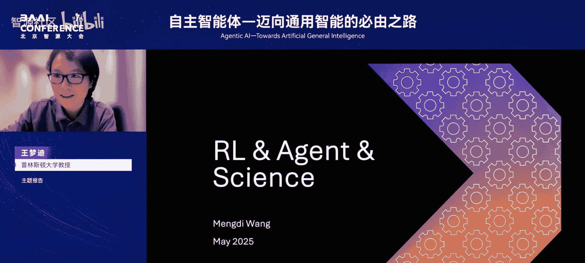
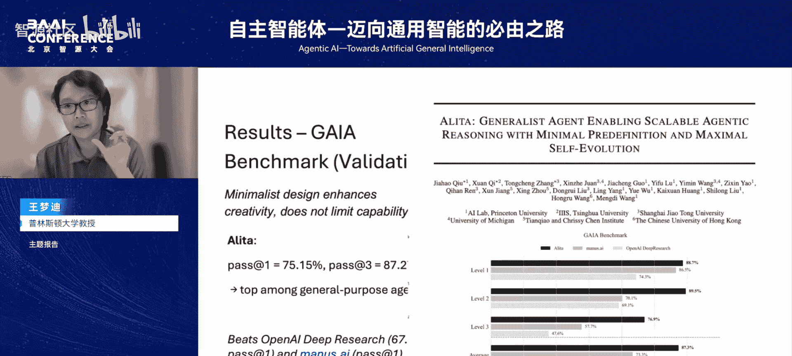
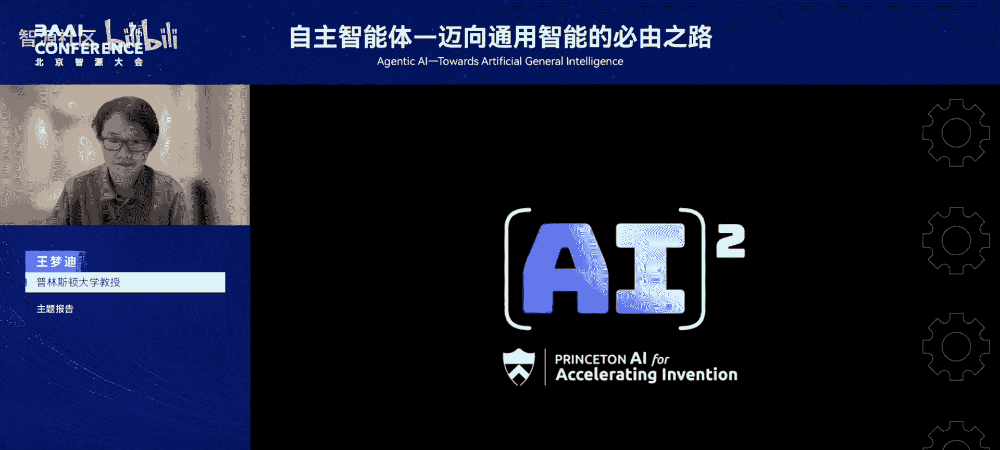
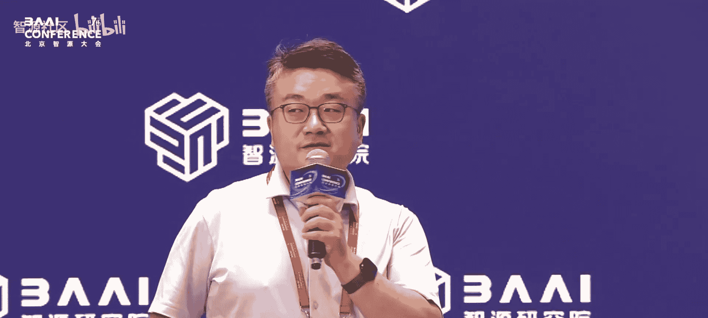

# 2025北京智源大会-自主智能体——迈向通用智能的必由之路 p02 主题 报告 -BV1ccN7z5ETU_p2-

So I'm going to talk about like like very general like our work on like and our thinking on like reinforcement learning towards agents。

 especially how we're building agents for automating scientific discoveries。

So it's my pleasure to meet you guys through Zoom。

Okay， so so first whenever we want to think about the large language models。

 so I usually put on my hat as a control researcher。

 so when we think about control usually we have a dynamical system or in other words we have a Markov decision process in which we have a dynamical system with a state that changes across time and the state transition is governed by a policy。

And we want to also tweak that policy to optimize some rewards。So from that view。

 we can think about all large language models as some policy that we want to optimize。 Okay。

 so basically， the initial state of the system is going to be the prompt。 Okay。

 So the large language model is going to take the prompt and the sequence of tokens generated so far and the language model is going to sample the next token。

 and then the next token is going to be appended to the input。

Which means that we have a new state now。 Okay， so now we have a state transition process corresponding to the token by token generation process。

 and we can view the layers of transformers as a particular policy。Okay。

 and now we have a very well defined Markov decision process。 Okay。

 the decision is embedded in the large language model itself。😊，Okay。

So then we can think about doing reinforcement learning on this Markov decision system。Okay， so。

 for example， a very relatively simple task for reinforcement learning is alignment。Okay。

 so alignment is also known as reinforcement learning from human feedback。

 So alignment means that we wantna basically tweak the policy。 Okay。

 so here the policy is the LM itself means that we want to fine tune the large language models so we can maximize certain rewards or maximize certain human feedback and there are many algorithms like DPO PPO okay。

 so this was the beginning okay and further we can actually do reinforcement learning to improve decoding So by decoding we mean that sometimes maybe we want to align to certain preference and certain rewards without actually training or fine tuning the model okay so maybe we can append another。

 I would say another head or another controller to tweak the some point distribution of the next tokens so we can again change the overall policy。

To maximize certain reward。O or one can try to。Do dynamic control decoding to accelerate inference。

 For example， one can try to couple a large draft model with a smaller draft model。

 and we had a paper last year in which we use reinforcement learning to control the switching between the larger model and smaller draft model for better and faster inference。

That is another form of reinforcement learning。Okay， so a third form is reasoning， Okay。

 which is like， I think that's the like one of the hottest topic that we really care about today。

 which means that we really want the policy。AK， A， the large language model to be able to come up with long chain of thought and to be able to come up with very long response to eventually。

Finding a solution or finding an answer to a complicated question。 And this is。Reasoning。

 but if we think about this overall problem as trying to， I would say， optimize the policy。

 starting from the base policy to optimize for some rewards。

 right So so this is really the same framework。 And actually。

 I think there are several versions of reinforcement algorithms。

 but they are actually very similar and also they are actually very simple。O。So now。

When our models can reason， it means that the model can actually make decisions in long horizon decision making problems。

 Okay， for example， with R1 as the brain， we can try to wrap up the model with additional memory capabilities with planning capabilities with external tools。

 So the model is no longer a brain。 We actually add I will say arms。😊，We add arms， I mean。

 like a hands and feet to the brain。 So now we have an actual agent that can both think and perform。

 And when the agent performs， the environment， maybe the web environment changes and the agent should be able to update his action condition on the new environmental state。

And now we have reasoning agents。O。So I'm going to begin with reinforcement learning so this is a work which we did last year and we released this paper in January 2025 around a similar time with deepSR1 so we had very。

 very little compute at that time， so we actually have to work with only four GPUs at first and later8 GPUs。

And we were， we were able to only focus on mathematical reasoning because， you know， in academia。

 we cannot really do， I mean， too much large scale industrial level training。

 So we have to focus on a specific topic。 Okay， but we were， we were， we were very proud that。😊。

We were able to actually train a 32 B Q1 model to surpass open A air 01，01， mini and deeps V 3。

So I try to like convince my friends that hey we had this amazing breakthrough with very little compute and no one believes me so let me try to convince you that this is actually possible okay so the key idea is again we want to do reinforcement learning but we want to do reinforcement learning in a very。

 very clever way so whenever we try to do RL and when the task is too complicated one can try to adopt a divide and conquer strategy in other words we can do hierarchical reinforcement learning。

😊，So the basic idea is that， hey， what if we have a master policy to decide on meta levell decisions and then we could have several sub policies to actually implement things or to actually solve subtasks okay so this very very simple。

 intuitive and simple idea of higherer URLL actually is find wide applications in robotics。

For example， when we actually train a robot okay so the robot usually has some higher level control。

 like higher level planning and higher level symbolic reasoning。 okay， but on the lower level。

 how does a robot spider actually move its legs。 usually there are lower level primitives which are actual physical control policies。

 The physical control policies can be conditioned on the actual physical state and grounded on the agent output from the higher level。

Okay， so we actually try to apply this。Herarchical R technique to solve agent reasoning problems。

Okay， so this is the basic idea。 Okay， suppose that， you'll give me a。Some input problem。 Okay。

 so we build a framework called reason flux。 Okay， so we。

 we need a library of thought template that can be extracted automatically from existing solutions。

 existing set of trajectories。 Okay， so now when we have a new input problem。

 we try to train reason flux to figure out the high level steps。Basically。

 a sequence of star template。 maybe， for example， if you give me a mathematical problem， I know that。

 hey， it looks like I need to try coach s inequality， or maybe I should try inequality。 Okay。

 so the reasoning model is only fine tuned to try to map out the high level mathematical template needed for solving the problem。

 Okay， so we are we are doing reinforcement learning on a higher intuitive abstract level。Okay。

And when we actually use the trend reason flux agent to do inference。 Okay。

 then we have to combine the higher level and lower level together。 Okay。

 so now once when we have an input problem， the RL trend reason flux brain is going figure out the trajectory of template and configure their。

Trajectory， and then on the lower level， Okay， the lower level becomes easier to solve。Okay。

 now I know that， hey， I'm looking at this problem。

 I know that I need to apply cautious worth inequality right now。 Okay， so in the lower level。

 actually don't do training。 We simply rely on the base model to do inference to auto field template。

 So overall， in the end， we instantiate every template in the chain of templates。

 and we come up with the the full solution。 So the nice thing is that this approach is actually pretty robust。

 because we only do reasoning our on the higher abstract level。

 which is substantially lower dimensional compared to the original C T space。

 And on the lower level because we are simply relying on the。The base model to auto fuel template。

 Okay， so the combination is something I I would， I would consider the combination of the higher level and lower level as something between formal reasoning and informal reasoning。

 And in the end， we have a solution。O。Okay， so this is an example of the output of freeze flux compared to over1 mini。

 So the nice thing of using a template library is like whenever we actually try to train agents to be specialized in certain domains。

 Usually， there are a lot of existing no house。 So thought templates。

 it turns out to be a pretty nice and easy way to abstract。Existing， no house。

To make it easier for the agent to learn and to train。O。So so later we try to push AI。

 try to push AI agents to solve scientific problems。 Okay。

 so a big difference between mathematics and general sciences like in mathematics。

 we have questions and answers， theorems and proofs， okay， but in scientific domain。

 we don't have that structured data set very easily。 Okay。

 so we developed and fully automated pipeline to extract。

Tinable structure data from real world scientific discussions。

We actually identified a Google forum where top scientists from all over the world。

Disgused about a particular technology。 And we collected 11 years of scientific discussions between real scientists。

 Okay， and we came up with a pipeline to extract high quality question answer pairs from the scientific discussions。

 And in the end， we obtained a data set of more than 3000 entries from real world。O。呃。

So we apply reinforcement learning to train agents。 Okay。

 so it turns out that so we know that RL actually works and we actually was able to figure out a way to do again。

 hierarch RL to have a higher level router and lower level function models。

 and eventually the router model is achieving human scientist level。

 surpassing all the best commercial reasoning models。

 So it's actually possible to train open source models to reason like a scientist from real world scientific discussions。

 Okay， we didn't as a single person to do any manual labeling。O。

So now we have a model that has been trained to understand genomics better。O。

And we also release this genome bench， which is this benchmark automatically extracted from real world scientific discussions。

O。Okay， so the next step is， hey， now we have fine tune a model that knows a type a particular scientific domain。

 well， and now let's build agents。 Okay， so we developed this multi agentent AI system CRISPR G last year。

 So this is basically an AI co scientist that is specializedize in the domain of genomics and genome engineering。

 So this is a system that can auto pilot。Any human， okay， to conduct gene editing research。

 drug screening， prime editing based editing。 it can figure out the experimental protocol design。

 It can figure out all the parameters， it can do troubleshooting when the experiment。

 when the experiment doesn't go so well。 And in the end。

 it can do it can perform data analysis and come up with the final report。 Okay。

 so the hardest thing to actually build such agent is not the agent building part。

 The hardest thing to actually build such an agent for science is to convince scientists to evaluate and use the agents and to work closely with AI researchers。

And that turns out to be very hard in the beginning。

 But once our scientific collaborators saw the value of AI agents， they become so excited。

 and we actually got a lot of inquiries from labs all over the world to work on expanding this agent system。

😊，Okay， so it has been a year since the first release of CRISPR GT。

 so we have been already like collaborating with scientists like across different universities。

 so we have conducted lab Web lab experimentation using the agent for lung cancer study so our agent is also being used by I would say neuro brain scientists。

 they use our agent to edit APE mutation for treating Alzheimer。

 and we are also expanding this agent in collaboration with genetic。

 which is a leading which is a leading pharma to build automated AI drug target screening pipelines。

O。And this paper is going to appear at a Nature journal very soon next month。Okay， so finally。

 so I want to just share with you my experiences with agent building。

 So building agent turns out to be。😊，buildinging agents could be pretty non trivial。 Okay。

 usually when we try to build agents for a certain task or a certain domain。

 usually we have to first lay out a number of existing tools or MCps。

 And then we try to build agents to automate workflows。 And sometimes we hope agents to be smarter。

 Okay， but the problem is。We have to predeefine the tools。 We have to predeefine the MCps。

 and usually。There might not be too many useful tools。

 maybe we don't have the best tool that can actually solve our problem。 And also。

 if we build agents limited to limited by predefined environments， then the agents are not creative。

 It's going to be pretty much like workflows driven by IOMs， but they were。

 They may be not as intelligent as we may hope。O。So we recently released a new work。

 which we call ata。 So Alilita is a self evolving agent， which is。

Which uses a framework completely different from existing agents。So， Alilita。

Does not rely on predefined tools。A little build tools by itself， Eve tools on the fly。

 and by solving。When solving a new task， ata is going to generate the necessary MCP on the fly。

 figure out the best workflow to solve it。 and eventually we solve the problem。

 So this is a very important paradigm shift。 Okay， We actually use ata。 We。

 we actually only really have three agents in Alita。 So we have a manager agent。 We have a Web agent。

And we have a MCP generation agent， only three。O， we don't really need to define all the tools。

 We don't need to tell the agent that， hey， you need to use this Wikipedia parsel。

 or you need to use that Google API。 We don't do that。

We only start with three agents and Alita can figure out which APIs， which MCP it needs。

 and when there isn't a good MCP to solve the problem。

 Alita can write can generate that MCP for solving the task。Okay。So呃。We。

 we were really excited about Alita because it is really a minimalist design and。😊。

Somehow we figure out that， hey， it looks like once we have something that's really simple。

 it turns out to be generalizing。Really， really well， so。We work with this。Benchmark called Gaa。

 developed by folks at Meta， including Yang Le Kun。

 So Gaa is a benchmark to evaluate an agent's deep research abilities。

 So we were pretty proud to be able to achieve like。😊。

The rank the first rank on a lit validation and the second rank on a litta test。Again。

 using the simlicit agent design without any predefined tools。

Okay， so going going forward， so we're actually building a range of agents for biology。

 so we have this big Bini agent， which was released last week。

 which is a collaboration between like Stanford Gene ARC， USAF， Princeton and UW。

So which is an agent system that is auto that has automated O， I shouldn't say O。

 but most of datana tasks in the biomedical domain。

 we are also building agents to automate optical experiments in search of new graphene materials。

 we are also building agents to do deep research in humanities in history in chemistry and so on。

Okay， so。I think with the increasingly powerful AI and the self- evolvinglving agents that we're building together。

 we believe the AI is going to very soon break down the barrier between different domains。

 especially scientific domains， and with reinforcement learning， I hope the agents will go further。

Okay， thank you very much。

好，感谢感谢孟迪老师嗯，那由于我们呃应该还有一定的时间，然后看孟迪老师能接受提问吗？😊。

嗯，是嗯，好的，那我们现场看有提问的，可以呃举手。我们有呃。志愿者可以。将话筒给你。嗯，可以举手示意，我没没看啊，这边啊这边。呃，你可以自我介绍一下啊，方便孟迪老师了解，大声一点。啊，老师们好。

我是来自高陵人工智能学院的博士生。呃，然后我有一个对那个elli比较感兴趣啊。然后有一个小问题是呃，他是怎么根据我现在的场景呃，创造出我的MCP。

或者说他是怎么根据我的环境反馈或者监督信号来去调整我的这个呃具体的MCP呢？嗯，对我觉得你可以嗯怎么说呢？你可以把它理解成是一种没有training的RL吧。只不过它在一个selfin过程中。

我没有通过RLtrain。然后嗯我可以根据我最后有没有实现这个task，然后再回去反推之前的MCP有没有写好我们这个工作现在就是说可能这几周会有一个开源的版本。

然后也会有这个更详细的这个technical report，欢迎你来看。对啊，好，谢谢老师。好，后面。呃，王老师你好，北京大学未来技术学院孙贺。对我我也是很关心在s领域做agent的一些工作。

但我有一个特别大的困惑，就是呃对于这种呃就导 knowledge比较多的这个问题，其实很多时候呃，我们不太清楚怎么着可以洗出高质量的数据来来做这种呃。

无论是这种tning还是这种呃benchmark的这种呃建立。你有没有一些经验或者建议，尤其对于这种特殊的领域上的问题，怎么着做数据的一个合成会比较好啊，谢谢你。嗯，我觉得这个还挺难的。我觉得怎么说呢？

就是。我觉得就是。呃，其实很多的那种 scientific benchmark是就是比如找很多很多感兴趣的这个这个同学，大家一起去往里出题。我觉得这是一种很好的botom up的 approach。

但我觉得就。报告从sentific discussion，比如从slack message，从这个飞书上的这个大家讨论的这些message里面，如果能够自动提取出很多的这种可以用来训练的数据的话。

那么它应该能让效率大大提高。我觉得这一点应该从这种数据的抓取和 synthetic data generation角度来讲，应该还有挺多可以做的。

然后另外一点就是说嗯我觉得就是说如果真正的想让AI的sence能力很强的话，我觉得可能需要我们去说服更多的这种。in的 expert，一些真正的科学家，我觉得他们需要更深刻的理解AF science。

需要更好的评测和更好的数据。我觉得可能需要这些科学家能够站出来一起帮助我们。我现在觉得就是说一般来讲做chmark的可能还是AI scientist就是搞AI的，大家意识到这件事情。

但是其实可能更大的科学共同体，大部分人还没有意识到Bnchmark有多重要。而且这件事情一定是需要有这个非常好的科学素养，深刻理解一个领域的这样的专家才能够站出来知导我们怎么样把这件事情做得更好。

做的更深度。呃，王老师，我想再追问一个快速的问题，就是呃觉得现在的可能就是搞数据最麻烦的一个问题，就是呃如果从论文里搞都是一些正面成功的案例。但是我总觉得是不是这种agent。

然后很多时候我们需要一些负面的什么是错误的这些经验。因为至少这个对培养学生来说很重要。所以您如果说从飞书或者sck里边去提取这些信息，是不是这些信息会多一点，还是也很难抓到啊，谢谢您啊。

也不是因为我们当时做的那个就是论坛上的信息就会有人说我出了这个我现在这个情况，对吧？这个实验为什么会这样，就是这种数据是更as，就我会觉得就是真实世界中大家的那个讨论的信息是比较biased的。

只看论文的话，我觉得也不好说，对吧？因为现在有些大家发的有用的东西不发论文，没用的东西发论文，所以我觉得论文里面也是 negative都有呃对，但但是说回来吧，我确实觉得就是大部分的论文，尤其是科学。

你的论文可能都是说。基本上是polity为主，然后呢信噪比也不见得非常高。我觉得这是一个很大的问题。对我倒是我其实我有一些这个我想过一些好玩的一些解决方案。比如就是你可以拿一些idea排列组合。

那些排列组合里面没有发论文的，可能就是负面的，我觉得也许可以去做一些好玩的尝试。对，但是我觉得现在大家应该还远远没有做到，就是就是。没有做到怎么选嗯，哎，好，谢谢您。好，那个由于时间关系最后一个问题嗯。

这边。呃，您好，王老师，我是航天二院的博士生郭一凯。想向您请教一个问题。就是说现在我听到您的工作里面提到这个轨迹。那么对轨迹打分呢是我理解作为一种强化学习中的这种基于processed的奖励方式。

那么deep呢，他们其实用到在zero中用到的outcom基于ORM的这种训练方式。您怎么看这个强化学习里面这两条技术路线，以及他们如何在未来的工作中协同。

或者说比如说PRM它可能更容易收敛ORM现在效果可能更好。您是怎么看这两个技术路径的。呃，这两个就是如果有好的process reward当然用对吧？

现在问题就是没有特别好的proces就是在R1里面就也有一个rewardreping的问题嘛。因为大部分问题你只有一个min，你没有中间的过程中的re。所以我感觉就是这两个其实也不是说是两个技术路径吧。

只不过就是大家还没有找到特别好的这种re的方式能够在proces给出很强的信号。好的，谢谢王老师我在追问一个小问题，就是呃比方说类似于斯坦福小镇这样的工作。

它里面有很多智能体在社交网络中就不断的去在一个环境中社交，那么未来有没有可能比如说一个多智能体，在一个虚拟环境中，他们互相交互或者跟环境交互，他们一边去互相推理，互相的这种就是交互。

同时呢又能够互相做一些V条或者强学习一边用一边演进。那么这种技术路径在最近期有没有可能出现，以及有没有这种就是可行的方法。😊，嗯这种技术路径是为了解决什么问题啊？就是说比如说我一个小镇里面很多人。

那么他们就是哎互相交流，越交流越像人。然后越这个小镇越演进，越像一个真的小镇一样，就是智能体边边工作边演进。这种不知道在技术路径上万一越交流越演进越不像人了怎么会不会很恐怖。

这个也有也有可能所以说有没有一种可能路径是让他能够越来越像人越来就是说在演进中越来越好。就像我们智能问诊一样，能让一个医院的问诊助手。唉大家者越问他他就越聪明，然后呢解答的越好对我觉得两两点吧。

就是说首先就是说用这种多智能体的方式去演进，看他会发生什么好玩的事。我觉得这是一个 super exciting就在斯坦福小镇之外。

就是我知道就是也有一些就是就是一些学者他们在做的一些好玩的项目和一些创业公司也在尝试这个idea，可能尝试的也是会从一些social science或多智能体。😊。

交互角度或者这种人机交互角度来来做这些尝试。但你说第二点，我觉得智能医院可能不太一样。我觉得就是说如果我现在不是说我把它当做一个纯虚拟的环境，我去看他怎么演化。

而是我还是希望他能够回到人类世界实实在在解决一个问题的话，那我觉得这里有个数据飞轮的问题，因为我在一个这个封闭的世界里，你想他的信息量，他的伤是不会变的。他是不可能学到这个封闭世界外面的信息的。

但如果他想真的是比如和医生一起协作，让他的诊断效果更好，从病人身上得到更多的反馈。那么你需要在真实世界的数据飞轮。所以我觉得那个可能更重要的反馈，还是来自于真实世界的数据飞轮吧。呃，明白。

那我能不能这么理解，可能相对于这个小镇越演化越好，您可能认为比如说因为商检的原因，他可能很大概率上不会发生这件事情，可能会因为比如说呃一些商的损失或者信息的损失而变得可能没有之前那么好。

是不是也有很大可能是会这样的情况去发生。我觉得是有这个可能。因为你看多智能体b的经常会大家最后就顺着一个说了，可能反而刚开始很dverse。除非你你在设计prom的时候。

你你强行让它有一些这个额外的dversity。但是它的总的信息量没有增大。最后它不管收远在哪，其实也是这个机模也是机模本身知识的一部分。好的，谢谢王老师。好，那这个时间关系啊。

那个我们不得不结束第一个报告。那再次感谢啊王梦迪老师。那应该说呃王老师最后的那个我觉得整体的这个报告其实给大家呈现了啊就是智能体的技术强化学习。

在AF science的很多的领域的这么一个呃富有想象空间的啊这么一个呃这么一个呃这个未来。那么其实我觉得最后的那一页，其实我觉得特别的呃有共鸣啊。

就是我感觉的确AI智能体本身应该是帮助我们全人类来实现知识评权，打破知识壁垒的非常重要的这么一个技术。那么未来我们如何能够实现跨学科的啊，特别是大跨度的这么一个交叉的这个创新。

的确智能技术将会发挥非常大的作用啊，也是特别期待未来能有更多的机会。然后跟王梦迪老师来进行更加深入的交流。那让我们再次以热烈掌声，感谢王老师给我们带来精彩报告。😊，谢谢大家嗯。😊。

